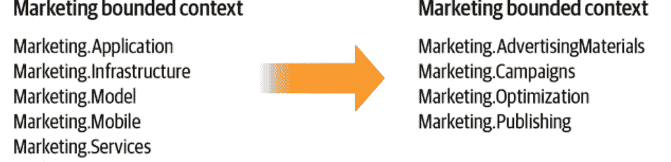
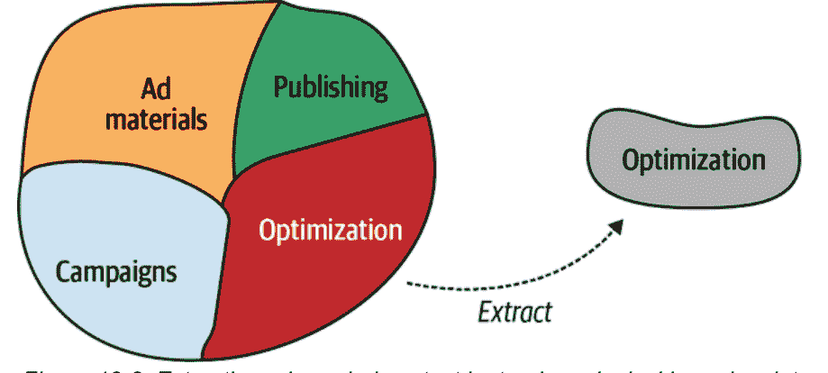
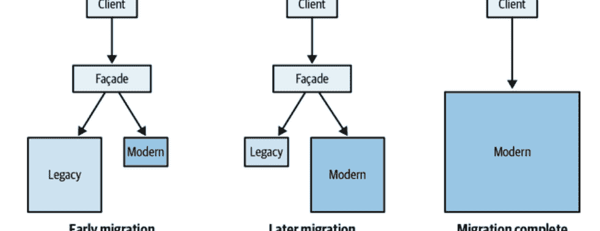
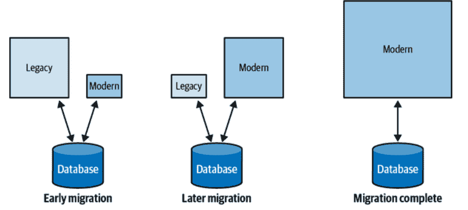

## 第 13 章. 真实世界中的领域驱动设计

我们已经介绍了用于分析业务域、共享知识以及做出战略和战术设计决策的领域驱动设计工具。想象一下将这些知识应用于实践会有多有趣。让我们考虑一个场景：你正在进行一个绿地项目。你的所有同事都对领域驱动设计有深刻理解，从一开始大家都在尽力设计有效的模型，当然也虔诚地使用通用语言。随着项目的推进，限界上下文的边界是明确且有效的，能够保护业务域模型。最后，由于所有战术设计决策都与业务战略保持一致，代码库始终保持良好状态：它使用通用语言并实现了适应模型复杂性的设计模式。现在醒醒。

你体验到我刚刚描述的实验室条件的机会与中彩票的概率差不多。当然，这是可能的，但不太可能。不幸的是，许多人错误地认为领域驱动设计只能应用于绿地项目和理想条件下，即团队中的每个人都是 DDD 黑带。具有讽刺意味的是，能从 DDD 中获益最多的项目是棕地项目：那些已经证明其商业可行性并需要整顿以对抗累积的技术债务和设计熵的项目。巧合的是，我们在软件工程职业生涯中花费大部分时间的工作正是这些棕地、遗留、大泥球代码库。

关于 DDD 的另一个常见误解是它是一种全有或全无的提议——要么你应用该方法论的每一种工具

has to offer, or it’s not domain-driven design. That’s not true. It might seem overwhelming to come to grips with all of these concepts, let alone implement them in practice. Luckily, you don’t have to apply all of the patterns and practices to gain value from domain-driven design. This is especially true for brownfield projects, where it’s practically impossible to introduce all the patterns and practices in a reasonable time frame.

In this chapter, you will learn strategies for applying domain-driven design tools and patterns in the real world, including on brownfield projects and in less-than-ideal environments.

### Strategic Analysis

Following the order of our exploration of domain-driven design patterns and practices, the best starting point for introducing DDD in an organization is to invest time in understanding the organization’s business strategy and the current state of its systems’ architecture.

### Understand the Business Domain

First, identify the company’s business domain:

- What is the organization’s business domain(s)?
- Who are its customers?
- What service, or value, does the organization provide to customers?
- What companies or products is the organization competing with?

Answering these questions will give you a bird’s-eye view of the company’s high-level goals. Next, “zoom in” to the domain and look for the business building blocks the organization employs to achieve its high-level goals: the subdomains.

A good initial heuristic is the company’s org chart: its departments and other organizational units. Examine how these units cooperate to allow the company to compete in its business domain.

Furthermore, look for the signs of specific types of subdomains.

#### Core subdomains

To identify the company’s core subdomains, look for what differentiates it from its competitors:

- Does the company have a “secret sauce” that its competitors lack? For example, intellectual property, such as patents and algorithms designed in-house?
- Keep in mind that the competitive advantage, and thus the core subdomains, are not necessarily technical. Does the company possess a nontechnical competitive advantage? For example, the ability to hire top-level personnel, produce a unique artistic design, and so on?

Another powerful yet unfortunate heuristic for core subdomains is identifying the worst-designed software components—those big balls of mud that all engineers hate but the business is unwilling to rewrite from scratch because of the accompanying business risk. The key here is that the legacy system cannot be replaced with a ready-made system—it would be a generic subdomain—and any modification to it entails business risks.

#### Generic subdomains

To identify generic subdomains, look for off-the-shelf solutions, subscription services, or integration of open source software. As you learned in Chapter 1, the same ready-made solutions should be available to the competing companies, and those companies leveraging the same solution should have no business impact on your company.

#### Supporting subdomains

For supporting subdomains, look for the remaining software components that cannot be replaced with ready-made solutions yet do not directly provide a competitive advantage. If the code is in rough shape, it triggers less emotional response from software engineers since it changes infrequently. Thus, the effects of the suboptimal software design are not as severe as for the core subdomains.

You don’t have to identify all of the core subdomains. It won’t be practical or even possible to do so, even for a medium-sized company. Instead, identify the overall structure, but pay closer attention to the subdomains that are most relevant to the software systems you are working on.

### Explore the Current Design

Once you are familiar with the problem domain, you can continue to investigate the solution and its design decisions. First, start with the high-level components. These are not necessarily bounded contexts in the DDD sense, but rather boundaries used to decompose the business domain into subsystems.

The characteristic property to look for is the components’ decoupled lifecycles. Even if the subsystems are managed in the same source control repository (mono-repo) or if all the components reside in a single monolithic codebase, check which can be evolved, tested, and deployed independently from the others.

### Evaluate the tactical design

For each high-level component, check which business subdomains it contains and what technical design decisions were taken: what patterns are used to implement the business logic and define the component’s architecture?

Does the solution fit the complexity of the problem? Are there areas where more elaborate design patterns are needed? Conversely, are there any subdomains where it’s possible to cut corners or use existing, off-the-shelf solutions? Use this information to make smarter strategic and tactical decisions.

### Evaluate the strategic design

Use the knowledge of the high-level components to chart the current design’s context map, as though these high-level components were bounded contexts. Identify and track the relationships between the components in terms of bounded context integration patterns.

Finally, analyze the resultant context map and evaluate the architecture from a domain-driven design perspective. Are there suboptimal strategic design decisions? For example:

- Multiple teams working on the same high-level component
- Duplicate implementations of core subdomains
- Implementation of a core subdomain by an outsourced company
- Friction because of frequently failing integration
- Awkward models spreading from external services and legacy systems

These insights are a good starting point for planning the design modernization strategy. But first, given this more in-depth knowledge of both the problem (business domain) and the solution (current design) spaces, look for lost domain knowledge. As we discussed in Chapter 11, knowledge of the business domain can get lost for various reasons. The problem is widespread and acute in core subdomains, where the business logic is both complex and business critical. If you encounter such cases, facilitate EventStorming sessions to try to recover the knowledge. Also, use the

EventStorming session as the foundation for cultivating a ubiquitous language.

### Modernization Strategy

The “big rewrite” endeavors, in which the engineers are trying to rewrite the system from scratch, this time designing and implementing the whole system correctly, are rarely successful. Even more rarely does management support such architectural makeovers.

A safer approach to improving the design of existing systems is to think big but start small. As Eric Evans says, not all of a large system will be well designed. That’s a fact we have to accept, and therefore we must strategically decide where to invest in terms of modernization efforts. A prerequisite for making this decision is to have boundaries dividing the system’s subdomains. The boundaries don’t have to be physical, making each subdomain a full-fledged bounded context. Instead, start by ensuring that at least the logical boundaries (namespace, modules, and packages, depending on the technology stack) are aligned with the subdomains’ boundaries, as shown in Figure 13-1.

Figure 13-1. Reorganizing the bounded context’s modules to reflect the business subdomains’ boundaries rather than technical implementation patterns

Adjusting the system’s modules is a relatively safe form of refactoring. You are not modifying the business logic, just repositioning the types in a more well-organized structure. That said,

ensure that references by full type names, such as the dynamic loading of libraries, reflection, and so on, are not breaking.

In addition, keep track of the subdomains’ business logic implemented in different codebases; stored procedures in a database, serverless functions, and so on. Make sure to introduce the new boundaries in those platforms as well. For instance, if some of the logic is handled in the database’s stored procedures, either rename the procedures to reflect the module they belong to or introduce a dedicated database schema and relocate the stored procedures.

### Strategic Modernization

As we discussed in Chapter 10, it can be risky to prematurely decompose the system into the smallest bounded contexts possible. We will discuss bounded contexts and microservices in more detail in the next chapter. For now, look for where the most value can be gained by turning the logical boundaries into physical boundaries. The process of extracting a bounded context(s) by turning a logical boundary into a physical one is shown in Figure 13-2.

Questions to ask yourself:

- Are multiple teams working on the same codebase? If so, decouple the development lifecycles by defining bounded contexts for each team.
- Are conflicting models being used by the different components? If so, relocate the conflicting models into separate bounded contexts.

### 营销有界上下文

### 优化的有界上下文

图 13-2. 通过将逻辑边界转变为物理边界来提取有界上下文

当最少所需的有界上下文就位后，检查它们之间的关系和集成模式。观察负责不同有界上下文的团队如何沟通和协作。尤其是当它们通过临时或类似共享内核的集成进行通信时，这些团队是否拥有共同的目标和足够的协作水平？

注意上下文集成模式可以解决的问题：

### 客户-供应商关系

正如我们在第 11 章中所讨论的，组织的增长可能会使之前的沟通和协作模式失效。寻找为多个工程团队的合作伙伴关系而设计的组件，但合作伙伴关系已不再可持续。重构为适当类型的客户-供应商关系（顺从者、防腐层或开放主机服务）。

### 防腐层

防腐层对于保护有界上下文免受遗留系统的侵害非常有用，尤其是当遗留系统使用低效的模型，这些模型倾向于扩散到下游组件时。

实现防腐层的另一个常见用例是保护有界上下文免受其所使用的上游服务公共接口频繁变更的影响。

### 开放主机服务

如果一个组件的实现细节的变更经常在系统中产生连锁反应并影响其消费者，请考虑将其设为开放主机服务：将其实施工模型与其公开的 API 解耦。

### 各走各路

尤其是在大型组织中，你可能会遇到工程团队之间的摩擦，因为他们必须协作并共同演进共享功能。如果“分歧之苹果”功能并非业务关键——即不是核心子域——团队可以各走各路并实现自己的解决方案，从而消除摩擦的来源。

### 战术现代化

首先，从战术角度来看，寻找业务价值与实施策略之间最“痛苦”的不匹配，例如核心子域实现了与模型复杂性不匹配的模式——事务脚本或活动记录。这些直接影响业务成功的系统组件必须最频繁地变更，但由于设计不佳，维护和演进却很痛苦。

### 培育通用语言

设计成功现代化的前提是业务领域的领域知识和有效模型。正如我在本书中多次提到的，领域驱动设计的通用语言对于获取知识和构建有效的解决方案模型至关重要。

不要忘记领域驱动设计收集领域知识的捷径：事件风暴。使用事件风暴与领域专家一起构建通用语言并探索遗留代码库，尤其是当代码库是无人真正理解的无文档混乱时。召集所有与该功能相关的人员并探索业务领域。事件风暴是恢复领域知识的绝佳工具。

一旦你掌握了领域知识及其模型，就决定哪些业务逻辑实现模式最适合所讨论的业务功能。作为起点，使用第 10 章中描述的设计启发式方法。接下来你需要做出的决定涉及现代化策略：逐步替换系统的整个组件（绞杀者模式），还是逐步重构现有解决方案。

### 绞杀者模式

*绞杀榕*，如图 13-3 所示，是一类热带树，具有奇特的生长模式：绞杀者生长在其他树——宿主树之上。绞杀者以种子形式开始其生命，种子位于宿主树的上部枝条。随着绞杀者的生长，它向下延伸直到扎根于土壤。最终，绞杀者长出遮蔽宿主树的叶冠，导致宿主树的死亡。

图 13-3. 生长在其宿主树之上的绞杀榕（来源：https://unsplash.com/photos/y_l5tep9wxl）

绞杀者迁移模式基于与该模式同名的树的相同生长动态。其思想是创建一个新的有界上下文——绞杀者——用它来实现新需求，并逐步将遗留上下文的功能迁移到其中。与此同时，除了热修复和其他紧急情况外，遗留有界上下文的演进和开发停止。最终，所有功能都迁移到新的有界上下文——绞杀者——并遵循类比，导致宿主——遗留代码库——的死亡。

通常，绞杀者模式与外观模式一起使用：一个薄的抽象层充当公共接口，并负责将请求转发给遗留或现代化的有界上下文进行处理。当迁移完成——即宿主死亡时——外观将被移除，因为它不再必要（见图 13-4）。

图 13-4. 外观层根据从遗留系统向现代化系统迁移功能的状态转发请求；一旦迁移完成，外观和遗留系统都将被移除

与每个有界上下文都是独立子系统、因此不能与其他有界上下文共享其数据库的原则相反，在实施绞杀者模式时可以放宽该规则。为了避免上下文之间复杂的集成——在许多情况下这会涉及分布式事务——现代化上下文和遗留上下文都可以使用同一个数据库——两个上下文都需要处理相同的数据，如图 13-5 所示。

放宽每个有界上下文一个数据库规则的条件是，最终，最好越快越好，遗留上下文将被退役，数据库将仅由新实现使用。

图 13-5. 遗留系统和现代化系统暂时使用同一个数据库

绞杀者迁移的替代方案是在原地现代化遗留代码库，也称为重构。

### 重构战术设计决策

在第 11 章中，你学习了迁移战术设计决策的各个方面。然而，在现代化遗留代码库时，有两个细微差别需要注意。

首先，小步增量的步骤比大规模重写更安全。因此，不要直接将事务脚本或活动记录重构为基于事件的领域模型。相反，采取中间步骤，设计基于状态的聚合。投入精力找到有效的聚合边界。确保所有相关的业务逻辑都位于这些边界内。从基于状态到基于事件的聚合的转变将比在基于事件的聚合中发现错误的事务边界安全得多。

其次，遵循同样的逐步增量步骤的思路，重构为领域模型不必是原子性变更。相反，你可以逐步引入领域模型模式的元素。

首先寻找可能的值对象。不可变对象即使你没有使用完整的领域模型，也能显著降低解决方案的复杂性。

正如我们在第 11 章中所讨论的，将活动记录重构为聚合不必一夜之间完成。它可以分阶段进行。首先收集相关的业务逻辑。接下来，分析事务边界。是否存在需要强一致性但操作于最终一致数据的决策？或者相反，解决方案是否在最终一致性就足够的地方强制执行强一致性？在分析代码库时，不要忘记这些决策是由业务而非技术问题驱动的。只有在对事务需求进行彻底分析之后，才应设计聚合的边界。

最后，在重构遗留系统时，如果必要，使用防腐层保护新代码库免受旧模型的影响，并通过实现开放主机服务并公开发布语言来保护消费者免受遗留代码库变更的影响。

### 务实的领域驱动设计

正如我们在本章引言中所讨论的，应用领域驱动设计并非全有或全无。你不必使用 DDD 提供的所有工具。例如，出于某种原因，

战术模式可能对你不起作用。也许你更喜欢使用其他设计模式，因为它们在你的特定领域中效果更好，或者只是因为你觉得其他模式更有效。那完全没问题！

只要你分析业务领域及其战略，寻找解决特定问题的有效模型，最重要的是，基于业务领域的需求做出设计决策：这就是领域驱动设计！

值得重申的是，领域驱动设计不仅仅是关于聚合或值对象。领域驱动设计是关于让你的业务*领域驱动软件设计*决策。

### 推广领域驱动设计

当我在技术会议上就此主题演讲时，我几乎每次都会被问到一个问题：“听起来都很棒，但我该如何向我的团队和管理层‘推销’领域驱动设计呢？”这是一个极其重要的问题。

推销很难，而且我个人讨厌推销。话虽如此，如果你想想，设计软件就是推销。我们向团队、管理层或客户推销我们的想法。然而，一种涵盖如此广泛的设计决策方面，甚至超出工程领域涉及其他利益相关者的方法论，可能极难推销。

管理层的支持对于在组织中做出任何重大改变至关重要。然而，除非高层管理人员已经熟悉领域驱动设计或愿意投入时间学习该方法论的业务价值，否则这对他们来说并不是首要考虑的，尤其是因为 DDD 似乎带来了工程流程的巨大转变。幸运的是，这并不意味着你不能使用领域驱动设计。

### 隐蔽的领域驱动设计

将领域驱动设计作为你专业工具箱的一部分，而不是组织战略。DDD 的模式和实践是工程技术，而软件工程就是你的工作，所以使用它们！

让我们看看如何在日常工作中融入 DDD，而不必大张旗鼓。

### 通用语言

通用语言的使用是领域驱动设计的核心实践。它对于领域知识发现、沟通和有效解决方案建模至关重要。

幸运的是，这一实践如此简单，以至于几乎是常识。仔细聆听利益相关者在谈论业务领域时使用的语言。温和地将术语从技术术语引导向其业务含义。

寻找不一致的术语并请求澄清。例如，如果同一事物有多个名称，请寻找原因。这些不同的模型是否在同一解决方案中交织在一起？寻找上下文并使其明确。如果含义相同，请遵循常识并要求使用一个术语。

此外，尽可能多地与领域专家沟通。这些努力不一定需要正式会议。水槽边和咖啡休息时间都是很好的沟通促进者。与领域专家谈论业务领域。尝试使用他们的语言。寻找理解上的困难并请求澄清。别担心——领域专家通常很乐意与真诚想了解问题领域的工程师合作！

最重要的是，在你的代码和所有项目相关沟通中使用通用语言。要有耐心。改变组织中使用了一段时间的术语需要时间，但最终会流行起来。

#### 有界上下文

在探索可能的分解选项时，坚持有界上下文模式背后的原则：

- 为什么设计面向问题的模型比为所有用例设计单一模型更好？因为“全包”解决方案很少对任何事情都有效。
- 为什么有界上下文不能容纳冲突的模型？因为认知负担和解决方案复杂性增加。
- 为什么让多个团队在同一代码库上工作是个坏主意？因为摩擦和团队之间协作受阻。

对有界上下文集成模式使用同样的推理：确保你理解每个模式旨在解决的问题。

#### 战术设计决策

在讨论战术设计模式时，不要诉诸权威：“让我们在这里使用聚合，因为 DDD 书籍就是这么说的！”相反，要诉诸逻辑。例如：

- 为什么显式的事务边界很重要？为了保护数据的一致性。
- 为什么数据库事务不能修改聚合的多个实例？为了确保一致性边界正确。
- 为什么聚合的状态不能由外部组件直接修改？为了确保所有相关的业务逻辑都位于同一位置且不被重复。
- 为什么我们不能将聚合的部分功能卸载到存储过程？为了确保没有逻辑被重复。重复的逻辑，尤其是在系统逻辑上和物理上相距遥远的组件中，往往会不同步并导致数据损坏。
- 为什么我们应该追求小的聚合边界？因为宽的事务范围既会增加聚合的复杂性，又会负面影响性能。
- 为什么不能简单地将事件写入日志文件来代替事件溯源？因为没有长期数据一致性保证。

说到事件溯源，当解决方案需要事件溯源的领域模型时，这种模式的实现可能很难推销。让我们看一个可以帮上忙的绝地心灵技巧。

#### 事件溯源领域模型

尽管有许多优点，事件溯源对许多人来说听起来过于激进。如同我们在本书中讨论的一切，解决方案是让业务领域驱动这一决策。

与领域专家交谈。向他们展示基于状态和基于事件的模型。解释差异以及事件溯源提供的优势，特别是在时间维度上。更常见的是，他们会对它提供的洞察力水平感到兴奋，并会自己倡导事件溯源。

并且在与领域专家互动时，不要忘记继续完善通用语言！

### 结论

在本章中，你学习了在真实场景中利用领域驱动设计工具的各种技术：处理棕地项目和遗留代码库，并且不一定拥有 DDD 专家团队。

与在绿地项目中一样，始终从分析业务领域开始。公司的目标是什么？其实现这些目标的战略是什么？利用组织结构和现有的软件设计决策来识别组织的子域及其类型。凭借这些知识，规划现代化战略。寻找痛点。寻找获得最大业务价值的机会。通过重构或替换相关组件来现代化遗留代码。无论哪种方式，都要逐步进行。大规模重写带来的风险比业务价值更大！

最后，即使在你的组织中 DDD 并未被广泛采用，你也可以使用领域驱动设计工具。使用合适的工具，并在与同事讨论时，始终使用每种模式背后的逻辑和原则。

本章结束了我们对领域驱动设计本身的讨论。在第四部分，你将学习 DDD 与其他方法论和模式的相互作用。

## 练习

- 1. 假设你想向一个棕地项目引入领域驱动设计工具和实践。你的第一步会是什么？
  a. 将所有业务逻辑重构为事件溯源领域模型。
  b. 分析组织的业务领域及其战略。
  c. 通过确保其遵循适当的边界上下文原则来改进系统的组件。
  d. 在棕地项目中不可能使用领域驱动设计。

- 2. 在迁移过程中，绞杀者模式在哪些方面与领域驱动设计的一些核心原则相矛盾？
  a. 多个有界上下文使用共享数据库。
  b. 如果现代化的有界上下文是核心子域，其实现会在旧实现和新实现中被重复。
  c. 多个团队在同一个有界上下文上工作。
  d. A 和 B。

- 3. 为什么通常不是一个好主意直接将基于活动记录的业务逻辑重构为事件溯源领域模型？
  a. 基于状态的模型在学习过程中更容易重构聚合的边界。
  b. 逐步引入重大变更更安全。
  c. A 和 B。
  d. 以上都不是。直接将事务脚本重构为事件溯源领域模型是合理的。

4. 当你在介绍聚合模式时，你的团队问为什么聚合不能直接引用所有可能的实体，从而使从一个地方遍历整个业务域成为可能。你如何回答他们？
