## 第 14 章. 微服务

在 2010 年代中期，微服务席卷了软件工程行业。其意图是解决现代系统快速变化、可扩展并自然契合云计算分布式特性的需求。许多公司做出了战略决策，将其单体代码库分解，以获得微服务架构提供的灵活性。不幸的是，许多这样的尝试并未取得良好结果。相反，这些公司最终得到了分布式的大泥球——设计比公司想要拆分的单体更脆弱、更松散、更昂贵。

历史上，微服务通常与 DDD 相关联，尤其是与有界上下文模式相关。许多人甚至将 *bounded context* 和 *microservices* 术语互换使用。但它们真的相同吗？本章探讨领域驱动设计方法论与微服务架构模式之间的关系。你将学习这些模式之间的相互作用，更重要的是，如何利用 DDD 来设计有效的微服务系统。

让我们从基础开始，定义服务和微服务到底是什么。

#### 什么是服务？

根据 OASIS，服务是一种能够访问一个或多个能力的机制，其中访问是通过规定的接口提供的。¹ *规定的接口* 是获取数据进出服务的任何机制。它可以是同步的，例如请求/响应模型，也可以是异步的，例如生产和消费事件的模型。这是服务公共接口，

如图 14-1 所示，它提供了一种与其它系统组件通信和集成的手段。

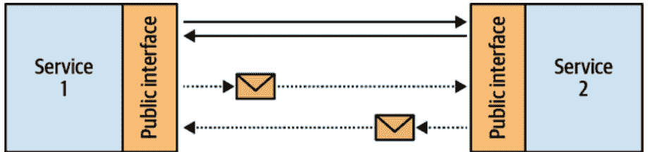

图 14-1. 服务之间的通信

Randy Shoup 将服务的接口比作前门。所有进入或离开服务的数据都必须通过前门。此外，服务的公共接口定义了服务本身：服务所暴露的功能。一个表达良好的接口足以描述服务实现的功能。例如，图 14-2 中说明的公共接口明确描述了服务的功能。

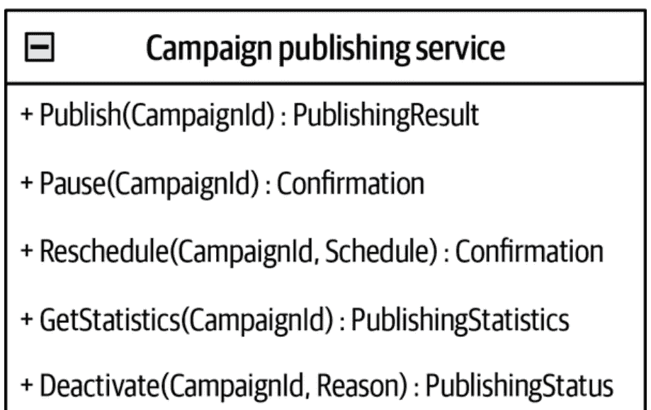

图 14-2. 服务的公共接口

这就引出了微服务的定义。

#### 什么是微服务？

微服务的定义出奇地简单。既然服务由其公共接口定义，那么微服务就是具有微公共接口的服务：微型前门。

拥有微公共接口使得理解单个服务的功能及其与其他系统组件的集成变得更容易。减少服务的功能也限制了其变更原因，并使服务在开发、管理和扩展方面更具自主性。

此外，这也解释了微服务不暴露其数据库的做法。暴露数据库，使其成为服务前门的一部分，会使公共接口变得庞大。例如，你可以在关系数据库上执行多少种不同的 SQL 查询？由于 SQL 是一种相当灵活的语言，可能的估计是无限的。因此，微服务封装其数据库。数据只能通过更紧凑、面向集成的公共接口访问。

#### 方法即服务：完美的微服务？

说微服务是微公共接口具有欺骗性的简单。它听起来似乎将服务接口限制为单个方法会产生完美的微服务。让我们看看如果在实践中应用这种天真的分解会发生什么。

考虑图 14-3 中的待办事项管理服务。其公共接口由八个公共方法组成，我们希望应用“每个服务一个方法”的规则。

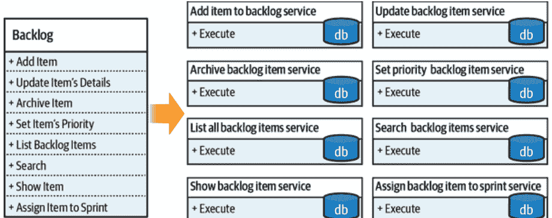

图 14-3. 天真分解

由于这些是表现良好的微服务，每个服务都封装了其数据库。没有任何一个服务被允许直接访问另一个服务的数据库；只能通过其公共接口访问。但目前没有公共接口供此使用。服务必须协同工作并同步每个服务应用的更改。因此，我们需要扩展服务的接口以考虑这些集成相关的关注点。此外，当可视化时，结果服务之间的集成和数据流类似于典型的分布式大泥球，如图 14-4 所示。

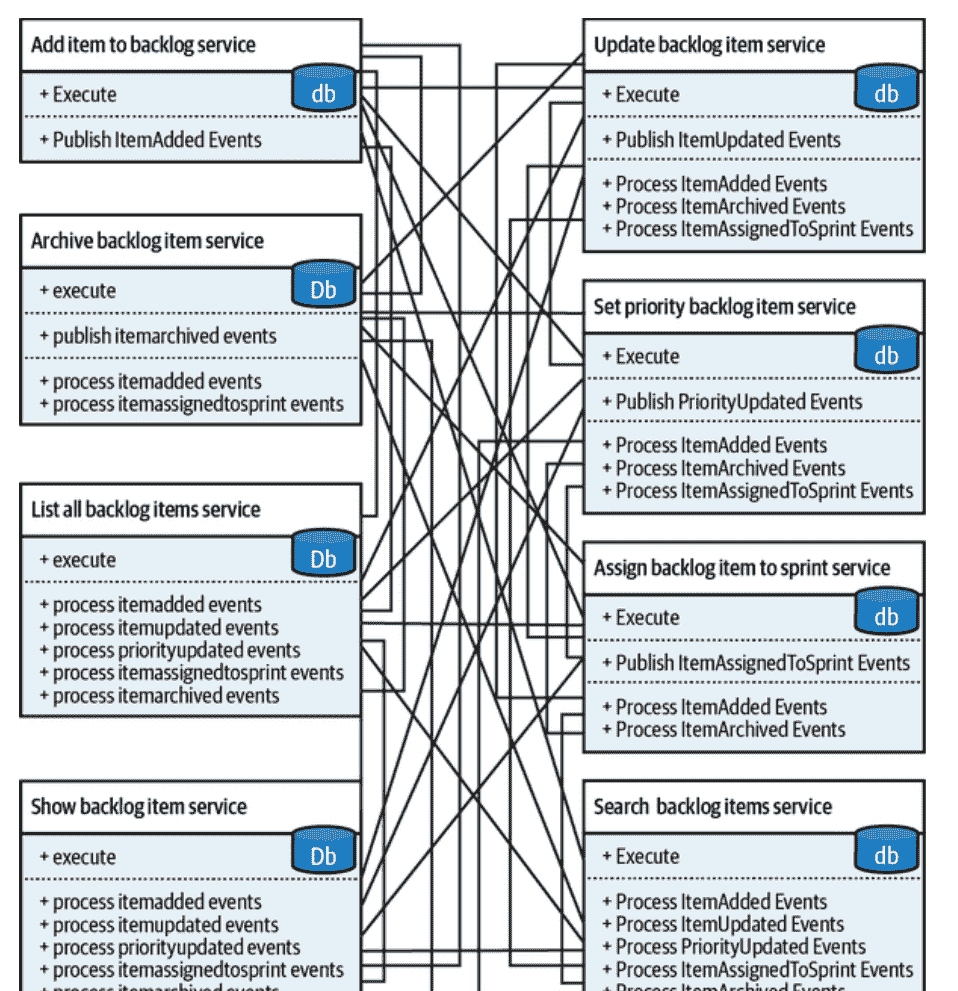

图 14-4. 集成复杂性

借用 Randy Shoup 的比喻，通过将系统分解为如此细粒度的服务，我们确实最小化了服务的前门。然而，为了实现整体系统的功能，我们不得不为每个服务增加巨大的“仅限工作人员”入口。让我们从这个例子中学习什么。

#### 设计目标

遵循每个服务仅暴露单个方法的简单分解启发式方法被证明在许多原因下是次优的。首先，这根本不可能。由于服务必须协同工作，我们被迫用集成相关的公共方法扩展其公共接口。其次，我们赢得了战斗却输掉了战争。每个服务最终比原始设计简单得多，然而由此产生的系统变得复杂了数个数量级。

微服务架构的目标是产生一个灵活的系统。集中设计工作于单个组件，而忽略其与系统其余部分的交互，违背了系统的定义本身：
- 一组相互连接的事物或设备，共同运行
- 一组为特定目的共同使用的计算机设备和程序

因此，系统不能由独立的组件构建。在一个适当的微服务系统中，无论解耦程度如何，服务仍然必须集成并相互通信。让我们看看单个微服务的复杂性与整体系统的复杂性之间的相互作用。

#### 系统复杂性

四十年前，没有云计算，没有全球规模的需求，也没有每 11.7 秒部署一次系统的需求。但工程师仍然必须驯服系统的复杂性。尽管当时的工具不同，但挑战——更重要的是解决方案——与现在相关，可以应用于微服务系统的设计。

在他的书《Composite/Structured Design》中，Glenford J. Myers 讨论了如何结构化过程代码以降低其复杂性。


在本书的第一页，他写道：

> *复杂性主题远不止于试图最小化程序每个部分的局部复杂性。一种更重要的复杂性类型是全局复杂性：程序或系统整体结构的复杂性（即程序各主要部分之间的关联程度或相互依赖程度）。*

在我们的语境中，*局部复杂性*是每个独立微服务的复杂性，而*全局复杂性*是整个系统的复杂性。局部复杂性取决于服务的实现；全局复杂性由服务之间的交互和依赖关系定义。在设计基于微服务的系统时，哪种复杂性更重要需要优化？让我们分析两种极端情况。

令人惊讶的是，将全局复杂性降至最低是很容易的。我们只需要消除系统组件之间的任何交互——也就是说，将所有功能实现在一个单体服务中。正如我们之前所见，这种策略在某些场景下可能有效。在其他情况下，它可能导致令人恐惧的泥球：可能是局部复杂性最高的水平。

另一方面，我们知道当我们只优化局部复杂性而忽视系统的全局复杂性时会发生什么——更令人恐惧的分布式泥球。这种关系在图 14-5 中显示。

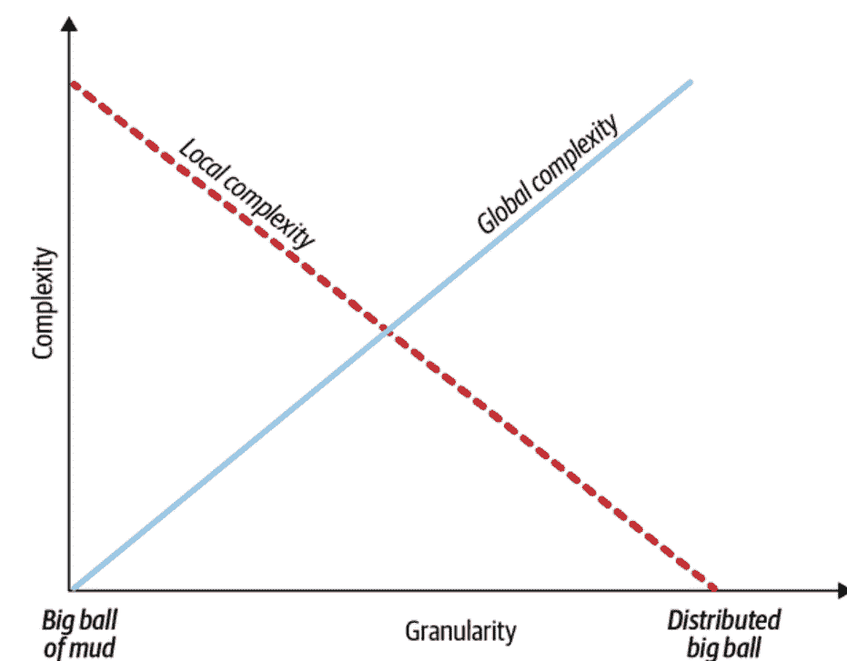

图 14-5. 服务粒度与系统复杂性

要设计一个合适的基于微服务的系统，我们必须同时优化全局和局部复杂性。将设计目标设定为单独优化其中之一是一种局部最优。全局最优则平衡两种复杂性。让我们看看微公共接口的概念如何有助于平衡全局和局部复杂性。

### 微服务作为深度服务

软件系统中的一个模块，或任何系统中的模块，都由其功能和逻辑定义。功能是模块应该做什么——其业务功能。逻辑是模块的业务逻辑——模块如何实现其业务功能。

在他的书 *The Philosophy of Software Design* 中，John Ousterhout 讨论了模块化的概念，并提出了一个简单而强大的视觉启发式方法来评估模块设计的深度。

Ousterhout 建议将模块可视化为一个矩形，如图 14-6 所示。矩形的顶部边缘代表模块的功能，或其公共接口的复杂性。更宽的矩形代表更广泛的功能，而更窄的矩形具有更受限制的功能，因此公共接口更简单。矩形的面积代表模块的逻辑，或其功能的实现。

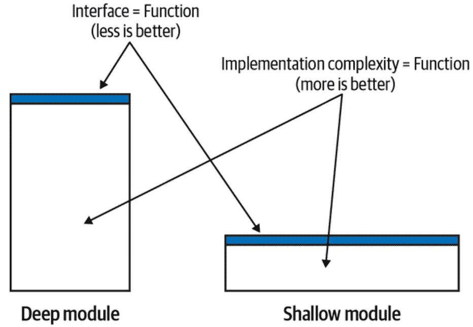

图 14-6. 深度模块

根据此模型，有效的模块是深度的：简单的公共接口封装了复杂的逻辑。无效的模块是浅层的：浅层模块的公共接口封装的复杂性远不及深度模块。考虑以下列表中的方法：

```
int AddTwoNumbers(int a, int b)
{
    return a + b;
}
```

这是浅层模块的极端情况：公共接口（方法的签名）和其逻辑（方法）完全相同。拥有这样的模块会引入多余的“活动部件”，因此，它不是封装复杂性，反而为上层系统增加了偶然复杂性。

### 微服务作为深度模块

除了术语不同之外，深度模块的概念与微服务模式不同之处在于模块可以表示逻辑和物理边界，而微服务严格是物理的。否则，这两个概念及其底层设计原则是相同的。

实现单个业务方法的服务，如图 14-3 所示，是浅层模块。因为我们必须引入与集成相关的公共方法，所以产生的接口比应有的更“宽”。

从系统复杂性的角度来看，深度模块减少了系统的全局复杂性，而浅层模块通过引入不封装其局部复杂性的组件来增加它。

浅层服务也是许多面向微服务的项目失败的原因。将微服务错误地定义为代码行数不超过 X 的服务，或应比修改更容易重写的服务，集中于单个服务，而忽略了架构最重要的方面：系统。

系统可以分解为微服务的阈值由系统用例定义，而微服务是其一部分的。如果我们将单体分解为服务，引入更改的成本会下降。当系统分解为微服务时，它达到最小值。然而，如果你继续分解超过微服务阈值，深度服务会变得越来越浅。它们的接口会重新变宽。这一次，由于集成需求，引入更改的成本也会上升，整个系统的架构将变成令人恐惧的分布式泥球。这在图 14-7 中有所描述。

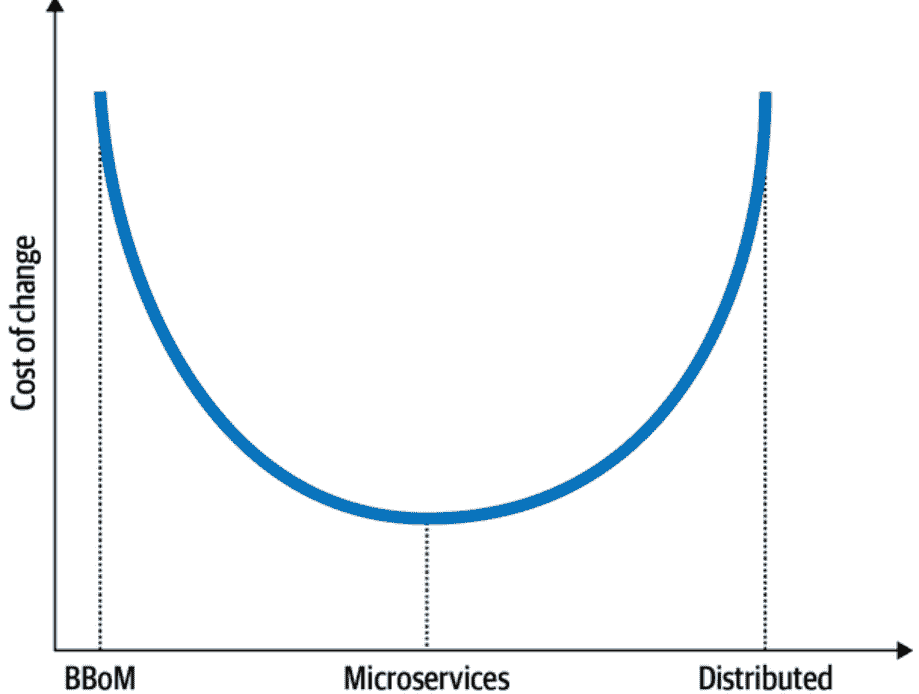

图 14-7. 粒度和更改成本

现在我们已经了解了微服务是什么，让我们看看领域驱动设计如何帮助我们找到深度服务的边界。

### 领域驱动设计与微服务的边界

作为微服务，上一章讨论的许多领域驱动设计模式都与边界有关：有界上下文是模型的边界，子域限定业务能力，而聚合和值对象是事务边界。让我们看看这些边界中哪一个适合微服务的概念。

#### 有界上下文

微服务和有界上下文模式有很多共同点，以至于这些模式经常被互换使用。让我们看看是否确实如此：有界上下文的边界是否与有效微服务的边界相关？

微服务和有界上下文都是物理边界。微服务作为有界上下文，由单个团队拥有。如同有界上下文中一样，冲突的模型不能在微服务中实现，导致接口复杂。微服务确实是有界上下文。但这种关系反过来成立吗？我们可以说有界上下文是微服务吗？

正如你在第 3 章中学到的，有界上下文保护通用语言和模型的一致性。不能在同一个有界上下文中实现冲突的模型。假设你正在开发一个广告管理系统。在系统的业务域中，业务实体 Lead 在促销和销售上下文中由不同的模型表示。因此，促销和销售是有界上下文，每个上下文定义了在各自边界内有效的 Campaign 实体的唯一一个模型，如图 14-8 所示。


图 14-8. 有界上下文

为简单起见，让我们假设系统中除了 Lead 之外没有其他冲突的模型。这使得得到的有界上下文自然较宽——每个有界上下文可以包含多个子域。子域可以从一个有界上下文移动到另一个有界上下文。只要子域不暗示冲突的模型，图 14-9 中的所有替代分解都是完全有效的有界上下文。

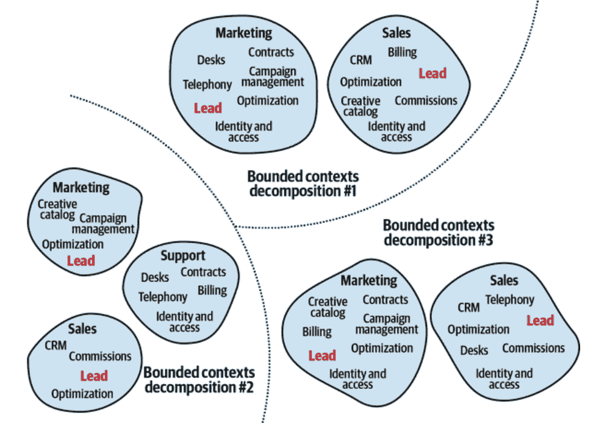

图 14-9. 有界上下文的替代分解

对有界上下文的不同分解归因于不同的需求，例如不同团队的大小和结构、生命周期依赖等。但我们可以说在这个例子中所有有效有界上下文都必然是微服务吗？不行。尤其是考虑到分解 1 中两个有界上下文相对较宽的功能。

因此，微服务与有界上下文之间的关系不是对称的。虽然微服务是有界上下文，但并非每个有界上下文都是微服务。另一方面，有界上下文表示最大有效单体的边界。这种单体不应与泥球混淆；它是一种可行的设计选择，可以保护其通用语言或其对业务域的模型的一致性。如


我们将在第 15 章讨论，这种宽泛的边界在某些情况下比微服务更有效。

图 14-10 直观地展示了有界上下文与微服务之间的关系。有界上下文与微服务之间的区域是安全的。这些都是有效的设计选项。然而，如果系统没有分解为适当的有界上下文，或分解超过了微服务的阈值，则会分别导致大泥球或分布式大泥球。

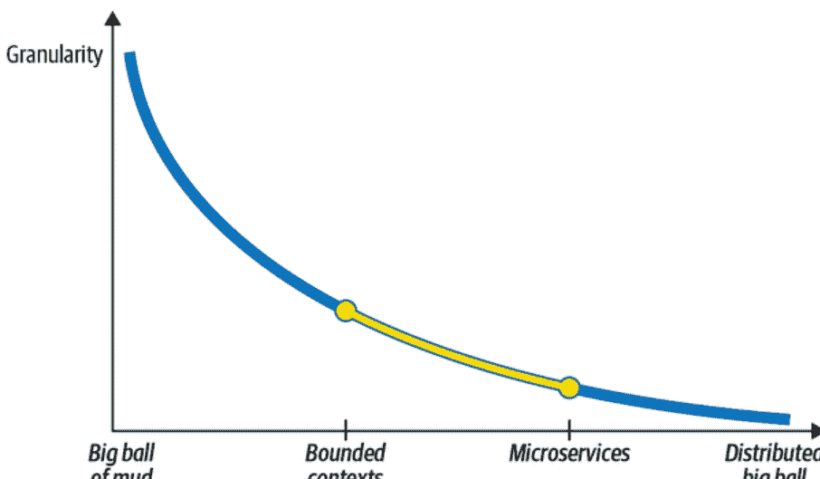

图 14-10. 粒度和模块化

接下来，让我们考察另一个极端：聚合是否可以帮助找到微服务的边界。

### 聚合

虽然有界上下文对最宽的有效边界施加了限制，但聚合模式则相反。聚合的边界是可能的最窄边界。

将聚合分解为多个物理服务或有界上下文不仅是不理想的，而且正如你在附录 A 中将学到的那样，至少会导致不期望的后果。

作为有界上下文，聚合的边界也经常被认为可以驱动微服务的边界。聚合是一个不可分割的业务功能单元，它封装了其内部业务规则、不变量和逻辑的复杂性。也就是说，正如你在本章前面学到的那样，微服务并不是关于单个服务。单个服务必须在其与其他系统组件的交互上下文中考虑：

- 相关聚合是否与其子域中的其他聚合进行通信？
- 它是否与其他聚合共享值对象？
- 聚合的业务逻辑变更影响其子域中其他组件的可能性有多大，反之亦然？

聚合与其子域中的其他业务实体关系越强，作为单个服务时它就越浅。

在某些情况下，将聚合作为服务会产生模块化设计。然而，更常见的是，这种细粒度的服务会增加整个系统的全局复杂性。

### 子域

设计微服务的一个更平衡的启发式方法是使服务与业务子域的边界保持一致。正如你在第 1 章学到的那样，子域与细粒度的业务能力相关。这些是公司在其实务域中竞争所需的业务构建块。从业务域的角度来看，子域描述了能力——业务做了什么——而不解释这些能力是如何实现的。从技术角度来看，子域代表了一组连贯用例的集合：使用业务域的相同模型，操作相同或密切相关的数据，并具有强功能关系。一个用例的业务需求变更很可能会影响其他用例，如图 14-11 所示。

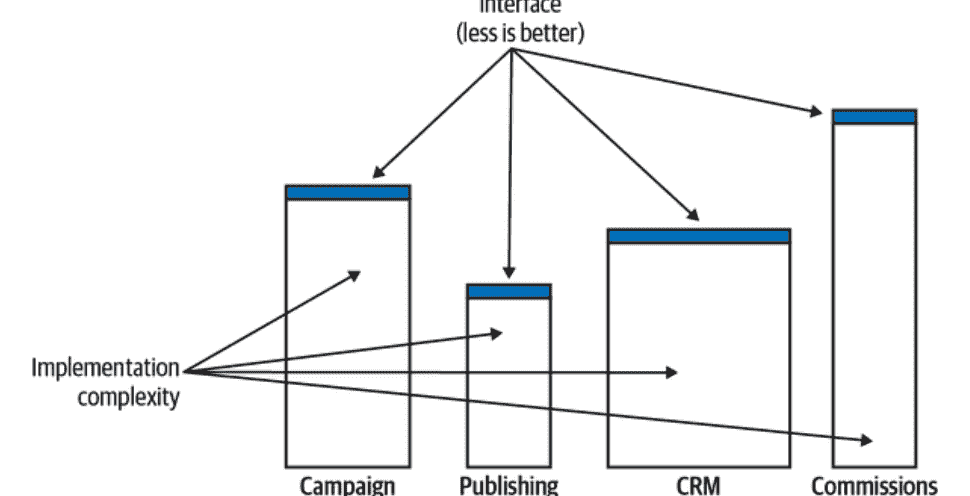

图 14-11. 子域

子域的粒度以及对功能——“做什么”而非“怎么做”的关注，使得子域自然成为深模块。子域的描述——功能——封装了更复杂的实现细节——逻辑。子域中包含的用例的连贯性也确保了由此产生的模块的深度。在许多情况下将它们拆分会产生更复杂的公共接口，从而导致模块更浅。所有这些都使得子域成为设计微服务的安全边界。

将微服务与子域对齐是一个安全的启发式方法，可为大多数微服务产生最优解。也就是说，会有某些情况其他边界会更有效；例如，保持在有界上下文更宽的语言边界内，或由于非功能性需求而退回到以聚合作为微服务。解决方案不仅取决于业务域，还取决于组织的架构、业务战略和非功能性需求。正如我们在第 11 章讨论的那样，持续适应环境变化地调整软件架构和设计至关重要。

### 压缩微服务的公共接口

除了寻找服务边界外，领域驱动设计还可以帮助使服务更深。本节演示了开放主机服务和反腐败层模式如何简化微服务的公共接口。

### 开放主机服务

开放主机服务将有界上下文对业务域的模型与用于与其他系统组件集成的模型解耦，如图 14-12 所示。

引入集成导向的模型，即发布语言，降低了系统的全局复杂性。首先，它允许我们在不影响其消费者情况下演进服务的实现：新的实现模型可以翻译为现有的发布语言。其次，发布语言暴露了一个更受约束的模型。它围绕集成需求设计。它封装了与服务消费者无关的实现复杂性。例如，它可以以对消费者更方便的模型暴露更少的数据。

在相同实现（逻辑）之上拥有更简单的公共接口（功能）使服务“更深”，并有助于更有效的微服务设计。

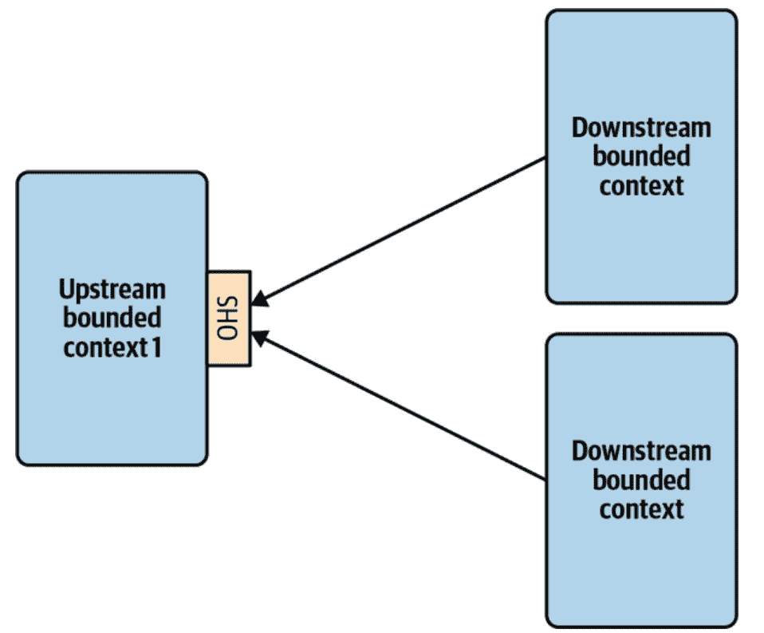

图 14-12. 通过发布语言集成服务

### 反腐败层

反腐败层（ACL）模式则反向工作。它减少了服务与其他有界上下文集成的复杂性。传统上，反腐败层属于它所保护的有界上下文。然而，正如我们在第 9 章讨论的那样，这一概念可以更进一步，作为一个独立服务实现。

图 14-13 中的 ACL 服务同时降低了消费有界上下文的局部复杂性和系统的全局复杂性。消费有界上下文的业务复杂性与集成复杂性分离。后者被卸载到 ACL 服务。由于消费有界上下文使用更方便的集成导向模型，其公共接口被压缩——它不反映生产服务暴露的集成复杂性。

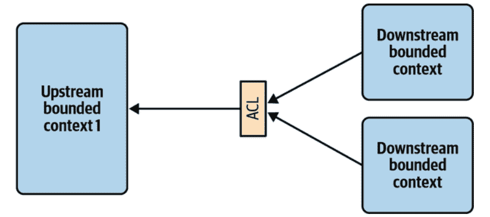

图 14-13. 作为独立服务的反腐败层

### 结论

历史上，微服务架构风格与领域驱动设计深度交织，以至于微服务和有界上下文这两个术语经常被互换使用。在本章中，我们分析了两者之间的联系，并看到它们并非同一事物。

所有微服务都是有界上下文，但并非所有有界上下文都是微服务。从本质上讲，微服务定义了服务的最小有效边界，而有界上下文保护所包含模型的<|message|> 一致性并代表最宽的有效边界。将边界定义为比其有界上下文更宽会导致大泥球，而比微服务更小的边界会导致分布式大泥球。

尽管如此，微服务与领域驱动设计之间的联系仍然紧密。我们看到了如何使用领域驱动设计工具来设计有效的微服务边界。

在第 15 章中，我们将继续从不同角度讨论高级系统架构：通过事件驱动架构进行异步集成。你将学习如何利用不同种类的事件消息来进一步优化微服务的边界。

## 练习

- 1. 有界上下文与微服务之间的关系是什么？
  a. 所有微服务都是有界上下文。
  b. 所有有界上下文都是微服务。
  c. 微服务和有界上下文是同一概念的不同术语。
  d. 微服务和有界上下文是完全不同的概念，无法比较。
- 2. 微服务的“微”应该指什么？
  a. 实现微服务的团队所需的披萨数量。该指标必须考虑团队成员不同的饮食偏好和平均每日卡路里摄入量。


+   b. 实现服务功能所需的代码行数。由于该指标与行的宽度无关，因此最好在超宽显示器上实现微服务。

+   c. 设计基于微服务的系统最重要的方面是获取微服务友好的中间件和其他基础设施组件，最好来自微服务认证的供应商。

+   d. 跨越服务边界并在其公共接口中体现的业务域及其复杂性的知识。

3. 什么是安全的组件边界？

+   a. 比有界上下文更宽的边界。

+   b. 比微服务更窄的边界。

+   c. 有界上下文（最宽）与微服务（最窄）之间的边界。

+   d. 所有边界都是安全的。

4. 将微服务与聚合的边界对齐是否是一个好的设计决策？

+   a. 是的，聚合总是能构成合适的微服务。

+   b. 不，聚合绝不应该作为独立的微服务暴露。

+   c. 不可能从单个聚合中构建微服务。

+   d. 该决策取决于业务域。

1 Reference model for service-oriented architecture v1.0. (n.d.). Retrieved June 14, 2021, from OASIS.
