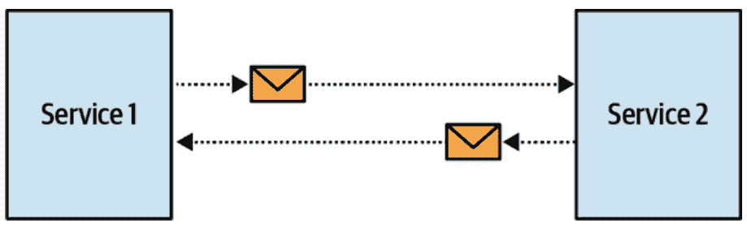
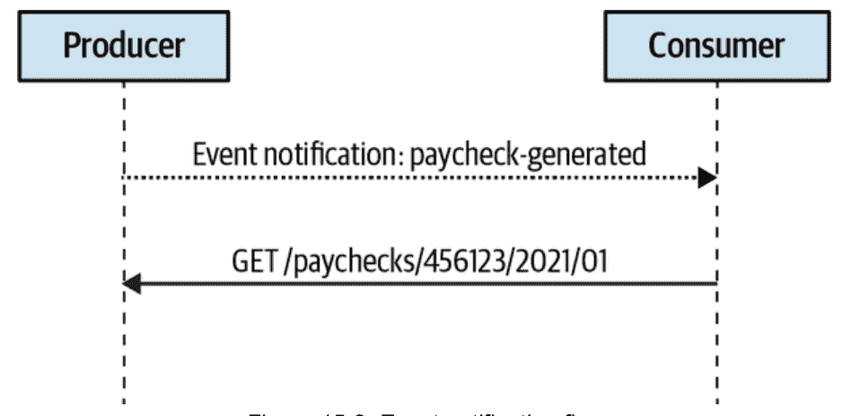
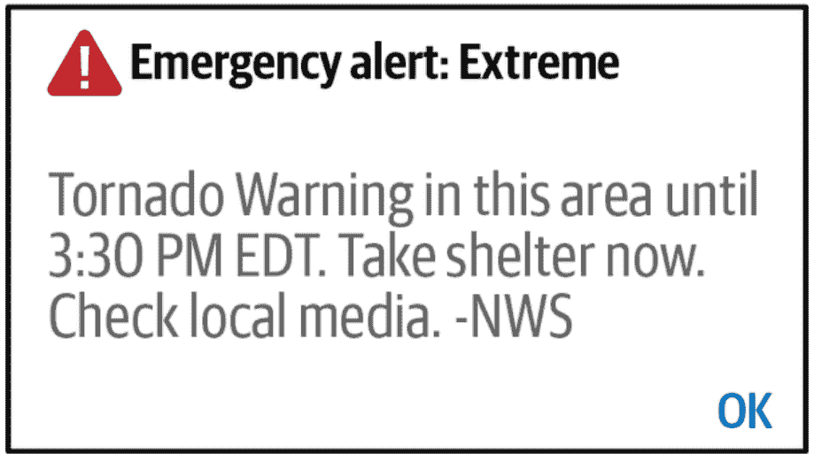
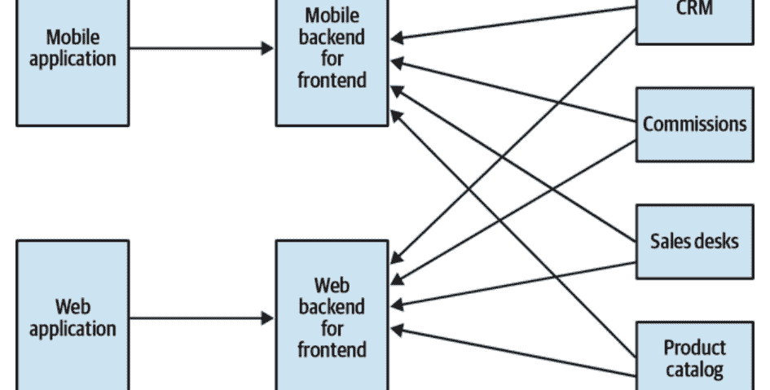
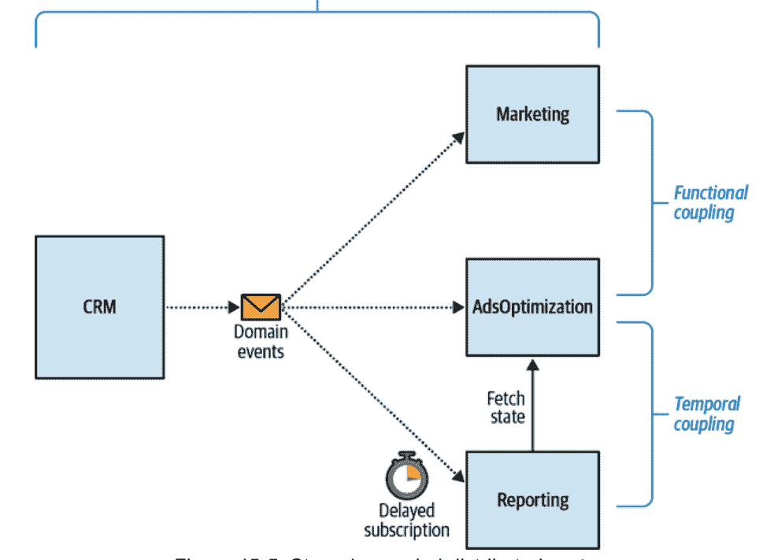
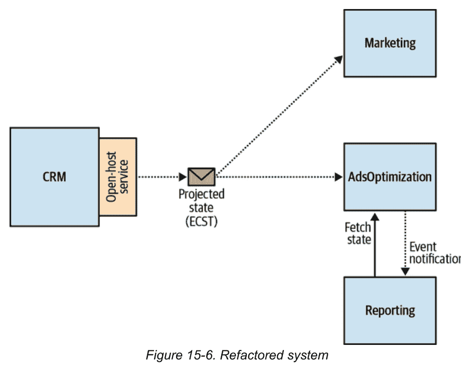

## 第15章 事件驱动架构

与微服务一样，事件驱动架构（EDA）在现代分布式系统中无处不在。许多人建议在设计松耦合、可扩展、容错的分布式系统时，将事件驱动通信作为默认的集成机制。

事件驱动架构通常与领域驱动设计相关联。毕竟，EDA 基于事件，而事件在 DDD 中也很突出——我们有领域事件，并且在需要时甚至将事件用作系统的事实来源。利用 DDD 的事件作为使用事件驱动架构的基础可能很诱人。但这是一个好主意吗？

事件并不是一种秘密调料，你可以将其倒在遗留系统上，就将其转变为松耦合的分布式系统。恰恰相反：粗心的 EDA 应用会将模块化单体转变为分布式的大泥球。

在本章中，我们将探讨 EDA 与 DDD 之间的相互作用。你将学习事件驱动架构的基本构建块、失败的 EDA 项目的常见原因，以及如何利用 DDD 的工具来设计有效的异步集成系统。

### 事件驱动架构

简单地说，*事件驱动架构*是一种架构风格，其中系统的组件通过交换事件消息异步相互通信（参见图 15-1）。

组件不会同步调用服务的端点，而是发布事件以通知其他系统元素域中的变化。组件可以订阅系统中引发的事件并相应地做出反应。事件驱动执行流程的典型示例是第 9 章中描述的 saga 模式。



图 15-1. 异步通信

必须强调事件驱动架构与事件溯源之间的区别。正如我们在第 7 章中所讨论的，事件溯源是一种将状态变化作为一系列事件捕获的方法。

尽管事件驱动架构和事件溯源都基于事件，但这两种模式在概念上是不同的。EDA 指的是服务之间的通信，而事件溯源发生在服务内部。为事件溯源设计的事件表示状态转换（在事件溯源领域模型中的聚合中实现），它们旨在捕获业务域的复杂性，并不 intended 用于将服务与其他系统组件集成。

正如你将在本章后面看到的那样，事件有三种类型，其中一些更适合集成。

### 事件

在 EDA 系统中，事件的交换是集成组件并使其成为系统的关键通信机制。让我们更详细地看看事件，并了解它们与消息的区别。

### 事件、命令和消息

到目前为止，事件的定义与消息模式的定义相似。¹ 然而，两者是不同的。事件是一种消息，但消息不一定是事件。有两种类型的消息：

*Event*

    描述已经发生的更改的消息

*Command*

    描述需要执行的操作的消息

事件是已经发生的事情，而命令是执行某事的指令。事件和命令都可以通过消息异步通信。然而，命令可以被拒绝：命令的目标可以拒绝执行命令，例如，如果命令无效或与系统的业务规则相矛盾。另一方面，事件的接收者无法取消事件。事件描述的是已经发生的事情。唯一可以推翻事件的方法是发出补偿操作——命令，正如在 saga 模式中执行的。

由于事件描述的是已经发生的事情，事件的名称应以过去时形式表述：例如 DeliveryScheduled、ShipmentCompleted 或 DeliveryConfirmed。

### 结构

事件是一个可以序列化并使用所选消息平台传输的数据记录。典型的事件模式包括事件的元数据及其有效载荷——事件传达的信息：

```
{
  "type": "delivery-confirmed",
  "event-id": "14101928-4d79-4da6-9486-dbc4837bc612",
  "correlation-id": "08011958-6066-4815-8dbe-dee6d9e5ebac",
  "delivery-id": "05011927-a328-4860-a106-737b2929db4e",
  "timestamp": 1615718833,
  "payload": {
    "confirmed-by": "17bc9223-bdd6-4382-954d-f1410fd286bd",
    "delivery-time": 1615701406
  }
}
```

事件的有效载荷不仅描述了事件传达的信息，还定义了事件的类型。让我们详细讨论三种类型的事件以及它们之间的区别。

### 事件类型

事件可分为三种类型之一：² 事件通知、事件携带状态传输或领域事件。

### 事件通知

事件通知是关于业务域中变化的消息，其他组件会对此做出反应。示例包括 PaycheckGenerated 和 CampaignPublished 等。

事件通知不应冗长：目标是通知感兴趣的各方事件的发生，但通知不应携带订阅者对事件做出反应所需的所有信息。例如：

```
{
  "type": "paycheck-generated",
  "event-id": "537ec7c2-d1a1-2005-8654-96aee1116b72",
  "delivery-id": "05011927-a328-4860-a106-737b2929db4e",
  "timestamp": 1615726445,
  "payload": {
    "employee-id": "456123",
    "link": "/paychecks/456123/2021/01"
  }
}
```

在前面的代码中，事件通知外部组件已生成工资单。它不携带与工资单相关的所有信息。相反，接收方可以使用链接获取更详细的信息。此通知流程如图 15-2 所示。



图 15-2. 事件通知流程

从某种意义上说，通过事件通知消息进行的集成类似于美国的无线紧急警报（WEA）系统和欧洲的 EU-Alert 系统（参见图 15-3）。这些系统使用蜂窝基站广播简短消息，通知公民公共卫生问题、安全威胁和其他紧急情况。这些系统的消息长度限制为最多 360 个字符。这条简短的消息足以通知你紧急情况，但你必须主动使用其他信息来源获取更多细节。



图 15-3. 紧急警报系统

简洁的事件通知在多种场景下可能是可取的。让我们更仔细地看两个：安全性和并发性。

### 安全性

强制接收方显式查询详细信息可防止通过消息基础设施共享敏感信息，并要求对订阅者访问数据进行额外授权。

### 并发性

由于事件驱动集成的异步特性，信息在到达订阅者时可能已经过时。如果信息的性质对竞争条件敏感，则显式查询它可以获得最新的状态。

此外，在并发消费者情况下，其中只有一个订阅者应处理事件，查询过程可以


与悲观锁集成。这确保了生产者端没有其他消费者能够处理该消息。

### 事件携带状态传输

事件携带状态传输（ECST）消息通知订阅者生产者内部状态的变化。与事件通知消息不同，ECST 消息包含反映状态变化的所有数据。

ECST 消息可以有两种形式。第一种是被修改实体的状态的完整快照：

```
{
  "type": "customer-updated",
  "event-id": "6b7ce6c6-8587-4e4f-924a-cec028000ce6",
  "customer-id": "01b18d56-b79a-4873-ac99-3d9f767dbe61",
  "timestamp": 1615728520,
  "payload": {
    "first-name": "Carolyn",
    "last-name": "Hayes",
    "phone": "555-1022",
    "status": "follow-up-set",
    "follow-up-date": "2021/05/08",
    "birthday": "1982/04/05",
    "version": 7
  }
}
```

前述示例中的 ECST 消息包含客户更新状态的完整快照。在处理大型数据结构时，将 ECST 消息中仅包含实际被修改的字段可能是合理的：

```
{
  "type": "customer-updated",
  "event-id": "6b7ce6c6-8587-4e4f-924a-cec028000ce6",
  "customer-id": "01b18d56-b79a-4873-ac99-3d9f767dbe61",
  "timestamp": 1615728520,
  "payload": {
    "status": "follow-up-set",
    "follow-up-date": "2021/05/10",
    "version": 8
    }
}
```

无论 ECST 消息包含完整快照还是仅更新的字段，此类事件流都允许消费者持有实体的状态的本地缓存并使用它。从概念上讲，使用事件携带状态传输消息是一种异步数据复制机制。这种方法使系统更具容错性，意味着即使生产者不可用，消费者也可以继续运行。这也是提高需要处理来自多个来源数据的组件性能的一种方法。无需每次需要数据时都查询数据源，所有数据都可以本地缓存，如图 15-4 所示。



图 15-4. 后端为前端

## 领域事件

第三种事件消息类型是我们于第 6 章中描述的领域事件。在某种程度上，领域事件介于事件通知和 ECST 消息之间：它们既描述

业务域中的重要事件，又包含描述该事件的所有数据。尽管相似，这些类型的消息在概念上是不同的。

### 领域事件与事件通知

领域事件和事件通知都描述了生产者业务域中的变化。也就是说，存在两个概念上的差异。

首先，领域事件包含描述事件的所有信息。消费者无需采取任何进一步操作即可获得完整的信息。

其次，建模意图不同。事件通知的设计意图是减轻与其他组件的集成。另一方面，领域事件旨在建模和描述业务域。即使没有外部消费者对它们感兴趣，领域事件也很有用。在事件溯源系统中尤其如此，其中领域事件用于建模所有可能的状态转换。如果所有可用的领域事件都有外部消费者感兴趣，将导致设计不佳。我们将在本章后面更详细地讨论这一点。

### 领域事件与事件携带状态传输

领域事件中包含的数据在概念上与典型的 ECST 消息模式不同。

ECST 消息提供足够的信息来保存生产者数据的本地缓存。单个领域事件不打算暴露如此丰富的模型。即使特定领域事件中包含的数据也不足以缓存聚合的状态，因为消费者未订阅的其他领域事件可能会影响相同的字段。

此外，与通知事件的情况一样，两种类型消息的建模意图不同。领域事件中包含的数据并非旨在描述聚合的状态。相反，它描述了在其生命周期中发生的业务事件。

### 事件类型：示例

以下是演示三种事件类型之间差异的示例。考虑以下三种表示结婚事件的方式：

```
eventNotification = {
  "type": "marriage-recorded",
  "person-id": "01b9a761",
  "payload": {
    "person-id": "126a7b61",
    "details": "/01b9a761/marriage-data"
  }
};

ecst = {
  "type": "personal-details-changed",
  "person-id": "01b9a761",
  "payload": {
    "new-last-name": "Williams"
  }
};

domainEvent = {
  "type": "married",
  "person-id": "01b9a761",
  "payload": {
    "person-id": "126a7b61",
    "assumed-partner-last-name": true
  }
};
```

marriage-recorded 是一个事件通知消息。它除了说明指定 ID 的人已结婚之外不包含任何信息。它包含关于事件的最小信息，并且

对更多细节感兴趣的消费者将不得不跟随 details 字段中的链接。

personal-details-changed 是一个事件携带状态传输消息。它描述了个人信息的更改，即其姓氏已更改。消息并未解释更改的原因。是结婚还是离婚？

最后，married 是一个领域事件。它尽可能接近业务域中事件的本质进行建模。它包含个人的 ID 和一个表示个人是否采用了其伴侣姓氏的标志。

### 设计事件驱动集成

正如我们在第 3 章中讨论的那样，软件设计主要关乎边界。边界定义了内部属于什么、外部保留什么，最重要的是，什么跨越边界——本质上，组件如何相互集成。EDA 系统中的事件是第一类设计元素，影响组件如何集成以及组件本身的边界。选择正确的事件消息类型决定了分布式系统是解耦还是耦合。

在本节中，您将学习应用不同事件类型的启发式方法。但首先，让我们看看如何使用事件来设计一个紧密耦合的分布式大泥球。

### 分布式大泥球

考虑图 15-5 所示的系统。

CRM 有界上下文被实现为事件溯源领域模型。当 CRM 系统必须与

营销有界上下文集成时，团队决定利用事件溯源数据模型的灵活性，让消费者——在这种情况下是营销——订阅 CRM 的领域事件并使用它们来投影适合其需求的模型。

当引入 AdsOptimization 有界上下文时，它也必须处理 CRM 有界上下文产生的信息。同样，团队决定让 AdsOptimization 订阅 CRM 中产生的所有领域事件并投影适合 AdsOptimization 需求的模型。



图 15-5. 紧密耦合的分布式系统

有趣的是，营销和 AdsOptimization 有界上下文都必须以相同格式呈现客户信息，因此最终都从

CRM 的领域事件中投影出相同的模型：每个客户状态的扁平化快照。

Reporting 有界上下文仅订阅 CRM 发布的部分领域事件，并将其用作事件通知消息以获取 AdsOptimization 上下文中执行的计算。然而，由于两个 AdsOptimization 有界上下文都使用相同的事件来触发其计算，为了确保 Reporting 模型得到更新，AdsOptimization 上下文引入了延迟。它在接收到消息后五分钟处理消息。

这种设计很糟糕。让我们分析一下该系统中的耦合类型。

### 时间耦合

AdsOptimization 和 Reporting 有界上下文在时间上耦合：它们依赖于严格的执行顺序。AdsOptimization 组件必须在 Reporting 模块被触发之前完成处理。如果顺序相反，Reporting 系统中将产生不一致的数据。

为了强制执行所需的执行顺序，工程师在 Reporting 系统中引入了处理延迟。五分钟的延迟让 AdsOptimization 组件完成所需的计算。显然，这并不能防止执行顺序错误：

- AdsOptimization 可能过载，无法在五分钟内完成处理。
- 网络问题可能会延迟传入消息向 AdsOptimization 服务的传递。
- AdsOptimization 组件可能出现故障并停止处理传入消息。


## 功能耦合

Marketing 和 AdsOptimization 有界上下文都订阅了 CRM 的领域事件，并最终实现了客户数据的相同投影。换句话说，将传入的领域事件转换为基于状态的表示的业务逻辑在两个有界上下文中都被重复了，并且它们有相同的变更原因：它们必须以相同的格式呈现客户数据。因此，如果在其中一个组件中更改了投影，则该更改必须在第二个有界上下文中复制。

这就是功能耦合的一个例子：多个组件实现相同的业务功能，如果它发生变化，则两个组件都必须同时发生变化。

## 实现耦合

这种耦合更微妙。Marketing 和 AdsOptimization 有界上下文订阅了 CRM 事件溯源模型生成的所有领域事件。因此，CRM 实现的变更，例如添加新的领域事件或更改现有事件的模式，必须反映在两个订阅的有界上下文中！如果不这样做，可能会导致数据不一致。例如，如果事件的模式发生变化，订阅者的投影逻辑将失败。另一方面，如果向 CRM 模型添加了新的领域事件，它可能会影响投影模型，因此忽略它将导致投影不一致的状态。

## 重构事件驱动集成

正如你所见，盲目地向系统灌输事件并不会使其解耦或具有弹性。你可能会认为这是一个不切实际的例子，但不幸的是，这个例子是基于一个真实的故事。

让我们看看如何调整事件来显著改善设计。

公开构成 CRM 数据模型的所有领域事件会将订阅者耦合到生产者的实现细节。实现耦合可以通过公开更受限制的事件集或不同类型的事件来解决。

Marketing 和 AdsOptimization 订阅者通过实现相同的业务功能在功能上耦合在一起。

实现耦合和功能耦合都可以通过将投影逻辑封装在生产者中来解决：CRM 有界上下文。CRM 不公开其实现细节，而是可以遵循消费者驱动契约模式：投影消费者需要的模型并使其成为有界上下文发布语言的一部分——一个集成特定的模型，与内部实现模型解耦。结果，消费者获得所需的所有数据，并且不知道 CRM 的实现模型。

为了解决 AdsOptimization 和 Reporting 有界上下文之间的时间耦合，AdsOptimization 组件可以发布事件通知消息，触发 Reporting 组件获取所需的数据。重构后的系统如图 15-6 所示。



图 15-6. 重构后的系统

## 事件驱动设计启发式

将事件类型与手头的任务相匹配，可以使 resulting 设计的耦合度降低几个数量级，更灵活且容错。让我们总结一下所应用更改背后的设计启发式。

## 假设最坏情况

正如 Andrew Grove 所说，只有偏执狂才能生存。³ 将其作为设计事件驱动系统时的指导原则：

- 网络将会变慢。
- 服务器将在最不方便的时刻失败。
- 事件会乱序到达。
- 事件会被重复。

最重要的是，这些事件最常发生在周末和公共假期。

事件驱动架构中的 *driven* 一词意味着你的整个系统都依赖于消息的成功传递。因此，避免像瘟疫一样避免“事情会没事”的心态。确保事件始终一致地传递，无论发生什么：

- 使用 outbox 模式可靠地发布消息。
- 在发布消息时，确保订阅者能够对消息进行去重并识别和重新排序乱序的消息。
- 在编排需要发出补偿操作的跨有界上下文流程时，利用 saga 和流程管理器模式。

## 使用公共和私有事件

在发布领域事件时，尤其是事件溯源聚合时，要警惕暴露实现细节。将事件视为有界上下文公共接口的固有部分。因此，在实现开放主机服务模式时，确保事件反映在有界上下文的发布语言中。关于转换基于事件的模型的模式在第 9 章中讨论。

在设计有界上下文的公共接口时，利用不同类型的事件。事件携带状态传输消息将实现模型压缩为更紧凑的模型，仅传达消费者需要的信息。

事件通知消息可用于进一步最小化公共接口。

最后，谨慎使用领域事件与外部有界上下文通信。考虑设计一组专用的公共领域事件。

## 评估一致性要求

在设计事件驱动通信时，将有界上下文的一致性要求作为选择事件类型的额外启发式：

- 如果组件可以接受最终一致的数据，请使用事件携带状态传输消息。
- 如果消费者需要读取生产者状态中的最后一次写入，请发出事件通知消息，然后查询以获取生产者的最新状态。

### 结论

本章将事件驱动架构作为设计有界上下文公共接口的固有方面进行了介绍。你学习了可用于跨有界上下文通信的三种事件类型：

*事件通知*

通知发生了重要的事情，但需要消费者显式查询生产者以获取额外信息。

*事件携带状态传输*

基于消息的数据复制机制。每个事件都包含可用于维护生产者数据本地缓存的状态快照。

## 领域事件

描述生产者业务域中事件的消息。

使用不合适的事件类型会破坏基于 EDA 的系统，无意中将其变成大泥球。要为集成选择正确的事件类型，请评估有界上下文的一致性要求并警惕暴露实现细节。设计明确的公共和私有事件集。最后，确保系统即使在技术问题和中断面前也能传递消息。

## 练习

- 1. 以下哪些陈述是正确的？
  a. 事件驱动架构定义了旨在跨组件边界传输的事件。
  b. 事件溯源定义了旨在保留在有界上下文边界内的事件。
  c. 事件驱动架构和事件溯源是同一模式的不同术语。
  d. A 和 B 正确。
- 2. 哪种类型的事件最适合传达状态变更？
  a. 事件通知。
  b. 事件携带状态传输。
  c. 领域事件。
  d. 所有事件类型都同样适合传达状态变更。
- 3. 哪个有界上下文集成模式要求明确定义公共事件？
  a. 开放主机服务
  b. 反腐败层
  c. 共享内核
  d. 顺从者
- 4. 服务 S1 和 S2 异步集成。S1 必须通信数据并且 S2 需要能够读取 S1 中最后写入的数据。哪种类型的事件适合此集成场景？
  a. S2 应发布事件携带状态传输事件。
  b. S2 应发布公共事件通知，这将提示 S1 发出同步请求以获取最新信息。
  c. S2 应发布领域事件。
  d. A 和 B。

1 Hohpe, G., & Woolf, B. (2003). Enterprise Integration Patterns: Designing, Building, and Deploying Messaging Solutions. Boston: Addison-Wesley.

2 Fowler, M. (n.d.). What do you mean by “Event-Driven”? Retrieved August 12, 2021, from Martin Fowler (blog).

3 Grove, A. S. (1998). Only the Paranoid Survive. London: HarperCollins Business.


