## 第16章 数据网格

迄今为止，本书中我们讨论了用于构建运营系统的模型。运营系统实现实时交易，操作系统的系统数据并协调其与环境的日常交互。这些模型是联机事务处理（OLTP）数据。另一种值得关注并进行适当建模的数据类型是联机分析处理（OLAP）数据。

在本章中，你将了解一种名为数据网格的分析数据管理架构。你将看到基于数据网格的架构如何工作，以及它与更传统的 OLAP 数据管理方法有何不同。最终，你将看到领域驱动设计和数据网格如何相互适应。但首先，让我们看看这些分析数据模型是什么，以及为什么我们不能直接重用运营模型用于分析用例。

#### 分析数据模型与事务数据模型

人们常说知识就是力量。分析数据是赋予公司利用积累的数据洞察如何优化业务、更好地了解客户需求，甚至通过训练机器学习（ML）模型来做出自动化决策的力量。

分析模型（OLAP）和运营模型（OLTP）服务于不同类型的消费者，支持不同种类的用例的实现，因此遵循不同的设计原则。

运营模型围绕系统业务域中的各种实体构建，实现其生命周期并协调它们之间的交互。这些模型如图 16-1 所示，服务于运营系统，因此必须优化以支持实时业务交易。

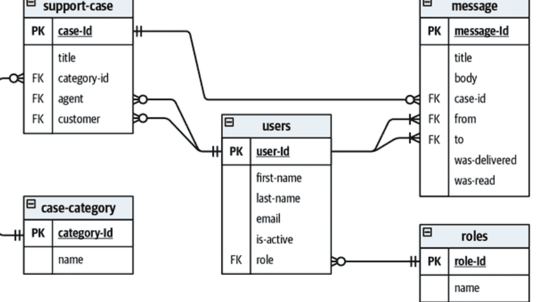

图 16-1. 描述运营模型中实体之间关系的数据库关系模式

分析模型旨在为运营系统提供不同的洞察。分析模型不是实现实时交易，而是旨在提供对业务活动绩效的洞察，更重要的是，如何优化业务运营以实现更大价值。

从数据结构角度来看，OLAP 模型忽略了单个业务实体，而是通过建模事实表和维度表来关注业务活动。我们接下来将更详细地查看这两个表。

#### 事实表

事实代表已经发生的业务活动。事实与领域事件的概念相似，因为两者都描述过去发生的事情。然而，与领域事件相反，事实名称没有风格上的要求必须以过去时动词命名。尽管如此，事实代表业务流程的活动。例如，事实表 `Fact_CustomerOnboardings` 将包含每个新入驻客户的记录，而 `Fact_Sales` 则包含每笔已确认销售的记录。图 16-2 显示了一个事实表的示例。

|  | Fact_SolvedCases |
|---|---|
| PK | CaseId |
| FK | AgentKey |
| FK | CategoryKey |
| FK | OpenedOnDateKey |
| FK | ClosedOnDateKey |
| FK | CustomerKey |

图 16-2. 包含公司支持台解决案例记录的事实表

此外，与领域事件类似，事实记录永远不会被删除或修改：分析数据是仅追加数据：表达当前数据已过时的唯一方法是追加一条包含当前状态的新记录。请考虑图 16-3 中的事实表 Fact_CaseStatus。它包含支持请求状态随时间变化的度量。事实名称中没有明显的动词，但事实所捕获的业务流程是处理支持案例的过程。

| Fact_CaseStatus |  |  |  |  |  |
|---|---|---|---|---|---|
| CaseId | Timestamp | AgentKey | CategoryKey | CustomerKey | StatusKey |
| case-141408202228 | 2021-06-15 10:30:00 |  | 12 | 10060512 | 1 |
| case-141408202228 | 15/06/2021 11:00:00 | 285889 | 12 | 10060512 | 2 |
| case-141408202228 | 15/06/2021 11:30:00 | 285889 | 12 | 10060512 | 2 |
| case-141408202228 | 15/06/2021 12:00:00 | 285889 | 12 | 10060512 | 3 |
| case-141408202228 | 15/06/2021 12:30:00 | 285889 | 12 | 10060512 | 2 |
| case-141408202228 | 15/06/2021 13:00:00 | 285889 | 12 | 10060512 | 4 |

图 16-3. 描述支持案例生命周期中状态变化的事实表

OLAP 与 OLTP 模型之间的另一个显著区别是数据的粒度。运营系统需要最精确的数据来处理业务交易。对于分析模型，在许多用例中聚合数据更有效。例如，在图 16-3 中显示的 Fact_CaseStatus 表中，可以看到快照每 30 分钟拍摄一次。使用模型的数据分析师决定什么粒度水平最适合他们的需求。为每次度量变化创建事实记录——例如每次案例数据变化——在某些情况下会造成浪费，在其他情况下甚至在技术上不可行。

#### 维度表

分析模型另一个基本构建块是维度。如果事实代表业务流程或动作（动词），则维度描述事实（形容词）。

维度旨在描述事实的属性，并作为外键从事实表引用到维度表。建模为维度的属性是任何在不同事实记录中重复出现且无法放入单个列中的度量或数据。例如，图 16-4 中的模式将 SolvedCases 事实与其维度进行了扩充。

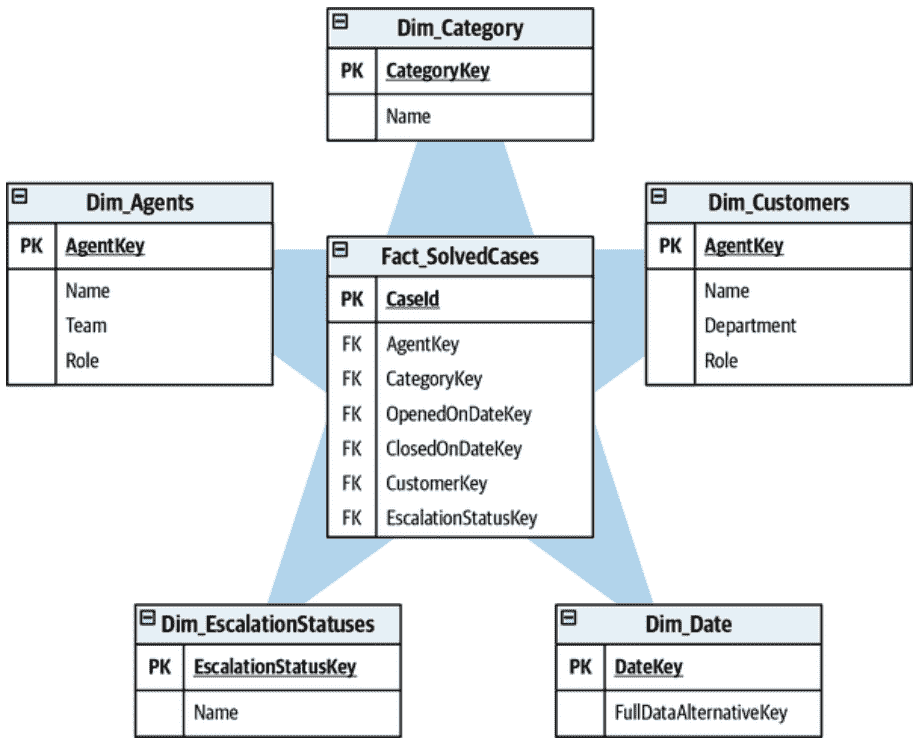

图 16-4. 被其维度包围的 SolvedCases 事实

维度高度规范化的原因是分析系统需要支持灵活查询。这是运营模型和分析模型之间的另一个区别。可以预测运营模型将如何被查询以支持业务需求。分析模型的查询模式是不可预测的。数据分析师需要灵活地查看数据的方式，很难预测未来会执行什么查询。因此，规范化支持跨不同维度的动态查询和过滤，以及对事实数据的分组。

#### 分析模型

图 16-5 中描绘的表结构称为 *星型模式*。它基于事实与其维度之间多对一的关系：每个维度记录被许多事实使用；事实的外键指向单个维度记录。

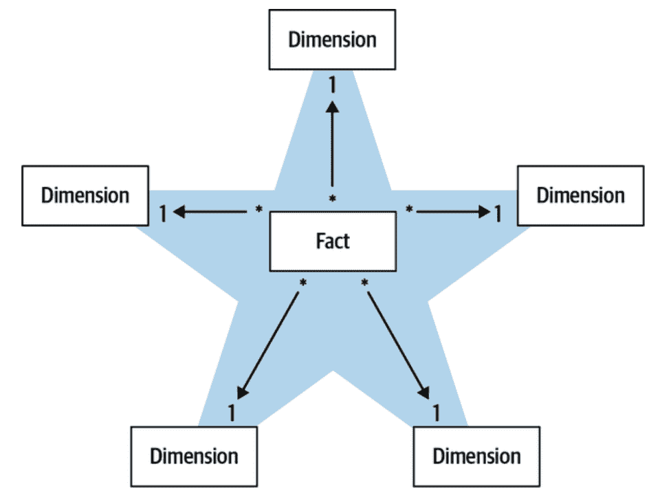

*图 16-5. 事实与其维度之间的多对一关系*

另一种主要的分析模型是雪花模式。雪花模式基于相同的构建块：事实和维度。然而，在雪花模式中，维度是多层次的：每个维度进一步规范化为更细粒度的维度，如图 16-6 所示。

由于额外的规范化，雪花模式将使用更少的空间来存储维度数据，并且更容易维护。

然而，查询事实数据将需要连接更多表，因此需要更多的计算资源。

星型模式和雪花模式都允许数据分析师分析业务绩效，获得可以优化并构建到业务智能（BI）报告中的洞察。

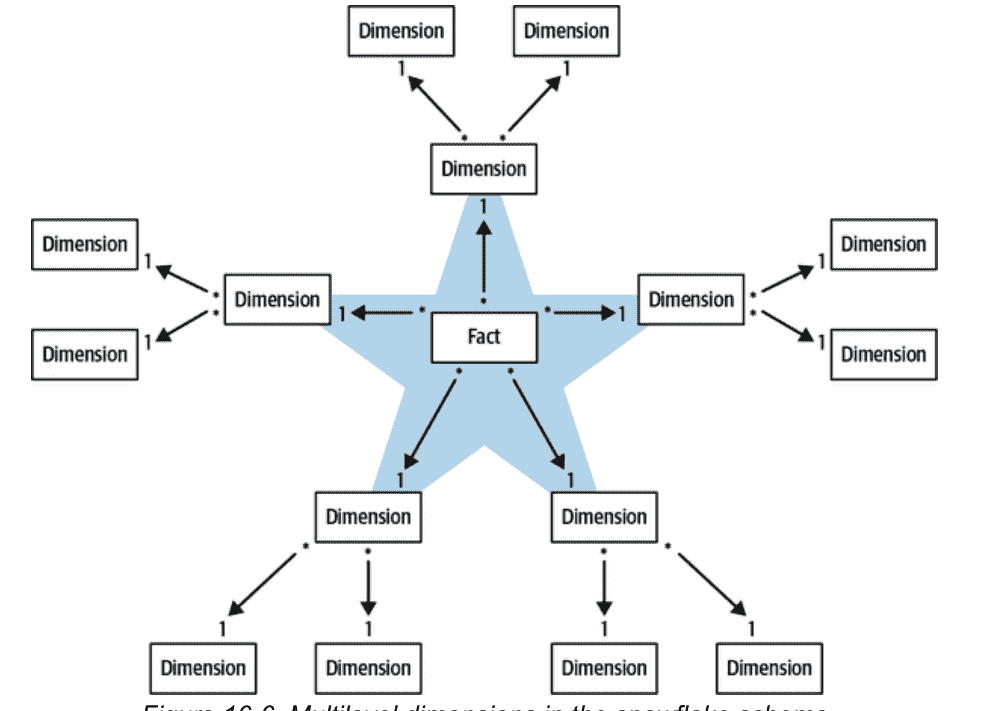

图 16-6. 雪花模式中的多层次维度

#### 分析数据管理平台

让我们将讨论从分析建模转移到支持生成和提供分析数据的管理架构。在本节中，我们将讨论两种常见的分析数据架构：数据仓库和数据湖。你将了解每种架构的基本工作原理，它们之间的区别，以及每种方法的挑战。

了解这两种架构的工作原理将为本章的主要主题奠定基础：数据网格范式及其与领域驱动设计的相互作用。

### 数据仓库

数据仓库（DWH）架构相对简单。从企业所有运营系统中提取数据，将源数据转换成语义分析模型，并将所得数据加载到面向数据分析的数据库中。该数据库即为数据仓库。

这种数据管理架构主要基于抽取-转换-加载（ETL）脚本。数据可以来自各种来源：运营数据库、流式事件、日志等。除了将源数据转换为基于事实/维度模型之外，转换步骤还可能包括其他操作，例如删除敏感数据、去重记录、重新排序事件、聚合细粒度事件等。在某些情况下，转换可能需要对传入数据进行临时存储。这被称为暂存区。

如图 16-7 所示的所得数据仓库包含涵盖企业所有业务流程的分析数据。数据使用 SQL 语言（或其方言之一）进行暴露，并被数据分析师和 BI 工程师使用。

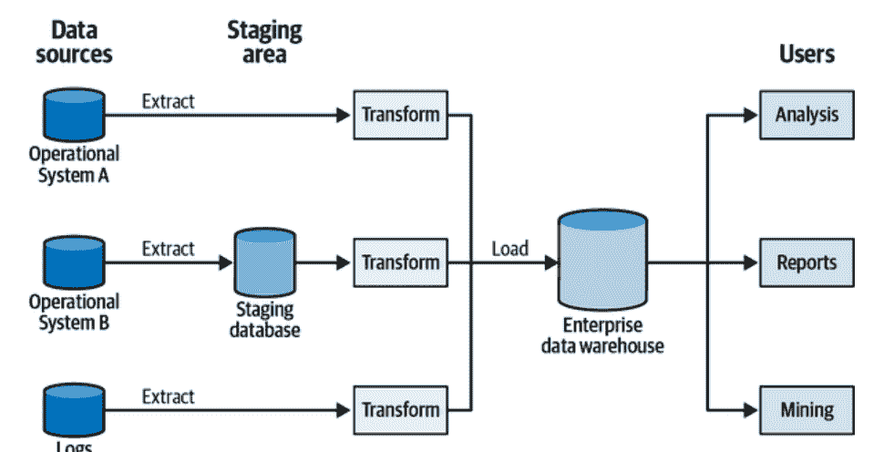

图 16-7. 典型的企业数据仓库架构

细心的读者会注意到，数据仓库架构与第 2 章和第 3 章中讨论的一些挑战相似。

首先，数据仓库架构的核心目标是构建企业范围的模型。该模型应描述企业所有系统产生的数据，并满足分析数据的各种用例。分析模型可实现例如优化业务、降低运营成本、做出智能业务决策、报告，甚至训练 ML 模型。正如你在第 3 章中所学到的，这种方法对于除最小规模的组织之外都是不切实际的。为手头的任务设计模型，例如构建报告或训练 ML 模型，是更有效且可扩展的方法。

构建包罗万象的模型这一挑战可以通过使用数据集市来部分解决。数据集市是一个数据库，其中保存了与明确的分析需求相关的数据，例如对单个业务部门的分析。在图 16-8 所示的数据集市模型中，一个集市直接由来自运营系统的 ETL 流程填充，而另一个集市则从数据仓库中提取数据。

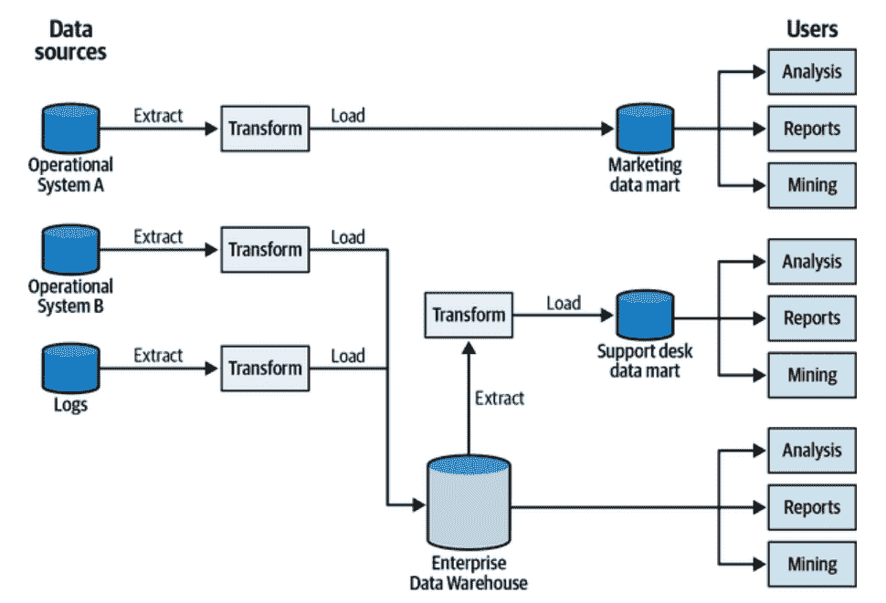

图 16-8. 增强了数据集市的企业数据仓库架构

当数据从企业数据仓库摄取到数据集市时，企业范围的模型仍需要在数据仓库中定义。或者，数据集市可以实现专用的 ETL 流程，直接从运营系统中摄取数据。在这种情况下，所得模型使得跨不同集市查询数据变得困难——例如跨不同部门——因为它需要跨数据库查询并显著影响性能。

数据仓库架构的另一个具有挑战性的方面是，ETL 流程在分析型（OLAP）和运营型（OLTP）系统之间创建了紧密的耦合。ETL 脚本所消费的数据不一定通过系统的公共接口公开。通常，DWH 系统只是简单地获取驻留在运营系统数据库中的所有数据。运营数据库中使用的模式不是公共接口，而是内部实现细节。因此，模式的细微更改注定会破坏数据仓库的 ETL 脚本。

由于运营和分析系统由 somewhat 遥远的组织单元实现和维护，两者之间的沟通具有挑战性，并导致团队之间产生大量摩擦。这种沟通模式如图 16-9 所示。

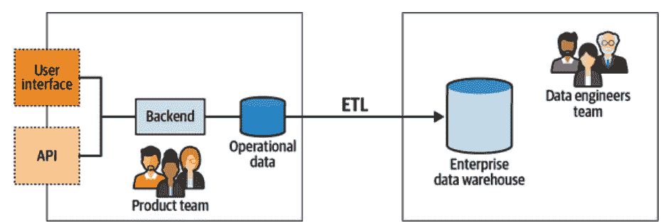

图 16-9. 通过直接从运营数据库获取数据填充数据仓库，忽略面向集成的公共接口

数据湖架构解决了数据仓库架构的一些不足。

### 数据湖

作为数据仓库，数据湖架构基于相同的概念，即摄取运营系统的数据并将其转换成语义分析模型。然而，这两种方法之间存在概念上的差异。

基于数据湖的系统会摄取运营系统的数据。然而，与立即转换成语义分析模型不同，数据以其原始形式，即原始运营模型的形式持久化。

最终，原始数据无法满足数据分析师的需求。因此，数据工程师和 BI 工程师的工作是理解湖中的数据并实现 ETL 脚本，以生成分析模型并将其馈送到数据仓库。图 16-10 描述了数据湖架构。

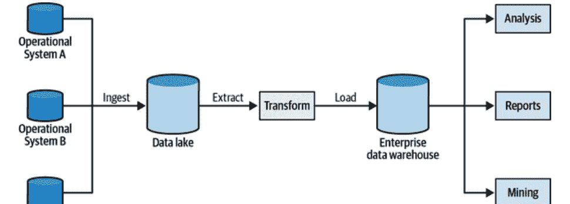

图 16-10. 数据湖架构

由于运营系统的数据以原始形式持久化，并且仅在之后才进行转换，因此数据湖允许使用多个面向任务的分析模型。一个模型可用于报告，另一个用于训练 ML 模型，等等。此外，未来可以添加新模型并使用现有原始数据进行初始化。

话虽如此，分析模型的延迟生成增加了整体系统的复杂性。数据工程师实现和支持同一 ETL 脚本的多个版本以适应运营模型的不同的版本的情况并不少见，如图 16-11 所示。

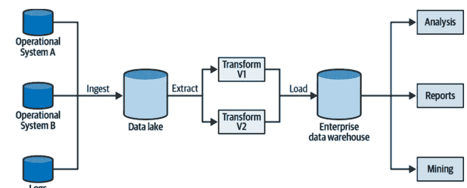

图 16-11. 多个版本的同一 ETL 脚本以适应运营模型的不同版本

此外，由于数据湖是无模式的——对传入数据没有施加模式——并且对传入数据的质量没有控制，因此在一定规模下，数据湖的数据会变得混乱。数据湖使摄取数据变得容易，但使用数据变得更加困难。或者，如常说，数据湖变成了数据沼泽。数据科学家的工作变得复杂数个数量级，以理清混乱并提取有用的分析数据。

### 数据仓库和数据湖架构的挑战

数据仓库和数据湖架构都基于这样一个假设：用于分析摄取的数据越多，组织获得的洞察就越多。然而，这两种方法在“大数据”的压力下往往会崩溃。运营到分析模型的转换在规模上会收敛到数千个无法维护的、临时的 ETL 脚本。

从建模角度来看，这两种架构都侵犯了运营系统的边界，并在其实现细节上创建了依赖。这种对实现模型的耦合在运营和分析系统团队之间造成了摩擦，往往到了为了不破坏分析系统的 ETL 作业而阻止对运营模型进行更改的地步。

更糟糕的是，由于数据分析师和数据工程师属于不同的组织单元，他们通常缺乏运营系统开发团队所拥有的对业务领域的深入了解。取而代之的是，他们主要专门从事大数据工具。

最后但并非最不重要的一点是，对实现模型的耦合在基于领域驱动设计的项目中尤其严重，在这些项目中，重点是不断发展和改进业务领域的模型。因此，运营模型的变化可能在分析模型中产生不可预见的后果。这种变化在 DDD 项目中很常见，并经常导致研发与数据团队之间的摩擦。

数据仓库和数据湖的这些局限性激发了一种新的分析数据管理架构：数据网格。

### 数据网格

数据网格架构在某种意义上是分析数据的领域驱动设计。正如 DDD 的不同模式划定边界并保护其内容一样，数据网格架构为分析数据定义并保护模型和所有权边界。

数据网格架构基于四个核心原则：围绕领域分解数据、数据即产品、实现自主性、构建生态系统。让我们详细讨论每个原则。

### 围绕领域分解数据

数据仓库和数据湖方法都旨在将企业的所有数据统一到一个大型模型中。由此产生的分析模型无效的原因与企业范围内的操作模型相同。此外，将来自所有系统的数据收集到一个位置会模糊各种数据元素的拥有边界。

与其构建单体分析模型，数据网格架构要求利用我们在第 3 章中针对操作数据讨论的相同解决方案：使用多个分析模型并将其与数据的来源对齐。这自然地使分析模型的拥有边界与有界上下文的边界保持一致，如图 16-12 所示。当分析模型根据系统的有界上下文进行分解时，分析数据的生成就成为相应产品团队的责任。

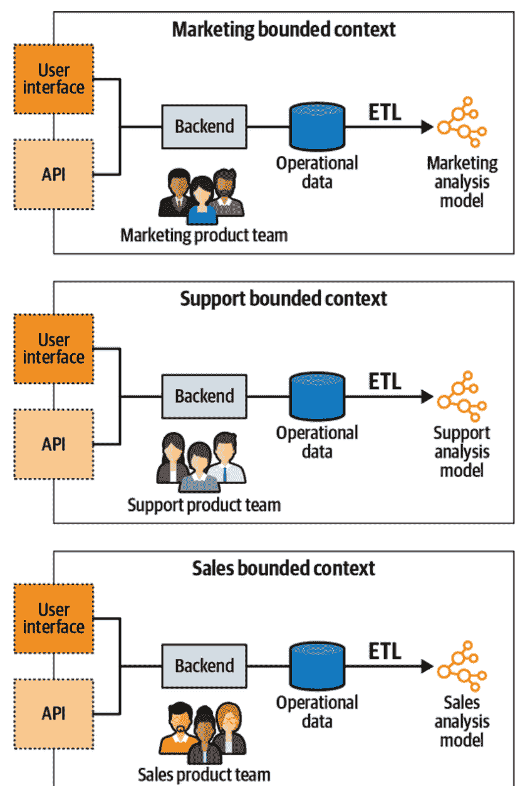

图 16-12. 使分析模型的拥有边界与有界上下文的边界保持一致

每个有界上下文现在都拥有其操作（OLTP）和分析（OLAP）模型。因此，同一个团队拥有操作模型，现在负责将其转换为分析模型。

### 数据即产品

经典的数据管理架构使得发现、理解和获取高质量的分析数据变得困难。在数据湖的情况下，这种情况尤其严重。

数据即产品原则要求将分析数据视为一等公民。相反，分析系统不必从可疑来源（内部数据库、日志文件等）获取操作数据，在基于数据网格的系统中，有界上下文通过如图 16-13 所示的明确定义的输出端口提供分析数据。

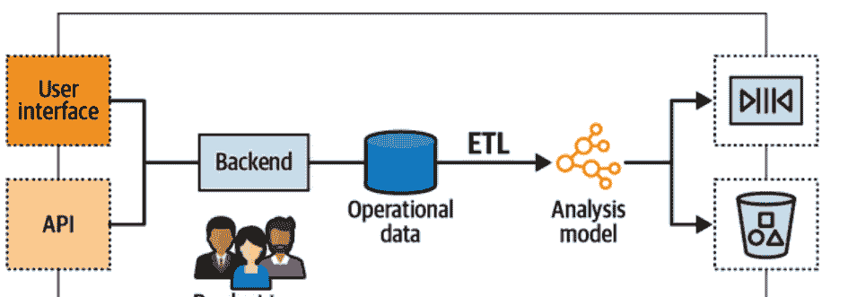

图 16-13. 多语言数据端点向消费者公开分析数据

分析数据应与任何公共 API 相同对待：

- 应该很容易发现必要的端点：数据输出端口。
- 分析端点应具有明确定义的模式，描述所提供的数据及其格式。
- 分析数据应该是可信的，并且与任何 API 一样，它应具有定义并受监控的服务等级协议（SLA）。
- 分析模型应像常规 API 一样进行版本控制，并相应地管理模型中的破坏性集成变更。

此外，由于分析数据被视为产品，它必须满足其消费者的需求。有界上下文的团队负责确保由此产生的模型满足其消费者的需求。与数据仓库和数据湖架构相反，在数据网格中，数据质量的问责是首要关注的问题。

分布式数据管理架构的目标是允许细粒度的分析模型组合起来满足组织的数据分析需求。例如，如果 BI 报表应反映来自多个有界上下文的数据，它应该能够轻松获取其分析数据（如有需要），应用本地转换并生成报表。

最后，不同的消费者可能需要以不同形式获取分析数据。有些人可能更喜欢执行 SQL 查询，其他人则从对象存储服务获取分析数据，等等。因此，数据产品必须是多语言的，以适合不同消费者需求的格式提供数据。

为了实施数据即产品原则，产品团队需要增加数据导向的专家。这是在跨职能团队拼图中缺失的一块，传统上该团队仅包括与操作系统相关的专家。

### 赋能自主

产品团队应该能够创建自己的数据产品并消费由其他有界上下文提供的数据产品。就像有界上下文一样，数据产品应该是可互操作的。

如果每个团队都构建自己的分析数据服务解决方案，将会浪费、效率低下且难以集成。为了防止这种情况发生，需要一个平台来抽象构建、执行和维护可互操作数据产品的复杂性。设计和构建此类平台是一项相当大的工作，需要一个专门的数据基础设施平台团队。

数据基础设施平台团队应负责定义数据产品蓝图、统一访问模式、访问控制和产品团队可以利用的多语言存储，以及监控平台并确保 SLA 和目标得到满足。

### 构建生态系统

创建数据网格系统的最后一步是任命一个联邦治理机构以实现互操作性和生态系统。
- d. A 和 C 正确。

2. 哪种有界上下文集成模式对于实现数据网格架构至关重要？

+   a. 共享内核
+   b. 开放主机服务
+   c. 反腐败层
+   d. 合作伙伴关系

3. 哪种架构模式对于实现数据网格架构至关重要？

+   a. 分层架构。
+   b. 端口与适配器。
+   c. CQRS。
+   d. 架构模式无法支持 OLAP 模型的实现。

4. 数据网格架构的定义要求围绕“域”分解数据。DDD 中用来表示数据网格的域的术语是什么？

+   a. 有界上下文。
+   b. 业务域。
+   c. 子域。
+   d. DDD 中没有数据网格域的同义词。

### 结语

为了完成我们对领域驱动设计的探索，我想回到我们一开始引用的那句话：

> *在我们就问题达成一致之前，谈论解决方案毫无意义；在我们就解决方案达成一致之前，谈论实施步骤也毫无意义。*

—Efrat Goldratt-Ashlag

这句话简洁地概括了我们的 DDD 之旅。

### 问题

要提供软件解决方案，我们首先必须理解问题：我们工作的 *业务域* 是什么，业务目标是什么，以及实现这些目标的策略是什么。

我们使用 *通用语言* 来深入理解业务域及其逻辑，这些逻辑需要在软件中实现。

你学会了通过将其拆分为 *有界上下文* 来管理业务问题的复杂性。每个有界上下文都实现业务域的单一模型，旨在解决特定问题。

我们讨论了如何识别和分类业务域的构建块：*核心*、*支持* 和 *通用子域*。表 E-1 对比了这三种子域类型。

### 表 E-1. 三种子域类型

| 子域类型 | 竞争优势 | 复杂性 | 波动性 | 实现方式 |
|---|---|---|---|---|
| 核心 | 是 | 高 | 高 | 内部开发 |
| 通用 | 否 | 高 | 低 | 购买/采用 |
| 支持 | 否 | 低 | 低 | 内部/外包 |

### 解决方案

你学会了利用这些知识为每种子域类型设计优化的解决方案。我们讨论了四种业务逻辑实现模式——*事务脚本*、*活动记录*、*领域模型* 和 *事件溯源领域模型*——以及每种模式在何种场景下表现最佳。你还看到了三种为业务逻辑实现提供所需脚手架的架构模式：*分层架构*、*端口与适配器* 和 *CQRS*。图 E-1 总结了使用这些模式进行战术决策的启发式方法。

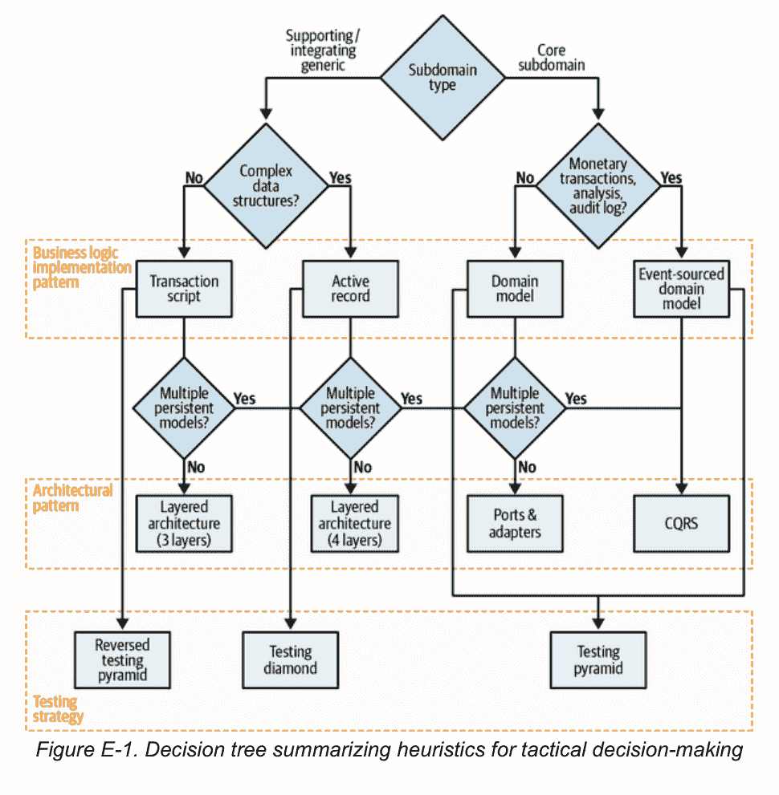

图 E-1. 总结战术决策启发式的决策树

### 实现

在第三部分中，我们讨论了如何将理论转化为实践。你学会了如何通过促进 EventStorming 会议来有效构建通用语言，如何在业务域演进时保持设计良好，以及如何在棕地项目中引入并开始使用领域驱动设计。

在第四部分中，我们讨论了领域驱动设计与其他方法论和模式之间的相互作用：微服务、事件驱动架构和数据网格。我们看到 DDD 不仅可以与这些技术协同使用，而且它们实际上是相辅相成的。

### 延伸阅读

我希望这本书能让你对领域驱动设计产生兴趣。如果你想继续学习，这里有一些我衷心推荐的书籍。

### 高级领域驱动设计

- Evans, E. (2003). *Domain-Driven Design: Tackling Complexity in the Heart of Software*. Boston: Addison-Wesley.
  Eric Evans 的原著，首次介绍了领域驱动设计方法论。虽然它没有反映 DDD 的更新方面，如领域事件和事件溯源，但它仍然是成为 DDD 黑带的必读之作。
- Martraire, C. (2019). *Living Documentation: Continuous Knowledge Sharing by Design*. Boston: Addison-Wesley.
  在这本书中，Cyrille Martraire 提出了一种基于领域驱动设计的知识共享、文档化和测试方法。
- Vernon, V. (2013). *Implementing Domain-Driven Design*. Boston: Addison-Wesley.
  另一部永恒的 DDD 经典。Vaughn Vernon 提供了深入的讨论和详细的领域驱动设计思维及其战略和战术工具集的使用示例。作为学习基础，Vaughn 使用了一个现实世界的例子，说明了 DDD 失败的举措以及团队通过应用必要的纠正措施而焕发的新旅程。
- Young, G. (2017). *Versioning in an Event Sourced System*. Leanpub.

在第 7 章中，我们讨论了演进事件溯源系统可能具有挑战性。这本书专门讨论了这个主题。

### 架构和集成模式

- Dehghani, Z. (预计 2022 年出版). *Data Mesh: Delivering Data-Driven Value at Scale*. Boston: O'Reilly.

Zhamak Dehghani 是我们在第 16 章中讨论的数据网格模式的作者。在这本书中，Dehghani 解释了数据管理架构背后的原则，以及如何在实践中实现数据网格架构。
- Fowler, M. (2002). *Patterns of Enterprise Application Architecture*. Boston: Addison-Wesley.

我曾在第 5 章和第 6 章中多次引用的经典应用架构模式书籍。这本书首次定义了事务脚本、活动记录和领域模型模式。
- Hohpe, G., & Woolf, B. (2003). *Enterprise Integration Patterns: Designing, Building, and Deploying Messaging Solutions*. Boston: Addison-Wesley.

第 9 章中讨论的许多模式最初都是在这本书中引入的。阅读这本书以了解更多组件集成模式。
- Richardson, C. (2019). *Microservice Patterns: With Examples in Java*. New York: Manning Publications.

在这本书中，Chris Richardson 提供了在构建微服务解决方案架构时经常使用的模式的许多详细示例。其中讨论的模式包括 saga、流程管理器和 outbox，我们在第 9 章中讨论过这些模式。

### 遗留系统的现代化

- Kaiser, S. (预计 2022 年出版). *Adaptive Systems with Domain-Driven Design, Wardley Mapping, and Team Topologies*. Boston: Addison-Wesley.

Susanne Kaiser 分享了她通过利用领域驱动设计、Wardley 映射和团队拓扑来现代化遗留系统的经验。
- Tune, N. (预计 2022 年出版). *Architecture Modernization: Product, Domain, & Team Oriented*. Leanpub.

在这本书中，Nick Tune 深入讨论了如何利用领域驱动设计和其他技术来现代化棕地项目的架构。
- Vernon, V., & Jaskula, T. (2021). *Implementing Strategic Monoliths and Microservices*. Boston: Addison-Wesley.

一本实践性书籍，作者展示了永恒的软件工程工具，包括快速发现和学习、领域驱动方法，以及妥善实现单体和微服务解决方案的复杂性，同时始终关注最重要的方面：交付创新的业务战略。
- Vernon, V., & Jaskula, T. (2021). *Strategic Monoliths and Microservices*. Boston: Addison-Wesley.

在这本书中，Vaughn 和 Tomasz 通过探索如何使用基于发现的学习和领域驱动方法来实现至关重要的创新，以及如何为工作选择最有目的性的架构和工具：微服务、单体，或混合，以及如何使它们协同工作来推广软件战略思维。

### EventStorming

- Brandolini, A. (尚未出版). *Introducing EventStorming*. Leanpub.

Alberto Brandolini 是 EventStorming 研讨会的创建者，在这本书中，他详细解释了 EventStorming 的流程和原理。
- Rayner, P. (尚未出版). *The EventStorming Handbook*. Leanpub.

Paul Rayner 解释了他如何在实践中使用 EventStorming，包括大量促进成功会议的技巧和窍门。

### 结论

就这样！非常感谢你阅读这本书。我希望你喜欢它，并且会运用你从中学到的知识。

我希望你从这本书中带走的是领域驱动设计工具背后的逻辑和原则。不要盲目地将领域驱动设计作为教条来遵循，而要理解其背后的推理。这种理解将显著增加你应用 DDD 并从中获益的机会。理解领域驱动设计的哲学也是

关键在于通过单独融入该方法论的概念来发挥价值，尤其是在棕地项目中。

最后，始终关注你的通用语言，遇到疑问时就进行事件风暴。祝好运！

### 附录 A. 应用 DDD：案例研究

在本附录中，我将分享我的领域驱动设计之旅是如何开始的：一个初创公司的故事，为本示例的目的，我们称之为“Marketnovus”。在 Marketnovus，我们从公司成立之日起就开始采用 DDD 方法论。多年来，我们不仅犯下了所有可能的 DDD 错误，而且也有机会从这些错误中学习并加以修正。我将利用这个故事和我们犯下的错误来展示 DDD 模式和实践在软件项目成功中所扮演的角色。

本案例研究分为两部分。在第一部分，我将带你了解 Marketnovus 的五个有界上下文的故事，做出了哪些设计决策，以及结果如何。在第二部分，我将讨论这些故事如何反映你在本书中学到的内容。

在开始之前，我需要强调 Marketnovus 已经不存在了。因此，本附录绝无任何宣传性质。此外，由于这是一家已倒闭的公司，我可以坦率地谈论我们的经历。

### 五个有界上下文

在深入探讨有界上下文及其设计方式之前，作为有良好行为的 DDD 实践者，我们必须先定义 Marketnovus 的业务领域。

### 业务领域

想象一下你正在生产产品或服务。Marketnovus 允许你外包所有与营销相关的琐事。Marketnovus 的专家会为你的产品制定营销策略。它的文案撰写者和平面设计师会制作大量创意素材，例如横幅和落地页，用于运行推广产品的广告活动。这些活动产生的所有线索都将由 Marketnovus 的销售代理处理，他们会进行电话沟通并销售你的产品。该流程如图 A-1 所示。

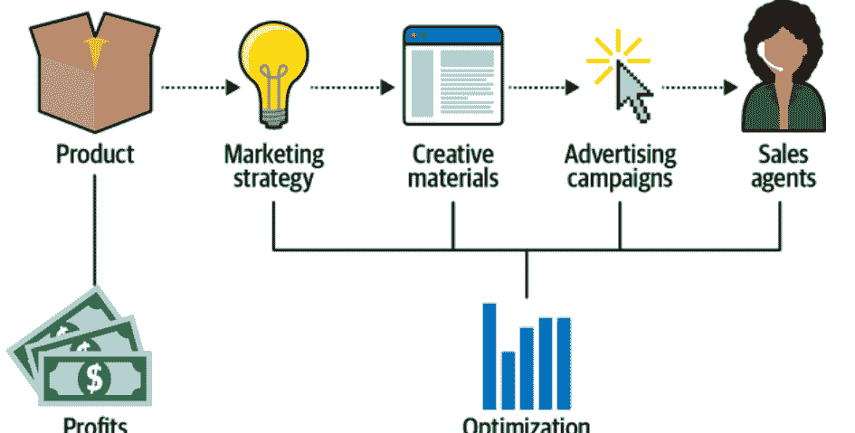

图 A-1. 营销流程

最重要的是，这个营销流程提供了许多优化机会，而这正是分析部门负责的。他们分析所有数据，以确保 Marketnovus 及其客户物有所值，无论是通过 pinpoint 最成功的活动、庆祝最有效的创意，还是确保销售代理正在处理最有希望的线索。

由于我们是一家自筹资金的公司，我们必须尽快启动。因此，公司成立后不久，我们软件系统的第一个版本必须实现我们价值链的三分之一：

- 用于管理合同和与外部发布商集成的系统
- 设计师管理创意素材的目录
- 运行广告活动的活动管理解决方案

我感到不知所措，必须找到一种方法来理清业务领域的复杂性。幸运的是，在我们开始工作不久前，我读到了一本承诺正好做到这一点的书。当然，我说的是 Eric Evans 的开创性著作，*Domain-Driven Design: Tackling Complexity at the Heart of Software.*

如果你读过本书的序言，你就知道 Evans 的书提供了我很久以来一直在寻找的答案：如何设计和实现业务逻辑。也就是说，对我来说，这本书第一次阅读并不容易理解。尽管如此，我觉得仅通过阅读战术设计章节，我就已经对 DDD 有了很强的把握。

猜猜系统最初是如何设计的？它肯定会让 DDD 社区中的某位知名人士¹感到非常自豪。

#### 有界上下文 #1：营销

我们第一个解决方案的架构风格可以简洁地概括为“到处都是聚合”。Agency、campaign、placement、funnel、publisher：需求中的每一个名词都被宣布为一个聚合。

所有这些所谓的聚合都驻留在巨大的、单一的有界上下文中。是的，一个庞大、令人恐惧的单体，正是大家现在警告你的那种。

当然，那些都不是聚合。它们没有提供任何事务边界，而且几乎没有任何行为。所有的业务逻辑都实现在一个庞大的服务层中。

当你旨在实现领域模型却最终得到活动记录模式时，这通常被称为“贫血领域模型”反模式。回过头来看，这个设计是关于如何不实现领域模型的教科书示例。然而，从业务角度来看，情况看起来大不相同。

从业务角度来看，这个项目被认为是一个巨大的成功！尽管架构有缺陷，我们仍能够在非常激进的时间上市内交付可工作的软件。我们是怎么做到的？

#### 一种魔力

我们 somehow 设法形成了一个健壮的通用语言。我们中没有人有在线营销的先前经验，但我们仍然可以与领域专家进行对话。我们理解他们，他们理解我们，令我们惊讶的是，领域专家原来是非常好的人！他们真诚地欣赏我们愿意向他们学习和他们的经验的事实。

与领域专家的顺畅沟通使我们能够迅速掌握业务领域并实现其业务逻辑。是的，它是一个相当大的单体，但对于车库里的两个开发者来说，它已经足够好了。再次，我们在非常激进的时间上市内生产了可工作的软件。

#### 我们早期对领域驱动设计的理解

我们此时对领域驱动设计的理解可以用图 A-2 所示的简单图表来表示。

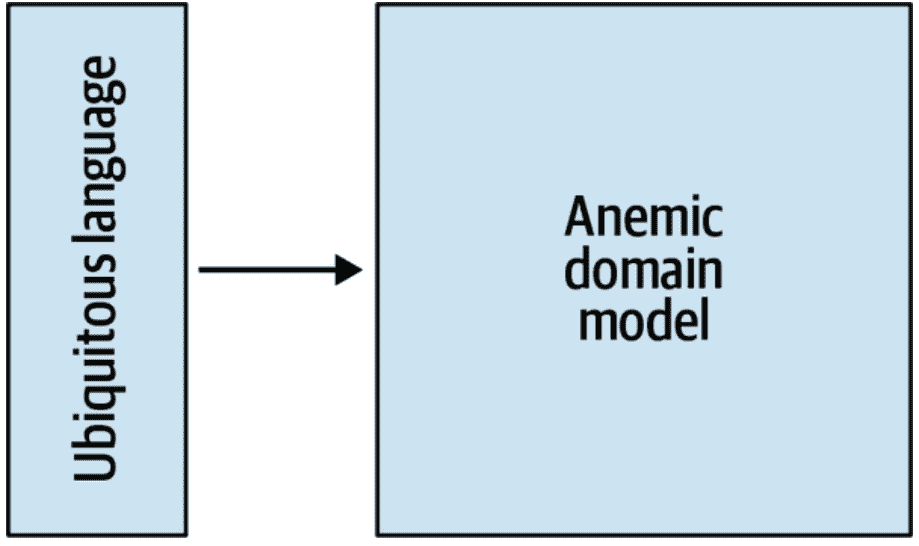

图 A-2. 我们早期对领域驱动设计的理解

#### 有界上下文 #2：CRM

在部署活动管理解决方案后不久，线索开始涌入，我们急需行动。我们的销售代理需要一个强大的客户关系管理（CRM）系统来管理线索及其生命周期。

CRM 必须聚合所有传入线索，根据不同参数对它们进行分组，并将其分配到全球多个销售台。它还必须与客户的内部系统集成，既要通知客户线索生命周期的变化，也要补充线索的额外信息。当然，CRM 还必须提供尽可能多的优化机会。例如，我们需要能够确保代理正在处理最有希望的线索，根据代理的资格和过往表现分配线索，并允许非常灵活的代理佣金计算方案。

由于现成的产品不符合我们的需求，我们决定推出自己的 CRM 系统。

#### 更多的“聚合”！

初始的实现方法是继续关注战术模式。再次，我们将每个名词都宣布为聚合并塞进同一个单体中。这一次，从一开始就感觉有些不对劲。

我们注意到，我们经常给这些“聚合”名称添加尴尬的前缀：例如，CRMLead 和 MarketingLead，MarketingCampaign 和 CRMCampaign。有趣的是，我们在与领域专家交谈时从未使用过这些前缀。某种程度上，他们总是能从上下文中理解含义。

然后我回忆起领域驱动设计有一个我们迄今为止一直忽略的有界上下文的概念。重新阅读 Evans 书中相关章节后，我了解到有界上下文解决了我们正在经历的完全相同的问题：它们保护通用语言的一致性。此外，到那时，Vaughn Vernon 已经发表了他的“Effective Aggregate Design”论文。该论文明确指出了我们在设计聚合时犯的所有错误。我们把聚合当作数据结构来对待，但它们在保护系统数据一致性方面扮演着更大的角色。

我们退一步，重新设计 CRM 解决方案以反映这些新认识。

#### 解决方案设计：第二次尝试

我们首先将单体划分为两个不同的有界上下文：营销和 CRM。当然，我们在这里并没有完全做到微服务；我们只是做了保护通用语言的最低限度。

然而，在新的有界上下文 CRM 中，我们不会再重复在营销系统中犯过的错误。不再有贫血领域模型！在这里，我们将实现一个真正的领域模型，具有真正的、按规范的聚合体。特别是，我们发誓要做到：

- 每个事务只影响一个聚合实例。
- 不使用 ORM，每个聚合本身定义事务范围。
- 服务层将进行严格的节食，所有业务逻辑都将重构到相应的聚合中。

我们对做正确的事情充满热情。但很快就显而易见，建模一个合适的领域模型是困难的！

相对于营销系统，一切都需要花费更多的时间！第一次就把事务边界搞对几乎是不可能的。我们必须评估至少几个模型并测试它们，只是为了后来才发现我们没有考虑到的那个才是正确的。做“正确”方式的代价非常高：大量时间。

很快对所有人都显而易见，我们根本没有机会按时完成！为了帮助我们，管理层决定将部分功能的实现外包给……数据库管理员团队。

是的，将业务逻辑实现在存储过程中。

这一决定在后续造成了很大的损害。并不是因为 SQL 不是描述业务逻辑的最佳语言。不，真正的问题更微妙、更根本。

### 巴别塔 2.0

这种情况产生了一个隐式的有界上下文，其边界切分了我们最复杂的业务实体之一：潜在客户。

结果是两个团队在同一个业务组件上工作并实现密切相关的功能，但彼此之间几乎没有互动。通用语言？别开玩笑了！实际上，每个团队都有自己的词汇来描述业务领域及其规则。

模型不一致。没有共同的理解。知识被重复，相同的规则被实现了两次。可以放心，当逻辑需要更改时，实现会立即不同步。

不用说，该项目远未按时交付，而且漏洞百出。多年以来一直潜伏在雷达下的恶劣生产问题腐蚀了我们最宝贵的资产：我们的数据。

摆脱这种混乱的唯一办法是完全重写 Lead 聚合，这次使用正确的边界，我们在几年后这样做了。这并不容易，但混乱太严重，别无选择。

### 对领域驱动设计的更广泛理解

尽管该项目按业务标准失败得很惨，我们对领域驱动设计的理解还是有所演进：构建通用语言，使用有界上下文保护其完整性，并且不要在任何地方实现贫血领域模型，而是在任何地方实现一个合适的领域模型。该模型如图 A-3 所示。

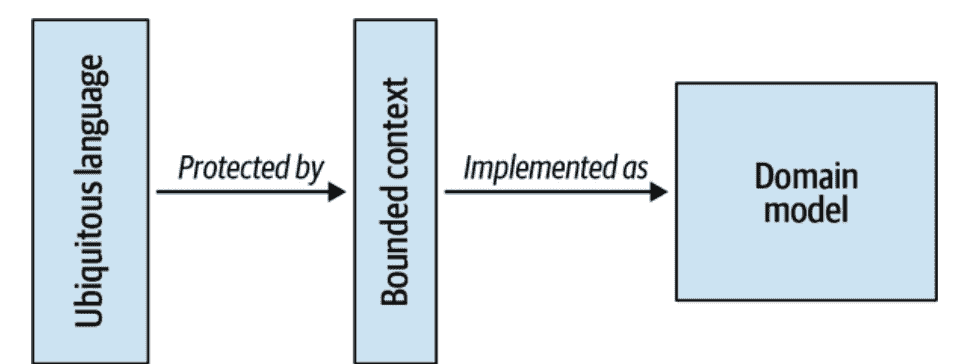

图 A-3. 将战略设计概念引入我们对领域驱动设计的理解

当然，这里缺少领域驱动设计的一个关键部分：子域、其类型以及它们如何影响系统的设计。

最初我们希望尽可能做好工作，但最终却在为支持子域构建领域模型上浪费了时间和精力。正如 Eric Evans 所说，一个大型系统的所有部分都不会设计得很好。我们以艰难的方式学到了这一点，并希望在下一个项目中使用所获得的知识。

### 有界上下文 #3：事件处理器

CRM 系统推出后，我们怀疑一个隐式的子域分布在营销和 CRM 之间。每当需要修改处理传入客户事件的过程时，我们都必须在营销和 CRM 有界上下文中引入更改。

由于概念上该过程不属于任何一方，我们决定将此逻辑提取到一个专门的有界上下文中，称为“事件处理器”，如图 A-4 所示。

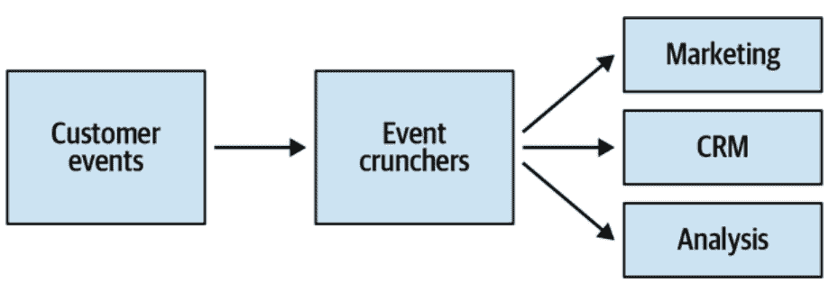

图 A-4. 事件处理器有界上下文处理传入的客户事件

由于我们并没有通过数据移动方式赚钱，而且没有可用的现成解决方案，事件处理器类似于一个支持子域。我们就是这样设计的。

这次没有什么花哨的：只是分层架构和一些简单的事务脚本。这个解决方案效果很好，但只持续了一段时间。

随着业务的发展，我们在事件处理器中实现了越来越多的功能。一开始是商业智能 BI 人员要求添加一些标志：一个标志用于标记新联系人，另一个标志用于标记各种首次事件，还有一些标志用于指示某些业务不变量，等等。

最终，这些简单的标志演变成真正的业务逻辑，具有复杂的规则和不变量。最初的事务脚本演变成一个功能齐全的核心业务子域。

不幸的是，当你将复杂的业务逻辑实现为事务脚本时，没有什么好事会发生。由于我们没有调整设计来应对复杂的业务逻辑，我们最终得到一个非常大的泥球。每次对代码库的修改变得越来越昂贵，质量直线下降，我们被迫重新思考事件处理器的设计。我们在一年后这样做了。到那时，业务逻辑变得如此复杂，以至于只能通过事件溯源来解决。我们将事件处理器的逻辑重构为基于事件溯源的领域模型，其他有界上下文订阅其事件。

### 有界上下文 #4：奖金

有一天，销售主管要求我们自动化一个简单却繁琐的他们一直手动执行的流程：为销售代理计算佣金。

再次，它一开始很简单：每月一次，只需计算每个代理销售额的百分比并将报告发送给主管。像以前一样，我们考虑这是否是一个核心子域。答案是否定的。我们没有发明任何新东西，没有从这个流程中赚钱，如果可以购买现有实现，我们肯定会买。不是核心，也不是通用，而是另一个支持子域。

我们据此设计了解决方案：由“智能”服务层编排的活动记录对象，如图 A-5 所示。

#### 基础设施
#### 活动记录
#### 服务/应用
#### 展示

图 A-5. 使用活动记录和分层架构模式实现的奖金有界上下文

一旦流程自动化，公司里每个人都变得很有创意。我们的分析师希望尽可能优化这个流程。他们希望尝试不同的百分比，将百分比与销售额和价格挂钩，为实现不同目标解锁额外佣金，等等等等。猜猜初始设计何时崩溃？

再次，代码库开始变成一个无法管理的泥球。添加新功能变得越来越昂贵，错误开始出现——当你处理钱时，即使是最小的错误也可能产生巨大的后果。

### 设计：再来一次

与事件处理器项目一样，在某个时候我们再也忍受不了了。我们不得不丢弃旧代码并从头重写解决方案，这次作为基于事件溯源的领域模型。

正如在事件处理器项目中一样，业务域最初被归类为支持性的。随着系统的演进，它逐渐演变成核心子域：我们找到了从这些流程中赚钱的方法。然而，这两个有界上下文之间有一个显著的区别。

### 通用语言

对于奖金项目，我们有一个通用语言。尽管初始实现基于活动记录，我们仍然可以拥有通用语言。

随着域复杂性的增长，领域专家使用的语言也变得越来越复杂。到某个时候，它再也不能用活动记录来建模了！这一认识使我们能够比在事件处理器项目中更早地注意到设计变更的需求。由于通用语言的存在，我们没有试图把方 peg 塞进圆孔，节省了大量时间和精力。

### 对领域驱动设计的一个经典理解

此时，我们对领域驱动设计的理解终于演进成了一个经典的模型：通用语言、限界上下文，以及不同类型的子域，每个子域都根据其需求进行设计，如图 A-6 所示。

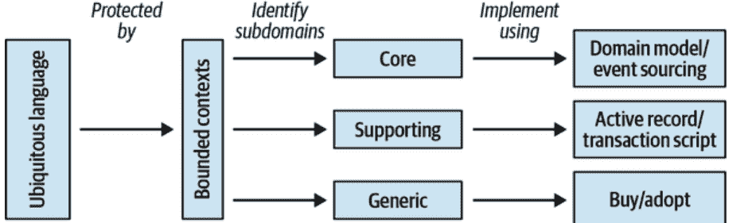

图 A-6. 领域驱动设计的经典模型

然而，我们下一个项目的情况却出现了相当出乎意料的转折。

### 限界上下文 #5：营销中心

我们的管理层正在寻找一个盈利的新业务方向。他们决定利用我们生成大量潜在客户并将其出售给之前未合作过的小型客户的能力。这个项目被称为“营销中心”。

由于管理层已将此业务域定义为新的盈利机会，它显然是一个核心业务域。因此，在设计上，我们祭出了重型武器：基于事件的领域模型和 CQRS。此外，当时，一个新的流行词，微服务，开始获得大量关注。我们决定尝试一下。

我们的解决方案看起来如图 A-7 所示的实现。

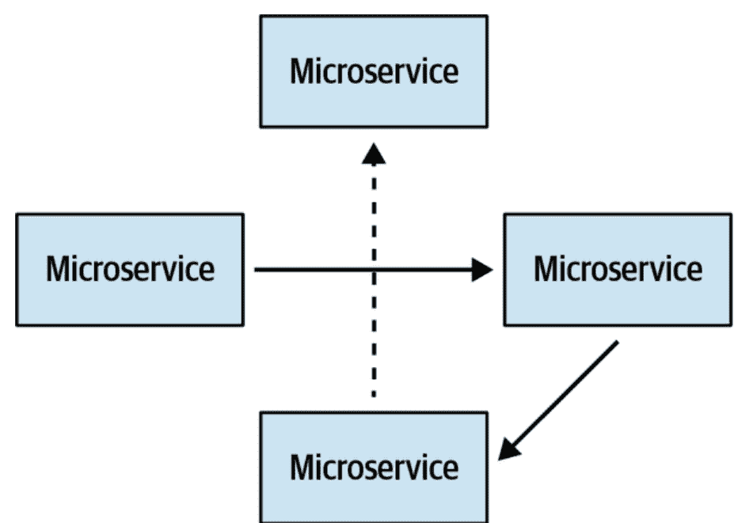

图 A-7. 营销中心限界上下文的基于微服务的实现

小型服务，每个服务都有自己的数据库，并在它们之间进行同步和异步通信：在纸面上，这看起来像是一个完美的解决方案设计。在实践中，却并非如此。

### 微服务是什么？

我们天真地认为微服务越小越好。因此，我们围绕聚合划分了服务边界。在 DDD 的术语中，每个聚合都成为一个独立的限界上下文。

再次，起初这个设计看起来很棒。它允许我们根据各自的具体需求实现每个服务。其中只有一个会使用事件溯源，其余的将是基于状态的聚合。此外，它们都可以独立维护和演进。

然而，随着系统的增长，这些服务变得越来越“健谈”。最终，几乎每个服务都需要来自所有其他服务的数据来完成其某些操作。结果？本意是解耦的系统最终变成了一个分布式单体：维护的绝对噩梦。

不幸的是，我们在这个架构上还有另一个更根本的问题。为了实现营销中心，我们使用了建模业务域的最复杂模式：领域模型和基于事件的领域模型。我们精心打造了这些服务。但这一切都是徒劳的。

### 真正的问题

尽管业务将营销中心视为核心子域，但它并没有技术复杂性。在那复杂的架构背后，是一套非常简单的业务逻辑，简单到本可以用普通的活动记录来实现。

事实证明，业务人员希望通过利用我们与其它公司现有的关系来获利，而不是通过巧妙的算法。

技术复杂性最终远高于业务复杂性。为了描述这种复杂性上的差异，我们使用术语 *偶然复杂性*，而我们的初始设计正是如此。系统被过度设计了。

### 讨论

这就是我想要告诉你的五个限界上下文：营销、CRM、事件处理、奖金和营销中心。当然，像 Marketnovus 这样广泛的业务域包含了更多限界上下文，但我想要分享的是我们从中学习最多的那些。

现在我们已经回顾了这五个限界上下文，让我们从另一个角度来看待这个问题。领域驱动设计核心元素的应用或误用如何影响了我们的结果？让我们来看看。

### 通用语言

在我看来，通用语言是领域驱动设计的“核心子域”。与领域专家使用同一种语言交流的能力对我们来说是不可或缺的。它被证明是比测试或文档更有效的信息共享方式。

此外，通用语言的存在一直是我们项目成功的关键预测因素：

- 我们刚开始时，营销系统的实现远非完美。然而，强大的通用语言弥补了架构上的不足，并使我们能够实现项目的目标。
- 在 CRM 上下文中，我们搞砸了。无意中，我们用两种语言描述了同一个业务域。我们努力追求适当的架构，但由于沟通问题，最终造成了巨大的混乱。
- 事件处理项目最初是一个简单的通用子域，我们没有投入通用语言。我们在复杂性开始增长时为此决定深感后悔。如果我们一开始就使用通用语言，我们会节省大量时间。
- 在奖金项目中，业务逻辑的复杂性增加了数个数量级，但通用语言使我们能够更早地注意到需要改变实现策略。

因此，无论你是在核心、支持还是通用子域上工作，通用语言都是不可或缺的。

我们学到了尽早投资通用语言的重要性。如果一种语言在公司中已经使用了很长时间，要“修复”它需要巨大的努力和耐心，就像我们的 CRM 系统那样。我们能够修复实现。这并不容易，但最终我们做到了。然而，语言却并非如此。多年后，仍有一些人在使用初始实现中定义的冲突术语。

### 子域

正如你在第 1 章中学到的那样，有三种类型的子域——核心、支持和通用——在设计解决方案时识别正在发挥作用的子域非常重要。

识别子域的类型可能具有挑战性。正如我们在第 1 章中讨论的那样，必须在与你正在构建的软件系统相关的粒度级别上识别子域。例如，我们的营销中心计划旨在成为公司的额外利润来源。然而，该功能的软件方面是一个支持子域，而利用与其他公司的关系和合同才是真正的竞争优势，即真正的核心子域。

此外，正如你在第 11 章中学到的那样，仅仅识别子域的类型是不够的。你还必须意识到子域可能演变为另一种类型的可能性。在 Marketnovus，我们见证了子域类型变化的几乎所有可能组合：

- 事件处理和奖金都始于支持子域，但一旦我们发现了将这些流程货币化的方法，它们就变成了我们的核心子域。
- 在营销上下文中，我们实现了自己的创意目录。它并没有什么特别或复杂之处。然而，几年后，一个开源项目出现了，其功能甚至比我们最初的还要多。一旦我们用这个产品替换了我们的实现，支持子域就变成了一个通用子域。
- 在 CRM 上下文中，我们有一个算法来识别最有希望的潜在客户。我们随着时间的推移对其进行了改进并尝试了不同的实现，但最终它被替换为在云厂商托管服务中运行的机器学习模型。从技术上讲，一个核心子域变成了通用子域。
- 正如我们所见，我们的营销中心系统最初是核心，但最终变成了一个支持子域，因为竞争优势存在于完全不同的维度。

正如你在本书中学到的那样，子域类型会影响广泛的设计决策。未能正确识别子域可能是一项代价高昂的错误，例如事件处理和营销中心的情况。

### 将设计决策映射到子域

这里有一个我在 Marketnovus 想出的技巧，可以防止识别子域时出错：反转子域与战术设计决策之间的关系。选择业务逻辑实现模式。不要猜测或过度设计；只需选择适合当前需求的模式。接下来，将所选模式映射到合适的子域类型。最后，用业务愿景验证所识别的子域类型。

反转子域与战术设计决策之间的关系会在你和

business. 有时企业需要我们，就像我们需要他们一样。

如果他们认为某件事是核心业务，但你一天就能搞定它，那么这要么意味着你需要寻找更细粒度的子域，要么就应该对该业务的可行性提出质疑。

另一方面，如果业务将某个子域视为支持性的，但只能通过高级建模技术来实现：领域模型或事件溯源领域模型，那么事情就会变得有趣。

首先，业务人员可能在需求上过于发挥创意，最终导致了意外的业务复杂性。会发生这种情况。在这种情况下，需求可以，也应该被简化。

其次，可能业务人员尚未意识到他们使用该子域来获得额外的竞争优势。奖金项目就是这种情况。通过发现这种不匹配，你正在帮助业务更快地识别新的利润来源。

### 不要忽视痛苦

最重要的是，在实现系统的业务逻辑时，永远不要忽视“痛苦”。它是一个关键信号，用于演进和改进业务域的模型或战术设计决策。在后一种情况下，这意味着子域已经演进，是时候回去重新思考其类型和实现策略了。如果类型发生了变化，请与领域专家交谈以了解业务背景。如果需要重新设计实现以满足新的业务现实，不要害怕这种变化。一旦对如何建模业务逻辑的决策是有意识地做出的，并且你了解所有可能的选项，那么对这种变化做出反应并将实现重构为更复杂的模式就会变得容易得多。

### 有界上下文的边界

在 Marketnovus，我们尝试了不少设置有界上下文边界的策略：

- 语言边界：我们将初始单体拆分为营销和 CRM 上下文，以保护它们的通用语言。
- 基于子域的边界：我们许多子域都在各自的有界上下文中实现；例如，事件处理器和奖金。
- 基于实体的边界：正如我们之前讨论的那样，这种方法在营销中心项目中效果有限，但在其他项目中却有效。
- 自杀式边界：正如你可能还记得的，在 CRM 的初始实现中，我们将一个聚合拆分为两个不同的有界上下文。千万不要在家尝试这个，好吗？

这些策略中哪一种是推荐的？没有一种适用于所有情况。根据我们的经验，从更大的服务中提取服务比一开始就使用过小的服务要安全得多。因此，我们更喜欢从更大的边界开始，随着对业务了解的增加再对其进行分解。这些初始边界有多宽？正如我们在第 11 章中所讨论的，一切都回到业务域：你对业务域了解得越少，初始边界就越宽。

这一启发式方法对我们很有帮助。例如，在营销和 CRM 有界上下文的情况下，每个上下文都包含了多个子域。随着时间的推移，我们逐渐将最初宽泛的边界分解为微服务。正如我们在第 14 章中所定义的那样，在有界上下文的演进过程中，我们始终保持在安全边界范围内。通过在对业务域获得足够了解后再进行重构，我们能够避免超出安全边界。

### 结论

在 Marketnovus 有界上下文的故事中，我展示了我们对领域驱动设计的理解如何随时间演进（请参阅图 A-6 以复习）：

- 我们始终从与领域专家一起构建通用语言开始，以尽可能多地了解业务域。
- 在模型冲突的情况下，我们根据通用语言的语言边界将解决方案分解为有界上下文。
- 我们在每个有界上下文中识别了子域的边界及其类型。
- 对于每个子域，我们使用战术设计启发式方法选择实现策略。
- 我们将初始子域类型与战术设计得出的类型进行了验证。在类型不匹配的情况下，我们与业务进行了讨论。有时这种对话导致需求发生变化，因为我们能够为产品负责人提供项目的新视角。
- 随着获取更多领域知识，并且如果需要的话，我们会进一步将有界上下文分解为边界更窄的上下文。

如果将这种领域驱动设计的愿景与我们最初的愿景进行比较，我会说主要区别在于我们从“到处都是聚合”转变为“到处都是通用语言”。

临别之际，既然我已经讲述了 Marketnovus 的开端故事，我想分享一下它的结局。

该公司很快就盈利了，最终被其最大的客户收购。当然，我不能将它的成功完全归功于领域驱动设计。然而，在所有这些年里，我们一直处于“初创模式”。

我们在以色列称之为“初创模式”的东西，在世界其他地方被称为“混乱”：业务需求和优先级不断变化，时间紧迫，研发团队规模很小。DDD 使我们能够应对所有这些复杂性并持续交付可用的软件。因此，回首过去，我们押注领域驱动设计的赌注得到了十足的回报。

### 附录 B. 练习题答案

#### 第 1 章

- 1. D: B 和 C。只有核心子域提供竞争优势，使公司与其所在行业的其他参与者区别开来。
- 2. B: 通用。通用子域很复杂，但不带来任何竞争优势。因此，最好使用现有的、经过实战检验的解决方案。
- 3. A: 核心。核心子域预计是最不稳定的，因为这些是公司旨在提供新解决方案的领域，通常需要多次交互才能找到最优化的解决方案。
- 4. WolfDesk 的业务域是 Help Desk 管理系统。
- 5. 我们可以识别出以下使 WolfDesk 能够与其竞争对手区分开来并支持其商业模式的核心子域：
  a. 旨在关闭工单从而鼓励用户开立新工单的工单生命周期管理算法
  b. 用于防止滥用其商业模式的欺诈检测系统
  c. 既减轻租户支持代理的工作负担又进一步缩短工单生命周期的支持自动驾驶功能
- 6. 可以在公司描述中识别出以下支持子域：
  a. 租户工单类别的管理
  - b. 租户产品的管理，客户可以就此开立支持工单
  - c. 租户支持代理工作时间表的录入
- 7. 可以在公司描述中识别出以下通用子域：
  - a. “行业标准”的用户身份验证和授权方式
  - b. 使用外部提供商进行身份验证和授权（SSO）
  - c. 公司利用的无服务器计算基础设施，以确保弹性可扩展性并最小化新租户入驻的计算成本

#### 第 2 章

- 1. D: 项目的所有利益相关者都应贡献他们对业务域的知识和理解。
- 2. D: 应在所有项目相关沟通中使用通用语言。软件的源代码也应“说”其通用语言。
- 3. WolfDesk 的客户是 *租户*。要开始使用该系统，租户会经历一个快速的 *入驻* 流程。公司的计费模式基于 *计费周期* 内开立的 *工单* 数量。*工单生命周期* 管理算法可确保 *非活跃工单* 自动关闭。WolfDesk 的 *欺诈检测* 算法可防止租户滥用其商业模式。*支持自动驾驶* 功能会尝试自动为新工单找到解决方案。*工单* 属于支持 *类别*，并与租户提供支持的 *产品* 相关联。*支持代理* 只能在其 *工作时间* 内处理工单，*工作时间* 由其 *班次时间表* 定义。

### 第3章
- 1. B：有界上下文是设计出来的，而子域是被发现的。
- 2. D：以上全部。有界上下文是模型的一个边界，而模型仅在其有界上下文中适用。有界上下文在独立的项目/解决方案中实现，从而使每个有界上下文拥有自己的开发生命周期。最后，有界上下文应由单一开发团队实现，因此它也是一个所有权边界。
- 3. D：视情况而定。没有一种适用于所有项目和情况的完美有界上下文规模。不同的因素，例如模型、组织约束和非功能性需求，会影响有界上下文的最佳范围。
- 4. D：B 和 C 正确。有界上下文应仅由一个团队拥有。同时，同一个团队也可以拥有多个有界上下文。
- 5. 可以安全地假设，实现 *工单* 生命周期 的操作模型，将与用于欺诈检测和支持自动驾驶功能 的模型不同。欺诈检测算法通常需要更偏向分析的建模，而自动驾驶功能很可能使用针对机器学习算法优化的模型。

### 第4章
- 1. D：分道扬镳。该模式意味着在多个有界上下文中重复实现一个功能。重复实现复杂、易变且业务关键的业务逻辑应不惜一切代价避免。
- 2. A：核心子域。核心子域最有可能利用反腐败层来保护自身免受上游服务暴露的无效模型的影响，或包含上游公共接口的频繁变更。
- 3. A：核心子域。核心子域最有可能实现开放主机服务。将其实施工模型与其公共接口（发布语言）解耦，使得在不影响下游消费者情况下演进核心子域模型更为方便。
- 4. B：共享内核。共享内核模式是对有界上下文单一团队所有权规则的例外。它定义了一个小的模型部分，该部分被共享并且可以由多个有界上下文同时演进。模型中共享的部分应始终尽可能保持最小。

### 第5章
- 1. C：这两种模式都不能用于实现核心子域。事务脚本和活动记录都适用于简单业务逻辑的情况，而核心子域涉及更复杂的业务逻辑。
- 2. D：以上所有问题都有可能：
  - a. 如果在第 6 行之后执行失败，调用方重试操作，并且 FindLeastBusyAgent 方法选择了同一个代理，则代理的 ActiveTickets 计数器会增加超过 1。
  - b. 如果在第 6 行之后执行失败但调用方未重试操作，计数器会增加，而工单本身不会被创建。
  - c. 如果在第 12 行之后执行失败，工单会被创建并分配，但第 14 行的通知不会被发送。
- 3. 如果在第 12 行之后执行失败且调用方重试操作并成功，同一个工单将被持久化并分配两次。
- 4. WolfDesk 的所有通用子域都是作为事务脚本或活动记录实现的良好候选者，因为它们的业务逻辑相对直接：
  - a. 管理租户的工单类别
  - b. 管理租户的产品，客户可就此打开支持工单
  - c. 输入租户支持代理的工作时间表

### 第6章
- 1. C：值对象是不可变的。（此外，它们可以同时包含数据和行为。）
- 2. B：聚合应设计得尽可能小，只要业务域的数据一致性要求保持不变。
- 3. B：确保正确的事务边界。
- 4. D：A 和 C。
- 5. B：聚合封装了其所有的业务逻辑，但操作活动记录的业务逻辑可能位于其边界之外。

### 第7章
- 1. A：领域事件使用值对象来描述业务域中发生了什么。
- 2. C：可以投影多种状态表示，并且将来始终可以添加额外的投影。
- 3. D：B 和 C 都正确。
- 4. 工单生命周期算法是作为事件溯源领域模型实现的良好候选。
为所有状态转换生成领域事件可以更方便地投影针对欺诈检测算法和支持自动驾驶功能优化的额外状态表示。

### 第8章
- 1. D：A 和 C。
- 2. D：B 和 C。
- 3. C：基础设施层。
- 4. E：A 和 D。
- 5. 使用 CQRS 模式处理多个模型并不违背有界上下文作为模型边界的要求，因为只有一个模型被定义为事实来源并用于更改聚合的状态。

### 第9章
- 1. D：B 和 C。
- 2. B：可靠地发布消息。
- 3. 出站箱模式可用于实现外部组件的异步执行。例如，它可用于发送电子邮件消息。
- 4. E：A 和 D 正确。

### 第10章
- 1. 事件溯源领域模型、CQRS 架构，以及以单元测试为重点的测试策略。
- 2. 轮班可以建模为活动记录，采用分层架构模式。测试策略应主要集中于集成测试。
- 3. 业务逻辑可以作为事务脚本实现，组织在分层架构中。从测试角度来看，值得集中于端到端测试，验证完整的集成流程。

### 第11章
- 1. A：合作伙伴关系到客户-供应商（顺从者、反腐败层或开放主机服务）。随着组织的增长，团队以临时方式集成其有界上下文可能会变得更具挑战性。因此，他们转向更正式的集成模式。
- 2. D：A 和 B。A 正确，因为当重复成本低于协作开销时，有界上下文会分道扬镳。C 不正确，因为重复实现核心子域是糟糕的主意。因此，B 正确，因为分道扬镳模式可用于通用和通用子域。
- 3. D：B 和 C。
- 4. F：A 和 C。
- 5. 在达到一定增长水平后，WolfDesk 可以追随亚马逊的脚步，实现自己的计算平台，以进一步优化其弹性扩展能力并优化基础设施成本。

### 第12章
- 1. D：所有了解你想要探索的业务域的利益相关者。
- 2. F：所有答案都是促进事件风暴会议的合理原因。
- 3. E：所有答案都是事件风暴会议的可能结果。你应该期望得到的结果取决于你促进会议的初始目的。

### 第13章
- 1. B：分析组织的业务域及其战略。
- 2. D：A 和 B。
- 3. C：A 和 B。
- 4. 具有有界上下文范围边界的聚合可能会使有界上下文的所有数据成为一个大事务的一部分。这种方法在性能问题上也可能一开始就显而易见。一旦发生这种情况，事务边界将被移除。因此，不再可能假设聚合中驻留的信息是强一致的。

### 第14章
- 1. A：所有微服务都是有界上下文。（但并非所有有界上下文都是微服务。）
- 2. D：业务域的知识及其复杂性在服务边界中暴露并反映在其公共接口中。
- 3. C：有界上下文之间的边界（最宽）和微服务（最窄）。
- 4. D：决策取决于业务域。

### 第15章
+   1. D：A 和 B 正确。
+   2. B：事件携带状态传输。
+   3. A：开放主机服务。
+   4. B：S2 应发布公共事件通知，这将触发 S1 发出同步请求以获取最新信息。

### 第16章
+   1. D：A 和 C 正确。
+   2. B：开放主机服务。开放主机服务所公开的其中一种语言可以是针对分析处理的 OLAP 数据。
+   3. C：CQRS。CQRS 模式可用于从事务模型生成 OLAP 模型的投影。
+   4. A：有界上下文。

### 参考文献
+   - Brandolini, A. (n.d.). *Introducing EventStorming*. Leanpub.
+   - Brooks, F. P., Jr. (1974). *The Mythical Man Month and Other Essays on Software Engineering*. Reading, MA: Addison-Wesley.
+   - Eisenhardt, K., & Sull, D. (2016). *Simple Rules: How to Succeed in a Complex World*. London: John Murray.
+   - Esposito, D., & Saltarello, A. (2008). *Architecting Applications for the Enterprise: Microsoft® .NET*. Redmond, WA: Microsoft Press.
+   - Evans, E. (2003). *Domain-Driven Design: Tackling Complexity in the Heart of Software*. Boston: Addison-Wesley.
+   - Feathers, M. C. (2005). *Working Effectively with Legacy Code*. Upper Saddle River, NJ: Prentice Hall PTR.
+   - Fowler, M. (2002). *Patterns of Enterprise Application Architecture*. Boston: Addison-Wesley.
+   - Fowler, M. (2019). *Refactoring: Improving the Design of Existing Code* (2nd ed.). Boston: Addison-Wesley.
+   - Fowler, M. (n.d.). *What do you mean by “Event-Driven”?* Retrieved August 12, 2021, from https://martinfowler.com/articles/201701-event-driven.html.
+   - Gamma, E., Helm, R., & Johnson, R. (1994). *Design Patterns: Elements of Reusable Object-Oriented Software*. Reading, MA: Addison-Wesley.
+   - Gigerenzer, G., Todd, P. M., & ABC Research Group (Research Group, Max Planck Institute, Germany). (1999). *Simple Heuristics That Make Us Smart*. New York: Oxford University Press.
+   - Goldratt, E. M. (2005). *Beyond the Goal: Theory of Constraints*. New York: Gildan Audio.
+   - Goldratt, E. M., & Goldratt-Ashlag, E. (2018). *The Choice*. Great Barrington, MA: North River Press Publishing Corporation.
+   - Goldratt-Ashlag, E. (2010). “The Layers of Resistance—The Buy-In Process According to TOC.” (Chapter 20 of the *Theory of Constraints* handbook.) Bedford, England: Goldratt Marketing Group.
+   - Garcia-Molina, H., & Salem K. (1987). *Sagas*. Princeton, NJ: Department of Computer Science, Princeton University.
+   - Helland, P. (2020). Data on the outside versus data on the inside. *Communications of the ACM*, 63(11), 111–118.
+   - Hohpe, G., & Woolf, B. (2003). *Enterprise Integration Patterns: Designing, Building, and Deploying Messaging Solutions*. Boston: Addison-Wesley.
+   - Khonononov, V. (2022). *Balancing Coupling in Software Design*. Boston: Addison-Wesley.
+   - Khonononov, V. (2019). *What Is Domain-Driven Design?* Boston: O'Reilly.
+   - Martaire, C. (2019). *Living Documentation: Continuous Knowledge Sharing by Design*. Boston: Addison-Wesley.
+   - Millett, S., & Tune, N. (2015). *Patterns, Principles, and Practices of Domain-Driven Design* (1st ed.). Nashville: John Wiley & Sons.
+   - Myers, G. J. (1978). *Composite/Structured Design*. New York: Van Nostrand Reinhold.
+   - Ousterhout, J. (2018). *A Philosophy of Software Design*. Palo Alto, CA: Yaknyam Press.
+   - Richardson, C. (2019). *Microservice Patterns: With Examples in Java*. New York: Manning Publications.
+   - Vernon, V. (2013). *Implementing Domain-Driven Design*. Boston: Addison-Wesley.
+   - Vernon, V. (2016). *Domain-Driven Design Distilled*. Boston: Addison-Wesley.
+   - West, G. (2018). *Scale: The Universal Laws of Life and Death in Organisms, Cities and Companies*. Oxford, England: Weidenfeld & Nicolson.
+   - Wright, D., & Meadows, D. H. (2009). *Thinking in Systems: A Primer*. London: Earthscan.

### 索引

A

accidental complexity
  case study of applying DDD, The real problem
  growth and, Growth, Bounded Contexts, Aggregates

active records, Active Record-When to Use Active Record
  design evolving
    active record to domain model, Active Record to Domain Model
    transaction script to active record, Transaction Script to Active Record
  design heuristics, Business Logic Implementation Patterns, Architectural Patterns
  Fowler naming, When to Use Active Record
  implementation, Implementation
  layered architecture, When to Use Layered Architecture
  when to use, When to Use Active Record

aggregates, Aggregates-Ubiquitous language
  about, Hierarchy of entities
    boundaries, Aggregates
  case study of applying DDD

customer relationship management bounded context, Bounded Context #2: CRM-A broader understanding of domain-driven design

marketing bounded context, Bounded Context #1: Marketing

commands, Consistency enforcement

communication

aggregate root, The aggregate root

domain events, The aggregate root, Integrating Aggregates -Process Manager

outbox pattern, Outbox

process manager, Process Manager-Process Manager

saga pattern, Saga-Consistency

complexity reduction, Managing Complexity

consistency and aggregate boundaries, Consistency

consistency enforcement, Consistency enforcement-Consistency enforcement

domain services coordinating, Domain services

“Effective Aggregate Design” (Vernon), More “aggregates”!

entities, Aggregates

identification field, Aggregates, Deleting Data

EventStorming, Step 9: Aggregates

growth management, Aggregates

hierarchy of entities, Hierarchy of entities-Hierarchy of entities

microservices, Aggregates
referencing other aggregates, Referencing other aggregates
state persisted versus event sourcing, Modeling the Dimension of Time, Event-Sourced Domain Model
(see also domain model; event-sourced domain model)
Ticket aggregate (see help desk)
transaction boundary, Transaction boundary
domain services and, Domain services
ubiquitous language, Ubiquitous language
Agile Manifesto, Tools
analysis model, Communication
analytical data management platforms
about, Analytical Data Management Platforms
analytical versus transactional model, Analytical Data Model Versus Transactional Data Model
data lake, Data Lake-Data Lake
challenges of, Challenges of Data Warehouse and Data Lake Architectures
data mesh
about, Data Mesh
data as product, Data as a Product, Enable Autonomy
decomposing data around domains, Decompose Data Around Domains

domain-driven design and, Combining Data Mesh and Domain-Driven Design

governance ecosystem, Build an Ecosystem

data warehouse, Data Warehouse-Data Warehouse

challenges of, Challenges of Data Warehouse and Data Lake Architectures

analyzing business domains (see domain analysis)

anemic domain model antipattern, When to Use Active Record, Bounded Context #1: Marketing

(see also active records)

answers to exercise questions, Chapter 1-Chapter 16

anticorruption layer, Anticorruption Layer

microservices, Anticorruption Layer

model translation, Model Translation-Asynchronous

modernization strategy, Strategic Modernization

APIs in application layer, Consistency enforcement

application layer, Consistency enforcement, Dependency Inversion Principle

(see also service layer)

applying domain-driven design (see case study of applying DDD)

architecture (see software architecture)

audit log

event sourcing for, Advantages

text file instead, Why Can’t I Just…?

monetary transactions, Business Logic Implementation Patterns

## B

backend-for-frontend pattern, Unifying multiple sources

big ball of mud, Growth

(see also real-world domain-driven design)

distributing via events, Distributed Big Ball of Mud

The Blue Book (Evans), Foreword

book source code, Using Code Examples

book website, Using Code Examples

boundaries

about, Boundaries, Integrating Bounded Contexts

aggregates, Aggregates

case study discussion, Boundaries of Bounded Contexts

event-driven architecture, Designing Event-Driven Integration

growth management, Subdomains

logical boundaries, Physical Boundaries

layers in layered architecture, Layered Architecture

service layer as, Service layer

microservices

about, Domain-Driven Design and Microservices’ Boundaries

aggregates, Aggregates

有界上下文，Bounded Contexts-有界上下文 子域，Subdomains
现代化策略，Modernization Strategy
所有权边界，Ownership Boundaries
物理边界，Physical Boundaries
有界上下文，Bounded Contexts
微服务，Microservices as Deep Modules，Bounded Contexts
N 层架构中的层，Layered Architecture
现实世界的 DDD，Explore the Current Design
有界上下文
关于，What Is a Bounded Context?
边界（参见 boundaries）
应用 DDD 的案例研究
奖金，Bounded Context #4: Bonuses
边界讨论，Boundaries of Bounded Contexts
业务域，Business Domain-Business Domain
客户关系管理，Bounded Context #2: CRM-A broader understanding of domain-driven design
事件处理者，Bounded Context #3: Event Crunchers
营销，Bounded Context #1: Marketing
营销中心，Bounded Context #5: The Marketing Hub
通信，Model Translation-Unifying multiple sources

上下文映射，Context Map-Limitations
  限制，Limitations
  维护，Maintenance

数据网格架构，Combining Data Mesh and Domain-Driven Design

设计启发式，Bounded Contexts
EventStorming，Step 10: Bounded Contexts
增长管理，Bounded Contexts
集成
  关于契约，Integrating Bounded Contexts
  合作，Cooperation-When to use shared kernel
  客户-供应商，Customer–Supplier-Open-Host Service
  分开无协作，Separate Ways
微服务，Bounded Contexts-Bounded Contexts
模型边界，Model Boundaries
组织变革及，Organizational Changes
现实生活，Bounded Contexts in Real Life-Buying a Refrigerator
  日常 DDD，Bounded contexts
范围，Scope of a Bounded Context
绞杀者迁移模式，Cultivate a Ubiquitous Language-Strangler pattern
子域与之对比，Bounded Contexts Versus Subdomains-The Interplay Between Subdomains and Bounded Contexts

相互作用，The Interplay Between Subdomains and Bounded Contexts-The Interplay Between Subdomains and Bounded Contexts

子域设计变更及，Strategic Design Concerns

通用语言，What Is a Bounded Context?-Scope of a Bounded Context

（另见 ubiquitous language）

Box，George，Effective Modeling

头脑风暴（参见 EventStorming）

Brandolini，Alberto，Discovering Domain Knowledge，Knowledge Discovery，Who Should Participate in EventStorming?，Variants，Remote EventStorming

Brooks，Fred，Event Sourcing

棕地 DDD，Domain-Driven Design in the Real World

（另见 real-world domain-driven design）

业务域

关于，What Is a Business Domain?

需要了解，Analyzing Business Domains，Problem

关于领域驱动设计，Who Should Read This Book

分析（参见 domain analysis）

现实生活中的有界上下文，Bounded Contexts in Real Life-Buying a Refrigerator

应用 DDD 的案例研究，Business Domain-Business Domain

现实世界的 DDD，Understand the Business Domain
集成有界上下文
关于契约，Integrating Bounded Contexts
合作，Cooperation-When to use shared kernel
客户-供应商，Customer–Supplier-Open-Host Service
分开无协作，Separate Ways
分层架构中的业务逻辑，Preface
EventStorming 用于知识，Cultivate a Ubiquitous Language
（另见 EventStorming）
建模（参见 modeling business domain）
子域，Subdomains
（另见 subdomains）
案例研究讨论，Subdomains-Don’t ignore pain
（另见 case study of applying DDD）
通用语言，What Is a Ubiquitous Language?-Synonymous terms
应用 DDD 的案例研究，A kind of magic，Tower of Babel 2.0，Ubiquitous language
现代化策略，Cultivate a Ubiquitous Language
业务知识
业务问题，Business Problems，Problem
通信，Knowledge Discovery-Communication
分析模型，Communication

通用语言，What Is a Ubiquitous Language?-Synonymous terms

（另见 ubiquitous language）

领域专家，Foreword，Who Are the Domain Experts?

（另见 domain experts）

EventStorming 用于，Cultivate a Ubiquitous Language

（另见 EventStorming）

知识发现，Knowledge Discovery

知识丢失，Domain Knowledge，Evaluate the strategic design

建模，What Is a Model?

（另见 modeling business domain）

现实世界的 DDD，Understand the Business Domain

业务逻辑实现

关于，Implementing Simple Business Logic

活动记录，Active Record-When to Use Active Record

设计启发式，Business Logic Implementation Patterns

设计启发式，Business Logic Implementation Patterns-
Business Logic Implementation Patterns

设计变更，Evolving Design Decisions-Generic to Supporting

领域模型模式

关于，Domain Model

关于历史，History

聚合，Aggregates-Ubiquitous language，Managing Complexity

复杂性管理，Complexity，Managing Complexity

设计启发式，Business Logic Implementation Patterns

领域服务，Domain services

实体，Entities

实现，Implementation

分层架构及，When to Use Layered Architecture

值对象，Value object-When to use value objects，Managing Complexity

务实方法，Be Pragmatic

现实世界的 DDD，Understand the Business Domain

现代化策略，Modernization Strategy-Refactoring tactical design decisions

软件架构

业务逻辑与之对比，Business Logic Versus Architectural Patterns

命令查询职责分离，Command-Query Responsibility Segregation-When to Use CQRS

依赖倒置原则，Dependency Inversion Principle

端口与适配器架构，Ports & Adapters，Integration of Infrastructural Components

服务层用于业务逻辑，Service layer，Dependency Inversion Principle

时间维度（参见 event-sourced domain model）

事务脚本，Transaction Script-When to Use Transaction Script

调试，It’s Not That Easy!-Implicit distributed transactions

设计启发式，Business Logic Implementation Patterns

实现，Implementation

分层架构，When to Use Layered Architecture

何时使用，When to Use Transaction Script

分层架构的业务逻辑层，Business Logic Layer

业务问题，Business Problems，Problem

## C

应用 DDD 的案例研究

关于，Applying DDD: A Case Study

有界上下文

奖金，Bounded Context #4: Bonuses

业务域，Business Domain-Business Domain

客户关系管理，Bounded Context #2: CRM-A broader understanding of domain-driven design

事件处理者，Bounded Context #3: Event Crunchers

营销，Bounded Context #1: Marketing

营销中心，Bounded Context #5: The Marketing Hub

讨论

有界上下文的边界，Boundaries of Bounded Contexts

子域，Subdomains-Don’t ignore pain

通用语言，Ubiquitous Language

通用语言

讨论，Ubiquitous Language

领域专家，A kind of magic，Ubiquitous language

两种独立语言，Tower of Babel 2.0

The Choice（Goldratt），Managing Complexity
协作模式

关于，Integrating Bounded Contexts

合作，Cooperation-When to use shared kernel

合作伙伴关系，Partnership

共享内核，Shared Kernel-When to use shared kernel

客户-供应商
  关于，Customer–Supplier
  反腐败层，Anticorruption Layer
  顺从者，Conformist
  开放主机服务，Open-Host Service
  子域变更影响，Strategic Design Concerns
现代化策略，Strategic Modernization
组织变革
  客户-供应商到分开方式，Customer–Supplier to Separate Ways
  合作伙伴关系到客户-供应商，Partnership to Customer–Supplier
分开无协作，Separate Ways
  通信问题，Communication Issues
  通用子域，Generic Subdomains
  模型差异，Model Differences
  子域变更影响，Strategic Design Concerns
命令查询职责分离（CQRS），Command-Query Responsibility Segregation-When to Use CQRS
  数据网格架构，Combining Data Mesh and Domain-Driven Design
  实现，Implementation
  命令执行模型，Command execution model
  读模型，Read models（projections）

模型隔离，Model Segregation
多语言建模，Polyglot Modeling
投影读模型，Projecting Read Models
    异步投影，Asynchronous projections
    挑战，Challenges
    同步投影，Synchronous projections
何时使用，When to Use CQRS
    设计启发式，Architectural Patterns
命令
    聚合状态修改方法，Consistency enforcement
    事件与，Events, Commands, and Messages
    事件风暴，Step 5: Commands
    聚合通信的 Saga 模式，Saga-Process Manager
        与过程管理器对比，Process Manager
通信
    关于领域驱动设计，Introduction
聚合
    聚合根，The aggregate root
    领域事件，The aggregate root, Integrating Aggregates -Process Manager
    出箱模式，Outbox
    过程管理器，Process Manager-Process Manager
Saga 模式，Saga-Consistency
业务知识，Knowledge Discovery-Communication
分析模型，Communication
应用 DDD 的案例研究，A kind of magic, Ubiquitous language
用于事件风暴，Cultivate a Ubiquitous Language
（另见 EventStorming）
通用语言，What Is a Ubiquitous Language?-Synonymous terms
（另见 ubiquitous language）
应用 DDD 的案例研究
讨论，Ubiquitous Language
两种独立的语言，Tower of Babel 2.0
通用语言，A kind of magic, Ubiquitous language
协作障碍，Communication Issues, Tower of Babel 2.0
模式的上下文映射，Context Map, Strategic Modernization
作为事件驱动架构，Event-Driven Architecture
领域事件，Domain event
事件通知，Event notification
事件携带状态传输，Event-carried state transfer
分层架构中的层，Communication Between Layers
模型转换
关于，Model Translation
有状态，Stateful Model Translation
有状态聚合传入数据，Aggregating incoming data
有状态统一多个来源，Unifying multiple sources
无状态，Model Translation
无状态异步，Asynchronous
无状态同步，Synchronous
建模业务域，Modeling the Business Domain
（另见 ubiquitous language）
非英语国家，Challenges
服务，What Is a Service?
软件危机与，Introduction
竞争优势
提供核心子域，Sources of competitive advantage, Competitive advantage
内部实现，Solution strategy
不提供通用子域，Generic subdomains, Competitive advantage
子域比较，Competitive advantage
不提供支持子域，Supporting subdomains, Competitive advantage
复杂性
关于，Competitive advantage, Complexity
偶然复杂性
  应用 DDD 的案例研究，The real problem
  增长与，Growth, Bounded Contexts, Aggregates
业务逻辑领域模型，Complexity, Managing Complexity
核心子域，Complexity, Complexity
  影响软件设计，Complexity
领域复杂性
  关于，Managing Domain Complexity
  边界，Boundaries
  有界上下文，What Is a Bounded Context?-Scope of a Bounded Context
  实际生活中的有界上下文，Bounded Contexts in Real Life-Buying a Refrigerator
  不一致的模型，Managing Domain Complexity-Inconsistent Models
  子域与有界上下文对比，Bounded Contexts Versus Subdomains
通用子域，Generic subdomains, Complexity
全局复杂性，System Complexity
增长与偶然复杂性，Growth, Bounded Contexts, Aggregates
子域比较，Complexity
系统复杂性
定义，Managing Complexity
微服务与，System Complexity-Microservices as Deep Modules
系统定义，Design Goal
符合 GDPR 和数据删除，Deleting Data
复合/结构化设计（Myers），System Complexity
顺从关系，Conformist
有界上下文的上下文映射，Context Map-Limitations
通信模式，Context Map, Strategic Modernization
局限性，Limitations
维护，Maintenance
有界上下文中的契约
关于，Integrating Bounded Contexts
通信，Model Translation
合作，Cooperation-When to use shared kernel
伙伴关系，Partnership
共享内核，Shared Kernel-When to use shared kernel
客户-供应商，Customer–Supplier-Open-Host Service
分开无协作，Separate Ways
有界上下文的合作模式，Cooperation-When to use shared kernel
伙伴关系，Partnership
共享内核，Shared Kernel-When to use shared kernel
核心域与核心子域对比，Sources of competitive advantage
核心子域，Core subdomains, Changes in Domains
  边界，Subdomains as coherent use cases
  来自的竞争优势，Sources of competitive advantage, Competitive advantage
    内部实现，Solution strategy
复杂性，Complexity, Complexity
  影响软件设计，Complexity
与核心域对比，Sources of competitive advantage
设计演进
  更改为通用，Core to Generic
  更改为支持，Core to Supporting
  通用更改为，Generic to Core
  支持更改为，Supporting to Core
设计启发式，Business Logic Implementation Patterns
持续演进，Volatility, Solution strategy
内部实现，Solution strategy
来自事件溯源的见解，Advantages
  真实世界的 DDD，Core subdomains
CRUD（创建、读取、更新和删除），Supporting subdomains
客户-供应商协作模式
  关于，Customer–Supplier
反腐败层，Anticorruption Layer
更改为分开方式，Customer–Supplier to Separate Ways
顺从，Conformist
现代化策略，Strategic Modernization
开放主机服务，Open-Host Service
伙伴关系更改为，Partnership to Customer–Supplier
子域变化影响，Strategic Design Concerns
### D
分层架构的数据访问层，Data Access Layer
基础设施层，Terminology
数据损坏
聚合一致性强制，Consistency enforcement-Consistency enforcement
务实方法，Be Pragmatic
事务脚本错误，It’s Not That Easy!-Implicit distributed transactions
数据湖，Data Lake-Data Lake
挑战，Challenges of Data Warehouse and Data Lake Architectures
数据即产品，Data as a Product
数据网格
关于，Data Mesh, Data Mesh
分析数据管理平台
关于，Analytical Data Management Platforms
数据湖和仓库的挑战，Challenges of Data Warehouse and Data Lake Architectures
数据湖，Data Lake-Data Lake
数据仓库，Data Warehouse-Data Warehouse
分析与事务数据模型对比
关于，Analytical Data Model Versus Transactional Data Model
分析模型，Analytical Models
维度表，Dimension Table
事实表，Fact Table-Fact Table
雪花模式，Analytical Models
星型模式，Analytical Models
数据即产品，Data as a Product
启用自主，Enable Autonomy
围绕域分解数据，Decompose Data Around Domains
领域驱动设计与，Combining Data Mesh and Domain-Driven Design
治理生态系统，Build an Ecosystem
在线分析处理数据，Data Mesh
数据多语言持久化模型，Polyglot Modeling
数据保护法规
删除数据，Deleting Data
货币交易，Business Logic Implementation Patterns
数据仓库（DWH），Data Warehouse-Data Warehouse
挑战，Challenges of Data Warehouse and Data Lake Architectures
DDD（见领域驱动设计）
调试
通过事件溯源的事后调试，Advantages
事务脚本错误，It’s Not That Easy!-Implicit distributed transactions
战术设计的决策树，Tactical Design Decision Tree
深度模块
微服务作为深度模块，Microservices as Deep Modules
软件系统中的模块，Microservices as Deep Services
子域作为深度模块，Subdomains
自由度和复杂性，Managing Complexity
依赖倒置原则（DIP），Dependency Inversion Principle
设计
设计变更
关于，Evolving Design Decisions

active record to domain model, Active Record to Domain Model

case study discussion, Subdomains, Don’t ignore pain

domain knowledge, Domain Knowledge

domain model to event-sourced domain model, Domain Model to Event-Sourced Domain Model

domains changed, Changes in Domains-Generic to Supporting

generating past transitions, Generating Past Transitions

growth, Growth-Aggregates

modeling migration events, Modeling Migration Events

organizational changes, Organizational Changes

strategic design concerns, Strategic Design Concerns

tactical design concerns, Tactical Design Concerns-Modeling Migration Events

transaction script to active record, Transaction Script to Active Record

### heuristics

about heuristics, Heuristic

architectural patterns, Architectural Patterns

bounded contexts, Bounded Contexts

business logic implementation, Business Logic Implementation Patterns-Business Logic Implementation Patterns

decision tree, Tactical Design Decision Tree
testing strategy, Testing Strategy
strategic (see strategic design)
tactical (see tactical design)
Dijkstra, Edsger W., Effective Modeling
dimension of time (see time modeled)
dimension table, Dimension Table
domain analysis
  about business domains, What Is a Business Domain?
    need to know, Analyzing Business Domains
  business problem domains, Business Problems
  domain experts, Foreword, Who Are the Domain Experts?
    (see also domain experts)
  examples
    about, Domain Analysis Examples
    BusVNext, BusVNext
    Gigmaster, Gigmaster-Design decisions
real-world DDD, Understand the Business Domain
subdomain boundaries
  about, Identifying Subdomain Boundaries
  details of business functions, Distilling subdomains
  essentials only, Focus on the essentials

subdomains as use cases, Subdomains as coherent use cases

### subdomain types

about, What Is a Subdomain?, Identifying Subdomain Boundaries

core subdomains, Core subdomains

generic subdomains, Generic subdomains

supporting subdomains, Supporting subdomains

supporting subdomains example, Sources of competitive advantage

### subdomains compared

about, Comparing Subdomains, Solution strategy

competitive advantage, Competitive advantage

complexity, Competitive advantage

in-house versus outsource, Solution strategy

volatility, Volatility

### domain events

aggregate communication, The aggregate root, Integrating Aggregates -Process Manager

outbox pattern, Outbox

process manager, Process Manager-Process Manager

saga pattern, Saga-Consistency

brainstorming business processes, What Is EventStorming?

(see also EventStorming)

event-driven architecture, Domain event
  event notification versus, Domain events versus event notification
  event-carried state transfer versus, Domain events versus event-carried state transfer
example, Event types: Example
domain experts, Who Are the Domain Experts?
  business knowledge
    analysis model, Communication
    business problems, Business Problems
    data mesh architecture, Combining Data Mesh and Domain-Driven Design
    knowledge contribution, Foreword, Who Are the Domain Experts?
    knowledge discovery, Knowledge Discovery
    knowledge lost, Domain Knowledge, Evaluate the strategic design
    sharing via EventStorming, What Is EventStorming?
      (see also EventStorming)
    ubiquitous language, What Is a Ubiquitous Language?-Synonymous terms
case study ubiquitous language, A kind of magic, Ubiquitous language
domain complexity
  about, Managing Domain Complexity

boundaries, Boundaries

bounded contexts, What Is a Bounded Context?-Scope of a Bounded Context

bounded contexts in real life, Bounded Contexts in Real Life-Buying a Refrigerator

inconsistent models, Managing Domain Complexity-Inconsistent Models

subdomains versus bounded contexts, Bounded Contexts Versus Subdomains

modeling business domain, Knowledge Discovery, Modeling the Business Domain

challenges, Challenges

tools, Tools

domain knowledge (see domain experts)

domain model for business logic

about, Domain Model

about history, History

anemic domain model antipattern, When to Use Active Record, Bounded Context #1: Marketing

building blocks

aggregates, Aggregates-Ubiquitous language, Managing Complexity

domain services, Domain services

entities, Entities

value objects, Value object-When to use value objects, Managing Complexity

design evolving, Evolving Design Decisions-Generic to Supporting

active record to domain model, Active Record to Domain Model

domain model to event-sourced domain model, Domain Model to Event-Sourced Domain Model

design heuristics, Business Logic Implementation Patterns, Architectural Patterns

event-sourced domain model versus, Modeling the Dimension of Time, Event-Sourced Domain Model

implementation, Implementation

layered architecture and, When to Use Layered Architecture

time modeled (see event-sourced domain model)

domain services as business logic building block, Domain services

domain-driven design (DDD)

about, Foreword, Who Should Read This Book

strategic and tactical design, Strategic Design

(see also strategic design; tactical design)

about communication, Introduction

(see also communication)

about problem–solution–implementation, Closing Words-Implementation

case study, Applying DDD: A Case Study

(see also case study of applying DDD)

data mesh and, Combining Data Mesh and Domain-Driven Design

(see also data mesh)

domain experts, Foreword, Who Are the Domain Experts?

(see also domain experts)

further reading, Further Reading-EventStorming

real-world DDD, Domain-Driven Design in the Real World

(see also real-world domain-driven design)

selling to team and management, Selling Domain-Driven Design-Event-sourced domain model

ubiquitous language, What Is a Ubiquitous Language?-Synonymous terms

(see also ubiquitous language)

Domain-Driven Design (Evans), Foreword, Preface, Sources of competitive advantage, History, Business Domain

### E

“Effective Aggregate Design” (Vernon), More “aggregates”!

encryption of sensitive information, Deleting Data

entities, Entities

aggregates, Aggregates-Ubiquitous language

about, Hierarchy of entities

aggregate root, The aggregate root
commands, Consistency enforcement
consistency enforcement, Consistency enforcement-Consistency enforcement
domain events, Domain events
hierarchy of entities, Hierarchy of entities-Hierarchy of entities
referencing other aggregates, Referencing other aggregates
transaction boundary, Transaction boundary
identification fields, Entities
aggregates, Aggregates, Deleting Data
entry barriers of core subdomains, Complexity
ETL (extract, transform, load)
data lake architecture, Data Lake-Data Lake
data warehouse architecture, Data Warehouse-Data Warehouse
OLAP–OLTP coupling, Data Warehouse
transaction scripts, When to Use Transaction Script
Evans, Eric, Foreword, Preface, Sources of competitive advantage, History, Ubiquitous language, Modernization Strategy, Business Domain
event notification, Event notification
concurrency, Concurrency
domain events versus, Domain events versus event notification

example, Event types: Example
security, Security
event-carried state transfer (ECST), Event-carried state transfer
domain events versus, Domain events versus event-carried state transfer
example, Event types: Example
event-driven architecture (EDA)
about domain-driven design and, Event-Driven Architecture
about event-driven architecture, Event-Driven Architecture
event sourcing versus, Event-Driven Architecture
designing
about, Designing Event-Driven Integration
distributed big ball of mud, Distributed Big Ball of Mud
implementation coupling, Implementation Coupling
logical coupling, Functional Coupling
public and private events, Use public and private events
refactoring, Refactoring the Event-Driven Integration
temporal coupling, Temporal Coupling
events, Events-Event types: Example
event-sourced domain model, Event-Sourced Domain Model-Event-Sourced Domain Model
about, Modeling the Dimension of Time
name, Event-Sourced Domain Model

advantages, Advantages

command-query responsibility segregation pattern, Polyglot Modeling, When to Use CQRS

design heuristics, Business Logic Implementation Patterns, Architectural Patterns

disadvantages, Disadvantages

domain model changing to, Domain Model to Event-Sourced Domain Model

domain model versus, Modeling the Dimension of Time, Event-Sourced Domain Model

event sourcing pattern, Event Sourcing-Event Store

adjusting event schema, Disadvantages

analysis, Analysis

event store, Event Store, Deleting Data

event-driven architecture versus, Event-Driven Architecture

searching earlier information values, Search

source of truth, Source of Truth, Why Can’t I Just…?

version field for modification state, Event Sourcing

forgettable payload pattern, Deleting Data

frequently asked questions

appending logs to log table, Why Can’t I Just…?

audit log from text file, Why Can’t I Just…?

deleting data, Deleting Data

performance, Performance

scalability, Performance

state-based source of truth, Why Can’t I Just…?

historical perspectives

aggregate past states reconstituted, Advantages

generating past transitions, Generating Past Transitions

retroactive debugging, Advantages

searching earlier information values, Search

selling domain-driven design, Event-sourced domain model

snapshotting an aggregate’s events, Performance

events

about, Events

about types of, Types of Events

example, Event types: Example

domain events, Domain event

aggregates, Domain events

event notification versus, Domain events versus event notification

event-carried state transfer versus, Domain events versus event-carried state transfer

example, Event types: Example

message translation and, Asynchronous

event notification, Event notification

concurrency, Concurrency

domain events versus, Domain events versus event notification

example, Event types: Example

security, Security

event-carried state transfer, Event-carried state transfer
domain events versus, Domain events versus event-carried state transfer
example, Event types: Example

event-driven architecture, Events-Event types: Example
event sourcing versus, Event-Driven Architecture

modeling migration events, Modeling Migration Events

names of, Events, Commands, and Messages

public and private, Use public and private events

structure, Structure

EventStorming
about, What Is EventStorming?

facilitation tips, Facilitation Tips

further reading, EventStorming

modernization strategy, Cultivate a Ubiquitous Language

process, The EventStorming Process-Step 10: Bounded Contexts
about how, When to Use EventStorming

aggregates, Step 9: Aggregates

bounded contexts, Step 10: Bounded Contexts

commands, Step 5: Commands

external systems, Step 8: External Systems

pain points, Step 3: Pain Points

pivotal events, Step 4: Pivotal Events

policies, Step 6: Policies

read models, Step 7: Read Models

timelines, Step 2: Timelines

unstructured exploration, Step 1: Unstructured Exploration

remote EventStorming, Remote EventStorming

scope, What Is EventStorming?

variants, Variants

what is needed, What Do You Need for EventStorming?

when to use, When to Use EventStorming

who should participate, Who Should Participate in EventStorming?

exercise question answers, Chapter 1-Chapter 16

external systems, Step 8: External Systems

extract-transform-load operations (see ETL)

### F

façade pattern abstraction layer

service layer for business logic layer, Service layer-Service layer, Dependency Inversion Principle

strangler migration pattern and, Strangler pattern

fact tables, Fact Table-Fact Table

forgettable payload pattern, Deleting Data

Fowler, Martin, Transaction Script, Active Record, When to Use Active Record, History, Service layer

further reading, Further Reading-EventStorming

### G

GDPR (General Data Protection Regulation) and data deletion, Deleting Data

generic subdomains, Generic subdomains, Changes in Domains boundaries, Subdomains as coherent use cases

competitive advantage not provided, Generic subdomains, Competitive advantage

complexity, Generic subdomains, Complexity

design evolving

changing to core, Generic to Core

changing to supporting, Generic to Supporting

core changing to, Core to Generic

supporting changing to, Supporting to Generic

design heuristics, Business Logic Implementation Patterns

duplication over cooperation, Generic Subdomains

off-the-shelf or open source, Solution strategy

real-world DDD, Generic subdomains

Gherkin tests, Tools

global complexity, System Complexity

glossary for ubiquitous language, Tools

Goldratt, Eliyahu M., Why I Wrote This Book, Managing Complexity

Goldratt-Ashlag, Efrat, Strategic Design, Closing Words

Google Search domains, Core subdomains

Grove, Andrew, Assume the worst

growth management, Growth-Aggregates

accidental complexity, Growth, Bounded Contexts, Aggregates

aggregates, Aggregates

bounded contexts, Bounded Contexts

subdomains, Subdomains

### H

help desk

domain model of implementation

about, Domain Model

aggregates, Aggregates-Ubiquitous language

entities, Entities

value objects, Value object-When to use value objects

event-sourced domain model, Event-Sourced Domain Model-Event-Sourced Domain Model

WolfDesk overview, Navigating the Book

heuristics defined, Heuristic

historical perspectives via event sourcing

aggregate past states reconstituted, Advantages

generating past transitions, Generating Past Transitions

retroactive debugging, Advantages

searching earlier information values, Search

version field for modification state, Event Sourcing

### I

identification fields

entities, Entities

aggregates, Aggregates, Deleting Data

forgettable payload pattern, Deleting Data

implementation of subdomains, Solution strategy

infrastructure layer of layered architecture, Terminology

dependency inversion principle, Dependency Inversion Principle

ports & adapters architecture, Integration of Infrastructural Components

knowledge of business (see business knowledge)

### L

layered architecture pattern, Layered Architecture

about, Preface

business logic layer, Business Logic Layer

communication between layers, Communication Between Layers

data access layer, Data Access Layer

infrastructure layer, Terminology

dependency inversion principle, Dependency Inversion Principle

infrastructure layer, Terminology

presentation layer, Presentation Layer

infrastructure layer, Terminology

service layer, Service layer-Service layer

terminology, Terminology

tiers versus layers, Layered Architecture

when to use, When to Use Layered Architecture

local complexity, System Complexity

logical boundaries, Physical Boundaries

layers in layered architecture, Layered Architecture

service layer as, Service layer

### M

Malan, Ruth, Boundaries

methods

commands of aggregates, Consistency enforcement

communication of result, Implicit distributed transactions

CRUD operations, Implementation

microservices

about microservices, What Is a Microservice?

deep modules, Microservices as Deep Modules

deep services, Microservices as Deep Services

design goal, Design Goal

history, Microservices

naïve decomposition, Method as a Service: Perfect Microservices?

system complexity, System Complexity-Microservices as Deep Modules

about services, What Is a Service?

anticorruption layer, Anticorruption Layer

boundaries

about, Domain-Driven Design and Microservices’ Boundaries

aggregates, Aggregates

bounded contexts, Bounded Contexts-Bounded Contexts

subdomains, Subdomains

case study of applying DDD, Bounded Context #5: The Marketing Hub

open-host service, Open-Host Service

system definition, Design Goal

modeling business domain

about, Modeling the Business Domain

about models, What Is a Model?

analysis model, Communication

bounded contexts, Model Boundaries, Boundaries, Integrating Bounded Contexts

logical boundaries, Physical Boundaries

ownership boundaries, Ownership Boundaries

physical boundaries, Physical Boundaries

scope of, Scope of a Bounded Context, Shared scope

subdomains versus, Bounded Contexts Versus Subdomains-The Interplay Between Subdomains and Bounded Contexts

bounded contexts integrated

about contracts, Integrating Bounded Contexts

cooperation, Cooperation-When to use shared kernel

customer–supplier, Customer–Supplier-Open-Host Service

duplication over collaboration, Model Differences

separate ways no collaboration, Separate Ways

brainstorming (see EventStorming)

command-query responsibility segregation, Command execution model

domain expert thinking, Modeling the Business Domain

domain experts’ mental models, Knowledge Discovery

(see also domain experts)

effective modeling, Effective Modeling

inconsistent models, Managing Domain Complexity-Inconsistent Models

polyglot modeling, Polyglot Modeling

time modeled (see event-sourced domain model)

ubiquitous language, What Is a Ubiquitous Language?-Synonymous terms

about modeling business domain, Modeling the Business Domain

challenges, Challenges

continuous effort, Continuous Effort

modernization strategy, Cultivate a Ubiquitous Language

non-English-speaking countries, Challenges

tools, Tools

modernization strategy

about, Modernization Strategy

further reading, Modernization of Legacy Systems

refactoring, Strangler pattern

strangler migration pattern, Cultivate a Ubiquitous Language-Strangler pattern

strategic modernization, Strategic Modernization

context map, Strategic Modernization

tactical modernization, Tactical Modernization

ubiquitous language cultivated, Cultivate a Ubiquitous Language

modules in software system, Microservices as Deep Services

microservices as deep modules, Microservices as Deep Modules

subdomains as deep modules, Subdomains

Myers, Glenford J., System Complexity

### N

N-Tier architecture versus layered, Layered Architecture

names

aggregates and data members, Ubiquitous language

domain events, Domain events

events as past tense, Events, Commands, and Messages

facts, Fact Table

### O

online analytical processing (OLAP) data, Data Mesh

(see also data mesh)

analytical versus transactional data model, Analytical Data Model Versus Transactional Data Model
  analytical models, Analytical Models
  fact tables, Fact Table-Fact Table
  snowflake schema, Analytical Models
  star schema, Analytical Models
  dimension table, Dimension Table
  ETL processes creating OLTP coupling, Data Warehouse
  online transactional processing (OLTP) data, Data Mesh
  analytical versus transactional data model, Analytical Data Model Versus Transactional Data Model
  ETL processes creating OLAP coupling, Data Warehouse
  open-host service, Open-Host Service
  data mesh architecture, Combining Data Mesh and Domain-Driven Design
  microservices, Open-Host Service
  model translation, Model Translation-Synchronous
  modernization strategy, Strategic Modernization
  optimistic concurrency and event sourcing, Advantages
  organizational changes, Organizational Changes
  customer–supplier to separate ways, Customer–Supplier to Separate Ways
  partnership to customer–supplier, Partnership to Customer–Supplier

Ousterhout, John, Microsservices as Deep Services

outbox pattern of communication, Outbox

ownership boundaries, Ownership Boundaries

data lake and warehouse architectures, Decompose Data Around Domains

data mesh architecture, Decompose Data Around Domains

### P

parameter objects, Consistency enforcement

partnerships in bounded contexts, Partnership

partnership changing to customer–supplier, Partnership to Customer–Supplier

Patterns of Enterprise Application Architecture (Fowler), When to Use Active Record, History, Service layer

performance of event sourcing pattern, Performance

snapshotting an aggregate’s events, Performance

The Philosophy of Software Design (Ousterhout), Microsservices as Deep Services

physical boundaries, Physical Boundaries

bounded contexts, Bounded Contexts

microservices, Microsservices as Deep Modules, Bounded Contexts

policies triggering command execution, Step 6: Policies

polyglot modeling, Polyglot Modeling

data as product, Data as a Product

polyglot persistence, Polyglot Modeling

ports & adapters architecture

about, Ports & Adapters, Integration of Infrastructural Components

dependency inversion principle, Dependency Inversion Principle

design heuristics, Architectural Patterns

infrastructure integration, Integration of Infrastructural Components

terminology, Terminology

variants, Variants

when to use, When to Use Ports & Adapters

power differences in relationships

about, Customer–Supplier

anticorruption layer, Anticorruption Layer

conformist, Conformist

open-host service, Open-Host Service

pragmatic domain-driven design, Pragmatic Domain-Driven Design

presentation layer of layered architecture, Presentation Layer

infrastructure layer, Terminology

process manager pattern of aggregate communication, Process Manager-Process Manager

properties described by value objects, Entities

protocols exposed for public, Open-Host Service

published language public protocol, Open-Host Service

### R

read models

- command-query responsibility segregation
- asynchronous projections, Asynchronous projections
- asynchronous projections challenges, Challenges
- implementation, Read models (projections)
- projecting, Projecting Read Models
- synchronous projections, Synchronous projections
- EventStorming, Step 7: Read Models

reading further, Further Reading-EventStorming

real-world domain-driven design

- about, Domain-Driven Design in the Real World
- big ball of mud, Growth
- bounded contexts in real life, Bounded Contexts in Real Life-Buying a Refrigerator
  - day-to-day DDD, Bounded contexts
- case study, Applying DDD: A Case Study
  - (see also case study of applying DDD)
- day-to-day DDD, Undercover Domain-Driven Design-Event-sourced domain model

modernization strategy

about, Modernization Strategy

context map, Strategic Modernization

further reading, Modernization of Legacy Systems

refactoring, Strangler pattern

strangler migration pattern, Cultivate a Ubiquitous Language-Strangler pattern

strategic modernization, Strategic Modernization

tactical modernization, Tactical Modernization

ubiquitous language cultivated, Cultivate a Ubiquitous Language

pragmatic domain-driven design, Pragmatic Domain-Driven Design

selling domain-driven design, Selling Domain-Driven Design-Event-sourced domain model

strategic analysis

business domain knowledge, Strategic Analysis

current system design, Explore the Current Design

refactoring modernization strategy, Strangler pattern

book website, Using Code Examples

Domain-Driven Design (Evans), Foreword, Preface, Sources of competitive advantage, History, Business Domain

further reading, Further Reading-EventStorming

Patterns of Enterprise Application Architecture (Fowler), When to Use Active Record, History, Service layer

### S

saga pattern of aggregate communication, Saga-Consistency

about sagas, Saga

example, Saga-Consistency

sales leads via event sourcing, Event Sourcing-Event Store

analysis, Analysis

searching earlier information values, Search

version field for modification state, Event Sourcing

scalability of event sourcing, Performance

science bounded contexts, Science

scripts for transactions, Transaction Script-When to Use Transaction Script

debugging, It’s Not That Easy!-Implicit distributed transactions

implementation, Implementation

when to use, When to Use Transaction Script

semantic domains, Semantic Domains

separate ways no collaboration pattern, Separate Ways

communication issues, Communication Issues

customer–supplier changing to, Customer–Supplier to Separate Ways

generic subdomains, Generic Subdomains

model differences, Model Differences

modernization strategy, Strategic Modernization

subdomain changes affecting, Strategic Design Concerns

service layer, Service layer-Service layer

business logic implementation, Service layer, Dependency Inversion Principle

public API actions to domain model, Consistency enforcement

shared kernel in bounded contexts, Shared Kernel

communication via model translation, Model Translation

implementation, Implementation

shared scope, Shared scope

when to use, When to use shared kernel

Shoup, Randy, What Is a Service?

snapshotting an aggregate’s events, Performance

snowflake schema, Analytical Models

software architecture

about domain-driven design, Who Should Read This Book, Scope

about patterns, Business Logic Versus Architectural Patterns

边界，边界

业务逻辑与，业务逻辑与架构模式

命令查询职责分离，命令查询职责分离-何时使用 CQRS

挑战，挑战

命令执行模型，命令执行模型

数据网格架构，结合数据网格与领域驱动设计

实现，实现

模型隔离，模型隔离

多语言建模，多语言建模

投影读模型，投影读模型-挑战

读模型，读模型（投影）

何时使用，何时使用 CQRS，架构模式

依赖倒置原则，依赖倒置原则

设计启发式，架构模式

进一步阅读，架构与集成模式

分层架构模式，分层架构

关于，前言

业务逻辑层，业务逻辑层

层间通信，层间通信

数据访问层，数据访问层

依赖倒置原则，依赖倒置原则

基础设施层，术语

表示层，表示层

服务层，服务层-服务层

术语，术语

层与层级，分层架构

何时使用，何时使用分层架构

N 层架构，分层架构

端口与适配器架构

关于，端口与适配器，基础设施组件集成

依赖倒置原则，依赖倒置原则

设计启发式，架构模式

基础设施集成，基础设施组件集成

术语，术语

变体，变体

何时使用，何时使用端口与适配器

软件危机，引言

建模空间，事件风暴需要什么？

星型模式，分析模型

绞杀者迁移模式，培养通用语言-绞杀者模式

战略设计

关于，前言，战略设计

业务知识（参见业务知识）

竞争优势

提供核心子域，竞争优势来源，竞争优势

子域比较，竞争优势

复杂性

关于，竞争优势，复杂性

核心子域，复杂性，复杂性

通用子域，通用子域，复杂性

软件设计受影响，复杂性

子域比较，复杂性

设计演进，战略设计关注点

领域分析（参见领域分析）

内部开发与外包，解决方案策略

来自事件溯源的洞见，优势

真实世界的 DDD，评估战略设计

现代化策略，战略现代化

子域的波动性，波动性

子域

关于，什么是子域？，识别子域边界，子域

边界识别

关于，识别子域边界

业务功能细节，提炼子域

仅保留本质，专注于本质

增长管理，子域

现代化策略，现代化策略

子域作为用例，子域作为连贯用例

与有界上下文对比，有界上下文与子域-子域与有界上下文之间的相互作用

相互作用，子域与有界上下文之间的相互作用-子域与有界上下文之间的相互作用

业务问题域，业务问题

案例研究讨论，子域-不要忽视痛点

（另见应用 DDD 的案例研究）

设计变更，领域变更-通用到支持

案例研究讨论，子域，不要忽视痛点

战略设计关注点，战略设计关注点

战术设计关注点，战术设计关注点-建模迁移事件

比较
  关于，比较子域，解决方案策略
  竞争优势，竞争优势
  复杂性，竞争优势
  内部开发与外包，解决方案策略
  波动性，波动性
核心子域，核心子域
  （另见核心子域）
设计启发式，业务逻辑实现模式
领域分析示例
  关于，领域分析示例
  BusVNext，BusVNext
  Gigmaster，Gigmaster-设计决策
通用子域，通用子域
  （另见通用子域）
增长管理，子域
微服务，子域
真实世界的 DDD，理解业务域
支持子域，支持子域
  （另见支持子域）
支持子域，支持子域，领域变更
  边界，子域作为连贯用例

变更最小，波动性

不提供竞争优势，支持子域，竞争优势

复杂性缺失，支持子域，复杂性

设计演进

变更为核心，支持到核心

变更为通用，支持到通用

核心变更为，核心到支持

通用变更为，通用到支持

设计启发式，业务逻辑实现模式

示例，竞争优势来源

内部实现，解决方案策略

真实世界的 DDD，支持子域

系统复杂性与微服务，系统复杂性-微服务作为深度模块

系统定义，设计目标

## T

战术设计

关于，前言，战略设计

业务逻辑（参见业务逻辑实现）

日常 DDD，战术设计决策

演进设计关注点，战术设计关注点-建模迁移事件

活动记录到领域模型，活动记录到领域模型

领域模型到事件溯源领域模型，领域模型到事件溯源领域模型

生成过去转换，生成过去转换
建模迁移事件，建模迁移事件
事务脚本到活动记录，事务脚本到活动记录

真实世界的 DDD，评估战术设计
现代化策略，战术现代化

测试策略
选择关于，测试策略
倒置测试金字塔，倒置测试金字塔
测试钻石，测试钻石
测试金字塔，测试金字塔

Ticket 聚合（参见帮助台）

架构中层与层级，分层架构

通过事件溯源建模时间
关于，建模时间维度
事件溯源模式，事件溯源-事件存储
调整事件模式，缺点
分析，分析
事件存储，事件存储，删除数据

与事件驱动架构对比，事件驱动架构
搜索早期信息值，搜索
事实来源，事实来源，为什么不能就这样…？
版本字段用于修改状态，事件溯源
事件溯源领域模型，事件溯源领域模型-事件溯源领域模型
优势，优势
缺点，缺点
可遗忘负载模式，删除数据
常见问题
将日志追加到日志表，为什么不能就这样…？
从文本文件审计日志，为什么不能就这样…？
删除数据，删除数据
性能，性能
可扩展性，性能
基于状态的事实来源，为什么不能就这样…？
历史视角
聚合过去状态重构，优势
生成过去转换，生成过去转换
追溯调试，优势
搜索早期信息值，搜索
版本字段用于修改状态，事件溯源

快照聚合的事件，性能

番茄语义域，语义域

聚合的事务边界，事务边界
领域服务与，领域服务

事务脚本，事务脚本-何时使用事务脚本

活动记录操作，实现
变更为活动记录，事务脚本到活动记录
调试，这并不容易！-隐式分布式事务
设计启发式，业务逻辑实现模式，架构模式
实现，实现
分层架构，何时使用分层架构
何时使用，何时使用事务脚本

事务性与分析数据模型，分析数据模型与事务数据模型

旅行商问题，BusVNext

Tune，Nick，有界上下文

U

Uber 子域，核心子域
复杂性，复杂性

通用语言，什么是通用语言？-同义词，通用语言精炼

聚合根，通用语言
集成有界上下文
  关于契约，集成有界上下文
  合作，合作-何时使用共享内核
  客户-供应商，客户-供应商-开放主机服务
  无协作，分开发展
  最优规模，有界上下文
应用 DDD 的案例研究
  讨论，通用语言
  领域专家，一种魔力，通用语言
  两种独立语言，巴别塔 2.0
挑战，挑战
  定义范围，有界上下文的范围
数据网格架构，结合数据网格与领域驱动设计
领域复杂性
  关于，管理领域复杂性
  边界，边界
  有界上下文，什么是有界上下文？-有界上下文的范围
  实际生活中的有界上下文，现实生活中的有界上下文-购买冰箱

不一致的模型，管理领域复杂性-不一致的模型

子域与有界上下文，有界上下文与子域

用于，事件风暴，何时使用事件风暴，培养通用语言

术语表，用于，工具

模型转换，模型转换-统一多个来源

建模业务域，建模业务域

业务逻辑的领域模型，通用语言

工具，工具

现代化策略，培养通用语言

非英语国家，挑战

已发布语言公共协议，开放主机服务

模型转换，异步

值对象，通用语言-通用语言

子域识别用例，子域作为连贯用例

### V

值对象

关于，值对象

聚合根，实体层次结构

复杂性降低，管理复杂性

实现，实现

通用语言，通用语言-通用语言

何时使用，何时使用值对象

Vernon，Vaughn，更多“聚合根”！

事件溯源系统中的版本控制（Young），缺点

可视化

有界上下文的上下文映射，上下文映射-局限性，战略现代化

战术设计的决策树，战术设计决策树

子域的波动性，波动性

可维护性，解决方案策略

### W

Wirfs-Brock，Rebecca，什么是模型？

WolfDesk 概览，浏览本书

### Y

Young，Greg，缺点，多语言建模

### 关于作者

**Vlad (Vladik) Khonononov** 是一名拥有超过 20 年行业经验的软件工程师，在此期间他曾在大小公司担任从网站管理员到首席架构师等各种角色。Vlad 积极从事媒体工作，担任公众演讲者、博主和作者。他周游世界，为公司提供咨询并谈论领域驱动设计、微服务以及软件架构的一般问题。Vlad 帮助公司理清业务领域、解开遗留系统并应对复杂的架构挑战。他与妻子和数量几乎合理的猫一起生活在以色列北部。

### 责任说明

《学习领域驱动设计》封面上的动物是莫娜猴（*Cercopithecus mona*），可在西非和加勒比群岛的热带森林中找到，后者是在奴隶贸易期间引入的。它们从中层到上层树冠的树木间跳跃，利用长尾保持平衡。

莫娜猴的毛色呈棕色，面部、四肢和尾部颜色较深。它们的腹部包括腿部内侧为白色。雌性平均长度为 16 英寸，而雄性平均为 20 英寸——尾巴再增加 26 英寸或更多。莫娜猴脸颊上的长毛簇可呈黄色或灰色，它们的鼻子有些淡粉色。脸颊用作觅食时的食物袋，可容纳相当于胃部的食物量。

莫娜猴以水果、种子、昆虫和树叶为食，在野外可生活约 30 年。每天，它们会多次成大群觅食。已记录到超过 40 只的群体；通常由一只雄性主导群体，与多只雌性交配并驱逐竞争的雄性。这些群体可能非常吵闹。

由于人类活动，莫娜猴的保护状况为近危。O’Reilly 封面上的许多动物都濒临灭绝；它们对世界都很重要。

封面插图由 Karen Montgomery 绘制，基于 *Lydekker’s Royal Natural History* 中的黑白版画。封面字体为 Gilroy Semibold 和 Guardian Sans。正文字体为 Adobe Minion Pro；标题字体为 Adobe Myriad Condensed；代码字体为 Dalton Maag 的 Ubuntu Mono。
