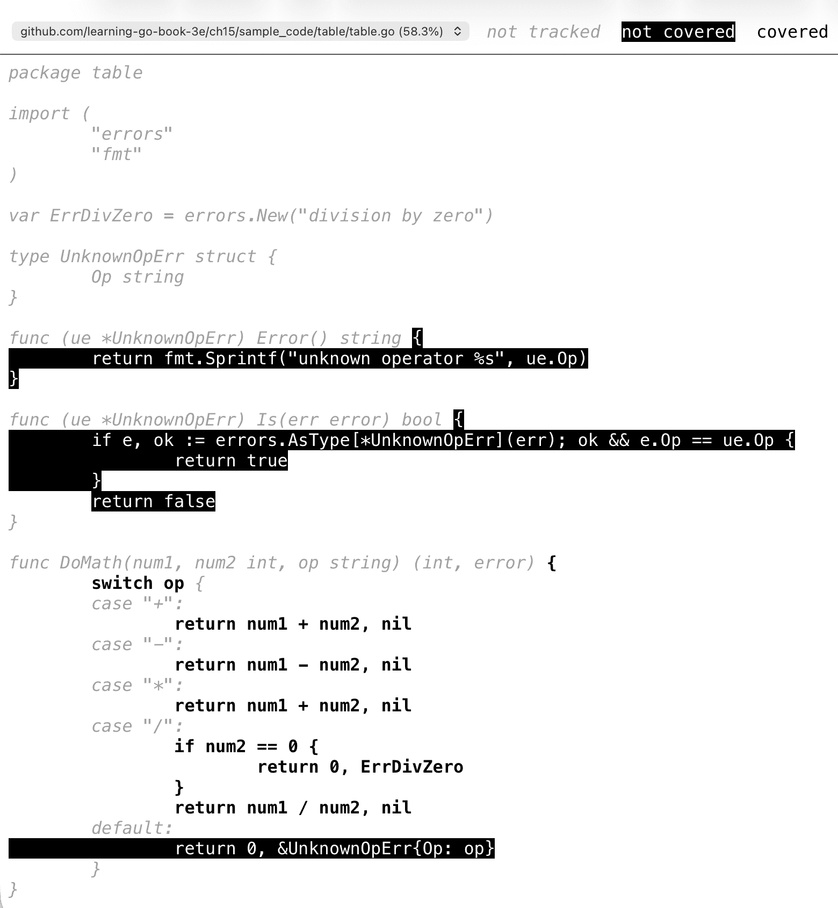
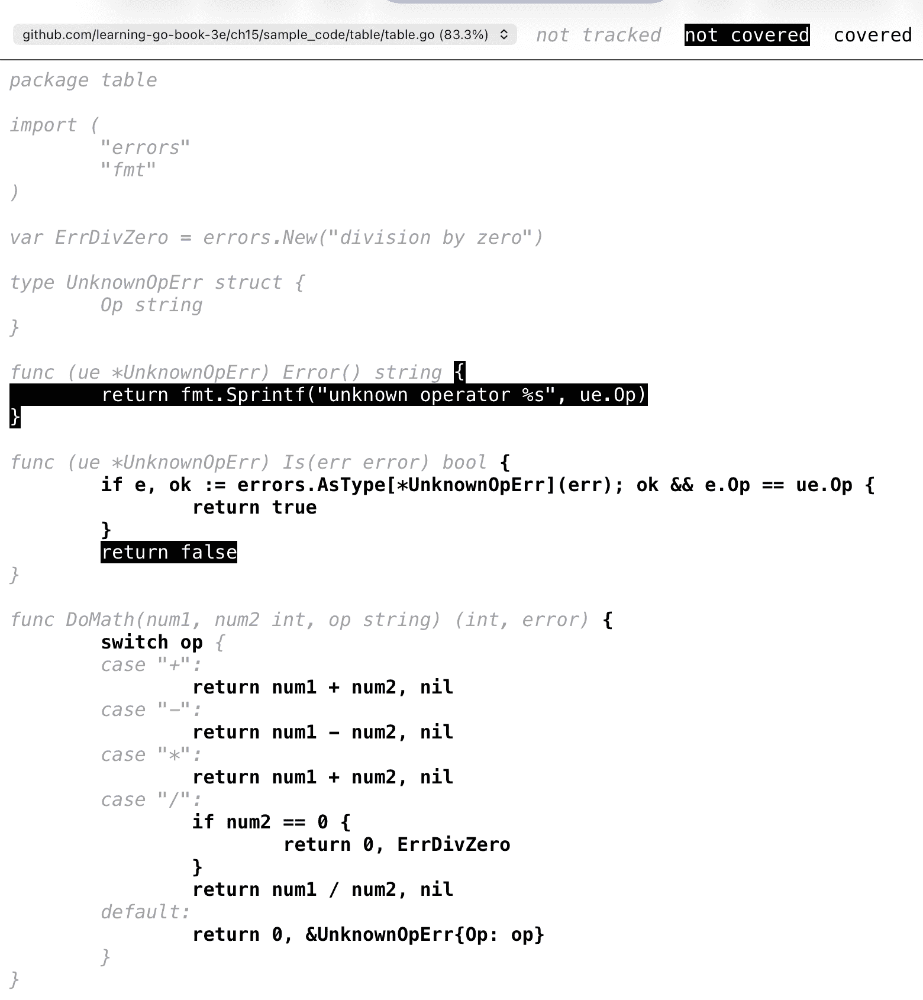

# Chapter 2. Writing Tests

自 2000 年代以来，自动化测试的广泛采用可能比任何其他软件工程技术都更能提高代码质量。作为一种专注于提高软件质量的语言和生态系统，Go 将测试支持作为其标准库的一部分也就不足为奇了。Go 让测试代码变得如此简单，没有理由不去做。

在本章中，你将看到如何测试 Go 代码，如何将测试分组为单元测试和集成测试，如何检查代码覆盖率，如何编写基准测试，以及如何使用 Go 数据竞争检测器检查代码中的并发问题。在此过程中，我将讨论如何编写可测试的代码以及为什么这能提高我们的代码质量。

## Understanding the Basics of Testing

Go 的测试支持分为两部分：库和工具。标准库中的 `testing` 包提供了编写测试的类型和函数，而随 Go 捆绑的 `go test` 工具则运行你的测试并生成报告。与许多其他语言不同，Go 将其测试放在与生产代码相同的目录和包中，因此它们可以访问和测试未导出的函数和变量。你稍后会看到如何编写测试以确保你只是在测试公共 API。

#### Note

本章的完整代码示例可在 [第 15 章仓库](https://github.com/learning-go-book-3e/ch15) 找到。

让我们编写一个简单的函数，然后编写一个测试来确保该函数正常工作。在 `sample_code/adder` 目录中，`adder.go` 文件中有以下内容：

```
func addNumbers(x, y int) int {
    return x + x
}
```

对应的测试在 `adder_test.go` 中：

```
func Test_addNumbers(t *testing.T) {
    result := addNumbers(2,3)
    if result != 5 {
        t.Error("incorrect result: expected 5, got", result)
    }
}
```

每个测试都写在一个文件名以 `_test.go` 结尾的文件中。如果你要对 `foo.go` 编写测试，请将测试放在名为 `foo_test.go` 的文件中。

测试函数以 `Test` 开头，并接受单个类型为 `*testing.T` 的参数。按惯例，该参数命名为 `t`。测试函数不返回任何值。测试的名称（除了以“Test”开头之外）旨在记录你正在测试的内容，因此请选择能解释你正在测试内容的名称。在为单个函数编写单元测试时，惯例是以 `Test` 加上函数名来命名单元测试。在测试未导出函数时，有些人会在 `Test` 和函数名之间使用下划线。

还要注意，你使用标准的 Go 代码来调用被测试的代码并验证响应是否符合预期。当结果不正确时，你使用 `t.Error` 方法报告错误，其工作原理类似于 `fmt.Print` 函数。你稍后会看到其他错误报告方法。


你刚刚看到了 Go 测试支持的库部分。现在让我们来看看工具部分。就像 `go build` 构建二进制文件而 `go run` 运行程序一样，命令 `go test` 运行当前目录中的测试函数：

```
$ go test
--- FAIL: Test_addNumbers (0.00s)
    adder_test.go:8: incorrect result: expected 5, got 4
FAIL
exit status 1
FAIL    test_examples/adder     0.006s
```

看起来你在代码中发现了一个 bug。仔细再看一下 `addNumbers`，你会发现你是在把 `x` 加到 `x` 上，而不是把 `x` 加到 `y` 上。让我们修改代码并重新运行测试以验证 bug 是否已修复：

```
$ go test
PASS
ok      test_examples/adder     0.006s
```

`go test` 命令允许你指定要测试的包。使用 `./...` 作为包名表示你想要在当前目录及其所有子目录中运行测试。加上 `-v` 标志可以获得详细的测试输出。

## Reporting Test Failures

` *testing.T` 上有几种方法用于报告测试失败。你已经见过 `Error`，它通过逗号分隔的值列表构建失败描述字符串。

如果你更愿意使用 `Printf`-风格的格式化字符串来生成消息，请改用 `Errorf` 方法：

```
t.Errorf("incorrect result: expected %d, got %d", 5, result)
```

虽然 `Error` 和 `Errorf` 会将测试标记为失败，但测试函数会继续运行。如果你认为测试函数在发现失败后应立即停止处理，请使用 `Fatal` 和 `Fatalf` 方法。`Fatal` 方法的工作方式与 `Error` 相同，而 `Fatalf` 方法的工作方式与 `Errorf` 相同。区别在于测试失败消息生成后测试函数会立即退出。请注意，这并不会退出 *所有* 测试；在当前测试函数退出后，剩余的测试函数仍会执行。

在什么情况下应使用 `Fatal`/`Fatalf`，什么情况下应使用 `Error`/`Errorf`？如果测试中某个检查的失败意味着同一测试函数中的后续检查总是会失败或导致测试 panic，则使用 `Fatal` 或 `Fatalf`。如果你正在测试多个独立项（例如验证结构体中的字段），则使用 `Error` 或 `Errorf`，这样可以一次报告多个问题。这使得在不反复重新运行测试的情况下更容易修复多个问题。

## Logging

在运行测试时输出额外信息通常很有帮助。Go 通过 `*testing.T` 上的方法集提供对测试日志记录器的访问。虽然你可以使用 `fmt.Println` 和 `fmt.Printf`，但最好使用测试日志记录器，因为其输出仅在测试失败时（或在你打开详细输出时）显示。

最常用的测试日志记录方法分别是 `Log` 和 `Logf`，它们提供未格式化和格式化的输出。日志消息会缩进并以日志语句的文件名和行号为前缀。

如果你的日志输出由外部工具处理，你可以使用 `Attr` 方法在输出中包含结构化数据。它接受两个字符串参数，一个键和一个值。键/值对的含义由你决定；唯一的限制是键中不能包含任何空白字符。该方法会写入一行，用空白分隔以下值：`===` `ATTR`、测试的名称、键和值。

最后，`Output` 方法提供了对测试日志记录器底层 `io.Writer` 的访问。与 `Log` 和 `Logf` 一样，使用此 `io.Writer` 写入的任何内容都会缩进，但没有文件名/行号前缀。

```
func TestLogging(t *testing.T) {
    fmt.Println("fmt.Println does work, but it's always there and unindented")
    t.Log("This is a simple string message")
    t.Logf("This message has %d %s specifiers in it", 2, "formatting")
    t.Attr("key_for_processing", "value_for_processing with whitespace")
    t.Output().Write([]byte("a final entry"))
}
```

此测试的输出如下：

```
$ go test -v
=== RUN   TestLogging
fmt.Println does work, but it's always there and unindented
    logging_test.go:10: This is a simple string message
    logging_test.go:11: This message has 2 formatting specifiers in it
=== ATTR  TestLogging key_for_processing value_for_processing with whitespace
    a final entry
--- PASS: TestLogging (0.00s)
PASS
ok      github.com/learning-go-book-3e/ch15/sample_code/logging 0.204s
```

## Saving Test Artifacts

有时捕获测试的输出文件（用于额外分析等）很有用。不要在测试代码中硬编码位置，利用 Go 的 artifact 目录支持。使用 `ArtifactDir` 方法获取应写入文件的目录名称。默认情况下，这是一个在测试完成后会被删除的临时目录。这使你能够控制 artifact 何时永久写入；生成 artifact 的代码始终存在，但你决定何时捕获新的 artifact。要使 artifact 永久化，在运行 `go test` 时设置 `-artifacts` 标志。这会将 artifact 目录更改为 `go test` 运行所在的目录的子目录。

```
func TestArtifacts(t *testing.T) {
    myDir := t.ArtifactDir()
    t.Log(myDir)
    f, err := os.Create(myDir + "/test.txt")
    if err != nil {
        t.Fatal(err)
    }
    defer f.Close()
    f.Write([]byte("valuable test data"))
}
```

```
$ go test -v
=== RUN   TestArtifacts
    artifact_test.go:10: /var/folders/hj/mr53lrfj1bqf4hg62wqkp4000000gn/T/TestArtifacts1377298058/001
--- PASS: TestArtifacts (0.00s)

$ go test -v -artifacts
=== RUN   TestArtifacts
=== ARTIFACTS TestArtifacts /Users/gobook/projects/learning-go-3e-code/ch15/sample_code/artifact/_artifacts/1837011095
    artifact_test.go:10: /Users/gobook/projects/learning-go-3e-code/ch15/sample_code/artifact/_artifacts/1837011095
--- PASS: TestArtifacts (0.00s)
```

#### Note

如果你想自定义 artifact 输出目录，请在 `go test` 上设置 `-outputdir` 标志。

## Setting Up and Tearing Down

有时你有一些需要在任何测试运行之前设置并在测试完成后移除的通用状态。使用 `TestMain` 函数来管理此状态并运行你的测试：

```
var testTime time.Time

func TestMain(m *testing.M) {
    fmt.Println("Set up stuff for tests here")
    testTime = time.Now()
    exitVal := m.Run()
    fmt.Println("Clean up stuff after tests here")
    os.Exit(exitVal)
}

func TestFirst(t *testing.T) {
    slog.Info("TestFirst uses stuff set up in TestMain", testTime)
}

func TestSecond(t *testing.T) {
    slog.Info("TestSecond also uses stuff set up in TestMain", testTime)
}
```

`TestFirst` 和 `TestSecond` 都引用包级变量 `testTime`。假设它需要在测试正常运行之前进行初始化。你声明一个名为 `TestMain` 的函数，其参数类型为 `*testing.M`。如果包中存在名为 `TestMain` 的函数，`go test` 会调用它而不是测试函数。`TestMain` 函数有责任设置使包中测试能够正确运行所需的任何状态。

一旦状态配置好，`TestMain` 函数就会在 `*testing.M` 上调用 `Run` 方法。这会运行包中的测试函数。`Run` 方法返回退出代码；`0` 表示所有测试都通过。最后，`TestMain` 函数必须使用从 `Run` 返回的退出代码调用 `os.Exit`。

对此运行 `go test` 会产生以下输出：

```
$ go test
Set up stuff for tests here
TestFirst uses stuff set up in TestMain 2026-03-30 23:10:55.190364 -0400 EDT
    m=+0.000474084
TestSecond also uses stuff set up in TestMain 2026-03-30 23:10:55.190364
    EDT m=+0.000474084
PASS
Clean up stuff after tests here
ok      test_examples/testmain  0.006s
```

#### Note

请注意，`TestMain` 只会被调用一次，而不是在每个单独测试之前和之后。你每个包只能有一个 `TestMain`。


`TestMain` 在两种常见情况下很有用：

* 当你需要在外部存储库中设置数据时，例如数据库
* 当被测试的代码依赖于需要初始化的包级变量时

正如我之前提到过的（并且还会再次提到！），你应该避免在程序中使用包级变量。它们使得理解数据如何在程序中流动变得困难。如果你因为这个原因而使用 `TestMain`，请考虑重构你的代码。

`*testing.T` 上的 `Cleanup` 方法用于清理为单个测试创建的临时资源。此方法只有一个参数：一个没有输入参数或返回值 的函数。该函数在测试完成时运行。对于简单的测试，你可以通过使用 `defer` 语句达到相同的效果，但当测试依赖于辅助函数来设置示例数据时，`Cleanup` 就很有用，就像在 Example 2-1 中看到的那样。调用 `Cleanup` 多次是可以的。就像 `defer` 一样，函数按最后添加、首先调用的顺序被调用。

### Example 2-1. Using `t.Cleanup`

```
// createFile is a helper function called from multiple tests
func createFile(t *testing.T) (_ string, err error) {
    f, err := os.Create("tempFile")
    if err != nil {
        return "", err
    }
    defer func() {
        err = errors.Join(err, f.Close())
    }()
    // write some data to f
    t.Cleanup(func() {
        os.Remove(f.Name())
    })
    return f.Name(), nil
}

func TestFileProcessing(t *testing.T) {
    fName, err := createFile(t)
    if err != nil {
        t.Fatal(err)
    }
    // do testing, don't worry about cleanup
}
```

如果你的测试使用临时文件，你可以通过利用 `*testing.T` 上的 `TempDir` 方法来避免编写清理代码。此方法每次调用时都会创建一个新的临时目录并返回该目录的完整路径。它还会向 `Cleanup` 注册一个处理程序，以便在测试完成后删除该目录及其内容。你可以用它来重写之前的示例：

// createFile is a helper function called from multiple tests
func createFile(tempDir string) (_ string, err error) {
    f, err := os.CreateTemp(tempDir, "tempFile")
    if err != nil {
        return "", err
    }
    defer func() {
        err = errors.Join(err, f.Close())
    }()
    // write some data to f
    return f.Name(), nil
}

func TestFileProcessing(t *testing.T) {
    tempDir := t.TempDir()
    fName, err := createFile(tempDir)
    if err != nil {
        t.Fatal(err)
    }
    // do testing, don't worry about cleanup
}
```

## Test Helpers

像 `createFile` 这样的函数有时被称为 *test helpers*，因为它们设置或拆除正确测试代码所需的 状态，但本身不执行任何测试。如果出现问题，通常是致命错误，因为测试在没有有效初始条件的情况下无法继续。为了将函数标记为测试辅助函数，惯用的做法是向这些函数传递一个 `*testing.T` 实例并在第一行添加对 `t.Helper` 的调用：

```
func TestFileProcessingWithCreateFileHelper(t *testing.T) {
    fName := createFileHelper(t)
    // do testing, don't worry about cleanup
    if !strings.Contains(fName, "tempFile") {
        t.Error("unexpected name")
    }
}

// createFileHelper is a helper function called from multiple tests
func createFileHelper(t *testing.T) string {
    t.Helper()
    tempDir := t.TempDir()
    f, err := os.CreateTemp(tempDir, "tempFile")
    if err != nil {
        t.Fatal(err)
    }
    // write some data to the file
    if err := f.Close(); err != nil {
        t.Fatal(err)
    }
    return f.Name()
}
```

当调用 `t.Helper` 时，它会修改测试辅助函数中对 `t.Error` 或 `t.Fatal` 的任何调用的输出。输出的不是测试辅助函数中行的文件名和行号，而是调用该测试辅助函数的测试函数中行的文件名和行号。 [Chapter 15 repository](https://github.com/learning-go-book-3e/ch15/tree/main/sample_code/helper) 中的 `sample_code/helper` 目录有一个示例。它也可在 [the Go Playground](https://go.dev/play/p/zboR2P3V4bl) 上获得。使用注释掉的 `t.Helper()` 行运行测试，然后取消注释并查看错误输出的差异。

永远不要在测试辅助函数中测试任何业务逻辑；只有在设置或拆除因某种原因失败时才使用 `t.Error` 或 `t.Fatal`。

## Testing with Environment Variables

使用环境变量配置应用程序是一种常见且非常好的做法。为了简化为依赖环境变量的代码编写测试，Go 在 `testing.T` 上提供了一个辅助方法。调用 `t.Setenv` 为你的测试注册环境变量的值。在幕后，它调用 `Cleanup` 在测试退出时将环境变量恢复到之前的状态：

// assume ProcessEnvVars is a function that processes environment variables
// and returns a struct with an OutputFormat field
func TestEnvVarProcess(t *testing.T) {
    t.Setenv("OUTPUT_FORMAT", "JSON")
    cfg := ProcessEnvVars()
    if cfg.OutputFormat != "JSON" {
        t.Error("OutputFormat not set correctly")
    }
    // value of OUTPUT_FORMAT is reset when the test function exits
}
```

#### Note

虽然使用环境变量来配置应用程序是好的，但也应确保应用程序的大部分代码完全不知道它们。请确保在程序开始工作之前，在你的 `main` 函数或紧随其后，将环境变量的值复制到配置结构体中。这样做使代码更易于重用和测试，因为 *如何* 配置代码与 *代码在做什么* 已被抽象开来。

与其自己编写此代码，你应强烈考虑使用第三方配置库，例如 [Viper](https://oreil.ly/-RUA-) 或 [envconfig](https://oreil.ly/rhGYk)。另外，查看 [GoDotEnv](https://oreil.ly/sN2Sp) 作为在开发或持续集成机器上将环境变量存储在 `*.env` 文件中的一种方式。

## Storing Sample Test Data

当 `go test` 遍历你的源代码树时，它使用当前包目录作为当前工作目录。如果你想使用示例数据来测试包中的函数，请创建一个名为 `testdata` 的子目录来保存你的文件。Go 将此目录名称保留为存放测试文件的位置。读取 `testdata` 时，始终使用相对文件引用。由于 `go test` 将当前工作目录更改为当前包，因此每个包都通过相对文件路径访问其自己的 `testdata`。

#### Tip

Chapter 15 仓库的 `sample_code` 目录中的 [`text` package](https://github.com/learning-go-book-3e/ch15/tree/main/sample_code/text) 演示了如何使用 `testdata`。

## Caching Test Results

正如你在第 10 章中学到的那样，如果包没有更改，Go 会缓存编译的包。Go 在跨多个包运行测试时也会缓存测试结果，如果它们已通过并且代码未更改。测试会在你更改包中的任何文件或 `testdata` 目录中的文件时重新编译并重新运行。你也可以通过向 `go test` 传递标志 `-count=1` 来强制测试始终运行。

## Testing Your Public API

你编写的测试与生产代码在同一个包中。这使你能够测试导出和未导出的函数。


如果只想测试包的公共 API，Go 有一种约定来指定这一点。你仍然将测试源代码保存在与生产源代码相同的目录中，但使用 `packagename_test` 作为包名。让我们使用导出的函数重新做初始测试用例。你可以在 [第 15 章仓库](https://github.com/learning-go-book-3e/ch15/tree/main/sample_code/pubadder) 的 `sample_code/pubadder` 目录中找到代码。在 `pubadder` 包的 `adder_public.go` 文件中，声明了以下导出函数：

```
func AddNumbers(x, y int) int {
    return x + y
}
```

你通过在 `pubadder` 包中名为 `adder_public_test.go` 的文件中使用以下代码来测试该函数作为公共 API：

```
package pubadder_test

import (
    "github.com/learning-go-book-3e/ch15/sample_code/pubadder"
    "testing"
)

func TestAddNumbers(t *testing.T) {
    result := pubadder.AddNumbers(2, 3)
    if result != 5 {
        t.Error("incorrect result: expected 5, got", result)
    }
}
```

注意测试文件的包名是 `pubadder_test`。即使文件在同一目录下，你也必须导入 `github.com/learning-go-book-3e/ch15/sample_code/pubadder`。为了遵循命名测试的约定，测试函数名与 `AddNumbers` 函数名相匹配。另请注意你使用 `pubadder.AddNumbers`，因为你正在调用另一个包中的导出函数。

就像你可以在包内部调用导出函数一样，你也可以从与源代码在同一包中的测试来测试你的公共 API。使用包名中 `_test` 后缀的优点是它让你将测试的包视为“黑盒”。你只能通过其导出的函数、方法、类型、常量和变量与之交互。

#### Tip

一个包可以包含使用 `_test` 后缀的包声明的测试源文件，同时也可以包含使用包名的测试源文件。这使你能够将导出的和未导出函数的测试组织到不同的文件中。

## Tests and the Context

在为期望 context 的函数编写测试时，如第 14 章所述，不要使用 `context.Background` 来生成 context。相反，使用 `t.Context`。这会返回一个 context，当测试退出时会自动取消，如果你使用 `t.Cleanup` 注册了任何函数，则在它们运行之前立即取消 context。使用测试 context 允许被测试的任何代码正确关闭。这包括在 context 取消时退出的 goroutine。在 “Quickly and Accurately Test Concurrent Code with `synctest`” 中，你将学习如何找到在 context 取消时未关闭的 goroutine。演示测试 context 的示例代码位于 [第 15 章仓库](https://github.com/learning-go-book-3e/ch15/tree/main/sample_code/oracle) 的 `sample_code/oracle` 目录中：

```
func TestOracle(t *testing.T) {
    ctx := t.Context()
    ch := oracle.Launch(ctx)
    outCh := make(chan string)
    ch <- oracle.Request{
        Query:    "Is the sky blue?",
        Response: outCh,
    }
    result := <-outCh
    if result != "Is the sky blue? Yes!" {
        t.Error("the oracle is wearing rose-tinted glasses")
    }
}
```

## Using go-cmp to Compare Test Results

编写复合类型两个实例的详细比较可能很冗长。虽然你可以使用 `reflect.DeepEqual` 来比较结构体、映射和切片，但有更好的方法。早在 2017 年，Google 发布了一个名为 [`go-cmp`](https://oreil.ly/9bWJf) 的第三方模块，它会为你进行比较并返回不匹配的详细描述。让我们通过定义一个简单的 `struct` 和一个填充它的工厂函数来看看它是如何工作的。你可以在 [第 15 章仓库](https://github.com/learning-go-book-3e/ch15/tree/main/sample_code/cmp) 的 `sample_code/cmp` 目录中找到此代码：

```
type Person struct {
    Name      string
    Age       int
    DateAdded time.Time
}

func CreatePerson(name string, age int) Person {
    return Person{
        Name:      name,
        Age:       age,
        DateAdded: time.Now(),
    }
}
```

在你的测试文件中，导入 `github.com/google/go-cmp/cmp`。测试函数如下所示：

```
func TestCreatePerson(t *testing.T) {
    expected := Person{
        Name: "Dennis",
        Age:  37,
    }
    result := CreatePerson("Dennis", 37)
    if diff := cmp.Diff(expected, result); diff != "" {
        t.Error(diff)
    }
}
```

`cmp.Diff` 函数接收期望的输出和被测试函数返回的输出。它返回一个描述两个输入之间任何不匹配的字符串。如果输入匹配，则返回空字符串。你将 `cmp.Diff` 函数的输出赋给名为 `diff` 的变量，然后检查 `diff` 是否为空字符串。如果不是，则发生了错误。

当你构建并运行测试时，你会看到当两个结构体实例不匹配时 `go-cmp` 生成的输出：

```
$ go test
--- FAIL: TestCreatePerson (0.00s)
    ch13_cmp_test.go:16:   ch13_cmp.Person{
              Name:      "Dennis",
              Age:       37,
        -     DateAdded: s"0001-01-01 00:00:00 +0000 UTC",
        +     DateAdded: s"2020-03-01 22:53:58.087229 -0500 EST m=+0.001242842",
          }

FAIL
FAIL    ch13_cmp    0.006s
```

带有 `-` 和 `+` 的行表示值不同的字段。测试失败是因为日期不匹配。这是个问题，因为你无法控制 `CreatePerson` 函数分配的日期。你必须忽略 `DateAdded` 字段。`go-cmp` 模块包含一个辅助包 `cmpopts`，其中包含提供对 `cmp.Diff` 执行的比较额外控制的函数。在这种情况下，使用 `cmpopts.IgnoreFields` 来忽略一个字段：

```
if diff := cmp.Diff(expected, result, cmpopts.IgnoreFields(Person{}, "DateAdded")); diff != "" {
    t.Error(diff)
}
```

这只是 `go-cmp` 中最有用功能的一个快速预览。查看其 [文档](https://oreil.ly/rmiWO) 以了解如何控制比较内容和输出格式。

## Running Table Tests

大多数情况下，验证函数是否正确工作需要不止一个测试用例。你可以编写多个测试函数来验证你的函数或在同一个函数中编写多个测试，但你会发现大量的测试逻辑是重复的。你设置支持数据和函数，指定输入，检查输出，并比较它们是否与你的期望相匹配。

而不是一遍遍地写这些，你可以利用一种称为 *table tests* 的模式。让我们看一个示例。你可以在 [第 15 章仓库](https://github.com/learning-go-book-3e/ch15/tree/main/sample_code/table) 的 `sample_code/table` 目录中找到此代码。假设你在 `table` 包中有以下函数：

```
func DoMath(num1, num2 int, op string) (int, error) {
    switch op {
    case "+":
        return num1 + num2, nil
    case "-":
        return num1 - num2, nil
    case "*":
        return num1 + num2, nil
    case "/":
        if num2 == 0 {
            return 0, ErrDivZero
        }
        return num1 / num2, nil
    default:
        return 0, &UnknownOpErr{Op: op}
    }
}
```

要测试此函数，你需要检查不同的分支，尝试返回有效结果的输入，以及触发错误的输入。你可以编写如下代码，但会非常重复：


```
func TestDoMath(t *testing.T) {
    result, err := DoMath(2, 2, "+")
    if result != 4 {
        t.Error("Should have been 4, got", result)
    }
    if err != nil {
        t.Error("Should have been nil error, got", err)
    }
    result2, err2 := DoMath(2, 2, "-")
    if result2 != 0 {
        t.Error("Should have been 0, got", result2)
    }
    if err2 != nil {
        t.Error("Should have been nil error, got", err2)
    }
    // and so on...
}
```

让我们用表格测试来替换这种重复。首先，声明一个匿名结构体切片。该结构体包含测试名称、输入参数和返回值字段。切片中的每个条目代表另一个测试：

```
data := []struct {
    name     string
    num1     int
    num2     int
    op       string
    expected int
    err      error
}{
    {"addition", 2, 2, "+", 4, nil},
    {"subtraction", 2, 2, "-", 0, nil},
    {"multiplication", 2, 2, "*", 4, nil},
    {"division", 2, 2, "/", 1, nil},
    {"bad_division", 2, 0, "/", 0, ErrDivZero},
}
```

接下来，遍历 `data` 中的每个测试用例，每次调用 `Run` 方法。这就是实现魔法的那一行。你向 `Run` 传递两个参数，一个子测试的名称和一个带有单个 `*testing.T` 类型参数的函数。在函数内部，你使用 `data` 中当前条目的字段调用 `DoMath`，反复使用相同的逻辑。当你运行这些测试时，你会发现它们不仅通过了，而且当你使用 `-v` 标志时，每个子测试现在也有一个名称：

```
for _, d := range data {
    t.Run(d.name, func(t *testing.T) {
        result, err := DoMath(d.num1, d.num2, d.op)
        if result != d.expected {
            t.Errorf("Expected %d, got %d", d.expected, result)
        }
        if !errors.Is(err, d.err) {
            t.Errorf("expected %v, got %v", d.err, err)
        }
    })
}
```

#### Tip

在测试中比较错误消息很脆弱，因为消息文本可能没有兼容性保证。如果你正在测试使用 `errors.New` 和 `fmt.Errorf` 创建错误的代码，你有两个选择：重写你的代码以使用自定义错误类型和哨兵错误，或比较消息并祈祷最好。最好重写你的代码。

## Running Tests Concurrently

默认情况下，单元测试是顺序运行的。由于每个单元测试都 supposed to 与其他每个单元测试独立，它们是并发的理想候选者。要使单元测试与其他测试并发运行，请在测试中的第一行对 `*testing.T` 调用 `Parallel` 方法：

```
func TestMyCode(t *testing.T) {
    t.Parallel()
    // rest of test goes here
}
```

标记为并行的测试会与其他标记为并行的测试并发运行。你也可以在表格测试内部调用 `Parallel`：

```
func TestParallelTable(t *testing.T) {
    data := []struct {
        name   string
        input  int
        output int
    }{
        {"a", 10, 20},
        {"b", 30, 40},
        {"c", 50, 60},
    }
    for _, d := range data {
        t.Run(d.name, func(t *testing.T) {
            t.Parallel()
            t.Log(d.input, d.output)
            out := toTest(d.input)
            if out != d.output {
                t.Error("didn't match", out, d.output)
            }
        })
    }
}
```

你可以在 [The Go Playground](https://oreil.ly/b0S4n) 上运行此代码，或在 [Chapter 15 repository](https://github.com/learning-go-book-3e/ch15/tree/main/sample_code/parallel) 的 `sample_code/parallel` 目录中运行。

并行测试的优点是它们可以加快长时间运行的测试套件的速度。也有一些缺点。如果你有多个依赖相同共享可变状态的测试，不要将它们标记为并行，因为你会得到不一致的结果。 （但在我所有的警告之后，你的应用程序中没有任何共享可变状态，对吧？）另外请注意，如果你将测试标记为并行并在测试函数中使用 `Setenv` 方法，你的测试将 panic。

#### Note

Go 1.22（于 2024 年 2 月发布）更改了 `for` 循环中索引和值变量的生命周期。如果索引和值变量有任何可能被闭包捕获的机会，编译器现在会在每次迭代时创建一个新的副本。这消除了使用共享索引和值状态的并行测试中的错误。如果你仍在使用 Go 1.21 或更早版本（或在 `go.mod` 文件中的 `go` 指令中将 Go 版本设置为 1.2.1 或更早版本），我强烈建议升级以利用这种改进的行为。

现在你有了一种运行大量测试的方法，你将学习代码覆盖率以了解你的测试正在测试什么。

## Exercises

这些练习帮助你练习 Go 测试的基础知识。它们位于 [Chapter 15 repository](https://github.com/learning-go-book-3e/ch15/tree/main/exercises) 的 `exercises` 目录中。解决方案位于 [Chapter 15 repository](https://github.com/learning-go-book-3e/ch15/tree/main/exercise-solutions) 的 `exercise-solutions` 目录中。

1. 在 `ex1` [directory](https://github.com/learning-go-book-3e/ch15/tree/main/exercises/ex1) 中，有一个名为 `calculator.go` 的文件，其中有一个名为 `Average` 的函数。创建一个 `calculator_test.go` 文件，其中包含一个用于测试 `Average` 的函数。如果你发现函数中的 bug，请修复 bug 并确认测试通过。

2. 在 `ex2` [directory](https://github.com/learning-go-book-3e/ch15/tree/main/exercises/ex2) 中，有一个名为 `temperature.go` 的文件，其中有一个名为 `Convert` 的函数。创建一个 `temperature_test.go` 文件，其中包含一个使用表格测试来验证所有输入和可能错误的函数。如果你发现函数中的 bug，请修复 bug 并确认测试通过。

3. 在 `ex3` [directory](https://github.com/learning-go-book-3e/ch15/tree/main/exercises/ex3) 中，有一个名为 `counter.go` 的文件，其中有一个名为 `TotalFile` 的函数。创建一个 `counter_test.go` 文件，其中包含一个用于测试 `TotalFile` 的函数。使用辅助函数创建好的和坏的示例数据。

## Checking Your Code Coverage

代码覆盖率是一个非常有用的工具，可以知道你是否遗漏了任何明显的情况。然而，达到 100% 的代码覆盖率并不能保证对于某些输入你的代码中没有 bug。首先你将看到 `go test` 如何显示代码覆盖率，然后你将查看仅依赖代码覆盖率的局限性。

向 `go test` 命令添加 `-cover` 标志会计算覆盖率信息并在测试输出中包含摘要。如果你包含第二个标志 `-coverprofile`，你可以将覆盖率信息保存到文件中。让我们回到 [Chapter 15 repository](https://github.com/learning-go-book-3e/ch15/tree/main/sample_code/table) 中 `sample_code/table` 目录并收集代码覆盖率信息：

```
$ go test -v -cover -coverprofile=c.out
```

如果你使用代码覆盖率运行表格测试，测试输出现在包含一行指示测试代码覆盖率的金额，87.5%。知道这一点很好，但如果你能看到你遗漏了什么会更有用。Go 随附的 `cover` 工具生成源代码的 HTML 表示，其中包含该信息：

```
$ go tool cover -html=c.out
```

当你运行它时，你的网络浏览器会打开并显示一个页面，其中使用深色模式配色方案显示代码覆盖率信息。每个被测试的文件都会出现在左上角的组合框中。源代码有三种颜色之一。灰色用于不可测试的代码行，绿色用于已被测试覆盖的代码，红色用于未被测试的代码。这种对颜色的依赖对于红绿色盲的人来说是不幸的（以及那些出版商不想打印大块黑色墨水的人）。为了解决这个问题，我创建了一个 [fork of the cover tool](https://github.com/jonbodner/coverlight)。使用以下方法安装并运行它：


```
$ go install github.com/jonbodner/coverlight@latest
$ coverlight -html c.out
```

打开的页面应类似于 Figure 2-1。有测试覆盖的代码以黑色显示，没有测试覆盖的代码以白字黑底显示，而不可测试的代码行则使用灰色。从中可以看到，你没有为当向函数传入错误操作符时的默认情况编写测试。向你的测试用例切片中添加该情况：

```
{"bad_op", 2, 2, "?", 0, &UnknownOpErr{Op: "?"}},
```

当你重新运行 `go test -v -cover -coverprofile=c.out` 和 `coverlight -html c.out` 时，你会在 Figure 2-2 中看到 `DoMath` 中的最后一行已被覆盖。`UnknownOppErr` 的方法仍然缺少代码覆盖。我将把编写额外测试以获得 100% 测试代码覆盖率作为读者的练习留下来。



代码覆盖率是一件很棒的事情，但它是不够的。即使你有 100% 的覆盖率，你的代码中仍然存在一个 bug。你注意到它了吗？如果没有，添加另一个测试用例并重新运行你的测试：

```
{"another_mult", 2, 3, "*", 6, nil},
```

你应该会看到错误：

```
table_test.go:60: Expected 6, got 5
```

你的乘法用例有一个拼写错误。它把数字加在一起而不是相乘。 （警惕复制粘贴编码的危险！）修复代码，重新运行 `go test -v -cover -coverprofile=c.out` 和 `go tool cover -html=c.out`，你会看到测试再次通过。

#### Warning

代码覆盖率是必要的但不充分。你可以有 100% 的代码覆盖率，同时代码中仍然存在 bug！

## Fuzzing

每个开发者最终都会学到的最重要教训之一是，所有数据都是可疑的。无论数据格式规范得多么好，你最终都必须处理与预期不符的输入。这不仅仅是因为恶意原因。数据在传输、存储甚至内存中都可能损坏。处理数据的程序可能存在 bug，而数据格式的规范总是有开发者以不同方式解释的边界情况。

即使开发者做了编写良好单元测试的工作，也不可能考虑到一切。正如你所见，即使是 100% 的单元测试代码覆盖率也不能保证你的代码没有 bug。你需要用可能以你未预料的方式破坏程序的生成数据来补充单元测试。这就是模糊测试的用武之地。

*Fuzzing* 是一种生成随机数据并将其提交给代码以查看其是否能正确处理意外输入的技术。开发者可以提供一个 *seed corpus* 或一组已知良好的数据，模糊测试器会以此为基础生成不良输入。让我们看看如何使用 Go 测试工具中的模糊测试支持来发现额外的测试用例。

假设你正在编写一个处理数据文件的程序。你可以在 [on GitHub](https://github.com/learning-go-book-3e/file_parser) 找到此示例的代码。你发送一个字符串列表但希望高效分配内存，因此文件中的字符串数量作为第一行发送，而其余行是文本行。以下是处理此数据的示例函数：

```
func ParseData(r io.Reader) ([]string, error) {
    s := bufio.NewScanner(r)
    if !s.Scan() {
        return nil, ErrEmpty
    }
    countStr := s.Text()
    count, err := strconv.Atoi(countStr)
    if err != nil {
        return nil, &ParseError{CountStr: countStr}
    }
    out := make([]string, 0, count)
    for range count {
        hasLine := s.Scan()
        if !hasLine {
            return nil, ErrTooFewLines
        }
        line := s.Text()
        out = append(out, line)
    }
    return out, nil
}
```

你使用一个 `bufio.Scanner` 按行从 `io.Reader` 读取。如果没有数据可读，则返回错误。然后你读取第一行并尝试将其转换为名为 `count` 的 int。如果转换失败，则返回错误。接下来，你为字符串切片分配内存，并从扫描器读取 `count` 个行。如果行数不足，则返回错误。如果一切顺利，你返回读取的行。

已经编写了一个单元测试来验证代码：

```
func TestParseData(t *testing.T) {
    data := []struct {
        name string
        in   []byte
        out  []string
        err  error
    }{
        {
            name: "simple",
            in:   []byte("3\nhello\ngoodbye\ngreetings\n"),
            out:  []string{"hello", "goodbye", "greetings"},
            err:  nil,
        },
        {
            name: "empty_error",
            in:   []byte(""),
            out:  nil,
            err:  ErrEmpty,
        },
        {
            name: "zero",
            in:   []byte("0\n"),
            out:  []string{},
            err:  nil,
        },
        {
            name: "number_error",
            in:   []byte("asdf\nhello\ngoodbye\ngreetings\n"),
            out:  nil,
            err:  &ParseError{CountStr: "asdf"},
        },
        {
            name: "line_count_error",
            in:   []byte("4\nhello\ngoodbye\ngreetings\n"),
            out:  nil,
            err:  ErrTooFewLines,
        },
    }
    for _, d := range data {
        t.Run(d.name, func(t *testing.T) {
            r := bytes.NewReader(d.in)
            out, err := ParseData(r)
            if !errors.Is(err, d.err) {
                t.Errorf("expected %v, got %v", d.err, err)
            }
            if diff := cmp.Diff(d.out, out); diff != "" {
                t.Error(diff)
            }
        })
    }
}
```

单元测试对 `ParseData` 实现了 100% 的行覆盖，处理了所有错误情况。你可能会认为代码已准备好投入生产，但让我们看看模糊测试是否能帮助你发现尚未考虑到的错误。

#### Note

请注意，模糊测试会使用大量资源。模糊测试可能会分配（或尝试分配）数 GB 的内存，并可能向本地磁盘写入数 GB 的数据。如果你同时在同一台机器上运行其他东西，不要惊讶如果它变慢了。

首先编写一个模糊测试：

```
func FuzzParseData(f *testing.F) {
    testcases := [][]byte{
        []byte("3\nhello\ngoodbye\ngreetings\n"),
        []byte("0\n"),
    }
    for _, tc := range testcases {
        f.Add(tc) // Use f.Add to provide a seed corpus
    }
    f.Fuzz(func(t *testing.T, in []byte) {
        r := bytes.NewReader(in)
        out, err := ParseData(r)
        if err != nil {
            t.Skip("handled error")
        }
        roundTrip := ToData(out)
        rtr := bytes.NewReader(roundTrip)
        out2, _ := ParseData(rtr)
        if diff := cmp.Diff(out, out2); diff != "" {
            t.Error(diff)
        }
    })
}
```

模糊测试看起来与标准单元测试相似。函数名以 `Fuzz` 开头，唯一参数的类型为 `*testing.F`，且没有返回值。

接下来，设置一个种子语料库，它由一个或多个样本数据集组成。数据可以成功运行、报错，甚至 panic。重要的是，你知道当提供这些数据时程序的行为如何，并且这种行为已由你的模糊测试考虑在内。这些样本会被模糊测试器变异以生成不良输入。此示例对每个条目仅使用一个数据字段（字节切片），但你可以根据需要拥有任意多个字段。语料库条目的字段目前仅限于某些类型：

*   任何整数类型（包括无符号类型、`rune` 和 `byte`）

*   任何浮点类型

*   `bool`

*   `string`

*   `[]byte`

语料库中的每个条目都传递给 `*testing.F` 实例上的 `Add` 方法。在示例中，每个条目都是一个字节切片：

```
f.Add(tc)
```


如果被模糊测试的函数需要一个 `int` 和一个 `string`，对 `Add` 的调用看起来像这样：

```
f.Add(1, "some text")
```

向 `Add` 传递无效类型的值是运行时错误。

接下来，在你的 `*testing.F` 实例上调用 `Fuzz` 方法。这看起来有点像在标准单元测试中编写表测试时对 `Run` 的调用。`Fuzz` 接受一个单一参数，一个函数，其第一个参数的类型为 `*testing.T`，其余参数必须与传入 `Add` 的值的类型、顺序和数量完全匹配。这也指定了模糊测试引擎在模糊测试期间生成的数据类型。Go 编译器无法强制执行此约束，因此如果未遵循约定，则为运行时错误。

最后，让我们看看模糊测试目标的主体。记住，模糊测试用于查找未正确处理坏输入的情况。由于输入是随机生成的，你无法编写了解输出应为的内容的测试。相反，你必须使用对所有输入都为真的测试条件。在 `ParseData` 的情况下，你可以检查两件事：

* 代码是否对坏输入返回错误，还是会 panic？
* 如果你将字符串切片转换回字节切片并重新解析它，是否得到相同的结果？

让我们看看运行模糊测试时会发生什么：

```
$ go test -fuzz=FuzzParseData
fuzz: elapsed: 0s, gathering baseline coverage: 0/137 completed
failure while testing seed corpus entry: FuzzParseData/03f81b404ad91d09
fuzz: elapsed: 3s, gathering baseline coverage: 2/137 completed
--- FAIL: FuzzParseData (2.92s)
    --- FAIL: FuzzParseData (0.00s)
        testing.go:1927: panic: runtime error: makeslice: cap out of range
            goroutine 12 [running]:
            runtime/debug.Stack()
                /opt/homebrew/opt/go/libexec/src/runtime/debug/stack.go:26 +0xc4
            testing.tRunner.func1()
                /opt/homebrew/opt/go/libexec/src/testing/testing.go:1927 +0x218
            panic({0x100ca49c0?, 0x100ce5dc0?})
                /opt/homebrew/opt/go/libexec/src/runtime/panic.go:860 +0x12c
            file_parser.ParseData({0x100ce7a40?, 0x10e411dfcf30?})
                file_parser/file_parser.go:46 +0x134
```

如果你不指定 `-fuzz` 标志，你的模糊测试将被视为单元测试并针对种子语料库运行。一次只能模糊一个模糊测试。

#### Note

如果你想获得完整的体验，删除 `*testdata/fuzz/FuzzParseData*` 目录的内容。这将导致模糊器生成新的种子语料库条目。由于模糊器生成随机输入，你的样本可能与所示的不同。不同的条目可能会产生类似的错误，尽管可能顺序不同。

模糊测试运行，少于一秒后，它报告了一个 panic。Panic 很糟糕，所以让我们看看生成的输入。每当测试用例失败时，模糊器都会将其写入与失败测试相同的包中的 `*testdata/fuzz/TESTNAME*` 子目录中，并向种子语料库添加一个新条目。此自动生成的单元测试在调用 `go test -fuzz=FuzzParseData` 时运行，并在你修复错误后充当回归测试。

以下是该文件的内容：

```
go test fuzz v1
[]byte("-1")
```

第一行是标头，用于指示这是模糊测试的测试数据。后续行包含导致失败的数据。

将失败消息中的文件名作为 `-run` 参数传递给 `go test` 允许你在重新运行测试时隔离此失败情况：

```
$ go test -run=FuzzParseData/03f81b404ad91d09
--- FAIL: FuzzParseData (0.00s)
    --- FAIL: FuzzParseData/03f81b404ad91d09 (0.00s)
panic: runtime error: makeslice: cap out of range [recovered, repanicked]
```

生成 panic 的行如下所示：

```
out := make([]string, 0, count)
```

你正在尝试创建一个具有负容量的切片，这会导致 panic。针对这种情况的错误类型已为你准备好。添加条件在调用 `make` 之前检查负数：

```
if count < 0 {
    return nil, ErrNegative
}
```

如果你运行 `go test -run=FuzzParseData/03f81b404ad91d09`，你会看到测试现在通过了。再次运行模糊器，看看它是否能找到更多错误：

```
$ go test -fuzz=FuzzParseData
fuzz: elapsed: 0s, gathering baseline coverage: 0/137 completed
failure while testing seed corpus entry: FuzzParseData/0e4ad8073b1a5373
fuzz: elapsed: 3s, gathering baseline coverage: 2/137 completed
--- FAIL: FuzzParseData (2.95s)
    --- FAIL: FuzzParseData (0.00s)
        file_parser_test.go:87:   []string{
              ... // 3 identical elements
              "",
              "",
            -  "\r",
            +  "",
              "0",
            }
```

这次，模糊器创建的输入文件如下所示：

```
go test fuzz v1
[]byte("7\n\n\n\n\n\n\r\r\n0")
```

模糊测试正在生成带有 `\r`（回车）字符的空白行。空白行在你的输入中是不期望的，因此向读取 `Scanner` 文本行的循环添加一些代码。你将检查一行是否仅由空白字符组成。如果是，则返回错误：

```
line = strings.TrimSpace(line)
if len(line) == 0 {
    return nil, ErrBlankLine
}
```

使用 `go test -run=FuzzParseData/0e4ad8073b1a5373` 验证你是否修复了错误，然后再次运行模糊器，看看它是否能找到更多错误：

```
$ go test -fuzz=FuzzParseData
fuzz: elapsed: 0s, gathering baseline coverage: 0/137 completed
fuzz: elapsed: 3s, gathering baseline coverage: 136/137 completed
fuzz: elapsed: 6s, gathering baseline coverage: 136/137 completed
fuzz: elapsed: 9s, gathering baseline coverage: 136/137 completed
failure while testing seed corpus entry: FuzzParseData/e8bf251ff804c663
fuzz: elapsed: 11s, gathering baseline coverage: 136/137 completed
--- FAIL: FuzzParseData (10.83s)
    fuzzing process hung or terminated unexpectedly: exit status 2
```

在这种情况下，`go` 命令报告你的程序“挂起或意外终止”。我们不希望程序挂起或终止，无论是否预期，所以让我们查看生成的测试用例以弄清出了什么问题：

```
go test fuzz v1
[]byte("3000000000000")
```

问题是你正在尝试分配一个容量足以容纳 3 万亿个字符串的切片。这需要比我的电脑（可能也比你的）更多的 RAM。你需要将预期文本元素的数量限制为合理数量。使用哨兵错误 `ErrTooManyLines` 并将最大行数设置为 1,000，通过在 `ParseData` 中解析预期行数后添加以下代码：

```
if count > 1000 {
    return nil, ErrTooManyLines
}
```

使用 `go test -run=FuzzParseData/e8bf251ff804c663` 验证错误是否已修复，并再次运行模糊器：

```
$ go test -fuzz=FuzzParseData
fuzz: elapsed: 0s, gathering baseline coverage: 0/147 completed
fuzz: elapsed: 0s, gathering baseline coverage: 147/147 completed,
    now fuzzing with 16 workers
fuzz: elapsed: 3s, execs: 1568753 (522795/sec), new interesting: 1 (total: 148)
fuzz: elapsed: 6s, execs: 3134921 (522087/sec), new interesting: 1 (total: 148)
fuzz: elapsed: 9s, execs: 4652294 (505854/sec), new interesting: 1 (total: 148)
...
fuzz: elapsed: 2m9s, execs: 59383661 (416674/sec), new interesting: 2 (total: 149)
fuzz: elapsed: 2m12s, execs: 60694659 (436957/sec), new interesting: 3 (total: 150)
fuzz: elapsed: 2m15s, execs: 61976072 (427059/sec), new interesting: 3 (total: 150)
^C
PASS
```

几分钟后，没有发现更多错误，因此按 Ctrl-C 结束模糊测试。


仅仅因为模糊测试没有找到额外的问题，并不意味着代码现在就无 bug 了。然而，模糊测试让你能够自动发现原始代码中的一些重大疏忽。编写模糊测试需要练习，因为它们需要的思维方式与编写单元测试略有不同。一旦你掌握了它们，它们就成为验证你的代码如何处理意外用户输入的重要工具。

## 使用基准测试

确定代码运行速度（或慢）是令人惊讶的困难。与其自己去弄明白，不如使用 Go 测试框架内置的基准测试支持。让我们用 [第 15 章仓库](https://github.com/learning-go-book-3e/ch15/tree/main/sample_code/bench) 中 `sample_code/bench` 目录下的一个函数来探索它：

```
func FileLen(f string, bufsize int) (int, error) {
    file, err := os.Open(f)
    if err != nil {
        return 0, err
    }
    defer file.Close()
    count := 0
    for {
        buf := make([]byte, bufsize)
        num, err := file.Read(buf)
        count += num
        if err != nil {
            break
        }
    }
    return count, nil
}
```

此函数计算文件中的字符数。它接收两个参数，文件名和用于读取文件的缓冲区的大小（你很快就会看到第二个参数的原因）。

在查看其速度之前，先测试你的库以确保它能正常工作（它确实可以）。这是一个简单的测试：

```
func TestFileLen(t *testing.T) {
    result, err := FileLen("testdata/data.txt", 1)
    if err != nil {
        t.Fatal(err)
    }
    if result != 65204 {
        t.Error("Expected 65204, got", result)
    }
}
```

现在你可以看看你的文件长度函数运行需要多长时间。你的目标是找出应该使用多大的缓冲区从文件中读取。

#### Note

在你花费时间钻进优化的兔子洞之前，请确保你需要优化。如果你的程序已经足够快以满足你的响应性要求，并且使用的内存量是可以接受的，那么你的时间最好花在添加功能和修复 bug 上。你的业务需求决定了“足够快”和“可接受的内存量”的含义。

在 Go 中，*基准测试* 是你在测试文件中以 `Benchmark` 开头的函数，并且接收单个类型为 `*testing.B` 的参数。此类型包含 `*testing.T` 的所有功能以及基准测试的额外支持。让我们先来看一个使用 1 字节缓冲区的基准测试：

```
func BenchmarkFileLen1(b *testing.B) {
    for b.Loop() {
        _, err := FileLen("testdata/data.txt", 1)
        if err != nil {
            b.Fatal(err)
        }
    }
}
```

Go 1.24 引入了 `*testing.B` 上的 `Loop` 方法。它管理了你在 Go 早期版本中必须手动完成的两件事。第一件事是循环适当的次数。测试框架会一遍又一遍地调用你的基准测试函数，使用越来越大的值，直到它确信计时结果是准确的。使用 `b.Loop` 可确保正确完成此操作。

`b.Loop` 方法做的另一件事是防止优化。编译器很聪明。它们可以自动删除计算或函数调用，其值永远不会被使用。在生产环境中运行程序时这很棒，但如果你在基准测试中调用一个函数来查看其速度快慢，而你并不关心结果，这就没那么好了。编译器可能会从基准测试中删除函数调用，这没有帮助。

为了解决这个问题，Go 编译器有一个特殊规则，当它看到正在编译一个带有 `for b.Loop` 循环的基准测试时。在这种情况下，它确保 `for` 循环体中的内容不会从编译后的代码中删除。

使用 `for b.Loop` 模式，测试框架会重复调用你的基准测试函数，直到它确信计时结果是准确的。你将在稍后的输出中看到这一点。

你通过向 `go test` 传递 `-bench` 标志来运行基准测试。此标志期望一个正则表达式来描述要运行的基准测试的名称。使用 `-bench=.` 运行所有基准测试。第二个标志 `-benchmem` 在基准测试输出中包含内存分配信息。所有测试都在基准测试之前运行，因此你只能在测试通过时对代码进行基准测试。

这是我在我的电脑上基准测试的输出：

```
BenchmarkFileLen1-16  44 24379298 ns/op  128 B/op  3 allocs/op
```

使用内存分配信息运行基准测试会产生五列输出。以下是每列的含义：

`BenchmarkFileLen1-16`

: 

基准测试的名称、一个连字符，以及基准测试的 `GOMAXPROCS` 值。

`44`

: 

测试运行的次数以产生稳定结果。

`24379298 ns/op`

: 

运行此基准测试单次迭代所需的时间，以纳秒为单位（每秒十亿纳秒）。

`128 B/op`

: 

基准测试单次迭代期间分配的字节数。

`3 allocs/op`

: 

基准测试单次迭代期间从堆分配字节的次数。这将始终小于或等于分配的字节数。

正如我在 Memory 部分所介绍的，我们关心在堆上分配的字节数以及程序从堆分配的次数，因为堆分配会为垃圾回收器带来更多工作。你的程序花费在垃圾回收上的时间越多，花在你编写它所要完成的工作上的时间就越少。

现在你已经有了 1 字节缓冲区的基准测试结果，让我们看看使用不同大小缓冲区的基准测试结果会是什么样：

```
func BenchmarkFileLen(b *testing.B) {
    for _, v := range []int{1, 10, 100, 1000, 10000, 100000} {
        b.Run(fmt.Sprintf("FileLen-%d", v), func(b *testing.B) {
            for b.Loop() {
                _, err := FileLen("testdata/data.txt", v)
                if err != nil {
                    b.Fatal(err)
                }
            }
        })
    }
}
```

正如你使用 `t.Run` 启动表测试一样，你正在使用 `b.Run` 启动仅基于输入而变化的基准测试。这是我的电脑上此基准测试的结果：

```
BenchmarkFileLen/FileLen-1-16          49  24230445 ns/op     128 B/op    3 allocs/op
BenchmarkFileLen/FileLen-10-16        489   2458019 ns/op     128 B/op    3 allocs/op
BenchmarkFileLen/FileLen-100-16      4214    269902 ns/op   73376 B/op  657 allocs/op
BenchmarkFileLen/FileLen-1000-16    29570     40574 ns/op   68736 B/op   70 allocs/op
BenchmarkFileLen/FileLen-10000-16   72368     16581 ns/op   82048 B/op   11 allocs/op
BenchmarkFileLen/FileLen-100000-16  62640     19032 ns/op  213121 B/op    5 allocs/op
```

这些结果的一部分是预期的，部分令人惊讶。随着缓冲区大小的增加，读取所有数据所需的循环次数减少，你的代码运行得更快，直到缓冲区大于文件。当缓冲区大于文件大小时，额外的分配会减慢输出。如果你期望文件大小大致如此，10,000 字节的缓冲区效果最好。

在 Slice Stack 部分，我提到切片有时可以分配在栈上而不是堆上；此基准测试提供了演示。1 字节和 10 字节的缓冲区使用的堆内存很少，因为它们是在栈上分配的。`benchmem` 标志仅显示昂贵的堆分配，而不是廉价的栈分配。对于更大的缓冲区，使用堆。

但你可以做出一个改进数字的更改。你每次从文件中获取下一组字节时都会重新分配缓冲区。这是没有必要的。如果你将字节切片分配移到循环之前并重新运行基准测试，你会看到改进：


```
BenchmarkFileLen/FileLen-1-16          48  24040199 ns/op     128 B/op  3 allocs/op
BenchmarkFileLen/FileLen-10-16        490   2435033 ns/op     128 B/op  3 allocs/op
BenchmarkFileLen/FileLen-100-16      4680    255315 ns/op     240 B/op  4 allocs/op
BenchmarkFileLen/FileLen-1000-16    34837     34776 ns/op    1152 B/op  4 allocs/op
BenchmarkFileLen/FileLen-10000-16   93732     12751 ns/op   10368 B/op  4 allocs/op
BenchmarkFileLen/FileLen-100000-16  84337     14236 ns/op  106624 B/op  4 allocs/op
```

分配次数现在保持一致且很小：对于每种缓冲区大小只有三次或四次。有趣的是，你现在可以做出权衡。如果内存紧张，你可以使用更小的缓冲区大小，在牺牲性能的情况下节省内存。

如果基准测试显示你存在性能或内存问题，下一步就是弄清楚问题的具体所在。Go 包含用于从正在运行的程序中收集 CPU 和内存使用数据的分析工具，以及帮助你可视化和解释生成数据的工具。你甚至可以公开一个 Web 服务端点，从正在运行的 Go 服务远程收集分析信息。这些数据甚至可以在编译时用于自动改进性能。我在第 17 章中谈论了对代码进行仪器化以及理解分析数据>>。

## benchstat

你如何跟踪代码不同版本之间的性能变化，又如何知道差异是否显著？你可以肉眼查看输出并尝试记住，但最好使用 `benchstat`，这是一个由 Go 团队构建的工具，可自动化该过程。使用以下命令将 `benchstat` 添加到你的 Go 模块中：

```
go get -tool golang.org/x/perf/cmd/benchstat
```

在为 `benchstat` 捕获基准测试时，你需要多次运行它们并将输出保存到磁盘。`-count` 标志控制每次基准测试运行的次数；默认设置为 10：

```
go test -bench=BenchmarkFileLen$ -count=10 -benchmem > base.txt
## move the allocation from inside the for loop to before the for loop
go test -bench=BenchmarkFileLen$ -count=10 -benchmem > new.txt
```

使用 `go tool benchstat base.txt new.txt` 比较运行结果。以下是通过对 `FileLen` 函数最后两个版本运行 `benchstat` 我得到的结果：

```
$ go tool benchstat base.txt new.txt
goos: darwin
goarch: arm64
pkg: github.com/learning-go-book-3e/ch15/sample_code/bench
cpu: Apple M3 Max
                          │  base.txt   │               new.txt               │
                          │   sec/op    │   sec/op     vs base                │
FileLen/FileLen-1-16        23.83m ± 1%   23.80m ± 0%        ~ (p=0.796 n=10)
FileLen/FileLen-10-16       2.433m ± 1%   2.412m ± 0%   -0.85% (p=0.000 n=10)
FileLen/FileLen-100-16      263.3µ ± 2%   249.4µ ± 1%   -5.31% (p=0.000 n=10)
FileLen/FileLen-1000-16     38.93µ ± 1%   33.80µ ± 0%  -13.18% (p=0.000 n=10)
FileLen/FileLen-10000-16    16.13µ ± 2%   12.69µ ± 2%  -21.35% (p=0.000 n=10)
FileLen/FileLen-100000-16   19.02µ ± 2%   14.15µ ± 1%  -25.60% (p=0.000 n=10)
geomean                     238.1µ        210.5µ       -11.63%

                          │   base.txt    │                new.txt                 │
                          │     B/op      │     B/op      vs base                  │
FileLen/FileLen-1-16           128.0 ± 0%     128.0 ± 0%        ~ (p=1.000 n=10) ¹
FileLen/FileLen-10-16          128.0 ± 0%     128.0 ± 0%        ~ (p=1.000 n=10) ¹
FileLen/FileLen-100-16       73040.0 ± 0%     240.0 ± 0%  -99.67% (p=0.000 n=10)
FileLen/FileLen-1000-16     66.125Ki ± 0%   1.125Ki ± 0%  -98.30% (p=0.000 n=10)
FileLen/FileLen-10000-16     80.12Ki ± 0%   10.12Ki ± 0%  -87.36% (p=0.000 n=10)
FileLen/FileLen-100000-16    208.1Ki ± 0%   104.1Ki ± 0%  -49.97% (p=0.000 n=10)
geomean                      10.35Ki        1.277Ki       -87.66%
¹ all samples are equal

                          │   base.txt   │               new.txt                │
                          │  allocs/op   │ allocs/op   vs base                  │
FileLen/FileLen-1-16          3.000 ± 0%   3.000 ± 0%        ~ (p=1.000 n=10) ¹
FileLen/FileLen-10-16         3.000 ± 0%   3.000 ± 0%        ~ (p=1.000 n=10) ¹
FileLen/FileLen-100-16      654.000 ± 0%   4.000 ± 0%  -99.39% (p=0.000 n=10)
FileLen/FileLen-1000-16      69.000 ± 0%   4.000 ± 0%  -94.20% (p=0.000 n=10)
FileLen/FileLen-10000-16     11.000 ± 0%   4.000 ± 0%  -63.64% (p=0.000 n=10)
FileLen/FileLen-100000-16     5.000 ± 0%   4.000 ± 0%  -20.00% (p=0.000 n=10)
geomean                       16.78        3.634       -78.34%
¹ all samples are equal
```

第一个表显示 CPU 时间的差异，第二个显示堆上分配的字节数差异，第三个显示从堆上分配内存的次数差异。每个数字都给出了方差范围（例如 ± 1%）；越低越好。p 值范围从 0 到 1，告诉你比较是否有效。0 表示你可以信任结果，1 表示你不能，中间的数字表示信任程度。如果基准情况和新情况之间的差异在统计上不显著，你会看到 p 的高值；可以忽略它。在其他情况下，p 值小于 0.05 是理想的。

如果方差或 p 值很高，请确保在收集基准数据时你的计算机没有忙于运行其他任务。你也可以使用 `-count` 标志增加基准测试运行次数，或使用 `-benchtime` 标志强制每次基准测试运行设定的秒数（`-benchtime=2s` 表示运行两秒）或运行设定的次数（`-benchtime=100000x` 强制每次基准测试运行 100,000 次）。

## 使用数据竞争检测器查找并发数据访问问题

即使有 Go 内置的并发支持，错误仍然会发生。很容易在没有获取锁的情况下从两个不同的 goroutine 引用同一个变量。计算机科学术语称之为 *data race*。为了帮助找到这类错误，Go 包含一个 *race checker*。它不能保证能找到代码中的每一个数据竞争，但如果它找到了一个，你应该在它找到的地方加上适当的锁。

看看 `sample_code/race/race.go` 文件中的一个简单示例，该文件位于 [Chapter 15 repository](https://github.com/learning-go-book-3e/ch15/blob/main/sample_code/race/race.go)：

```
func getCounter() int {
    var counter int
    var wg sync.WaitGroup
    for range 5 {
        wg.Go(func() {
            for range 1000 {
                counter++
            }
        })
    }
    wg.Wait()
    return counter
}
```

此代码启动五个 goroutine，让它们各自更新共享的 `counter` 变量 1,000 次，然后返回结果。你会期望它是 5,000，所以让我们用 `sample_code/race/race_test.go` 中的单元测试来验证：

```
func TestGetCounter(t *testing.T) {
    counter := getCounter()
    if counter != 5000 {
        t.Error("unexpected counter:", counter)
    }
}
```

如果你多次运行 `go test`，有时会通过，但大多数时候会失败并出现类似这样的错误信息：

```
unexpected counter: 3673
```

问题是代码中存在数据竞争。在这么简单的程序中，原因很明显：多个 goroutine 同时尝试更新 `counter`，并且某些更新丢失了。在更复杂的程序中，这类竞争更难察觉。让我们看看数据竞争检测器会做什么。使用 `-race` 标志与 `go test` 一起启用它：

```
$ go test -race
==================
WARNING: DATA RACE
Read at 0x00c000128070 by goroutine 10:
  test_examples/race.getCounter.func1()
      test_examples/race/race.go:12 +0x45

Previous write at 0x00c000128070 by goroutine 8:
  test_examples/race.getCounter.func1()
      test_examples/race/race.go:12 +0x5b
```


The traces make it clear that the line `counter++` is the source of your problems.

#### Warning

Some people try to fix race conditions by inserting “sleeps” into their code, trying to space out access to the variable that’s being accessed by multiple goroutines. *This is a bad idea*. Doing so might eliminate the problem in some cases, but the code is still wrong and will fail in some situations.

You can also use the `-race` flag when you build your programs. This creates a binary that includes the data race detector and that reports any races it finds to the console. This allows you to find data races in code that doesn’t have tests.

If the data race detector is so useful, why isn’t it enabled all the time for testing and production? A binary with `-race` enabled runs approximately 10 times slower than a normal binary. That isn’t a problem for test suites that take a second to run, but for large test suites that take several minutes, a 10× slowdown reduces productivity.

For more information on the data race detector, check out its [官方文档](https://oreil.ly/0uLcW).

## 使用 `synctest` 快速准确地测试并发代码

你可能会惊讶地发现，一种在测试和并发方面都具有强大支持的语言，最初并没有对并发测试提供强大的支持。Go 1.25 的发布通过 `synctest` 包解决了这一疏漏。让我们看看它能做什么。

在 `synctest` 发布之前，有三种常见的测试起来很别扭的情况。首先，是依赖时间流逝的代码。假设你实现了一个带过期时间的简单缓存。你可以向其中放入值并从中读取值。如果一个值在过期时间内未被读取，则缓存不再返回它。

```
func (c *Cache[K, V]) Get(key K) (V, bool) {
    c.mu.Lock()
    defer c.mu.Unlock()
    e, ok := c.items[key]
    if !ok || time.Now().After(e.expiresAt) {
        delete(c.items, key)
        var zero V
        return zero, false
    }
    return e.value, true
}
```

这段代码从缓存中获取一个值。 （完整实现位于 [Chapter 15 仓库中的 cachev1 目录](https://github.com/learning-go-book-3e/ch15/tree/main/sample_code/synctest/cachev1)）它将条目放入缓存的时间与当前时间进行比较。作为一名优秀的开发者，你希望编写一个测试来确保这段代码正常工作。由于缓存的行为取决于经过了多少时间，你需要在对缓存的读写中加入 `time.Sleep` 调用以制造暂停。

下面是一个将值放入缓存、休眠至值过期，然后确认值不再存在的测试：

```
func TestCache_GetAfterExpiry_standard(t *testing.T) {
    c := cachev1.Newstring, int
    c.Set("answer", 42)

    // Jump past the TTL.
    time.Sleep(1100 * time.Millisecond)

    _, ok := c.Get("answer")
    if ok {
        t.Fatal("expected key to be expired after TTL")
    }
}
```

如果运行此测试，它会通过，但 `time.Sleep` 调用意味着它需要大约一秒钟才能运行。只是一秒钟，但正确测试此缓存需要额外的测试，这些测试也需要 `time.Sleep` 调用。你程序的其他部分也可能有需要时间流逝的测试，这会累积起来。单元测试应快速执行以防止开发者分心。这就是 `synctest` 有用的地方。

`synctest` 包定义了两个函数：`synctest.Test` 和 `synctest.Wait`。我先谈谈 `Test`。它接受两个参数，一个 `*testing.T` 和一个以 `*testing.T` 作为输入参数且没有输出参数的函数。这看起来很像 “Running Table Tests” 中使用的 `t.Run` 方法。与 `t.Run` 类似，`synctest.Test` 创建了一个子环境。在 `synctest.Test` 的情况下，此环境具有魔力。每次调用 `synctest.Test` 都会创建 Go 团队所称的“气泡”。在这个气泡中，有一个假时钟，从 2000 年 1 月 1 日 UTC 开始。在气泡内，所有在气泡中启动的 goroutine 中的每个 `time.Sleep` 调用或 `time.Ticker` 或 `time.Timer` 的使用都会被跟踪。这允许假时钟向前移动，而无需等待现实世界中指定的时间过去。

一个例子更容易理解。假设你有一个如下所示的测试：

```
func TestTimeWaiting(t *testing.T) {
    start := time.Now() // real wall clock time/date
    go func() {
        time.Sleep(1 * time.Second)
        t.Log(time.Since(start)) // always logs "1s"
        t.Log(time.Now())
    }()
    time.Sleep(2 * time.Second) // the goroutine above will run before this Sleep returns
    t.Log(time.Since(start))    // always logs "2s"
    t.Log(time.Now())
}
```

运行此测试需要 2 秒才能完成。但如果你使用 `synctest.Test`，测试会立即完成：

```
func TestTime(t *testing.T) {
    synctest.Test(t, func(t *testing.T) {
        start := time.Now() // always midnight UTC 2000-01-01
        go func() {
            time.Sleep(1 * time.Second)
            t.Log(time.Since(start)) // always logs "1s"
            t.Log(time.Now())
        }()
        time.Sleep(2 * time.Second) // the goroutine above will run before this Sleep returns
        t.Log(time.Since(start))    // always logs "2s"
        t.Log(time.Now())
    })
}
```

#### Note

使用 `synctest` 要求你的模块的 `go.mod` 文件声明你使用的是 Go 1.25 或更高版本。如果出现如下错误：

`panic: synctest.Run not supported with asynctimerchan!=0`

请检查你的 `go.mod` 文件并更新指定的 Go 版本。

如果我们将此模式应用于前面 `TestCache_GetAfterExpiry_standard` 函数，运行测试现在是即时的。

```
func TestCache_GetAfterExpiry_synctest(t *testing.T) {
    synctest.Test(t, func(t *testing.T) {
        c := cachev1.Newstring, int
        c.Set("answer", 42)

        // Jump past the TTL.
        time.Sleep(1100 * time.Millisecond)

        _, ok := c.Get("answer")
        if ok {
            t.Fatal("expected key to be expired after TTL")
        }
    })
}
```

使用 `synctest` 还能帮助确保所有 goroutine 正确退出。如第 12 章所述，你必须确保启动的每个 goroutine 也会退出。让我们用改进的缓存实现来演示这一点。第一个版本不会在过期时删除元素；它等待它们再次被查找。这会在条目被放入缓存后从未再次引用时导致内存泄漏。让我们添加一个后台作业来删除过期的元素：

```
func (c *Cache[K, V]) clean(interval time.Duration) {
    ticker := time.NewTicker(interval)
    defer ticker.Stop()
    for range ticker.C {
        c.mu.Lock()
        now := time.Now()
        for k, e := range c.items {
            if now.After(e.expiresAt) {
                delete(c.items, k)
                c.Stats.RemovedBySweep++
            }
        }
        c.mu.Unlock()
    }
}

func NewK comparable, V any *Cache[K, V] {
    c := &Cache[K, V]{
        items: make(map[K]entry[V]),
        ttl:   ttl,
        done:  make(chan struct{}),
    }
    go c.clean(sweepInterval)
    return c
}
```

每次使用 `New` 函数创建新的缓存实例时，它还会启动一个 goroutine 来删除已过期的项目。 （此缓存实现的其余代码位于 [Chapter 15 仓库中的 cachev2 目录](https://github.com/learning-go-book-3e/ch15/tree/main/sample_code/synctest/cachev2)。）再次，作为一名优秀的开发者，你编写一个测试来验证此代码是否有效。该实现通过 `clean` 跟踪删除的条目数，因此你可以检查此值：


```
func TestCache_Clean(t *testing.T) {
    c := cachev2.Newstring, string
    c.Set("key", "hello")
    time.Sleep(4 * time.Second)
    val, ok = c.Get("key")
    if ok {
        t.Fatal("expected key to not be present")
    }
    if c.Stats.RemovedByClean != 1 {
        t.Error("expected removed by Sweep to be 1")
    }
}
```

如果运行此测试，它会通过，但测试完成需要 4 秒。将它包装在 `synctest.Test` 中以加速测试会产生令人惊讶的结果：

```
=== RUN   TestCache_Clean_synctest
--- FAIL: TestCache_Clean_synctest (0.00s)
panic: deadlock: main bubble goroutine has exited but blocked goroutines remain [recovered, repanicked]
...
```

`synctest` bubble 确保在 bubble 结束前，在 bubble 内创建的每个 goroutine 都已退出。 （我希望 Go 团队将其称为“popping”，但软件行业并不处于奇思妙想的时刻。）如果有任何 goroutine 继续运行，测试就会 panic。查看 `clean` 的实现，没有办法向 goroutine 发出退出信号。如果没有 `synctest`，这类问题很难检测到。

以下更改可以修复此问题。首先我们更新缓存实现：

```
func (c *Cache[K, V]) clean(interval time.Duration) {
    ticker := time.NewTicker(interval)
    defer ticker.Stop()
    for {
        select {
        case <-ticker.C:
            c.mu.Lock()
            now := time.Now()
            for k, e := range c.items {
                if !now.Before(e.expiresAt) {
                    delete(c.items, k)
                    c.Stats.RemovedBySweep++
                }
            }
            c.mu.Unlock()
        case <-c.done:
            return
        }
    }
}

func (c *Cache[K, V]) Done() {
    c.mu.Lock()
    defer c.mu.Unlock()
    select {
    case <-c.done:
        return
    default:
        close(c.done)
    }
}
```

接下来，我们修复测试以调用 `c.Done`：

```
func TestCache_Clean_synctest(t *testing.T) {
    synctest.Test(t, func(t *testing.T) {
        c := cachev2.Newstring, string
        t.Cleanup(c.Done)
        c.Set("key", "hello")
        time.Sleep(4 * time.Second)
        synctest.Wait()
        val, ok = c.Get("key")
        if ok {
            t.Error("expected key to not be present")
        }
        if c.Stats.RemovedBySweep != 1 {
            t.Error("expected removed by Sweep to be 1")
        }
    })
}
```

有了新的 `clean` 实现以及 `Done` 方法的添加，测试在包含对 `defer c.Done()` 的调用时就会通过。

这就引出了 `synctest` 解决的第三个问题。你可能已经注意到修复代码中对 `synctest.Wait()` 的调用，并想知道它有什么作用。在我回答这个问题之前，想想这个：你怎么*知道*睡眠 4 秒是足够的？你知道后台清理器 goroutine 会在 4 秒内从其计时器收到一次 tick，但你怎么知道它会完成查找要删除的过期缓存条目的工作并回到等待计时器下一次 tick 的状态？

事实是你不知道要等待多久；你只是默认时间应该足够。如果以这种方式编写测试并在负载很高的机器上运行（例如共享的 CI/CD 服务器），你可能会发现不够就是不够。除非你为 `time.Sleep` 使用一个极大的值，否则测试会随机失败。在 `synctest` bubble 中时间“瞬间”流逝，工作更可能无法完成。

`synctest.Wait` 函数为此问题提供了解决方案。当你从传递给 `synctest.Test` 的闭包内部调用它时，测试会暂停，直到所有其他 goroutine 运行完成、等待从通道读取或写入、通过 `time.Sleep` 睡眠、等待 `WaitGroup.Wait`，或等待 `Cond.Wait`。synctest 规范称之为处于“持久阻塞”状态。

为了使我们的后台清理器测试正确，我们需要在 `time.Sleep(4 * time.Second)` 之后添加一个 `synctest.Wait` 调用。这可以保证 `clean` goroutine 不仅有机会运行，而且会运行到它等待从 ticker 通道读取下一个 tick 为止。这确保了条目已从缓存中删除。

`synctest` 包解决了测试并发代码中的许多问题，但它也有一些限制。更多细节请参阅 [包文档](https://pkg.go.dev/testing/synctest) 和 Go 团队介绍 `synctest` 的 [博客文章](https://go.dev/blog/testing-time)。

## Exercises

现在你已经看到了 Go 提供的更高级的测试工具，这些练习将给你一个尝试它们的机会。它们位于 *exercises* 目录中的 [Chapter 15 仓库](https://github.com/learning-go-book-3e/ch15/tree/main/exercises)。解决方案位于 *exercise-solutions* 目录中的 [Chapter 15 仓库](https://github.com/learning-go-book-3e/ch15/tree/main/exercise-solutions)。

1. 在 *ex4* [目录](https://github.com/learning-go-book-3e/ch15/tree/main/exercises/ex4) 中，有一个名为 *wealth.go* 的文件，其中包含一个名为 `CalcWealth` 的函数，以及在文件 *wealth_test.go* 中的该函数的测试。检查此测试的代码覆盖率。检查代码，看看是否有测试未检测到的 bug。如果有，添加一个测试来演示该 bug，然后修复代码。

2. 在 *ex5* [目录](https://github.com/learning-go-book-3e/ch15/tree/main/exercises/ex5) 中，有一个名为 *count.go* 的文件。它包含三个执行相同任务的函数，`CountWithFields`、`CountWithFieldsSeq` 和 `CountManual`。编写测试以验证这些函数是否正常工作，然后编写基准测试以比较它们的性能和内存使用量。

3. 在 *ex6* [目录](https://github.com/learning-go-book-3e/ch15/tree/main/exercises/ex6) 中，有一个名为 *tracker.go* 的文件，其中包含一个名为 `Tracker` 的类型。*tracker_test.go* 中有此函数的测试。看看测试是否通过。如果没有，使用数据竞争检测器找出原因，并修复代码使其通过。提示：修复并发 bug 可能需要你考虑锁的获取和释放生命周期。

## Using Stubs in Go

到目前为止，你为不依赖其他代码的函数编写了测试。这并不典型，因为大多数代码都充满了依赖关系。正如你在第 7 章中所见，Go 允许你以两种方式抽象函数调用：定义函数类型和定义接口。这些抽象不仅有助于编写模块化的生产代码，还有助于编写单元测试。

#### Tip

当你的代码依赖于抽象时，编写单元测试会更容易！

让我们看一下 *sample_code/solver* 目录中 [Chapter 15 仓库](https://github.com/learning-go-book-3e/ch15/tree/main/sample_code/solver) 中的一个示例。定义一个名为 `Processor` 的类型：

```
type Processor struct {
    Solver MathSolver
}
```

它有一个 `MathSolver` 类型的字段：

```
type MathSolver interface {
    Resolve(ctx context.Context, expression string) (float64, error)
}
```

你将在稍后实现并测试 `MathSolver`。

`Processor` 还有一个从 `io.Reader` 读取表达式并返回计算值的方法：

```
func (p Processor) ProcessExpression(ctx context.Context, r io.Reader)
                                    (float64, error) {
    curExpression, err := readToNewLine(r)
    if err != nil {
        return 0, err
    }
    if len(curExpression) == 0 {
        return 0, ErrNoExpression
    }
    answer, err := p.Solver.Resolve(ctx, curExpression)
    return answer, err
}
```

让我们编写测试 `ProcessExpression` 的代码。首先，你需要一个简单的 `Resolve` 方法实现来编写测试：


```
type mathSolverStub struct{}

func (ms mathSolverStub) Resolve(ctx context.Context, expr string)
                                (float64, error) {
    switch expr {
    case "2 + 2 * 10":
        return 22, nil
    case "( 2 + 2 ) * 10":
        return 40, nil
    case "( 2 + 2 * 10":
        return 0, &InvalidExpressionErr{Expression: "( 2 + 2 * 10"}
    }
    return 0, nil
}
```

接下来，你编写一个使用此 stub 的单元测试：

```
func TestProcessor_ProcessExpressions(t *testing.T) {
    p := Processor{mathSolverStub{}}
    in := strings.NewReader(`2 + 2 * 10
( 2 + 2 ) * 10
( 2 + 2 * 10`)
    data := []struct {
        name string
        val  float64
        err  error
    }{
        {name: "case1", val: 22, err: nil},
        {name: "case2", val: 40, err: nil},
        {name: "case3", val: 0,
         err: &InvalidExpressionErr{Expression: "( 2 + 2 * 10"}},
    }
    for _, d := range data {
        t.Run(d.name, func(t *testing.T) {
            result, err := p.ProcessExpression(t.Context(), in)
            if !errors.Is(err, d.err) {
                t.Errorf("expected error %v, got %v", d.err, err)
            }
            if result != d.val {
                t.Errorf("Expected result %f, got %f", d.val, result)
            }
        })
    }
}
```

然后你可以运行测试，看看一切是否正常工作。

虽然大多数 Go 接口只指定一两个方法，但有时你会遇到一个接口包含许多方法的情况。让我们看看 [Chapter 15 repository](https://github.com/learning-go-book-3e/ch15/tree/main/sample_code/stub) 中 `sample_code/stub` 目录下的代码。假设你有一个接口如下：

```
type Entities interface {
    GetUser(id string) (User, error)
    GetPets(userID string) ([]Pet, error)
    GetChildren(userID string) ([]Person, error)
    GetFriends(userID string) ([]Person, error)
    SaveUser(user User) error
}
```

测试依赖于大型接口的代码有两种模式。第一种是将接口嵌入到结构体中，这会自动为结构体定义接口的所有方法。它不会提供这些方法的任何实现，因此你需要为当前测试实现你关心的那些方法。假设 `Logic` 是一个结构体，它有一个类型为 `Entities` 的字段：

```
type Logic struct {
    Entities Entities
}
```

假设你想测试这个方法：

```
func (l Logic) GetPetNames(userId string) ([]string, error) {
    pets, err := l.Entities.GetPets(userId)
    if err != nil {
        return nil, err
    }
    out := make([]string, len(pets))
    for _, p := range pets {
        out = append(out, p.Name)
    }
    return out, nil
}
```

此方法仅使用了 `Entities` 上声明的一个方法：`GetPets`。与其为了测试 `GetPets` 而创建一个实现 `Entities` 上每个方法的 stub，不如编写一个仅实现需要测试此方法的 stub 结构体：

```
type getPetNamesStub struct {
    Entities
}

func (ps getPetNamesStub) GetPets(userID string) ([]Pet, error) {
    switch userID {
    case "1":
        return []Pet{{Name: "Bubbles"}}, nil
    case "2":
        return []Pet{{Name: "Stampy"}, {Name: "Snowball II"}}, nil
    default:
        return nil, &InvalidIDError{ID: userID}
    }
}
```

然后你编写单元测试，将 stub 注入到 `Logic` 中：

```
func TestLogicGetPetNames(t *testing.T) {
    data := []struct {
        name     string
        userID   string
        petNames []string
        err      error
    }{
        {"case1", "1", []string{"Bubbles"}, nil},
        {"case2", "2", []string{"Stampy", "Snowball II"}, nil},
        {"case3", "3", nil, &InvalidIDError{ID: "3"}},
    }
    l := Logic{getPetNamesStub{}}
    for _, d := range data {
        t.Run(d.name, func(t *testing.T) {
            petNames, err := l.GetPetNames(d.userID)
            if !errors.Is(err, d.err) {
                t.Errorf("expected error %v, got %v", d.err, err)
            }
            if diff := cmp.Diff(d.petNames, petNames); diff != "" {
                t.Error(diff)
            }
        })
    }
}
```

顺便说一下，`GetPetNames` 方法有一个 bug。你看到了吗？即使是简单的 方法有时也会出现 bug。）

#### Warning

如果你在 stub 结构体中嵌入接口，请确保为测试期间调用的每个方法都提供实现！如果调用未实现的方法，你的测试将会 panic。

如果你只需要为单个测试在接口中实现一两个方法，这种技术效果很好。缺点是当你需要在不同测试中以不同的输入和输出调用相同方法时会出现问题。这种情况下，你需要将每个测试的每种可能结果都包含在同一个实现中，或者为每个测试重新实现结构体。这很快就会变得难以理解和维护。更好的解决方案是创建一个 stub 结构体，它将方法调用代理到函数字段。对于 `Entities` 上定义的每个方法，在你的 stub 结构体上定义一个具有匹配签名的函数字段：

```
type entitiesStub struct {
    getUser     func(id string) (User, error)
    getPets     func(userID string) ([]Pet, error)
    getChildren func(userID string) ([]Person, error)
    getFriends  func(userID string) ([]Person, error)
    saveUser    func(user User) error
}
```

然后通过定义方法使 `entitiesStub` 满足 `Entities` 接口。在每个方法中，调用关联的函数字段。例如：

```
func (es entitiesStub) GetUser(id string) (User, error) {
    return es.getUser(id)
}

func (es entitiesStub) GetPets(userID string) ([]Pet, error) {
    return es.getPets(userID)
}
```

一旦你创建了这个 stub，你就可以通过表测试的数据结构中的字段为不同测试用例提供不同方法的不同实现：

```
func TestLogicGetPetNames2(t *testing.T) {
    data := []struct {
        name     string
        getPets  func(userID string) ([]Pet, error)
        userID   string
        petNames []string
        err      error
    }{
        {"case1", func(userID string) ([]Pet, error) {
            return []Pet{{Name: "Bubbles"}}, nil
        }, "1", []string{"Bubbles"}, nil},
        {"case2", func(userID string) ([]Pet, error) {
            return []Pet{{Name: "Stampy"}, {Name: "Snowball II"}}, nil
        }, "2", []string{"Stampy", "Snowball II"}, nil},
        {"case3", func(userID string) ([]Pet, error) {
            return nil, &InvalidIDError{ID: "3"}
        }, "3", nil, &InvalidIDError{ID: "3"}},
    }
    l := Logic{}
    for _, d := range data {
        t.Run(d.name, func(t *testing.T) {
            l.Entities = entitiesStub{getPets: d.getPets}
            petNames, err := l.GetPetNames(d.userID)
            if diff := cmp.Diff(d.petNames, petNames); diff != "" {
                t.Error(diff)
            }
            if !errors.Is(err, d.err) {
                t.Errorf("Expected error %v, got %v", d.err, err)
            }
        })
    }
}
```

为 `data` 的匿名结构体添加一个函数类型的字段。在每个测试用例中，指定一个返回 `GetPets` 将返回的数据的函数。以这种方式编写测试 stub 时，很清楚每个测试用例的 stub 应该返回什么。每次测试运行都会实例化一个新的 `EntitiesStub`，并将测试数据中的 `getPets` 函数字段分配给 `EntitiesStub` 中的 `getPets` 函数字段。

## 使用 httptest


确保对 HTTP 服务的调用发送正确的请求并妥善处理响应非常重要。虽然集成测试对于验证多服务部署至关重要，但它通常速度很慢。快速运行的 HTTP 客户端单元测试在开发期间提供了信心。Go 标准库包含 [`net/http/httptest`](https://oreil.ly/0c_MX) 包，它使模拟 HTTP 服务变得容易。让我们回到 [第 15 章仓库](https://github.com/learning-go-book-3e/ch15/tree/main/sample_code/solver) 中的 `sample_code/solver` 目录，并提供一个调用 HTTP 服务来求值表达式的 `MathSolver` 实现：

```
type RemoteSolver struct {
    MathServerURL string
    Client        *http.Client
}

func (rs RemoteSolver) Resolve(ctx context.Context, expression string)
                              (float64, error) {
    req, err := http.NewRequestWithContext(ctx, http.MethodGet,
        rs.MathServerURL+"?expression="+url.QueryEscape(expression), nil)
    if err != nil {
        return 0, err
    }
    resp, err := rs.Client.Do(req)
    if err != nil {
        return 0, err
    }
    defer resp.Body.Close()
    contents, err := io.ReadAll(resp.Body)
    if err != nil {
        return 0, err
    }
    if resp.StatusCode != http.StatusOK {
        return 0, &RequestErr{
            StatusCode: resp.StatusCode,
            Contents:   string(contents),
        }
    }
    result, err := strconv.ParseFloat(string(contents), 64)
    if err != nil {
        return 0, err
    }
    return result, nil
}
```

现在让我们看看如何使用 `httptest` 库在不启动服务器的情况下测试此代码。代码位于 [第 15 章仓库](https://github.com/learning-go-book-3e/ch15/blob/main/sample_code/solver/remote_solver_test.go) 中 `sample_code/solver/remote_solver_test.go` 的 `TestRemoteSolver_Resolve` 函数中，但以下是重点。首先，你要确保传递给函数的数据到达服务器。在你的测试函数中，定义一个名为 `info` 的类型来保存你的输入和输出，以及一个名为 `io` 的变量，它被赋值为当前的输入和输出：

```
type info struct {
    expression string
    code       int
    body       string
}
var io info
```

接下来，设置你的假远程服务器并用它来配置 `RemoteSolver` 的实例：

```
server := httptest.NewServer(
    http.HandlerFunc(func(rw http.ResponseWriter, req *http.Request) {
        // validate the incoming request to make sure the client is
        // sending the expected data
        if req.URL.Query().Get("expression") != io.expression {
            rw.WriteHeader(http.StatusBadRequest)
            return
        }
        rw.WriteHeader(io.code)
        rw.Write([]byte(io.body))
    }))
defer server.Close()
rs := RemoteSolver{
    MathServerURL: server.URL,
    Client:        server.Client(),
}
```

`httptest.NewServer` 函数在随机未使用的端口上创建并启动一个 HTTP 服务器。你需要提供一个 `http.Handler` 实现来处理请求。由于这是一个服务器，你必须在测试完成后关闭它。`server` 实例的 URL 指定在 `server` 实例的 `URL` 字段中，并且有一个预配置的 `http.Client` 用于与测试服务器通信。将这些传递给 `RemoteSolver`。

函数的其余部分与你见过的每个其他表测试的工作方式相同：

```
data := []struct {
    name   string
    io     info
    result float64
    err    error
}{
    {"case1", info{"2 + 2 * 10", http.StatusOK, "22"}, 22, nil},
    {"case2", info{"( 2 + 2 ) * 10", http.StatusOK, "40"}, 40, nil},
    {"case3", info{"( 2 + 2 * 10", http.StatusBadRequest,
                    "invalid expression: ( 2 + 2 * 10"}, 0,
        &RequestErr{
            StatusCode: http.StatusBadRequest,
            Contents:   "invalid expression: ( 2 + 2 * 10",
        }},
}
for _, d := range data {
    t.Run(d.name, func(t *testing.T) {
        io = d.io
        result, err := rs.Resolve(t.Context(), d.io.expression)
        if result != d.result {
            t.Errorf("io `%f`, got `%f`", d.result, result)
        }
        if !errors.Is(err, d.err) {
            t.Errorf("expected error %v, got %v", d.err, err)
        }
    })
}
```

变量 `io` 已被两个闭包捕获：一个用于存根服务器，另一个用于运行每个测试。你在一个闭包中写入它，在另一个闭包中读取它。这在生产代码中是个坏主意，但在单个函数中的测试代码中效果很好。

## 使用集成测试和构建标签

即使 `httptest` 提供了避免针对外部服务测试的方法，你仍应编写 *集成测试*，即连接其他服务的自动化测试。这些验证了你对服务 API 的理解是否正确。挑战在于如何对自动化测试进行分组；你只希望在支持环境存在时运行集成测试。此外，集成测试往往比单元测试慢，因此通常运行频率较低。

在第 11 章中，我介绍了构建标签，Go 编译器使用它来控制何时编译文件。虽然它们主要用于允许开发人员编写仅适用于特定操作系统、CPU 或 Go 版本的代码，但你可以利用指定自定义构建标签的能力来控制何时编译和运行集成测试。

让我们用数学求解项目来尝试一下。使用 [Docker](https://oreil.ly/5FWcb) 通过 `docker pull jonbodner/math-server` 下载服务器实现，然后通过 `docker run -p 8080:8080` `jonbodner/math-server` 在本地端口 8080 上运行服务器。 （第 15 章仓库中的 `sample_code/solver` 目录有一个 Docker Compose 文件，因此如果你已在本地克隆它，可以运行 `docker compose up`。）

#### Note

如果你没有安装 Docker 或想自己构建代码，你可以在 [GitHub](https://oreil.ly/yjMzc) 上找到 math-server 代码。

你需要编写一个集成测试，以确保你的 `Resolve` 方法能正确地与数学服务器通信。 [第 15 章仓库](https://github.com/learning-go-book-3e/ch15/blob/main/sample_code/solver/remote_solver_integration_test.go) 中的 `sample_code/solver/remote_solver_integration_test.go` 文件在 `TestRemoteSolver_ResolveIntegration` 函数中有一个完整的测试。该测试看起来像你编写的每个其他表测试一样。有趣的是文件第一行，与包声明由一个换行符分隔：

```
//go:build integration
```

要将你的集成测试与你编写的其他测试一起运行，请使用以下命令：

```
$ go test -tags integration -v ./...
```

Go 社区中的一些人更喜欢使用环境变量而不是构建标签来创建集成测试组。Peter Bourgon 在一篇标题不含蓄的博文 [“Don’t Use Build Tags for Integration Tests”](https://oreil.ly/BXSnu) 中描述了这一概念。他的论点是，很难找到需要设置的构建标签以运行集成测试。每个集成测试中对环境变量的显式检查，结合 `t.Skip` 方法调用中的详细消息，会清楚地表明测试未被运行以及如何运行它们。最终，这是在冗长性和可发现性之间的权衡。请随意使用任一技术。

## 练习

现在你已经了解了如何使用模拟和存根，完成这些练习将该知识应用于示例应用程序。

1. 在 `ex7` 目录中，`notifier.go` 文件包含一个名为 `NotificationService` 的类型，其中有一个名为 `Notify` 的方法。使用函数字段存根编写一个表测试，以确保此代码正确处理正确的数据、无效输入和发送失败。


### 2.
在 `ex8` 目录中，`report.go` 文件包含一个名为 `ReportBuilder` 的类型，其中有一个名为 `PriceSummary` 的方法。`ReportBuilder` 依赖于一个大型接口 (`DataStore`)，但 `PriceSummary` 仅使用了该接口中的一个方法。编写一个测试来验证 `PriceSummary` 是否工作正确。

### 3.
在 `ex9` 目录中，`weather.go` 文件包含一个名为 `Client` 的类型，其中有一个名为 `GetTemperature` 的方法，该方法连接到远程 HTTP 服务器以获取天气数据。编写一个单元测试来验证此方法，而无需运行外部服务器。

## Wrapping Up

在本章中，你已学习如何使用 Go 内置的测试支持、代码覆盖率、基准测试、模糊测试和数据竞争检查来编写测试并提高代码质量。在下一章中，你将探索一些允许你打破规则的 Go 特性：`unsafe` 包、反射和 `cgo`。

## About the Author

**Jon Bodner** 在过去 25 多年里一直担任软件工程师、首席开发人员和架构师。在此期间，他从事过教育、金融、商业、医疗保健、法律、政府和互联网基础设施等多个领域的软件开发工作。

Jon 目前是 Datadog 的员工工程师，负责改善客户的入职体验。

此前，Jon 在 Capital One 担任高级杰出工程师，负责技术商业化、为公司开发和测试工作流程做出贡献、开发了用于检测和填充网页支付页面的专利技术，并共同撰写了用于查找和管理软件开发问题的工具。

Jon 是 Go 大会的常客，他在 Go 和软件工程方面的博客文章已被浏览超过 300,000 次。他是 [Proteus 数据访问库](https://github.com/jonbodner/proteus) 的创建者，也是 [checks-out](https://github.com/capitalone/checks-out) 的共同开发者，这是一个 LGTM 项目的分支。

