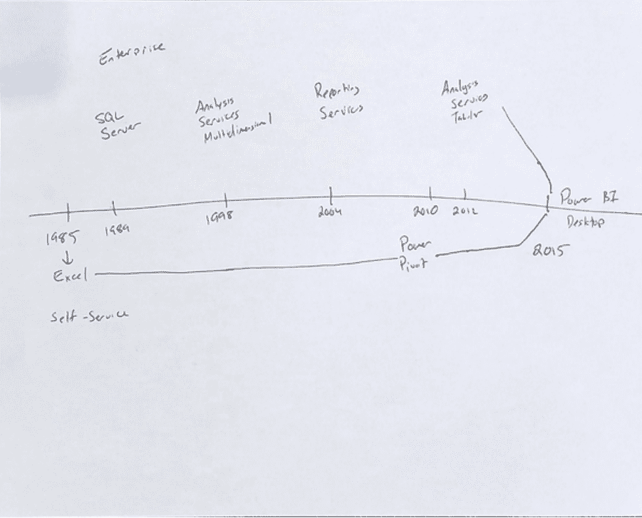
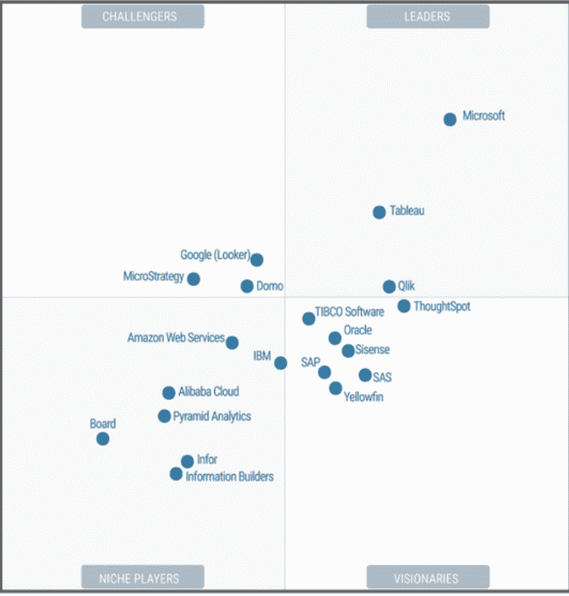

## 第 1 章。Power BI 简介

### 给早期发布版读者的说明

通过早期发布版电子书，您可以获取书籍最早期的形态——作者在编写过程中的原始且未编辑的内容——因此您可以在这些书籍正式发布之前很久就开始利用这些技术。

本章将是最终图书的第 1 章。请注意，GitHub 仓库将在稍后激活。

如果您对如何改进本书内容和/或示例有任何意见，或发现本章中有缺失材料，请联系作者：feedback.powerbifundamentals@outlook.com。

您是数据从业人员。您了解电子表格的工作原理。您了解自己的数据。但需要处理的数据量很大，而您的电子表格已不够用了。

您需要一种可视化数据并与业务用户共享的方式，以便他们可以看到分析结果，像您一样理解数据，甚至可以在几乎无需培训的情况下操作可视化内容。

如果您正是出于这个原因才查看这本书，那么您做出了正确的选择。Microsoft Power BI 正是您所需要的，而本书将向您展示如何快速上手，以便您能够构建和发布报表，令同事刮目相看，让妈妈为您骄傲。

Microsoft Power BI 是一款数据分析和可视化工具，功能强大到足以满足最苛刻的数据科学家的需求，同时又足够易于上手，适合任何需要从数据中获取更多价值的人进行日常使用。

起初，在生活更简单的日子里（2011 年），Power BI 只是一个简单的桌面软件。但现在已不再如此。它是一个完整的商业智能 (BI) 生态系统，可以适配多种多样的技术栈。

在本章中，我们将介绍 Microsoft Power BI，讨论整个 Power BI 产品系列，概述 Power BI 的工作原理，并探讨其与其他类似工具的区别。读完本章后，您将能够：

- 了解 Power BI 生态系统中包含哪些组件及其重要性。
- 了解 Microsoft 商业智能工作的历史，了解它如何让我们迎来了 Power BI。
- 发现 Power BI 与竞争对手的不同之处。

### 什么是 Power BI？

Power BI 既是一款软件，也是一个更大的产品生态系统。通常当人们提到“Power BI”这个词时，指的是桌面创作软件。

然而，在讨论大多数人如何（以可视化方式）将工作成果与他人共享时，是在 Power BI 服务（Power BI service）的背景下进行的，这是一种软件即服务 (SaaS) 解决方案，用于托管其他有权访问的人员可使用的 Power BI 数据集和报表。

除了这两个功能之外，该系列中还有各种各样的产品，可让您将报表嵌入网站和其他应用程序，在移动设备上查看报表，甚至在本地拥有自己的 SaaS 解决方案版本。

本书专注于 Power BI Desktop 和 Power BI 服务，因为它们是您最基本、最有价值的构建模块。

Power BI Desktop 是一款用于数据调查和可视化的工具。分析师可以获取数据并创建交互式报表，使用户能够获得先前被掩埋的洞察。在金融领域，您可以使用 Power BI 自动生成损益表 (P&L) 或分析随时间变化的成本。在建筑领域，您可以使用 Power BI 根据团队构成或地理因素识别项目完成时间的差异。在零售领域，您可以识别哪些产品最成功，同时通过假设分析，确定哪些产品在稍加推动下可能即将大受欢迎。

根据 Microsoft 在 2021 年商务应用程序峰会上的说法，97% 的财富世界 500 强以某种方式使用 Power BI。因此，如果您希望获得能够转变企业的那种洞察，这是一项您可以放心投入时间和精力的技术。就我而言，这是我为女儿构建 Pokédex（图鉴）的借口。有时你就是想要做到最好，像从未有人做到过那样。

### Power BI 组件

如今，Power BI 包含各种各样的产品，允许用户根据数据创建和消费报表。根据 Microsoft（出版时）的说法，以下是构成 Power BI 产品系列的所有组件。

- Power BI Desktop
- Power BI service
- Power BI Mobile
- Power BI Report Builder
- Power BI Report Server on-premises
- Power BI Embedded

这些产品有很多内容需要了解。本书的大部分内容将涉及 Power BI Desktop，因为它是所有内容构建所依赖的基础。我们也将在后面更详细地讨论 Power BI 服务，因为您需要一些了解才能发布（然后共享）那些令人惊叹的、会让您成为部门羡慕对象的工作。

考虑到这一点，快速了解这些组件将在未来很有用，因此以下是它们的概述：

### *Power BI Desktop*

您安装在本地计算机上的免费应用程序，可用于连接、转换和可视化数据。这是 Power BI 生态系统中所有其他部分的基础模块。

### *Power BI service*

一种在线 SaaS 解决方案，允许最终用户将在 Power BI Desktop 或 Power BI Report Builder 中创建的报表与组织内的用户共享。

### *Power BI Mobile*

一组适用于 Windows、iOS 和 Android 的应用程序，允许最终用户从移动设备查看 Power BI 服务中的报表，而无需使用网络浏览器。

### *Power BI Report Builder*

您安装在本地计算机上的免费应用程序，可用于生成以与 SQL Server Reporting Services 相同形式呈现的像素级完美分页报表。例如，如果您想构建一些内容来自动生成发票或创建用于分发的长数据列表，您可以在此完成。

### *Power BI Report Server on-premises*

出于安全考虑，如果您无法将报表发布到 Power BI 服务，您的 IT 团队可以将该软件的一个版本放置在公司防火墙后面的内部服务器上，使用本地计算资源而非云资源。Power BI 本地报表服务器并不

与 Power BI 服务始终保持功能一致。这是因为 Report Server 每年只更新三次，分别是 1 月、5 月和 9 月。还值得注意的是，如果你要将报告部署到本地 Report Server，则需要使用与已安装的 Report Server 版本相匹配的特殊版本 Power BI Desktop。

### *Power BI Embedded*

允许你将 Power BI 报告和可视化效果集成到应用程序中。它具有自己的定价和许可结构。

既然我们已经介绍了整个系列，现在将重点转移到与本书相关的两个组件：Power BI Desktop 和 Power BI 服务。

### Power BI Desktop

Power BI Desktop 是一种软件，可让你连接、转换和可视化数据。让我们深入了解一些细节。Power BI Desktop 由其自身组件组成。我们将讨论对 Power BI 初学者最重要的两个组件：Power BI 画布和 Power Query。你将在 Power BI Desktop 工作中花费最多时间的地方就是这两个组件。

Power BI 画布是构建可视化效果的地方。画布可以看作是你数据的 PowerPoint。在这里，你使用拖放功能将信息拉入不同的可视化效果中，以探索数据并获得洞察。这也是你对可视化效果应用格式、添加图像、文本框等的地方。

Power Query 用于导入和操纵数据，实质上是对数据进行塑造。在 Power BI 中，与 Excel 不同，例如，你不是编辑数据单元格，而是编辑数据列。Power Query 提供了根据你设计的规则创建自定义列的选项。它让你合并不同的数据表，或将一个表中的值添加到另一个表中。

Power Query 中的一切都首先始于从数据源获取数据，而 Power Query 支持大量数据源。你想连接到数据库吗？SQL？Oracle？Teradata？Power Query 都能满足你的需求。你想连接到 Excel 工作簿以获取表格吗？没问题。CSV？很简单。云数据源？也不是问题。

Microsoft 不惜创建新的数据源连接器，以表明 Power BI 不仅用于与其他 Microsoft 产品配合使用，而且适用于你数据所在的任何位置。如果你精通 M（Power Query 的编程语言），甚至可以在理论上为不受官方支持的数据源创建自定义数据连接器。请注意，本书不会讨论 M 或高级 DAX 主题，也不会讨论实际编程。我们在这里帮助 Power BI 初学者，你没有那些知识也能做得很好。

### The Power BI Service

现在我们进入精彩部分，这将把你从一个只是生成报告的普通人，转变为组织内的人们都远道而来观看报告的人。Power BI 服务（在线 SaaS 解决方案）允许用户将其 Power BI Desktop 中的报告与组织内的其他用户共享。每个人都可以免费访问自己的工作区。但是，你无法从个人工作区共享内容。

要将报告共享给其他用户，你需要创建一个工作区并邀请其他用户加入该工作区。要有资格被邀请加入工作区，用户必须拥有 Power BI Pro 许可证，或者你的组织必须使用 Power BI Premium Dedicated Capacity 来与没有 Power BI Pro 许可证的用户共享报告。

Power BI 服务让其他最终用户探索你创建的报告，以便从你的工作中获得洞察。这种探索可以采用你精心整理的可视化效果组成的仪表板形式。也可以是访问你创建的包含所有页面的报告。甚至可以是使用 Q&A 功能提出自然语言问题以便从数据中获得洞察的能力。

Power BI 服务还包括许多其他功能，例如创建名为 Dataflows 的特殊对象的能力。这些数据流可用于在数据库之外获取 Power BI 服务中的信息，同时允许最终用户访问该数据，并将其与 Power BI Desktop 模型内的其他数据结合。

开发者可以管理 Power BI 服务中工作区的部署管道，这让你能够创建和管理开发、测试和生产工作区。部署管道使对 Power BI 项目进行持续开发工作成为可能，而不会影响最终用户已在使用的项目的用户体验。

Power BI 服务中的一个新功能让用户能够创建目标。目标使用 Power BI 服务中的数据进行跟踪。目标信息随后可以与适当的用户共享，以便快速获得可操作的洞察。

总而言之，Power BI 服务是关键的粘合剂，使 Power BI 与（例如）在办公室里简单共享 Excel 工作簿有所不同。它创建了一个共享空间，让人们可以安全地查看相同的洞察，同时邀请他们探索可以为满足每个最终用户的特定需求而精选的共享数据元素。

### The Power Platform

现在让我们退后一步，看看大局：Microsoft 家族中的“Power”产品有哪些？Power Platform 是一组更大的产品集合，它们相互支持，而 Power BI 只是其中一个组件。虽然我们不会对这些其他项目进行培训，但了解市面上还有什么是件好事，以防将来你需要将其中某个产品集成到 Power BI 报告中。

### *Power Apps*

一种低代码或无代码开发环境，你可以在其中开发自己的应用程序来解决不同的业务挑战

### *Power Automate*

一个允许最终用户创建自动化组织流程的“流”的框架。

### *Power Virtual Agents*

一种无代码工具，可让你构建聊天机器人以与客户和员工互动。

### **其他 Power 产品如何与 Power BI 协同工作？**

每个组件都可以由 Power BI 使用，以创建洞察并帮助推动你的工作向前发展。让我们了解一下每个组件如何与 Power BI 协同工作的一些示例。

例如，在 Power Apps 中，你可以创建一个应用程序，允许现场检查员做笔记并将数据上传到 SQL Server 数据库。Power BI 报告也可以连接到该 SQL Server 数据库，下载 Power App 上传的信息，并根据现场众多检查员使用 Power App 添加的新数据更新报告。

假设你的老板出于某种原因，每天都想看一份报告的静态版本。嗯，你可以手动进入 Power BI 服务并创建导出，将其下载下来，撰写电子邮件，然后点击发送。或者，一个更高效的选择是使用 Power Automate 创建一个流，为你自动执行该任务，确保每天早上 8 点整，你老板的收件箱里都会有一份包含你最新版本 Power BI 报告的精美 PDF。如果这还不能让你得分，我也不知道还有什么能做到。

谈到虚拟代理（提供类似客服代表的人工客户服务的软件），每当最终用户与你的聊天机器人交互时，都会收集大量数据。所有这些数据都被收集和存储，这意味着 Power BI 可以生成相关报告。这创建了一个端到端的报告解决方案，让你的组织能够获得关于消费者真正在寻找什么的文本洞察。最终用户可以处理并查看实际数据。

### 我们如何走到 Power BI 这一步？

Microsoft 在商业智能领域的历史悠久且卓有成效。从许多方面来看，Power BI 是最新的（也许也是最终的）篇章，代表了 Microsoft 多年来构建的一系列组件中开发的商业智能能力的集大成者。为了让你最大限度地利用本产品，值得讨论 Microsoft 的商业智能技术栈如何走到 Power BI 这一步，以及这一历程对你作为最终用户意味着什么。

本节将为你提供宝贵的背景：为什么要开发 Power BI，它为什么重要，哪些产品相互关联？提前了解这些将有助于你，就像在走进工作面试之前调查一家公司一样有帮助。你获得的清晰认识在未来将大有裨益。

### SQL Server：Microsoft 的关系数据库

1989 年，Microsoft 以针对 OS/2 的 SQL Server 形式发布了其第一个关系数据库。数据库是一种软件，用于包含和组织大量数据以供不同用途使用。虽然 SQL Server 是 Microsoft 进军商业智能领域的第一步（也是必要的一步），但单靠数据库本身不足以提供商业智能。

### SQL Server Analysis Services 多维：迈向商业智能的一小步

随着处理能力的提升，新的数据处理方法变得流行——例如，数据立方体。1998 年，Microsoft 发布了其第一个 OLAP（联机分析处理）引擎，并将其命名为 OLAP 服务，该服务最终演变为 SQL Server Analysis Services。这指的是多维分析服务模型（或其他多维 OLAP 提供商的等效服务）。

### SQL Server 报表服务：像素级报表、自动化报表及更多

Microsoft 最终需要为 SQL Server 添加像素级报表选项。2004 年，它将 SQL Server 报表服务作为 SQL Server 2000 的附加组件发布，其第二个版本随 SQL Server 2005 一同发布。SQL Server 报表服务具有多种在企业部署中很有用的功能，包括像素级报表生成、自动化报表分发，并且在许多部署中，允许最终用户通过用户界面向后端 SQL Server 数据库生成查询。

### Excel：一种自助式 BI 工具

迄今提到的每款软件都是我们所定义的企业商业智能工具。这些昂贵的工具需要大型团队来管理和部署。

如果企业商业智能由其大规模部署和高投入程度定义，那么自助式商业智能就是以某种方式使用和操纵数据的能力，使最终用户能够探索和分析其拥有的数据。

Microsoft 在自助式商业智能方面的历史归结为一款几乎人人都见过或接触过的核心产品：Microsoft Excel。Excel 的第一个版本于 1985 年面向 Macintosh 推出。从本质上讲，Excel 是一款允许你获取数据、将其提取为“平面”数据并按需对其进行操作或临时计算的产品。Excel 使最终用户能够获取其数据并从中获得洞察。这就是自助式商业智能的前提。

### Power Pivot

2010 年，Microsoft 发布了 Power Pivot。作为 Excel 的最初附加组件，Power Pivot 让最终用户能够从众多不同的来源获取信息，并将该信息存储在工作簿内的 ROLAP 模型（关系 OLAP）中。Power Pivot 还随附 Power Query。Power Query 是一种内置引擎的提取、转换和加载（ETL）工具，允许使用 M 语言进行数据操作。

### 导致 Power BI 的重要新功能

大约在这段时间，我们开始看到企业商业智能和自助式商业智能开始融合。当 Microsoft 发布 SQL Server 2012 时，Analysis Services 随附了一个名为表格模型的新功能。Analysis Services 现在可以支持一种更像经典数据仓库的数据组织方法。区别在于，为了在此表格模型中获得性能提升，Microsoft 开发了其第一个列式数据存储技术。最终，这成为了我们现在所知道的 VertiPaq，即内存列式数据存储分析服务表格模型——这意味着它非常快。

与此同时，开发了一种名为 DAX（数据分析表达式）的新公式语言，用于支持这些表格模型，允许对这些数据列进行计算，以帮助使数据可操作。

与 Excel 2013 一起发布的下一个 PowerPivot 版本使用了此引擎作为其工作的基础。PowerPivot 被重命名为 Power Pivot（添加了一个空格，变成两个单词），从而与这个新 Power BI 工具套件中的其他产品名称相匹配。

### Power BI Desktop 诞生

2015 年 7 月 24 日，Power BI Desktop 的第一个公开可用版本发布给世界。Power BI Desktop 内部包含一个完整的企业级语义建模工具，具有 VertiPaq 引擎和 DAX 公式语言。它使用 Power Query 从各种来源获取信息，将其拉入引擎，并允许对该数据进行转换，以便为未来分析进行塑造。

图 1-1 展示了 Microsoft BI 路线的时间线及其汇合方式，重点介绍了过去 30 年中企业 BI 和自助式 BI 的一些里程碑。

没有人会在这段历史上考你，但希望这能让你有视角了解我们是如何走到今天的。我的意思是，当然……并非我们所有人都在书架上放着关于 Microsoft 的历史书，但并非我们所有人都有 Satya Nadella 的秘密神龛。这是人生的选择。

图 1-1：此 Power BI 时间线展示了商业智能的演变，从 Excel 到当今的 Power BI Desktop。

### Power BI Desktop 的内部工作原理

Power BI Desktop 能够工作，是因为其内部有两个强大的引擎。这些引擎在技术层面使整个系统运作。有一个公式引擎，它接收数据请求、处理请求并生成用于执行的查询计划。然后有一个存储引擎，它存储数据模型的数据，并提取公式引擎请求的数据以满足查询需求。

另一种看待方式是将公式引擎比作大脑。它找出处理问题的最佳方式，并将相应的工作指令发送到身体的正确部分来完成工作。存储引擎是接收这些命令并完成收集所有数据工作的身体。

### VertiPaq：存储引擎

让我们来认识一下 SQL Server Analysis Services 表格模型的存储引擎，即 VertiPaq。这是一个企业级语义建模工具，随每个 Power BI Desktop 副本一起提供。当你将数据拉入 Power BI Desktop 时，VertiPaq 引擎在转换后读取数据源并将数据放入列式结构中。然后它会压缩数据，使文件大小比原来小得多。接着，它将整个数据模型放入本地内存中。此视图可以从原始数据源刷新。

在你兴奋地跑出去庆祝之前，需要知道，对于从 Excel 等工具转过来的用户来说，这个数据存储引擎带来一个重大障碍。你无法修改单个数据单元格。由于数据被转换为列进行存储，并被索引和压缩，模型中的数据变得实际上不可更改。你可以添加列和度量值，但基础数据不会改变。如果你想更改数据，必须要么返回到数据的转换步骤（例如在 Power Query 中），要么返回到数据源并在其中进行编辑，然后刷新数据。

其次，让我们讨论公式引擎及其语言——数据分析表达式。DAX 是一种用于 Analysis Services Tabular、Power BI 和 Power Pivot 的公式语言。当你想要访问数据模型中的数据时，这就是使用 DAX 的方式。这与某人编写 SQL 以从数据库获取数据的方式相同。Power BI 的精妙之处在于，对于简单的拖放功能，或者在创建可视化对象时，Power BI 会为你生成 DAX 并将其传递给内部引擎，以生成和执行其查询计划。

你在 Power BI 中所做的一切都离不开 DAX。你可能看不到它，但它始终存在，发挥着关键作用，即找出如何最好地从你的数据模型中获取信息以满足你的请求。

### Power BI 与竞争对手的不同之处

坦率地说，成为数据分析师从未像今天这样美好。市场上的许多工具都有各种优势和劣势，Power BI 也不例外。事实上，为了看看这个市场上有多少竞争对手，让我们快速看一下图 1-2，它显示了 Gartner 2021 年分析和商业智能平台的魔力象限。

### 图 1-2：分析和商业智能平台的魔力象限

图 1-2：Gartner 的分析和商业智能平台魔力象限。

现在，无论你对分析中竞争对手的位置有何看法，仅仅是它们的数量就足以让你眼花缭乱。每个竞争对手都有其存在于当今市场的原因。不过，请注意，在领导者象限中，只有三个参与者：Qlik、Tableau 和 Microsoft。

微软与其竞争对手在该领域真正的区别在于其执行软件计划的能力。微软在商业智能领域拥有超过30年的历史，SQL Server 本身也已有30多年历史。微软在这个领域深耕已久，其商业智能平台支持的技术数量也远超其他竞争对手。

所有这些主要竞争对手都提供可让您获取数据并将其转化为出色的数据可视化效果的产品，这些可视化效果能帮助您从数据中发现未知的信息。例如，我永远会嫉妒 Tableau 点击拖拽进行分组的能力。

### 为何选择 Power BI，以及其在全球的应用示例

不管 Tableau 多么耀眼，Power BI 在 Power Query 中为非技术人员提供了一款使用极为简便的数据引入工具，其易用性无出其右。它还拥有当今地球上最强大的分析引擎之一（如果不是最强大的），即 Analysis Services 表格模型。这些工具加速了许多组织内部数据民主化的进程。Power BI 在全球范围内培养了大量利用数据开展变革性工作的公民数据分析师。的确，只要您花精力阅读并消化本书，就迈出了加入该社区所需的步伐！

以下是一些示例。全球领先的自然保护组织世界自然基金会（World Wide Fund for Nature）使用 Power BI 向捐赠者分享影响效果。卡明斯（Cummins）的工程师使用 Power BI 进行高级产能规划，以更快速地将发动机推向市场。Humana 利用 Power BI 整合并可视化其企业中 45 多个不同唯一数据源的数据，并将 Power BI 作为面向最终用户的整合平台。伦敦国王学院（King's College London）使用 Power BI 的人工智能可视化效果来识别可能表明学生表现变化的关键因素，从而开展有针对性的外联活动，最大限度提升学生成功的机会。这些只是该平台上当今发生的多样化用例中的一部分。

Power BI 背后拥有数十年的 Analysis Services 经验，其前端现已能够兑现其承诺。此外，微软每个月都会为 Power BI Desktop 发布包含新功能、连接器和可视化效果的更新。微软致力于 Power Platform，可以肯定地说微软会长期坚持下去。当 97% 的财富 500 强企业对某事达成一致时，那很可能是有充分理由的。

# 摘要

Power BI 的核心远不止是一个桌面创作工具。它是微软过去近三十年一直在构建的一个完整平台。它拥有独特的优势，即拥有世界上最经企业验证的两个分析引擎：VertiPaq 和 DAX。它还提供了一个出色的工具，允许非技术用户整合分散的数据，并使用 Power Query 开始对该数据进行真正的分析。

Power BI Desktop 现已成为一种企业级解决方案，被世界上最大的公司、非营利组织乃至小企业使用，以帮助从数据中获得以前不可能获得的洞察。

在了解 Power BI 是什么之后，我们现在可以明确目标地打开该软件了。一切从报表视图开始，所以拿起一瓶汽水，抚摸一下你的狗，让我们开始深入了解。下一章将介绍用户界面及其使用方法。
