## 第 2 章 用户界面 I：报表视图和数据视图

### 致早期发行版读者的注意事项

借助早期发行版电子书，您可以获取书籍的最初形态——作者在编写过程中的原始、未经编辑的内容——从而能够在正式发布这些书籍之前很长时间就开始使用这些技术。

这将是最终图书的第 2 章。请注意，GitHub 仓库稍后将激活。

如果您对本书内容和/或示例的改进有任何意见，或在本章中发现缺失的材料，请联系作者：feedback.powerbifundamentals@outlook.com。

Power BI Desktop 是一款强大的数据可视化工具，可让您以多种方式处理数据并从中创建可视化洞察。本章将介绍 Power BI Desktop 界面的基础知识，重点探讨报表视图和数据视图。

内容将会相当详细，请继续跟随我。本章的部分内容可能会有些枯燥，因为我将专注于用户界面（UI）的功能，而不一定是如何使用它。

我们的大部分精力将放在报表视图上，因为那是您将要花费最多时间的地方。此外，报表视图拥有最多可交互的元素。在 UI 中您需要知道的两个最重要的内容是功能区的“开始”选项卡功能和可视化窗格，请在阅读时牢记这一点。

微软表示，他们为 Power BI Desktop 设定的目标是将其打造为您数据的“PowerPoint”。截至本书撰写时，您可以看到 Power BI 已采纳了 Microsoft Office 家族中许多其他工具（包括 PowerPoint）的设计原则。

如果您自 2010 年以来使用过任何其他 Microsoft Office 产品，那么您在 Word、Excel、PowerPoint 及其他产品中都见过某种版本的功能区用户界面。对界面的这种熟悉会让您占据优势，但 Power BI 的用户界面确实有一些特点。有时，您会发现 Power BI 会根据所选项目上下文添加或删除功能区中的项目，起初这可能会让人感到别扭。

让我们来看看 Power BI 如何集成功能区，并向您展示打开 Power BI Desktop 时首先看到的内容。请参见图 2-1。

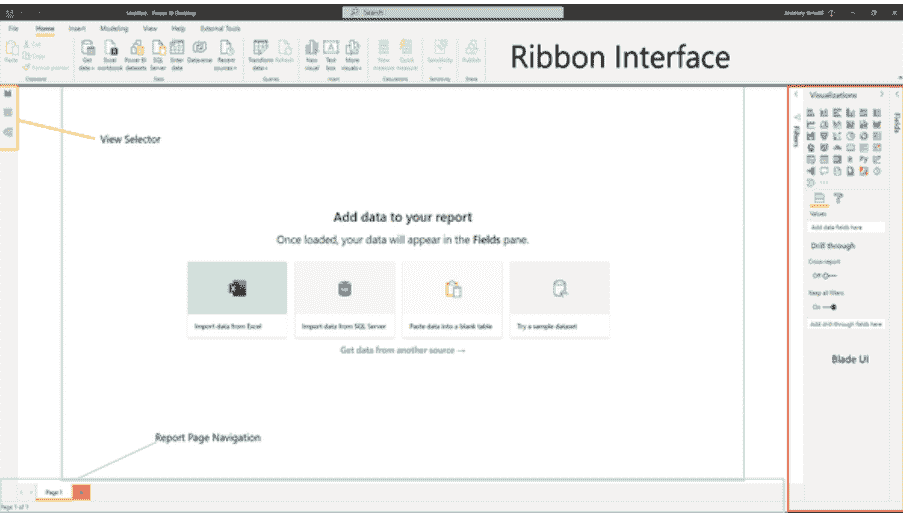

图 2-1. 这是您打开 Power BI Desktop 时首先看到的内容。

查看图 2-1 中的视图选择器，我们可以看到三个可能的视图：报表视图、数据视图和关系视图。

### 报表视图：功能区“开始”部分

打开 Power BI 时，默认即为报表视图。您可以看到顶部有一个经典的功能区界面，允许您搜索可能执行的不同操作。右侧是 UI 的窗格部分。这部分与微软最初 Xbox 360 界面所做的非常相似。

您可以使用功能区的“视图”部分添加不同的窗格以供查看。您还可以最小化当前可见的窗格，如上例中在打开可视化窗格时所见的筛选器和字段窗格所示。

在底部，您会看到报表页导航选项。您可以单击单个报表页，或者，如果报表很大，可以使用箭头在页面列表中滚动，这与在 Excel 中浏览工作表非常相似。最后，在左侧，您会看到三个表示视图选择器的图标。从上到下，视图顺序为报表、数据和模型。功能区菜单会根据您所在的视图发生变化。

从功能区界面开始，默认视图是“开始”选项卡，如图 2-2 所示。“开始”选项卡有几种不同的名称，包括“开始视图”、“开始功能区”和“开始部分”。接下来，我将不同部分（开始、插入、建模）统称为“选项卡”。

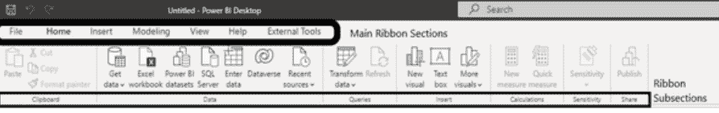

图 2-2. “开始”选项卡（也称为“开始功能区”、“开始视图”或“开始部分”）是 Power BI Desktop 的默认视图。

图 2-2 中的所有选项卡或主功能区部分均分为“小节”，并由一条浅色垂直线分隔。各部分的名称位于功能区的底行。在图 2-2 中，小节包括剪贴板、数据、查询、插入、计算、敏感度和共享。因此，接下来当我提到选项卡的“小节”时，请查看底行以了解我所指的内容。

（我意识到，如果您在过去几十年里活着并且使用过任何 Microsoft Office 产品，您可能已经知道这些，但我只是想确保我们对“选项卡的小节”这一概念的理解一致。）在确定选项卡和小节后，我将介绍按钮。

### 剪贴板小节

那么，让我们回到“开始”选项卡。首先您会看到剪贴板小节，其中包含标准剪切、复制和粘贴功能。您可以使用格式刷将一个可视化效果的格式应用到另一个可视化效果，这与在 Excel 或 PowerPoint 中使用格式刷的方式相同。

### 数据小节

在下一个小节，即数据小节中，您会看到几个快速选项，用于快速连接到不同的数据源。我们可以在图 2-3 中更清晰地看到这些选项。

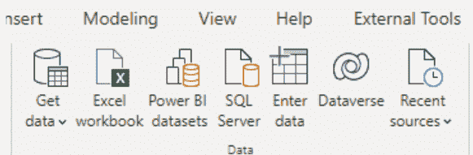

图 2-3. 数据小节允许您选择数据来源。

从左侧开始，您会看到“获取数据”按钮，它分为上下两半。如果单击上半部分，将出现一个新菜单，其中包含 Power BI 中所有可能的数据连接器列表，如图 2-4 所示。

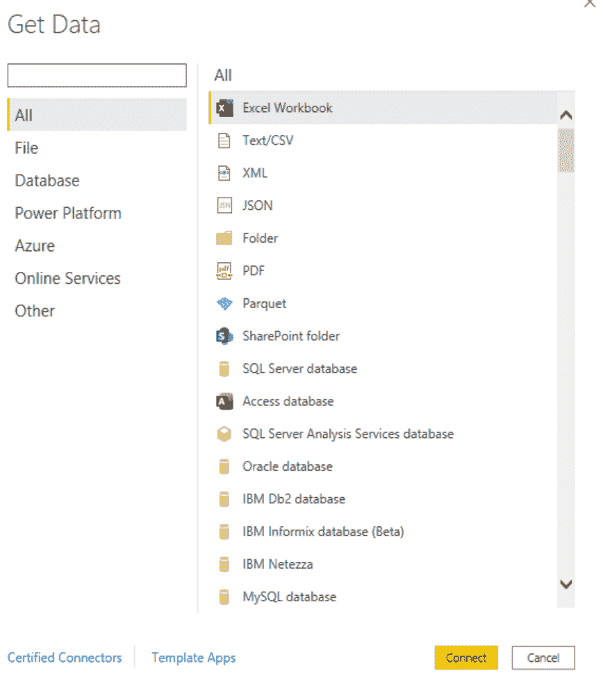

图 2-4。这是完整的“获取数据”窗口，适用于您需要完整的“整套”功能，即整个数据连接器列表的情况。

如果单击按钮的下半部分，您会看到一个较小的、被截断的更常用数据源列表。当您不需要查看完整连接器列表时，这非常方便。截断后的列表如图 2-5 所示。

- 常用数据源
  - Excel 工作簿
  - Power BI 数据集
  - Power BI 数据流
  - Dataverse
  - SQL Server
  - Analysis Services
  - 文本/CSV
  - Web
  - OData 源
  - 空白查询
  - Power BI 模板应用
  - 更多...

*图 2-5。快速数据选择列表是数据连接器的更短列表，适用于您午餐想来点“经典”的时候。*

单击“Excel 工作簿”按钮将立即打开一个资源管理器窗口以导航到您的 Excel 文件。单击“Power BI 数据集”按钮，将出现一个窗口，您可以从中选择已在 Power BI 服务中发布的数据集，以通过“实时连接”进行连接。有关示例，请参见图 2-6 中的窗口。

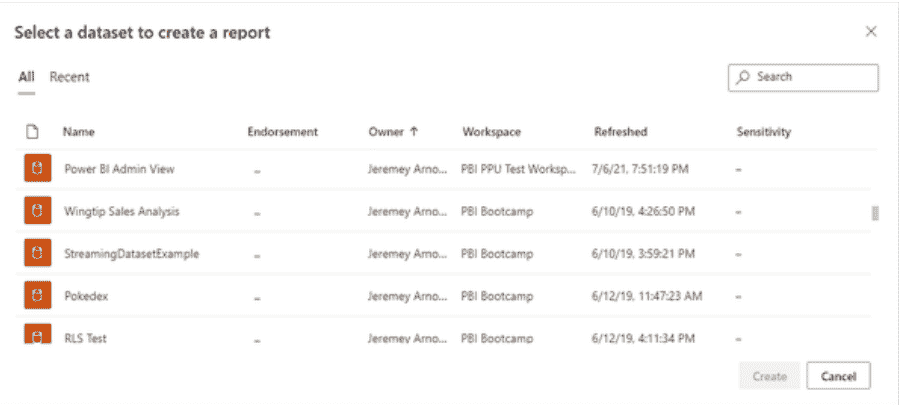

图 2-6。连接到 Power BI 服务中已有的数据集。

如果单击“SQL Server”按钮，将出现一个弹出式菜单，供您输入服务器名称或地址，以及可选的数据库名称。当您尝试连接时，服务器会要求您提供凭据。您还会看到一个用于选择“导入”或“DirectQuery”的选项，我们将在本书后面部分更详细地讨论。该窗口如图 2-7 所示。

还有一个“高级选项”按钮，按下后允许您添加以分钟为单位的命令超时、传递自定义 SQL 语句、包含关系列、使用完整层次结构进行导航，并启用 SQL Server 故障转移支持。

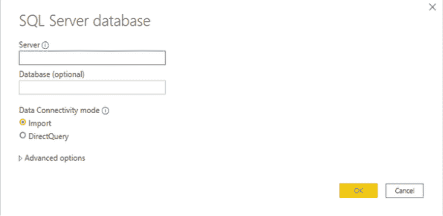

图 2-7。连接到您亲切的社区 SQL Server。

“输入数据”按钮（回到图 2-3）会提供一个界面，如果您使用过 Excel，应该会觉得很熟悉，因为它会打开一个类似表格的结构，您可以在其中添加列、命名列，并将数据放入单元格中，如图 2-8 所示。需要注意的是，此界面中没有公式函数。它仅用于简单的数据输入。您也可以将信息复制粘贴到此窗口中，但在此窗口中滥用复制粘贴之前要小心。这对于测试或如果您想为模型生成查找表很有用，但我建议不要向这种表格结构中输入大量信息，因为它需要手动管理。

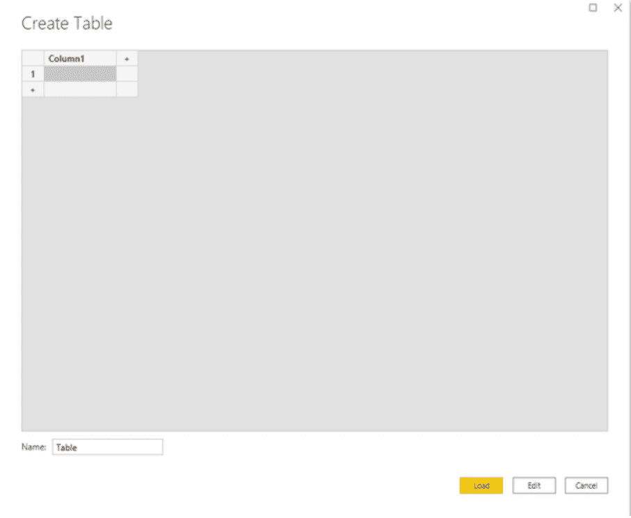

图 2-8。一个简单的数据输入窗口，适用于您需要的额外内容在别处找不到的情况。

我们在图 2-3 中看到的“Dataverse”按钮将生成一个弹出窗口，供您输入环境域信息以及提示模式。根据您对 Microsoft Dynamics 的熟悉程度，您可能以前曾将其称为“公共数据模型”。用于提供 Dataverse 信息的窗口如图 2-9 所示。

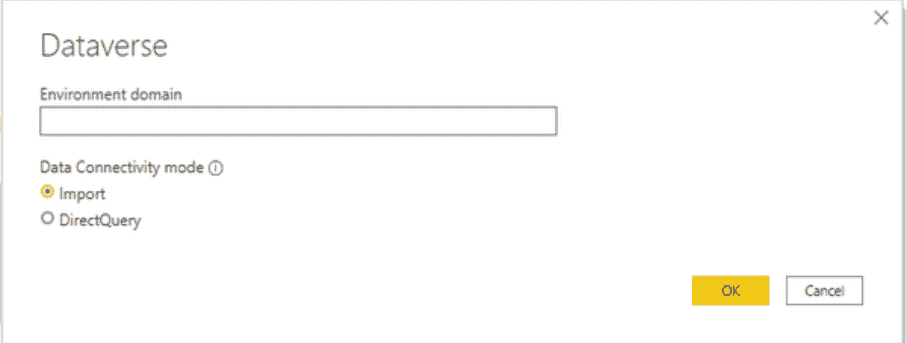

图 2-9。如果您在 Dynamics 宇宙中，您可能会连接到 Microsoft Dataverse。

“最近源”列表会为您提供最近源的下拉菜单，因此如果您必须再次连接到数据源，它会方便地已经在那里。您可以单击下拉菜单中的“更多”以获取更大的最近数据源列表。图 2-10 显示了我在 Power BI 中的一些最近数据源。

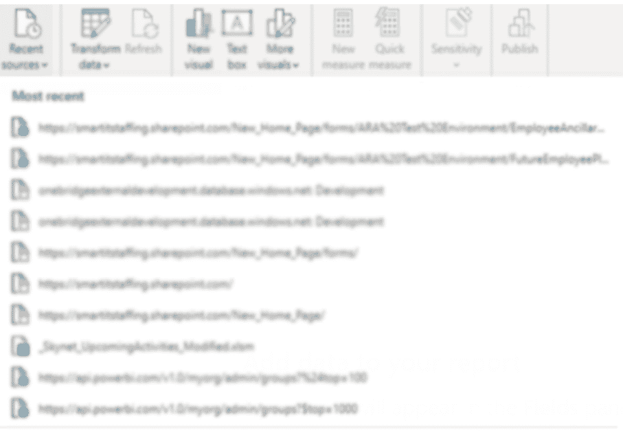

图 2-10。我的最近源列表……忽略 Skynet……图片待补充。

### 剪贴板小节

进入“查询”小节，有两个按钮：“转换数据”和“刷新”。在图 2-11 中，“刷新”按钮显示为灰色，因为我的模型中没有可刷新的数据。但是，当该按钮可用并被按下时，它将对数据模型中的所有数据源执行完整刷新。

“转换数据”有两个不同的功能，取决于您单击按钮的顶部还是底部。如果单击顶部，它会直接带您进入 Power Query 界面，我们将在另一章中更详细地讨论。如果单击底部，您将获得一个带有几个不同选项的下拉菜单。“数据源设置”会带您进入一个弹出式窗口，以修改凭据或文件位置等设置。如果您有参数和变量，也可以在此处修改。

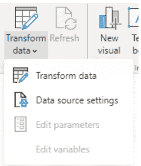

图 2-11。“转换数据”选项。（不确定是否需要这个）

### 插入小节

接下来是“插入”选项卡，它有三个选项。您可以在报表页面上插入新的可视化对象，插入文本框，或在“可视化”窗格中将更多可视化对象添加到可视化对象列表中。

如果单击“新建可视化”，您将看到一个可视化对象被放置在画布上。放置在画布上的默认可视化对象是“堆积柱状图”。

“文本框”按钮会将文本框放置在画布上，方式与其在 PowerPoint 中出现的方式相同。

单击“更多可视化对象”按钮时，将如图 2-12 所示。如果您从“我的文件”中选择，将被引导到一个资源管理器窗口，您可以在其中从本地计算机上的 pbiviz 文件中选择要添加的可视化对象。

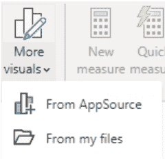

图 2-12。从两个可能的来源添加可视化对象。

如果您选择“来自 AppSource”，将看到图 2-13 所示的窗口。在此处，您可以选择第三方可视化对象添加到可视化对象列表中。

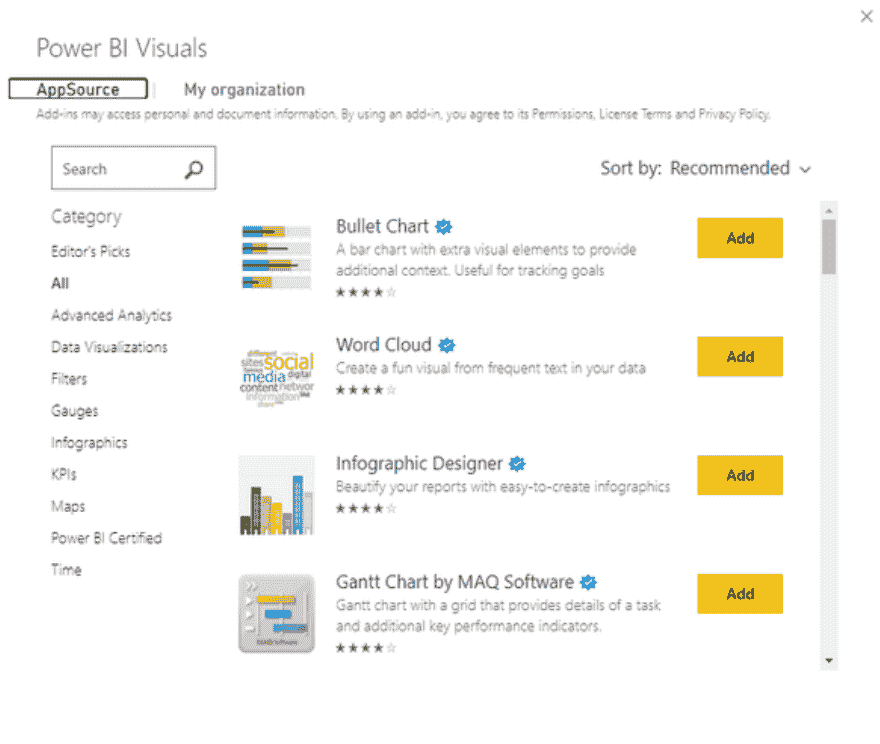

图 2-13。Power BI AppSource 拥有大量您可以为报表选择的其他可视化对象。

### 计算小节

在“计算”下，您有“度量值”和“快速度量值”。

度量值是使用 DAX 对数据进行的计算。我们将在本书后面更详细地讨论度量值，但目前，如果单击“新建度量值”，您将在功能区下方看到一个出现的公式栏，您可以在其中输入度量值的 DAX。这类似于您在 Excel 中可能使用的公式栏。

“快速度量值”按钮会弹出一个框，帮助您使用带有多个预定义计算的向导创建度量值。您可以在下方的图 2-14 中同时看到这两个功能。有用提示：Microsoft 在某些版本中会添加新的快速度量值，因此更新后返回查看是否添加了新的快速度量值总是值得的。

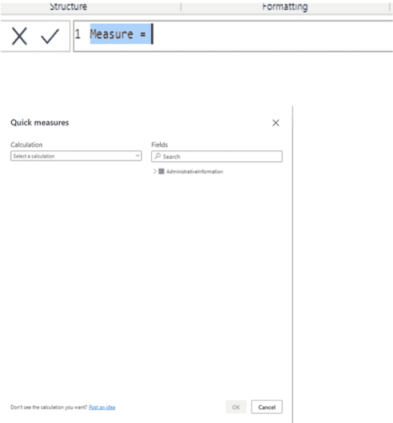

图 2-14。DAX 公式栏和“快速度量值”菜单。您将使用这些。我保证。

### 最后两个小节：敏感度和共享

“主页”选项卡上的最后两个按钮涉及敏感度标签以及将报表发布到服务的功能。我们将在后面更详细地处理这些选项。

### 报表视图：插入选项卡

在功能区的报表视图下，接下来是图 2-15 所示的“插入”选项卡。

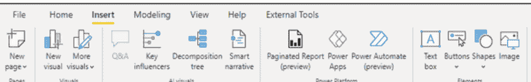

图 2-15。功能区中的“插入”选项卡。

### 页面小节

在“页面”小节中，“新建页面”按钮无论单击哪个部分都会创建一个下拉菜单。该菜单为您提供两个选项：“空白页面”和“复制页面”。“空白页面”会在报表中创建一个新页面，位于所有其他报表页面的最右侧。“复制页面”会按当前配置完全复制您的当前报表页面，包括画布上的所有可视化对象，新副本将位于报表中所有其他页面的最右侧。

### 可视化对象小节

“可视化对象”小节有与我们在“主页”选项卡中看到的完全相同的两个按钮，即“新建可视化”和“更多可视化对象”按钮。它们的功能也是完全相同的。这里复制它们是为了方便，因此如果您在功能区的这个小节（围绕将内容放置到画布上）中寻找其他特定项目，也可以在此处操作。

### AI 可视效果子部分

插入选项卡中的下一个子部分涉及 AI（人工智能）可视效果，如图 2-15 所示。在撰写本文时，这些 AI 驱动的可视效果共有四种已正式发布。如果你单击其中任意一个，会将该可视效果的空白版本放置在画布上，位置尽可能靠近顶部和左侧角落。我们将在第 3 章中更详细地讨论这些可视效果，届时将介绍 Power BI 开箱即用的所有可用可视效果。

这里需要注意的是，这些可视效果在分析功能方面提供了非常独特的功能。Microsoft 致力于在尽可能多的 Power Platform 产品中展示其 AI 实力，Power BI 也不例外。我预计未来会有更多这类 AI 驱动的可视效果正式发布。

### Power Platform 子部分

下一个子部分是 Power Platform，它涉及从技术上讲属于可视效果的项目，但与平台中的其他每个可视效果有根本区别。Power Platform 可视效果提供与我们之前讨论过的 Power Platform 其他部分进行交互和集成的能力，并将其嵌入到 Power BI 报告中。我们将在稍后更详细地讨论这些内容，但请知道它们非常强大，并有助于展示 Power Platform 在组织内部的整体价值。

### 元素子部分

插入选项卡的最后一个子部分是元素，它涉及报告元素。这些项目不一定像 Power BI 可视效果那样具有交互性，但可以帮助增强报告或使其更加清晰。不同的元素选项包括文本框、按钮、形状和图像控件。

Power BI 中的文本框与 PowerPoint 中的作用完全相同。它在画布上放置一个可编辑的文本框，并附带一个基本的文本格式化工具。该工具允许你更改字体、字体大小、文本颜色、加粗、斜体、下划线、文本对齐方式，以及向报告外部的网页添加超链接。文本框上的其他元素可以在选中文本框时出现的“设置文本框格式”窗格中编辑。请参见画布上的示例，如图 2-16 所示。

图 2-16. 文本框界面允许你应用各种格式选项。

单击按钮元素可获取一系列选项，这些选项可帮助报告导航或提供更多信息。选项非常多，因此图 2-17 显示了完整列表，供你开始思考如何在未来的报告中使用这些按钮。

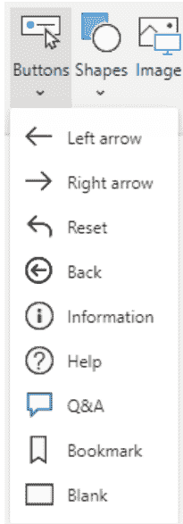

图 2-17. 按钮……按钮，数不胜分。

需要注意的是，对于除 Q&A 和书签之外的所有这些按钮，在画布上放置按钮本身不会产生任何作用，直到你向 Power BI 提供有关按钮用法的上下文。当你将其中一个按钮放在画布上时，右侧将出现“设置按钮格式”窗格，其中包含可视效果格式选项，说明该按钮应执行什么操作。

Q&A 按钮和书签按钮已分别预设为 Q&A 和书签功能的默认操作。但是，如果你觉得报告可以在不同的上下文中使用该按钮，仍可将这些操作更改为其他操作。

形状按钮将显示一系列可插入报告的形状。选中形状后，它将根据主题填充默认颜色出现在画布上。你可以通过操作画布上可视效果的大小来更改它。选中形状进行格式设置时也可以对其进行操作，因为形状有自己专用的窗格。

最后，如果你选择图像按钮，将弹出资源管理器窗口，以便你选择要导入 Power BI 报告的图像。Power BI 可以添加图 2-18 所示格式的图片。（顺便说一句，GIF 的发音是有正确说法的……别站错边。）

| BMP | (*.bmp;*.dib;*.rle) |
| JPEG | (*.jpg;*.jpeg;*.jpe;*.jfif) |
| GIF | (*.gif) |
| TIFF | (*.tif;*.tiff) |
| PNG | (*.png) |

图 2-18. 说真的，总有一种图像格式适合每个人。

一旦图像出现在报告页面上，如同功能区元素子部分中提供的其他任何项目一样，选中后将在右侧出现其专用格式窗格。形状可以像所有其他 Power BI 元素一样，通过单击并拖动框来调整大小，以达到所需尺寸。

### 报表视图：建模选项卡

报告视图功能区的第三部分是建模选项卡。在这里，你可以从报告视图获得更多数据管理选项。图 2-19 中有许多精妙之处。

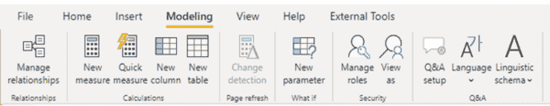

图 2-19. 对数据建模是 Power BI 取得成功的关键。

### 关系子部分

首先是管理关系。此按钮打开一个窗口，让你查看模型中的所有关系，并从此处添加或编辑现有关系。

默认情况下，Power BI 会尝试根据列名自动检测关系。这对于为数据模型建立初始关系集很有用，但不一定总是你希望模型设置的方式。需要注意的是，如果数据模型中少于两个表，此按钮将置灰。我们将在下一章讨论模型视图时详细介绍关系。

### 计算子部分

下一个区域涉及计算。新建度量值和快速度量值按钮的功能与前面关于主页选项卡中描述的完全相同。

其他两个项目是提示，将打开我们之前展示的内联 DAX 编辑器，以便你可以从新建列按钮创建 DAX 计算列，或从新建表按钮创建 DAX 计算表。请注意，新建列按钮有一个不便之处。如果在选择此按钮之前没有在字段窗格中突出显示表，Power BI 假设计算列将进入该窗格中看到的第一个表。

### 页面刷新子部分

页面刷新子部分有一个更改检测按钮，仅在 DirectQuery 方案中相关。你可以确定是希望在检测到数据变化时刷新页面，还是在固定刷新间隔时刷新。你可以使用此功能在 Power BI Desktop 中模拟此功能。

### 假设分析子部分

假设分析仅允许你创建假设参数。第 6 章将详细讨论这些内容。

### 安全子部分

此子部分有两个非常重要的按钮。管理角色和查看方式按钮是我们在 Power BI 中实施行级别安全性 (RLS) 的方式。RLS 是一项功能，通过创建使用 DAX 公式构建的角色来控制人们在模型中看到的数据。我们将在后面的章节中再次详细讨论此内容。

### 问答子部分

最后，我们有问答子部分。问答设置按钮会打开一个大型向导，展示如何微调问答引擎以适应用户更自然的语言，如图 2-20 所示。你可以使用它教会引擎同义词，因此当你使用某个词提问时，Power BI 引擎知道该词在你的数据模型上下文中的含义。

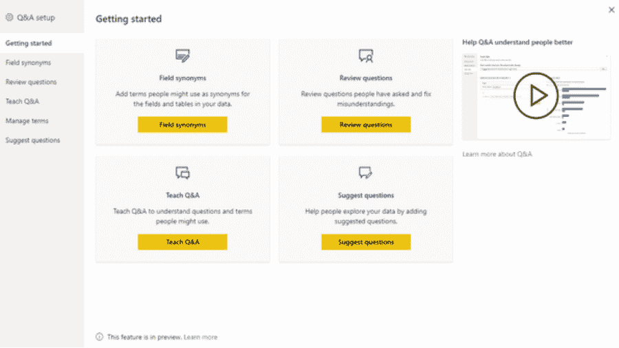

*图 2-20. 自然语言向导。*

选择语言按钮可获取问答可用语言列表。我预计未来语言列表会不断增长。

最后，语言架构按钮有一个下拉菜单，允许你导入或导出语言架构文件。如果你对此主题感兴趣，我建议你访问 https://powerbi.microsoft.com/en-us/blog/editing-q-a-linguistic-schemas/ 并下载示例语言架构文件和示例 PBIX 文件。

### 报表视图：视图选项卡

功能区的下一个主要部分是“视图”选项卡，如图 2-21 所示。此选项卡非常重要，因为它允许你设置主题、设置不同的页面视图以查看用户可能看到的报表外观，以及更多功能。想在 Power BI 中加入一些 PowerPoint 的元素？这里就是实现这些功能的地方。

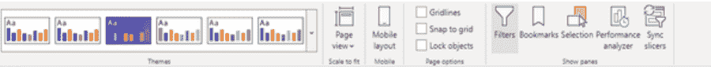

图 2-21. 使用“视图”选项卡为 Power BI 添加一些 PowerPoint 元素。

### 主题小节

主题小节的工作方式与 PowerPoint 中相同。你可以从一些默认主题入手，也可以点击右侧的下拉菜单以获取更多主题供选择、浏览其他主题、查看主题库，或自定义当前主题并保存更改。主题种类繁多，欢迎随时尝试！

### 缩放以适应小节

在“缩放以适应”中，“页面视图”按钮提供将画布适配页面、适配宽度或按实际大小显示的选项。这与移动小节的“移动布局”按钮配合使用，后者会将报表画布更改为适合在移动设备上显示报表的大小和形状。与标准报表开发相比，移动报表开发需要考虑的因素有很大不同，因为可用空间更有限。

### 页面选项小节

在本小节中，你可以从三个按钮中进行选择。你可以显示网格线、使项目吸附到网格，以及锁定对象。

网格线有助于提供参考指引，让你知道项目相对于其他项目的位置。

吸附到网格仅在移动布局下有效，它会强制所有可视化对象整齐地适配到给定的像素密度。

锁定对象可防止页面上的项目被移动。

### 显示窗格小节

显示窗格小节是“视图”选项卡上的最后一个小节。此小节与你可以随时从该用户界面部分添加或移除的不同窗格相关。

我们将在本章后面详细介绍这些功能的用户界面，但总体来说，筛选器窗格允许你在可视化对象、页面或报表级别修改筛选器。

书签允许你将报表页面设置为特定的一系列事件，然后在以后的时间点返回该状态，类似于网页书签。

选择窗格显示每个报表页面上画布中的所有对象，并允许你快速选择特定对象。你还可以使用它来对对象进行分组，并确定它们在可能重叠时的重要性层次。

性能分析器让你查看影响报表页面性能的因素，并可让你提取机器生成的 DAX。

同步切片器窗格允许你确定哪些切片器（如果有）应跨报表页面同步，从而在不同报表页面之间保持比较一致的一种方式。

### 报表视图：帮助部分

功能区上的“帮助”选项卡将提供一种方式来查看你使用的 Power BI Desktop 版本，并提供引导式学习、培训视频、文档和支持链接的链接，如图 2-22 所示。

### 社区小节

我将跳到社区小节，因为信息、帮助和资源小节不言自明。此外，社区小节非常强大。

在“社区”下，你将找到指向 Power BI 博客的链接、连接到更广泛的 Power Platform 社区的方式、面向开发人员的特定文档（称为 Power BI for Developers）、为 Power BI Desktop 提交想法的功能，以及指向常用外部工具的链接。

我确实想强调提交和投票想法，因为这对你有帮助。微软 Power BI 开发团队多次表示，他们会倾听这些想法并关注正在被投票的内容。大约每一两个月就会有一个软件更新，他们会讨论某个想法在 ideas.powerbi.com 上有多受欢迎。所以，如果你有想法，这里就是合适的论坛。

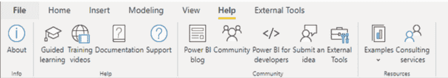

图 2-22. 我们都需要朋友的一点帮助，而在“帮助”选项卡上就能获得这样的帮助。

### 报表视图：外部工具部分

最后，功能区上有“外部工具”选项卡。外部工具数量众多，且不尽相同。为了举例，请参见图 2-23。我们将在第 10 章进一步探讨一些最重要的外部工具，但目前，请先看看这些工具的多样性。

图 2-23. 这真是大量的外部工具！

### 报表视图的窗格界面

虽然功能区存在于 Power BI 的每个视图中，但窗格（微软倾向于如此称呼）是报表视图特有的。你可以访问七个窗格，如图 2-24 所示。还有一个唯一的窗格，当我们与功能区插入部分讨论中描述的任何元素进行交互时，它会覆盖可视化窗格。

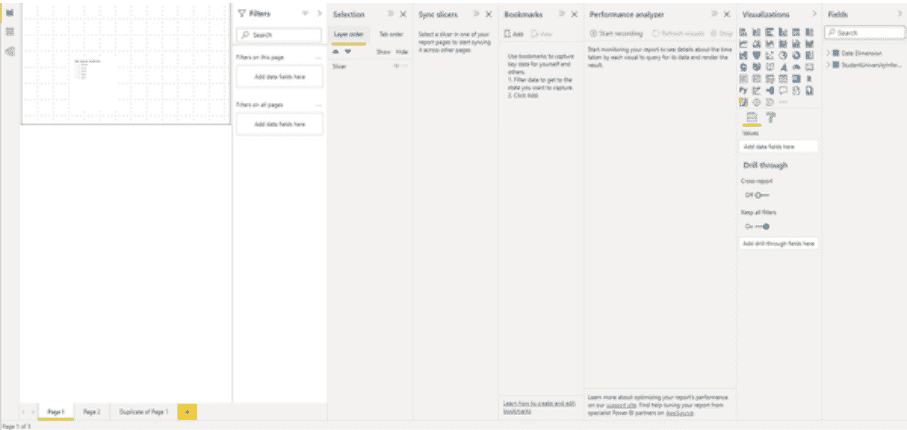

图 2-24. 所有窗格在一起。现在全部一起！

如你所见，当所有窗格都完全显示时，可用的工作空间并不多。但是，只有两个窗格始终可见，即可视化窗格和字段窗格。此外，筛选器窗格与其他窗格不同，它更贴近画布，因为它决定了画布上项目的行为方式。

### 可视化窗格

可视化窗格是你选择要添加到报表的可视化对象、在值小节中添加要在可视化对象中显示的列和度量值的地方，等等。让我们先浏览一下可视化对象列表，然后再移至下一个小节。可视化对象按从左到右、从上到下的顺序列出。

- 堆叠条形图
- 堆叠柱形图
- 群集条形图
- 群集柱形图
- 100% 堆叠条形图
- 100% 堆叠柱形图
- 折线图
- 面积图
- 堆叠面积图
- 折线和堆叠柱形图
- 折线和群集柱形图
- 条带图
- 瀑布图
- 漏斗图
- 散点图
- 饼图
- 环图
- 矩形树图
- 地图
- 填充地图
- 形状地图
- Azure 地图
- 仪表图
- 卡片
- 多行卡片
- 关键绩效指标
- 切片器
- 表格
- 矩阵
- R 脚本视觉对象
- Python 脚本视觉对象
- 关键影响因素
- 分解树
- 问答
- 智能叙述
- 分页报表
- Power BI 的 ArcGIS 地图
- Power BI 的 Power Apps
- Power BI 的 Power Automate

开箱即用的可视化对象数量非常多，看起来可能令人不知所措。我向你保证，情况没有看起来那么糟糕，而且其中有些可能是你永远不会用到的项目。

请注意，如果你的 Power BI 报表中有任何自定义可视化对象或导入的可视化对象，它们将出现在此列表下方，位于我们将在下一部分讨论的字段和格式按钮之上。

在可视化对象列表下方，值小节上方有两个按钮。左侧用于字段，右侧用于格式化。每个可视化对象的子部分会略有不同，因为它们接受不同的参数。例如，柱形图和折线图可能看起来相似，但柱形图和折线图会有多个区域来放置字段。

同样，格式窗格也将根据可视化对象具有不同的参数，因为每个可视化对象都有独特的格式设置内容。

不过，也存在一些常量。你还会注意到，当选中一个可视化对象时，此区域中会出现第三个选项。这就是“分析”按钮。需要注意的是，此功能仅真正适用于 Power BI 默认内置的可视化对象，而且即使如此，也不是每个可视化对象都可用。不过，你可以执行诸如设置趋势线、常量线、平均值等操作。

关于此小节重要的是，你应该随意探索大量可用的设置。如果不确定，可以让 Power BI 使用其默认设置为你完成工作。当你准备好多掌控一些时，格式和分析小节将为你提供所需的能力。

可视化窗格的最后一个区域是“钻取”小节。
这是一个非常强大的功能，允许你从报表的一个部分钻取到另一个部分，同时保持所有数据元素按先前的方式筛选，从而使你能够快速构建数据故事，让用户找到与其分析相关的非常具体的示例。我们将稍后详细讨论钻取功能。

### 字段和筛选器窗格

字段窗格包含报表中所有表、列和度量值的列表。除此之外，它还将包含你可能创建的任何文件夹，以及你在数据模型中定义的任何层次结构或组。将这些项添加到可视化对象中，只需单击并拖动列或度量值到可视化窗格的相应区域，或拖动到画布上的可视化对象本身即可。你也可以单击复选框，让 Power BI 将该项移动到你选定的可视化对象中。或者，如果你还没有可视化对象，Power BI 会使用所选数据元素在画布上为你创建一个可视化对象。如果你在模型中右键单击一个表，你将得到一个

用于添加新度量值、新计算列、新快速度量值、刷新数据、在 Power Query 中编辑该表的查询等内容的上下文菜单列表。如果您在此区域右键单击某个列，将获得一个上下文菜单列表，用于将其添加到画布、从该首列创建层次结构、添加新度量值或列、将列添加到筛选器列表中，或将其添加到详细信息页。您还可以选择将其隐藏，以防不希望在当时使用该数据元素。

筛选器窗格包含三个子部分。您很可能已经使用过筛选器，但筛选器是一个设置条件的函数，数据必须满足该条件才能显示。例如，如果我有一个年龄段筛选器并选择了 12 至 18 岁的分组，那么我看到的所有数据都是这样的数据。所有其他数据都将被忽略。

在筛选器窗格中，当您选中特定可视对象时，它将允许您将筛选器应用于该特定可视对象。本页上的筛选器会筛选特定报告页面上的所有可视对象。所有页面上的筛选器会为整个报告设置筛选条件。默认情况下，任何在可视对象中的字段也会出现在筛选器窗格的“此可视对象上的筛选器”子部分中，并可以在那里进行交互。

您可以在筛选器窗格中设置三种常见的筛选器类型，每种都有其自身的行为。基本筛选显示给定列的所有值，并允许您选择其中任意数量的值为真。这非常直观。高级筛选为您提供两个独立且唯一条件的组合，可用的逻辑基于列所代表的数据类型：

- 包含 (文本)
- 不包含 (文本)
- 开头是 (文本)
- 开头不是 (文本)
- 是 (全部)
- 不是 (全部)
- 为空 (全部)
- 不为空 (全部)
- 为空 (文本)
- 不为空 (文本)
- 日期在...之后 (日期)
- 日期在...或之后 (日期)
- 日期在...之前 (日期)
- 日期在...或之前 (日期)
- 小于 (数字)
- 小于或等于 (数字)
- 大于 (数字)
- 大于或等于 (数字)

这些条件中的大多数都很明确，但重要的是要记住，与允许您查看值选择的基本筛选不同，您必须自己将值输入到子部分中。然后您可以选择按钮来创建“且/或”条件并设置第二组逻辑。使用高级筛选不需要设置第二个逻辑条件。

第三种常见筛选器类型是 Top N 类型筛选器。在此处，您可以设置要显示的顶部或底部值的固定数量，这些值基于模型中的某个值（该值可以在可视对象中，但不必在其中）。一个经典示例是按州、国家/地区、收入或查看前十大销售客户。您设置要显示的值的数量，以及是要可视对象中该特定字段的顶部值还是底部值。您会注意到，在对整个页面或报告进行筛选时，Top N 不可用。Top N 筛选仅在可视对象级别使用时才起作用。

日期还有两种其他可用的筛选器类型，即相对日期和相对时间。仅当日期字段同时包含时间组件时，相对时间才会显示。这些筛选器选项允许您为可视对象或报告设置特定的时间间隔，例如过去 10 天、下周或去年。相对时间允许您精确到小时和分钟的粒度。

### 其他窗格快速概览

默认情况下不可见的窗格有四个，但您可以在“视图”选项卡中打开它们，它们将按您添加的顺序出现。这些是书签、选择、性能分析器和同步切片器窗格。参见图 2-25。

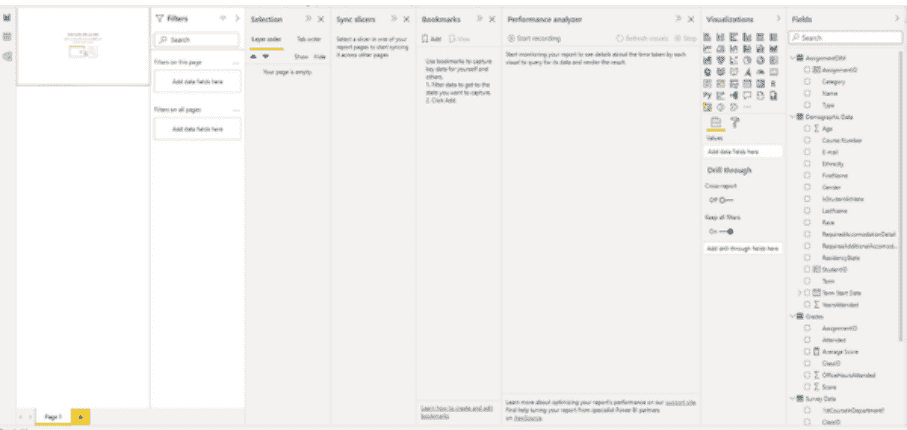

图 2-25。它们分别是书签、选择、性能分析器和同步切片器窗格。

书签窗格允许您保存为特定报告页面设置的筛选器、钻取和其他条件，就像可以返回的书签一样。例如，假设我们有一个显示所有数据的报告页面示例，但希望最终用户能够快速将报告更改为特定的筛选视图。我们可以使用书签在页面条件之间从一个点切换到另一个点。书签是一个非常强大的功能，我们将在后面更详细地讨论。

选择窗格允许您快速管理报告中对象的可见性和层叠顺序。假设您有一个徽标，希望它始终出现在报告的非常特定位置，但在您将可视对象添加到画布时，徽标被可视对象的框遮挡，即使重叠徽标的框部分是空白。要解决此问题，您需要将徽标置于最前面，可以通过此菜单执行此操作并管理整个层叠顺序。您还可以将对象分组，以便一起处理和移动。

性能分析器可在您准备排查报告中某项内容显示时间比预期更长或加载速度比以前慢的原因时提供帮助。您可以使用性能分析器收集有关生成 DAX 查询花费了多少毫秒、可视化结果以及其他项目（包括 Power BI 生成用于创建可视对象的 DAX）的信息。虽然机器生成的 DAX 对初学者来说并不总是最容易学习，但当您具备一定的 DAX 经验时，了解所有筛选器上下文和行上下文以查看 Power BI 如何生成适当代码来驱动可视化会很有用。同样，当您的报告出现问题时，您可以测试不同的配置，看看报告性能是提高还是下降。

最后要讨论的窗格是同步切片器窗格。当您将切片器可视对象添加到报告时，它们仅适用于该页面。但是，使用同步切片器窗格，您可以选择一个切片器并将该切片器添加到其他页面并进行同步——因此，当一个页面上的切片器更改时，所有其他页面上的切片器也会更改。这对于探索性分析非常有用，例如，有人正在查看数据并发现他们想深入研究的特定公司。如果他们在报告的一部分中设置了该筛选器，则这将把该切片器选择应用到所有其他也具有该切片器的页面。您甚至可以控制它应该在页面 A 上同步，但在页面 B 上不同步，例如。

### 数据视图

数据视图允许您查看报告内的表级数据。它将按序号顺序而非字母顺序显示报告中的列。序号顺序是数据源中列的顺序，或者在我们的情况中，是列在加载到数据模型之前在 Power Query 中出现的顺序。让我们查看我的示例日期维表，以了解整个表在数据视图中的外观，如图 2-26 所示。

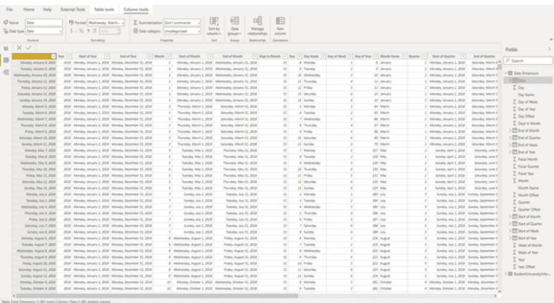

图 2-26。数据视图中的示例表。

### 表和列工具

首先，您会注意到有两个新的功能区子部分可供交互。功能区的“表工具”选项卡将在您在“字段”窗格中选择任何表或列时出现。“列工具”选项卡仅在选择特定列时出现。让我们通过放大图 2-27 来查看。

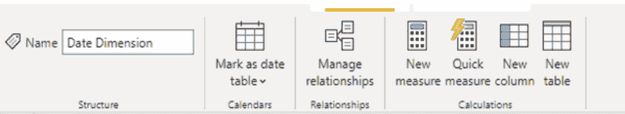

图 2-27。新视图，新功能区选项。

表工具子部分允许您更改表名称、将其标记为日期表，或者像我们之前从功能区讨论的那样在此处查看关系。此外，我们还有用于创建度量值和表的计算选项。这里没有太多新内容，并且在您选择表或列时，此视图也会在报告视图中显示。

值得讨论的独特功能是“标记为日期表”功能。默认情况下，幕后，Power BI 为数据模型中每个日期字段的每个实例创建一个日期表，该表包含该字段第一个日期和最后一个日期之间的所有日期。它这样做是为了幕后组装日期层次结构功能和其他一些必要功能。在小型模型中，这并不是什么大问题。但是，当您开始拥有大型模型，其中有几十个甚至数百个隐藏日期表时，您的模型可能会非常快地增长。Power BI 允许您通过在模型中设置一个日期表来绕过此过程，以服务于所有这些其他日期的目的。由于我有一个日期维表，我将执行此操作，我们将在后续章节中再次讨论此主题。

当我选中一个列时，我也可以看到“列工具”选项卡，如图 2-28 所示。

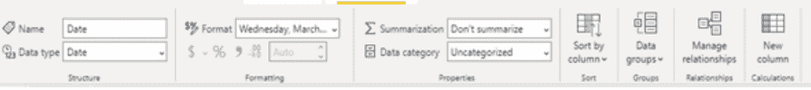

图 2-28。列工具选项卡。

从左侧开始，我可以看到列的名称及其数据类型。在此示例中，我正在查看 Date 列，它具有日期数据类型，与日期/时间数据类型不同。我可以选择将数据加载到可视对象时的格式。鉴于它是日期，我可以选择下拉菜单并查看各种选项。如果我选中带有数字的列，我可以选择以货币、小数、整数、百分比或科学计数法显示值。常规选项将默认为数据在数据模型中存储的方式。货币、百分比、在值中显示逗号以及设置要查看值保留多少位小数的选项是灰显的。

接下来，在“属性”子部分中，您可以设置该列的属性，用于其默认汇总以及 Power BI 应如何对该数据进行分类。默认情况下，非数字列不进行汇总。但是，您可以为任何列设置默认汇总，或设置为 count 或 count (distinct)。数值列的默认汇总是求和，但这并不总是合理。默认汇总选项包括 sum、average、minimum、maximum、count 和 count (distinct)。您始终可以通过将其设置为 Don’t Summarize 来使任何列没有默认汇总。

数据类别是对该数据上下文的描述。默认情况下，绝大多数列未分配数据类别，保持未分类状态。对于数字，选项并不多，除非您希望将数值识别为邮政编码或条形码值等内容。日期没有任何数据类别选项。不过，文本有大量选项，为适当的列选择这些选项，可以使在某些可视化中处理该数据变得更加轻松。这些选项包括 Address、Place、City、County、State or Province、Postal code、Country、Continent、Latitude、Longitude、Web URL、Image URL 和 Barcode。

下一个子部分是“按列排序”。这个设置藏得比较隐蔽，但却是个绝妙的设置。它允许您为列设置规则，以便在将其放入可视化对象时自动排序。我有一些关于虚拟大学“酷校大学”的示例数据。这些数据专门用于 ISOM 210 数据可视化导论课程。假设我想按另一个值对某一列进行排序？例如，按学生 ID 号对姓氏进行排序？这就是“按列排序”允许您做的事情。我们将在书中后面更详细地展示此示例。

数据组允许您将数据的组合或分组放在一起以便快速分析。这类分组的明显示例包括年龄段或人种分组。不过，您大可以想出许多不同的方式来创建组。产品列表很复杂？将它们分组为更易管理的列表。想将某个特定患者状况与其他情况分离出来作为对照组？请专门对它们进行分组。
我们将在书中后面更详细地演示分组。

### 总结

希望本章能让您更好地了解使用功能区和该界面中的窗格的“报告”和“数据”选项卡的用户界面。我们已经看到，在数据视图中与数据进行交互的方式有很多种，这对我们以后会有帮助。但是，在做其他任何事情之前，我们必须先将数据导入 Power BI 文件。为此，在下一章中，我们将讨论如何将数据导入模型以及如何使用关系视图。
