## 第 3 章. 导入和建模我们的数据

### 致早期发行版读者的说明

使用早期发行版电子书，您可以获取书籍的最早形式——即作者撰写时的未经编辑的原始内容——因此您可以在这些书籍正式发布之前很久就开始使用这些技术。

这将是最终图书的第 3 章。请注意，GitHub 仓库将在稍后激活。

如果您对如何改进本书的内容和/或示例有任何意见，或发现本章中有缺失的材料，请通过 _feedback.powerbifundamentals@outlook.com_ 联系作者。

在上一章中，我们详细介绍了“报告”和“数据”视图的 UI 功能，以帮助您理解。本章讨论 Power Query 和模型视图的用户界面。到本章结束时，我们将把模拟班级数据导入 Power BI Desktop 文件，并使用该数据来演示 Power Query 用于数据操作和整理的基本功能。

在讨论模型视图时，我们将演示数据模型中的关系是什么以及它们的作用。最后，这是我们第一次浏览数据并主动尝试的章节。如果您是一名实践型学习者，我强烈建议您获取示例数据并跟我一起操作，尝试复制步骤和结果。

### 获取我们的数据

为进行此练习，我将使用三个可在此处下载的 Microsoft Excel 文件（编者注：我们尚不确定将在哪里托管这些文件）。我们将设身处地，以酷校大学数据可视化课程讲师的身份进行操作。我们拥有学校提供的信息文件、我们从学生那里自己获取的信息文件，以及学生作业成绩文件。

从“报告”视图功能区上的“开始”选项卡开始，让我们使用 Excel 工作簿快捷方式导入第一个名为“School Supplied Data”的文件。使用 Excel 工作簿按钮时，Power BI 会弹出资源管理器窗口以导航到 Excel 文件。选择文件并按“打开”。

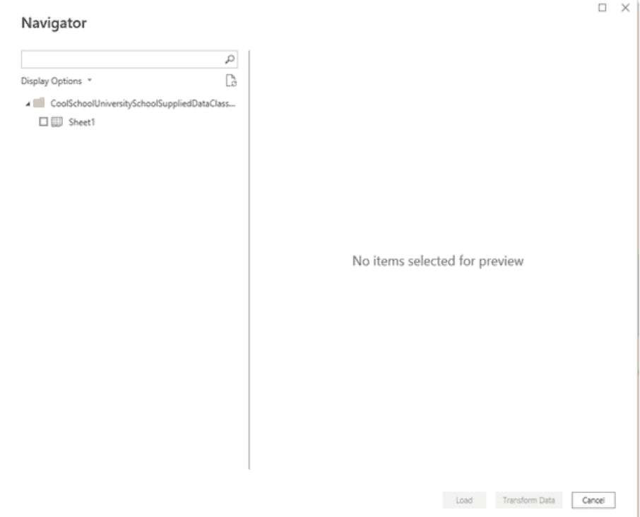

图 3-1. 打开“School Supplied Data”文件后，导航器窗口应会立即弹出

您将看到导航器窗口弹出，其外观通常如图 3-1 所示。之所以说“通常”，是因为当您使用数据库作为数据源时，基于您对数据库的访问权限，可能会看到更多可选择的数据元素。连接到 Excel 工作簿时，您应该能看到工作簿中的所有工作表。当您从下拉菜单中选择数据元素（在我们的示例中为 Sheet 1）时，将如图 3-2 所示显示数据预览。请注意，我单击了 Sheet 1 旁边的方框，从而有效地将其选中以导入。另外请注意，您不需要选中复选框即可查看预览。

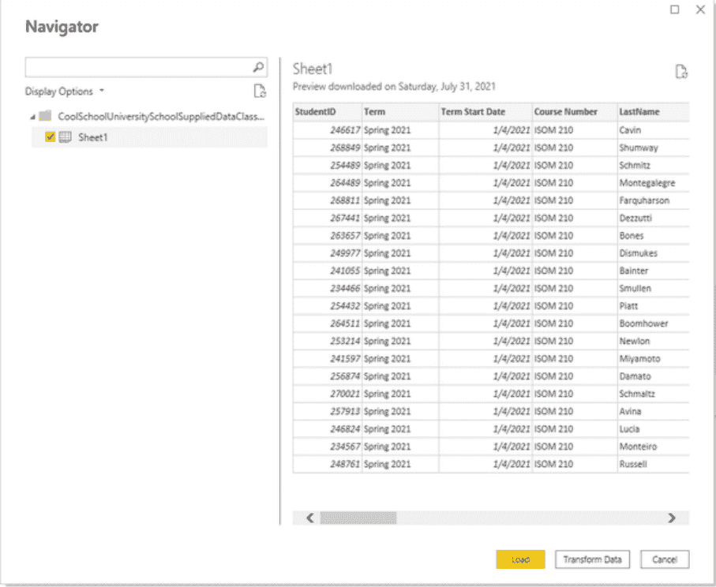

图 3-2. 数据预览

此时，请将您的注意力集中在右下角，您可以看到“加载”和“转换数据”按钮不再置灰。选择数据元素（通过单击复选框）后即会发生这种情况。虽然此文件只有一个工作表，但如果文件中有多个工作表，我们可以同时选择多个工作表进行导入。不过，就像我曾经从两个住在办公隔间里的聪明秃头男士那里学到的那样，请始终选择“转换数据”。按下“加载”将按照预览中显示的内容直接导入数据，并将其加载到数据模型中。没有任何内容阻止我们稍后回到 Power Query 中操作表格，但一旦选择“加载”，其他所有进程都会停止，以便 Power BI 导入该数据并将其存入 VertiPaq 的存储中。

我的经验法则是：多花一秒钟，按下“转换数据”，并在 Power Query 中再次检查数据是否按照您的意图进行了整理和类型设定。让我们看看在图 3-3 中按下“转换数据”会发生什么。

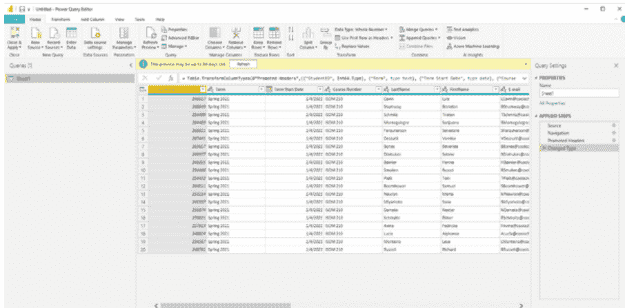

图 3-3. Power Query 是我们用来根据需要整理数据的地方

会出现一个新的弹出窗口。它显示了许多内容：我们的潜在表格（当前名为 Sheet 1）、数据预览、大量的数据转换选项，以及 Power BI 现在称之为查询的数据当前已应用的转换步骤。查询是即将导入我们数据模型的数据元素。在深入了解 Power Query 的所有功能之前，让我们先将另外两个 Excel 文件导入 Power Query，并为它们命名，使其比 Sheet 1 和 Sheet 2 更具意义。在不离开 Power Query 窗口的情况下，选择“新建源”并添加“讲师收集的信息”。完成了吗？现在重复此步骤以获取本学期的成绩。

值得注意的是，在 Power Query 内部添加数据源时，导航器窗口不会显示“加载”和“转换数据”选项。只有一个黄色的确定按钮和一个取消按钮。不用担心，在 Power Query 的导航器窗口中按下“确定”，相当于选择了“转换数据”。

此时，您可能已经注意到“成绩”文件与前两个不同！抱歉，我在这里故意加入了一个小陷阱。它确实，在

事实上，有两个工作表。根据我们之前的讨论，通过选择两个工作表并按下 OK，我们可以将两个工作表都导入。

不过，请查看 GradeScores 数据预览，你会发现它包含一些未命名且为 null 的额外列。我特意稍微修改了一下这个文件，以便向你展示建议表（Suggested Tables）功能。在导航器窗口（Navigator Window）中，你会看到有一个建议表下拉菜单（Suggested Tables drop down）。如果你选择它并预览数据，你会看到在去掉额外的 null 列后，数据看起来是正确的。让我们从顶部选择 AssignmentDIM，从底部选择 Table 1，并将两者都导入。如果你能猜出我是如何搞乱这个 Excel 工作表的，我会奖励你 15 分。不幸的是，就像《Whose Line is it Anyway》一样，这些分数是假的，无关紧要。

现在，在结束本节之前，让我们重命名查询，使其更有意义。AssignmentDIM 保留了其工作表名称，这很有帮助，但我们仍然需要重命名其他查询。你可以在查询视图中右键单击表格并选择重命名，或者在选中查询的情况下，从 Power Query 右侧的属性窗口调整名称。让我们将这些查询重命名为 Demographic Data、Survey Data 和 Grades。如果你一切操作正确，Power Query 应该看起来如图 3-4 所示。如果不是，我建议右键单击每个对象，选择删除，然后重新开始，看看你能否找出哪里出错了。当一切就绪后，单击“关闭并应用”（Close & Apply）按钮加载数据。要从报表视图返回 Power Query 窗口，在“开始”选项卡中单击“转换数据”（Transform Data）按钮。

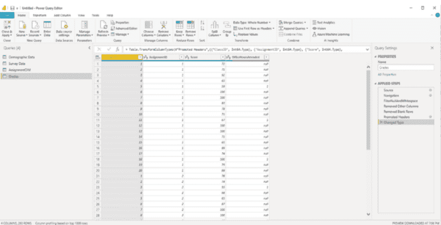

图 3-4。如果你跟着操作，此时应该出现这个界面

### Power Query 功能区

现在我们已将数据导入 Power Query，只需在功能区中点击，你就会发现有很多转换数据的方法。在本介绍中，我将重点介绍功能区中的“开始”、“转换”和“添加列”区域。如果你想执行某种数据转换但在功能区中找不到，可能可以通过手动编码来实现。这超出了本练习的范围，但如果你想了解更多关于 M（即 Power Query 语言）的信息，可以在 Microsoft 的语言文档中找到，位于 (https://docs.microsoft.com/en-us/powerquery-m/)。

最后，在继续之前，在接下来的部分中，你会注意到对选定列的引用。你可以通过单击列标题来选择一列；如图 3-4 所示，我已选中 ClassID 列。当你想要选择多列时，可以选择一列并按住 Shift 键，单击另一列。这将选择这两列之间的所有列。若要逐个选择列，请按 Control + 鼠标左键，以此方式选择多个单独的列。

### “开始”选项卡

Power Query 中的“开始”选项卡大体上很简单。查看图 3-5，我们可以看到各组中的所有图标，我们将逐一介绍并提供一些用例示例。

图 3-5。“开始”选项卡是核心所在……或者该说是大脑？

“关闭并应用”（Close & Apply）按钮将应用你迄今所做的所有修改，并刷新受更改影响的所有数据元素。如果你单击按钮下半部分，将看到一个包含三个选项的下拉菜单：

- Close & Apply
- Apply：应用更改但不关闭 Power Query
- Leave：不应用任何更改

如果你选择离开，Power BI Desktop 会显示警告，告知你有未应用的更改。

“新建查询”部分允许我们使用“新建源”按钮导入新数据。单击按钮上半部分会打开完整的数据源选择菜单，而下半部分则会生成一个最常用数据源的下拉菜单。

“最近源”按钮允许你快速连接到最近使用过的任何数据源，而不仅限于当前的 Power BI Desktop 文件。如果你正在进行测试并想要生成第二个文件并快速建立连接，或者你正在处理新模型并希望使用之前处理过的内容来扩展它，这将很有用。

“输入数据”将打开一个简单的表格结构，你可以在其中手动插入数据并创建列名。我不建议大量使用“输入数据”，但如果你有不一致的数据源需要制作映射表或快速的额外维度（而该维度可能在你的数据其他地方不存在），它可能很有用。虽然“输入数据”的界面看起来非常像 Excel，但它不支持公式，也没有数据验证规则。它只有行和列，输入的数据越多，就需要手动管理的内容越多。因此，如果可能，我通常建议谨慎使用“输入数据”，但如果你需要，它就在那里。

“数据源设置”按钮将打开类似图 3-6 所示的窗口。在此窗口中，你可以更改源、导出 PBIDS 文件（你可以将其想象为该数据源的 Power BI Desktop 快捷方式，可以在其他 Power BI 文件中打开）、编辑权限和清除权限。

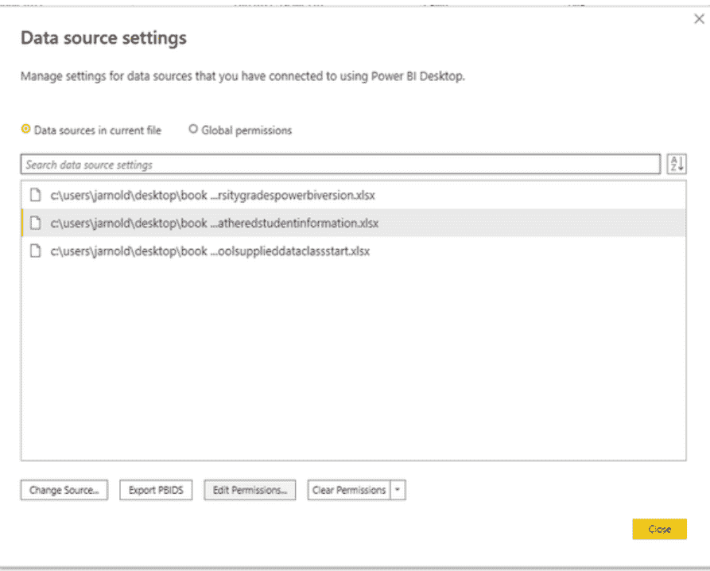

图 3-6。数据源设置——这个区域看起来好像不太重要，直到它变得重要为止

“管理参数”允许你创建、查看和编辑所有现有参数。Power Query 中的参数是可在特定上下文中调用的值，用于更改与特定数据的交互方式。参数有众多应用，我们稍后将与假设分析、部署管道中的参数规则等内容一起讨论。

目前，只需认识到参数的强大之处，我们稍后再回到这个话题。

“开始”选项卡中的“查询”部分允许你刷新预览、查看属性、打开高级编辑器或管理查询，其含义不一定明显。“刷新预览”按钮会获取当前高亮显示的查询，并为你提供更新的数据预览供你在工作时参考。在数据集频繁更新且你希望确认在数据变化时仍然获得预期的转换行为时，这非常有帮助。你也可以单击按钮下半部分，选择刷新模型中当前所有查询的预览。

“属性”按钮会打开一个对话框窗口，显示查询的名称、查询的描述，以及“启用加载到报表”和“包含在报表刷新中”两个选项；默认情况下，这两个选项始终处于选中状态。在添加之前，描述窗口中没有内容，因此为查询添加描述会很有帮助。

当“启用加载到报表”关闭时，整个表将被视为不存在，所有依赖该表的可视化对象都将失效。你可以把这类似于从数据模型中对表执行“软删除”。如果你想重新启用它，它仍然存在于 Power Query 中，但除此之外，Power BI 会将其视为不存在。

“包含在报表刷新中”不像应该的那样直观。如果“启用加载”已关闭，则无法将其包含在报表刷新中。当此选项禁用时，它会保持数据在模型中当前的状态，但在数据刷新发生时不会更新该查询。当表格非常大，且我想在数据刷新中测试其他更改而不重新加载最大表时，我通常会使用此选项。此外，还有一些用例，人们会在特定时间点保留某些数据以供审计之用。

“高级编辑器”就是你可以查看每次转换生成的实际 M 代码的地方！我个人觉得能够查看更改时生成什么代码很有趣，尤其是当

你是否有兴趣自己学习这门语言。作为一种语言，在我看来，M 易上手但难精通。如果你想尝试直接在此编辑器中修改 M，请在进行更改前先将当前正常工作的代码复制到文本文件或其他备份中。原因是，无论你做出什么更改并按下“Done”，你都会得到结果，不管你的代码是否能正常工作；因此，正如编程中一贯如此，请务必备份！

最后，“Manage”按钮命名不当。当你按下此按钮时，会看到三个选项：Delete、Duplicate 和 Reference。复制查询会获取查询当前的状态并对其进行复制。这很直接，实际上确实意味着你要将该数据存储两次。

引用（Reference）的作用略有不同。它会创建一个新查询，乍看之下像是复制，但实际上并非如此。它获取所引用的查询（无论其最终形状如何），并允许你在此基础上进行操作。这意味着，如果你对父查询进行更改，引用的查询也会随之更改，这可能会导致该查询出错，所以要小心。

“管理列”区域有两个按钮：“选择列”和“删除列”。两者都能达到相同目的，但方式不同。“选择列”按钮在顶部点击时，会弹出一个对话框，让你选择要在查询中保留哪些列，丢弃其余列。该按钮下半部分可以打开上述“选择列”对话框，也可直接跳转到查询中的某个特定列。当查询中有很多列且不确定其在列顺序中的位置时，此第二个功能非常有用。“删除列”按钮的上半部分仅删除所选列，不会弹出对话框。它会将所选列直接抛入深渊。下半部分在其下拉菜单中提供第二个选项“删除其他列”。这会移除你未选中的所有列。

“缩减行”区域有两个部分：“保留行”和“删除行”。各自针对前 X 行或 X 到 Y 号行之间的行有独特的用例。我要在此区域特别提醒你一点，即如“删除行”部分所示的删除重复项功能。需注意的是，它将基于你选定的列来删除重复项。因此，如果你只选定了一列并删除重复项，可能会丢失你原本打算保留的数据。“排序”部分允许你突出显示一列，然后按升序或降序排序。当选中多列时，此功能不适用。

接下来是“转换”部分，它提供了一些基本的转换选项。“拆分列”允许你选中一列，并基于你选择的分隔符将其拆分为多列。典型的用例可能是：你有一个包含名和姓的单名称列，但需要将它们分开。“分组”允许你对当前查询进行某种聚合。例如，当你有大量数据并希望进行预聚合以减少行数时，这很有用。在图 3-7 中，你可以看到一个使用成绩数据计算每个作业平均分的分组示例。

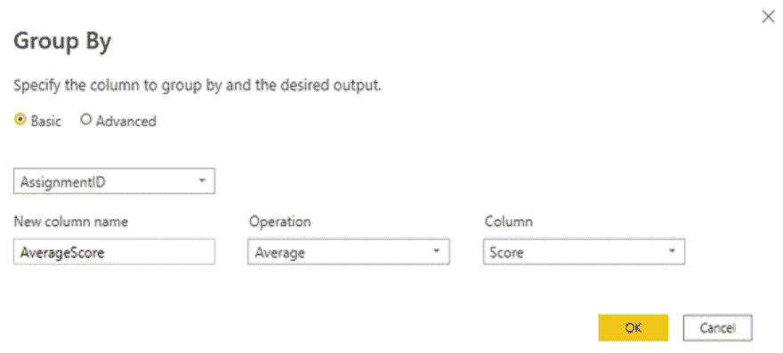

图 3-7. “分组”让我们有机会使用多种操作对数据进行聚合

我们可以使用“数据类型”按钮更改所选列的数据类型。有多种不同的数据类型，当数据首次导入 Power Query 时，Power BI 会尝试自动检测它们。Power BI 在检测数据类型方面实际上做得不错，但也存在不完美的情况，因此如果你需要手动调整，请在此处进行。

“将首行用作标题”非常直观，Power BI 通常会尝试根据数据源检测首行是否包含列标题。如果你单击“将首行用作标题”按钮旁边的箭头，还会看到一个选项，即将标题设为首行，也就是逆操作。“替换值”允许你在指定列中查找并替换值。常见的用例是：根据你的分析，将零视为空值或将空值视为零。需要注意的是，你无法编辑单个单元格，因为单元格不是 Power Query 认识的概念；它只理解列。

“合并”部分允许我们合并查询、追加查询和合并文件。“合并查询”类似于 SQL JOIN 语句。表 A 中有列 A，表 B 中也有列 A，你想将表 B 的列 N 添加到表 A。JOIN 语句表示：当表 A 中列 A 的值与表 B 中列 A 的值相等时，给我列 N 的值并将其添加。我们在这里做的正是同样的事。

“追加查询”允许你获取两个查询并将它们合并在一起，得到一个包含两者所有列和值的单一结果。它的作用就是如此，但在我看来，这并非其预期用途。其预期用途是获取多个数据形状和格式相同的查询，并将它们合并为一个更长的查询，更类似于 SQL 中的 UNION 语句。“合并文件”允许你在“追加查询”的问题出现之前，预先将多个文件合并为单一视图。

最后，“AI 见解”部分包含允许你连接组织可能使用的 Azure AI 服务的项目。需要注意的是，如果这些功能需要刷新，则需要 Power BI Premium 才能使用。你的组织很可能没有这些资源，因此我不会在此花费太多时间，只是提及它们的存在。如果组织确实使用 Azure Machine Learning Studio 或 Cognitive Services，请咨询你的 Azure 管理员以了解更多信息。

### 转换选项卡

“转换”选项卡包含一些用于转换数据的额外选项，超出了我们在“开始”选项卡的“转换”部分中所见的内容。然而，正如上一章所见，Microsoft 在功能区中确实设置了一些冗余，我会特别指出这些情况。但首先，让我们查看图 3-8，了解整个“转换”选项卡。

图 3-8. 转换你的数据，远比表面所见更多

首先，在“表”部分（见图 3-8 底行中的“表”），我们看到“分组”和“将首行用作标题”。这些都非常直观。“转置”将你的列转换为行。“反转行”按行颠倒数据的顺序，使最后一条记录排在第一位，第一条记录排在最后。“计数行”将显示该查询中有多少行。

“任何列”部分提供了编辑列数据类型的功能，如我们之前所见。你也可以如前所述替换值。“取消透视列”将你选定的数据列重塑为“属性”列和“值”列。可能存在你希望以这种方式重塑数据的场景，例如，当你希望将许多列合并为更少的列，但记录更多时。“检测数据类型”按钮将遍历每一列，并尝试根据其数据预览为其分配适当的数据类型。Power BI 通常会在首次将数据拉入 Power Query 时自动执行此操作，但如果你进行了多次可能更改多个列数据类型的转换操作，可以让它再次执行。

“填充”按钮允许你从顶部或底部开始，使用列中其他值填充缺失值。我得坦诚说，我从未实际使用过此功能。

移动按钮允许你移动表中列的位置。你可以将其向左、向右、移动到开头或移动到末尾。你可以在多列选中状态下执行此操作。重命名允许你重命名所选列。

数据透视列允许你获取某列的值，将这些值转换为列，并在新的组合中重新计算值。当一个列中有属性而另一个列中有值，并且你希望将属性作为列来查看值时，这会非常有用。

转换为列表是一个独特的函数。它获取一个列并将其转换为Power Query中称为列表的一种特殊表类型。列表可以有点像参数一样传递给特殊的自定义函数。我们在本书中不会过分关注列表。

文本列区域的命名有点奇怪，因为你可以在这些不仅仅是文本列的列上执行这些函数。幸运的是，它们大部分都很简单。

拆分列允许你获取一个列并根据分隔符选择将其拆分为两个列。格式不允许你编辑数据类型。它允许你执行诸如将所有数据更改为小写或大写或添加前缀或后缀等操作。请注意，使用此功能会将该列转换为文本类型列。合并列将两个或多个列合并在一起，允许你选择分隔符。提取允许你修改一个或多个列以保留列中的特定字符。我不经常使用这个功能，但使用时，我主要用它来删除非Unicode字符。

解析与这里的其他所有功能都不同。解析会获取JSON或XML文件（半结构化数据），并将其放入更经典的结构化格式中以供分析。我们在示例中没有使用任何JSON或XML文件，但如果你正在使用NoSQL数据库或从API调用获取结果，在对数据进行分析之前可能需要先解析该数据，而此解析函数正好可以做到这一点。

数字列函数允许你将某列作为独立值获取统计信息，对某列执行标准计算以编辑其值，对某列应用科学计算，对某列执行三角函数，对某列进行四舍五入，或查找某值是偶数还是奇数及其符号。除统计函数外，我建议在对数据进行任何修改前先复制列；这样你可以同时保留原始干净的值和修改后的值。日期和时间区域的功能与数字列的功能相同，包含大量日期和时间转换。

转换选项卡中的最后一部分是脚本部分，它提供了针对数据运行R和Python脚本的功能。要使用这些功能，你必须安装R或Python，并且Power BI需要知道这些语言库的安装位置。如果你更习惯在R或Python中使用数据框架，并且宁愿在那里执行转换并将其用作单个步骤，你可以这样做。你也可以在Power Query中进行预处理，然后应用脚本任务，最后再在Power Query中进行进一步修改。你可以混合使用这些功能，如果你想同时使用两者，也是可以的。学习R和Python超出了本书的范围，但如果你打算从事数据分析行业，这两门语言都可能对你非常有用。

### 添加列选项卡

在添加列选项卡中首先需要注意的是，除了常规部分之外，我们之前在功能区的其他位置已经见过所有其他函数。但是，常规部分包含的内容非常多，仍然值得单独成一节。查看图3-9将使这一点更加清楚。

图3-9. Power BI功能区通常会有多个位置可以找到某些功能，但至少它们是按主题组织的。

示例列简直是真实、客观的黑魔法。你可以选择一个或多个列来获取数据片段。然后，你需要给出响应的一些示例，它将在你提供示例以供处理时尝试自动填充列。例如，在我们的成绩查询中，我将添加一个基于示例的列，用于说明如果“办公时间出勤”列为空，则为“否”，否则为“是”。我们可以在图3-10中看到这一点，你还能额外看到它在M语言中组合的逻辑，这也可以是了解语言处理不同事物的另一种方式。

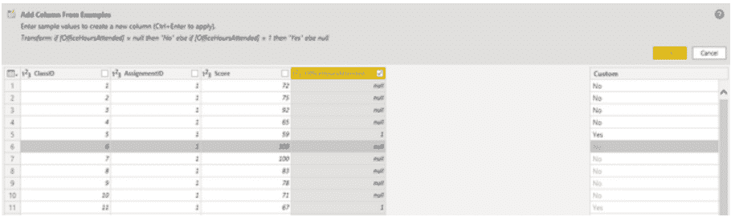

图3-10. 给出一些我想要的示例，加入一点AI，哇，新鲜出炉的列！

自定义列将弹出一个对话框菜单，你可以在其中使用M语言创建自定义列。如果你想执行的转换可能不受UI支持，或者可以通过代码更高效地完成，这会很有用。窗口至少会告诉你代码中是否存在语法错误，但如果你刚开始学习M语言，这些错误并不总是非常有帮助。

调用自定义函数是一个非常强大的工具，它允许你获取一个函数，针对给定列对该函数进行迭代，找到特定值，然后应用某种逻辑。一个简单的例子是创建一个函数，生成一个新列，该列取一个列的值并将其乘以另一个列，得到一个将放置在新列中的第三个值。你明白这个逻辑了吗？这是一个非常强大的工具，但第一次使用时，你可能很难立刻理解它的作用。

条件列允许你创建类似于if-then-else语句的列。如果列X小于列Y，则为“是”，否则为“否”。你也可以有多个子句来处理更复杂或迭代的if函数。如果你熟悉SQL，可以将其视为类似于CASE WHEN语句。图3-11显示了添加条件列的对话框窗口。

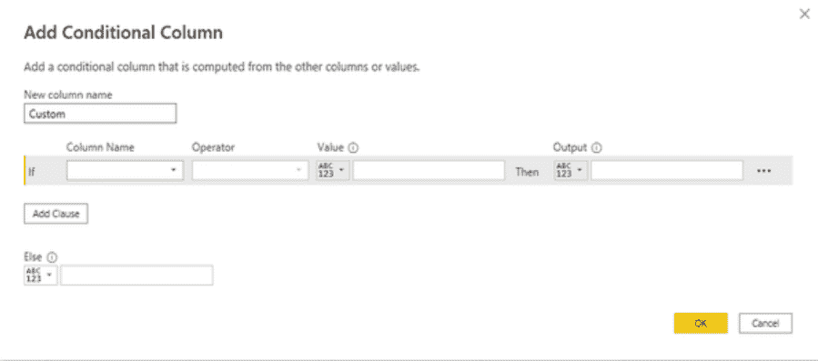

图3-11. 有时我们只需要一个if语句

索引列会创建一个从0或1开始并创建唯一值列表（通常对应于行号）的列。索引列最重要的特点是它完全唯一，在必要时可以作为临时键值使用，可能将该列与其他列合并，以将索引或键值传递给其他表以创建关系。理想情况下，你的数据中已经存在键，不需要索引。但是，如果你确实需要创建索引，这非常简单。复制列会获取当前列并制作其副本。就这些。对这个没有什么妙语连篇的评论。它只是复制粘贴。

### 模型视图

回到Power BI，让我们来看看Power BI Desktop中的第三个视图，即模型视图。为什么关系很重要？它们实际上能实现什么？我可以忽略关系，只创建一个能解决世界饥饿问题的大表格吗？我们将在本节中探讨这些想法。

让我们快速查看图3-12中当前文件的模型视图。默认情况下，Power BI会在导入数据时尝试检测关系，并以一种能够正确检测关系的方式组合数据。不幸的是，它并不总能很好地完成这项工作。因此，你在导入数据后应始终仔细检查关系，以确保你的模型是按照预期构建的。

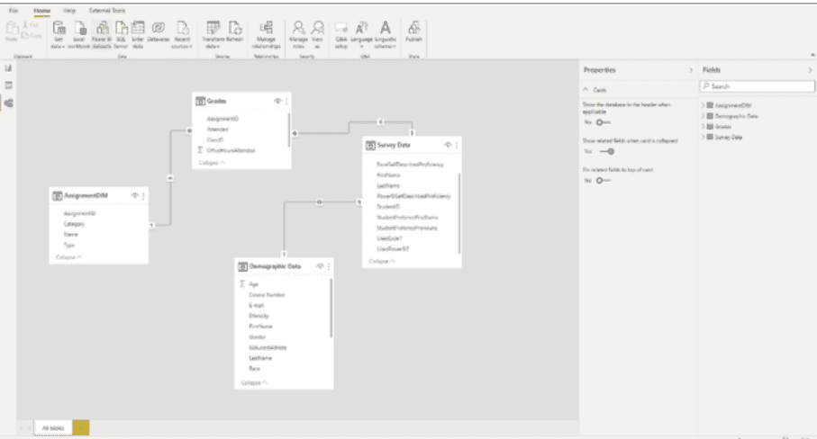

图3-12. 就是这样，我们的数据模型

### 什么是关系？

简而言之，关系是一种告诉Power BI哪些表格相连以及如何连接的方式。关系应构建为一个表中某一列的值与另一个表中对应列的值匹配，这样如果我们尝试查询，就能得到合理的结果。关系由几个要素组合而成：列、方向和基数。如果我们将鼠标悬停在数据模型的连线上，它们会发光变黄；双击该连线，就可以看到如图3-13所示的关系对话框窗口。在此示例中，我演示的是AssignmentDIM和Grades之间的关系。

### 编辑关系

选择相关的表和列。

| 班级ID | 作业ID | 分数 | 办公时间出席 | 出席 |
|---|---|---|---|---|
| 1 | 1 | 72 | null | 否 |
| 2 | 1 | 75 | null | 否 |
| 3 | 1 | 92 | null | 否 |

| 作业ID | 名称 | 类别 | 类型 |
|---|---|---|---|
| 1 | HW1 | 作业 | 论文 |
| 2 | HW2 | 作业 | 选择题 |
| 3 | HW3 | 作业 | 项目 |

图 3-13。这并非巧合，关系是基础

让我们浏览一下这个对话窗口，看看我们有什么。首先，我们看到有两个表被选中。在这种情况下，因为我们从模型视图中选择了关系，所以它预填充了相关表。您可以看到每个表都有一个高亮列。这就是构成关系基础的列。

这里我们告诉 Power BI 以下内容：“当您需要运行查询并从 Grades 和 AssignmentDIM 两个表中提取数据时，您可以在该列上将它们连接起来。”这在任何数据库系统中都至关重要，Power BI 也不例外。但是，我们确实有 Analysis Services 的额外约束，这些约束旨在加快其查询时间。您会注意到，我无法选择多列来建立关系。

“但 Jeremy！”我已经能听到有些人在对着页面大喊，“我可以编写一个带有两个表之间多个连接条件的 SQL 语句！”是的，您可以。但是，Power BI 在查询其内部数据库时不运行 SQL，它运行 DAX。如果您需要在带有多列的两个表之间创建关系，我的建议是：在两个表中创建一个包含您要连接的列的复合值的列，然后使用您的新串联列创建单个关系。

接下来，让我们谈谈基数和方向。这两者密不可分。在 Power BI 中我们可以创建三种类型的关系：一对一关系、一对多关系和多对多关系。

我不喜欢多对多关系。构建数据模型的最佳实践是在可能的情况下尽量避免多对多关系，因为它们性能不佳，有时会给您带来与预期不同的奇怪结果。对于 SQL 人员来说，多对多关系更类似于完全外连接。您可以通过查看连接两个表的线并查看线的两端是否都有星号，来快速识别关系是否为多对多。

一对一关系是指表 A 的列 A 中的所有值都是唯一的，且表 B 的列 A 中的所有值也是唯一的场景。您可以通过看到连接两个表的线的两端都有数字 1，来快速识别一对一关系。

一对多关系是指表 A 的列 A 中的所有值都是唯一的，但表 B 的列 A 中的值不是唯一的。您可以通过在模型视图中看到线的一端有“1”，另一端有星号，来快速识别模型中的这种关系。这两种关系类型的好处是，我在寻找一个值并在另一列中比较这些值，而不是查找该值的每个副本并将其与其他每个副本进行比较。

当我们讨论关系的方向时，我们是在讨论哪个表可以过滤另一个表。它们可以双向过滤还是只能单向过滤？一对一关系默认具有双向过滤方向。这可以通过连接两个表的线中间部分的双向箭头来查看。多对多关系只能具有双向过滤方向。一对多关系默认采用单向过滤方向，从具有唯一值的表指向具有非唯一值的表。单向关系可以通过有一个箭头指向正在被过滤的表来识别。

让我们演示几个例子来展示会发生什么。首先，我将显示一个包含这两个表中值但完全没有关系的表，然后是建立关系后的情况，最后演示方向如何工作。图 3-14 显示了没有关系时会发生什么。

| 作业ID | 平均分数 |
|---|---|
| 1 | 77.07 |
| 2 | 77.07 |
| 3 | 77.07 |
| 4 | 77.07 |
| 5 | 77.07 |
| 6 | 77.07 |
| 7 | 77.07 |
| 8 | 77.07 |
| 9 | 77.07 |
| 10 | 77.07 |
| 11 | 77.07 |
| 12 | 77.07 |
| 13 | 77.07 |
| 14 | 77.07 |
| Total | 77.07 |

图 3-14。你还不是专家，但你知道这不对，原因就在于关系

这里，在图 3-14 中，我从 AssignmentDIM 表中提取了作业 ID 代码，并添加了这些作业的平均分数。那个 77.07 值是所有内容的总平均分数，但不是每个作业的平均分数。没有任何关系，Power BI 不知道如何生成查询来获取我所需的内容。

现在让我们重新添加关系，看看图 3-15 中我们会得到什么。

| 作业ID | 平均分数 |
|---|---|
| 1 | 81.95 |
| 2 | 79.60 |
| 3 | 82.30 |
| 4 | 79.60 |
| 5 | 78.20 |
| 6 | 80.50 |
| 7 | 78.25 |
| 8 | 81.50 |
| 9 | 79.45 |
| 10 | 79.60 |
| 11 | 77.90 |
| 12 | 80.60 |
| 13 | 78.55 |
| 14 | 41.00 |
| **总计** | **77.07** |

图 3-15。这更合理了，合理多了，因为关系使得内部查询可以正常工作

您会注意到，总平均分仍然正确；该值不需要与作业 ID 进行任何交互。但是，对于每个单独的 AssignmentID，我可以创建一个查询，基本上是说：“在作业 ID = 1 的位置，忽略 Grades 表中作业 ID 不是 1 的所有其他值，然后仅计算该作业 ID 的平均分数，然后对每个作业 ID 重复此操作。”关系使这一切成为可能。

现在让我们谈谈过滤方向。在下一个示例中，我有一个分数的切片器，我希望看到哪个作业 ID 包含该分数。

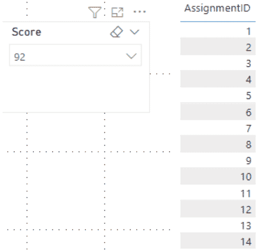

图 3-16。无用的过滤器就是无用。基数和关系方向很重要！

请记住，在我们的数据模型中，AssignmentDIM 和 Grades 之间存在一对多关系，它只单向过滤，从 AssignmentDIM 中的一侧过滤到 Grades 表中的多侧。因此，Grades 的分数无法过滤 AssignmentDIM。现在，让我们反过来，将作业 ID 放在切片器上，将分数列表放在表中，看看图 3-17 中我们会得到什么。然后，在图 3-18 中，我们可以看到当方向性过滤器设置为双向时会发生什么。

| 作业ID | 分数 |
|---|---|
| 7 | 57 |
| | 58 |
| | 61 |
| | 63 |
| | 64 |
| | 72 |
| | 74 |
| | 75 |
| | 76 |
| | 77 |
| | 78 |
| | 82 |
| | 89 |
| | 92 |
| | 95 |
| | 96 |
| | 100 |

图 3-17。有用的过滤器很有用！

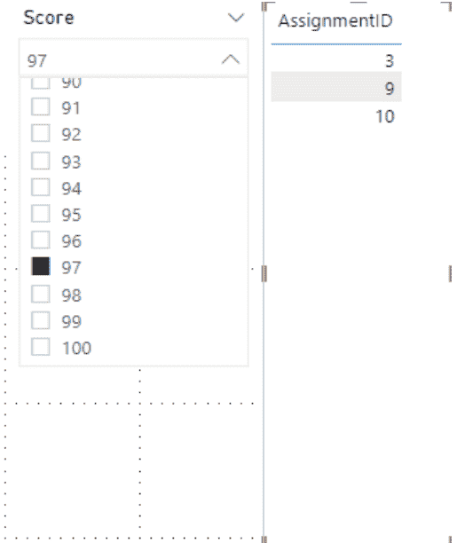

图 3-18。双向过滤

我又能听到来自虚空的那些呼喊了，“但 Jeremy，如果双向过滤能做到这一点，为什么我们不一直将其设为默认呢？”简短的回答是，它性能不如单向，而且您可能会创建出现所谓歧义的关系，这会阻止其他关系被使用。通常，最佳的数据建模做法是所谓的星型架构，其中包含事实数据的表周围环绕着其他较小的表，像星星一样过滤该表。

好吧，那那个能解决世界饥饿的单表呢？那不会很好吗？好吧，简短的回答是不。大型单表无法充分利用维度建模方法的优势，该方法具有多种数据治理和易用性优势。此外，大型单表很快会变得难以管理，因为您需要在 Power Query 中进行许多复杂的编辑来促成该单表的创建。与一个拥有十五列的单表相比，处理一个五列的表和一个十列的表确实更容易。

### The Properties Pane

模型视图中的“属性”窗格非常上下文相关。无论您选定哪个数据元素，“属性”窗格都会根据您选定的数据对象类型进行相应更改。

选中表时，您可以查看 Name、Description、Synonyms、Row Label、Key Column、Is Hidden 标志和 Is Featured Table 标志。在“高级”部分中，将显示“存储模式”。“存储模式”可以是 Import、DirectQuery 或 Dual。请注意，一旦某项内容处于 Import 模式，就无法更改了。

“名称”字段非常简单。“说明”将为空白，您可以填写该表包含的内容摘要或其在数据模型中的用途。“同义词”是为了 Q&A 功能而列出的，我们之前稍微提到过，但会在本书后面更详细地讨论。“行标签”允许您识别一个列，以便在使用特定表进行 Q&A 时作为默认列使用。

“键列”允许您识别仅包含唯一值的列。我喜欢高亮显示作为表与其他表关系基础的列。另外，当某列被识别为键列时，它将在“字段”窗格旁边获得一个特殊图标。

如果‘Is Hidden’设置为 yes，则该表将从“报表”视图中隐藏，因此您无法将该表的项目添加到报表项中。请注意，如果您已经使用该表创建了对象，这些对象将保持可见，但您无法将该表的数据元素添加到新的可视化对象中。最后，如果表是“特色表”，启用了特色表的组织中的用户可以从 Power BI 服务搜索此表。我们将在本书后面更详细地讨论 Power BI 服务时，进一步讨论特色表和其他元素。

选中单个列时，您可以查看 Name、Description、Synonyms、Display Folder 和 Is Hidden 标志。在窗格的“格式”部分中，您可以查看列的数据类型以及该数据的格式。最后，在“高级”部分中，您可以选择要按其排序的另一列，如有需要可识别数据类别（可以将这些视为 Power BI 在非常特定情况下可能需要用到的非常特定类型数据的识别项），并设置默认汇总。您还可以在此部分中识别列是否应允许包含空值。上面表格部分的所有指导均适用，但我想稍微谈谈显示文件夹。

显示文件夹是将数据元素分组到表中的子文件夹，从而保持数据模型整洁的好方法。此处不会修改或操纵任何实际数据；这仅用于视觉整洁。您也可以将度量值放入显示文件夹中，当我想将特定项目分组在一起（这些项目在 Power BI 在“字段”窗格中进行的大型字母顺序排序中可能不方便放置）时，我发现这特别有帮助。

那么，为了总结本章，我们完成了大量工作。我们初步涉足 Power Query，将数据加载到模型中，建立了支持分析的关系，现在可以开始创建仪表板，帮助我们了解学生在整个学期在我们班级中的表现。

为此，在下一章中，我将深入探讨 Power BI 中的不同可视化选项，并讨论每种可视化类型的一些用例。我们还将练习从这些可视化对象中推断数据，以更多了解学生。到目前为止，您跟得很好，做得很棒。您肯定正在赢得酷校大学连帽衫的道路上。

### About the Author

**杰里米·阿诺德** 是 Onebridge 的高级分析架构师，Onebridge 是印第安纳波利斯的一家大型数据分析咨询公司。杰里米在数据分析领域工作超过十年，并自 2013 年 Power BI 发布以来一直是 Microsoft Power BI 用户。他的经验涵盖医疗保健、金融、制造和公共部门等多个行业，均专注于将数据转化为洞察并实现真正的数据驱动环境。

