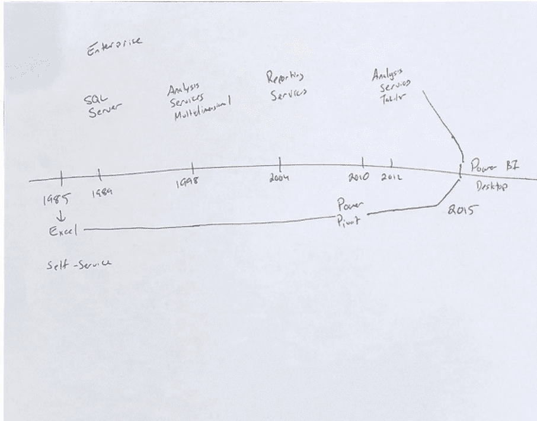
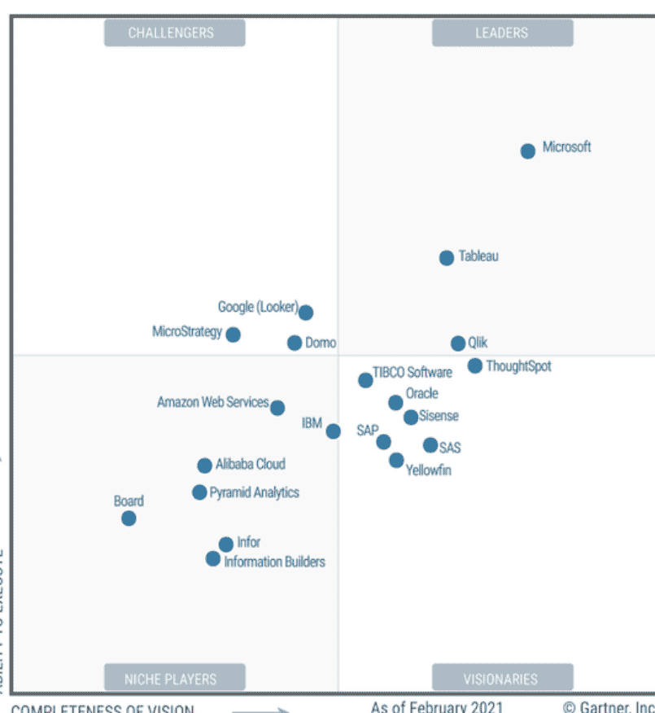

# Microsoft Power BI 学习：数据转化为洞察

In the beginning, back when life was simpler (in 2011), Power BI was just a simple piece of desktop software. But it isn’t anymore. It’s an entire business intelligence (BI) ecosystem that can fit into multiple diverse technology stacks.

In this chapter, we’ll introduce Microsoft Power BI, discuss the entire Power BI family of products, provide an overview of how Power BI works, and look at what distinguishes it from other similar tools. By the end of this chapter, you’ll:

- Know what components fit in the Power BI ecosystem and why they’re important.
- Learn the history of Microsoft’s business intelligence work to learn how that got us to Power BI.
- Discover what makes Power BI different than its competitors.

## What is Power BI?

Power BI is both a piece of software and a larger ecosystem of products. Usually when people throw out the phrase “Power BI,” it’s in reference to the desktop authoring software.

However, when discussing how most people will (visually) share the fruits of their work with others, it’s done so in the context of Power BI service, a software-as-a-service (SaaS) solution that hosts Power BI datasets and reports that can be used by others who have access.

Even beyond these two features, there are a wide variety of products in the family that allow you to embed reports into websites and other applications, view reports on your mobile device, and even have your own version of the SaaS solution on-premises.

This book focuses on Power BI Desktop and the Power BI service since they are your most basic and valuable building blocks.

Power BI Desktop is a tool for data investigation and visualization. Analysts can take data and create interactive reports that enable end users to garner insights that were previously buried. In finance, you might use Power BI to automate the generation of profit and loss (P&L) statements or analyze costs over time. In construction, you could use Power BI to identify variances in times to complete projects based on team composition or geographical factors. In retail, you might identify which of your products are the most successful, while pinpointing which ones might be on the cusp of taking off given a bit more of a push via a what-if analysis.

According to Microsoft at the 2021 Business Applications Summit, 97% of the Fortune 500 uses Power BI in some capacity. So it’s a technology you can trust putting your time and effort into, if you’re looking for the kind of insight that transforms your enterprise. Or in my case, it’s the excuse to build a Pokédex for my daughter. Sometimes you just really want to be the best, like no one ever was.

## Power BI Components

Power BI today consists of a wide variety of products that allow users to create and consume reports from your data. According to Microsoft (at the time of publishing), here are all the components that make up the Power BI family of products.

- Power BI Desktop
- Power BI service
- Power BI Mobile
- Power BI Report Builder
- Power BI Report Server on-premises
- Power BI Embedded

There is much to unpack in these products. The majority of this book will deal with Power BI Desktop because that’s the foundation it’s all built around. We’ll also discuss the Power BI service in more detail towards the end, since you’ll need some exposure to publish (and then share) your amazing work that will make you the envy of the department.

With that in mind, a quick overview of these components will be useful in the future, so here they are:

### Power BI Desktop

A free application you install on a local computer that you can use to connect to, transform, and visualize data. This is the building block for all the other portions of the Power BI ecosystem.

### Power BI service

An online SaaS solution that lets end users share reports that were created in Power BI Desktop or Power BI Report Builder with users across an organization.

### Power BI Mobile

A set of applications for Windows, iOS, and Android that allows end users to view reports in the Power BI service from their mobile devices without having to use a web browser.

### Power BI Report Builder

A free application you install on a local computer that you use to generate pixel-perfect paginated reports in the same form as SQL Server Reporting Services. For example, if you want to build something to automate invoice generation or create long lists of data for distribution, you could do that here.

### Power BI Report Server on-premises

If, for security reasons, you cannot publish reports to the Power BI service, your IT team may put a version of that software on an internal server behind the company firewall using on-premises computing resources, as opposed to cloud resources. Power BI Report Server is not always in feature parity with the Power BI service. That's because Report Server is updated only three times a year, January, May, and September. It's also worth noting that if you are going to deploy reports to Report Server on-prem, you will need to use a special version of Power BI Desktop that is in alignment with the version of Report Server installed.

### Power BI Embedded

Allows you to integrate Power BI reports and visuals into applications. This has its own pricing and licensing structure.

Now that we've introduced the whole family, we'll shift focus to the two components pertinent to this book, Power BI Desktop and Power BI service.

## Power BI Desktop

Power BI Desktop is software that allows you to connect, transform, and visualize data. Let's dig into some details. Power BI Desktop is comprised of its own components. We'll discuss the two that are most important to a Power BI beginner: the Power BI canvas and Power Query. These are where you'll spend the most time in your Power BI Desktop work.

The Power BI canvas is where you build visualizations. The canvas can be thought of like a PowerPoint for your data. Here you use drag-and-drop functionality to pull information into different visualizations to explore your data and garner insights. This is also where you'll apply formatting to visuals, add images, text boxes, and more.

Power Query is used to import and manipulate data, essentially shaping it. In Power BI, unlike Excel, for example, you do not edit cells of data, you edit columns of data. Power Query provides options for creating custom columns based on rules you design. It lets you combine different tables of data or add values from one table to another.

使用 Q&A 功能提出自然语言问题，从数据中获取洞察。

Power BI 服务还包含其他多个功能，例如能够创建称为 Dataflows 的特殊对象。这些数据流可用于在 Power BI 服务中获取数据库之外的信息，同时允许终端用户访问该数据并将其与其他数据结合在 Power BI Desktop 模型中。

开发人员可以在 Power BI 服务中管理工作区的部署管道，这使您可以创建和管理开发、测试和生产工作区。部署管道使 Power BI 项目的持续开发工作成为可能，而不会影响最终用户已在使用项目的用户体验。

Power BI 服务中的一项新功能使用户能够创建目标。这些目标使用 Power BI 服务中的数据进行跟踪。然后可以将有关目标的信息与适当的用户共享，以便快速获得可操作的洞察。

总之，Power BI 服务是使 Power BI 与例如在办公室周围共享 Excel 工作簿不同而至关重要的粘合剂。它创建了一个共享空间，在那里人们可以安全地看到相同的洞察，同时邀请他们探索可以为满足每个终端用户的特定需求而策划的共享数据元素。

## Power Platform

现在让我们退一步看大局：微软家族中的“Power”产品有哪些？Power Platform 是相互支持的产品的大型集合，其中 Power BI 只是其中一个组件。虽然我们不会对这些其他项目进行培训，但了解还有什么在那里是有好处的，以防您将来需要将其中一个产品集成到您的 Power BI 报表中。

### Power Apps

一个低代码或无代码开发环境，您可以在其中开发自己的应用程序来解决不同的业务挑战

### Power Automate

一个框架，允许终端用户创建“流程”以自动化组织流程。

### Power Virtual Agents

一种无代码工具，可让您构建聊天机器人以与客户和员工互动。

### 其他 Power 产品如何与 Power BI 协同工作？

每个组件都可被 Power BI 使用，以创建洞察来推动您的工作向前发展。让我们通过一些示例来了解每个部分如何与 Power BI 协同工作。

例如，在 Power Apps 中，您可以拥有一个应用程序，允许现场检查员记笔记并将该数据上传到 SQL Server 数据库。Power BI 报表也可以连接到该 SQL Server 数据库，获取由 Power App 上传的信息，并根据现场众多使用 Power App 的检查员添加的新数据更新报表。

假设你的老板，出于某种原因，想要每天看到一份报表的静态版本。好吧，你可以手动进入 Power BI 服务并创建导出，下载它，写一封电子邮件，然后按下发送。相反，更有效率的选择是使用 Power Automate 创建一个流程来为您自动化该任务，确保每天早上 8 点整，你老板的收件箱中就会有一份漂亮的 PDF，其中包含您 Power BI 报表最新版本。如果这不能为你加分，我就不知道什么能了。

当谈到虚拟代理（为人类提供客户服务的软件，模仿客户服务代表）时，每当终端用户与您的聊天机器人互动时，就会收集大量数据。所有这些数据都被收集和存储，这意味着 Power BI 可以生成关于它的报表。这创建了一个端到端的报表解决方案，允许您的组织获得文本洞察，了解您的消费者真正希望从您的组织获得什么。终端用户可以处理并查看实际数据。

## 我们是如何走到 Power BI 的？

微软在商业智能方面的历史悠久而丰富。在许多方面，Power BI 是最新（也许也是最终）的一章，代表了微软多年来在系列组件中开发的商业智能能力的 culmination。为了让您充分利用该产品，讨论微软的商业智能堆栈如何发展到 Power BI 以及这段旅程对您作为终端用户意味着什么是值得的。

本节将为您提供宝贵的背景：为什么开发 Power BI，为什么它很重要，以及哪些产品相互关联？提前了解这一点可以帮助您，就像在参加工作面试前研究公司一样。您获得的清晰度将在未来为您提供良好的服务。

### SQL Server：微软的关系数据库

1989 年，微软以 SQL Server for OS/2 的形式发布了其第一个关系数据库。数据库是一段包含和组织大量数据以供不同用途使用的软件。虽然 SQL Server 是微软进入商业智能的第一步（也是必要的），但仅靠数据库不足以提供商业智能。

### SQL Server Analysis Services 多维：迈向 BI 的一步

随着处理能力的增长，新的数据处理方法变得流行——例如，数据立方体。1998 年，微软发布了其第一个 OLAP（联机分析处理）引擎，并称之为 OLAP Services，这最终将成为 SQL Server Analysis Services。这指的是多维分析服务模型（或其他多维 OLAP 提供商的等效服务）。

### SQL Server Reporting Services：像素级报表、自动化报表等

微软最终需要在 SQL Server 中添加像素级报表选项。2004 年，它将 SQL Server Reporting Services 作为 SQL Server 2000 的附加组件发布，其第二个版本与 SQL Server 2005 一起发布。SQL Server Reporting Services 在企业部署中有几个有用的功能，包括像素级报表生成、自动化报表分发，以及在许多部署中，终端用户能够通过用户界面向后端 SQL Server 数据库生成查询的能力。

### Excel：自助式 BI 工具

到目前为止提到的每件软件，我们都将其定义为企业商业智能工具。这些昂贵的工具需要大型团队来管理和部署。

如果企业商业智能以其大型部署和高投资水平来定义，自助式商业智能就是能够使用和操纵数据的方式，使终端用户能够探索和分析他们拥有的数据。

微软在自助式商业智能方面的历史归结为几乎每个人都见过或接触过的一款核心产品：Microsoft Excel。Excel 的第一个版本于 1985 年为 Macintosh 发布。其核心，Excel 是一款产品，允许您获取数据，将其拉入“平面”提取中，并根据需要对其进行操作或进行即兴计算。

Excel 使终端用户能够获取他们的数据并从中获得洞察。这就是自助式商业智能的前提。

### Power Pivot

2010 年微软发布了 Power Pivot。最初是 Excel 的加载项，Power Pivot 让终端用户能够从各种不同的来源获取信息并将该信息存储在工作簿内的 ROLAP 模型（关系型联机分析处理）中。Power Pivot 还随附了 Power Query。Power Query 是一种内置的提取、转换和加载（ETL）工具，允许使用 M 语言进行数据操作。

### 导致 Power BI 的重要新功能

大约在这个时候，我们开始看到企业和自助式商业智能开始融合。当微软发布 SQL Server 2012 时，Analysis Services 中发布了一个新功能，称为表格模型。Analysis Services 现在可以支持一种更像经典数据仓库的数据组织方法。不同之处在于，为了在该表格模型中获得性能提升，微软开发了其第一种列式数据存储技术。最终，这将成为我们今天所知的 VertiPaq，即内存列式数据存储 Analysis Services 表格模型——这意味着它非常快。

与此同时，一种新的公式语言 DAX（数据分析表达式）被开发出来，以支持这些表格模型，允许跨这些数据列进行计算以帮助使数据可操作。

随 Excel 2013 发布 PowerPivot 的下一个版本使用了该引擎作为其工作的基础。PowerPivot 被重命名为添加一个空格，使其成为两个词，从而与这一新的 Power BI 工具套件中的其他产品名称相匹配。

### Power BI Desktop 的诞生

2015年7月24日，Power BI Desktop 的第一个正式公开版本面向全球发布。Power BI Desktop 内部包含了一整套企业级语义建模工具，搭载 VertiPaq 引擎和 DAX 公式语言。它使用 Power Query 从各种不同的来源获取信息，将其导入引擎，并允许对这些数据进行转换，以便为后续分析做好准备。

图 1-1 展示了 Microsoft BI 的发展轨迹以及它们如何汇聚融合，突出显示了过去 30 年来企业级 BI 和自助式 BI 的一些里程碑。

没有人会考你这段历史，但希望它能让你理解我们是如何走到今天的。我的意思是，当然……并非所有人都会在书架上摆放关于 Microsoft 的历史书籍，但也不是所有人都会为萨蒂亚·纳德拉设立秘密神龛。这是一种人生选择。

图 1-1：这条 Power BI 时间线展示了商业智能从 Excel 到当今 Power BI Desktop 的演变过程。

## Power BI Desktop 的内部机制

Power BI Desktop 之所以能够工作，是因为其内部拥有两个强大的引擎。正是它们在技术层面上让整个系统得以运转。其中一个是公式引擎，它接收数据请求、处理请求，并生成用于执行的查询计划。另一个是存储引擎，它存储数据模型的数据，并提取公式引擎所请求的数据以满足查询需求。

另一种理解方式是，将公式引擎视为大脑。它找出解决问题的最佳方法，并将相应的工作指令发送到身体合适的部位去完成。存储引擎

## Power BI 与竞争对手有何不同？

说实话，对于数据分析师来说，从来没有比现在更好的时代。市场上的许多工具各有优缺点，Power BI 也不例外。事实上，为了看看这个市场上有多少竞争对手，让我们快速看一下图 1-2，它展示了 Gartner 2021 年分析与商业智能平台魔力象限。

## 图 1：分析与商业智能平台魔力象限

来源：Gartner（2021 年 2 月）

图 1-2：Gartner 分析与商业智能平台魔力象限。

现在，无论你对各竞争对手在该分析中的位置有何看法，仅仅是它们的数量之多就足以让你眼花缭乱。每个竞争对手都有其今天立足于市场的理由。不过请注意，在领导者象限中只有三个玩家：Qlik、Tableau 和 Microsoft。

Microsoft 与该领域竞争对手之间真正的差异化来源，在于其执行软件规划的能力。Microsoft 在商业智能领域拥有超过 30 年的历史，而 SQL Server 本身如今也已超过 30 岁。Microsoft 在这场游戏中已经深耕了很长时间，与其他厂商相比，其商业智能平台拥有最多的配套支持技术。

所有这些主要竞争对手都提供产品，让你获取数据并将其转化为出色的数据可视化，帮助你从数据中发现此前未知的信息。例如，我将永远羡慕 Tableau 那种点击拖拽即可分组的能力。

## 为什么选择 Power BI，以及它在全球范围内的应用实例

暂且不论 Tableau 的耀眼光芒，Power BI 在 Power Query 中提供了一种在易用性方面无与伦比的数据接入工具，非常适合非技术背景的用户。它还拥有当今地球上最强大的分析引擎之一（即便不是最强大的），即 Analysis Services 表格模型。这些工具加速了许多组织内部的数据民主化进程。Power BI 在世界各地培养了一批使用数据开展变革性工作的平民数据分析师。事实上，当你付出努力阅读并消化本书时，你正是在迈出加入这个社区所需的步骤！

以下是一些实例。世界领先的保护组织世界自然基金会使用 Power BI 与捐赠者分享影响力效果。康明斯的工程师使用 Power BI 进行高级产能规划，以更快地将发动机交付出厂。Humana 利用 Power BI 将整个企业中超过 45 个不同的独特数据源进行集中和可视化，将 Power BI 作为最终用户的整合平台。伦敦国王学院使用 Power BI 的人工智能视觉对象来识别可能预示学生学业表现发生变化的关键因素，从而进行有针对性的外联，最大限度地增加学生成功的机会。这些只是当今在该平台上各种应用案例中的一小部分。

Power BI 背后有数十年的 Analysis Services 经验积累，其前端如今也名副其实。此外，Microsoft 每月都会发布 Power BI Desktop 更新，带来新功能、连接器和可视化对象。Microsoft 致力于 Power Platform，可以肯定地说，Microsoft 将长期坚持下去。当 97% 的财富 500 强公司都对某件事达成共识时，很可能有充分的理由。

## 总结

Power BI 的核心不仅仅是一个桌面创作工具。它是一个完整的平台，是 Microsoft 近三十年来一直致力于构建的目标。它拥有独特的优势，即拥有 VertiPaq 和 DAX 这两个全球经受最多企业级检验的分析引擎。它还提供了一个出色的工具，让非技术用户能够将不同的数据整合在一起，并通过 Power Query 对这些数据开始真正的分析。

Power BI Desktop 如今已成为企业级解决方案，被全球最大的公司、非营利组织甚至小型企业所使用，帮助他们从数据中获取以往不可能获得的洞察。

在了解了 Power BI 是什么之后，我们终于可以带着清晰的愿景打开这款软件，明确我们将用它做什么。这一切从报表视图开始，所以拿一罐汽水，摸摸你的狗，让我们开始吧。下一章将介绍用户界面及其使用方法。
