# 第 2 章 用户界面 I：报表视图和数据视图

## 致早期版本读者的一则说明

通过早期版本电子书，你可以在这些技术正式发布之前就提前使用它们——因为你会看到书籍最早期的形态，即作者写作时的原始未经编辑的内容。

这将是最终图书的第 2 章。请注意，GitHub 仓库将在稍后激活。

如果你对如何改进本书内容和/或示例有任何意见，或者你发现本章中有遗漏的内容，请通过 feedback.powerbifundamentals@outlook.com 联系作者。

Power BI Desktop 是一款强大的数据可视化工具，允许你获取数据并以各种不同的方式从中创建可视化洞察。在本章中，我们将介绍 Power BI Desktop 界面的基础知识，重点讨论报表视图和数据视图。

接下来会非常详细，请保持耐心。本章的某些部分可能会有点枯燥，因为我会专注于用户界面（UI）的功能，而不一定是我们如何使用它。

我们的大部分注意力将集中在报表视图上，因为那是你工作最多的地方。此外，报表视图拥有最多可交互的元素。在 UI 中，你需要了解的两个最重要部分是功能区中“开始”选项卡的功能和“可视化”窗格，请在阅读时记住这一点。

Microsoft 曾表示，他们为 Power BI Desktop 设定的目标是使其成为“你的数据的 PowerPoint”。在本书撰写时，你可以看到 Power BI 已经采用了 Microsoft Office 家族中其他工具（包括 PowerPoint）的许多设计原则。

如果你从 2010 年起使用过任何其他 Microsoft Office 产品，你就会在 Word、Excel、PowerPoint 和其他产品中见过某种版本的 Ribbon 用户界面。对这种界面的熟悉能为你带来优势，但 Power BI 的用户界面确实有一些独特之处。你会时不时地看到 Power BI 根据项目选择的上下文在功能区中添加或移除项目，这在最初可能会让人感到有些别扭。

让我们来看看 Power BI 如何集成功能区，并展示你打开 Power BI Desktop 时首先看到的内容。请参见图 2-1。

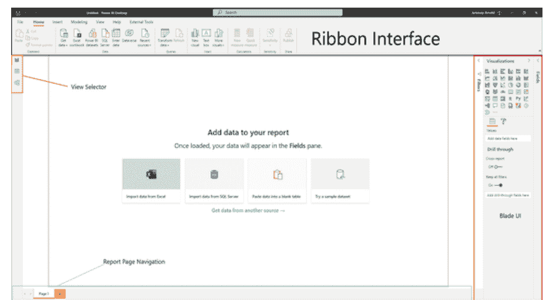

图 2-1：这是你打开 Power BI Desktop 时首先看到的内容。

查看图 2-1 中的视图选择器，我们可以看到三种可能的视图：报表视图、数据视图和关系视图。

## 报表视图：功能区的主页部分

Power BI 打开时默认显示报表视图。你可以看到顶部有一个经典的功能区界面，可以用来搜索你可能执行的各种操作。在右侧，你会看到用户界面的窗格部分。这部分与微软在最初的 Xbox 360 界面上所做的非常相似。

你可以通过功能区的“视图”部分添加不同的窗格来查看。你也可以将当前可见的窗格最小化，正如上面的示例中，在“可视化”窗格打开的情况下，你可以看到“筛选器”和“字段”窗格被最小化。

在底部，你会看到“报表页面导航”选项。你可以单击各个报表页面，或者，如果你的报表很大，可以使用箭头在页面列表中滚动浏览，这与在 Excel 中浏览工作表的方式非常相似。最后，在左侧，你会看到三个图标，它们表示视图选择器。视图从上到下依次是“报表”、“数据”和“模型”。功能区菜单会根据你所处的视图而变化。

从功能区界面开始，默认视图是“主页”选项卡，如图 2-2 所示。“主页”选项卡有几个不同的名称，包括主页视图、主页功能区和主页部分。在后续内容中，我将把不同的部分（主页、插入、建模）称为“选项卡”。

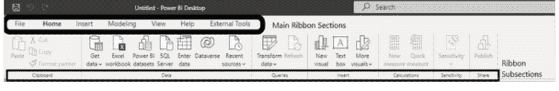

图 2-2. “主页”选项卡，也称为主页功能区、主页视图或主页部分，是 Power BI Desktop 的默认视图。

图 2-2 中的所有选项卡或主要功能区部分都被划分为多个“子部分”，并用一条淡色的垂直虚线分隔。各部分的名称位于功能区的底部行。在图 2-2 中，这些子部分分别是：剪贴板、数据、查询、插入、计算、敏感度和共享。因此

## 获取数据

- 全部
- 文件
- 数据库
- Power Platform
- Azure
- 在线服务
- 其他

- 全部
- Excel 工作簿
- 文本/CSV
- XML
- JSON
- 文件夹
- PDF
- Parquet
- SharePoint 文件夹
- SQL Server 数据库
- Access 数据库
- SQL Server Analysis Services 数据库
- Oracle 数据库
- IBM Db2 数据库
- IBM Informix 数据库（Beta）
- IBM Netezza
- MySQL 数据库

- 认证连接器
- 模板应用
- 连接
- 取消

图 2-4. 这里是完整的“获取数据”窗口，用于当你需要“全套”时，即完整的数据连接器列表。

如果你单击按钮的下半部分，你会看到一个较小的、截断的列表，其中包含更常用的数据源。当你不需要进入完整的连接器列表时，这会非常方便。这个截断的列表如图 2-5 所示。

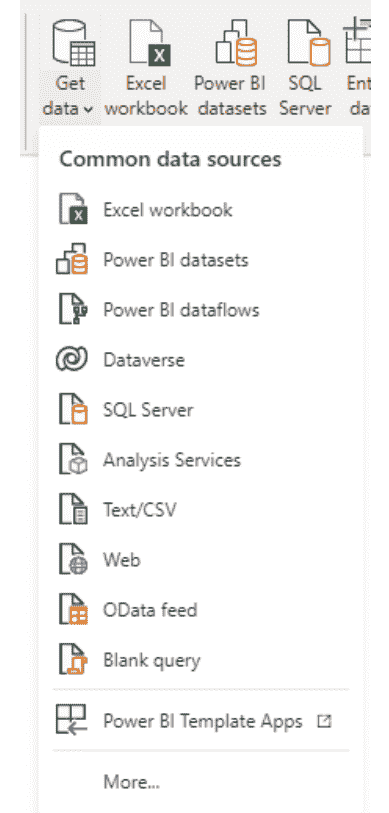

*图 2-5. 快速数据选择列表是一个较短的数据连接器列表，适用于你只想“简单吃点”的时候。*

“Excel 工作簿”按钮将立即打开一个资源管理器窗口，以便你导航到 Excel 文件。单击“Power BI 数据集”按钮，将出现一个窗口，以便你可以选择已发布到 Power BI 服务中的数据集，并通过“实时连接”进行连接。参考图 2-6 中的示例窗口。

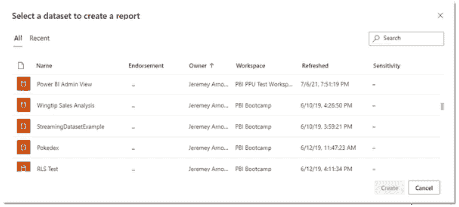

图 2-6. 连接到已存在于 Power BI 服务中的数据集。

如果你单击“SQL Server”按钮，将出现一个弹出菜单，供你输入服务器名称或地址，以及可选的数据库名称。当你尝试连接时，服务器会要求你提供凭据。你还会看到选择“导入”或“DirectQuery”的选项，我们将在本书后面更详细地讨论这些选项。该窗口如图 2-7 所示。

你还可以按“高级选项”按钮，该按钮允许你添加以分钟为单位的命令超时、传递自定义 SQL 语句、包含关系列、使用完整层次结构导航，以及启用 SQL Server 故障转移支持。

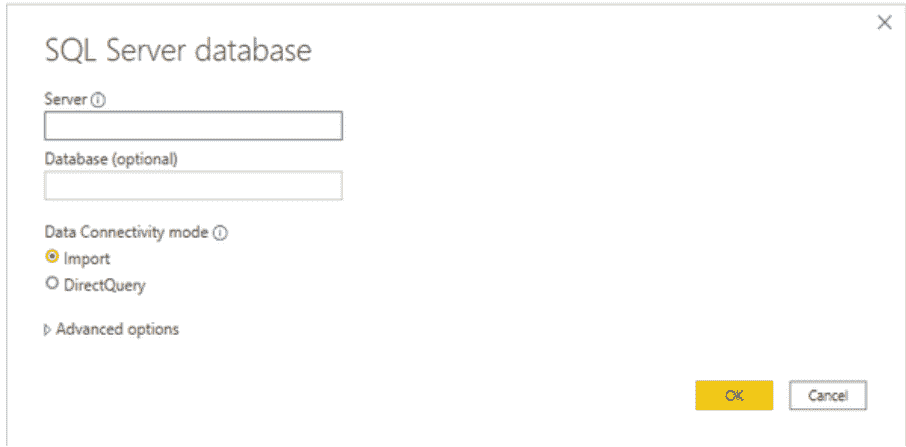

图 2-7. 连接到你的友好邻居 SQL Server。

“输入数据”按钮（回到图 2-3）会提供一个界面，如果你使用 Excel，应该会感到熟悉，因为它会打开一个类似表格的结构，你可以在其中添加列、为列命名并将数据放入单元格中，如图 2-8 所示。需要注意的是，此界面中没有公式功能。它仅用于简单的数据输入。你也可以将信息复制并粘贴到此窗口中，但在该窗口中疯狂复制粘贴之前要小心。这对于测试或者当你想要为模型生成一个查找表时可能很有用，但我建议你不要将大量信息放入这种类型的表格结构中，因为它必须手动管理。

### 剪贴板子部分

继续看“查询”子部分，有两个按钮：“转换数据”和“刷新”。在图 2-11 中，“刷新”按钮呈灰色，因为我的模型中没有数据可供刷新。但是，当该按钮可用并按下时，它将完全刷新数据模型中的所有数据源。

“转换数据”有两个不同的功能，具体取决于你单击按钮的上半部分还是下半部分。如果你单击上半部分，它会直接带你进入 Power Query 界面，我们将在另一章中更详细地讨论该界面。如果你单击下半部分，你将看到一个下拉菜单，其中包含几个不同的选项。“数据源设置”会打开一个弹出窗口，用于修改这些设置，例如凭据或文件位置等。如果你有参数和变量，也可以在这里修改。

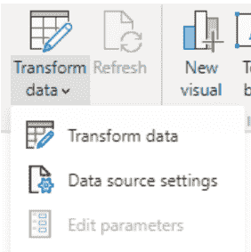

*图 2-11. “转换数据”选项。（不确定是否需要这个）*

### 插入子部分

接下来是“插入”选项卡，它有三个选项。你可以将新的视觉对象插入到报表页面中，插入文本框，或者向“可视化”窗格中的可视化列表中添加更多可视化对象。

如果你单击“新建视觉对象”，你会看到一个视觉对象被放置到画布上。默认放置在画布上的视觉对象是“堆积柱形图”。

“文本框”按钮会将一个文本框放置到画布上，其方式与在 PowerPoint 中的显示方式相同。

单击“更多视觉对象”按钮后，将显示如图 2-12 所示的内容。如果你选择“从我的文件”，你将被引导至资源管理器窗口，在那里你可以从本地机器上的 pbviz 文件中选择要添加的视觉对象。

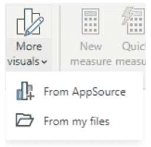

图 2-12. 从两个可能来源添加视觉对象。

如果你选择“从 AppSource”，你将看到如图 2-13 所示的窗口。在这里，你可以选择第三方可视化对象以添加到你的可视化列表。

图 2-13. Power BI AppSource 拥有大量额外的可视化对象，你可以为报表选择这些对象。

### 计算子部分

在“计算”下，你有“度量值”和“快速度量值”。

度量值是使用 DAX 对数据进行的计算。我们将在本书后面更详细地讨论度量值，但现在，如果你单击“新建度量值”，你会看到功能区下方出现一个公式栏，你可以在其中输入度量值的 DAX。这类似于你可能在 Excel 中使用的公式栏。

单击“快速度量值”按钮将出现一个弹出框，帮助你使用包含若干预定义计算向导来创建度量值。你可以在下面的图 2-14 中看到这两者。这里有一个有用的提示：Microsoft 在某些版本中会添加新的快速度量值，因此，在更新后总是值得回来检查是否添加了新的快速度量值。

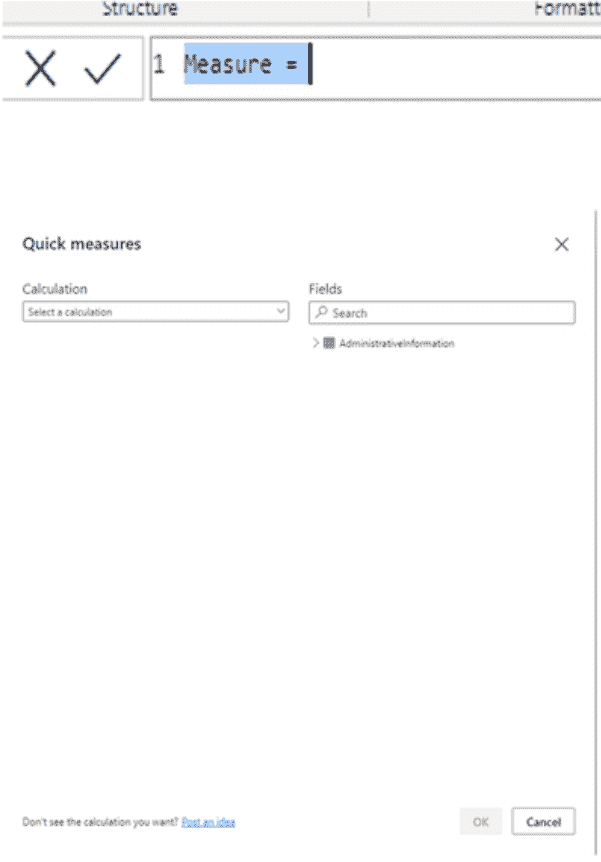

*图 2-14. DAX 公式栏和快速度量值菜单。你会用到这些的。我保证。*

### 最后两个子部分：敏感度和共享

“主页”选项卡上的最后两个按钮涉及敏感度标签以及将报表发布到服务的能力。我们稍后将更详细地讨论这些选项。

## 报表视图：插入选项卡

在 Report 视图的 ribbon 下，接下来我们进入图 2-15 所示的插入选项卡。

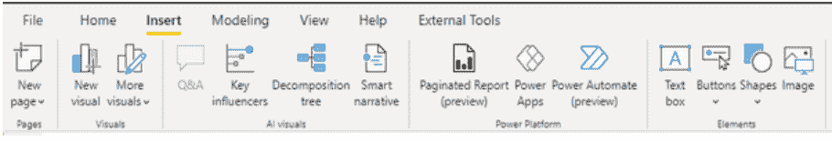

图 2-15. Ribbon 中的插入选项卡。

### 页面子部分

在页面子部分，无论点击哪个部分，新建页面按钮都会弹出一个下拉菜单。该菜单提供两个选项：空白页面和复制页面。空白页面会在报告的最右侧创建新页面。复制页面会按当前配置完整复制当前报告页面，包括画布上的所有视觉对象，新副本会位于报告所有其他页面的最右侧。

### 视觉对象子部分

视觉对象子部分有两个与主页选项卡中完全相同的按钮，即新建视觉对象和更多视觉对象按钮。它们的功能也完全相同。这里重复提供是为了方便，如果你想在 ribbon 的这一子部分中放置内容到画布上，可以直接在这里操作。

### AI 视觉对象子部分

插入选项卡中的下一个子部分是 AI 视觉对象，如图 2-15 所示。截至本文撰写时，已有四种 AI 驱动的视觉对象正式发布。如果你点击其中任何一个，它会将该视觉对象的空白版本放置到画布上尽可能靠上、靠左的位置。我们将在第 3 章更详细地讨论这些视觉对象，在那里我们将全面介绍 Power BI 原生提供的所有视觉对象。

这里需要注意的是，这些视觉对象在分析能力方面提供了非常独特的功能。微软希望在尽可能多的 Power Platform 产品中展示其 AI 实力，Power BI 也不例外。我预计未来会有更多 AI 驱动的视觉对象逐步进入正式发布。

### Power Platform 子部分

下一个子部分 Power Platform 处理的是技术上属于视觉对象，但从根本上与其他所有平台视觉对象不同的项目。Power Platform 视觉对象提供了与我们之前讨论过的 Power Platform 其他部分进行交互和集成的能力，将其嵌入到你的 Power BI 报表中。我们稍后会更详细地讨论这些内容，但请知晓它们非常强大，有助于展示 Power Platform 在组织内部的整体价值。

### 元素子部分

插入选项卡的最后一个子部分元素，处理的是报表元素。这些项目不像 Power BI 视觉对象那样一定是交互式的，但它们可以帮助增强报表或使其更清晰。不同的元素选项包括文本框、按钮、形状和图像控件。

Power BI 中的文本框与 PowerPoint 中的功能完全相同。它在画布上放置一个可编辑的文本框，并附带基本的文本格式工具。该工具允许你更改字体、字号、文字颜色、加粗、斜体、下划线、文本对齐，并为报表外的网页添加超链接。文本框的其他元素可以在选中文本框时出现的格式文本框窗格中进行编辑。参见图 2-16 中画布上的示例。

图 2-16. 文本框界面让你可以应用各种格式选项。

按下按钮元素即可获得可帮助报表导航或提供额外信息的选项列表。选项相当多，因此图 2-17 显示了完整列表，以便你开始思考如何在未来的报表中使用它们。

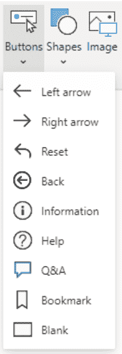

图 2-17. 按钮……目之所及皆是按钮。

需要注意的是，对于所有这些按钮，除了 Q&A 和书签之外，将按钮放置在画布上并不会起作用，直到你为 Power BI 提供该按钮的使用上下文。当你在画布上放置其中一个按钮时，右侧会出现格式按钮窗格，其中包含视觉格式选项，并注明该按钮应执行的操作。

Q&A 和书签按钮已分别默认设置为 Q&A 和书签功能。然而，你仍然可以将这些操作更改为其他操作，如果你认为报表在不同上下文中使用该按钮会更合适。

形状按钮会显示可放入报表的各种形状列表。形状被选中时，会以基于你主题的默认颜色填充后出现在画布上。你可以从那里通过调整画布上视觉对象的大小来更改它。选中时也可以进行格式调整，因为形状有其专用的窗格。

最后，如果你选择图像按钮，资源管理器窗口会弹出，以便你选择要导入 Power BI 报表中的图像。Power BI 可以添加以下格式的图片，如图 2-18 所示。顺带一提，GIF 有正确的发音方式……不要站错队。

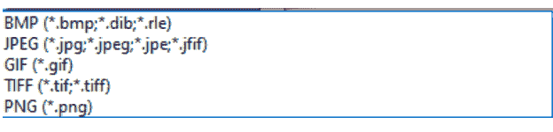

图 2-18. 说真的，几乎每个人都有对应的图像格式。

一旦图像出现在报表页面上，与 ribbon 元素子部分中的所有其他项目一样，选中后右侧会出现其专用的格式窗格。形状可以像所有其他 Power BI 元素一样，通过点击并拖动框来修改报表中的大小。

## 报表视图：建模选项卡

Report 视图中 ribbon 的第三部分是建模选项卡。在这里你可以在 Report 视图中获得更多的数据管理选项。图 2-19 中有很多魔力。

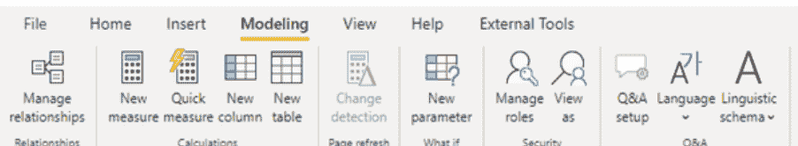

图 2-19. 建模数据对于在 Power BI 中取得成功至关重要。

### 关系子部分

首先是管理关系。该按钮打开一个窗口，让你查看模型中的所有关系，并在此处添加或编辑现有关系。

默认情况下，Power BI 会根据列名自动检测关系。这对于为数据模型建立初始关系集很有用，但不一定总是你想要的模型设置方式。需要注意的是，如果你的数据模型中少于两个表，该按钮将被禁用。我们将在下一章讨论模型视图时更详细地介绍关系。

### 计算子部分

下一个区域涉及计算。新建度量和快速度量按钮的功能与之前关于主页选项卡的描述完全相同。

另外两个项目是提示，会弹出我们之前展示的内联 DAX 编辑器，以便你从新建列按钮创建 DAX 计算列，或从新建表按钮创建 DAX 计算表。请注意，新建列按钮有一个不便的怪癖。如果你未在字段窗格中先高亮一个表再选择此按钮，Power BI 会假设计算列将进入该窗格中它看到的第一个表。

### 页面刷新子部分

页面刷新子部分有一个变更检测按钮，仅在 DirectQuery 场景中相关。你可以确定是否希望在检测到数据变更时刷新页面，或按固定的刷新间隔刷新。你可以在 Power BI Desktop 中使用此功能模拟该功能。

### What If 子部分

What If 仅允许你创建假设参数。它们将在第 6 章中进一步详细讨论。

## 安全子部分

此子部分有两个非常重要的按钮。“管理角色”和“查看为”按钮是我们在 Power BI 中实现行级安全性（RLS）的方式。RLS 是一项功能，通过创建基于 DAX 以公式方式构造的角色，来控制人员如何查看我们模型中的数据。我们将在后面的章节中再次详细讨论这一点。

功能区的下一个主要部分是“视图”选项卡，如图 2-21 所示。此选项卡很重要，因为它允许你设置主题、设置不同的页面视图以查看用户可能如何查看你的报表等。你想在 Power BI 中拥有一些 PowerPoint 风格吗？就在这里实现。

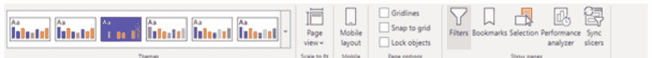

*图 2-21. 使用“视图”选项卡，在 Power BI 中加入一些 PowerPoint 风格。*

## 缩放以适合子部分

在“缩放以适合”中，“页面视图”按钮允许你选择将画布适应页面、适应宽度或按实际大小显示。这与“移动”子部分的“移动布局”按钮密切相关，后者会将报表画布更改为适合在移动设备上显示的报表的大小和形状。在移动报表开发中，由于可用空间更为有限，你需要考虑的事项与标准报表开发有很大不同。

## 页面选项子部分

在此子部分中，你可以选择三个按钮。可以显示网格线、使项目对齐到网格，以及锁定对象。

网格线有助于为你提供项目相对其他项目位置的参考指引。

“对齐到网格”仅在移动布局中起作用，并会强制所有视觉对象整齐地适应给定的像素密度。

“锁定对象”可防止页面上的项目被移动。

## 显示窗格子部分

“显示窗格”子部分是“视图”选项卡上的最后一个子部分。此子部分与可以在用户界面的该部分随时添加或删除的不同窗格相关。

本章稍后我们将详细介绍这些功能和用户界面，但作为总体概述，“筛选器”窗格允许你在视觉对象、页面或报表级别修改筛选器。

“书签”允许你将报表页设置为特定的状态，然后在以后返回该状态，就像网页书签一样。

“选择”窗格显示每个报表页中画布上的所有对象，并允许你快速选择特定对象。你还可以使用它来对对象进行分组，并在对象可能重叠时确定其重要性的层级。

“性能分析器”允许你查看哪些因素影响报表页的性能，并允许你提取机器生成的 DAX。

“同步切片器”窗格允许你确定哪些切片器（如果有）应在各报表页之间同步，从而在不同报表页之间保持比较一致。

## 报表视图：帮助部分

功能区上的“帮助”选项卡为你提供一种查看正在使用的 Power BI Desktop 版本的方法，并提供指向引导式学习、培训视频、文档和支持链接的链接，如图 2-22 所示。

### 社区子部分

我将跳到“社区”子部分，因为“信息”、“帮助”和“资源”子部分不言自明。此外，“社区”子部分非常强大。

在“社区”下，你会找到指向 Power BI 博客的链接、连接到更广泛的 Power Platform 社区的途径、面向开发人员的特定文档（称为“适用于开发人员的 Power BI”）、为 Power BI Desktop 提交想法的能力，以及常用外部工具的链接。

我确实想强调提交和投票想法，因为这会对你有帮助。Microsoft Power BI 开发团队已多次表示，他们会倾听这些想法，并关注哪些内容获得投票。几乎每一两个月，软件就会有一次更新，他们会讨论某个想法在 ideas.powerbi.com 上的受欢迎程度。因此，如果你有想法，这里就是合适的论坛。

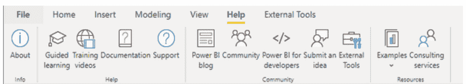

*图 2-22. 我们都需要朋友的些许帮助，而“帮助”选项卡正是获取帮助的地方。*

## 报表视图：外部工具部分

最后，功能区上还有“外部工具”选项卡。外部工具有很多，而且并非所有工具都同等重要。举例来说，请参见图 2-23。我们将在第 10 章进一步探讨一些最重要的外部工具，但现在，先看看各种工具。

*图 2-23. 外部工具真多！*

## 报表视图的窗格界面

- 堆积柱形图
- 簇状条形图
- 簇状柱形图
- 百分比堆积条形图
- 百分比堆积柱形图
- 折线图
- 面积图
- 堆积面积图
- 折线和堆积柱形图
- 折线和簇状柱形图
- 带状图
- 瀑布图
- 漏斗图
- 散点图
- 饼图
- 环形图
- 树状图
- 地图
- 填充地图
- 形状地图
- Azure 地图
- 仪表
- 卡片
- 多行卡片
- KPI
- 切片器
- 表格
- 矩阵
- R 脚本视觉对象
- Python 脚本视觉对象
- 关键影响因素
- 分解树
- 问答
- 智能叙述
- 分页报表
- 用于 Power BI 的 ArcGIS 地图
- 用于 Power BI 的 Power Apps
- 用于 Power BI 的 Power Automate

开箱即用就有如此大量的视觉对象，可能看起来令人不知所措。我保证实际情况并没有看起来那么糟，而且其中一些可能是你永远不会用到的项。

请注意，如果你的 Power BI 报表中有任何自定义视觉对象或导入的视觉对象，它们将出现在此列表下方、我们接下来将要讨论的“字段”和“格式”按钮上方。

在可视化列表下方、值子部分上方有两个按钮。左侧用于“字段”，右侧用于“格式”。每个视觉对象的子部分看起来会略有不同，因为它们接受不同的参数。例如，柱形图和折线图可能看起来相似，但柱形图和折线图会有多个用于放置字段的区域。

同样，“格式”窗格也会根据视觉对象的不同而具有不同的参数，因为每个视觉对象都有一些独特之处需要设置格式。然而，也有一些常量。你还会注意到，当选中一个视觉对象时，此区域还会出现第三个选项，即“分析”按钮。需要注意的是，此功能实际上只适用于 Power BI 默认内置的可视化对象，即便如此，也不适用于每个视觉对象。但你可以执行诸如设置趋势线、常量线、平均值等操作。

关于此子部分，重要的是你应该自由探索可供选择的各种设置。如果你不确定，就让 Power BI 用其默认设置为你完成工作。当你准备更多控制时，“格式”和“分析”子部分会提供你所需的功能。

可视化窗格的最后一个区域是“钻取”子部分。这是一个非常强大的功能，允许你从报表的一个子部分向下钻取到另一个子部分，同时保持所有数据元素的筛选状态与之前相同——使你能够利用数据快速构建一个故事，让用户找到与其分析相关的非常具体的示例。稍后我们将进一步讨论“钻取”。

## 字段和筛选器窗格

“字段”窗格包含报表中所有表、列和度量的列表。除此之外，它还包含你可能创建的任何文件夹，以及你可能在数据模型中定义的任何层次结构或组。将这些项目添加到视觉对象中非常简单，只需单击并将列或度量拖动到可视化窗格的适当区域或画布上视觉对象本身即可。你还可以单击复选框，让 Power BI 将项目移动到所选的可视化对象中。或者，如果你没有选中任何可视化对象，Power BI 会将该所选数据元素放置到画布上的一个可视化对象中。如果你右键单击模型中的某个表，你会得到一个

...用于添加新度量值、新计算列、新快速度量值、刷新数据、在 Power Query 中编辑该表的查询，以及更多操作的上下文菜单。如果你右键单击此区域中的某一列，则会看到用于将其添加到画布、从该首列创建层次结构、添加新度量值或列、将该列添加到筛选器列表，或将其添加到钻取中的上下文菜单。如果你不希望该数据元素在当时被使用，还可以选择将其隐藏。

“筛选器”窗格包含三个子分区。你可能已经使用过筛选器，但筛选器本质上是一种函数，它设置一个条件，数据必须满足该条件才能被显示。例如，如果我设置了一个年龄段筛选器，并选择了 12 到 18 岁这一分组，那么我只会看到符合该条件的所有数据，其他所有数据都会被忽略。

在“筛选器”窗格中，当你选中某个特定视觉对象时，可以对该特定视觉对象应用筛选器。“此页面上的筛选器”会筛选该特定报表页面上的所有视觉对象。“所有页面上的筛选器”则为整个报表设置筛选条件。默认情况下，视觉对象中的任何字段也会出现在“筛选器”窗格的“此视觉对象上的筛选器”子分区中，并可在其中进行交互。

你可以在“筛选器”窗格中设置三种常见的筛选器类型，每种类型都有各自的行为。基本筛选会显示给定列的所有值，并允许你选择任意数量的这些值作为有效条件。这非常直观。高级筛选则基于列所代表的数据类型，提供两个独立且唯一的条件的组合，并可选择相应逻辑：

-   包含（文本）
-   不包含（文本）
-   开头为（文本）
-   开头不为（文本）
-   是（所有）
-   不是（所有）
-   为空（所有）
-   不为空（所有）
-   为空（文本）
-   不为空（文本）
-   晚于（日期）
-   不早于（日期）
-   早于（日期）
-   不晚于（日期）
-   小于（数字）
-   小于或等于（数字）
-   大于（数字）
-   大于或等于（数字）

这些条件大多非常明确，但请务必记住，与基本筛选允许你查看一组可选值不同，使用高级筛选时，你必须自己将值输入到子分区中。然后，你可以选择按钮来设置“与/或”条件，并设置第二组逻辑。使用高级筛选时，你并非必须设置第二个逻辑条件。

第三种常见的筛选器类型是“前 N 项”筛选器。你可以在此处根据模型中的某个值（该值可以但不一定位于该视觉对象中）设置要显示的前 N 个或后 N 个值的具体数量。一个典型的例子是按州、国家/地区、收入或数量查看销售额排名前十的客户。你可以设置要显示的值数量，并选择在视觉对象中显示该特定字段的前几个还是后几个值。请注意，“前 N 项”在筛选整个页面或整个报表时不可用。“前 N 项”筛选仅在视觉对象级别有效。

日期还有另外两种可用的筛选器类型：相对日期和相对时间。相对时间仅当日期字段同时包含时间分量时才会显示。这些筛选选项允许你为视觉对象或报表设置特定的时间间隔，例如最近 10 天、下周或最近一年。相对时间则可以让你细化到小时和分钟。

## 其他窗格快速概览

默认情况下有四个窗格不可见，但你可以在“视图”选项卡中将其打开，它们会按照你添加的顺序出现。这些窗格分别是“书签”、“选择”、“性能分析器”和“同步切片器”窗格。请参见图 2-25。

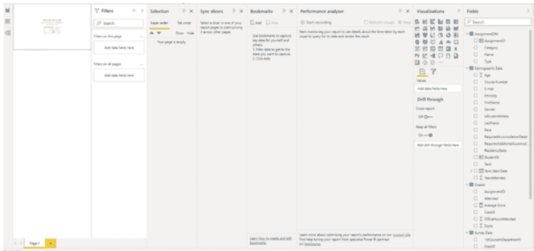

图 2-25. 这就是“书签”、“选择”、“性能分析器”和“同步切片器”窗格。

“书签”窗格允许你保存可能为给定报表页面设置的筛选器、钻取和其他条件，就像一个可以返回的书签。例如，假设我们的报表页面示例显示了所有数据，但我们希望最终用户能够快速将报表切换为特定的筛选视图。我们可以使用“书签”在页面条件之间切换。“书签”是一个非常强大的功能，我们稍后将更详细地讨论。

“选择”窗格允许你快速管理报表中对象的可见性和层叠顺序。假设你有一个徽标，希望它始终出现在报表的特定位置，但是当你将视觉对象放到画布上时，徽标会被视觉对象的方框遮住，即使方框与徽标重叠的部分是空白的。要解决这个问题，你可以将徽标移到最前面，并且可以通过此菜单完成该操作并管理整个层叠顺序。你还可以将对象分组，以便将其作为一个整体进行移动和处理。

“性能分析器”可以帮助你排查报表中某些内容显示时间比预期更长，或加载速度比以前更慢的原因。你可以使用“性能分析器”收集信息，了解生成 DAX 查询、可视化结果以及其他项目（包括 Power BI 为创建视觉对象而生成的 DAX）所需的毫秒数。虽然机器生成的 DAX 并不总是最容易让初学者学习，但当你积累了一些 DAX 经验后，了解所有筛选器和行上下文以查看 Power BI 如何生成适当的代码来驱动视觉对象将会很有用。同样，当报表出现问题时，你可以测试不同的配置，看看报表性能是提升还是下降。

要讨论的最后一个窗格是“同步切片器”窗格。当你将切片器视觉对象放到报表上时，它们仅在该页面中起作用。但是，使用“同步切片器”窗格，你可以选择一个切片器并将其添加到其他页面并使其同步——这样，当一个页面上的切片器发生变化时，其他所有页面上的该切片器也会随之变化。这对于探索性分析非常有用，例如，当某人查看数据时，发现了一家想要重点研究的特定公司。如果他们在报表的一个部分设置了该筛选器，此操作会将切片器选择传递到所有包含该切片器的其他页面。你甚至可以控制它只同步到 A 页面，而不同步到 B 页面。

## 数据视图

数据视图允许你查看报表中的表级数据。它会按原始顺序而不是字母顺序显示报表中的列。原始顺序是指列在数据源中的顺序，或者就我们而言，是列在加载到数据模型之前在 Power Query 中出现的顺序。让我们看一下示例“日期维度”表，了解整个表在数据视图中的样子，如图 2-26 所示。

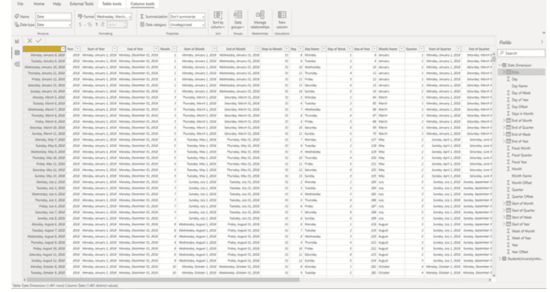

图 2-26. 数据视图中的示例表。

### 表和列工具

首先，你会注意到功能区中有两个新的子分区可以交互。当你在“字段”窗格中选中任何表或列时，功能区中的“表工具”选项卡会显示出来。只有当选中特定列时，“列工具”选项卡才会出现。让我们放大图 2-27 来看一下。

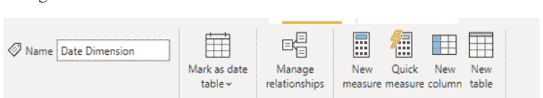

图 2-27. 新视图，新的功能区选项。

“表工具”子分区允许你更改表名称、将其标记为日期表，或者像我们之前从功能区操作的那样查看关系。此外，我们还有用于创建度量值表的计算选项。这里没有太多新内容，而且当你选中表或列时，此视图也会在报表视图中出现。

这里唯一值得讨论的独特功能是“标记为日期表”功能。默认情况下，在后台，Power BI 会为数据模型中的每个日期字段创建一个日期表，其中包含该字段第一个和最后一个日期之间的所有日期。这样做是为了实现日期层次结构功能以及后台的其他一些必要功能。在小型模型中，这没什么大不了的。然而，当你开始使用大型模型（包含几十甚至上百个隐藏日期表）时，模型大小会迅速增长。Power BI 允许你通过设置模型中的一个日期表来替代所有这些日期表，从而绕过此过程。由于我有一个日期维度表，我打算这样做，我们将在后续章节中回到这个话题。

当我选中某一列时，我还可以看到“列工具”选项卡，如图 2-28 所示。

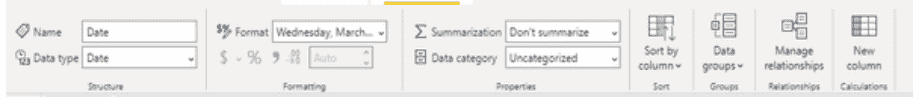

图 2-28. “列工具”选项卡。

从左侧开始，我可以看到列的名称以及列的数据类型。在这种情况下，我查看的是“日期”列，它的数据类型是“日期”，与“日期/时间”数据类型不同。我可以选择数据在视觉对象中呈现时的格式。由于它是日期，我可以选择下拉菜单查看各种选项。如果我选中的是包含数字的列，我可以选择将值显示为货币、小数、整数、百分比或科学计数法。“常规”选项将默认采用数据在数据模型中的存储方式。货币、百分比、在值中显示千位分隔符以及设置要显示的小数位数等选项呈灰色显示。

接下来，在 Properties 子部分中，你可以设置该列的属性，包括其默认汇总方式以及 Power BI 如何对该数据进行分类。默认情况下，非数值列不会被汇总。但是，你可以为任何列设置默认汇总方式，或设置为计数或计数（不同值）。数值列的默认汇总方式是求和，然而，这并不总是合理。默认汇总选项有 sum、average、minimum、maximum、count 和 count（distinct）。你始终可以通过将其设置为 Don’t Summarize 来让任何列不进行默认汇总。

Data Category 是对该数据上下文的描述。默认情况下，几乎每一列都没有分配数据类别而是保持未分类。对于数字来说，选项并不多，除非你希望将某个数值识别为邮政编码或条形码值。日期没有数据类别选项。然而，文本有大量的选项，并且为合适的列选择这些选项可以使在某些可视化中处理该数据变得容易得多。这些选项有 Address、Place、City、County、State or Province、Postal code、Country、Continent、Latitude、Longitude、Web URL、Image URL 和 Barcode。

下一个子部分是 Sort by Column。它被隐藏起来，但是一个非常实用的设置。它允许你为某列设置规则，以决定该列在放入可视化时如何自动排序。我有一些虚构大学 Cool School University 的示例数据。这些数据专门用于 ISOM 210 Introduction to Data Visualization。如果我想按另一个值对某列进行排序呢？比如按学生 ID 号对姓氏进行排序？这正是 Sort by Column 允许你做的事情。我们将在本书后面更详细地展示这个示例。

Data Groups 允许你将数据组合或分箱在一起以便快速分析。一些明显的例子是年龄段或民族分组。然而，你可能能想出大量不同的分组方式。产品列表很复杂吗？将其分组为更易管理的组。想要将某种特定患者状况与其他情况分开作为对照组吗？专门将其分组。我们将在本书后面更详细地演示分组。

## 总结

希望在本章中，你对使用 Ribbon 和该界面中的窗格来操作 Report 和 Data 选项卡的用户界面有了更好的理解。我们看到在 Data 视图中有大量与数据交互的方式，这将在以后对我们有所帮助。然而，我们必须在做其他任何事情之前将数据导入 Power BI 文件。为此，在下一章中我们将讨论如何将数据带入我们的模型以及如何使用 Relationship 视图。

