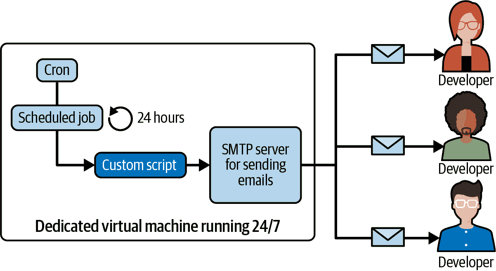
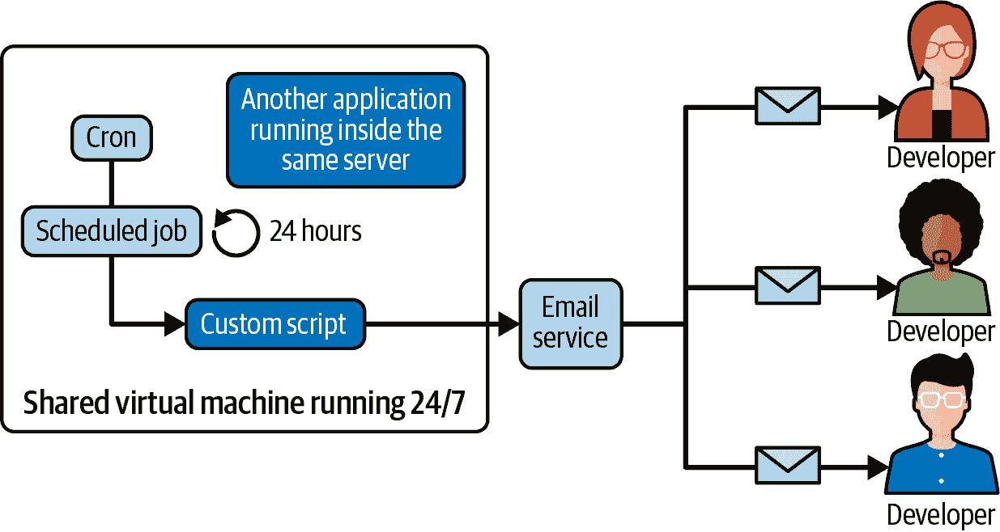
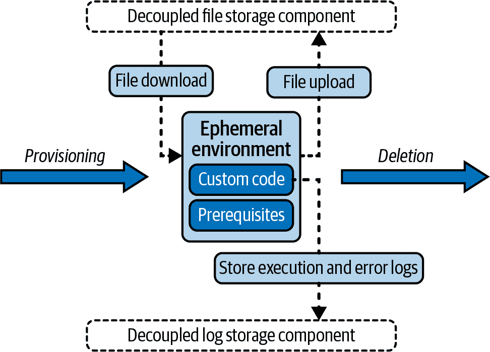
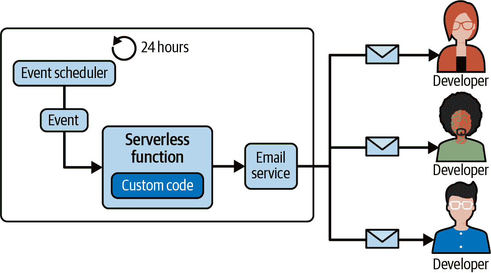
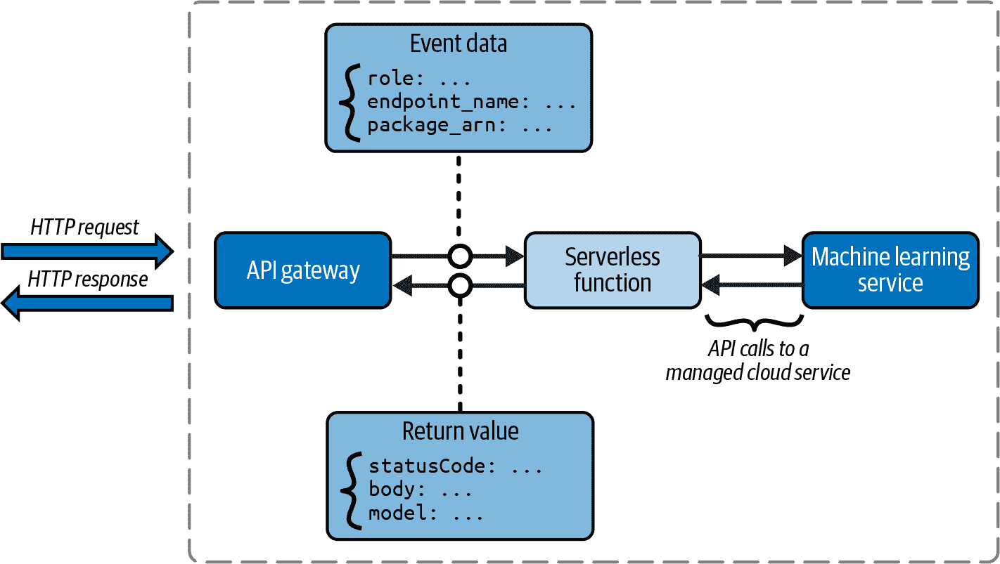
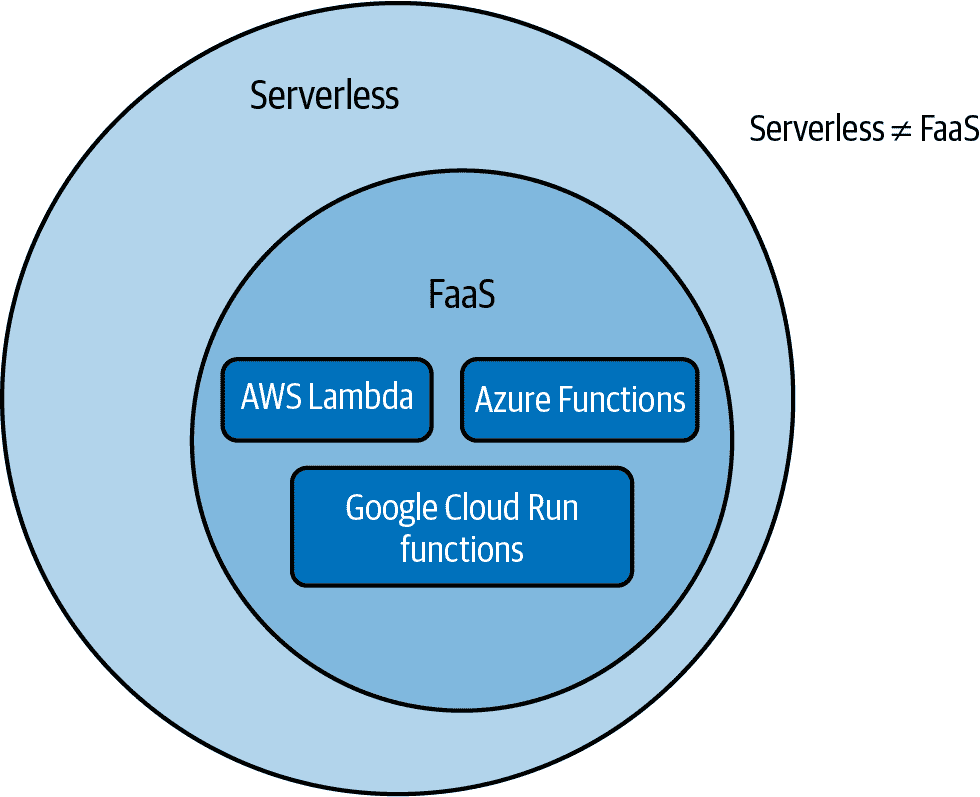
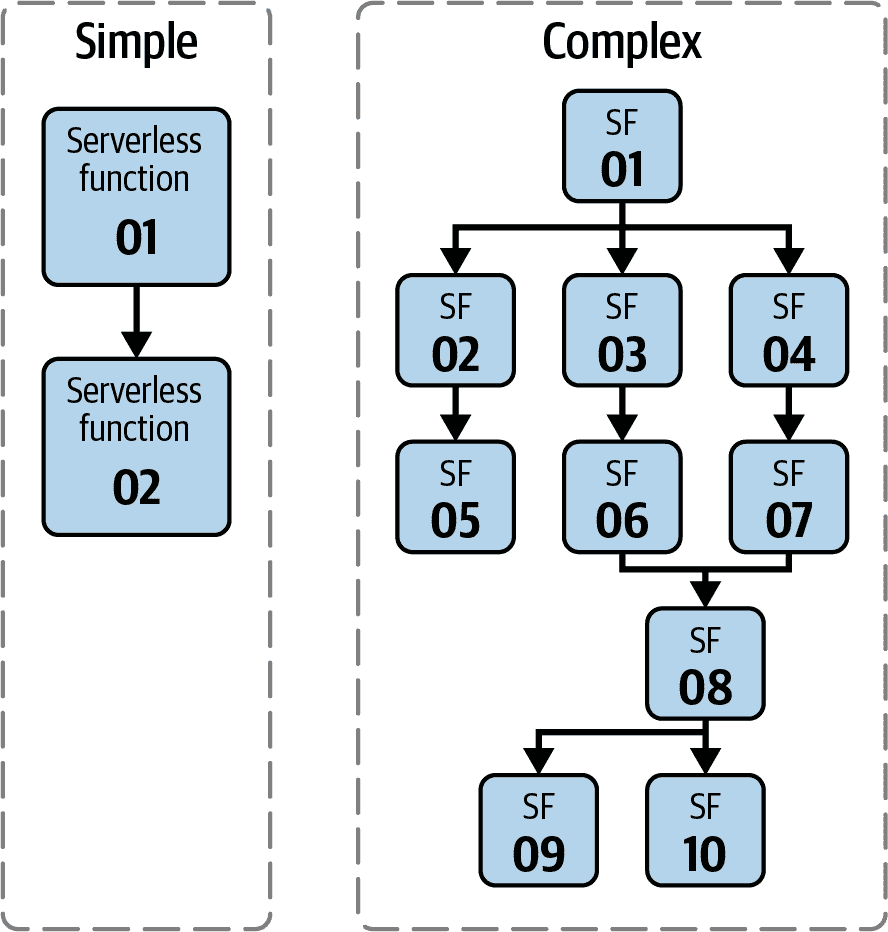
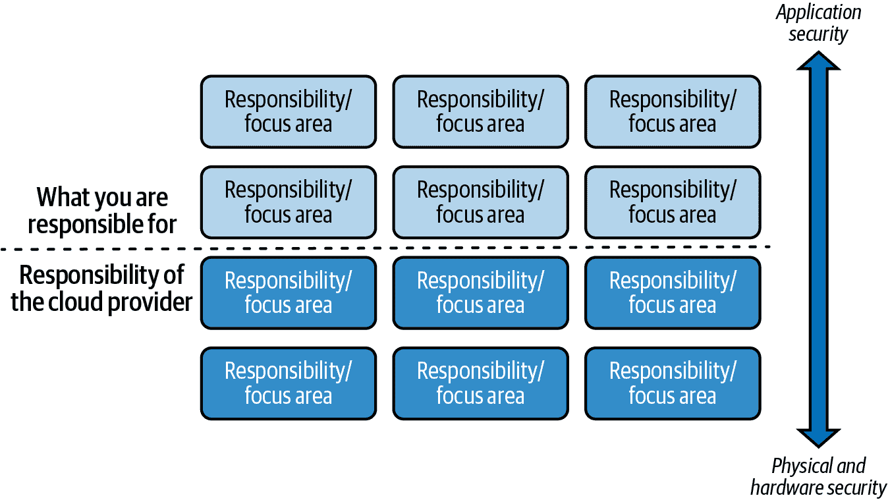
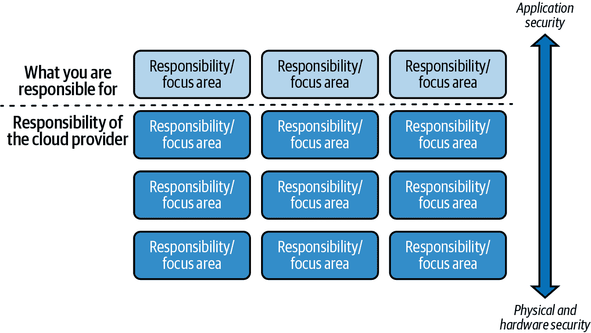

## Chapter 1. Introduction to Serverless Computing

您还记得自己为真正的终端用户构建的第一个应用程序吗？我第一个项目是一个时间跟踪应用程序，允许一家公司的员工通过 Web 界面记录和跟踪他们的工作时间。它采用单体架构构建，其中组件紧密集成并一起部署。

随着我开始构建更复杂的应用程序，我探索了各种架构、概念和方法，包括多层架构、圈复杂度、自动化测试、服务器自动扩缩容、微服务和面向服务的架构。这些帮助我和我的团队管理部署系统的复杂性和可扩展性。随着时间的推移，我们发现如何使用托管云服务，使负载均衡器和数据库等某些组件的管理变得更加可行。使用这些服务降低了我们在云中运行的系统停机风险。这至关重要，因为我的团队从未有专职的云工程师来管理云基础设施资源。由于我们团队结构精简，工程团队几乎所有人都主要专注于构建新功能和系统。如果您发现自己处于类似情况，您可以考虑使用托管云服务，以便更专注于创新和业务增长。

在看到托管云服务的益处后，我意识到无服务器计算可以更进一步。AWS Lambda 发布几个月后，我构建并部署了一个无服务器应用程序，该应用程序将执行以下操作：

*   识别所有区域中运行的所有云服务器资源
*   估算保持这些云服务器资源运行的成本
*   向团队中的每个开发人员发送电子邮件，附上相关详细信息

该应用程序每天仅运行几秒钟，以提醒开发人员手动关闭他们在当天开发功能时用于测试的云资源。鉴于无服务器函数资源在应用程序未运行时会自动缩减为零，我构建的无服务器应用程序的整体基础设施成本整整一年为零。^(1)

#### Note
在本書中，我将 *serverless* 和 *serverless computing* 互换使用。

在我们第一个无服务器项目成功后，我的团队在考虑对新项目使用无服务器方法时提出了一些问题。以下是我们讨论的一些重要问题：

*   无服务器架构中真的没有服务器吗？
*   这是否意味着我们不必担心云基础设施管理工作？
*   我们能否将无服务器用于复杂的大规模项目？
*   我们可以使用哪些编程语言来构建无服务器应用程序？
*   使用无服务器实现时，我们是否甚至需要担心应用程序和基础设施的安全性？

如果您对这些问题的答案感到好奇，您将在本章中找到清晰的解答和解释。以我的第一个无服务器项目为案例研究，^(2) 我将带您了解无服务器架构的外观，定义基本术语，并介绍用例。我们将深入探讨常见的神话和误解，以便您全面了解无服务器计算。我的目标是在我们探索本书其余内容之前，让您对无服务器安全的工作方式有清晰的认识，并完善您对无服务器安全的看法。

言归正传，让我们开始吧！

## Demystifying Serverless Computing

您可能已经遇到过 *serverless* 这个术语，并想知道是否真的不涉及服务器。当然，后台有服务器！您只需不必担心管理其底层基础设施。虽然您可能认为这个概念就像它看起来一样简单，但这对无服务器的真正含义和它不是什么的简化。


在本节中，我将通过深入介绍我的第一个无服务器项目来揭开无服务器计算的神秘面纱。我将带你了解当时的思考过程，并讨论无服务器如何解决开发和基础设施管理过程中的各种挑战和复杂性。然后我将定义并澄清围绕无服务器计算的概念，并突出无服务器最有效的场景。

### 拥抱无服务器

我之所以为我的云资源跟踪项目探索无服务器，其主要原因之一是其节省成本的潜力。由于该应用程序每天只需要运行几秒钟，整个系统得以在云中以几乎为零的成本运行。

你可能好奇我的第一个无服务器项目是如何几乎免费虚拟运行的。使用 AWS Lambda 服务的成本取决于云函数资源运行的时间、调用请求的次数以及分配给函数资源内存量的多少。由于使用量在 AWS 免费套餐的限制范围内，因为该应用程序每天最多运行约 30 秒，因此在此特定应用程序中使用的服务没有产生费用。

#### Note

诸如 AWS Lambda、Microsoft Azure Functions 和 Google Cloud Run 函数等无服务器函数服务的定价因资源配置、调用频率、执行持续时间、数据传输量以及你选择启用的附加功能而异。截至本文撰写时，使用 AWS Lambda 函数时的整体云成本受多种因素影响。这些包括使用其他功能和能力相关的成本，例如预置并发和 SnapStart。其他因素包括数据传输成本和额外的临时存储使用量。^(3)

当时 AWS 上可用的最小 Amazon Elastic Compute Cloud (EC2) 实例类型是 `t1.micro` 实例（后来是 `t2.micro` 实例；nano 实例要到很久以后才推出）。^(4) 在那时，我们已经运行了其中几个实例，其合计使用量远远超过了 AWS 免费套餐的限制。话虽如此，对于这种特定用例，24/7 运行专用服务器将是浪费且比使用无服务器函数更昂贵，因为我的脚本每天最多运行约 30 秒。

Figure 1-1 中显示的设置利用了服务器端自动作业调度，它引用配置文件并按指定计划自动执行自定义脚本。虽然现在看起来可能有点老派，但当时这是自动化服务器任务的首选方案。



#### Note

即使服务器配置正确并得到维护，这种单服务器设置仍可能出现计划外停机。诸如可用区故障或底层硬件问题等超出你控制范围的问题都可能影响服务器正常运行时间。

我还考虑过在已运行生产 Web 服务器的现有 EC2 实例中运行脚本。采用这种设置，只为运行脚本而再购置一台服务器无需额外成本。我还研究了使用 Amazon Simple Email Service (SES)，一种基于云的电子邮件服务，以简化运行应用程序所需的设置。

尽管这种新设计中包含基于云的电子邮件服务，但 Figure 1-2 中显示的设置仍存在以下风险和潜在问题：

* 其他团队成员对共享实例发起的修改、部署和服务器管理工作可能会无意中损害脚本不间断成功运行的能力。
* 诸如可用区故障或底层服务器硬件问题等问题都可能影响服务器正常运行时间。
* 云提供商可能会要求你关闭共享服务器，如果攻击者利用同一服务器上运行的另一个应用程序的漏洞。在一种可能的场景中，攻击者可以利用被入侵的服务器针对外部实体和组织，造成服务器以及服务器运行的账户被标记为可疑活动。



此外，如果该特定 EC2 实例被克隆以设置具有至少两个实例的最小值的自动扩展 Web 层，脚本可能会运行多次，开发人员会收到重复的电子邮件消息。仅为确保系统中的幂等性就需要额外的工作。^(5) 我决定最好在没有其他可能中断并负面影响脚本执行的应用程序的独立环境中运行脚本。

由于我只需要脚本每天运行约 30 秒，我还考虑过设置一个临时服务器实例。如果托管应用程序或脚本的专用服务器仅运行几秒钟然后自动删除会怎样？作为一个喜欢为成本削减开发自动化解决方案的人，我几乎实现了类似 Figure 1-3 所示的基础设施自动化层。



随着按需启动、配置和删除的临时服务器实例，运行在其中的应用程序代码最好是 `stateless`，并且你需要确保在实例终止时不会丢失关键数据。采用这种方法，你可能会使用存储服务（例如 Amazon Simple Storage Service，或 S3）——与计算资源解耦——在临时实例终止前将数据安全保存或传输。与此类似，由你的自定义代码生成的应用程序和错误日志必须在临时实例被删除之前安全地传输并存储在临时实例之外。否则，如果在运行应用程序或脚本时出现问题，故障排除将很困难。最后，需要有一种方法来确保在代码运行之前，应用程序代码的先决条件和依赖项已在服务器内部正确安装和配置。

正如你可能猜到的那样，由于当时构建这种自动化的临时服务器实例设置需要大量工作，我没有自己去实现。以下原因也阻止我继续进行这个基础设施自动化项目：

* 发送成本控制电子邮件提醒的脚本所需的内存和存储极少，无需整个服务器实例即可运行。虽然可以通过使用容器和其他替代方案在一台服务器上运行多个隔离环境，但增加的基础设施开销和复杂性不值得付出努力。
* 这种临时服务器实例设置与无服务器函数资源的工作方式有些相似。在 AWS Lambda 等无服务器函数服务中，云平台已提供并抽象了用于路由请求以及运行函数代码的事件处理的<|message|> 基础设施。
* 当时，如果不利用现有的托管云服务，执行脚本或应用程序所需的任务调度和任何后端 API 都必须托管在 24/7 运行的云服务器上。
* 构建另一个系统会带来维护、监控和保护它的额外负担。


除非我的团队还有其他应用程序和脚本会利用这个自定义自动化解决方案，否则为一次性脚本费劲搭建这套基础设施就没有意义了。借助无服务器函数服务，我认为我可以更专注于在云函数资源内部运行的自定义应用程序逻辑。重新造轮子并不值得，因为像 `AWS Lambda` 这样的服务已经提供了这类场景所需的必要基础设施和能力。

因此，我着手利用各种 AWS 服务来构建和部署无服务器应用程序。我花了不到一天的时间就完全实现了 Figure 1-4 中所示的架构。



这个无服务器应用程序使用了一个事件调度器（`Amazon CloudWatch Events`，现称为 `Amazon EventBridge`），每 24 小时向一个无服务器函数发送一次事件。无服务器函数运行自定义代码，该代码通过电子邮件服务（`Amazon SES`）向每位开发者发送成本控制邮件提醒。这段自定义代码不超过 50 行代码，每天最多运行约 30 秒。

你可能会惊讶于这个特定的无服务器实现在其生命周期内 *从未* 出现过停机。正确使用无服务器计算和托管服务有助于确保架构中没有 *单点故障*（`SPOF`）。这消除了停机风险，并使系统能够在无需人工干预的情况下平稳运行。虽然并非所有无服务器系统都会具有相同的正常运行时间和可靠性水平，但在这个项目中，良好架构的无服务器解决方案的好处是显而易见的。

#### Note

从安全角度来看，也没有任何公开暴露的 API 端点，因为无服务器函数资源是由事件调度器服务直接调用的。唯一有权调用云函数的组件是事件调度器服务。这种设置最小化了攻击面，并通过防止对云函数的任何未经授权的交互来降低安全漏洞的风险。

### Exploring Definitions and Serverless Use Cases

现在你对真实的无服务器实现有了大致的了解，下面是无服务器计算的深入定义，以及你在本书其余部分会遇到的一些相关概念的更详细说明。虽然术语 *serverless* 有各种定义和解释，以及与其通常关联的概念，但本书使用以下定义：

#### Serverless

Serverless，或无服务器计算，是一种 *运营模式*，允许开发者在无需管理或扩展底层基础设施的情况下构建和运行应用程序。无服务器抽象掉了服务器管理、扩展、修补和资源配置的责任。^6 这种模式使开发者能够专注于通过使用各种互联工具和服务来交付业务价值，这些工具和服务可根据需求自动扩展应用程序。像 `AWS`、`Azure` 和 `Google Cloud` 这样的云平台在用于无服务器架构的各种服务中定义和实现了无服务器计算，^7 在术语、定价模式和资源管理实践上略有差异。^8

#### Function as a service (FaaS)

一种无服务器计算服务，允许开发者在无需配置或管理服务器的情况下响应事件运行单个函数。FaaS 服务的示例包括 `AWS Lambda`、`Azure Functions` 和 `Google Cloud Run functions`。

#### Note

*serverless* 是否等同于使用无服务器函数服务和资源的使用？正如你将在后文 “Myth 2: Serverless Is Equivalent to FaaS” 中看到的，无服务器并不等同于 FaaS。

#### Managed cloud service

一种服务，将 IT 资源的部分或全部管理和维护工作外包给云提供商。使用托管云服务创建的云资源，虽然并非完全免受中断和停机的影响，但通常比由内部 IT 员工手动设置的资源更具容错性。

#### Pay-as-you-go (PAYG) model

一种灵活的定价模式，按客户对服务的实际使用量收费，^9 而不是收取预付固定费用或要求长期合同。

#### Event-driven architecture

一种软件架构模式，使用事件来触发并促进解耦组件之间的通信。在这种架构中，组件会对系统其他组件发出的状态变化或事件做出反应。

#### Container

一个便携的、独立的软件包，其中包含在隔离环境中运行所需的所有应用程序代码、依赖项、配置和运行时。

#### Microservice

一个小型、解耦的、模块化服务，旨在执行特定业务功能或在更大应用程序内执行特定任务集。

#### Single point of failure (SPOF)

一个组件，其故障会导致整个架构或系统完全服务中断。

在弄清了定义之后，你可能想知道如何判断何时无服务器是正确的选择。了解应用程序的上下文和具体需求可以帮助确定无服务器是否是最佳前进路径。

在以下场景中，利用无服务器解决方案和策略通常是一个好主意：

**Event-driven workloads**

云资源根据传入事件动态分配和扩展，使系统能够实时响应和扩展。

**Short-lived and bursty workloads**

应用程序可能会出现不可预测且突然的需求激增。

**Rapid prototyping and development**

可以对系统的特定组件进行更新，而不会中断整个应用程序。

**Modular and decoupled architectures**

应用程序的模块和组件可以独立开发、测试和部署。

**Cost-conscious applications**

在任何给定时间都需要配置合适数量的资源。

**Resilient and fault-tolerant applications**

故障对整体应用程序的影响被最小化并自动管理，以保持高可用性。

并非所有项目都需要完全符合这些场景才能使用无服务器实现。在某些情况下，你可能会考虑为一个与这些用例不完全一致的项目使用无服务器架构。例如，预算有限的项目可以从无服务器实现中受益，特别是当预计使用量或流量较低时。基础设施管理经验有限的团队也可以利用无服务器架构来避免配置和维护服务器的复杂性。

我的第一个无服务器项目与这些用例非常吻合。无服务器函数服务与其他云服务在应用程序中的无缝集成降低了整体架构的复杂性。我能够更专注于应用程序的核心功能，而不是花费时间担心服务器维护和正常运行时间。

就成本而言，并非所有无服务器架构都具有相同的成本效率。这是因为总体成本取决于以下因素：

* Design and complexity of the application
* Data storage needs
* Resource consumption patterns
* Network data transfer patterns
* Service configurations


根据经验，监控和日志的用量，以及每个所用服务的计费模式，也会对整体成本产生相当大的影响。在某些情况下，你甚至可能会遇到监控和日志服务的成本高于无服务器计算和数据库服务的项目。

在考虑为下一个项目使用无服务器架构时，整体基础设施成本占据了很大一部分，因此你可能会发现采用 `serverless-first` 的思维方式更为实用，这样你就可以在最有意义的地方考虑无服务器方法。^10 关键在于认识到无服务器表现优异的场景，并确定其他架构和方法的适用之处。

到目前为止，你可能对无服务器是什么有了更清晰的理解。现在我们已经定义了概念并讨论了无服务器表现优异的场景，是时候驳斥一些常见的神话和误解，以消除任何困惑。

## 驳斥常见神话和误解

在本节中，我将通过解决人们可能对无服务器计算产生的一些神话和误解，进一步澄清无服务器计算的概念。^11 通过回顾它是什么以及它不是什么，你将避免隐藏在经常被误解的领域中的安全陷阱。

本节分为以下部分：

*   "神话 1：无服务器意味着不涉及任何服务器"
*   "神话 2：无服务器等同于 FaaS"
*   "神话 3：无服务器仅由云提供商提供"
*   "神话 4：无服务器仅适用于简单的小规模应用"
*   "神话 5：无服务器计算和容器化不能很好地协同工作"
*   "神话 6：无服务器应用仅支持有限数量的语言"
*   "神话 7：无服务器消除了所有管理和运营任务"
*   "神话 8：无服务器平台和服务可以互换，没有区别"
*   "神话 9：无服务器应用免疫于安全攻击"

让我们开始辟谣！

### 神话 1：无服务器意味着不涉及任何服务器

术语 `serverless` 具有误导性，因为它并不意味着不涉及任何服务器；相反，管理这些服务器的责任被转移给了平台。

相信这种神话可能导致以下不切实际的期望：

*   认为故障转移、重试和扩展将始终自动发生
*   预期基础设施责任为零，例如监控系统性能
*   忽视在部署无服务器资源的位置需要安全的网络配置

实际上，如果你正在从事使用无服务器架构的项目，你仍然有责任确保安全、处理系统故障并优化应用程序代码的性能。根据无服务器架构中使用的服务，你可能有配置特定运行时环境、内存分配、并发限制和其他配置参数的选项。

了解无服务器服务的内部机制虽然是可选的，但对于优化应用程序性能和管理潜在挑战，例如冷启动延迟，是必不可少的。^12 在某些情况下，云平台会提供对这些服务内部运行的可见性，以帮助开发人员就安全、扩展和资源管理做出明智的决策。

### 神话 2：无服务器等同于 FaaS

普遍的误解是无服务器计算仅限于且等同于 FaaS。事实上，当谈到无服务器计算时，人们首先想到的就是 FaaS 服务，例如 `AWS Lambda`、`Azure Functions` 和 `Google Cloud Run` 函数。^13 使用这些服务时，开发人员通常只需要专注于编写由事件触发的自定义函数代码，这些事件来自 HTTP 请求以及其他云资源等来源。

在这些函数内部，你可以执行以下操作：

*   编写并实现自定义业务逻辑代码。
*   使用包含在应用程序运行时环境中并安装的库和包。
*   通过应用程序编程接口 (`APIs`) 和软件开发工具包 (`SDKs`) 利用云平台的其他服务和功能来执行专门任务。这些任务可能涉及处理和转换数据、使用由人工智能 (`AI`) 驱动的服务分析图像，甚至使用托管云服务训练机器学习 (`ML`) 模型。
*   使用 `APIs` 和 `SDKs` 创建、管理和修改或删除云平台中的其他资源。例如，无服务器函数可以通过使用若干 `基础设施即代码` (`IaC`) 服务，根据配置文件自动创建 DevOps 流水线。
*   触发其他无服务器函数。
*   与其他非无服务器资源（如虚拟机 (`VM`) 实例和数据库）协同工作。

如果你想知道这些函数是如何实现的，示例 1-1 展示了 `AWS Lambda` 函数在 Python 中的实现。

#### 示例 1-1. Python 中示例 AWS Lambda 函数实现

```
import json

# ... (insert imports here) ...

def lambda_handler(event, context):
    role = event.get('role')
    endpoint_name = event.get('endpoint_name')
    package_arn = event.get('package_arn')

    model_name = random_string()
    create_model(model_name, package_arn, role)
    endpoint_config_name = create_endpoint_config(model_name)

    create_endpoint(endpoint_name, endpoint_config_name)

    return {
        'statusCode': 200,
        'body': json.dumps(event),
        'model': model_name
    }
```

该函数通过使用名为 `Amazon SageMaker AI` 的托管 ML 服务，自动配置并 provision 一个无服务器 ML 驱动的端点。该函数使用从另一个文件导入的其他自定义实用函数，例如 `random_string`、`create_model`、`create_endpoint_config` 和 `create_endpoint`。

##### 注

正如你在 第 2 章 中将会看到的，`Amazon SageMaker AI` 不被视为无服务器服务。然而，它具有无服务器选项来部署无服务器推理端点，使你能够在无需配置或管理服务器的情况下部署和扩展 ML 模型。虽然 FaaS 是无服务器架构的核心组件，但你也可以在非无服务器实现中技术上使用它。

示例 1-1 中显示的函数在由另一个云资源触发的事件触发时执行。该云资源可能是接受来自浏览器的 HTTP 请求并将请求“转换”为包含触发无服务器函数所需输入参数集的事件的 `Amazon API Gateway` HTTP API。 图 1-5 描绘了此示例。



函数执行完毕后，它会将函数返回值发送回 `Amazon API Gateway` HTTP API。然后 HTTP API 将该函数返回值转换为 HTTP 响应。

##### 注

无服务器函数资源在执行后会自动释放。这允许基础设施资源在应用程序空闲或无流量时缩减至零。

无服务器计算与 FaaS 相同这一误解通过忽略无服务器架构中经常使用的组件和策略来简化了概念 (图 1-6)。FaaS 是无服务器计算的核心部分，但并非所有无服务器计算都必然是 FaaS。




除了无服务器计算服务之外，无服务器架构通常还包括托管服务，如存储、数据库和消息系统。这些组件对于构建超越简单云函数的真实无服务器应用至关重要。

#### Note
我们将在 Chapter 2 中深入探讨 AWS、Azure 和 Google Cloud 中各种无服务器服务以及常见的无服务器架构模式。牢固掌握无服务器系统如何实现将有助于我们更好地保护这些系统。

在处理无服务器安全时，你必须考虑所有属于无服务器范畴的服务，而这些服务不一定是 FaaS。你还必须担心集成到无服务器架构中并包含其中的非无服务器资源和组件，因为无服务器和非无服务器资源很可能共存于同一个云环境中。

### Myth 3: Serverless Is Offered Only by Cloud Providers

另一个常见误区是无服务器仅由 AWS、Azure 和 Google Cloud 等云服务提供商提供。在构建无服务器架构时有各种选择，并且可以使用开源框架来提供无服务器计算的好处，而无需依赖单一云服务提供商。

以下是一些支持无服务器和 FaaS 工作负载的开源平台、框架和工具的示例：

* OpenFaaS
* Apache OpenWhisk
* Fn Project
* Knative
* Fission
* OpenLambda
* Firecracker

本书主要关注 AWS、Azure 和 Google Cloud 等云服务提供商的无服务器服务的安全性。一些安全概念和技术也与上述开源平台、框架和工具相关。

### Myth 4: Serverless Is Suitable for Only Simple, Small-Scale Applications

认为无服务器仅适用于简单应用是一种误解，因为无服务器架构和策略越来越多地被用于构建大规模、复杂的系统。随着今天更成熟的工具和框架的可用，管理大规模无服务器系统的复杂性变得显著更容易。

尽管我们第一个无服务器项目具有可靠性和成本效益，我的团队仍然犹豫是否将无服务器用于关键任务工作负载。当时，无服务器概念如此新颖，许多团队缺乏信心将其用于大规模生产环境。与我们今天拥有的相比，当时的支持工具、框架和服务相对有限。团队也质疑无服务器架构对关键应用的适用性，因为冷启动的不可预测性。他们的观点是合理的，因为当时的冷启动问题并没有多少解决方案。

#### Note
如今，冷启动问题已不再是很大的顾虑。云服务提供商已引入了诸如预置并发以及其他内部改进等机制，以降低无服务器函数启动延迟。

随着时间的推移，发布了更多无服务器服务、功能和增强功能，以进一步扩展无服务器计算可以构建的内容。鉴于越来越多的专业人士和开发团队采用无服务器架构，生态系统迅速成熟，工具和框架也更好了。

由于无服务器生态系统的成熟，我的团队能够在 AWS、Azure 和 Google Cloud 上成功构建和部署以下生产级无服务器应用：

* 一个大规模的 GraphQL 驱动的 Web 应用
* ML 驱动的应用，其中 ML 模型托管在无服务器计算函数内部
* 一个 IT 安全自动化系统，可自动检测和修复配置漂移
* 一个持续集成和部署（CI/CD）流水线构建器
* 一个数据处理 ETL（提取、转换、加载）流水线
* 一个由检索增强生成（RAG）驱动的无服务器生成式 AI 聊天机器人
* 分析平台
* 基础设施成本仪表板
* 一个为管理和运营团队提供支持的商业智能仪表板

起初，我团队的开发人员在构建这些无服务器系统时对粒度函数级限制所施加的限制感到沮丧。过了一段时间后，他们意识到这些限制帮助他们拥有无状态和模块化的代码。他们还认识到，这些限制鼓励了更易于维护的代码，更容易扩展和优化。鉴于无服务器函数限制迫使我们一些较大的函数被拆分为更小的函数，这在早期阶段显著降低了代码库的复杂性。从我们的经验来看，处理这些限制的前期投入通常会导致更顺畅的部署和生产中更少的问题。

#### Note
我们还尝试让特定开发人员负责已部署云资源的维护和管理。在这种设置下，单个开发人员对特定云资源负有全部责任，包括实现、故障排除和性能调优。由于无服务器实现通常涉及多个解耦组件，因此将云资源分配给团队成员是直接的。这种方法确保了明确的责任归属，并使开发人员能够对其分配的特定云资源承担全部责任。虽然这种策略可能不适用于所有类型的项目和团队，但它可以帮助你管理随着时间推移而逐渐增加复杂性的无服务器项目。

今天，生态系统和工具的成熟足以支持大多数用例，帮助你管理更复杂的无服务器应用。在处理简单的无服务器应用时，你可能会发现自己只使用一两个无服务器函数资源。处理 2 个函数肯定比管理如 Figure 1-7 所示的 10 个函数的协调和排序要容易得多。



一旦你的应用超过了一定的复杂性水平，你可以考虑使用编排和工作流服务来管理无服务器架构中函数与其他资源的协调、顺序和流程。

此外，利用以下一种或多种策略将有助于你管理复杂的无服务器项目：

* 利用托管服务，如消息队列和事件流
* 使用提供实用抽象和自动化以部署和管理无服务器应用的无服务器框架
* 使用专门针对无服务器系统的错误追踪、调试和监控工具
* 实施和执行 IaC 实践
* 使用部署工具以自动化并确保无服务器应用的部署和发布管理的一致性

你应根据所涉及的无服务器应用的复杂性水平选择合适的解决方案和流程。只要有适当的规划和合适的工具、服务和实现模式，处理复杂的无服务器应用应该更易于管理。

#### Note
我们将在 Chapter 2 中更详细地讨论这些策略。

### Myth 5: Serverless Computing and Containerization Don’t Work Well Together


本章前面，我将无服务器计算定义为一种运营模式，它抽象了底层基础设施，使开发人员和工程师能够专注于编写代码。另一方面，容器化提供了一种可移植的方式来打包和运行应用程序于不同的环境中。一种常见的误解是，在云计算世界中，无服务器和容器化解决方案不能很好地融合在一起。这绝对不是事实，因为无服务器计算和容器化解决方案已被有效结合起来构建现代应用程序。

云平台中存在多种服务、功能和特性，它们结合了无服务器和容器化范式的优势。例如，像 AWS App Runner、AWS Fargate、Azure Container Apps 和 Google Cloud Run 这样的服务允许开发人员将应用程序打包在容器中运行，同时受益于无服务器计算的优势。

对于允许你指定和配置自己的自定义容器镜像作为函数执行环境的无服务器服务，你需要考虑与镜像完整性相关的安全问题、容器依赖项中的漏洞，以及运行时环境的配置。例如，容器镜像可能包含容易受到特定类型攻击的旧版本库。你也可能意外地在容器镜像中安装了恶意软件包和依赖项，这些软件包会窃取容器内运行的代码所使用的凭据。用于无服务器系统的容器镜像必须定期更新并彻底扫描漏洞，以确保它们不包含任何恶意代码或过时的依赖项。

#### Note
在 Chapter 3 中，我们将深入探讨影响容器化和非容器化无服务器应用程序的各种威胁和风险。

### Myth 6: Serverless Applications Support Only a Limited Number of Languages

多年前，无服务器函数服务推出时，它们仅支持大约两种或三种语言。随着时间的推移，云服务提供商通过扩展这些服务中的语言支持来解决早期无服务器平台的这一限制，以适应更广泛的语言。今天，你不再受内置运行时的限制，因为你现在可以使用自定义运行时环境、自定义容器镜像或特定无服务器服务的自定义处理程序。

每种编程语言都有其自身的安全考虑，包括保护该语言编写的应用程序代码的最佳实践。你需要意识到这些特定于语言的安全考虑，因为每种语言的设计、成熟度和生态系统都会影响某些漏洞和问题的可能性。例如，为相对较新的编程语言开发的库可能存在安全漏洞，而其他更成熟语言中的对应库则没有，因为这些漏洞可能在多年前就已被检测并修复。

### Myth 7: Serverless Eliminates All Management and Operational Tasks

你可能有的另一个误解是，无服务器消除了所有管理和维护工作。运营责任——例如性能、成本、合规性和安全——仍然是开发团队的责任，即使在无服务器系统中也是如此。

为了明确你在与云平台提供的服务合作时的责任，你需要了解云平台推广的共享责任模型。虽然 AWS、Azure 和 Google Cloud 在实施方式上存在一些细微差异，但核心原则通常保持一致。

无论云资源的部署和用途类型如何，云账户所有者都负责 Figure 1-8 上半部分中的关注领域和任务。



以下是你负责的一些方面：

* 数据管理和安全
* 访问管理和安全
* 网络配置管理
* 应用程序配置管理
* 监控和日志记录

虽然这不是一个全面的列表，但它概述了无论云服务模型如何都仍由你的团队承担的基本责任。那么无服务器计算如何改变游戏规则？无服务器将这种共享责任模型稍微改变了一下，因为开发人员只需担心应用程序代码以及他们控制的其他几个关注领域（Figure 1-9）。

在这里，云服务提供商负责确保操作系统和运行时环境得到修补并保持最新。在大多数情况下，你只需担心应用程序代码以及服务允许你配置和更改的设置。



在某些情况下，云服务提供商允许开发人员设置并上传他们自己的自定义容器镜像环境（无服务器函数代码在其中运行）。然而，默认运行时环境是可用的，开发人员通常需要专注于他们部署在无服务器函数资源内部的代码的安全性。

一旦你清楚地了解了你负责的内容以及云服务提供商负责的内容，你就会意识到在你的账户中运行的云资源的配置（或错误配置）是你的责任。这意味着，如果你意外地错误配置了无服务器函数使用的存储资源的访问权限，*你* 要为涉及存储在该存储资源中的敏感数据的任何数据泄露负责。

### Myth 8: Serverless Platforms and Services Are Interchangeable, with No Differences

在处理无服务器应用程序的需求时，你需要熟悉云平台之间的细微差异。无服务器平台和服务可以互换的迷思过于简化，并忽略了云服务提供商之间细微的差异。随着我开始在 AWS、Azure 和 Google Cloud 上处理更复杂的应用程序，我发现提前评估每个平台的安全功能是多么关键。

在我团队之前的一些项目中，我们错误地假设复杂应用程序在主要云平台上的实现和部署是相似的。云平台的选择有时会推迟到项目后期。在某些情况下，客户会在实施阶段中途改变主意并选择不同的云平台。从经验来看，对于简单应用程序来说这是可以的。然而，对于复杂应用程序来说，这通常可能成为导致延迟和返工的昂贵错误。有时，缺少的自动化和安全功能需要实现，因为所选平台当时没有这些功能。此外，为每个平台设置功能所需的时间也不同。

#### Note
云平台之间一个关键区别是网络配置为无服务器应用程序实现和保护的方式。我们将在 “Insecure Network Configuration” 中更详细地讨论这一点。

我们通过艰难的方式学到的一个事实是，每个平台的细微差异需要在实施阶段之前确定，因为架构设计可能需要一种平台中存在而另一种平台中不存在的服务、功能和能力。

### Myth 9: Serverless Applications Are Immune to Security Attacks


在 2024 年，我将一个最初使用 24/7 运行的服务器的生成式 AI 应用迁移到使用 Amazon Bedrock 的无服务器架构。鉴于使用像 Amazon Bedrock 这样的无服务器服务的成本会随着使用量而增加，我必须在应用程序代码中实现自定义的限流机制，以防止用户超出每天允许的最大使用量。投入几个小时开发这种自定义防护措施有助于确保成本保持在预算范围内。此外，我还探索并尝试了安全机制和策略，以应对生成输出中的毒性、偏见和恶意内容问题。如果没有这些防护措施，生成式 AI 应用可能会让用户暴露于安全和伦理风险中，从而导致潜在的法律和合规问题。

正如你所见，虽然无服务器服务和架构抽象掉了基础设施问题，但无服务器应用并不免疫于安全威胁。利用 FaaS 服务的无服务器应用仍然依赖开发者的代码来执行自定义业务逻辑。如果代码存在漏洞，攻击者可以像执行其他应用层攻击一样利用它们。

#### Note
缺乏意识或知识也可能导致错误地认为无服务器应用免疫于安全攻击。

你可能会认为无服务器应用可以无限扩展以满足需求。然而，无服务器系统可能容易受到*拒绝服务*（DoS）攻击，攻击者会向应用发送大量请求，压垮部署的资源，导致应用无响应或不可用。虽然无服务器架构可以快速自动扩展到非常高的限制，但云提供商有服务限制和配额，这可能使你的应用在 DoS 攻击期间无响应。^(14)

此外，无服务器应用可能容易受到*拒绝钱包*（DoW）攻击。在这种攻击中，攻击者向应用发送大量请求并对账户所有者造成财务损害。如果没有速率限制器、防护措施和其他安全机制，无服务器系统存在因滥用或误用而导致意外成本激增的风险。如果云凭证被泄露，攻击者可能能够执行 *LLMJacking* 攻击并使用泄露的凭证执行以下一项或多项操作：

* 向大型语言模型（LLM）服务发出持续、高流量的请求，这将导致巨额财务成本^(15)
* 在受害者支付账单的同时，将 LLM 服务作为货币化的影子应用的一部分进行调用

泄露的凭证也可能导致整个账户被接管。凭借这些凭证，攻击者可以提升权限、访问云账户中的敏感数据、发起攻击并将账户用于恶意活动。

#### Note
我们将在 Chapter 3 中与其它无服务器安全威胁和风险一起广泛讨论这些内容。

当你开始无服务器之旅时，你错误地认为其中哪些神话和误解是正确的？在无服务器安全主题上，你认为哪些最相关？你可能会惊讶地发现，本章讨论的*所有*神话和误解对于理解无服务器架构中的安全风险和挑战都至关重要。

## Summary

在本章中，你了解了什么是无服务器以及与无服务器架构相关的其他概念。在探讨无服务器最有意义的场景后，我们驳斥了与无服务器计算相关的各种神话和误解。在本介绍性章节的结尾，你了解到无服务器应用并不免疫于安全威胁和风险。

在下一章中，你将探索使无服务器运营模式成为可能的各种云服务和功能。你将深入研究无服务器架构中使用的最常见的构建块、模式和解决方案，并在过程中回顾相关的安全考虑。

^(1) 或接近于零。
^(2) 在本书中，我会定期将这个无服务器项目称为“我的云资源跟踪项目”或“我的第一个无服务器项目。”
^(3) 有关定价的更多详细信息，请访问 [AWS Lambda pricing page](https://oreil.ly/yHLW-).
^(4) *EC2 instance* 是一种虚拟机，允许你在服务器上运行应用程序。虽然术语 *server* 可能意味着不同的东西，例如 Web 服务器或云虚拟机资源，但在本章讨论的上下文中，我将其称为云虚拟机实例资源。
^(5) 在计算中，*idempotence* 保证重复的操作不会导致意外的副作用。幂等实现可确保预计每天下午 6 点收到一条电子邮件提醒的开发者即使在后台发生重试，也最多只会收到一封电子邮件。
^(6) 服务器在幕后仍然在使用，但其管理由云提供商抽象化。
^(7) 在云提供商之外，还有开源的无服务器平台，使开发者能够在其自己的基础设施上运行无服务器应用。
^(8) 关于特定云服务正确使用术语 *serverless* 的争论主要源于定义无服务器计算的关键特征，包括基础设施管理的抽象、自动扩展和按使用付费定价。一些人认为这些特征在不同服务之间可能有所不同，导致对真正符合无服务器资格的内容有不同的解释。
^(9) 无服务器云服务的付款模式通常基于云资源的实际使用。虽然付款模式因云服务而异，但大多数无服务器产品通常遵循 PAYG 结构，确保成本随资源的实际使用而增长。
^(10) *serverless-first* 方法优先考虑无服务器解决方案，同时允许替代方案，而 *serverless-only* 方法则将实现严格限制为仅无服务器技术。
^(11) 虽然本节中 *myth* 和 *misconception* 术语经常互换使用，但它们在含义上有细微差别。*myth* 是一种被广泛接受但错误的信念，可能涉及夸大的元素。*misconception* 是基于有缺陷的推理或不完整知识的错误理解或解释。
^(12) *Cold start latency* 是在无服务器函数空闲后调用时的延迟。
^(13) 我第一次遇到无服务器计算时，我假设它仅限于使用无服务器函数服务，并且错误地认为它与 FaaS 在根本上是相同的。任何首次探索无服务器的人很可能会有同样的假设。
^(14) 根据我的经验，这些服务限制和配额是有价值的防护措施，可防止不受控制的扩展和意外的账单激增。
^(15) 在此上下文中，*LLM service* 指的是允许你与大型语言模型交互的 API 驱动服务或组件。目前，AI 和 ML 云服务提供广泛的功能，其中模型托管只是众多产品之一。
