## Chapter 2. Understanding Serverless Architectures and Implementation Patterns

几年前，我的团队接受了将一个复杂的 `serverful` ML 驱动应用程序迁移到无服务器架构的挑战。^(1) 在至少半年的时间里，我们经历了既具有挑战性又令人满意的过程，将单体应用程序拆解并重写为模块化、事件驱动的组件。

我们知道无服务器应用程序并非 `not` 免疫于安全攻击，因此我们将安全作为核心设计要求来拥抱，并在迁移阶段始终优先确保安全编码实践和访问控制得到一致执行。尽管与无服务器实现相关的底层基础设施被抽象化，我们仍然必须处理可能存在于应用层、存储层和集成层的漏洞和配置错误。因此，在继续进行迁移之前，对我们来说至关重要地解决以下问题：

* 将使用哪些服务来构建应用程序？哪些是无服务器的，哪些不是？
* 应用程序将如何构建？我们将如何将组件组合在一起？构建应用程序时将使用哪些实现模式？
* 应用程序的每个组件将如何配置？哪些组件可以调用其他函数或服务？
* 数据将存储在哪里？
* 实现某些模块有哪些替代方案？其他云平台上有哪些类似服务？

本章将回答这些问题，并帮助你为保护你的无服务器应用程序奠定坚实的基础。在此过程中，你将了解在 AWS、Microsoft Azure 和 Google Cloud 中运行无服务器应用程序的常见实现模式和架构构建块。对这些实现模式的深入理解将帮助你理解无服务器架构的安全风险和威胁的复杂性。

#### Note

还有其他几个云平台，在一本书中详细涵盖所有平台是不可能的。因此，我将重点关注截至本文撰写时全球使用最广泛的三个最受欢迎的云平台：AWS、Azure 和 Google Cloud。需要注意的是，排名可能会随时间变化。

## Cloud Services and Capabilities That Enable the Serverless Operational Model

我们的团队花费了几周时间制定了一份实用的路线图，用于将单体 ML 驱动应用程序迁移到无服务器架构。我们将大部分时间花在探索各种可用的无服务器服务上，以确定哪些最符合我们应用程序的需求。

在审阅无服务器架构的白皮书和官方文档中使用的服务时，我们经常会问自己以下问题：

* 该服务真的无服务器吗？
* 该服务是否提供任何无服务器功能和能力？
* 该服务如何契合无服务器范式？

一些专业人士认为，要将云服务视为无服务器，它应遵循 PAYG 计费模式，不会经历计划性停机，无需服务器实例运行，利用在不使用时自动缩减为零的临时计算资源，并且具有零配置开销。其他人则认为无服务器服务应严格指代 FaaS 服务。

鉴于这些不同的解释，你将在本节中探索的服务包括 `spectrum` 的云服务，这些服务 `enable the serverless operational model`，如 Figure 2-1 所示。

在光谱的一端是具有最高“无服务器”程度的完全托管服务——即满足了在 Chapter 1 中讨论的启用无服务器操作模型的所有标准的服务。在光谱的另一端是“无服务器”程度最低的服务，其中包括尚未完全满足启用无服务器操作模型标准的服务。

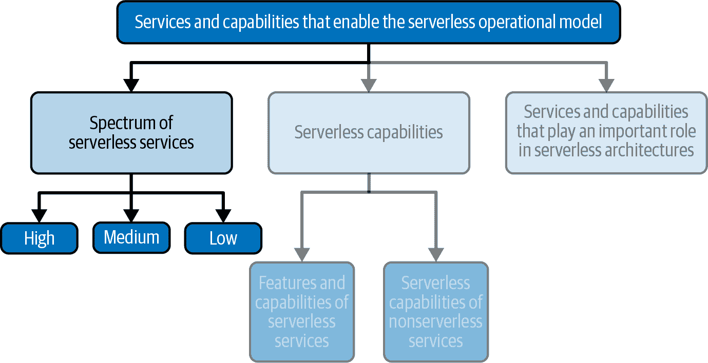

在某些情况下，云服务也可能具有无服务器功能、配置选项或能力 (Figure 2-2)。这些云服务不一定被标记为无服务器，但仍提供无服务器能力。例如，在 Azure Kubernetes Service (AKS) 中，[AKS virtual nodes](https://oreil.ly/lz6BN) 通过弥合无服务器和容器化范式的优势来启用无服务器操作模型。通过 AKS 虚拟节点，Kubernetes API 已扩展了 Azure Container Instances (ACI) 的可扩展、基于容器的计算能力。这使工程团队能够快速扩展 AKS 集群中的应用程序工作负载，并在需求激增时通过分配所需数量的额外容器来响应。^(2)

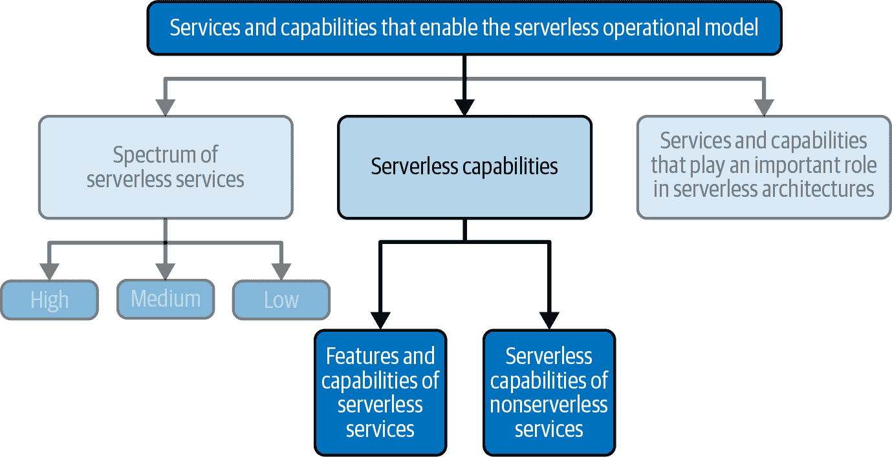

Google Cloud SQL 具有一个名为 [serverless exports](https://oreil.ly/cbJf7) 的无服务器功能，可在导出数据时自动创建临时数据库实例。^(3) Cloud SQL 虽然是完全托管的数据库服务，但并非无服务器。然而，它 `has` 一个无服务器功能，使工程师和数据库管理员能够在无需担心对正在运行的生产数据库工作负载造成任何性能影响的情况下从数据库实例导出数据。这有助于最大限度地减少性能问题，因为直接从生产数据库导出数据会与任何正在运行的查询竞争。

另一个属于这一范畴的例子是 `SageMaker Serverless Inference`，它允许 ML 工程师使用 Amazon SageMaker AI 服务将 ML 模型部署到无服务器推理端点。在 SageMaker AI 中部署 ML 模型时，ML 工程师有以下部署选项：(1) 实时推理端点，(2) 异步推理端点，(3) 无服务器推理端点。在这些选项中，只有无服务器推理端点选项满足了启用无服务器操作模型的大多数标准。因此，虽然 Amazon SageMaker AI 被视为完全托管的 ML 服务，但它并非无服务器，而是为 ML 模型部署提供无服务器选项。

在浏览以下小节中的服务列表时，你可能会发现某些服务未被云提供商明确标记为无服务器。我包含这些服务的原因如下：

* 它们经常被开发人员用于实现启用无服务器操作模型的无服务器架构。
* 它们在各种无服务器架构和实现中发挥着重要作用 (Figure 2-3)。

此类别中的云存储服务包括 Amazon S3、Azure Blob Storage 和 Google Cloud Storage。其他可能属于这一范畴的服务包括工作流编排服务、密钥管理服务以及可观测性和监控服务。

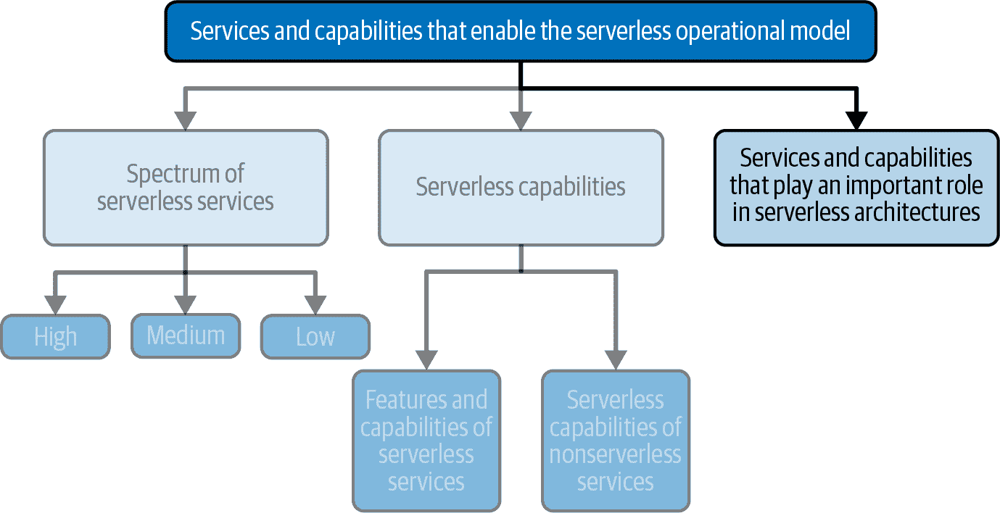

如果配置不正确，这些服务可能会使敏感数据暴露，并允许攻击者获得对关键资源的未经授权访问。从攻击者的角度来看，这些服务中的配置错误显著增加了利用无服务器应用程序的机会。

为了保护无服务器应用程序，你需要考虑一份全面的服务和能力列表，这些服务和能力启用了无服务器操作模型，如 Figure 2-4 所示。

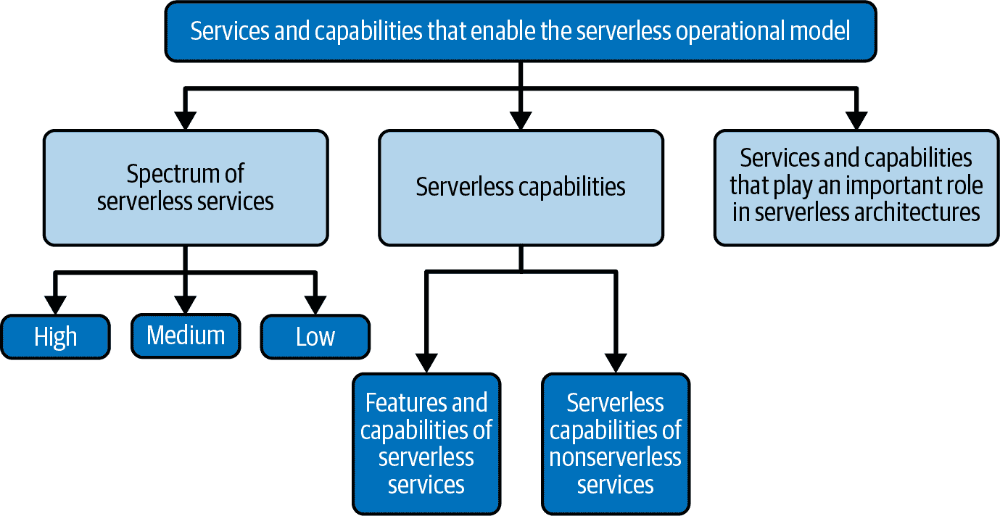

你可能会惊讶地发现，这些服务还包括一些云提供商将其标记为无服务器的服务，即使启用无服务器操作模型的标准并未完全满足。这些服务仍然值得包含，因为它们可能最终成为我们需要审计和保护的无服务器架构的一部分。

牢记这一点，让我们回顾一下 AWS、Azure 和 Google Cloud 上的无服务器服务、功能和能力！

### AWS 上的无服务器服务、功能和能力

表 2-1 提供了 AWS 上可用于无服务器架构的服务和功能的全面但非详尽的列表。^4 让我们逐一查看它们如何融入更大的整体。

表 2-1. 使 AWS 上无服务器运营模型成为可能的服务和能力

| Service/feature/capability | Description |
| --- | --- |
| AWS Lambda | 一种无服务器、事件驱动的计算服务，允许开发人员在无需管理或配置服务器的情况下运行自定义函数代码。AWS Lambda 可作为粘合剂，允许开发人员通过连接多个服务并实现可扩展的事件驱动架构，为各种用例构建无服务器应用程序。^a |
| AWS Fargate | 一种用于容器的无服务器计算引擎，允许开发人员在无需担心其运行的基础设施的情况下部署容器。 |
| AWS App Runner | 一种完全托管的服务，可通过最少的配置简化无服务器容器化应用程序和 API 的部署、负载均衡和自动扩缩容。 |
| Amazon S3 | 一种无服务器对象存储服务，为各种应用程序和用例提供可扩展、耐用且安全的存储。 |
| Amazon EventBridge | 一种无服务器事件总线服务，可简化应用程序集成，并帮助工程师构建解耦、可扩展且 resilient 的无服务器架构。EventBridge 允许工程师连接来自各种来源的数据——包括 AWS 服务、内部系统和软件即服务（SaaS）应用程序——以实现无缝的事件驱动工作流。 |
| Amazon Simple Queue Service (SQS) | 一种完全托管的队列服务，为微服务、分布式系统和无服务器应用程序提供异步、基于消息的通信。 |
| Amazon Simple Notification Service (SNS) | 一种完全托管的 pub/sub 服务，使开发人员能够构建松耦合且可扩展的事件驱动应用程序。SNS 支持扇出消息传递，允许单个发布的消息同时传递给多个订阅者。 |
| Amazon API Gateway | 一种完全托管的服务，使开发人员能够为各种类型的应用程序创建、发布、监控和保护 RESTful API 和 WebSocket API。 |
| AWS Step Functions | 一种无服务器工作流编排服务，使开发人员能够构建分布式应用程序、微服务和管道。它通过与各种 AWS 服务实现无缝集成来简化无服务器工作流的编排。 |
| Amazon Elastic File System (EFS) | 一种无服务器、完全弹性的文件系统，可在多个计算资源之间提供共享数据访问。 |
| Amazon ElastiCache Serverless | Amazon ElastiCache 的无服务器选项，允许开发人员在无需基础设施配置或配置的情况下设置高可用缓存。 |
| Amazon EMR Serverless | EMR 的无服务器部署选项，为使用开源框架的数据处理作业提供无服务器运行时环境。 |
| Amazon DynamoDB | 一种完全托管的 NoSQL 数据库服务，允许开发人员构建现代无服务器应用程序。 |
| Amazon Relational Database Service (RDS) Proxy | 一种完全托管、高可用的 RDS 数据库代理，可用于可扩展的无服务器应用程序。 |
| Amazon Aurora Serverless | Amazon Aurora 的按需、自动扩缩容配置，可根据工作负载自动上下扩展容量。^b |
| Amazon Redshift Serverless | 一种无服务器数据仓库服务，允许商业智能团队在无需设置、管理和扩缩容数据仓库基础设施的情况下运行和扩缩容分析工作负载。 |
| Amazon Neptune Serverless | Neptune 数据库的无服务器部署选项。 |
| Amazon OpenSearch Serverless | Amazon OpenSearch Service 中的无服务器选项。 |
| Amazon Athena | 一种无服务器交互式查询服务，使数据工程师能够通过标准 SQL 在 Amazon S3 中分析数据，而无需管理服务器或数据仓库。 |
| AWS Glue DataBrew | 一种完全托管的数据准备服务，允许数据科学家和分析师可视化探索、清理和转换数据以用于分析和机器学习。 |
| Amazon Kinesis Data Streams | 一种完全托管的无服务器服务，用于实时处理流数据。 |
| Amazon Data Firehose | 一种无服务器服务，用于捕获、转换和实时将流数据传递到各种 AWS 存储和分析服务。^c |
| AWS AppSync | 一种完全托管的无服务器 GraphQL API 服务，使开发人员能够构建实时且可扩展的 GraphQL API。 |
| Amazon Bedrock | 一种完全托管的无服务器服务，用于构建和扩展生成式 AI 应用程序。^d |
| Amazon SageMaker Serverless Inference | SageMaker 中用于在无服务器推理端点部署机器学习模型的部署选项。 |
| Amazon Quick Sight | 一种无服务器、完全托管的商业智能服务，可自动扩缩容以支持数十万用户。 |
| Amazon Keyspaces | 一种托管的无服务器 Apache Cassandra 兼容数据库服务。 |

^a 使用 AWS Lambda 以及类似服务（如 Azure Functions 和 Google Cloud Run functions）的开发人员需要考虑资源限制，例如内存使用、函数执行时间和并发限制，以在性能和成本效率之间取得平衡。开发人员还应记住，这些函数在临时计算上运行，该计算仅在函数执行期间存在，因此函数必须是无状态的，并且必须将数据存储在运行时之外。^b 在撰写本文时，Aurora Serverless v2 是当前受支持的版本，v1 现已弃用。^c Amazon Data Firehose 前身为 Amazon Kinesis Data Firehose。^d 最近，AWS 引入了 Amazon Bedrock AgentCore——一种完全托管的、生产就绪的智能体平台，可让您在无服务器基础设施上构建、部署和管理 AI 智能体。

您将在无服务器架构中看到这些服务和能力中的许多被组合使用，以解决各种各样的需求。例如，在 AWS 上，您可以使用 AWS Lambda 调用托管在 Amazon Bedrock 上的基础模型，并使用 AWS Step Functions 在应用程序中编排多步骤工作流，从而构建无服务器 AI 驱动的管道。

#### Note

您可以通过访问 [“Serverless on AWS” page](https://oreil.ly/2QLnH) 找到 AWS 无服务器服务、用例和其他资源的列表。

### Azure 上的无服务器服务、功能和能力

表 2-2 提供了 Azure 上可用于无服务器架构的服务和功能的全面但非详尽的列表。让我们逐一查看它们如何融入更大的整体。

表 2-2. 使 Azure 上无服务器运营模型成为可能的服务和能力

| Service/feature/capability | Description |
| --- | --- |
| Azure Functions | 一种无服务器、事件驱动的计算服务，允许开发人员在无需配置或管理服务器基础设施的情况下编写和运行代码。与 AWS Lambda 类似，开发人员可以将 Azure Functions 作为粘合剂与其它 Azure 服务集成，以构建用于不同用例的各种无服务器应用程序。 |

### Azure 无服务器服务

| Azure Durable Functions | Azure Functions 的一项功能，使开发人员能够在无服务器架构中编写有状态函数。 |
| Azure Container Apps | 用于基于容器的应用程序的无服务器平台。 |
| Azure Functions on Azure Container Apps | 一种容器托管选项，可让开发人员将函数与其它微服务、API 或任何容器化应用程序一起运行。 |
| Azure Kubernetes Service (AKS) virtual nodes | AKS 的扩展，为托管 Kubernetes 服务带来无服务器能力，用于在 Azure 上运行容器化应用程序。 |
| Azure Static Web Apps | 一种无服务器服务，使开发人员能够托管静态前端网站并使用无服务器后端 API，通过从代码存储库自动部署全栈 Web 应用程序。 |
| Azure Event Hubs | 一种数据流服务，每秒可处理数百万个事件，实现从各种来源实时收集和处理大量数据。 |
| Azure Service Bus | 一种完全托管的企业消息服务，使应用程序和服务之间能够进行通信。 |
| Azure Event Grid | 一种高度可扩展的无服务器事件代理，使用事件集成应用程序。 |
| Azure SignalR Service | 一种完全托管的服务，帮助工程师构建具有实时功能的应用程序。它支持一种无服务器服务模式，可与 Azure Functions 配合使用以提供实时消息传递功能。 |
| Azure API Management | 一种完全托管的服务，允许开发人员和工程师发布、保护、转换、维护和监控 API 资源。 |
| Azure Logic Apps | 一种无服务器工作流自动化服务，使团队更轻松地管理和扩展其应用程序。 |
| Azure DevOps | 一组基于云的服务，可用于 Azure 上的无服务器操作（例如软件开发和交付）。它允许创建可将代码部署到各种服务的 CI/CD 管道。 |
| Azure Functions Durable Task Scheduler | Azure Durable Functions 的完全托管后端，用于编排和管理有状态的无服务器工作流。 |
| Azure SQL Database serverless | Azure SQL Database 中数据库的计算层，可根据工作负载自动扩展。 |
| Azure Cosmos DB serverless | Azure Cosmos DB 中的一种容量模式，使用该服务时可实现无服务器按需消费模式。 |
| Azure Blob Storage | 一种对象存储解决方案，针对在 Azure 上实现的各种无服务器架构中常用的海量对象进行了优化。 |
| Azure Data Factory | 一种基于云的无服务器数据集成服务，允许用户创建、安排和管理数据管道和工作流。 |
| Azure Stream Analytics | 一种实时数据流和分析服务，每秒可处理数百万个事件。 |
| Azure Synapse Analytics | 一种企业分析服务，提供无服务器和专用资源，帮助用户大规模地摄取、转换、建模、分析和提供数据——包括但不限于无服务器 SQL 池和无服务器 Apache Spark 池。 |
| Azure Queue Storage | 一种用于存储大量消息的服务，使函数分离和组件解耦成为可能，以便在大型工作负载中扩展和管理任务。 |
| Azure Files | 一种完全托管的无服务器文件共享服务。 |
| Azure Storage Actions | 一种无服务器平台，通过使用户能够在多个存储账户中的数百万个对象上执行常见数据操作，从而简化存储对象的管理。 |
| Microsoft Foundry | 一个统一平台，旨在让开发人员构建生成式 AI 应用程序，并使用尖端的 AI 工具和 ML 模型进行探索、构建、测试和部署。它支持无服务器和非无服务器部署选项，允许在模型和应用程序的托管和扩展方式上具有灵活性。^(a) |
| Azure Application Insights | 一种应用程序性能管理服务，允许开发人员深入了解其应用程序的性能和可用性。 |
| ^(a) Microsoft Foundry 支持的四种部署选项为 Azure OpenAI 服务、Azure AI 模型推理、无服务器 API 和托管计算。 |

在实践中，其中许多服务和功能通常在无服务器架构中一起使用，以满足各种业务和技术需求。例如，如果您在 Azure 上构建无服务器 Web 应用程序或 API，您可能会使用 Blob Storage、API Management 和依赖 Key Vault 在应用程序组件之间安全管理机密、密钥和凭据的 Azure Functions。

#### Note
您可以通过访问 [Azure serverless page](https://oreil.ly/UetSe) 找到 Azure 无服务器服务的列表、用例和其他资源。

### Google Cloud 上的无服务器服务、功能和能力

Table 2-3 是可在 Google Cloud 上用于无服务器架构的服务和功能的全面但非详尽的列表。让我们逐一了解它们如何融入更大的图景。

#### Table 2-3. Services and capabilities that enable the serverless operational model on Google Cloud

| Service/feature/capability | Description |
| --- | --- |
| Cloud Run functions | 一种无服务器计算服务，允许开发人员编写和执行响应事件的代码。与 AWS Lambda 类似，Cloud Run functions 在其它 Google Cloud 服务之间充当粘合剂，使开发人员能够为不同用例构建各种无服务器应用程序。^(a) |
| Cloud Run | 一种完全托管的无服务器容器计算平台。 |
| Cloud Build | 工程师团队的无服务器 CI/CD 平台。 |
| App Engine | 一种无服务器平台，允许开发人员在无需担心底层基础设施的情况下构建和部署 Web 应用程序。 |
| API Gateway | 一种完全托管的服务，让开发人员为无服务器和非无服务器应用程序设置、保护和监控 API。 |
| Vertex AI | Google Cloud 上的 ML 平台，允许工程师构建支持各种 ML 用例（包括但不限于生成式 AI）的无服务器和非无服务器应用程序。 |
| Vertex AI Pipelines | 用于构建和运行 ML 管道的无服务器编排器。它使数据科学家和 ML 工程师能够通过在 ML 生命周期中自动化和监控可重复的工作流来实现机器学习运营（MLOps）实践。 |
| Firestore | 一种完全托管的无服务器 NoSQL 文档数据库，用于构建丰富的移动、Web 和物联网应用程序。 |
| Cloud Storage | Google Cloud 上各种无服务器和非无服务器应用程序中使用的对象存储解决方案。 |
| Dataflow | 一种无服务器数据处理服务，可与 Google Cloud 上的其它无服务器服务无缝集成。 |
| BigQuery | 一种无服务器、高度可扩展且经济高效的数据仓库。 |
| Cloud SQL serverless exports | Google Cloud SQL 中的一项无服务器功能，使工程师能够在不影响生产工作负载性能或稳定性的情况下从数据库实例导出数据。此功能允许主数据库资源以通常的性能速率执行操作，因为会创建一个临时数据库实例来卸载导出操作。导出操作完成后，此临时实例会自动删除。 |
| Database Migration Service | 一种无服务器数据迁移服务，抽象了手动配置、管理和监控用于将数据库迁移到 Google Cloud 的数据库迁移资源的繁重工作，可实现最小停机时间。 |

| 服务 | 描述 |
|---|---|
| Serverless for Apache Spark | 一种服务，允许工程师在无需配置和管理 Dataproc 集群的情况下运行 Spark 工作负载。^(b) |
| Bigtable Data Boost | 一种无服务器计算服务，允许工程师使用与处理应用流量的集群隔离的无服务器计算，向 Bigtable 数据发送高吞吐量的读取作业和查询。这有助于确保这些集群的性能不会受到分析或批处理工作负载的影响。^(c) |
| Datastream | 一种无服务器变更数据捕获和复制服务，允许工程师设置 ELT（提取、加载和转换）管道以实现低延迟数据复制。它还使工程师能够在不同应用和异构数据库之间同步数据流，同时将运营开销和延迟降至最低。 |
| Eventarc | 一种用于异步传递事件的服务，用于特定的无服务器架构。 |
| Pub/Sub | 一种异步且可扩展的消息传递服务，可解耦服务，并可用于无服务器应用。 |
| Workflows | 一种无服务器编排服务，使工程师能够构建复杂的工作流，并与 Google Cloud 上的其他无服务器服务无缝集成。 |
| Cloud Scheduler | 一种完全托管的 cron 服务，用于某些无服务器架构和实现。 |
| Serverless VPC Access | 一种服务，允许计算资源和应用通过 Google Cloud 完全管理的连接器，使用其 IP 地址访问 VPC 网络中的资源。 |
| Serverless network endpoint group（serverless NEG） | Google Cloud 中的单个端点，解析为 App Engine、Cloud Run 函数、API Gateway 或 Cloud Run 资源，允许这些无服务器资源用作负载均衡器的目标。 |

^(a) Google Cloud 在 2024 年 8 月的 [blog post](https://oreil.ly/hhd4Y) 中透露，Google Cloud Run functions 现在与 Cloud Run 一起运行在统一的无服务器平台上。使用 Cloud Functions（2nd gen）的开发者现在可以访问 Cloud Run 功能，包括但不限于多事件触发器管理、挂载 Cloud Storage 卷的能力，以及对使用 NVIDIA GPU 的推理函数的支持。^(b) Dataproc 是 Google Cloud 中用于运行开源大数据工具和框架的完全托管服务。你可以查看 [guide page](https://oreil.ly/ZdT2S) 以了解 Dataproc 与 Serverless for Apache Spark 之间的差异。^(c) Bigtable 是 Google Cloud 中用于大规模、低延迟工作负载的完全托管 NoSQL 列式数据库。

---

你经常会看到这些服务和功能在无服务器架构中协同工作，以应对各种挑战和需求。例如，如果你要在 Google Cloud 上构建一个无服务器、事件驱动的 HTML 到 PDF 转换服务，你可能会使用 Eventarc 在用户将 HTML 文件上传到指定的 Cloud Storage 存储桶时自动触发工作流。然后 Cloud Run 服务将下载并处理 HTML 文件，将其转换为 PDF，并将结果输出存储在单独的输出存储桶中。

#### Note
你可以通过访问 Google Cloud 的 [“Go Serverless” page](https://oreil.ly/SZqQK) 找到 Google Cloud 无服务器服务、用途和其他资源的列表。

到目前为止，你应该熟悉为 AWS、Azure 和 Google Cloud 上的无服务器架构提供支持的云服务和功能。随着云服务提供商推出新服务，预计该列表会增长。

## Common Building Blocks, Patterns, and Solutions for Serverless Architectures

现在你已经了解了在 AWS、Azure 和 Google Cloud 上实现无服务器运营模式的各种服务、功能和能力，是时候更仔细地看看它们如何协同工作以形成无服务器解决方案了。在本节中，我将带你了解实现无服务器架构的各种构建块、模式和解决方案。我还将强调重要的运营和安全注意事项，以避免你在实际无服务器应用部署中可能遇到的挑战。

#### Note
对无服务器应用的设计和实现有坚实的基础，将使你更容易掌握本书后续章节中讨论的无服务器安全概念和技术。

### Serverless Web Applications and APIs

无服务器 Web 应用和 API 利用各种云资源来响应 HTTP 请求等事件（Figure 2-5）。在无服务器架构中，你会看到的最常见实现之一涉及 API 网关调用无服务器函数，使用 AWS Lambda、Azure Functions 和 Google Cloud Run functions 等服务。

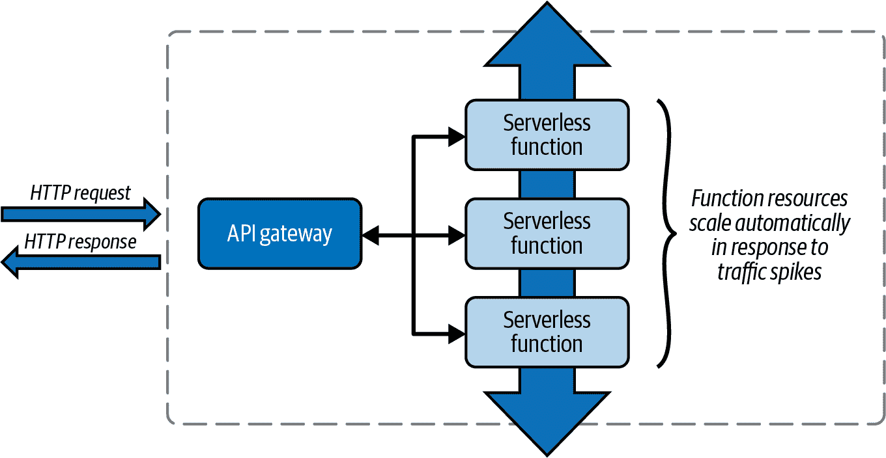

此设置会根据传入流量自动扩展，并在空闲时可扩展为零。请求期间会发生什么？当 API 网关接收到 HTTP 请求时，会发生以下情况：

1. 调用云函数，并自动配置必要的计算基础设施。
2. 云函数处理事件或 HTTP 请求，并将响应返回给 API 网关。
3. 执行后，函数的计算环境可能会保持活动状态一段时间以处理额外请求，或在保持空闲时自动取消配置。

由于无服务器函数资源是动态创建和销毁的，它们理想情况下不会在本地存储状态。相反，状态通常保存在外部数据库和存储服务中，如 Figure 2-6 所示。

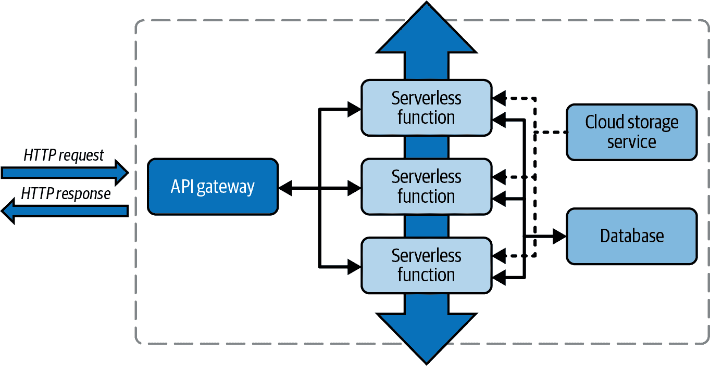

在此设置中，无服务器函数根据需要从数据库和存储服务检索和持久化记录和文件。这有助于确保数据在函数调用、扩展事件或非活动期间可靠存储且不会丢失。

假设你有一个简单的网站，用户可以在上面查看你撰写的博客文章并发表评论。使用我们刚刚讨论的无服务器架构，当用户在帖子上提交评论时会发生以下情况：

1. HTTP 请求触发事件，通过 API 网关调用无服务器函数。
2. 无服务器函数对其进行处理，将评论连同其他相关元数据（如时间戳、用户 ID 和博客文章 ID）存储在数据库中，并将新记录与关联的博客文章 ID 链接。
3. 作为评论一部分上传的图像和其他文件存储在云存储服务中。步骤 2 中创建的记录将包含对这些文件的引用，以便在渲染博客文章页面时可以轻松检索并与评论一起显示。
4. 处理完评论后，无服务器函数向 API 网关返回成功响应，API 网关随后将响应转发回用户的浏览器或应用。

评论连同任何相关文件和图像稍后会通过单独的过程检索并显示在博客文章页面上，该过程根据需要查询数据库和存储服务。

#### Note
除了后端组件和资源之外，完整的无服务器应用设置通常还包括一个 Web 前端，该前端可以使用基于云的静态网站托管服务单独托管。前端通过公开的 API 端点与之通信，以执行创建、读取、更新和删除数据等操作。

如果您在思考从 “Cloud Services and Capabilities That Enable the Serverless Operational Model” 中哪些云服务可用于此架构，表 2-4 提供了适用于此设置的数据库和存储选项的非详尽列表。

#### 表 2-4. 可用于该架构的数据库和存储服务

| 云平台 || 服务 |
| --- | --- |
| AWS || S3, DynamoDB, EFS, ElastiCache Serverless, RDS Proxy, Aurora Serverless, Redshift Serverless, Neptune Serverless |
| --- | --- |
| Azure || Blob Storage, SQL Database serverless, Cosmos DB serverless, Files |
| Google Cloud || Cloud Storage, Firestore, BigQuery |

此架构的其他变体使用不被视为无服务器服务的托管云数据库服务。对于具有严格性能要求的应用程序，使用无法缩减为零的数据库资源可以提供更一致的性能和更低的延迟，因为资源始终运行且可立即使用。

在处理无服务器 Web 应用程序和 API 时，您应注意以下重要事项：
* 开发人员可能忘记在自定义函数代码中正确验证输入，这可能导致攻击者可能利用的漏洞。
* 团队可能会意外地将后端资源（例如 API 端点、数据库和云存储）暴露给未经授权的访问。
* 如果未正确配置速率限制机制，API 端点可能容易受到 DoS 和 DoW 等攻击。
* 开发人员可能会无意中向无服务器函数或其他资源授予过多的权限。这可能允许攻击者提升权限并在云环境中破坏其他资源。

在处理无服务器 Web 应用程序和 API 时，您有责任保护架构中的云资源以及函数资源中自定义应用程序代码（包括其依赖项）的<|message|>。这意味着如果攻击者利用您无服务器应用程序中的漏洞和错误配置，在您的云账户中 spin up 资源进行恶意活动，*您* 要承担责任。

### 基于队列的负载均衡模式

用于无服务器架构的组件和资源具有不同的扩展限制，这些限制取决于系统负载、扩展策略和服务特性。例如，计算层中的无服务器函数与数据库层相比扩展方式不同：无服务器函数通常根据请求量进行扩展，而数据库层可能由于读写容量限制、存储限制和其他因素而遇到性能瓶颈。因此，无服务器架构在重负载下可能会出现性能下降或停机，因为资源受性能瓶颈、扩展和并发限制、速率限制和节流机制以及提供商强制执行的服务配额的约束。

解决此挑战的一种方法是实施 *基于队列的负载均衡模式*，该模式引入队列来管理和吸收流量峰值，控制传入流量的速率，并在重负载下保护其他后端组件不被压垮。

在 图 2-7 中，队列消息由从队列中消费的计算资源异步处理。这些计算资源可以配置为自动扩展到用户指定的最大并发限制，以确保在高峰流量期间处理队列消息的组件不会过载。

下面是一个实际示例来说明其工作原理。假设您有一个无服务器应用程序，用户可以使用生成式 AI 根据文本提示生成自定义图像。采用我们刚刚讨论的模式，当用户提交文本提示进行图像生成时，会发生以下情况：
1. HTTP 请求触发一个事件，通过 API 网关将消息发送到队列。
2. 队列中的消息异步调用无服务器计算资源。此计算资源通过 API 调用预训练的生成式 AI 模型。模型处理文本提示并根据提供的提示生成相应的图像。
3. 无服务器计算资源接收图像，为其准备存储，然后将其保存到云存储服务中。
4. 使用通知或消息云服务，无服务器计算资源通知用户图像已准备就绪。通知包括可访问和下载生成的图像的 URL 或位置。

在此设置中，重要的是为扩展计算资源设置最大并发限制，该限制不超过托管生成式 AI 模型的服务或组件支持的最大并发推理请求数。这将有助于避免因模型端点过载或超出服务配额而导致的错误和性能问题。

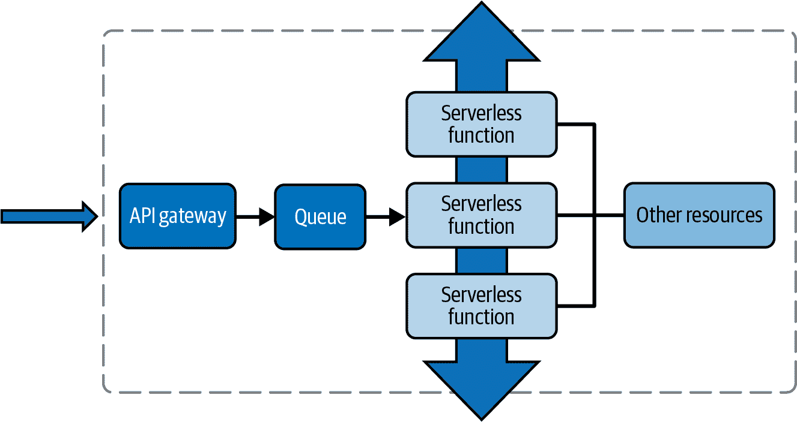

#### Note
基于队列的负载均衡模式将推送事件到队列的事件生产者与在另一端处理这些事件的消费者解耦。当事件产生的速度远快于消费者处理的速度时，此模式特别有用。

尽管基于队列的负载均衡模式并不独用于无服务器队列和函数，但它与无服务器原则非常契合，并且可以使用现有的云服务和功能轻松实现。从 “Cloud Services and Capabilities That Enable the Serverless Operational Model” 中可用于基于队列的负载均衡模式中队列的服务的非详尽列表包括 Amazon SQS、Azure Queue Storage 和 Google Cloud Pub/Sub。

实施此模式时，请牢记以下关键注意事项：
* 开发人员可能忘记在处理队列消息的自定义代码中验证输入。这可能允许恶意有效负载被计算资源处理，攻击者可能会利用这一点。
* 开发人员可能无意中在与队列交互的代码中硬编码凭据，从而使其暴露于从代码库或存储库中提取的风险。
* 团队可能无意中忽略监控失败消息，从而导致队列长度或处理时间突然激增等异常模式——可能是 DoS 攻击的指标——未被注意到。
* 开发人员可能无意中将敏感数据（例如个人身份信息 PII 或付款详情）发送到队列。获得对队列未经授权访问的攻击者可以直接从队列中提取敏感数据。

此外，重要的是要注意，基于队列的负载均衡模式并不能使系统免受 DoS 攻击。虽然该模式可以帮助管理流量峰值，但它并不能消除无服务器应用程序因请求过多而被压垮的风险。

### Gatekeeper 模式

与无服务器架构相关的另一个模式是 *gatekeeper 模式*。此模式引入了一个验证层，作为 gatekeeper，在云应用程序中两个组件之间检查和过滤传入请求。此额外层可用于保护后端服务并确保只有来自外部来源的授权和有效请求才被允许继续。

该方法的一个关键优势在于，它将请求验证逻辑集中化并将其与核心应用程序逻辑分离。这使得受保护的后端组件能够专注于处理经过网关守卫授权的已验证请求。同时，在不引入对网关守卫处理的验证逻辑的更改或风险的情况下，更容易管理和更新受保护的后端组件。

图 2-8 展示了该模式的实际应用示例。*API Gateway Lambda 授权器*充当网关守卫，在将请求传递给 API 网关后面的后端资源之前验证传入请求。

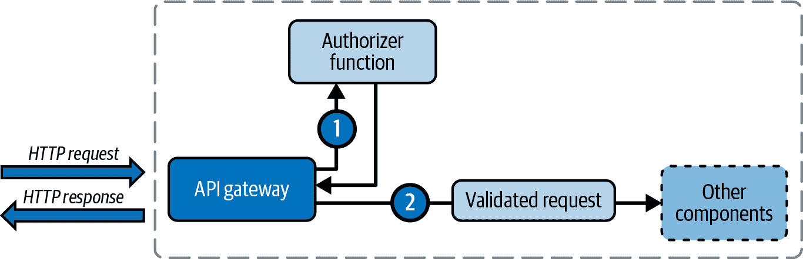

以下是请求到达 API 网关时发生的情况：

1. API 网关接收请求并调用 Lambda 授权器执行验证检查。
2. Lambda 授权器根据开发者准备的自定义验证函数代码检查请求，其中包括确保请求具有正确的标头、令牌或特定参数。
3. 验证成功后，请求会被转发到 API 网关后面的后端组件。否则，请求将被拒绝并返回相关的状态码和消息，方法请求失败。

你可以在 AWS、Azure 和 Google Cloud 上以多种方式实现网关模式。你需要根据应用程序的架构和安全要求，以及每个云平台提供的服务和功能，对验证和请求路由的处理进行自定义，以确定最合适的解决方案。

使用此模式时应注意以下事项：

* 鉴于网关守卫的主要职责是验证和过滤请求，它不应代表应用程序执行处理任务。
* 你可能需要为网关守卫设置冗余和故障转移机制，因为引入的验证层可能成为应用程序的单点故障。
* 开发人员可能会忘记限制后端访问以仅接受通过网关守卫路由的已验证请求。即使存在验证层，攻击者也可能直接访问后端服务并完全绕过网关守卫。

此外，在实现网关守卫模式时添加额外层可能会因增加的验证步骤而减慢应用程序速度。如果在验证层中使用无服务器函数，冷启动可能会进一步增加整体请求处理时间。

### Fan-Out Pattern

在无服务器架构中常用的另一种设计模式是*扇出模式*。该模式通过实现组件间的并行处理来解耦组件并增强系统的可扩展性。不是按顺序执行任务，你可以并行运行多个任务，从而减少其整体执行时间。

如图 2-9 所示，扇出模式允许单个事件分发给多个消费者，并允许这些消费者并行处理任务。对于无服务器应用程序而言，实现此模式非常简单，因为你可以利用云服务，例如 Amazon SNS、Azure Event Grid 或 Google Cloud Pub/Sub，来处理此类用例。^(5)

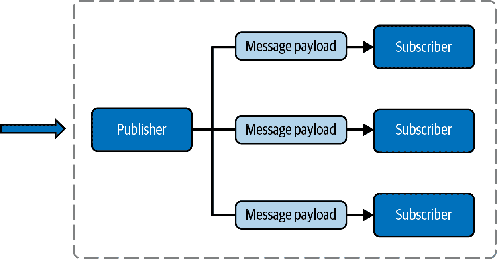

以下是演示其工作原理的示例。假设你有一个应用程序，用户可以使用各种生成式 AI 模型根据文本提示生成多个自定义图像。使用扇出模式，当用户提交文本提示进行图像生成时，会发生以下情况：

1. 消息由发布者发布给多个订阅者。为简单起见，每个订阅者都由一个无服务器函数表示。
2. 每个无服务器函数独立处理消息，通过 API 调用特定的生成式 AI 模型，并根据文本提示生成图像。
3. 生成的图像存储在云存储服务中，相关元数据保存到数据库中。

在此设置中，重要的是要考虑每个订阅者不同的任务处理速度。扇出模式更可靠且可扩展的变化形式是使用队列作为订阅者，队列充当缓冲以吸收传入消息的峰值。这允许消费者以不同的速度异步并行处理任务。

在实现扇出模式以及无服务器架构中的其他模式之前，请确保你了解与所用云资源相关的安全风险和威胁。攻击者经常针对开发团队在生产环境中使用的常见云服务。

让我们通过一个现实世界的例子来说明攻击者如何利用扇出模式中常用的云服务进行网络钓鱼攻击。最近的一项网络安全威胁是利用 Amazon SNS 发送包含网络钓鱼链接的欺诈性短信的短信钓鱼攻击。通过被盗或泄露的凭证入侵的受损账户，通常已移出短信沙箱，被用于通过脚本自动向一系列电话号码发送大量短信。这些消息似乎来自受信任的实体，例如美国邮政服务，通知收件人包裹投递未遂，诱使他们点击消息中的恶意链接。点击链接的受害者通常会被重定向到旨在窃取敏感数据的假网站，例如姓名、地址、电话号码、电子邮件地址和信用卡号码。如果没有监控和检测机制，及时检测和响应这些攻击将很困难。

#### Note

此类攻击不仅限于 Amazon SNS。攻击者利用各平台上的各种消息和通知服务进行网络钓鱼攻击和其他恶意活动。

此示例凸显了正确配置、保护和监控云资源的重要性，因为攻击者经常利用常见的配置错误进行恶意活动。同时，及时了解最新的安全新闻和云服务更新将帮助你实施适当的控制并在发生之前防止安全事件。

### Valet Key Pattern

在无服务器架构以及云架构中普遍使用的另一种模式是*代客钥匙模式*。使用此模式，客户端设备和资源可通过在指定时间后过期的密钥或令牌直接访问特定资源。这种方法有助于卸载数据传输工作并从应用程序服务器中移除处理开销，因为客户端可以直接与特定资源交互，而无需将数据路由通过服务器。

假设你有一个移动应用程序，帮助用户将大型视频文件上传到存储服务。不是设置一个后端应用程序来接收视频然后将其上传到存储服务，生成的访问密钥可由移动客户端用于直接将视频上传到存储位置。对于此类用例，你也可以使用预签名 URL，它们授予临时、有限的访问权限以直接将视频上传到存储位置。

#### Note

云存储服务，例如 Amazon S3、Azure Blob Storage 和 Google Cloud Storage，通常提供内置支持来生成预签名 URL。

使用代客钥匙模式时应注意以下事项：

* 如果密钥泄露或被入侵，攻击者可以在密钥过期前将其用于恶意活动。
* 为降低滥用和未经授权访问的风险，密钥应仅授予最低所需权限，并限制为特定操作或资源。

此外，请确保您已建立监控和审计系统，以便在出现可疑活动时能够立即撤销对密钥的访问权限。

### 事件驱动的无服务器容器

在 “揭穿常见神话和误解” 中，我们驳斥了无服务器计算与容器化策略和解决方案无法良好协同工作的神话。诸如 `AWS Fargate`、`Azure Container Apps` 和 `Google Cloud Run` 等云服务允许您同时利用无服务器和容器化范式的优势。这些无服务器容器服务使您能够迁移和部署复杂的应用程序，而这些应用程序如果在标准 FaaS 约束下运行或不进行大规模重写则会很困难。^(6)

一些 FaaS 服务和托管 ML 服务提供无服务器推理部署选项，允许您在配置资源时利用自定义容器镜像。^(7) 一个例子是 [Amazon SageMaker Serverless Inference 的容器支持](https://oreil.ly/vEGWl)——使其能够在容器化环境中托管 ML 模型，同时获得无服务器计算模型的优势。

几年前，我开发了一个由 ML 驱动的无服务器函数，该函数使用自定义容器镜像来运行 `R` 代码以满足时间序列预测需求。由于我使用的无服务器函数服务默认不支持 `R`，我不得不实现一个自定义运行时，并将代码和依赖项打包到自定义容器镜像中进行部署，如 Figure 2-10 所示。

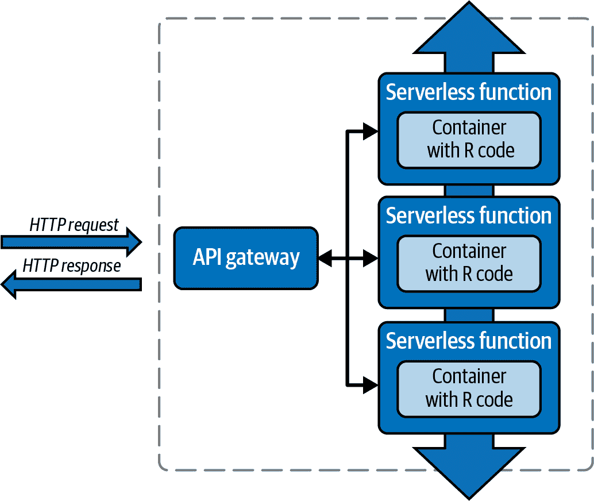

在测试阶段和项目的早期阶段，该函数通过 API 网关直接调用。随着项目的演进，该函数后来也被各种其他事件源触发。在手动部署该函数的新版本数周后，我构建了一个无服务器部署管道，以自动化每个新版本的准备和部署。虽然这看起来工作量很大，但使用无服务器服务大幅缩短了准备部署管道所需的时间。

在使用支持无服务器容器的服务时，这里有一些需要注意的重要考虑事项：

* 使用自定义容器通常需要使用构建容器的额外云服务，然后将生成的自定义镜像推送到容器注册表中，以便用作无服务器容器资源的自定义运行时环境。攻击者可能会找到一种方法来利用容器构建管道中的配置错误，并使用配置错误的资源获得未经授权的访问或提升权限。
* 开发人员在测试和调试无服务器资源时，有时可能会出于便利而使用公开可访问的 HTTP(S) 端点。^(8) 如果没有适当的安全措施，这可能会使这些资源暴露于潜在攻击。

如果您使用自定义容器镜像作为无服务器服务的运行时环境，您有责任维护和保护容器镜像，以及在配置云资源时提供的所有应用程序代码和依赖项。鉴于您的自定义镜像可能包含存在漏洞的应用程序库和二进制文件，您可以考虑使用容器镜像扫描和分析工具来解决潜在的安全问题。您还必须熟悉容器安全，以便在使用自定义容器镜像时保护您的无服务器应用程序。

### 事件驱动的文件处理

在使用 `Amazon S3`、`Azure Blob Storage` 和 `Google Cloud Storage` 等存储服务处理文件上传时，您可以利用 *事件驱动文件处理*，以便在新文件上传到存储服务时自动运行处理作业或工作流。使用这种方法，而不是手动调用的同步过程，计算资源例如无服务器函数可以自动触发，以异步且可扩展的方式处理文件。

除了文件上传之外，其他存储资源操作例如文件修改和删除，也可以触发事件驱动的处理工作流，并使您能够根据云存储资源的更改自动执行各种任务（Figure 2-11）。

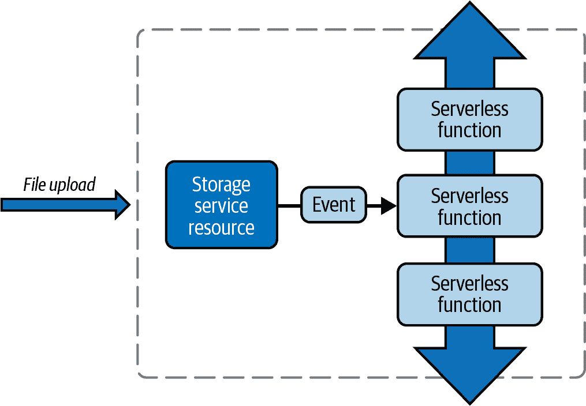

为了演示事件驱动文件处理的工作原理，这里有一个快速示例。假设您有一个文档共享应用程序，用户可以在其中上传需要自动汇总的 PDF 文档。使用事件驱动文件处理，当 PDF 文档上传到存储服务时会发生以下情况：

1. 存储服务在新 PDF 文件上传时触发事件。
2. 该事件同步调用一个运行 AI 摘要模型的无服务器函数，以生成文档的简短摘要。
3. 原始 PDF 文档和生成的摘要随后分别存储在云存储和数据库服务中。

使用此设置，被调用的函数可能需要几秒钟来生成摘要。如果同时上传太多 PDF 文档，调用无服务器函数的事件就会开始堆积并导致 PDF 文档摘要生成失败。这种设置的更具容错性的变体使用队列作为缓冲，以管理同时上传大量文件时事件激增的情况。

#### Note
其他模式例如扇出可用于将处理负载分发到多个无服务器函数或服务。

在实现事件驱动文件处理时，请牢记以下关键考虑事项：

* 存储服务是无服务器架构的基本组件——为数据湖、可扩展数据管道、ML 工作流和事件驱动应用程序提供支持。然而，尽管此存储通常包含敏感数据，但团队可能会无意中将这些服务配置为过度宽松的访问控制，攻击者可能会利用这些控制来访问或修改存储的文件。
* 开发人员可能会忘记在处理来自存储服务的事件的自定义代码中验证输入。这可能导致计算资源例如函数无意中处理来自攻击者的恶意负载。
* 开发人员可能会优先考虑便利性而非安全性，并授予计算资源例如函数过多的权限，这可能允许攻击者在账户内提升权限。

考虑到这些要点，请确保您在使用事件驱动文件处理模式时，对涉及的云服务和资源的完整安全配置选项有充分的了解。

### 无函数集成模式

*无函数集成模式* 是一种无服务器模式，其中云服务直接相互连接，而无需无服务器函数充当连接器。不是在无服务器函数内部编写自定义代码，您可以配置并利用云平台提供的服务的原生服务集成。

如 Figure 2-12 所示，您可以拥有一个直接与数据库资源集成的 API 网关。虽然您可能习惯于在无服务器架构中看到无服务器函数连接这两个资源，但如果云平台支持此操作，则这种直接集成是可能的。

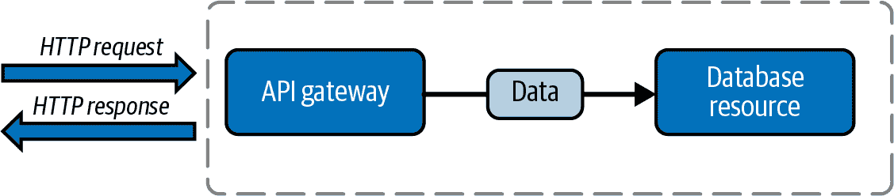

#### Note
您可以在 AWS 上构建无服务器应用程序时，将 Amazon API Gateway HTTP API 直接与 EventBridge、S3、AppSync、DynamoDB、CloudWatch 和 Comprehend 等服务的资源集成。有关更多信息，请访问 [Serverless Land 上的“Serverless Patterns Collection”页面](https://oreil.ly/BnbSK)。

在使用无函数集成模式时，需要考虑以下几点：

*   不同云平台对服务的直接集成支持各不相同。
*   在配置和集成资源时可能仍涉及代码。例如，在 Amazon API Gateway 中，你可能需要使用 Velocity Template Language (VTL) 来转换传入请求或传出响应。
*   无函数集成模式有其自身的一系列限制和挑战，架构师和开发人员在使用它部署到生产系统之前必须加以考虑——包括所用云服务对复杂转换和错误处理的支持有限。

在使用云平台提供的原生服务集成时，你需要意识到无法配置的安全机制，以及无法实现复杂身份验证和授权工作流。

### 联邦身份模式

*联邦身份模式*在无服务器架构中也很常见。^9 而不是在自己的应用程序或服务中处理验证用户凭据的过程，你可以将身份验证委托给受信任的外部身份提供者 (IdP)。^10 该模式对于利用单点登录实现在各种系统和应用程序之间无缝用户身份验证的场景特别有用。这也允许外部用户通过受信任的外部 IdP 访问你的应用程序。

通过将身份验证集中在外部提供者上，该模式通过消除为每个应用程序创建和管理单独凭据的需求来提高安全性。用户凭据安全地存储在 IdP 中，永远不会暴露给你的应用程序。相反，应用程序会收到包含已验证身份信息的令牌——从而降低了凭据被盗的风险，并最大限度地减少了应用程序本身的安全责任。

在无服务器应用程序中使用联邦身份模式并不会使这些应用程序免受安全威胁和风险。如果 IdP 被入侵，则所有依赖该 IdP 的应用程序都可能面临风险，即使应用程序本身是安全的。因此，作为纵深防御策略的一部分，实施额外的验证层和安全控制以增强应用程序整体安全性非常重要。

### 集中式日志和监控

无服务器函数运行在临时的计算环境中，该环境在每次调用后会被清理。因此，存储在执行环境临时存储中的任何数据在函数执行完毕后都会被删除。

为了保留日志和运营指标，无服务器函数依赖于提供集中且持久存储的监控服务（Figure 2-13）。

这些服务通过警报、根因分析、安全监控、容量规划、异常检测、性能调优、合规报告和错误率监控，使你能够监控、排查和微调应用程序。

#### Note

监控服务，例如 Amazon CloudWatch、Azure Monitor 和 Google Cloud Monitoring，并非仅限于无服务器架构中使用的服务，而是构建为支持各种云和本地环境。

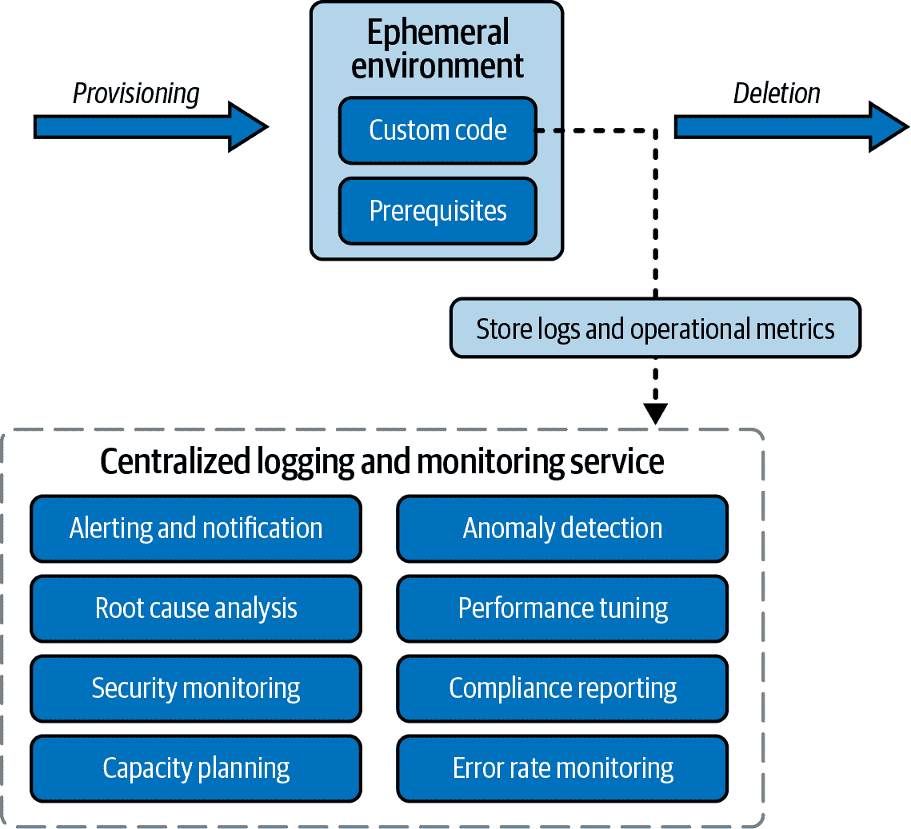

你无需为此模式手动配置任何内容，因为云平台会自动捕获并为你存储这些日志和运营数据。然而，这里有一些需要了解的重要注意事项：

*   虽然可以配置自定义仪表板和警报来监控账户中运行的云资源运行状况和性能，但开发团队有时不会花精力去设置它们。
*   在某些情况下，没有人主动或定期审查日志、仪表板和警报。这可能导致问题和安全漏洞在为时已晚之前未被发现。
*   开发人员可能会将监控与可观测性混淆，认为标准监控健康指标已足够。如果没有通过日志、指标和跟踪的丰富遥测实现端到端可观测性，就很难诊断问题、优化性能并确保无服务器应用程序的可靠性和安全性。
*   在调试或排查问题时，开发人员有时会意外记录敏感凭据，例如 API 密钥、密码或敏感个人信息。
*   团队有时会优先考虑便利性而非安全性——授予过度权限，从而使敏感日志、仪表板和日志备份暴露给未经授权的用户。
*   维护无服务器应用程序的团队可能缺乏区分由授权安全测试生成的日志和来自真实攻击者的日志所需的专业知识和经验。

你应探索监控服务的功能，并确保它们已正确设置，以便你和你的团队能够有效地检测和响应潜在问题和威胁。

到目前为止，你应该对现代无服务器架构的核心构建块、模式和解决方案有了深入的了解。虽然我们可以涵盖更多模式和解决方案，但本章中的内容与本书其余部分最相关。

## Summary

在本章中，你探索了使无服务器运营模型成为可能的各种云服务和功能。你了解了无服务器架构中使用的最常见构建块、模式和解决方案，并在过程中注意到了相关的安全考虑。

在下一章中，你将深入探讨无服务器安全威胁和风险，并研究这些威胁和风险如何导致泄露和事件。你将了解攻击者如何根据无服务器实现模式调整其技术，并利用无服务器架构中使用的构建块和服务中的漏洞和配置错误。

^1 我指的是应用程序托管在持续运行的服务器上的有服务器模型，而不是 serverful.io 应用程序部署工具。

^2 在撰写本文时，Azure 为 AKS 引入了节点自动配置，可根据工作负载波动自动创建和扩展节点池。

^3 Cloud SQL 是一种完全托管的关系数据库服务，支持各种数据库管理系统，例如 PostgreSQL、MySQL 和 SQL Server。

^4 尽管此列表并非详尽无遗，但它可作为探索 AWS 上可用的无服务器服务和功能的一个起点。

^5 你并不限于这些选项，因为其他云服务也可以帮助你实现扇出模式。

^6 一些服务，例如 Cloud Run functions，使你能够在 GPU 上[运行 LLM 推理](https://oreil.ly/VclKT)。[Google Cloud Tech YouTube 频道的演示视频](https://oreil.ly/CG40v)展示了其实际效果。

^7 [AWS Lambda](https://oreil.ly/lG_DM) 和 [Azure Functions](https://oreil.ly/T3yBm) 是提供在创建函数时自定义容器镜像支持的 FaaS 服务。Cloud Run functions 提供了将函数[构建到容器镜像中然后将容器镜像部署到 Cloud Run](https://oreil.ly/VuuNE) 的选项。

^8 例如，在 AWS Lambda 中，你可以配置 HTTP(S) 端点（通过 Lambda 函数 URL）来直接访问和测试你的函数。

^9 联邦身份模式不仅限于无服务器架构；它也适用于非无服务器架构。

^10 Google、Facebook、Amazon、Okta 和 Auth0 是一些 IdP 的示例。

