## 第 3 章. 深入探讨无服务器安全威胁与风险

保护无服务器应用需要全面了解无服务器架构的威胁态势。虽然无服务器实现可能与非无服务器系统共享常见的安全问题，但攻击者更可能将精力集中在与无服务器架构相关的某些风险和威胁上。

在本章中，我将带你了解无服务器应用中常见的各种安全威胁和风险。你将学习攻击者如何根据无服务器实现模式调整其技术，并利用无服务器架构中使用的构建块和服务中的错误配置进行攻击。同时，我们将探讨这些问题如何导致数据泄露和其他安全事件的真实案例。

本章将威胁和风险分为以下几个部分：

*   “公开可访问的函数”
*   “云存储资源配置错误”
*   “泄露的凭据”
*   “凭据和密钥存储不安全”
*   “注入攻击”
*   “过度授权的权限和角色”
*   “业务逻辑漏洞”
*   “不安全的网络配置”
*   “跟踪、日志记录、监控和告警不足”
*   “无服务器安全机制限制”
*   “CI/CD 管道被入侵”
*   “身份验证破坏”
*   “易受攻击的应用依赖项”
*   “拒绝服务和拒绝钱包”
*   “跨站脚本”
*   “API 网关安全配置错误”
*   “供应链攻击”

虽然这不是一个详尽的清单，但它涵盖了最关键的威胁和风险，这些威胁和风险经常导致无服务器应用中发生严重的安全漏洞和事件。在本章结束时，你将意识到看似微小的配置错误和问题如何累积并导致更大的泄露。让我们直接开始吧！

### 公开可访问的函数

在构建和调试无服务器 Web 应用时，开发人员可能会无意中通过 HTTP 端点，例如通过函数 URL 或 API 网关资源，将无服务器函数公开暴露，而几乎没有安全控制措施。特别是函数 URL，通常比 API 网关端点更容易设置和配置，使其成为开发人员更方便但也可能更具风险的选择。

很容易认为攻击者不会发现公开暴露的端点并直接调用这些函数。然而，这些端点通常嵌入在前端代码或配置文件中，任何使用 Web 浏览器的用户都可以轻松访问。

Figure 3-1 显示了一个示例无服务器 Web 应用，其前端代码作为静态托管网站部署。前端 JavaScript 代码通过其公开可访问的函数 URL 直接调用无服务器函数。

假设这个 Web 应用是一个简单的计算器应用，其界面允许用户通过点击代表数字和基本运算符如 +、−、× 和 ÷ 的屏幕按钮来构建数学表达式。一旦表达式完成，用户点击提交按钮，触发前端 JavaScript 代码将表达式构造为字符串（例如 2 + 2）并通过其函数 URL 发送到后端无服务器函数进行求值。无服务器函数随后通过 Python 的 `eval()` 函数处理表达式并将结果返回以在浏览器中显示。你可能已经猜到接下来会发生什么，对吧？

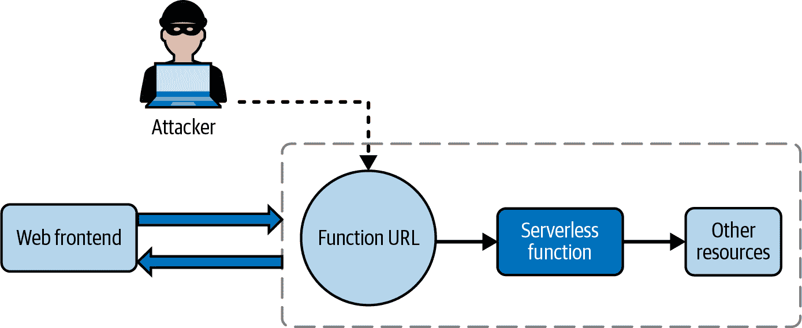

#### Note

如果您对接下来可能发生的事情没有头绪，请稍等，因为我们将在 “注入攻击” 中深入探讨这个主题。

在通过各种枚举技术获得函数 URL 访问权限后，攻击者可以直接向无服务器函数发送恶意请求，而无需通过前端界面。这可能导致一系列操作，最终导致整个系统被入侵。

这些端点可能以其他方式暴露。例如，开发人员可能会直接与外部合作伙伴共享它们，用于测试或协作，而没有适当的访问限制。在其他情况下，端点可能是配置错误的暂存环境的一部分，这些环境本不打算公开访问。更常见的是，这些非生产环境缺乏生产环境中的安全机制。在极少数情况下，配置错误的暂存资源可能会指向生产资源，无意中绕过生产级安全控制。

即使无服务器函数不再处于活跃使用中，也可能公开可访问。开发人员可能会忘记不再使用的生产 API 端点或其他无服务器资源，使其继续运行并暴露。这些孤立资源如果未正确停用或防止未经授权的访问，仍可能被攻击者利用。一旦被发现，这些资源可以为攻击者提供访问未针对直接访问进行加固的底层应用逻辑的途径。一次暴露的端点很快就可能成为攻击者可能利用的入口点。

### 配置错误的云存储资源

在使用无服务器架构中的云存储服务时，开发人员可能会无意中错误配置访问控制，并使包含敏感数据的<|message|> 公开可访问或暴露给未经授权的用户。虽然你可能会认为这种情况不太可能，但配置错误的云存储资源是全球数据泄露的主要原因之一。

在 Chapter 2 中，你了解到无服务器 Web 应用和 API 通常使用云存储资源和数据库来存储数据。特别是云存储服务，可能用于存储各种可能包含敏感数据的档案（Figure 3-2）。

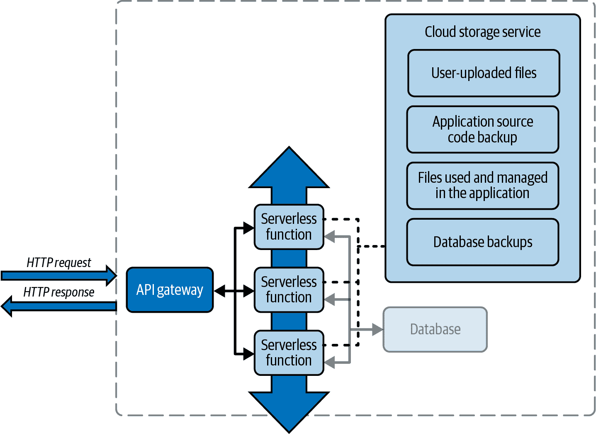

如果您好奇由于配置不当的云存储资源而可能暴露的敏感数据是什么，Table 3-1 提供了通常存储在云存储服务中的档案和可能暴露的敏感数据的非详尽列表。

Table 3-1. 配置错误的云存储资源可能存在哪些风险

| 存储的档案和数据 || 可能暴露的敏感数据 |
| --- | --- |
| 用户上传的档案 || 可能包含客户个人信息和其他敏感数据的图像、视频和文档 |
| --- | --- |
| 客户支持聊天或电子邮件消息 || 对话、个人数据或机密业务信息 |
| 用于分析的数据湖中的数据 || 用户行为数据、交易日志或敏感分析数据 |
| 数据库的备份副本 || PII、财务数据或专有业务数据 |


| 应用程序源代码的备份副本 | 配置文件、凭证和 API 密钥，可能被用于未经授权访问其他账户、系统或服务 |
| 归档的应用程序日志 | 身份验证详情、错误消息或调试信息，可能暴露应用程序漏洞 |
| 临时文件 | 中间处理数据、用户输入或缓存信息，可能无意中存储敏感信息 |
| ML 模型和训练数据 | 商业机密和敏感客户详情，包括购买历史、人口统计数据或财务信息 |
| RAG 驱动系统中使用文档 | 专有数据、敏感公司信息和商业机密 |

通过配置错误的云存储桶泄露敏感数据可能导致严重后果——从监管罚款到声誉受损不等。一个显著的例子发生在 2016 年至 2019 年间，一家医疗公司因配置错误的云存储桶而无意中泄露了敏感记录，其中包含超过 2,000 名客户的健康数据和个人信息。此次配置错误使任何人都可以直接从可公开读取的云存储桶中访问并下载文件。因此，公司因未能妥善保护敏感个人数据而被罚款。虽然该公司不一定使用了无服务器架构，但它依赖于核心构建块和服务——例如云存储服务——这些在无服务器架构中被广泛使用。

在利用事件驱动文件处理的无服务器架构中（参见 “Event-Driven File Processing”），无服务器函数和资源可以响应云存储桶中的文件上传或更改而自动调用。虽然开发人员可能将其用于自动化数据处理工作流，但攻击者可以利用使用事件驱动文件处理的系统，并将恶意文件上传到配置错误的云存储资源（Figure 3-3）。这将自动触发无服务器函数，进而可能导致攻击者准备的恶意代码被执行——使攻击者能够提升权限并获得对云账户中其他资源的未经授权访问。

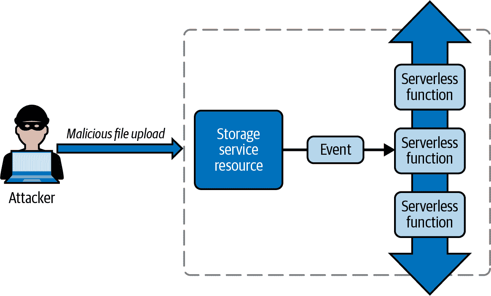

攻击者还可能通过上传大量文件来使系统过载，每个文件都会触发无服务器函数和其他资源作为对文件上传操作的自动响应。这可能会使系统因调用过多而不堪重负，导致性能下降和停机。同时，此次调用激增可能导致成本增加，因为处理恶意文件上传的无服务器函数和资源数量过多。

### Leaked Credentials

在 “Misconfigured Cloud Storage Resources” 中，你了解到公开可访问的存储桶会暴露各种文件，例如用户上传的文档、数据库备份、应用程序源代码和配置文件。如果攻击者访问到暴露存储桶中存储的应用程序配置文件，他们可能能够窃取第三方集成的密钥、云提供商访问密钥以及存储在这些文件中的其他敏感凭证。

除了配置错误的云存储桶外，泄露的凭证还可能源于在公共代码仓库中硬编码的凭证、前端应用程序代码中暴露的凭证和密钥、数据泄露和网络钓鱼攻击中窃取的凭证，以及数据库和 API 网关等其他云资源的配置错误。每一种都可能使攻击者获得凭证，从而导致更严重的入侵，包括未经授权访问数据库、应用程序、账户和其他资源。这正是攻击者利用一种通常用于扇出模式的云服务时发生的情况（参见 “Fan-Out Pattern”），以发送包含网络钓鱼链接的欺诈性短信。无服务器资源通常不会像传统服务器那样暴露开放端口，因为它们是通过需要身份验证凭证的 API 访问的。然而，如果攻击者使用泄露的凭证访问并对这些资源执行未经授权的操作，这些资源仍会面临风险。

#### Note
2022 年，一家公司无意中在其网站的前端代码中暴露了云提供商的长期访问密钥。任何拥有网络浏览器的用户都可以轻松检查网页源代码以提取这些密钥。这些密钥使得未经授权访问存储在云账户中其他资源内的文件成为可能——包括护照、合同和其他包含个人信息的文档。虽然将云提供商访问密钥暴露在前端应用程序代码中似乎像是新手错误，但今天的开发人员过度依赖 AI 驱动工具，可能会犯类似错误并忽视可能导致严重入侵的安全最佳实践。

如果具有管理员权限的长期访问密钥被泄露，攻击者可以创建持久后门，使用基于身份和访问管理 (`IAM`) 的持久化技术，而不是在无服务器环境中效果较差的传统方法。^1 例如，攻击者可能会创建新的 IAM 用户或为已存在的账户创建额外的访问密钥，以维持对受损云账户的长期访问。

### Insecure Storage of Credentials and Secret Keys

在无服务器函数和其他计算资源中存储和管理凭证和密钥有多种选择。忽视最佳实践的开发人员可能会将其直接硬编码到无服务器函数代码中或存储在环境变量中。通过各种手段获得这些凭证的攻击者可能会找到提升权限、访问敏感数据或破坏环境中其他资源的方法。

#### Note
攻击者获取这些凭证的一种方式是通过注入攻击。我们将在 “Injection Attacks” 中更详细地讨论这个问题。

离职员工可能在离职后很长时间仍保留代码库的副本，其中包括硬编码在应用程序代码中的凭证或存储在环境配置文件中的凭证。如果这些凭证未被撤销或妥善管理，前员工可能会滥用它们以获得对敏感系统或数据的未经授权访问。

开发人员还可能将凭证和密钥以未加密的形式存储在存储服务、数据库和备份中。建议改用密钥管理服务以降低与不安全凭证存储相关的风险。这些服务通常具有以下内置功能：

* 静态和传输中加密
* 审计日志和监控
* 与 IAM 服务集成
* 细粒度权限
* 密钥自动轮换
* 密钥版本控制

使用密钥管理服务并不能保证完全免受安全风险。无服务器应用程序的其他组件可能存在漏洞，攻击者可利用这些漏洞获得对密钥的未经授权访问。同时，向无服务器函数授予过于宽泛的权限可能会允许攻击者在入侵函数后访问本不应访问的密钥。虽然密钥管理服务可能无法解决与凭证存储相关的所有安全挑战，但与将凭证存储在通用存储解决方案中相比，它们提供了更安全的方案。

### Injection Attacks


在无服务器应用中最相关的攻击之一是 `injection attack`，即攻击者将恶意负载作为事件的一部分插入，从而触发无服务器系统中的资源或组件（Figure 3-4）。由于事件可以在无服务器架构中源自多个来源，攻击者可能会尝试在各种事件源中注入恶意负载，从而可能导致在被调用的无服务器资源内执行未经授权的代码。

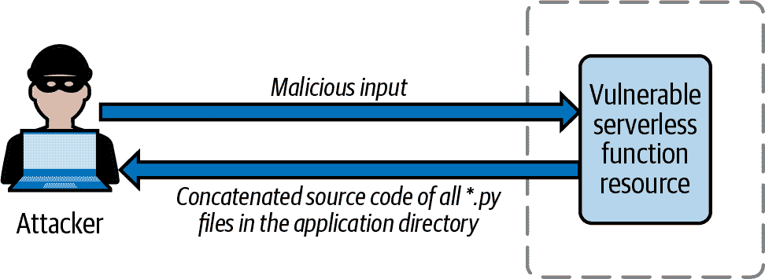

假设你在 Figure 3-4 中的无服务器函数使用 Python 的 `eval()` 函数来动态评估表达式。为了窃取你在无服务器函数内部运行的自定义源代码，攻击者可以向发送到无服务器函数的输入负载注入以下恶意代码，或类似的负载：

```
__import__('subprocess').check_output('cat *.py', shell=True)
```

此恶意代码随后将被 `eval()` 函数评估，进而执行系统命令以读取并返回无服务器函数环境中存在的所有 Python 源文件的内容。如果硬编码的凭据或密钥在这些文件中，攻击者就可以使用它们来获得对其他系统的未经授权访问，或在云环境中提升权限。

现在，让我们仔细看看以下包含服务器端模板注入（SSTI）漏洞的示例易受攻击的 AWS Lambda 函数实现，该漏洞可能导致远程代码执行：

```
from jinja2 import Template
import json, base64

def lambda_handler(event, context):
    body = event.get("body") or ""
    if event.get("isBase64Encoded"):
        try:
            body = base64.b64decode(body).decode("utf-8")
        except Exception:
            return {"statusCode": 400, "body": "Invalid base64 body"}

    try:
        data = json.loads(body) if body else {}
    except json.JSONDecodeError:
        data = {}
        body = body or ""


    template_str = data.get("template", body or "No template provided")
    template = Template(template_str)
    render_ctx = data.get("params", {"a": "1", "b": "2"})
    rendered = template.render(**render_ctx)

    return {
        "statusCode": 200,
        "headers": {"Content-Type": "text/html; charset=utf-8"},
        "body": rendered
    }
```

该函数充当动态模板渲染器，将请求数据转换为渲染后的模板输出，这对于生成电子邮件模板和自动报告很有用。它解码 Base64 输入（如果需要），将 body 解析为 JSON，并使用指定的模板字符串以及用户提供的参数值来生成输出字符串，该字符串作为 HTTP 响应体返回。

按预期使用时，Lambda 函数处理如下格式的输入事件：

```
{
  ...
  "body": "{
    \"template\":\"
    <html>
      <head></head>
      <body>
        <div>Hello {{ name }}!</div>
      </body>
    </html>\",
    \"params\":{\"name\":\"ARVS\"}}"
}
```

Lambda 函数随后将渲染后的模板作为 HTTP 响应体返回：

```
{
  "statusCode": 200,
  "headers": {
    "Content-Type": "text/html; charset=utf-8"
  },
  "body": "<html><head></head><body><div>Hello ARVS!</div></body></html>"
}
```

虽然该函数旨在通过使用用户提供的输入值来安全地渲染模板，但攻击者可以滥用此功能通过 SSTI 执行任意系统命令来提取环境变量，类似于以下示例：

```
{
  ...
  "body": "{
    \"template\":\"
    <html>
      <head></head>
      <body>
        <div>Hello {{ name }}!</div>
        <div>{{
          self.__init__.__globals__.__builtins__.__import__('subprocess')
              .check_output('env', shell=True) }}
        </div>
      </body>
    </html>\",
    \"params\":{\"name\":\"ARVS\"}}"
}
```

渲染时，注入的代码会执行 `subprocess.check_output('env')` 并在 HTTP 响应中返回 Lambda 执行环境中的环境变量。正如你在这个示例中看到的，除了窃取你的无服务器函数的自定义源代码外，攻击者还可以窃取存储在环境变量中的凭据。

#### Caution

这些凭据随后可被攻击者用于在云账户中提升权限，尤其是当它们与配置不当且权限过高的主体或角色相关联时。

代码注入也可以以其他方式发生在你的无服务器函数中。以下是你也应密切关注的几个场景：

* 在配置加载期间不安全的 YAML 反序列化导致任意代码执行。当攻击者上传恶意 YAML 配置文件时就会发生这种情况，该文件旨在一旦使用易受攻击的 `yaml.load()` 函数加载就执行任意 Python 代码。
* 通过 `pickle` 的不安全反序列化使攻击者能够运行任意代码。
* 对外部负载/ Webhook 的不安全处理，其中看似可信的外部数据包含可执行文件或指令，函数以导致代码执行的方式处理它们。
* 对传入 Webhook 负载的不安全处理，其中函数输入被假定为安全，但实际上包含恶意负载。
* 用户输入被插值到由 `os.system()` 或 `subprocess.run()` 调用的 shell 命令中，攻击者可能滥用这些命令来执行命令注入攻击。

请记住，即使这些示例假设无服务器函数是用 Python 编写的，其他运行时如 Node.js、Java、Go 和 .NET 同样容易受到类似的注入漏洞。

对于与数据库交互的无服务器应用程序，攻击者可以利用 SQL 注入漏洞，通过构建能够修改或删除查询数据库资源中存储的记录的恶意负载（Figure 3-5）。

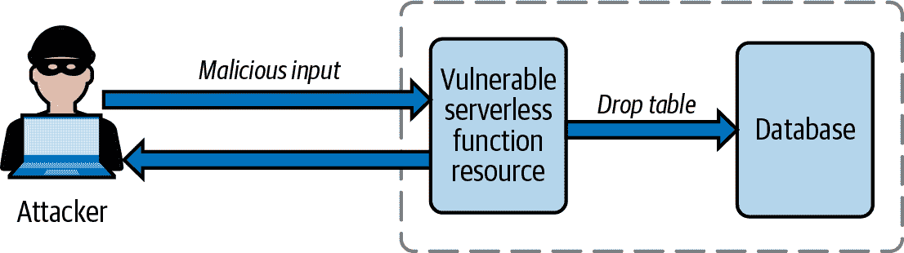

你可能不会期望 SQL 注入在无服务器应用程序中仍然有效。如果你的无服务器代码没有正确清理和验证用户输入，攻击者就可以注入恶意查询以获得未经授权的访问或修改数据库中的敏感数据。

#### Note

任何刚接触无服务器应用程序开发的新手都可能错误地认为输入验证是由云平台自动处理的，并简单地将用户输入直接传递给数据库，而不进行适当的清理和验证。

一个利用文本到 SQL 的由生成式 AI 驱动的无服务器应用程序，该应用程序将自然语言查询转换为 SQL 查询，如果用户输入在处理前未得到适当清理和验证，则可能特别容易受到注入攻击。

Figure 3-6 显示了一个示例应用程序，该应用程序使用 LLM 将用户提示转换为 SQL 语句，然后数据库对其进行处理。虽然示例无服务器应用程序期望像 `Give me the total number of users who ordered Product A` 这样安全的输入，但攻击者可以构建恶意提示，LLM 会将其转换为会删除数据库表的 SQL 语句。如果没有适当的安全控制，此有害的 SQL 语句可能会导致数据库表被未经授权删除。

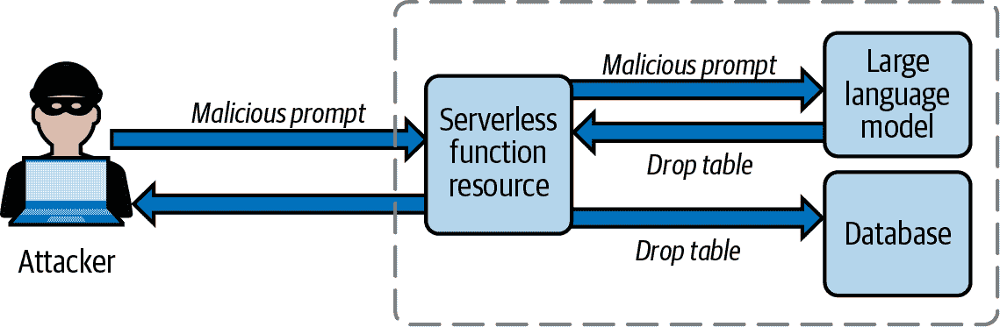


虽然迄今为止分享的示例涉及 Web 应用程序和 API，但注入攻击也可能源自非 API 事件源。例如，攻击者可能在云存储桶中上传一个文件名中嵌入恶意负载的文件。当文件上传操作触发事件时，该恶意负载将被触发，进而触发无服务器资源执行。*可怕吧？* 这意味着你需要对自定义应用程序代码进行保护，以防止来自所有事件源的不受信任输入。这涉及在使用输入于应用程序逻辑之前对其进行验证和清理。

### 过度授权的权限和角色

在构建无服务器应用程序时，开发人员可能会出于便利或加快开发速度的原因，为资源和用户授予过于宽泛的权限。在这种情况下，诸如无服务器函数和其他事件驱动组件等资源会被无意中配置为拥有超出其预期任务所需权限的访问权限。虽然这可能会简化开发和测试，但也给了攻击者通过配置错误的角色或策略获得对其他资源的未经授权访问并提升权限的机会（图 3-7）。

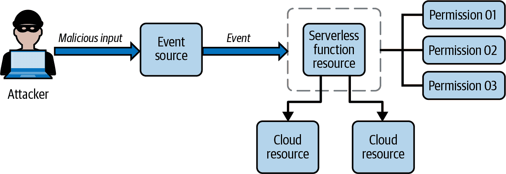

假设你有一个无服务器函数被配置为具有完全的管理运行时权限，只为处理存储在云存储服务中的图像文件。如果攻击者成功对该函数实施注入攻击，他们可能能够从函数环境中窃取凭据。这些凭据随后会被发送到攻击者控制的端点，使攻击者能够访问、创建和修改云账户中的其他云资源（图 3-8）。

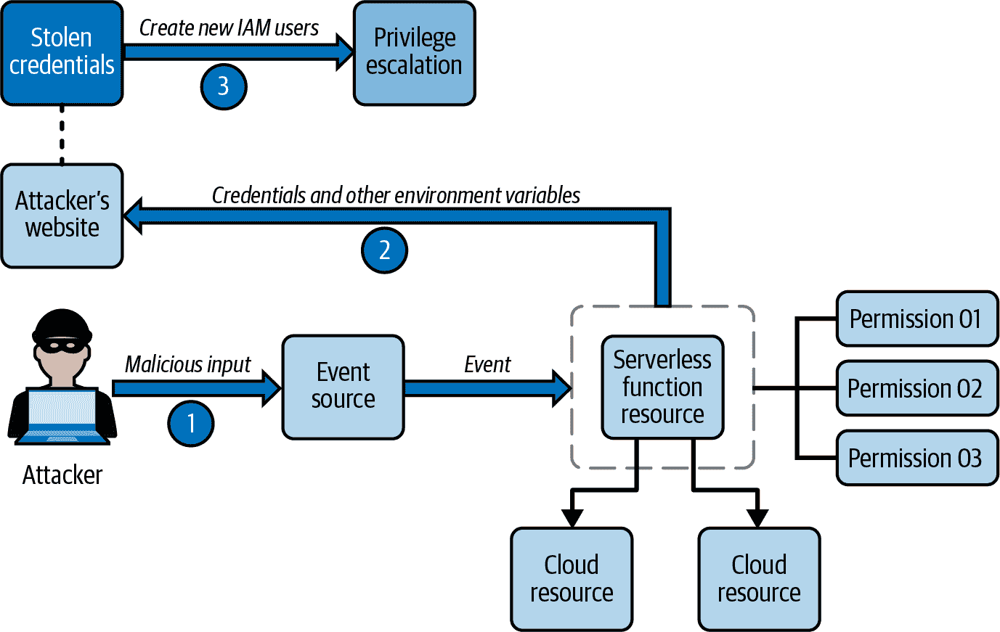

使用这些凭据，攻击者可以创建一个具有管理权限的新 IAM 用户。从那里，他们可以完全控制云账户，只是因为一个无服务器函数被授予了超出其实际需要的权限。

这只是攻击者可以串联利用漏洞以完全控制云账户的众多方式之一。即使无服务器函数未被配置为具有完全的管理运行时权限，配置错误的策略仍可能允许攻击者在云环境中提升权限。

### 业务逻辑漏洞

攻击者还可能寻找特定于无服务器应用程序实现方式的*业务逻辑漏洞*。这些漏洞通常是由于开发人员假设用户始终会遵循预期的工作流程，而没有考虑边缘情况、误用或蓄意滥用所致。如果没有必要的检查和保护措施，攻击者可以绕过预期逻辑并利用这些漏洞。

假设你有一个无服务器票务平台，用户可以在该平台上购买活动门票。在到达结账页面时，用户可以输入促销代码以对其门票购买应用折扣。虽然促销代码预计只能使用一次，但攻击者可能找到业务逻辑漏洞并多次使用相同的促销代码。如果有适当的防护措施来跟踪并限制每个用户的促销代码使用情况，则可以防止这种情况发生。

我们经常假设用户缺乏绕过标准工作流程的技术能力或动机。然而事实并非如此，因为有动机的攻击者即使不使用高级黑客工具也能识别并利用业务逻辑漏洞。^(2)

### 不安全的网络配置

虽然你可能认为在无服务器架构中不再需要设置和配置虚拟网络，但无服务器应用程序中使用的许多云资源都可以部署并在私有网络的私有子网中得到保护，例如虚拟私有云（VPC）和虚拟网络（VNet）。无服务器函数可以通过正确的网络配置连接到这些资源，具体配置因资源部署的平台而异。表 3-2 显示了如何在 AWS、Azure 和 Google Cloud 上实现这一点。

表 3-2. 无服务器函数如何在 AWS、Azure 和 Google Cloud 上访问部署在私有子网中的资源

| 云平台 || 描述 |
| --- | --- |
| AWS || 无服务器函数可以附加并关联到 VPC 以访问部署在 VPC 私有子网中的资源，例如数据库。可以配置额外的网络资源，例如 VPC 端点或网络地址转换（NAT）网关，以便函数不会失去连接外部资源的能力。 |
| --- | --- |
| Azure || 无服务器函数可以与 VNet 集成以访问托管在 VNet 内部的资源。可以使用私有端点或服务端点允许函数安全地访问私有子网内的资源。 |
| Google Cloud || 无服务器函数可以通过 Serverless VPC Access 连接器连接到部署在私有子网中的资源。 |

由于私有网络配置增加了复杂性并可能导致更高的成本，无服务器函数通常更倾向于在 VPC 或 VNet “外部”运行。然而，这可能会阻止这些函数访问部署在私有网络内部的某些资源。为了解决这个问题，工程师可能会将部署在私有子网中的资源转移到公共子网——如果没有适当的安全控制，这可能会将敏感资源暴露给互联网。

你应该熟悉无服务器架构的网络最佳实践，因为它们与非无服务器应用程序中使用的传统网络配置不同。

### 跟踪、日志记录、监控和警报不足

你在 “集中式日志和监控” 中了解到，拥有全面的日志记录和监控机制非常重要。设置无服务器应用程序中使用的组件和资源的警报和跟踪有助于更有效地管理威胁和问题。如果在攻击期间未正确设置这些，你将很难追踪攻击来源并弄清泄露的范围。这会延迟你快速响应并在攻击者在更多资源上获得控制权之前减轻攻击的能力。

以下是一些可以帮助你识别和缓解潜在威胁的问题：

* 谁访问了存储资源中存储的文件？
* 使用 IAM 凭据执行了哪些操作？
* 谁尝试登录？
* 对权限做了哪些更改？
* 观察到哪些流量模式？
* 哪些资源被配置或修改？
* 日志中出现了哪些错误或失败？
* 管理员和其他用户执行了哪些操作？

假设你有一个无服务器函数，它接受包含用户敏感信息的输入。攻击者可以利用你无服务器应用程序中的漏洞，提升权限并替换函数的代码。这将允许攻击者在你的云账户中静默运行，即使其原始访问凭据已被撤销。如果没有适当的监控和审计机制，你甚至都不会意识到部署的函数已经被攻击者替换了！


你应该知道，攻击者可能会尝试禁用日志机制以隐藏其活动并避免被检测。他们还可能使用密钥加密这些日志，然后安排密钥立即删除，从而使日志永久无法访问——删除未经授权活动的证据。然而，在正确的控制措施到位的情况下，这些日志无法被未经授权的用户篡改或删除。

### Serverless 安全机制的局限性

当云平台发布新的 serverless 服务时，一些安全功能和配置选项可能需要几个月才能完全支持。在此期间，早期采用者通常必须实施自定义安全控制，以在使用新服务时减轻潜在风险。随着服务的采用率增加，云平台可能会加快用户经常请求的安全功能开发。

在某些情况下，云平台可能需要时间才能发布缺失的安全功能，因为它优先考虑其他功能。因此，在为下一个 serverless 应用程序选择使用哪些服务时，在将它们用于生产系统之前，评估它们当前的功能集和即将推出的功能至关重要。云平台通常允许用户在功能完全发布前几个月以预览形式访问即将推出的功能。你应该意识到这些功能可能会发生变化或被弃用，这可能需要对你的应用程序进行调整。

### 受损的 CI/CD 管道

受损的持续集成和持续交付（或持续集成和持续部署，CI/CD）管道对使用这些管道构建、测试和部署 serverless 应用程序的团队构成了重大的安全风险。虽然这些管道并非利用 serverless 服务和架构的项目所独有，但某些 serverless 实现，尤其是那些涉及自定义容器镜像和非标准应用程序依赖项和运行时的实现，需要多阶段管道，这可能会引入比所构建的 serverless 应用程序更大的安全风险。

在 “事件驱动的 Serverless 容器” 中，你了解到开发团队可能会设置管道以自动构建自定义容器镜像。这些容器镜像随后将作为 serverless 容器资源的自定义运行时环境。除构建自定义容器镜像外，管道还可能执行以下一项或多项操作：

* 将容器镜像推送到容器注册表
* 将容器镜像部署到 serverless 计算资源
* 触发容器漏洞扫描
* 运行自动化测试
* 访问密钥或环境变量
* 创建、修改或删除云资源
* 向开发者发送警报或通知
* 在服务之间触发额外的自动化工作流
* 将应用程序部署到生产环境

为了帮助你了解管道如何用于自动化 serverless 部署，让我们逐步介绍一个示例管道工作流。

Figure 3-9 显示了一个使用 `Dockerfile` 构建自定义容器镜像的管道——该配置文件包含容器镜像所需的构建指令。一旦容器镜像构建完成，它会自动推送到容器注册表，然后存储以供以后使用。这些容器镜像随后将用于为开发者提供更大的灵活性和控制权，以便在 serverless 计算资源中使用自定义容器镜像运行应用程序代码的依赖项。

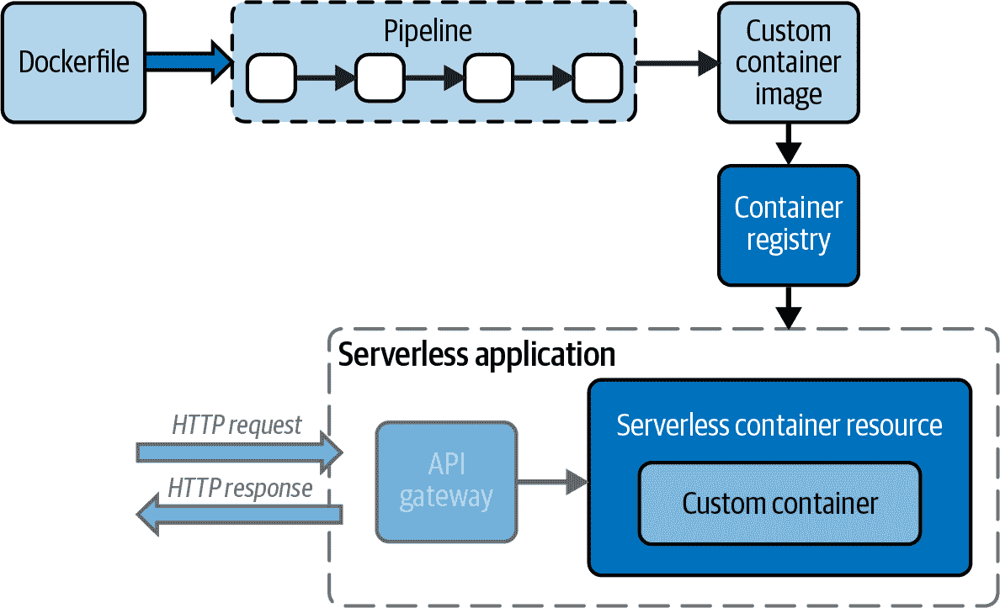

这些管道也可能完全不涉及容器或容器注册表。一些 CI/CD 管道仅专注于测试、打包和部署应用程序代码以及任何相关依赖项到 serverless 函数（Figure 3-10）。你可以配置这些管道，以便在代码更改推送到存储库时自动运行。

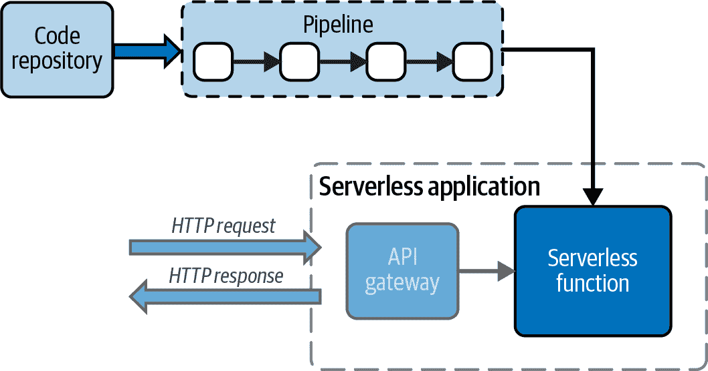

团队可能会配置管道以直接将更改部署到生产环境，而无需人工批准。在这种设置下，管道的最后阶段会自动将经过测试的代码推送到生产环境。

为了实现构建和部署自动化，这些管道通常需要在多个服务之间拥有广泛的权限。在设置和配置期间，团队可能会优先考虑便利性而非安全性，并向与构建管道关联的所有云资源授予完全的管理员访问权限。

#### Note

用于 serverless 应用程序的 CI/CD 管道不一定是 serverless。托管这些管道的服务器如果未打补丁、暴露且配置错误，可能容易受到各种攻击。虽然开发者可能认为攻击者无法直接与管道交互或利用管道，但暴露和配置错误的管道资源可能会给攻击者提供机会来破坏这些资源。

这些管道通常依赖于允许用户执行自定义命令的服务和组件——例如运行脚本、安装软件包、修改文件和配置环境变量。虽然这种灵活性对于构建容器镜像、运行测试和打包依赖项等任务至关重要，但攻击者可能会利用这些管道注入恶意代码并将后门部署到 serverless 应用程序资源中、访问存储在云数据库中的敏感数据、创建用于持久化的 rogue 计算资源、修改 IAM 策略以提升权限，或禁用监控和日志记录以逃避检测。单个受损的管道可能导致托管它的云账户发生全面泄露。

### 破损的身份验证

*破损的身份验证* 是 serverless 应用程序中最常见且最容易被忽视的威胁之一。仅仅拥有身份验证并不能保证应用程序是安全的。未能正确保护和配置身份验证机制，就像锁上每个窗户却把前门敞开一样。这些问题通常源于一系列小的配置错误，攻击者可以利用这些错误来破坏你的系统。

重要的是不要将身份验证与授权混淆。*身份验证* 是验证用户、服务或系统的身份的过程——通常使用密码、访问令牌或证书等凭据。*授权* 另一方面，决定经过身份验证的身份被允许执行的操作以及可以访问的资源。

#### Note

例如，在在线学习平台中，身份验证确保你就是你声称的人，而授权定义了你拥有的访问级别。

为了了解问题可能出现在哪里，以下是导致 serverless 应用程序中出现破损身份验证的一些常见问题：

特权用户未强制执行多因素身份验证（MFA）

MFA 为管理员或高权限账户增加了额外的安全层。如果没有它，通过网络钓鱼或凭证填充获得密码的攻击者可以完全访问可能具有访问敏感数据权限的账户。

令牌生命周期过长

过期时间长的令牌显著延长了攻击者利用被盗或被拦截令牌的机会窗口。

硬编码凭据

应用程序代码中的硬编码凭据可能会允许攻击者通过各种方式绕过身份验证机制。如果凭据无意中暴露在应用程序的前端代码中，任何拥有网络浏览器的人都可以访问它们，这最终可能导致安全漏洞。

不当的令牌验证

对令牌的验证不足或验证不当可能导致对敏感资源的未经授权访问。

缺乏速率限制


没有速率限制，身份验证端点容易受到暴力破解和凭证填充攻击。

#### 会话管理不当

对会话令牌处理不当，例如在注销或轮换后未能撤销令牌，可能会允许攻击者重用已过期或已失效的令牌以维持未经授权的访问。

#### 不安全的密码重置流程

设计不良的密码重置机制，例如可预测的重置令牌、缺乏过期时间或身份验证不足，都可能被攻击者利用来入侵用户账户并获得未经授权的访问。

无服务器应用程序中的身份验证损坏并不总是由开发人员的自定义代码引起。它也可能源于云资源配置错误、过于宽松的策略以及缺少安全控制。即使使用允许您利用联合身份模式的服务（参见 “联合身份模式”），配置错误也可能允许攻击者绕过身份验证、提升权限或获得对无服务器资源的未经授权访问。

攻击者既以系统化方式又以机会主义方式运作。他们枚举目标环境并记录他们可以访问的标识符、凭证、权限和资源。从那里，他们探测诸如配置错误或过于宽松的策略等弱点以提升权限。如果初始尝试失败，他们会迅速调整并尝试替代方法，直到实现其预期目标。如果攻击者寻找的前提条件直接暴露在无服务器应用程序的前端代码中会怎样？在一些生产环境中配置错误的无服务器应用程序中，资源标识符被硬编码在 JavaScript 或捆绑的配置文件中，任何人只需通过浏览器开发者工具检查应用程序源代码即可查看。

为了帮助您了解这在实践中可能如何展开，假设您有一个使用 Amazon Cognito 管理用户身份验证和授权的无服务器应用程序。该应用程序包括用于处理登录和注册的用户池、用于管理身份验证流程的应用客户端，以及一个身份池，可将 Cognito 令牌交换为临时 AWS 凭证，用户随后可使用这些凭证安全地访问 AWS Secrets Manager 密钥。

让我们逐步检查此过程如何展开。如 图 3-11 所示，当用户使用用户名和密码登录时，(1) 应用客户端向用户池发送请求以对用户进行身份验证，(2) 用户池返回访问令牌。然后使用此访问令牌 (3) 向身份池发出请求，(4) 身份池颁发与映射的 IAM 角色绑定的临时 AWS 凭证。然后用户可以 (5) 使用这些临时 AWS 凭证安全地访问 Secrets Manager 密钥。

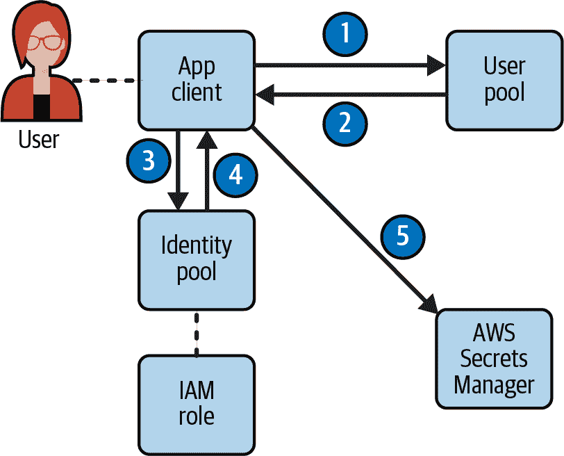

在此示例中，由于 Cognito 用户池已配置为启用自助注册，攻击者可以注册并确认新用户账户，并使用该账户继承经过身份验证的角色的权限并执行合法用户可以执行的操作。^3

#### Note

在撰写本文时，当您通过命令行界面 CLI 命令 `aws cognito-idp create-user-pool` 创建 Cognito 用户池时，`AllowAdminCreateUserOnly` 的默认配置为 `false`。该配置意味着启用了自助注册，允许用户在无需管理员干预的情况下自行注册。即使应用程序的用户界面没有注册页面，攻击者仍可以直接通过 Cognito API（例如使用 `aws cognito-idp sign-up` 或通过 SDK）针对用户池创建账户。

更具体地说，攻击者将首先从无服务器应用程序的前端代码中提取 Cognito 标识符，这些标识符通常硬编码或捆绑到客户端 JavaScript 代码中，类似于以下内容：

```
const COGNITO_USER_POOL_ID = '...'
const COGNITO_CLIENT_ID = '...';
const COGNITO_IDENTITY_POOL_ID = '...';
const AWS_REGION = '...';

...
```

然后，使用以下命令，攻击者可以使用提取的 Cognito 应用客户端 ID 注册新用户账户，使用攻击者提供的凭证（用户名、电子邮件地址和密码）：

```
aws cognito-idp sign-up \
    --client-id "CLIENT_ID" \
    --username "USERNAME" \
    --password "PASSWORD" \
    --user-attributes Name=email,Value="EMAIL" \
    --region "REGION"
```

从那里，攻击者将通过使用发送到电子邮件地址的确认码来确认新创建的用户来完成注册过程：

```
aws cognito-idp confirm-sign-up \
    --client-id "CLIENT_ID" \
    --username "USERNAME" \
    --confirmation-code CONFIRMATION_CODE \
    --region "REGION"
```

然后攻击者可以使用刚刚创建的用户账户的凭证登录，并捕获浏览器网络流量中返回的临时 AWS 凭证，如 图 3-12 所示。

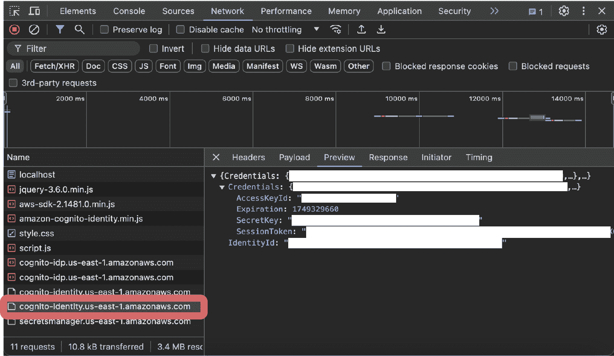

这些凭证随后将用于配置新的 AWS CLI 配置文件（例如在攻击者的机器或账户中）并访问受损云账户中的资源。如果与 Cognito 身份池关联的 IAM 角色具有过于宽松的权限，攻击者可能会提升权限并可能完全控制您的 AWS 账户。

#### Note

在 2023 年，攻击者利用了配置错误的 IdP 应用程序，其中涉及暴露的标识符，他们利用该标识符获取临时云平台凭证。这些凭证使他们能够进行未经授权的 API 调用并访问敏感资源。在某些情况下，他们能够提升权限，最终导致完全接管账户。

从防御安全角度来看，您应在使用 Cognito 时禁用自助注册，除非确实需要，对映射到身份池的任何 IAM 角色强制实施最小权限，并确保实施适当的日志记录和监控以检测和响应可疑的账户创建或凭证使用。同时，您应主动研究其他已知的 Cognito 配置错误，尤其是本书未涵盖的那些，以便更好地识别和修复潜在的安全风险，防止攻击者利用它们。

请注意，身份验证损坏不仅在 [Open Web Application Security Project (OWASP) Serverless Top 10](https://oreil.ly/vp4Ck) 中被强调，也在其他十大安全威胁和风险列表中被强调。这凸显了其作为现代应用程序安全中严重问题的意义。身份验证损坏仍然是最关键的安全问题之一，因为它允许攻击者冒充合法用户或未经授权访问敏感数据。在无服务器应用程序中，身份验证和身份管理通常与云服务紧密集成，配置错误或实施不当的控制可能产生严重后果。为解决身份验证损坏，您应考虑实施强密码策略、强制执行 MFA，并审查身份和访问配置以最大程度降低被入侵的风险。

### 存在漏洞的应用程序依赖项


开发人员在构建无服务器应用程序时使用各种库和包。如果你以前处理过依赖冲突，你可能不得不选择过时的库版本只是为了让应用程序继续运行。虽然仅为了修复依赖兼容性问题而使用较旧的库版本似乎无害，但它可能会使应用程序暴露于已知的安全漏洞，并增加攻击者利用这些漏洞的风险。随着时间的推移，也可能忘记更新库版本，导致应用程序在最初部署多年后仍继续使用过时且可能存在漏洞的依赖项。

想象一下，你有一个使用事件驱动文件处理的无服务器应用程序，用于从云存储桶中处理用户提供的配置文件，以动态设置无服务器 CI/CD 管道（图 3-13）。每当新的 YAML 配置文件上传到存储桶时，一个使用过时版本的 YAML 解析器库的无服务器函数会读取上传的文件并用它来设置和配置无服务器 CI/CD 管道。此 YAML 文件包含管道中各个步骤的配置，例如部署环境、构建命令、测试脚本和部署目标。

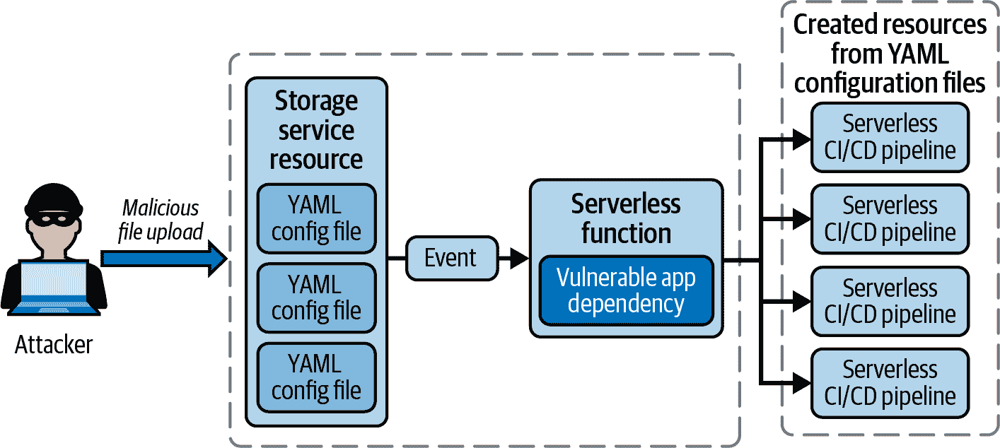

攻击者可以通过上传恶意的 YAML 文件来利用此旧版本库中的已知漏洞——当无服务器函数处理它时触发代码执行。这可能允许攻击者窃取存储在函数环境中的凭据，未经授权访问其他资源，并可能在云账户中提升权限。

#### Note

这是一个经典的 *不安全反序列化* 示例，攻击者利用反序列化过程——例如解析 YAML 文件——来执行任意代码，这是由于缺乏对用户提供输入的适当验证或清理。

虽然定期审计和更新应用程序依赖项是一项重要的安全最佳实践，但说起来容易做起来难。在快节奏的开发环境和激进的时间表下，团队通常优先考虑功能交付而非维护任务。如果没有自动化工具，过时且存在漏洞的库和包可能会悄悄积累——使得在最终发现漏洞和问题时更难修复。

### Denial of Service and Denial of Wallet

你现在可能已经知道，尽管无服务器架构能够自动扩展并处理可变工作负载，但它们并不会随着需求 *无限* 扩展。虽然诸如基于队列的负载均衡、扇出和代客钥匙（均在 第 2 章 中讨论）等模式对于管理流量峰值、并行化任务执行以及减轻后端资源的扩展需求是有效的，但它们无法完全消除在 DoS 攻击期间达到硬服务和并发限制的风险。这些模式也不能完全保护无服务器应用程序免受 DoW 攻击——资源使用量的激增可能会迅速导致成本失控。

我团队多年前开发和部署的一个无服务器应用程序曾遭遇分布式拒绝服务（DDoS）攻击。虽然该应用程序在请求洪流下保持稳定，从未出现停机，但现有的机制无法阻止总体成本飙升。我们考虑利用各种提供增强攻击防护的云服务，以防攻击加剧或没有停止迹象。

虽然你可能认为 DoS 和 DoW 攻击很少见，但它们正变得越来越常见，因为攻击者经常利用它们来分散团队对另一项攻击的注意力。这些攻击产生的流量洪流使得安全团队难以检测或响应同时发生的更隐蔽的攻击。云服务和解决方案可以帮助减轻这些攻击，但它们通常需要高昂的成本，这对于预算紧张的组织来说可能不可行。

### Cross-Site Scripting

在为无服务器应用程序开发交互式 Web 界面时，开发人员通常优先考虑开发速度和用户体验——有时以牺牲安全的输入处理为代价。在此过程中，他们可能会忽视正确清理或验证用户生成输入的必要性。这种疏忽会使应用程序容易受到 *跨站脚本*（XSS）攻击，允许攻击者注入在不知情用户浏览器中执行的恶意脚本。

想象一下，你有一个无服务器电子商务应用程序，具有两个不同且独立的前端——面向客户的站点和面向管理员的站点。这些前端连接着同一组管理客户订单、产品列表、用户账户和产品评论的后端资源。

攻击者可以利用面向客户站点产品评论部分中的 XSS 漏洞，将恶意脚本注入评论输入字段（图 3-14）。当管理员用户打开相应的产品页面并在面向管理员的站点上加载包含注入恶意脚本的提交的产品评论时，该脚本就会执行。这可能允许攻击者窃取敏感信息并未经授权访问管理界面。

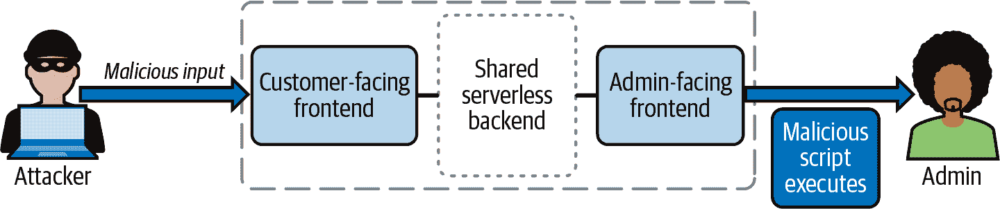

只要用户输入或存储的数据在浏览器中呈现之前未得到正确验证或转义，XSS 漏洞就会悄悄潜入无服务器应用程序。即使在没有无服务器函数和数据库的无服务器应用程序中，攻击者也可能操纵存储在云服务中的值——例如密钥管理器服务——以便恶意负载被渲染到页面的文档对象模型（DOM）中并在受害者浏览器中执行。^(4)

假设你有一个应用程序，它将直接从密钥管理器服务渲染的密钥值直接渲染到管理页面，而不验证或转义特殊 HTML 字符。如 图 3-15 所示，攻击者可以在密钥管理器服务中注入存储的 XSS 负载，然后等待管理员登录并访问加载恶意密钥负载的易受攻击页面。如果负载成功执行，它可以使攻击者窃取凭据、劫持用户会话，或根据负载的设计执行其他未经授权的操作。

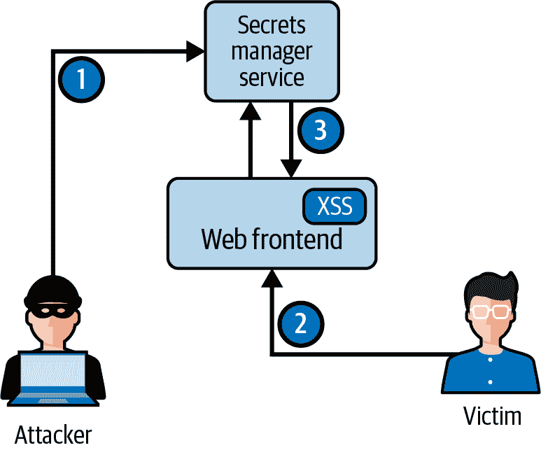

在无服务器应用程序中，XSS 攻击可能源自各种来源，甚至来自文件上传和未能验证和清理外部输入的 Webhook。你应始终在所有来源上实施严格的输入验证和清理实践，包括文件和外部服务，以防止恶意脚本运行。从防御安全角度来看，在浏览器或任何客户端上下文中呈现之前，验证并正确转义所有用户输入和存储数据至关重要。你应学习攻击者可能注入 XSS 负载的各种方式，以帮助你在代码进入生产环境之前找到并修复易受攻击的代码。此外，你应考虑使用 CI/CD 管道自动化代码扫描和其他安全检查，以在代码部署到生产环境之前检测漏洞。

### API Gateway Security Misconfigurations


API 网关在无服务器应用中充当关键组件，处理来自外部源的请求并将其路由到内部服务。云服务提供商提供完全托管的 API 网关服务，使设置、配置和管理这些资源用于无服务器 Web 应用和 API 变得简单。虽然你可能认为使用完全托管的 API 网关消除了所有安全风险，但如果未能正确配置和保护它，可能会使你的无服务器应用暴露于攻击之下。在为无服务器应用设置 API 网关时，开发人员有时会忘记强制执行严格的访问控制和权限。因此，他们可能会最终使 API 配置错误，并允许攻击者访问敏感数据或执行未经授权的操作。在某些情况下，他们可能会错误地认为默认配置已足够并保持不变。

假设你利用了 `functionless integration pattern`（参见 “Functionless Integration Pattern”）并配置了一个 API 网关资源，将传入的读取请求直接映射到数据库。假设 API 仅用于支持读取操作，攻击者可能能够利用配置错误来修改或删除数据库中的记录。你可能会错误地认为无法猜出你的 API 的端点 URL 以及 API 的子路径或路由。然而，攻击者通常使用各种工具和技术来发现、探索和攻击这些端点。

除了配置不当的访问控制之外，其他 API 网关安全配置错误也可能使你的无服务器应用面临风险。以下是需要了解的配置错误和问题的非详尽列表：

#### No authentication and authorization mechanisms

托管的 API 网关服务通常开箱即用地支持细粒度的访问控制以及与 IdP 的集成，但必须由设置云资源的工程师明确配置。如果 API 端点在没有身份验证和授权机制的情况下暴露，将允许任何人，尤其是攻击者，调用 API。

#### Exposed sensitive data in query parameters or headers

通过查询参数或 HTTP 头部传递敏感信息（如 API 密钥、访问令牌或个人用户数据）而未加密，可能会导致意外泄露，攻击者可能利用其获得未经授权的访问、冒充用户或在系统内提升权限。

#### Unrestricted CORS configuration

过于宽松的跨源资源共享（CORS）设置允许任何应用与你的 API 交互。例如，使用 `Access-Control-Allow-Origin: *` 可能会使恶意网站代表已认证用户发出未经授权的请求。

#### No logging or insufficient logging

在 API 网关级别请求和错误日志记录不足或配置错误，会限制你审计、调查或有效响应攻击的能力。

#### Lack of rate limiting and throttling

托管的 API 网关服务通常提供内置的速率限制和节流支持，以保护后端资源和管理成本。未配置速率限制和节流会使 API 端点暴露于暴力破解、DoS 和 DoW 攻击之下。

#### Exposed private APIs

网络设置的配置错误可能会使私有 API 网关资源意外暴露并可公开访问。

#### Publicly exposed debug information

在生产 API 中保留调试或详细错误消息可能会无意中泄露堆栈跟踪和实现细节，攻击者可利用这些信息来利用你的应用。托管的 API 网关资源通常允许工程师配置自定义错误响应，确保敏感的内部细节如堆栈跟踪和服务实现细节不会暴露给未经授权的用户。

#### Note

你可能还想查看 [OWASP Top 10 API Security Risks (2023)](https://oreil.ly/DHxIK) 以更深入地了解常见的 API 漏洞。虽然所讨论的安全风险和问题通常适用于各种类型的 API，但在构建和保护无服务器 API 时也应考虑它们。

配置不当的 API 网关资源可能会使无服务器应用暴露于各种安全风险之中。了解常见的配置错误是什么样的以及它们如何被利用，是防止未经授权访问和保护你的无服务器应用的关键。

### Supply Chain Attacks

开发人员通常依赖第三方库、SDK 和预构建的 IaC 模板来加速无服务器应用的开发。虽然这些有助于更快地构建和部署应用，但如果在使用它们时未检查篡改或恶意更新，可能会使你的应用暴露于供应链攻击之下。攻击者无需直接通过 API 网关攻击你的应用，而是可以发布恶意包或在现有包中注入恶意代码，而你的应用正在使用该包。虽然你可能认为使用知名或厂商管理的库会降低风险，但现实是，即使是广泛使用的包也可能通过各种手段被破坏。

在 2022 年，`ctx` Python 库被更新，加入了旨在窃取环境变量的恶意代码，这些环境变量可能包含凭据和其他敏感配置值。该库允许开发人员在使用字典时使用点表示法，被修改为将环境变量发送到攻击者控制的远程服务器（Figure 3-16）。

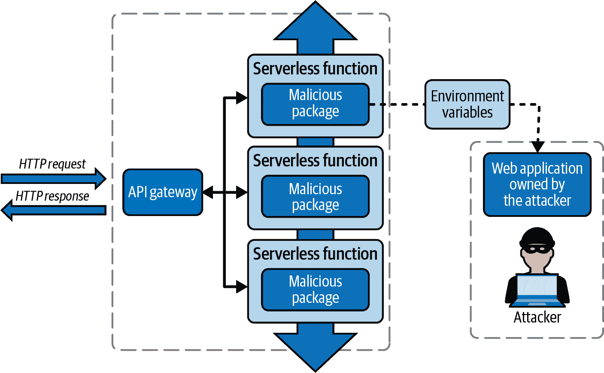

如果使用该库的应用部署在无服务器函数中，攻击者可以获得云平台凭据和其他存储在环境变量中的密钥。这些凭据随后将允许攻击者进行未经授权的 API 调用、提升权限并获得对其他服务或资源的未经授权访问。虽然所有恶意版本都已立即从 Python Package Index（PyPI）中删除，但从 2022 年 5 月 14 日至 2022 年 5 月 24 日期间安装、更新并使用该包的人被建议审核所有可能受影响的凭据并根据需要轮换。

#### Note

如果你想知道恶意版本的包是如何出现在 PyPI 上的，[域接管使攻击者能够破坏原始维护者的用户账户](https://oreil.ly/E9vlA)，随后用于发布恶意版本的 `ctx` 包。攻击者重新注册了与原始维护者电子邮件地址关联的过期域名，重新创建了在 PyPI 上使用的电子邮件账户，并发起密码重置以获得对原始维护者 PyPI 账户的访问权限。从那里，攻击者上传了恶意版本的 `ctx` 包，使用时将捕获的环境变量发送到攻击者控制的服务器。

在 2023 年，`bignum` Node Package Manager（NPM）包的先前版本被报告下载了一个恶意二进制文件，该文件窃取环境变量和凭据，并将其发送给攻击者。`bignum` 包使用 `node-pre-gyp` 在安装期间从硬编码的云存储桶下载二进制文件。当该云存储桶被删除时，攻击者创建了一个同名的新存储桶并上传了包下载的恶意版本的二进制文件。安装受影响的 `bignum` 包版本的用户下载了恶意二进制文件而不是合法的二进制文件（Figure 3-17）。

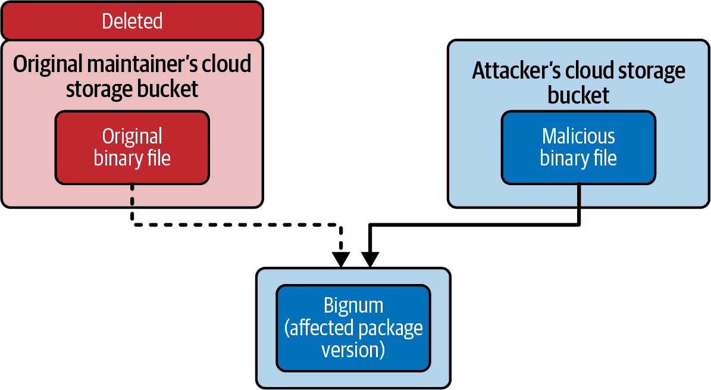


想象一下拥有一个无服务器的 CI/CD 管道，当新的提交推送到代码仓库时，它会自动安装依赖项、运行测试并部署你的应用程序。如果管道配置了过度的权限，并且被破坏的 `bignum` 包被包含在依赖项中，攻击者就可以从管道资源内部窃取敏感凭据、提升权限，并可能完全控制云账户。

#### Note
如 [GitHub Advisory Database](https://oreil.ly/UPZwk) 中所述，`bignum` NPM 包的新版本不再使用 `node-pre-gyp` 下载二进制文件，也不不再支持下载预编译的二进制文件，以避免下载恶意二进制文件的风险。

供应链攻击甚至可能让经验丰富的开发团队措手不及，因为恶意代码可能隐藏在开发者所依赖的依赖项中。如果团队没有保持高度警惕并且没有部署自动化的安全控制，这些攻击可能在很长时间内都未被发现。我们将在 Chapter 13 中更深入地探讨供应链攻击，并探索策略和防御措施，以帮助保护你的项目免受恶意依赖项的侵害。

## Summary
在本章中，我们探讨了各种无服务器安全风险和威胁，并讨论了这些风险如何导致泄露和事件。你了解了攻击者如何根据无服务器实现模式调整其技术，并利用无服务器架构中使用的构建块和服务的配置错误。你还探索了真实世界的示例，展示了这些问题如何导致数据泄露和其他安全事件。

在下一章中，你将研究攻击者如何利用无服务器应用程序中暴露的 IAM 凭据。你将深入了解客户端代码中的凭据如何被滥用以获得对 AWS 账户的完全管理访问权限，如何利用过于宽松的 IAM 策略来禁用 AWS CloudTrail 日志记录，以及如何仅用几条命令创建后门 IAM 用户。在本章的后半部分，你将学习如何审计 CloudTrail 事件数据和 Bedrock 模型调用日志以调查安全事件，并了解攻击如何在无服务器应用程序中展开。

^1 由于无服务器函数在设计上是短暂的，传统的持久化方法——例如将后门写入本地文件系统——效果较差，因为执行环境寿命短暂且在每次调用之间都会重置。

^2 当然，使用自动化工具可以帮助攻击者加快发现配置错误和被忽视的边缘情况的速度。

^3 自助注册是用户池中的一项功能，允许用户无需管理员干预即可注册账户。启用后可以简化入职流程，但在未正确限制的情况下可能会引入安全风险。

^4 DOM 代表浏览器中网页元素、属性和内容的结构化树。
