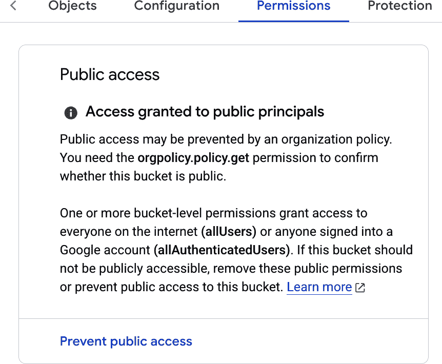
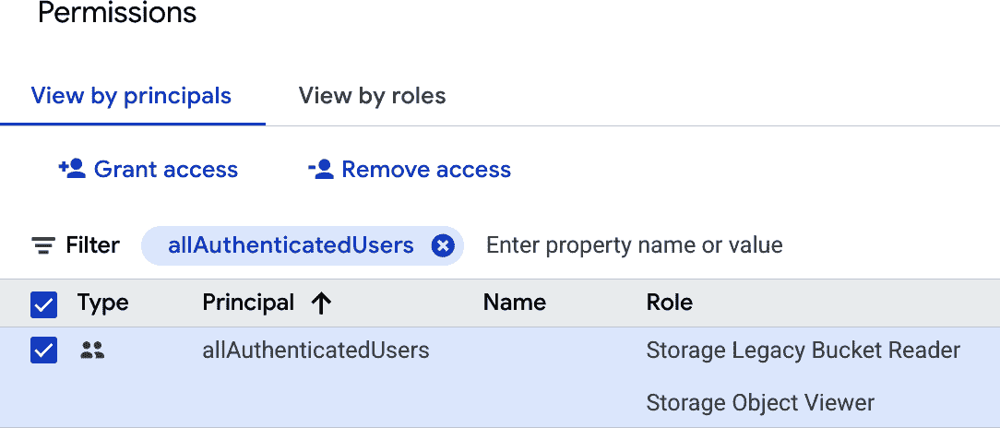
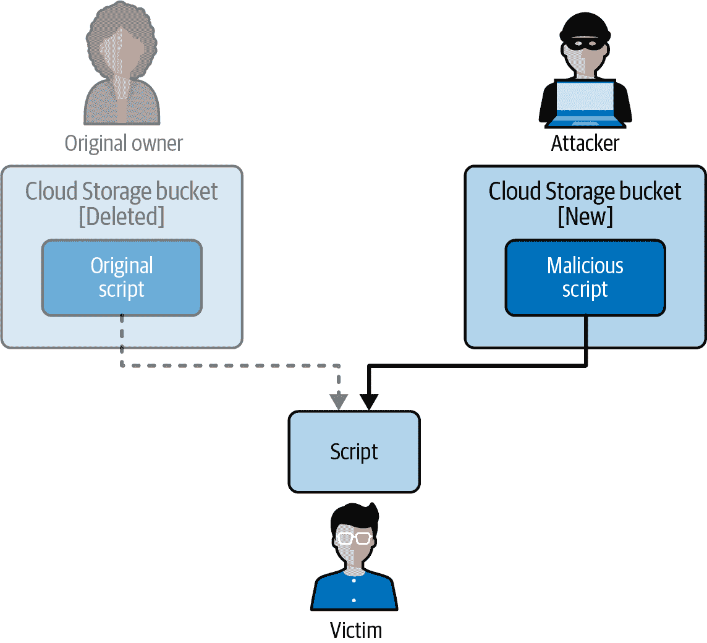
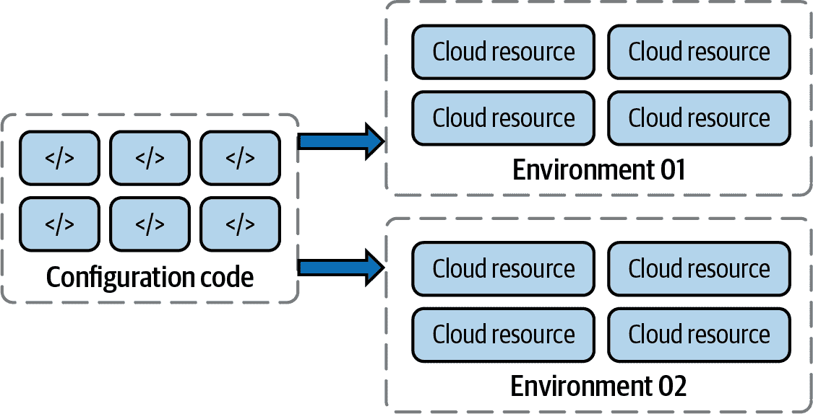

## Chapter 8. Hacking and Securing Google Cloud Storage Buckets

由于无服务器函数和支持无服务器计算模型的云资源本质上通常是短暂的，因此无服务器应用程序利用云存储和数据库服务来存储必须独立于短暂计算资源而持久存在的数据。例如，一个照片分享应用可能会将上传的照片、日志和静态资源存储在 Google Cloud Storage 存储桶中，而用户账户数据则单独存储在专用数据库中。同样，一个电子商务平台可能会在多个存储桶中存储用户文档、交易收据和订单发票。想象一下，你不小心将一个包含上传的护照扫描件的存储桶暴露给了公众！由于存储桶是公开可访问的，攻击者可以轻松下载这些文件，使你的应用程序用户面临身份盗用的风险。这种疏忽可能迅速升级为导致法律、财务和声誉后果的全面数据泄露。

云存储配置错误占云中数据泄露的相当大比例。在本章中，你将深入研究 Cloud Storage 存储桶安全配置错误，并了解攻击者如何利用它们来未经授权访问文件和信息。你将模拟一次悬空存储桶接管，并探索攻击者如何滥用对已删除存储桶的残留引用。最后，你将学习如何使用 IaC 强制执行安全的存储桶配置，以最大程度地降低代价高昂的配置错误风险。

本章将涵盖以下内容：

*   “Exploring Cloud Storage Bucket Security Misconfigurations”

*   “Simulating a Dangling Bucket Takeover”

*   “Enforcing Secure Bucket Configuration with Infrastructure as Code”


在本章结束时，你将了解如何识别和修复存储桶的错误配置，了解攻击者如何利用它们，并应用各种最佳实践和策略来保护你的无服务器应用程序。

### 审阅技术先决条件

要跟随本章，以及第 9 和 10 章的内容，你需要两个 Google Cloud 账号：一个用于设置和托管易受攻击的无服务器实验环境（Serverless Lab 账号），另一个用于运行模拟攻击（Attacker 账号）。强烈建议使用全新的账号，且没有任何预先存在的资源，以最大程度地减少安全相关的副作用，并确保实验环境按预期运行。如果你还没有这些账号，可以在 Google Cloud 的 [Free Tier page](https://oreil.ly/8jNjd) 上创建新账号。

确保两个账号都已准备就绪，并在单独的浏览器会话（或隐身/隐私窗口）中打开，以避免会话冲突。如果你尚未在 Google Cloud 账号中设置相应的计费账号，请在继续操作前确保配置好计费信息，以便实验环境按预期工作。

#### Note

为帮助你跟随操作并运行示例，本章使用的代码和命令的副本可在 [GitHub gist (see `ch08.md`)](https://oreil.ly/0mSPU) 中获取。

### 探索 Cloud Storage 存储桶安全错误配置

在 Chapter 3 中，你了解了错误配置的存储资源如何将敏感数据暴露给未经授权的用户。一个典型的例子是存储桶被意外配置为允许互联网上的任何人查看或下载其内容。在某些情况下，错误配置不仅允许查看或下载；攻击者甚至可能能够修改或删除存储桶内的文件。类似的失误导致了大规模的数据泄露，使得敏感的客户信息和数百万条记录可以被公众访问。

为了探索错误配置存储桶的风险并学习如何保护它们，你将通过以下部分进行操作：

*   “Setting Up a Vulnerable-by-Design Cloud Storage Bucket”
*   “Exploiting the Misconfigured Cloud Storage Bucket”
*   “Securing the Misconfigured Bucket”

牢记这些内容，让我们开始吧！

#### Setting Up a Vulnerable-by-Design Cloud Storage Bucket

在本节中，你将设置一个配置错误的 Cloud Storage 存储桶，使其内容暴露给 `allAuthenticatedUsers`。这样，所有使用 Google 账号进行身份验证的服务账号和用户都可以访问存储桶中的对象。^(1) 虽然授予 `allAuthenticatedUsers` 访问权限似乎是一个明显的错误配置，但其发生的频率远高于你的预期。在某些情况下，存储桶甚至暴露给 `allUsers`，使存储桶内的对象完全公开，任何互联网用户都可以访问。

在你深入本节的动手部分之前，让我们先定义一些与本章中你将遇到的内容相关的关键术语和概念：

Project

: 
充当 Google Cloud 中资源的容器。项目让你能够启用 API、配置服务、管理权限，并将资源链接到计费账号。可以将其视为所有云资源所在并受管理的 workspace。

Project name

: 
项目的用户定义、可读名称。它不必是全局唯一的，并且可以随时更改。项目名称主要用于 Cloud Console 中的显示目的，不会影响 API 或资源标识符。

Project ID

: 
项目的用户定义、全局唯一标识符。它用于在 API、URL 和命令行工具中引用项目。一旦分配，项目 ID 就无法更改。

Cloud Storage bucket

: 
Google Cloud 中用于存储对象（如文件、图像和备份）的容器。存储桶让你可以组织数据、使用权限控制谁可以访问它，并使用诸如签名 URL 进行临时访问或生命周期规则自动管理存储等功能。你可以将存储桶想象成一个安全的在线文件柜：每个对象都是柜子里的一个文件，你可以控制谁被允许打开、添加或删除文件。

Service account

: 
Google Cloud 用于应用程序或服务进行身份验证和授权 API 请求的身份。它决定了服务可以访问哪些资源。例如，Cloud Run 服务可以分配一个服务账号，允许它从 Secrets Manager 读取密钥并访问 Firestore 中的数据，同时限制对其他资源的访问。

#### Note

本节假定你使用的是 Serverless Lab 账号，该账号将托管易受攻击的无服务器实验环境。

让我们逐步进行创建和配置一个 Cloud Storage 存储桶的步骤，该存储桶会无意中将其内容暴露给所有使用 Google 账号进行身份验证的用户（`allAuthenticatedUsers`）：

1. 在浏览器标签页中前往 [Google Cloud console](https://oreil.ly/1vxJH)，如果尚未登录，请使用你的 Serverless Lab 账号登录。

    ### Tip

    确保在顶部导航栏中选择了一个项目。如果未选择项目，请打开页面顶部的项目选择器，然后选择或创建一个项目以继续。

2. 点击 Google Cloud 控制台右上角的 Activate Cloud Shell 按钮 (`> _`)。如果出现 Authorize Cloud Shell 弹出窗口，请点击 Authorize。如果出现 Cloud Shell Editor，请点击顶部菜单栏中的 Open Terminal 以访问命令行环境。

3. 在 Cloud Shell 终端中运行以下命令（在 `$` 符号之后）以克隆 `misconfigured-cloud-storage-bucket` 仓库：

    ```
    cd ~
    
    USERNAME=learning-serverless-security
    REPO=misconfigured-cloud-storage-bucket
    
    git clone https://github.com/$USERNAME/$REPO.git
    
    cd misconfigured-cloud-storage-bucket
    ```

4. 运行以下命令以删除 `.git` 文件夹：

    ```
    rm -rf .git
    ```

5. 可选地，你可以通过运行以下命令确保你的 `gcloud` CLI 会话已通过身份验证：

    ```
    gcloud auth login
    ```

    请确保按照说明完成所有步骤。

6. 创建一个 Cloud Storage 存储桶：

    ```
    PROJECT_ID=$(gcloud config get-value project)
    BUCKET_NAME="storage-bucket-$(date +%s)"
    
    gsutil mb -p $PROJECT_ID -c STANDARD -l US gs://$BUCKET_NAME/
    ```

    ### Note

    如果你尚未在此项目中使用过 Cloud Storage，请务必使用以下命令启用 API：`gcloud services enable storage.googleapis.com`。

7. 验证你的存储桶是否已成功创建：

    ```
    gsutil ls -b gs://$BUCKET_NAME/
    ```

    如果你的存储桶存在，运行该命令将返回 `gs://your-bucket-name/`。否则，它将产生 `BucketNotFoundException` 以指示存储桶不存在。

    ### Tip

    如果存储桶尚未创建，请在继续操作前确保在步骤 6 中运行了 `gsutil mb` 命令。

8. 将 `data.csv` 和 `cover-photo.png` 复制到你的存储桶中：

    ```
    gsutil cp data.csv gs://$BUCKET_NAME/
    gsutil cp cover-photo.png gs://$BUCKET_NAME/
    ```

9. 列出存储桶的内容以验证已上传的文件：

    ```
    gsutil ls gs://$BUCKET_NAME/
    ```

    这会产生以下日志输出：


```
gs://storage-bucket-.../cover-photo.png
gs://storage-bucket-.../data.csv
```

##### 10. 检索你的 Cloud Storage 存储桶的 IAM 策略以查看其当前权限

```
gsutil iam get gs://$BUCKET_NAME
```

运行该命令输出的 JSON 类似于以下内容：

```
{
  "bindings": [
    {
      "members": [
        "projectEditor:...",
        "projectOwner:..."
      ],
      "role": "roles/storage.legacyBucketOwner"
    },
    {
      "members": [
        "projectViewer:..."
      ],
      "role": "roles/storage.legacyBucketReader"
    }
  ],
  "etag": "..."
}
```

##### 11. 为所有经过身份验证的 Google 用户授予对你的 Cloud Storage 存储桶的读取和列出权限

```
gsutil iam ch allAuthenticatedUsers:objectViewer gs://$BUCKET_NAME
gsutil iam ch allAuthenticatedUsers:legacyBucketReader gs://$BUCKET_NAME
```

在这里，你是有意将存储桶配置错误，以探索过度宽松的权限如何暴露存储在 Cloud Storage 存储桶中的敏感数据。

#### Caution

请勿将此配置应用于任何工作相关或个人 Cloud Storage 存储桶。此设置仅用于练习和实验。

##### 12. 再次运行以下命令以检查存储桶的当前权限

```
gsutil iam get gs://$BUCKET_NAME
```

这会产生以下输出：

```
{
  "bindings": [
    {
      "members": [
        "projectEditor:...",
        "projectOwner:..."
      ],
      "role": "roles/storage.legacyBucketOwner"
    },
    {
      "members": [
        "allAuthenticatedUsers",
        "projectViewer:..."
      ],
      "role": "roles/storage.legacyBucketReader"
    },
    {
      "members": [
        "allAuthenticatedUsers"
      ],
      "role": "roles/storage.objectViewer"
    }
  ],
  "etag": "..."
}
```

此时，由于 `allAuthenticatedUsers` 被分配了角色 `roles/storage.legacyBucketReader` 和 `roles/storage.objectViewer`，任何使用 Google 账户进行身份验证的人都应该能够列出并访问存储在存储桶中的对象。^2

现在，让我们逐步了解生成和使用签名 URL 以访问存储在存储桶中的其中一个对象（即 `cover-photo.png` 图像文件）的过程：^3

1. 运行以下命令以生成访问 `cover-photo.png` 文件的公共 URL：

```
echo "https://storage.googleapis.com/$BUCKET_NAME/cover-photo.png"
```

2. 打开一个新的浏览器标签页（或无痕/隐私窗口）并导航到上一步返回的 URL，以验证文件是否可访问。

#### Note

由于对象不是公开可访问的，尝试在浏览器中打开该 URL 将导致 `AccessDenied` 错误。

3. 切回打开 Google Cloud 控制台（Serverless Lab 账户）的浏览器标签页。

4. 创建一个将用于生成签名 URL 的服务账号：

```
SA_NAME="signurl-sa"

gcloud iam service-accounts create $SA_NAME \
  --display-name="Signing URL Service Account"
```

这会输出以下内容：

```
Created service account [signurl-sa].
```

5. 创建并下载服务账号密钥：

```
gcloud iam service-accounts keys create key.json \
  --iam-account "$SA_NAME@$PROJECT_ID.iam.gserviceaccount.com"
```

如果成功，这应返回以下输出响应：

```
created key [....] of type [json] as [key.json] for
[signurl-sa@....iam.gserviceaccount.com]
```

6. 生成一个有效期为 24 小时的签名 URL，以允许安全地临时访问 `cover-photo.png` 文件：

```
gsutil signurl -d 24h key.json gs://$BUCKET_NAME/cover-photo.png
```

你应该得到以下输出：

```
URL     HTTP Method     Expiration      Signed URL
gs://.../cover-photo.png  GET     2025-00-00 00:00:00     [LINK]
```

7. 复制生成的签名 URL 并在新的浏览器标签页中打开，使用无痕/隐私窗口。这应该会打开展示大斑点鹰的书籍封面图像。

目前，虽然看起来似乎需要签名 URL 才能访问存储桶的内容，但任何使用 Google 账户进行身份验证的人仍然可以访问存储桶内的对象。这类似于一个标有仅限授权人员进入的会议室但未上锁，允许任何持有门禁卡的人进入。同样，即使不应该有访问权限的用户也可以查看或修改 Cloud Storage 存储桶的内容，就像有人可以看到或篡改房间内的敏感文件或设备一样。

#### Exploiting the Misconfigured Cloud Storage Bucket

在本节中，你将在前面的步骤基础上继续，并了解攻击者如何利用配置错误在无需签名 URL 的情况下访问存储桶的对象。为了帮助你形象化一个可能的真实场景，请考虑一名攻击者收到一封包含通过签名 URL 共享的图像的电子邮件。攻击者不仅查看图像，还会检查 URL 并核实底层存储桶是否配置错误。从这里开始，攻击者运行一系列测试，包括在没有签名 URL 的情况下访问图像、探测目录列表，并检查权限是否无意中暴露了存储桶内的对象。如果成功，攻击者可能随后能够下载存储桶中存储的所有文件，包括那些从未打算共享的文件。

#### Note

本节假设你正在使用 Attacker 账户，该账户将用于模拟攻击者尝试利用配置错误的 Cloud Storage 存储桶。

让我们逐步了解攻击者如何获得对配置错误的 Cloud Storage 存储桶中存储的对象访问权限的步骤：

1. 在新的无痕/隐私窗口中前往 [Google Cloud 控制台](https://oreil.ly/1vxJH) 并使用你的 Attacker 账户登录，如果尚未登录。或者，你也可以使用访客窗口登录，而不影响你的 Serverless Lab 账户会话。

#### Tip

确保在顶部导航栏中已选择一个项目。如果未选择项目，请打开页面顶部的项目选择器，然后选择或创建一个项目以继续。

2. 点击 Google Cloud 控制台右上角的激活 Cloud Shell 按钮 (`> _`)。如果出现授权 Cloud Shell 弹出窗口，请点击授权。

3. 将上一节生成的签名 URL 存储在变量 (`SIGNED_URL`) 中：

```
SIGNED_URL="[SPECIFY SIGNED URL]"
```

#### Note

获得签名 URL 的攻击者——例如来自电子邮件或网页——可以直接从 URL 中提取存储桶名称。

4. 从签名 URL 中提取存储桶名称并将其存储在变量 (`TARGET_BUCKET_NAME`) 中：

```
TARGET_BUCKET_NAME=$(echo "$SIGNED_URL" | awk -F'/' '{print $4}')
```

5. 检查目标存储桶是否存在：

```
gsutil ls -b gs://$TARGET_BUCKET_NAME/
```

由于目标存储桶存在，运行该命令将返回 `gs://target-bucket-name/`。

6. 列出目标存储桶的内容：

```
gsutil ls gs://$TARGET_BUCKET_NAME/
```

这会输出以下内容：

```
gs://storage-bucket-.../cover-photo.png
gs://storage-bucket-.../data.csv
```

7. 将 `cover-photo.png` 和 `data.csv` 文件从目标存储桶复制到你的当前工作目录（在 Cloud Shell 终端中）：

```
gsutil cp gs://$TARGET_BUCKET_NAME/cover-photo.png .
gsutil cp gs://$TARGET_BUCKET_NAME/data.csv .
```

这会产生以下输出日志：


```
Copying gs://storage-bucket-.../cover-photo.png...
- [1 files][151.4 KiB/151.4 KiB]
Operation completed over 1 objects/151.4 KiB.
Copying gs://storage-bucket-.../data.csv...
/ [1 files][  1.3 KiB/  1.3 KiB]
Operation completed over 1 objects/1.3 KiB.
```

### 使用 `cat` 命令查看 `data.csv` 文件的内容：

```
cat data.csv
```

这会显示 `data.csv` 文件的内容：

```
First Name,Last Name,Birthdate,Sex,Email,Phone,Street Address,City,State/Province,Postal Code,Country
Aiko,Tanaka,1991-04-23,Female,aiko.tanaka@example.jp,+81-90-1234-5678,2-11-3 Meguro,Tokyo,Tokyo,153-0063,Japan
Liam,O'Rourke,1985-12-02,Male,liam.orourke@example.ie,+353-87-234-5678,14 Pearse Street,Dublin,Leinster,D02, Ireland
Leila,Benali,1990-06-18,Female,leila.benali@example.ma,+212-661-789012,12 Rue Ibn Khaldoun,Casablanca,Grand Casablanca,20250,Morocco
...
```

此时，攻击者已成功获取 `data.csv` 的内容，该文件是一个填充了虚拟记录值的占位文件。在现实场景中，此类文件可能包含个人身份信息，如姓名、出生日期、地址和联系方式。在许多真实泄露事件中，暴露的存储桶泄露的远不止 CSV 文件中的用户记录。这些包括整个数据库转储、内部系统日志，甚至包含用于访问其他资源的机密和凭证的应用程序配置文件。

### 保护配置错误的存储桶

是时候保护配置错误的 Cloud Storage 存储桶了。你将首先通过公共访问预防设置来限制公共访问。之后，你将通过撤销对所有经过身份验证的用户 (`allAuthenticatedUsers`) 的访问来调整存储桶的权限，^4 以保护存储桶免受未经授权用户的访问，同时确保签名 URL 访问继续按预期运行。

让我们逐步了解如何为存储桶使用公共访问预防：

1. 切换到已使用 Serverless Lab 账户登录的浏览器窗口。

   ###### Tip
   如果 Cloud Shell 终端当前遮挡了 Google Cloud 控制台界面，请将其最小化。

2. 使用你的 Serverless Lab 账户，在顶部搜索栏中搜索 `storage bucket` 并从结果列表中选择 Buckets。在 Buckets 页面上，找到并选择名称以 `storage-bucket` 开头的存储桶。然后导航到 Permissions 选项卡并点击“Prevent public access” (Figure 8-1)。

   

   ###### Note
   当提示“Prevent public access to this bucket?”时，选择 Confirm。然后你应该会看到“Prevent public access”按钮变为 Remove Public Access Prevention。你可能需要刷新页面才能反映此更改。

3. 切换回已使用 Attacker 账户登录的浏览器窗口。在 Cloud Shell 终端中（在 `$` 符号之后），将生成的签名 URL 存储在变量 (`SIGNED_URL`) 中：

   ```
   SIGNED_URL="[SPECIFY SIGNED URL]"
   ```

   ###### Tip
   如果 `SIGNED_URL` 变量仍包含之前生成的签名 URL，你可以跳过此步骤。

4. 从签名 URL 中提取存储桶名称并将其存储在变量 (`TARGET_BUCKET_NAME`) 中：

   ```
   TARGET_BUCKET_NAME=$(echo "$SIGNED_URL" | awk -F'/' '{print $4}')
   ```

   通过运行以下命令检查目标存储桶是否存在：

   ```
   gsutil ls -b gs://$TARGET_BUCKET_NAME/
   ```

   这会给出以下错误信息：

   ```
   AccessDeniedException: 403 ... does not have storage.buckets.get access
   to the Google Cloud Storage bucket. Permission 'storage.buckets.get'
   denied on resource (or it may not exist).
   ```

5. 列出目标存储桶的内容：

   ```
   gsutil ls gs://$TARGET_BUCKET_NAME/
   ```

   同样，你会收到以下错误信息：

   ```
   AccessDeniedException: 403 ... does not have storage.objects.list access
   to the Google Cloud Storage bucket. Permission 'storage.objects.list'
   denied on resource (or it may not exist).
   ```

6. 打印环境变量中存储的签名 URL 的值：

   ```
   echo $SIGNED_URL
   ```

7. 复制签名 URL 并在新的浏览器标签页中使用隐身/隐私窗口打开它。

   ###### Note
   你应该会收到 `AccessDenied` 错误。需要注意的是，即使你从 Serverless Lab 账户生成新的签名 URL，使用新 URL 访问对象仍会导致 `AccessDenied` 错误。

看起来完全限制公共访问可能不是此特定用例最合适的选项，因为它会阻止你生成的签名 URL 正常工作。考虑到这一点，你需要调整存储桶权限以允许签名 URL 访问，同时将 Cloud Storage 存储桶限制在未经授权的用户之外。^5

现在，让我们逐步了解如何在限制 Cloud Storage 存储桶免受未经授权用户访问的同时，通过签名 URL 恢复访问：

1. 切换到已使用 Serverless Lab 账户登录的浏览器窗口。

2. 在 Cloud Storage 存储桶的 Permissions 选项卡上，选择“View by principals”，然后选择 Principal 为 `allAuthenticatedUsers` 的条目 (Figure 8-2)。

   

3. 点击“Remove access”以防止未经授权的用户（所有经过身份验证的用户）访问存储桶。

4. 在 Cloud Shell 终端中运行以下命令，为服务账号授予对存储桶的读取访问权限：

   ```
   SERV_ACCOUNT=$SA_NAME@$PROJECT_ID.iam.gserviceaccount.com
   
   gsutil iam ch serviceAccount:$SERV_ACCOUNT:objectViewer gs://$BUCKET_NAME
   ```

此时，你应该能够使用签名 URL 访问对象，同时阻止所有经过身份验证的用户。在浏览器或隐身窗口中打开签名 URL 以确认其显示，并尝试从 Attacker 账户列出存储桶。这些尝试应以权限错误失败，确认 `allAuthenticatedUsers` 无法访问对象。

在本节中，你了解到安全不仅仅是限制访问；它还涉及正确设计和配置应用程序、资源和系统，以便在不损害安全性的前提下保留合法的数据访问和功能。

### 模拟悬空存储桶接管

现在，让我们讨论悬空存储桶接管。当已删除的 Cloud Storage 存储桶仍在应用程序、配置文件、脚本、云基础设施模板或第三方库中被引用时，就会引入悬空存储桶接管的潜在风险。攻击者可以利用这些悬空引用在存储桶内上传恶意文件，并获得对下载或依赖于存储桶中文件的资源的未经授权访问，如 Figure 8-3 所示。



你可以将悬空存储桶视为仍出现在文档页面、配置文件或脚本中的过时网站链接。攻击者可以购买该域名并在其中托管恶意内容，而你的应用程序可能会无意中下载或执行该内容。

#### 设置悬空存储桶

为了展示悬空存储桶接管的工作原理，你将逐步创建 Cloud Storage 存储桶、上传示例安装程序，然后删除该存储桶，以便脚本仍指向不存在的资源。这设置了一个逼真的悬空存储桶接管场景，演示了攻击者如何利用应用程序、配置文件和基础设施模板中的这些遗留引用来提供或执行恶意内容。

#### Note


本节假设您使用的是 Serverless Lab 账户，该账户托管了易受攻击的按设计构建的无服务器实验环境。

现在，让我们创建存储桶以及引用它的关联脚本：

1. 运行以下命令生成唯一的存储桶名称并将其存储在环境变量（`BUCKET_NAME`）中：
```
RAND=$RANDOM
RANDOM_IDENTIFIER="$RAND"
BUCKET_NAME="lss-installers-$RANDOM_IDENTIFIER"

echo $BUCKET_NAME
```
请务必记下存储在 `BUCKET_NAME` 中的值，因为您将在本章后续步骤中需要它。

2. 使用指定的名称设置一个可公开访问的 Cloud Storage 存储桶：
```
gsutil mb gs://$BUCKET_NAME
gsutil iam ch allUsers:objectViewer gs://$BUCKET_NAME
```

3. 检查存储桶的 IAM 配置以查看谁可以访问它：
```
gsutil iam get gs://$BUCKET_NAME
```
这会产生以下 JSON 输出：
```
{
  "bindings": [
    {
      "members": [
        "projectEditor:...",
        "projectOwner:..."
      ],
      "role": "roles/storage.legacyBucketOwner"
    },
    {
      "members": [
        "projectViewer:..."
      ],
      "role": "roles/storage.legacyBucketReader"
    },
    {
      "members": [
        "allUsers"
      ],
      "role": "roles/storage.objectViewer"
    }
  ],
  "etag": "..."
}
```

4. 向您的 Cloud Storage 存储桶上传一个占位符 shell 脚本：
```
echo "echo Hello" > setup.sh
gsutil cp setup.sh gs://$BUCKET_NAME
```
此基本 shell 脚本（`setup.sh`）在执行时仅打印 `Hello`。^(6)

5. 创建一个新文件（`installer.sh`），它将作为本地安装程序，用于从您的 Cloud Storage 存储桶下载并执行脚本：
```
cd ~
touch installer.sh
```

6. 在 Cloud Shell 编辑器中打开 `installer.sh` 文件并添加以下内容：^(7)
```
#!/usr/bin/env bash
set -euo pipefail

URL="https://storage.googleapis.com/lss-installers-[UNIQUE STRING]/setup.sh"
TMP_SCRIPT="/tmp/setup.sh"

echo "[*] Downloading installer from $URL..."
[ -f /tmp/setup.sh ] && rm /tmp/setup.sh
curl -fsSL "$URL" -o "$TMP_SCRIPT"

echo "[*] Making script executable..."
chmod +x "$TMP_SCRIPT"

echo "[*] Running installer..."
"$TMP_SCRIPT"

echo "[*] Done."
```
请确保将 `[UNIQUE STRING]` 替换为您唯一的存储桶标识符（存储在 `RANDOM_IDENTIFIER` 中）。您可以通过导航到 Google Cloud 控制台中的 Cloud Storage 存储桶页面并从列表中复制确切的存储桶名称来检索存储桶名称（`lss-installers-…​`）。

#### Tip
`installer.sh` 文件的副本可在 [GitHub gist（查看 `installer.sh`）](https://oreil.ly/0mSPU) 中获得。

7. 在终端中运行以下命令（在 `$` 符号之后）以使安装程序脚本可执行：
```
chmod +x installer.sh
```

#### Note
如果您尚未打开终端窗格，可以从编辑器菜单中打开（View → Terminal）。或者，您也可以点击 Cloud Shell 编辑器右上角的 Open Terminal。

8. 运行安装程序脚本：
```
./installer.sh
```
这应成功从 Cloud Storage 存储桶下载 `setup.sh` 文件，执行下载的脚本，并产生以下输出：
```
[*] Downloading installer from https://storage.googleapis.com/.../setup.sh...
[*] Making script executable...
[*] Running installer...
Hello
[*] Done.
```
这里，由于 `setup.sh` 脚本仅打印 `Hello`，运行 `installer.sh` 后您应在日志输出中看到此内容。

9. 删除存储桶以及存储桶内的 `setup.sh` 文件：
```
BUCKET_NAME="[SPECIFY BUCKET NAME]"
gsutil rm -r gs://$BUCKET_NAME
```
请务必指定存储桶名称并在运行命令前替换 `[SPECIFY BUCKET NAME]`。

此时，您有一个脚本（`installer.sh`）引用了一个不再存在的存储桶，从而为潜在的悬空存储桶接管打开了大门。借助此残留引用，攻击者可以注册相同的存储桶名称并上传恶意文件。因此，任何仍从旧引用下载的系统或用户都可能无意中获取并运行这些文件。

#### 执行存储桶接管

现在悬空存储桶接管的条件已经建立，让我们检查一个潜在的攻击场景。在本节中，您将模拟攻击者在其账户中重新创建已删除的存储桶名称，使其可公开读取，并上传恶意的 `setup.sh` 文件。然后您将在 Serverless Lab 账户中运行原始的 `installer.sh`，使其下载并执行攻击者控制的脚本，以展示悬空存储桶如何被滥用。

#### Note
在本节中您将同时使用 Serverless Lab 和 Attacker 账户。请确保在单独的浏览器窗口中打开它们。

让我们逐步了解攻击者可能采取的悬空存储桶接管步骤：

1. 在 Attacker 账户中，在 Cloud Shell 终端中运行以下命令以生成新的存储桶（使用与您在之前步骤中刚删除的存储桶相同的存储桶名称）并为其配置公共读取访问权限：
```
BUCKET_NAME="[SPECIFY BUCKET NAME]"
gsutil mb gs://$BUCKET_NAME
gsutil iam ch allUsers:objectViewer gs://$BUCKET_NAME
```
请确保在运行命令前将 `[SPECIFY BUCKET NAME]` 替换为您刚删除的存储桶的名称。^(8)

验证存储桶是否具有适当的权限，以便安装程序脚本可以成功从存储桶下载任何额外文件（例如 `setup.sh` 文件）：
```
gsutil iam get gs://$BUCKET_NAME
```
这应给您以下输出：
```
{
  "bindings": [
    {
      "members": [
        "projectEditor:...",
        "projectOwner:..."
      ],
      "role": "roles/storage.legacyBucketOwner"
    },
    {
      "members": [
        "projectViewer:..."
      ],
      "role": "roles/storage.legacyBucketReader"
    },
    {
      "members": [
        "allUsers"
      ],
      "role": "roles/storage.objectViewer"
    }
  ],
  "etag": "..."
}
```
向 Attacker 账户的 Cloud Storage 存储桶上传一个占位符 shell 脚本：
```
echo "echo Pwned" > setup.sh
gsutil cp setup.sh gs://$BUCKET_NAME
```

#### Note
在实践中，攻击者可能会上传一个与原始版本非常相似的脚本，但包含细微的修改，在保持原始脚本主要功能正常工作的同时执行恶意操作。^(9)

2. 切换到已登录 Serverless Lab 账户的浏览器窗口。

3. 在您的 Serverless Lab 账户中，打开 Cloud Shell 终端并导航到 `installer.sh` 文件所在的目录。通过使用以下命令运行安装程序脚本：
```
./installer.sh
```
这会产生以下日志输出：
```
[*] Downloading installer from https://.../setup.sh...
[*] Making script executable...
[*] Running installer...
Pwned
[*] Done.
```

#### Note
由于 Serverless Lab 账户中的原始存储桶已被删除，`installer.sh` 脚本下载并执行了来自 Attacker 账户 Cloud Storage 存储桶的恶意 `setup.sh` 脚本。


在这个示例中，恶意的 `setup.sh` 脚本在执行时只是简单地打印了 `Pwned`。在真实场景中，此类脚本可能会从系统或终端环境中窃取密钥或凭据，并将其传输到攻击者控制的远程服务器。

从防御安全角度来看，定期审计所有 Cloud Storage 存储桶以识别悬空存储桶并删除（或更新）代码库和文档中残留的引用至关重要。最好实施全面的退役计划，以安全地清理存储桶并防止过时的引用。

### 使用基础设施即代码强制执行安全的存储桶配置

手动设置存储桶时很容易出错。通过代码自动化基础设施资源配置有助于强制执行最佳实践，并降低可能导致敏感数据泄露或存储桶公开可访问的错误配置风险。在本节中，您将学习如何通过使用基础设施即代码（IaC）来强制执行 Cloud Storage 存储桶的安全配置。

您可以使用 IaC 在各种环境中自动配置资源，例如 staging 和 production，如 Figure 8-4 所示。通过将基础设施定义为代码，您可以确保环境以完全自动化和可重复的方式一致且可重复地设置。请记住，IaC 不仅限于创建存储桶，您可以使用它来配置平台支持的几乎任何云资源，包括计算实例、数据库、网络组件和 IAM 资源。这使得您可以通过代码管理整个无服务器应用程序成为可能，使您能够在 staging 环境中测试更改，然后安全地将其部署到生产环境。



#### 使用 IaC 配置 Cloud Storage 存储桶

使用 IaC 设置 Cloud Storage 存储桶涉及准备工具特定的代码来定义存储桶的属性和安全配置。配置代码准备好后，下一步是使用 IaC 工具将代码转换为具有定义权限和属性的实际基础设施资源。最受欢迎的 IaC 工具之一是 Terraform，它允许您通过声明式配置文件定义和管理云资源，包括存储桶。^10 使用 Terraform，您可以定义基础设施的期望配置，它会应用所需的更改以实现该状态。

#### Note

本节假设您正在使用您的 Serverless Lab 账户，该账户托管无服务器实验室环境。

让我们逐步了解使用 IaC 设置和配置 Cloud Storage 存储桶的步骤：

1. 切换到已登录 Serverless Lab 账户的浏览器窗口。

2. 在 Cloud Shell 终端中运行以下命令，创建一个新目录（`bucket_iac`），用于存储您的 Terraform 代码：

```
cd ~
mkdir -p bucket_iac
```

3. 导航到新目录：

```
cd bucket_iac
```

4. 为您的项目创建相关的 Terraform 文件：

```
touch provider.tf
touch main.tf
touch variables.tf
touch outputs.tf
```

#### Note

本节中使用的代码示例可以在 [`bucket_iac` GitHub repository](https://oreil.ly/BORpr) 中找到。

5. 如果 Cloud Shell Editor 尚未打开，请点击 Open Editor 开始编辑您在上一步中创建的文件。

6. 让我们定义并准备您的 Cloud Storage 存储桶的 Terraform 代码。在 Cloud Shell Editor 中打开 `provider.tf` 并添加以下内容：

```
terraform {
  required_providers {
    google = {
      source  = "hashicorp/google"
      version = ">= 4.0"
    }
  }
}

provider "google" {
  project = var.project_id
  region  = var.region
}
```

此块配置 Terraform 使用官方 Google Cloud 提供程序并强制执行最小提供程序版本（`>= 4.0`）以确保与配置的兼容性。

#### Caution

不要忘记在进行下一步之前保存 `provider.tf` 文件。在接下来的步骤中工作时，请确保保存您更新的每个文件，以确保您的配置代码正确应用。

在编辑器中打开 `main.tf` 并添加以下代码行：

```
resource "google_storage_bucket" "default" {
  name          = var.bucket_name
  location      = var.region
  force_destroy = false

  uniform_bucket_level_access = true
  storage_class               = "STANDARD"

  public_access_prevention    = "enforced"
}
```

这定义了一个 Google Cloud Storage 存储桶，具有统一的存储桶级访问权限、标准存储类别和强制的公共访问预防。

在编辑器中打开 `variables.tf` 并添加以下变量定义：

```
variable "project_id" {
  description = "The GCP Project ID"
  type        = string
}

variable "region" {
  description = "Region where resource(s) will be created"
  type        = string
  default     = "US"
}

variable "bucket_name" {
  description = "Name of the Cloud Storage bucket"
  type        = string
}
```

这些变量块定义了项目 ID、区域和存储桶名称，这使得 Terraform 配置代码可以在不同环境中重复使用。

在编辑器中打开 `outputs.tf` 并添加以下 `output` 块：

```
output "bucket_name" {
  description = "The name of the created Cloud Storage bucket"
  value       = google_storage_bucket.default.name
}
```

此输出块返回创建的 Cloud Storage 存储桶的名称，并使其易于在其他 Terraform 配置或其他脚本中引用或使用。

7. 在 Cloud Shell 终端（`$` 符号之后）中，运行以下命令以检索项目 ID：

```
PROJECT_ID=$(gcloud config get-value project)
```

8. 生成一个唯一的存储桶名称并将其存储在环境变量（`BUCKET_NAME`）中：

```
RAND=$RANDOM
BUCKET_NAME="lss-bucket-$RAND"
```

由于 `$RANDOM` 的值每次调用时都会更改，如果您计划将其用作云资源名称的一部分，则将其返回的数字存储在单独的变量中非常重要。

9. 使用您在上一步中定义的环境变量生成 `terraform.tfvars` 文件：

```
cat <<EOF > terraform.tfvars
project_id  = "$PROJECT_ID"
region      = "US"
bucket_name = "$BUCKET_NAME"
EOF
```

10. 一切准备就绪后，在 `bucket_iac` 目录内运行此命令以初始化 Terraform 工作目录：

```
terraform init
```

这会产生以下输出：

```
Initializing the backend...

Initializing provider plugins...
- Finding hashicorp/google versions matching ">= 4.0.0"...
- Installing hashicorp/google v7.0.1...
- Installed hashicorp/google v7.0.1 (signed by HashiCorp)

Terraform has created a lock file .terraform.lock.hcl to record the provider selections it made above. Include this file in your version control repository so that Terraform can guarantee to make the same selections by default when you run "terraform init" in the future.

Terraform has been successfully initialized!

You may now begin working with Terraform. Try running "terraform plan" to see any changes that are required for your infrastructure. All Terraform commands should now work.

If you ever set or change modules or backend configuration for Terraform,
rerun this command to reinitialize your working directory. If you forget, other commands will detect it and remind you to do so if necessary.
```

#### Note


`terraform init` 命令通过设置管理基础设施所需的一切来为 Terraform 准备你的工作目录。该命令下载并安装所需的提供程序插件（例如 `hashicorp/google`），如果已定义则配置用于状态管理的后端，并初始化环境。运行此命令是任何 Terraform 工作流中的第一步，因为它确保 Terraform 拥有管理你的基础设施所需的一切。

### 可选地格式化 Terraform 代码

可选地，你可以通过以下命令格式化你的 Terraform 代码：

```
terraform fmt
```

这将有助于在你的配置文件中强制执行一致的格式。

### 使用 plan 预览更改

运行 `terraform plan` 来预览 Terraform 将基于你的配置文件所做的更改：

```
terraform plan
```

以下是输出：

```
Terraform used the selected providers to generate the following
execution plan. Resource actions are indicated with the following
symbols:
  + create

Terraform will perform the following actions:

  # google_storage_bucket.default will be created
  + resource "google_storage_bucket" "default" {
      + effective_labels            = {
          + "goog-terraform-provisioned" = "true"
        }
      + force_destroy               = false
      + id                          = (known after apply)
      + location                    = "US"
      + name                        = "lss-bucket-29100"
      + project                     = (known after apply)
      + project_number              = (known after apply)
      + public_access_prevention    = "enforced"

      ...
    }

Plan: 1 to add, 0 to change, 0 to destroy.

Changes to Outputs:
  + bucket_name = "lss-bucket-00000"

─────────────────────────────────────────────────────────────────────────

Note: You didn't use the -out option to save this plan, so Terraform can't
guarantee to take exactly these actions if you run
"terraform apply" now.
```

### 保存并应用计划

生成 Terraform 计划并将其保存为文件（`bucket.tfplan`）：

```
terraform plan -out bucket.tfplan
```

运行以下命令以应用你保存的计划：

```
terraform apply bucket.tfplan
```

这会产生以下输出：

```
google_storage_bucket.default: Creating...
google_storage_bucket.default: Creation complete after 2s
[id=lss-bucket-00000]

Apply complete! Resources: 1 added, 0 changed, 0 destroyed.

Outputs:

bucket_name = "lss-bucket-00000"
```

### 检查输出

使用此命令检查你定义的输出的值：

```
terraform output
```

你应该得到以下输出：

```
bucket_name = "lss-bucket-00000"
```

#### Note

`terraform output` 返回的存储桶名称将与你在 `terraform.tfvars` 文件中定义的 `bucket_name` 的值相匹配。这是因为 `terraform.tfvars` 中指定的 `bucket_name` 值在 Terraform 创建 Cloud Storage 存储桶资源时充当了 `bucket_name` 变量的输入值。

使用 `terraform output` 命令检索 Terraform 创建的存储桶名称：

```
TF_BUCKET_NAME=$(terraform output -raw bucket_name)
echo $TF_BUCKET_NAME
```

这会返回类似以下内容的存储桶名称：

```
lss-bucket-00000
```

运行以下命令以检查你的基础设施的当前状态：

```
terraform show
```

这会返回你的 Terraform 管理的资源的属性，类似于以下内容：

```
### google_storage_bucket.default:
resource "google_storage_bucket" "default" {
    default_event_based_hold    = false
    effective_labels            = {
        "goog-terraform-provisioned" = "true"
    }
    enable_object_retention     = false
    force_destroy               = false
    id                          = "lss-bucket-00000"
    location                    = "US"
    name                        = "lss-bucket-00000"
    project                     = "..."
    project_number              = ...
    public_access_prevention    = "enforced"

    ...
}


Outputs:

bucket_name = "lss-bucket-00000"
```

此时，你应该对如何利用 IaC 来定义和管理云资源有了一个很好的了解。在实践中，请记住，云工程师有时可能会直接在云控制台或通过 API 手动修改资源，如果没有通过 IaC 流程正确跟踪和管理，这可能会导致配置漂移。

### 检测和修复配置漂移

在上一节中，你了解到 Terraform 提供了一个计划并应用的工作流，允许你在应用更改之前预览更改。随着你开始使用 Terraform 等 IaC 工具，你会看到此工作流如何帮助你避免错误配置和潜在的安全问题。

此外，Terraform 通过检测和纠正实际基础设施资源与代码中定义所需状态之间的任何差异来帮助你管理配置漂移。你将在即将到来的示例中看到这一点，我们将通过使用 Terraform 来强制执行存储桶的所需状态。

#### Note

本节假设你正在使用你的 Serverless Lab 账户，该账户托管无服务器实验室环境。

让我们逐步了解如何使用 Terraform 检测和修复配置漂移：

1. 在不同的浏览器标签页中转到 [Google Cloud 控制台](https://oreil.ly/1vxJH) 并使用你的 Serverless Lab 账户登录。

2. 在顶部搜索栏中搜索 `storage bucket` 并从结果列表中选择 Buckets。

3. 在 Buckets 页面上，找到并选择名称以 `lss-bucket` 开头的存储桶。

4. 导航到 Permissions 选项卡并点击 Remove Public Access Prevention。

   ###### Note

   当提示“Remove public access prevention on this bucket?”时，选择 Confirm。然后你应该会看到 Remove Public Access Prevention 按钮变为“Prevent public access”。你可能需要刷新页面才能反映此更改。

5. 切换回具有活动 Cloud Shell 终端的浏览器标签页。

6. 在 Cloud Shell 终端中，导航到 `bucket_iac` 目录：

```
cd ~/bucket_iac
```

运行此命令以检测你定义的配置与实际基础设施之间的漂移，并预览执行计划：

```
terraform plan
```

这应该会检测到存储桶的 `public_access_prevention` 设置已从之前的设置（`enforced`）漂移至 `inherited`。通过此操作，你将获得一个执行计划，显示 Terraform 将把该设置更新回 `enforced`：


```
google_storage_bucket.default: Refreshing state... [id=lss-bucket-00000]

Terraform used the selected providers to generate the following
execution plan. Resource actions are indicated with the following symbols:
  ~ update in-place

Terraform will perform the following actions:

  # google_storage_bucket.default will be updated in-place
  ~ resource "google_storage_bucket" "default" {
        id                          = "lss-bucket-00000"
        name                        = "lss-bucket-00000"
      ~ public_access_prevention    = "inherited" -> "enforced"
        # (17 unchanged attributes hidden)

        # (2 unchanged blocks hidden)
    }

Plan: 0 to add, 1 to change, 0 to destroy.

─────────────────────────────────────────────────────────────────────────

Note: You didn't use the -out option to save this plan, so Terraform can't
guarantee to take exactly these actions if you run "terraform apply" now.
```

应用更改：

```
terraform apply
```

当提示 `Do you want to perform these actions?` 时，通过输入 `yes` 确认。

#### Note

由于 `public_access_prevention` 属性是可变的，Terraform 会就地更新现有存储桶，而不是重新创建它。这确保了你的存储桶及其数据保持不变，同时仅更改访问设置。

7. 最小化 Cloud Shell 终端；然后打开 Cloud Storage 存储桶的权限标签页。

8. 刷新页面以确保更新后的访问设置正确反映。你应该会看到“阻止公开访问”按钮已改回删除公开访问预防。

至此，你应该对如何检测定义配置与实际云资源之间的配置漂移，以及如何通过手动运行相关 Terraform 命令来强制执行期望状态，有了很好的了解。从防御性安全角度来看，重要的是要注意，此过程可以自动化，以持续监控更改，并在检测到漂移时发送通知。请记住，也可以设置基础设施自动化系统，在没有任何人工干预的情况下将资源恢复到期望状态。^13

### 使用 Checkov 审计 IaC 配置

手动审查和审计 IaC 配置既耗时又容易出错。随着文件和模板库的增长，检测各种问题和安全错误配置的范围和复杂性也在增加。使用自动化扫描器可以使此过程更快、出错率更低，并且在项目之间更易于管理。其中最广泛使用的工具之一是 Checkov，这是一款开源工具，可扫描 IaC 配置代码、容器镜像和开源软件包中的安全和合规问题。

在本节中，你将学习如何使用 Checkov 审计和扫描你的 IaC 配置文件是否存在问题和错误配置。我们将使用本章中准备的 IaC 代码，并查看 Checkov 如何自动检测安全问题并推荐修复方法。

#### Note

本节假定你使用的是 Serverless Lab 账户，该账户托管易受攻击的按设计无服务器实验室环境。

让我们逐步了解安装 Checkov 并使其运行的步骤：

1. 在 Cloud Shell 终端中运行以下命令（在 `$` 符号之后）以创建并激活 Python 虚拟环境：

```
cd ~
python3 -m venv checkov-env
source checkov-env/bin/activate
```

2. 运行以下命令安装 Checkov：^14

```
pip install checkov
```

3. 一切准备就绪后，让我们使用 Checkov 扫描你的 IaC 配置文件是否存在错误配置：

```
checkov -d ~/bucket_iac
```

这会产生以下输出：

```
...

terraform scan results:

Passed checks: 2, Failed checks: 2, Skipped checks: 0

Check: CKV_GCP_29: "Ensure that Cloud Storage buckets have uniform
                bucket-level access enabled"
        PASSED for resource: google_storage_bucket.default
        File: /main.tf:1-10
        Guide: ...
Check: CKV_GCP_114: "Ensure public access prevention is enforced
                     on Cloud Storage bucket"
        PASSED for resource: google_storage_bucket.default
        File: /main.tf:1-10
        Guide: ...
Check: CKV_GCP_78: "Ensure Cloud storage has versioning enabled"
        FAILED for resource: google_storage_bucket.default
        File: /main.tf:1-10
        Guide: ...

                1  | resource "google_storage_bucket" "default" {
                2  |   name          = var.bucket_name
                3  |   location      = var.region
                4  |   force_destroy = false
                5  |
                6  |   uniform_bucket_level_access = true
                7  |   storage_class               = "STANDARD"
                8  |
                9  |   public_access_prevention = "enforced"
                10 | }
Check: CKV_GCP_62: "Bucket should log access"
        FAILED for resource: google_storage_bucket.default
        File: /main.tf:1-10
        Guide: ...

                1  | resource "google_storage_bucket" "default" {
                2  |   name          = var.bucket_name
                3  |   location      = var.region
                4  |   force_destroy = false
                5  |
                6  |   uniform_bucket_level_access = true
                7  |   storage_class               = "STANDARD"
                8  |
                9  |   public_access_prevention = "enforced"
                10 | }
```

这些 Checkov 扫描结果表明两个检查通过而两个检查失败。通过的检查确认存储桶已启用统一存储桶级访问，并且已强制执行公开访问预防，这两者都增强了访问控制并降低了未经授权访问的风险。另一方面，失败的检查突出了尚未实施的最佳实践和措施。这包括未启用版本控制（`CKV_GCP_78`），以及未配置访问日志记录（`CKV_GCP_62`）。

4. 让我们通过在存储桶上启用版本控制来解决其中一个失败的检查。在 Cloud Shell 编辑器中打开 `main.tf` 并将其内容替换为以下内容：

```
resource "google_storage_bucket" "default" {
  name          = var.bucket_name
  location      = var.region
  force_destroy = false

  uniform_bucket_level_access = true
  storage_class               = "STANDARD"

  public_access_prevention = "enforced"

  versioning {
    enabled = true
  }
}
```

启用版本控制很重要，因为它保留了旧的对象副本，并使从意外删除、覆盖或恶意修改中恢复成为可能。如果攻击者删除或修改存储桶中的对象，版本控制允许你恢复以前的版本并恢复受影响的文件。

5. 在终端中（在 `$` 符号之后），再次使用 Checkov 扫描你的 IaC 配置文件：

```
checkov -d ~/bucket_iac
```

这会给出以下输出：


```
terraform scan results:

Passed checks: 3, Failed checks: 1, Skipped checks: 0

Check: CKV_GCP_29: "Ensure that Cloud Storage buckets have uniform
                        bucket-level access enabled"
            PASSED for resource: google_storage_bucket.default
            File: /main.tf:1-14
            Guide: ...
Check: CKV_GCP_78: "Ensure Cloud storage has versioning enabled"
            PASSED for resource: google_storage_bucket.default
            File: /main.tf:1-14
            Guide: ...
Check: CKV_GCP_114: "Ensure public access prevention is enforced on Cloud
                         Storage bucket"
            PASSED for resource: google_storage_bucket.default
            File: /main.tf:1-14
            Guide: ...
Check: CKV_GCP_62: "Bucket should log access"
            FAILED for resource: google_storage_bucket.default
            File: /main.tf:1-14
            Guide: ...

                    1  | resource "google_storage_bucket" "default" {
                    2  |   name          = var.bucket_name
                    3  |   location      = var.region
                    4  |   force_destroy = false
                    5  |
                    6  |   uniform_bucket_level_access = true
                    7  |   storage_class               = "STANDARD"
                    8  |
                    9  |   public_access_prevention = "enforced"
                    10 |
                    11 |   versioning {
                    12 |     enabled = true
                    13 |   }
                    14 | }
```

这次，你可以看到启用版本控制解决了之前的一个失败检查，只剩下访问日志检查（`CKV_GCP_62`）未通过。

##### 6. 跳过访问日志检查

由于我们不打算为此存储桶设置访问日志，让我们运行以下命令再次扫描你的 IaC 目录，同时跳过 `CKV_GCP_62` 检查：

```
checkov -d ~/bucket_iac --skip-check CKV_GCP_62
```

以下是输出结果：

```
terraform scan results:

Passed checks: 3, Failed checks: 0, Skipped checks: 0

Check: CKV_GCP_29: "Ensure that Cloud Storage buckets have
                        uniform bucket-level access enabled"
            PASSED for resource: google_storage_bucket.default
            File: /main.tf:1-14
            Guide: ...
Check: CKV_GCP_78: "Ensure Cloud storage has versioning enabled"
            PASSED for resource: google_storage_bucket.default
            File: /main.tf:1-14
            Guide: ...
Check: CKV_GCP_114: "Ensure public access prevention is enforced
                         on Cloud Storage bucket"
            PASSED for resource: google_storage_bucket.default
            File: /main.tf:1-14
            Guide: ...
```

请记住，存储桶的期望配置将取决于你的具体用例、合规要求和组织政策。例如，在受监管的环境中，访问日志可能是强制性的，但在测试或低风险场景中可能是可选的。

##### 7. 预览 Terraform 将要做的更改

```
cd ~/bucket_iac

terraform plan
```

这会产生以下输出：

```
google_storage_bucket.default: Refreshing state... [id=lss-bucket-...]

Terraform used the selected providers to generate the following execution
plan. Resource actions are indicated with the following symbols:
  ~ update in-place

Terraform will perform the following actions:

  # google_storage_bucket.default will be updated in-place
  ~ resource "google_storage_bucket" "default" {
        id                          = "lss-bucket-..."
        name                        = "lss-bucket-..."
        # (18 unchanged attributes hidden)

      + versioning {
          + enabled = true
        }

        # (2 unchanged blocks hidden)
    }

Plan: 0 to add, 1 to change, 0 to destroy.
```

在这里，Terraform 显示它将通过启用版本控制来更新现有的存储桶（`lss-bucket-…​`）。^(15)

##### 8. 应用更改

使用 `terraform apply` 来应用更改：

```
terraform apply -auto-approve
```

这会给出以下输出：

```
Apply complete! Resources: 0 added, 1 changed, 0 destroyed.

Outputs:

bucket_name = "lss-bucket-..."
```

此时，存储桶已更新并启用了版本控制。

现在你已经使用 Checkov 完成了对 IaC 配置代码的审计，你应该对如何使用它来识别和修复错误配置有了扎实的理解。一个关键的最佳实践是将 Checkov 和其他安全扫描工具集成到你的 CI/CD 流水线中，并设置自动化扫描以在部署前捕获错误配置。通过将这些扫描作为强制检查，你可以防止错误配置的基础设施资源部署到生产环境。

IaC 将软件开发的相同纪律带到了管理云资源中。工程师不再在控制台中进行临时更改，而是将基础设施定义为代码，然后可以进行同行评审、版本控制，并在投入生产前获得批准。这种方法降低了错误配置的风险，强制执行治理，并为你提供可审计的变更历史。就像应用程序代码一样，IaC 也可以使用诸如 Checkov 之类的工具进行 lint、分析和扫描，以在开发过程早期检测安全风险或策略违规。

## Summary

在本章中，你将重点转向 Google Cloud，并探讨攻击者如何利用 Cloud Storage 存储桶的错误配置来暴露或窃取敏感数据。你模拟了悬空存储桶接管，并检查了对已删除存储桶的残留引用如何被滥用并用于恶意目的。最后，你学习了如何使用 IaC 强制执行安全的存储桶配置，以最大程度地降低代价高昂的错误配置风险。

在下一章中，你将深入探讨攻击者如何利用 Google Cloud 中事件驱动的文件处理应用程序中的错误配置和代码注入漏洞。你还将检查在保护事件驱动的文件处理工作流免受攻击者侵害时，哪些方法有效，哪些无效。

^(1) 你可以查看 [Google Cloud 文档](https://oreil.ly/kzY-z) 了解有关 `allAuthenticatedUsers` 的更多信息。

^(2) 虽然攻击者不一定能够直接检查权限配置，但他们通常可以通过反复试验来推断权限。

^(3) *签名 URL* 是一种安全链接，它为特定云存储对象提供临时、基于权限的访问，即使对于没有账户的用户也是如此。

^(4) 也就是说，所有使用 Google Cloud 账户进行身份验证的用户。

^(5) 值得注意的是，可以通过各种解决方案和配置来实现相同的目标，具体取决于特定的应用程序和安全要求。在本节中，你将探索其中一种可能的解决方案。

^(6) 此 shell 脚本用作占位符，用于模拟可下载的安装程序或脚本，该脚本可能执行额外的命令或执行进一步的设置任务。

^(7) 实际上，这些安装程序可能用另一种语言编写，并执行软件包和库设置的一部分。例如，Python 软件包可能包含自定义的 `setup.py` 或 post-install 脚本，该脚本下载安装程序正常运行所需的其他脚本或资源。安装程序还可能利用无服务器函数下载并执行托管在 Cloud Storage 存储桶中的脚本，这使得在安装过程中可以进行自动设置或更新。


^(8) 存储桶名称以 `lss-installers` 开头。

^(9) 这些恶意行为可能包括从系统或终端环境中窃取密钥或凭据，并将凭据发送到攻击者拥有的远程服务器。

^(10) 使用 Terraform 和其他 IaC 工具时，请务必检查许可详情，因为这可能会影响你使用或分发所管理软件或应用程序的方式。有关更多信息，请查看 [“HashiCorp Licensing FAQ”](https://oreil.ly/VgACz) 页面。

^(11) Terraform 将计划保存为二进制文件（不打算供人阅读）。

^(12) 或者，你可以通过点击 Google Cloud 控制台右上角的 Activate Cloud Shell 按钮，直接在当前浏览器标签页中打开一个新的 Cloud Shell 终端。

^(13) 本书未涵盖配置漂移的自动化监控和修复。

^(14) 本章假设你使用的是 Checkov 版本 3.2.471。只要核心功能保持不变，稍新或稍旧的版本也应能正常工作。

^(15) 这是一个原地更新，这意味着存储桶在不被销毁和重新创建的情况下被修改。了解这一点很重要，因为它有助于你理解更改的影响并避免意外的停机或数据丢失。
