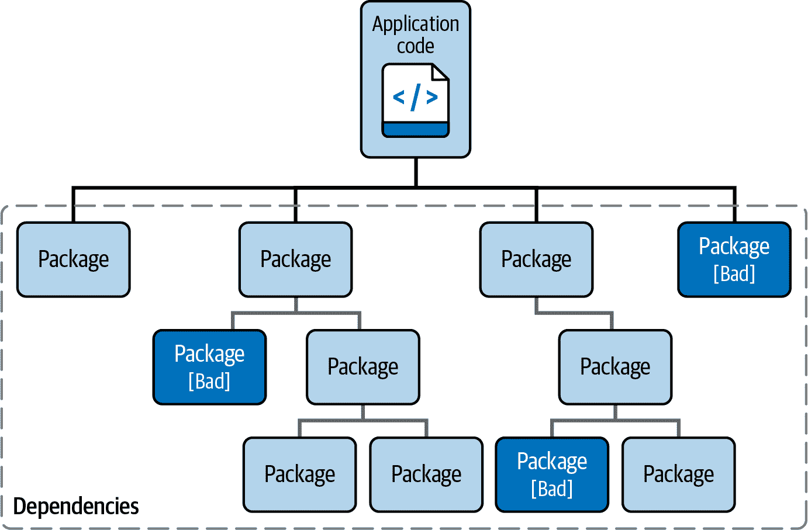
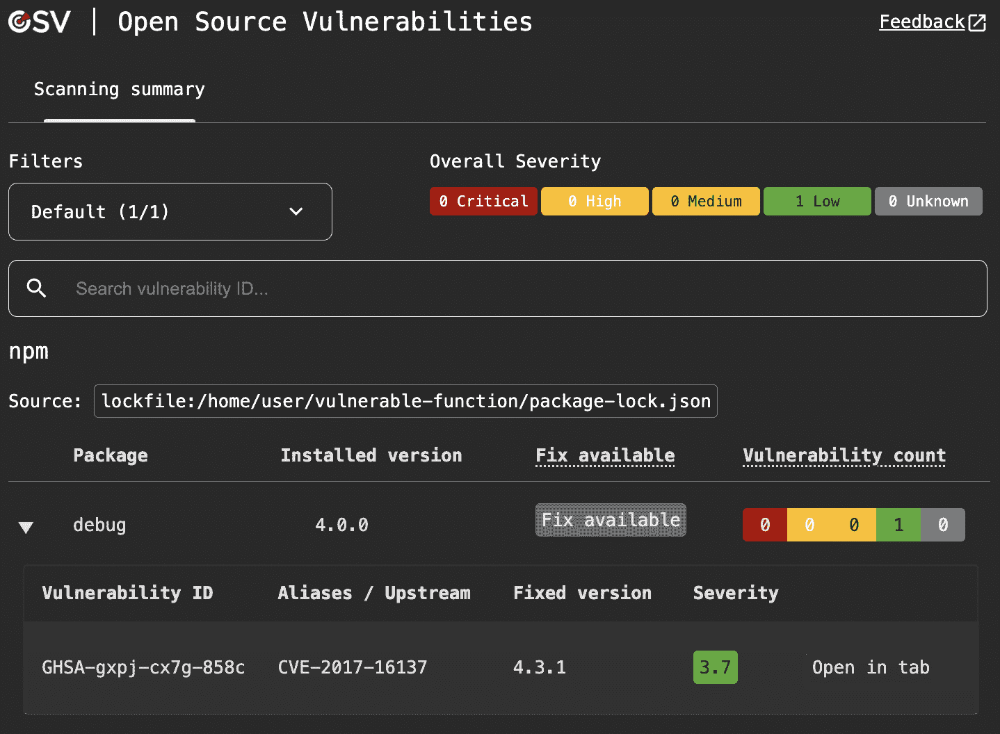
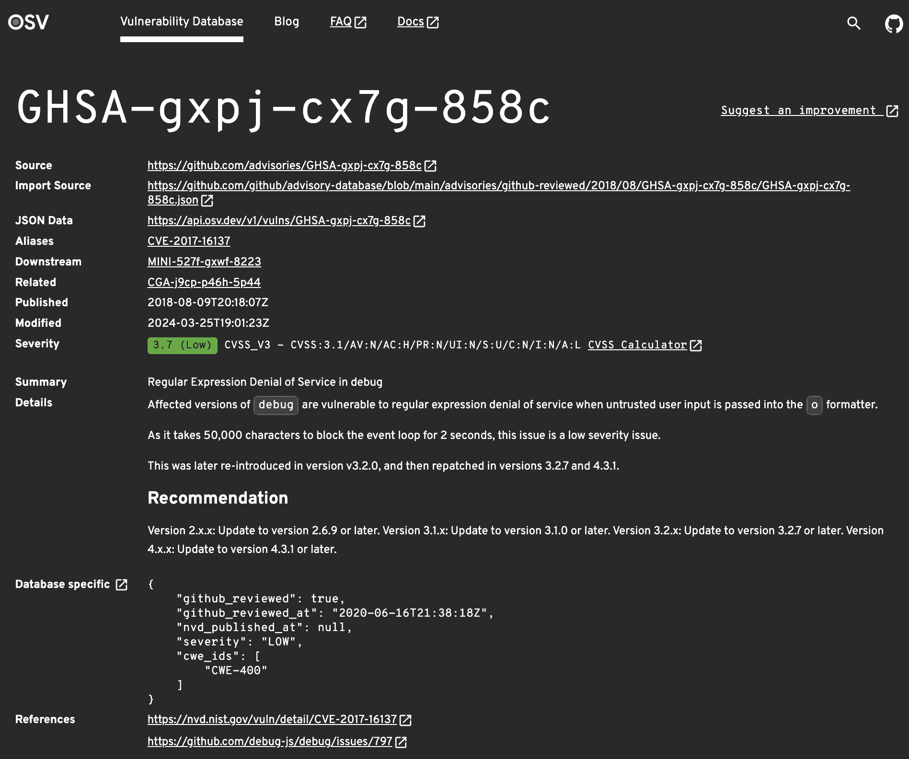
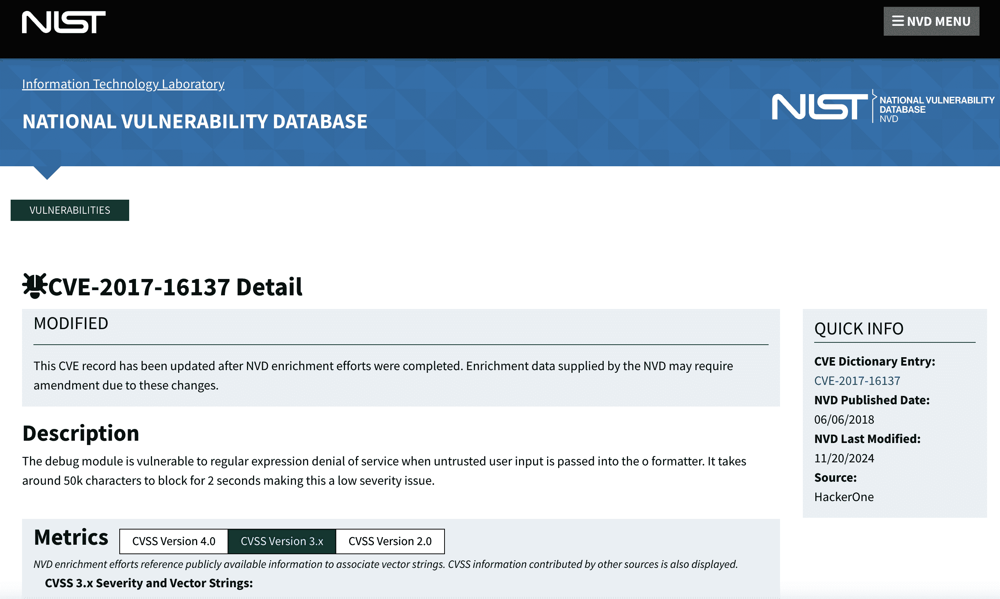

## Chapter 13. Analyzing, Auditing, and Securing Serverless Application Code

在本最后一章中，你将学习如何在无服务器应用程序代码中识别和修复常见的安全漏洞，同时利用实用的工具和技术来保护你的无服务器应用程序。更具体地说，你将使用 Semgrep 来检测代码中常见的<|start|>assistant [content]

这是可以预期的，因为该令牌没有查询 Key Vault 所需的角色分配或权限。

6. 假设 Key Vault 名称已知，使用新的访问令牌列出 Key Vault 中的所有密钥应会因授权错误而失败：

```
URL="https://${KEYVAULT_NAME}.vault.azure.net/secrets?api-version=7.5"

curl -s -H "Authorization: Bearer $NEW_ACCESS_TOKEN_2" \
     -H "Content-Type: application/json" \
     "$URL" | jq .
```

运行该命令将产生类似以下内容的错误消息：

```
{
  "error": {
    "code": "Forbidden",
    "message": "Caller is not authorized to perform action on resource...",
    "innererror": {
      "code": "ForbiddenByRbac"
    }
  }
}
```

你已通过应用最小权限原则成功保护了函数应用的托管标识。^2 从防御性安全角度来看，你应定期审查所有角色分配，以确保未授予过度的权限。此外，监控访问日志以查找异常活动，并在函数中强制执行安全编码实践，以防止攻击者利用代码注入等漏洞。一起，这些措施有助于最大限度地降低权限提升的风险并保护环境中的敏感资源。

#### Caution

不要急于清理你的资源，因为它们将在下一章的动手示例和模拟中用到。

## Summary

在本章中，你研究了过度宽松的托管标识如何被滥用于权限提升。在升级了设计上存在漏洞的无服务器函数并以更严格的角色集配置其托管标识后，你模拟了一次攻击，该攻击提取了令牌、提升了角色并访问了 Key Vault 密钥。然后，你通过删除不必要的角色分配来保护函数，以强制执行最小权限。

在下一章中，你将在此基础上探索更多技术和最佳实践，以保护你的无服务器应用程序。你将学习如何利用自动化工具、安全编码实践和自定义脚本，进一步保护你的应用程序免受代码注入、供应链攻击和其他新兴威胁。

^1 记录权限更改也有助于防止生产环境中出现意外问题和停机。

^2 然而，无服务器函数仍然包含代码注入漏洞，你将在 Chapter 13 中解决并修复该漏洞。

## Chapter 13. Analyzing, Auditing, and Securing Serverless Application Code

在本最后一章中，你将学习如何在无服务器应用程序代码中识别和修复常见的安全漏洞，同时利用实用的工具和技术来保护你的无服务器应用程序。更具体地说，你将使用 Semgrep 来检测代码中常见的


##### 3. 在你的主目录中创建并激活一个 Python 虚拟环境，然后安装 Semgrep：

```
cd ~
    
python3 -m venv venv
source venv/bin/activate
    
pip install semgrep
```

##### 4. 检查已安装的 Semgrep 版本：

```
semgrep --version
```

你应该得到以下版本（或相近的版本号）：

```
...
1.141.0
```

#### Caution

运行 Semgrep 时，你可能会看到关于已弃用 API 的警告，例如某些 Python 包如 `opentelemetry-instrumentation` 使用的 `pkg_resources`。这意味着该 API 可能在未来的 Python 或 Setuptools 版本中被移除，或在某些版本中已被移除。为了管理潜在的弃用问题，请确保在安装和运行时监控警告，并将依赖项固定到稳定版本（例如，`setuptools<81`）。

##### 5. 运行以下命令克隆官方 Semgrep 规则仓库：

```
git clone https://github.com/semgrep/semgrep-rules.git
```

##### 6. 列出 `semgrep-rules/javascript` 下的所有目录：

```
ls -1F semgrep-rules/javascript
```

这会给出一个目录列表，类似于以下内容：

```
ajv/
angular/
apollo/
argon2/
    
...
    
vue/
wkhtmltoimage/
wkhtmltopdf/
xml2json/
```

#### Note

到你阅读本书时，你可能会得到不同的目录集合。

##### 7. 准备就绪后，使用 `javascript` 目录中的规则对 `evaluate.js` 运行 Semgrep：

```
semgrep --config=semgrep-rules/javascript \
   vulnerable-function/src/functions/evaluate.js
```

这会产生以下输出：

```
  ...
    
┌────────────────┐
│ 1 Code Finding │
└────────────────┘
    
    vulnerable-function/src/functions/evaluate.js
    ❯❱ semgrep-rules.javascript.browser.security.eval-detected
          Detected the use of eval(). eval() can be dangerous if used to
          evaluate dynamic content. ...
    
           13┆ result = eval(expression);
    
┌──────────────┐
│ Scan Summary │
└──────────────┘
Scan completed successfully.
 • Findings: 1 (1 blocking)
 • Rules run: 171
 • Targets scanned: 1
 • Parsed lines: ~100.0%
 • No ignore information available
Ran 171 rules on 1 file: 1 finding.
```

Semgrep 在 `evaluate.js` 中检测到 `eval()` 的使用，`semgrep-rules.javascript.browser.security.eval-detected` 规则将其标记为潜在的代码注入漏洞。

##### 8. 查看检测不安全 `eval()` 用法的 Semgrep 规则：

```
cat semgrep-rules/javascript/browser/security/eval-detected.yaml
```

这会输出 Semgrep 规则定义，包括其 ID、消息、元数据、受影响的语言、严重程度以及用于检测不安全 `eval()` 用法的模式：

```
rules:
- id: eval-detected
  message: >-
    Detected the use of eval(). eval() can be dangerous if used to ...
  metadata:
    cwe:
    - "CWE-95: Improper Neutralization of Directives in Dynamically
       Evaluated Code ('Eval Injection')"
    
    ...
    
    likelihood: LOW
    impact: MEDIUM
    confidence: LOW
    references:
    - https://owasp.org/Top10/A03_2021-Injection
  languages:
  - javascript
  - typescript
  severity: WARNING
  patterns:
  - pattern-not: eval("...")
  - pattern: eval(...)
```

##### 9. 要开始使用自定义规则，请为你的自定义 Semgrep 规则创建一个目录，然后设置空文件（`no-eval.yml` 和 `no-hardcoded-keys.yml`）用于你的自定义规则：

```
cd ~
    
mkdir -p custom-rules
    
touch custom-rules/no-eval.yml
touch custom-rules/no-hardcoded-keys.yml
```

##### 10. 在 Cloud Shell 代码编辑器中打开 `custom-rules/no-eval.yml`。用以下规则定义替换文件内容：

```
rules:
  - id: no-eval
    patterns:
      - pattern: eval($EXPR)
    message: "Avoid using eval() — dangerous with user input."
    languages: [javascript, typescript]
    severity: ERROR
```

#### Caution

请确保在进入下一步之前保存你的更改。

##### 11. 在 Cloud Shell 代码编辑器中打开 `custom-rules/no-hardcoded-keys.yml`。用以下规则定义替换文件内容：

```
rules:
  - id: hardcoded-secret-detection
    languages: [javascript, typescript]
    message: "Possible hardcoded secret or API key"
    severity: ERROR
    pattern: |
      const $VAR = "$SECRET"
    metadata:
      category: security
    condition:
      metavariable-regex:
        metavariable: $VAR
        regex: (?i)(key|secret|token|password)
```

##### 12. 使用你的自定义规则文件对 `evaluate.js` 文件运行 Semgrep：

```
semgrep --config=custom-rules \
   vulnerable-function/src/functions/evaluate.js
```

这会产生以下输出：

```
┌─────────────────┐
│ 2 Code Findings │
└─────────────────┘
    
    vulnerable-function/src/functions/evaluate.js
   ❯❯❱ custom-rules.hardcoded-secret-detection
          Possible hardcoded secret or API key
    
            3┆ const HARDCODED_KEY = "67890ghijkl";
    
   ❯❯❱ custom-rules.no-eval
          Avoid using eval() — dangerous with user input.
    
           13┆ result = eval(expression);
    
    
    
┌──────────────┐
│ Scan Summary │
└──────────────┘
✅ Scan completed successfully.
 • Findings: 2 (2 blocking)
 • Rules run: 2
 • Targets scanned: 1
 • Parsed lines: ~100.0%
 • No ignore information available
Ran 2 rules on 1 file: 2 findings.
```

此时，你应该对如何使用 Semgrep 检测无服务器应用程序代码中的安全问题有了很好的了解。请记住，虽然 Semgrep 和其他自动化扫描工具可以捕获许多常见漏洞，但它可能无法识别代码中的每个安全问题。你应该将自动化扫描与人工代码审查相结合，以捕获自动化可能遗漏的问题。

### Securing Serverless Application Code from Code Injection

在前一节中，你学习了如何使用 Semgrep 等工具检测无服务器函数代码中 `eval()` 的不安全使用。此外，你还探索了创建自定义规则以自动检测代码中的硬编码密钥，从而最大程度地降低凭据意外泄露的风险。在本节中，你将通过用更安全的 expr-eval 库替换 `eval()` 来保护你的代码。在对函数代码进行更改后，你将重新运行 Semgrep 扫描以验证之前检测到的问题是否已解决。

让我们逐步了解更新和保护你的无服务器函数代码的步骤：

##### 1. 切换回浏览器窗口和 Serverless Lab 账户的 Cloud Shell 终端。

##### 2. 安装 expr-eval 包，该包提供了一种安全地解析和评估数学表达式的方法：

```
cd ~/vulnerable-function
    
npm install expr-eval
```

这会产生以下输出：

```
added 1 package, and audited 91 packages in 1s
    
16 packages are looking for funding
  run `npm fund` for details
    
found 0 vulnerabilities
```

#### Note

本章中的动手示例假设你将使用 expr-eval 库的版本 `².0.2`。有关更多信息，你可以访问 [官方 GitHub 仓库](https://oreil.ly/1cDim)。

##### 3. 在代码编辑器中打开 `vulnerable-function/src/functions/evaluate.js`。用以下内容替换文件的内容：


```javascript
const { app } = require('@azure/functions');
const { Parser } = require('expr-eval');

app.http('evaluate', {
  methods: ['POST'],
  authLevel: 'function',
  handler: async (request, context) => {
    const expression = await request.text() || '"No expression provided"';

    let result;
    try {
      const parser = new Parser({
        operators: {
          add: true,
          subtract: true,
          multiply: true,
          divide: true,
          power: false,
          factorial: false
        }
      });
      result = parser.evaluate(expression);
    } catch (err) {
      result = `Error: ${err.message}`;
    }

    return { body: `Evaluation result: ${result}` };
  }
});
```

这里，`eval()` 函数已被 `expr-eval` 库的安全数学表达式解析器 [`Parser.evaluate`] 取代。通过此更新，该函数强制执行严格的求值规则并拒绝恶意负载，同时仍然支持有效的数学表达式。

请记住，使用像 `expr-eval` 这样的包有助于降低风险，但并不能保证完全的安全。虽然此解决方案展示了比 `eval()` 更安全的替代方案，但最终如何保护易受攻击的函数，主要取决于该函数的用途、其配置以及它与无服务器架构中其他组件的集成方式。必须明确定义有效输入，拒绝无效输入，并在整个无服务器应用程序中始终执行验证检查。

#### Note

还必须审查您使用的任何库和包的已知问题和漏洞，因为过时的版本可能会引入安全风险或意外行为。虽然听起来只需将包更新到最新版本就很简单，但在实践中这可能具有挑战性，因为存在兼容性问题、破坏性更改或对应用程序其他部分的依赖。

4. 在终端中运行以下命令以部署最新更改：

```
source function-vars.sh
func azure functionapp publish $FUNCTION_APP
```

5. 从上一条命令 [`func azure functionapp publish`] 的输出中复制函数的 Invoke URL 并将其存储在 `INVOKE_URL` 环境变量中：

```
INVOKE_URL="[SPECIFY INVOKE URL]"
```

6. 获取 `evaluate` 函数的函数密钥：

```
KEY=$(az functionapp function keys list \
  --resource-group $RESOURCE_GROUP \
  --name $FUNCTION_APP \
  --function-name evaluate)

FUNCTION_KEY=$(echo $KEY | jq -r ".default")
```

7. 使用 `curl` 发送 `POST` 请求并附带一个简单表达式来测试 `evaluate` 函数：

```
curl -X POST "$INVOKE_URL?code=$FUNCTION_KEY" \
  -H "Content-Type: text/plain" \
  -d "4+2"
```

这会产生以下输出：

```
Evaluation result: 6
```

8. 现在您已部署并测试了更新后的无服务器函数，请返回到攻击者账户的浏览器窗口和 Cloud Shell 终端。

9. 运行以下命令（在 `$` 符号之后）以执行 `tester.rb` 脚本：

```
ruby tester.rb
```

10. 让我们检查有效数学表达式是否能正确求值。在脚本的 REPL 中，在 `Enter an expression (or type 'exit' to quit)` 之后，首先输入一个类似以下的简单数学表达式：

```
2 - 45
```

这会产生以下输出响应：

```
[OUTPUT RESPONSE]
-43
```

接下来，尝试使用括号来控制运算符优先级求值表达式：

```
(12 * 2) + 5
```

这会输出以下内容：

```
[OUTPUT RESPONSE]
29
```

现在，让我们验证恶意输入表达式不再起作用。尝试列出当前文件夹中的所有文件和目录：

```
require('fs').readdirSync('./')
```

您应该会收到以下错误消息：

```
[OUTPUT RESPONSE] Error: parse error [1:15]: Expected EOF
```

尝试使用本章前面使用过的相同输入表达式来检索环境变量：

```
JSON.stringify(process.env)
```

这会返回一个 `undefined variable: JSON` 错误消息。

最后，尝试通过作为单行运行以下命令来获取访问令牌：

```
require("child_process").execSync(
   `curl -s -H "X-IDENTITY-HEADER: ${process.env.IDENTITY_HEADER}"
   "${process.env.IDENTITY_ENDPOINT}
   ?resource=https://management.azure.com/&api-version=2019-08-01"`,
   { encoding: "utf8" }
);
```

这会给出以下错误消息：

```
[OUTPUT RESPONSE] Error: parse error [1:26]: Expected EOF
```

#### Tip

像 `Error: parse error [1:26]: Expected EOF` 这样的错误消息也可以被替换为更通用的捕获所有错误消息，以降低泄露实现细节的风险。

11. 现在，让我们在无服务器实验室账户的 Cloud Shell 终端中重新运行 Semgrep 扫描，以验证 `eval()` 的不安全使用是否已成功移除。在 `javascript` 目录中使用规则对 `evaluate.js` 运行 Semgrep：

```
cd ~

semgrep --config=semgrep-rules/javascript \
   vulnerable-function/src/functions/evaluate.js
```

这会产生以下输出：

```
Scanning 1 file (only git-tracked) with 182 Code rules:

  ...

┌────────────────┐
│ 1 Code Finding │
└────────────────┘

    vulnerable-function/src/functions/evaluate.js
     ❱ semgrep-rules.javascript.lang.correctness.useless-assignment
          `const` is assigned twice; the first assignment is useless

            1┆ const { app } = require('@azure/functions');
            2┆ const { Parser } = require('expr-eval');


┌──────────────┐
│ Scan Summary │
└──────────────┘
Scan completed successfully.
 • Findings: 1 (1 blocking)
 • Rules run: 171
 • Targets scanned: 1
 • Parsed lines: ~100.0%
 • No ignore information available
Ran 171 rules on 1 file: 1 finding.
```

这里，`useless-assignment` 发现是一个误报，因为在这种情况下，该规则误解了导入模块时使用 `const` 的情况。

#### Tip

在使用自动化安全扫描时，了解真正阳性和误报之间的区别非常重要。*真正阳性* 是真正重要的事项，因为它们对应于应用程序中的实际漏洞。另一方面，*误报* 是噪音；它们看起来像问题，但并不会构成任何风险。了解其中的区别有助于您专注于重要的内容，避免浪费时间处理并非真实威胁的发现。

接下来，在排除 `useless-assignment` 规则的同时对 `evaluate.js` 运行 Semgrep：

```
EXCLUDE="semgrep-rules.javascript.lang.correctness.useless-assignment"

semgrep --config=semgrep-rules/javascript \
   --exclude-rule=$EXCLUDE \
   vulnerable-function/src/functions/evaluate.js
```

这会产生以下输出：

```
...

┌──────────────┐
│ Scan Summary │
└──────────────┘
Scan completed successfully.
 • Findings: 0 (0 blocking)
 • Rules run: 170
 • Targets scanned: 1
 • Parsed lines: ~100.0%
 • No ignore information available
Ran 170 rules on 1 file: 0 findings.
```

#### Note


你可以使用 `--exclude-rule` 在整个代码库中禁用一条规则——尤其是在某条规则产生持续的误报时。然而，请记住，一旦规则被排除，它将不会在项目中的任何地方标记问题。

最后，使用你的自定义规则文件在 `evaluate.js` 文件上运行 Semgrep：

```
semgrep --config=custom-rules \
    vulnerable-function/src/functions/evaluate.js
```

同样，使用你的自定义规则运行 Semgrep 应该显示没有发现，因为不安全的 `eval()` 用法已被修复：

```
...
┌──────────────┐
│ Scan Summary │
└──────────────┘
Scan completed successfully.
 • Findings: 0 (0 blocking)
 • Rules run: 2
 • Targets scanned: 1
 • Parsed lines: ~100.0%
 • No ignore information available
Ran 2 rules on 1 file: 0 findings.
```

至此，你的无服务器函数已受到你之前测试的代码注入攻击的保护，因为它现在可以安全地拒绝恶意的输入表达式。你还重新运行了 Semgrep 扫描以验证之前的问题已得到解决，并且没有引入新的问题。当然，一旦你的无服务器函数作为包含多个资源的大型应用程序的一部分部署，还应实施额外的安全机制以确保纵深防御并防范更广泛的攻击向量。

### 开发一个检测恶意依赖项的自定义脚本

2025 年 9 月，JavaScript 生态系统经历了迄今为止最广泛的 npm 供应链攻击之一。^1 攻击者诱骗了多名维护者，获得了他们的账户访问权限，并推送了每周总下载量超过二十亿次的流行库的恶意版本。^2 其中一些包是大量其他库的依赖项，这意味着它们通常在开发者不知情的情况下被间接拉取。尽管大多数恶意版本在几小时内被移除，但该事件凸显了你的应用程序依赖项可能在一夜之间成为你的最薄弱环节（Figure 13-2）。^3



在本节中，你将编写一个自定义脚本来标记你的无服务器项目中的恶意依赖项。你将首先准备一个 JSON 文件，列出你想要监控的 npm 包的已知不良版本。之后，你将开发一个 Ruby 脚本，该脚本解析你的项目的 lockfile，将已安装版本与已知恶意版本列表进行比较，并报告哪些包是安全的，哪些受影响。

#### Note

本节假设你使用的是你的 Serverless Lab 账户，该账户托管了易受攻击的按设计无服务器实验室资源。

尽管已有工具可用，但学习创建或更新脚本可以让你更深入地了解如何自动检测易受攻击或恶意的依赖项。此外，你将对自定义检测逻辑以适应你的特定工作流程和项目需求拥有更大的控制权。

让我们通过一个构建无服务器函数自定义依赖检测脚本的实际示例来逐步了解：

1. 在你的 Serverless Lab 账户的 Cloud Shell 终端中（在 `$` 符号之后），运行以下命令以显示所选 npm 包的项目依赖树，包括受 2025 年 9 月供应链攻击影响的包：^4

```
cd ~/vulnerable-function

npm ls debug color-convert backslash error-ex simple-swizzle chalk
```

这会产生以下输出：

```
vulnerable-function@1.0.0 /home/user/vulnerable-function
├─┬ @azure/identity@4.13.0
│ └─┬ @azure/core-rest-pipeline@1.22.1
│   └─┬ @typespec/ts-http-runtime@0.3.1
│     ├─┬ http-proxy-agent@7.0.2
│     │ └── debug@4.4.3
│     └─┬ https-proxy-agent@7.0.6
│       └── debug@4.4.3 deduped
└─┬ azure-functions-core-tools@4.3.0
  ├─┬ chalk@3.0.0
  │ └─┬ ansi-styles@4.2.0
  │   └── color-convert@2.0.1
  ├─┬ extract-zip@2.0.1
  │ └── debug@4.3.7
  └─┬ https-proxy-agent@5.0.1
    ├─┬ agent-base@6.0.2
    │ └── debug@4.3.7 deduped
    └── debug@4.3.7 deduped
```

在这里，你可以查看所选 npm 包的已安装版本，包括直接依赖项和传递依赖项。^5

#### Note

之前的 `npm ls` 命令仅列出了受影响包的一个子集。在下一步中，你将看到自动化脚本如何通过引用单独的 `bad_versions.json` 文件将此检查扩展到所有受监控的依赖项。

2. 在你的主目录中为即将到来的脚本和已知恶意包版本列表创建空白文件：

```
cd ~

touch check_lockfile.rb
touch bad_versions.json
```

3. 在 Cloud Shell 代码编辑器中打开 `bad_versions.json` 并使用以下包-版本映射定义已知恶意版本：^6

```
{
  "debug": ["4.4.2"],
  "color-convert": ["3.1.1"],
  "backslash": ["0.2.1"],
  "error-ex": ["1.3.3"],
  "simple-swizzle": ["0.2.3"],
  "is-arrayish": ["0.3.3"],
  "color-name": ["2.0.1"],
  "color-string": ["2.1.1"],
  "ansi-styles": ["6.2.2"],
  "chalk": ["5.6.1"],
  "supports-color": ["10.2.1"],
  "strip-ansi": ["7.1.1"],
  "ansi-regex": ["6.2.1"],
  "wrap-ansi": ["9.0.1"],
  "slice-ansi": ["7.1.1"],
  "color": ["5.0.1"],
  "supports-hyperlinks": ["4.1.1"],
  "has-ansi": ["6.0.1"],
  "chalk-template": ["1.1.1"]
}
```

#### Tip

建议将已知恶意版本列表保存在单独的 `bad_versions.json` 文件中，这样你可以在不修改脚本的情况下更新它。你可以使用相同的格式向此文件添加其他 npm 包或版本，并允许脚本在后续运行中自动检查它们。

4. 在 Cloud Shell 代码编辑器中打开 `check_lockfile.rb`。添加以下处理命令行参数解析的代码行：

```
require 'json'
require 'optparse'

options = {}
OptionParser.new do |opts|
  opts.banner = "Usage: ruby check_lockfile.rb " \
                "--project_dir PATH " \
                "--bad_versions FILE"

  opts.on("--project_dir DIR",
          "Project directory containing package-lock.json") do |dir|
    options[:project_dir] = dir
  end

  opts.on("--bad_versions FILE",
          "Path to bad_versions.json file") do |file|
    options[:bad_versions_file] = file
  end
end.parse!

unless options[:project_dir] && options[:bad_versions_file]
  puts "Missing required arguments."
  puts "Usage: ruby check_lockfile.rb " \
       "--project_dir PATH --bad_versions FILE"
  exit 1
end
```

这允许脚本接受用户指定的项目目录和 `bad_versions.json` 文件的输入，并使其能够灵活地针对不同的项目和受监控包集运行。

#### Tip

确保在每个代码块后包含一个空行或空格，以提高可读性并避免语法问题。

接下来，添加以下读取 `bad_versions.json` 和 lockfile 的代码行：

```
lockfile_path = File.join(options[:project_dir], "package-lock.json")
unless File.exist?(lockfile_path)
  puts "Could not find #{lockfile_path}"
  exit 1
end

unless File.exist?(options[:bad_versions_file])
  puts "Could not find bad versions file: " \
       "#{options[:bad_versions_file]}"
  exit 1
end

bad_versions = JSON.parse(File.read(options[:bad_versions_file]))

lockfile = JSON.parse(File.read(lockfile_path))

installed = {}
issues = []
```


在指定的项目目录中添加以下运行 `npm ls` 的代码块，以检查所有受监控的包：

```
Dir.chdir(options[:project_dir]) do
  packages = bad_versions.keys.join(' ')
  output = `npm ls #{packages}`
  puts output
end
```

#### Tip

在运行脚本之前，请确保保存 `check_lockfile.rb` 文件。

##### 5. 在脚本的前半部分准备好后，让我们在 Cloud Shell 终端中（`$` 符号之后）运行 `check_lockfile.rb` Ruby 脚本：^7

```
ruby check_lockfile.rb \
    --project_dir vulnerable-function \
    --bad_versions bad_versions.json
```

这会产生以下输出：

```
vulnerable-function@1.0.0 /home/user/vulnerable-function
├─┬ @azure/identity@4.13.0
│ └─┬ @azure/core-rest-pipeline@1.22.1
│   └─┬ @typespec/ts-http-runtime@0.3.1
│     ├─┬ http-proxy-agent@7.0.2
│     │ └── debug@4.4.3
│     └─┬ https-proxy-agent@7.0.6
│       └── debug@4.4.3 deduped
└─┬ azure-functions-core-tools@4.3.0
  ├─┬ chalk@3.0.0
  │ ├─┬ ansi-styles@4.2.0
  │ │ └─┬ color-convert@2.0.1
  │ │   └── color-name@1.1.4
  │ └── supports-color@7.1.0
  ├─┬ extract-zip@2.0.1
  │ └── debug@4.3.7
  └─┬ https-proxy-agent@5.0.1
    ├─┬ agent-base@6.0.2
    │ └── debug@4.3.7 deduped
    └── debug@4.3.7 deduped
```

#### Tip

在构建过程中积极运行和测试脚本有助于及早发现错误，并确保每个部分在脚本完成前都能正常工作。你也可以使用调试工具如 [Pry](https://oreil.ly/U3KQ2) 来暂停执行、交互式检查变量，并在编写脚本时轻松调试实现问题。

##### 6. 在 Cloud Shell Code Editor 中再次打开 `check_lockfile.rb` 文件。添加以下处理 npm v7+ lockfile 的代码行，通过将每个包与坏版本列表进行检查：

```
if lockfile.key?("packages")
  lockfile["packages"].each do |path, data|
    next unless data.is_a?(Hash) && data["version"]

    name1 = data["name"] || File.basename(path)
    name2 = path.sub("node_modules/", "")
    version = data["version"]

    [name1, name2].each do |name|
      if bad_versions.key?(name)
        installed[name] ||= []
        installed[name] << version \
          unless installed[name].include?(version)
        if bad_versions[name].include?(version)
          issues << "#{name}@#{version}"
        end
      end
    end
  end
end
```

接下来，添加以下处理 npm v6 风格 lockfile 的代码行：

```
if lockfile.key?("dependencies")
  stack = [lockfile["dependencies"]]
  until stack.empty?
    deps = stack.pop
    deps.each do |name, data|
      version = data["version"] rescue nil
      if version && bad_versions.key?(name)
        installed[name] ||= []
        installed[name] << version \
          unless installed[name].include?(version)
        if bad_versions[name].include?(version)
          issues << "#{name}@#{version}"
        end
      end
      stack << data["dependencies"] if data["dependencies"]
    end
  end
end
```

完成脚本以报告安全与受影响的包版本：

```
if installed.empty?
  puts "None of the monitored packages were found"
else
  puts "Detected package versions:"
  installed.each do |pkg, versions|
    bad_list = bad_versions[pkg].join(", ")
    versions.each do |ver|
      if bad_versions[pkg].include?(ver)
        puts " - #{pkg}: installed #{ver} AFFECTED " \
             "| bad versions: [#{bad_list}]"
      else
        puts " - #{pkg}: installed #{ver} SAFE " \
             "| bad versions: [#{bad_list}]"
      end
    end
  end
end

if issues.any?
  puts "\nDetected malicious versions in your lockfile!"
  issues.each { |i| puts " - #{i}" }
  exit 1
else
  puts "\nNo malicious versions detected"
end
```

##### 7. 准备就绪后，让我们在 Cloud Shell 终端中（`$` 符号之后）运行 `check_lockfile.rb` Ruby 脚本，以检查哪些依赖项与 `bad_versions.json` 中定义的恶意版本匹配：

```
ruby check_lockfile.rb \
    --project_dir vulnerable-function \
    --bad_versions bad_versions.json
```

这会产生以下输出：

```
vulnerable-function@1.0.0 /home/user/vulnerable-function
├─┬ @azure/identity@4.12.0
│ └─┬ @azure/core-rest-pipeline@1.22.1
│   └─┬ @typespec/ts-http-runtime@0.3.1
│     ├─┬ http-proxy-agent@7.0.2
│     │ └── debug@4.4.3
│     └─┬ https-proxy-agent@7.0.6
│       └── debug@4.0.0
└─┬ azure-functions-core-tools@4.2.2
  ├─┬ chalk@3.0.0
  │ ├─┬ ansi-styles@4.2.0
  │ │ └─┬ color-convert@2.0.1
  │ │   └── color-name@1.1.4
  │ └── supports-color@7.1.0
  ├─┬ extract-zip@2.0.1
  │ └── debug@4.3.7
  └─┬ https-proxy-agent@5.0.1
    ├─┬ agent-base@6.0.2
    │ └── debug@4.3.7 deduped
    └── debug@4.3.7 deduped

Detected package versions:
 - color-name: installed 1.1.1 SAFE | bad versions: [2.0.1]
 - color-name: installed 1.1.4 SAFE | bad versions: [2.0.1]
 - ansi-styles: installed 4.2.0 SAFE | bad versions: [6.2.2]
 - chalk: installed 3.0.0 SAFE | bad versions: [5.6.1]
 - color-convert: installed 2.0.1 SAFE | bad versions: [3.1.1]
 - debug: installed 4.3.7 SAFE | bad versions: [4.4.2]
 - debug: installed 4.4.3 SAFE | bad versions: [4.4.2]
 - supports-color: installed 7.1.0 SAFE | bad versions: [10.2.1]

No malicious versions detected
```

在一次初始 npm 供应链入侵事件发生约一周后，该事件影响了一组包，一种名为 Shai-Hulud 的自我复制蠕虫迅速感染了 npm 生态系统中的数百个包。该蠕虫从受损系统中窃取凭据，将其外泄到攻击者控制的服务器，并通过被盗令牌自动传播到其他 npm 包。鉴于该蠕虫影响的包尚未在 `bad_versions.json` 文件中跟踪，你只需使用更新后的文件来改进检测，而无需从头重写检测逻辑。虽然这只是一个部分措施，但它为识别和解决受影响的包提供了一个实用的第一步。你还可以进一步使用相同的 `bad_versions.json` 文件来阻止开发人员在 `npm install` 期间安装已知恶意包版本。

#### Note

[`bad_versions.json` gist](https://oreil.ly/dGrFt) 包含已知易受攻击的包版本的列表。此 gist 中的 `bad_versions.json` 文件仅包含已知恶意包版本的一个子集。如需完整且最新的列表，请始终参考官方来源或漏洞公告。

通过在每次提交前或在 `npm install` 期间自动检查依赖项，你可以最大限度地降低引入不安全包的风险，并在开发工作流程早期发现潜在的供应链攻击。例如，结合预提交钩子，此脚本可以帮助防止在项目中使用易受攻击或恶意的包版本。^8 或者，你可以将此脚本包含在 CI/CD 流水线中，以在每次构建或拉取请求时自动扫描依赖项，并设置自动警报，以便在检测到易受攻击或恶意版本时立即通知你的团队。


此时，你应该已经对如何创建用于检测易受攻击或恶意软件包版本的自定义脚本有了扎实的理解。你可以扩展本节中准备的脚本，使其自动下载最新的 `bad_versions.json` 文件，生成详细的<|message|>安全报告，并提供可操作的修复建议——例如将依赖项锁定到已知的安全版本，以及更新受影响的软件包。

### 使用 OSV-Scanner 检测易受攻击的软件包

在前一节中，你创建了一个用于检测恶意或易受攻击软件包版本的自定义脚本。在实践中，将自定义脚本与预构建的自动化扫描工具结合使用，可以为检测易受攻击的依赖项提供最全面的覆盖。其中一个热门选择是 `OSV-Scanner`，它会将你的应用程序依赖项与开源漏洞 (`OSV`) 数据库进行比对，并生成详细的漏洞报告。

在本节中，你将安装 `OSV-Scanner`，扫描你的无服务器项目是否存在易受攻击的依赖项，并查看生成的报告，以便采取可操作的步骤来保护你的项目。你可以将 `OSV-Scanner` 想象成机场安检处的金属探测器，检查项目的依赖项并标记任何看起来可疑的东西。这里，生成的报告就像安检员的检查记录，显示出哪些项目需要进一步关注以及下一步应采取什么行动。

#### Note

本节假设你正在使用你的 Serverless Lab 账户，该账户托管了易受攻击的无服务器实验室资源。

让我们回顾如何使用 `OSV-Scanner` 来检测易受攻击的软件包：

1. 在你的 Serverless Lab 账户的 Cloud Shell 终端中（在 `$` 符号之后），运行以下命令在项目中安装易受攻击版本的 `debug` 软件包：

```
cd ~/vulnerable-function/

npm install debug@4.0.0
```

这会产生以下输出：

```
added 1 package, changed 1 package, and audited 92 packages in 2s

16 packages are looking for funding
  run `npm fund` for details

1 low severity vulnerability

To address all issues, run:
  npm audit fix

Run `npm audit` for details.
```

#### Note

这里，`npm` 报告 `debug@4.0.0` 中存在一个低严重性漏洞，表明你应该在下一步中进一步详细调查该问题。

2. 运行 `npm audit` 以生成审计报告，显示咨询 ID、易受攻击的版本以及在受影响软件包中解决问题的步骤：

```
npm audit --verbose
```

这会生成以下审计报告：^(9)

```
...
### npm audit report

debug  4.0.0 - 4.3.0
Regular Expression Denial of Service in debug -
  https://github.com/advisories/GHSA-gxpj-cx7g-858c

fix available via `npm audit fix`
node_modules/debug

1 low severity vulnerability

...
```

3. 运行以下命令检查过时的 npm 软件包：

```
npm outdated --json
```

这会返回以下 JSON 输出：

```
{
  "debug": {
    "current": "4.0.0",
    "wanted": "4.4.3",
    "latest": "4.4.3",
    "dependent": "vulnerable-function",
    "location": ".../node_modules/debug"
  }
}
```

4. 检查已安装的 `debug` 的哪些版本以及它们在依赖树中出现的位置：

```
npm list debug
```

你应该会得到一个详细的依赖树，显示项目中 `debug` 的所有出现位置和版本：

```
vulnerable-function@1.0.0 /home/user/vulnerable-function
├─┬ @azure/identity@4.13.0
│ └─┬ @azure/core-rest-pipeline@1.22.1
│   └─┬ @typespec/ts-http-runtime@0.3.1
│     ├─┬ http-proxy-agent@7.0.2
│     │ └── debug@4.4.3
│     └─┬ https-proxy-agent@7.0.6
│       └── debug@4.0.0 deduped
├─┬ azure-functions-core-tools@4.3.0
│ ├─┬ extract-zip@2.0.1
│ │ └── debug@4.3.7
│ └─┬ https-proxy-agent@5.0.1
│   ├─┬ agent-base@6.0.2
│   │ └── debug@4.3.7 deduped
│   └── debug@4.3.7 deduped
└── debug@4.0.0
```

在这里，你可以看到 `debug` 的多个版本安装在依赖树的不同部分中，包括项目直接使用的易受攻击的 `4.0.0` 版本以及一些嵌套依赖项。

5. 将最新的 `OSV-Scanner` 二进制文件下载到你的主目录：

```
cd ~

URL_1="https://github.com/google/osv-scanner"
URL_2="releases/latest/download/osv-scanner_linux_amd64"

curl -LO "$URL_1/$URL_2"
```

6. 重命名下载的二进制文件并使其可执行：

```
mv osv-scanner_linux_amd64 osv-scanner
chmod +x osv-scanner
```

7. 通过检查其版本来验证 `OSV-Scanner` 二进制文件是否正常工作：

```
./osv-scanner --version
```

这会返回以下内容：

```
osv-scanner version: 2.2.2
osv-scalibr version: 0.3.1
commit: 16ed4529c0d0cc1ddf1bed2fb08deba187339673
built at: 2025-08-27T02:52:51Z
```

#### Note

你看到的版本号可能会因安装 `OSV-Scanner` 的时间而有所不同，因为自本书发布以来可能已发布了更新的版本。

8. 使用 `OSV-Scanner` 递归扫描 `vulnerable-function` 目录中的项目是否存在漏洞：

```
./osv-scanner --recursive vulnerable-function/
```

这会产生以下日志：

```
Scanning dir vulnerable-function/
Starting filesystem walk for root: /
Scanned /home/user/vulnerable-function/package-lock.json file
and found 90 packages
End status: 5 dirs visited, 16 inodes visited, 1 Extract calls,
2.457984ms elapsed, 2.458154ms wall time
Total 1 package affected by 1 known vulnerability
(0 Critical, 0 High, 0 Medium, 1 Low, 0 Unknown) from 1 ecosystem.
1 vulnerability can be fixed.


╭─────────────────────────────────────┬──────┬───────────┬─────── ≈
│ OSV URL                             │ CVSS │ ECOSYSTEM │ PACKAG ≈
├─────────────────────────────────────┼──────┼───────────┼─────── ≈
│ https://osv.dev/GHSA-gxpj-cx7g-858c │ 3.7  │ npm       │ debug  ≈
╰─────────────────────────────────────┴──────┴───────────┴─────── ≈
```

9. 再次运行 `OSV-Scanner` 并以 JSON 格式输出结果：

```
./osv-scanner --recursive vulnerable-function/ --format json
```

你应该会得到类似以下内容的 JSON 响应：

```
  ...

  "packages": [
    {
      ...
      "vulnerabilities": [
        {
          ...
          "summary": "Regular Expression Denial of Service in debug",
          "details": "Affected versions of `debug` are vulnerable to
          regular expression denial of service when untrusted user
          input is passed into the `o` formatter...",
          "severity": [
            {
              "type": "CVSS_V3",
              "score": "CVSS:3.1/AV:N/AC:H/PR:N/UI:N/S:U/C:N/I:N/A:L"
            }
          ],
          ...
        }
      ],
      ...
    }
  ]

  ...
```

10. 为 `vulnerable-function` 项目生成 HTML 报告并将其保存到文件（`report.html`）：

```
./osv-scanner --recursive vulnerable-function/ --format=html > report.html
```

11. 通过点击 Cloud Shell 工具栏上的“上传/下载文件”按钮并从选项列表中选择下载，将生成的 HTML 报告下载到你的本地机器。在“下载文件”对话框中，指定 `report.html`，然后点击下载。最后，点击“点击此处下载你的文件”开始下载。


12. 在本地机器上打开下载的 `report.html` 文件。你应该能看到针对你的函数代码和依赖项的详细漏洞报告，如 Figure 13-3 所示。



13. 展开“debug”部分，找到漏洞 ID 为 `GHSA-gxpj-cx7g-858c` 的条目，然后点击“Open in tab”。这将打开一个包含该漏洞详细信息 的页面（Figure 13-4）。



#### Tip

你可以点击 Source 链接在新标签页中打开引用的 GitHub 页面。

14. 在 References 部分，点击 [*https://nvd.nist.gov/vuln/detail/CVE-2017-16137*](https://nvd.nist.gov/vuln/detail/CVE-2017-16137)。这将在新标签页中打开 `CVE-2017-16137` 的国家漏洞数据库页面（Figure 13-5）。



15. 向下滚动以找到 Weakness Enumeration 部分。在 CWE-ID 列中，点击 `CWE-400`。当出现关于重定向的提示时，点击 OK 继续。这将带你到包含 `CWE-400` 详细信息的页面。

#### Tip

虽然本书主要关注权限提升和其他高风险漏洞，但不要忽视中等和低风险问题。即使看似微不足道的漏洞也可以与其他漏洞结合或串联使用，并可能导致重大的安全风险。

在本节中，你使用 `OSV-Scanner` 自动扫描项目的软件包是否存在已知的安全问题。该工具还包括诸如容器扫描、许可证扫描以及离线运行扫描等功能。截至撰写时，`OSV-Scanner` 具有实验性的 guided remediation 功能，可建议升级软件包版本以解决应用程序依赖项中检测到的问题。随着时间的推移，你可以期待 `OSV-Scanner` 随着社区根据实际需求提出改进而拥有更多功能。

像 `OSV-Scanner` 这样的自动化工具对于检测易受攻击的应用程序依赖项非常宝贵，但对底层安全概念的扎实掌握对于有效评估和管理风险至关重要。透彻理解漏洞和风险后，你可以正确解读扫描结果并做出明智的决策。像 `OSV-Scanner` 这样的工具就像你项目依赖项的 X 光，能够暴露可能 otherwise 未被注意到的漏洞和问题。但正如 X 光需要受过训练的专业人员来解读一样，安全扫描也需要你的专业知识和经验来区分次要问题和关键漏洞。没有这种背景，你可能会忽略关键漏洞或浪费时间修复次要问题。

#### Caution

现在你已完成本章和前两章中的动手示例，请务必查看并删除你在 Azure 账户中创建的所有资源。留下不再使用的资源可能会导致不必要的费用，并使你的账户暴露于潜在的安全风险。
