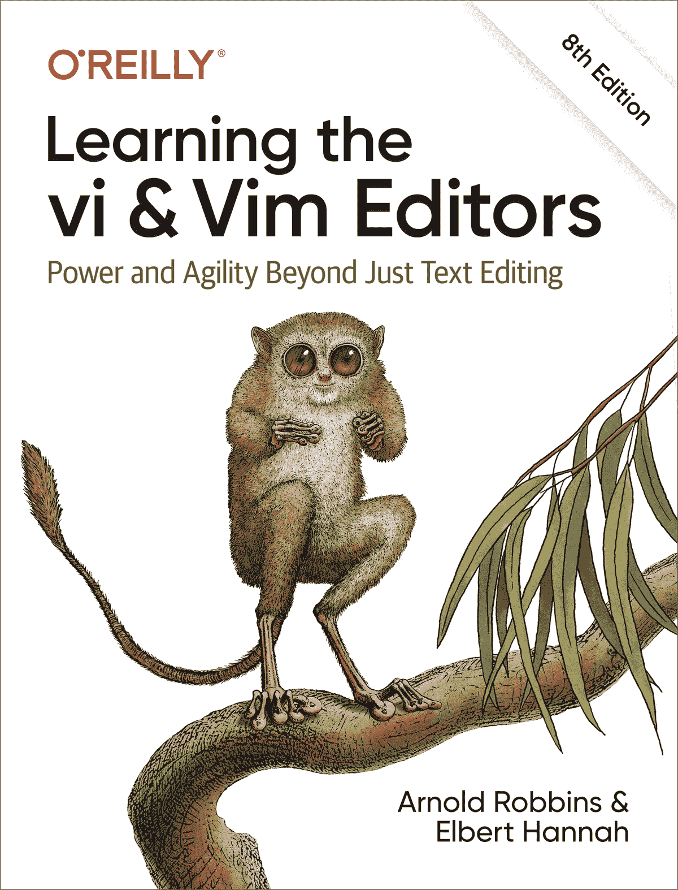

# Vi 和 Vim 编辑器学习指南：超越单纯文本编辑的力量与敏捷性





## 致谢

致我的妻子 Miriam，感谢你的爱、耐心和支持。

—Arnold Robbins，第六、第七和第八版

致我的妻子 Anna，感谢你的爱、鼓励和耐心。谢谢你一直陪伴在我身边。

—Elbert Hannah，第七和第八版

## 前言

文本编辑是任何计算机系统上最常见的任务之一，而 `vi` 是系统上最有用的标准文本编辑器之一。使用 `vi` 你可以创建新文件或编辑任何现有的纯文本文件。

`vi` 与在 Unix® 早期发展起来的许多经典实用程序一样，有难以导航的名声。Bram Moolenaar 的增强克隆版 `Vim`（“`vi` Improved”）在很大程度上消除了这种印象的原因。`Vim` 包含无数便利功能、视觉指南和帮助屏幕。

今天，`Vim` 是 `vi` 最流行的版本，因此本第八版重点介绍 `Vim` 如下：

*   第一部分，“`vi` 和 `Vim` 基础”，教授适用于所有 `vi` 版本的基本 `vi` 技能，但它是在 `Vim` 的上下文中进行的。
*   第二部分，“`Vim`”，专门用若干章节介绍 `Vim` 的高级功能。
*   第三部分，“`Vim` 在更广阔的环境中”，介绍与 `Vim` 在更大背景下相关的章节。

# 材料是如何呈现的

我们的理念是为新用户提供 `vi` 和 Vim 生存材料的良好概述。学习新编辑器，尤其是拥有 Vim 所有选项的编辑器，似乎是一项令人不知所措的任务。我们努力以易读且逻辑清晰的方式呈现基本概念和命令。

在提供了可在任何地方使用的 `vi` 和 Vim 基础知识后，我们继续深入介绍 Vim。以下各节描述了本书中使用的约定。

## vi 命令讨论

对于每个键盘命令或相关命令组，在将其分解为任务导向的章节之前，你会找到对主要概念的简要介绍。然后我们为每种情况提供适当的命令，以及命令的描述和正确的使用语法。

## 约定

在语法描述和示例中，你实际输入的内容以 `constant width` 字体显示，所有命令名称和程序选项也是如此。变量（你不会逐字输入，而是在输入命令时替换为实际值）显示为 *`Constant width italic`*。括号表示变量是可选的。例如，在语法行中：

```
vi [filename]
```

`filename` 将被实际文件名替换。括号表示 `vi` 命令可以完全不指定文件名就调用。括号本身不输入。

某些示例显示在 shell 提示符下输入命令的效果。在此类示例中，你实际输入的内容显示为 **`constant width bold`**，以区别于系统响应。例如：

```
$ ls
ch01.xml ch02.xml ch03.xml ch04.xml
```

在代码示例中，*italic* 表示不应输入的注释。在正文中，*italic* 指文件名，引入专业术语，并强调需要强调的内容。

遵循传统的 Unix 文档约定，形式为 `printf`(3) 的引用指的是在线手册（通过 `man` 命令访问）。此示例指的是手册第 3 节中 `printf()` 函数的条目。在大多数系统上，你会输入 `man -s 3 printf` 来查看它。

## 击键

特殊击键显示在框中。例如：

```
iWith aESC
```

在整本书中，你还会找到 `vi`/Vim 命令及其结果的列：

| Keystrokes || Results |
| --- | --- |
| `ZZ` || 
```
"practice" [New] 6L, 104C written 
```
 |
| --- | --- |
|  || Give the write and save command, `ZZ`. Your file is saved as a regular disk file. |

在前面的示例中，命令 `ZZ` 显示在左列。右列中是一行（或几行）屏幕，显示命令的结果。光标位置以反视频显示。在此实例中，由于 `ZZ` 保存并写入文件，你会看到写入文件时显示的状态行；光标位置不显示。命令/结果下方是对命令及其作用的解释。

在其中一些演示中，我们显示 shell 命令及其结果。在这种情况下，命令前面有标准的 `$` shell 提示符，命令为粗体：

| Keystrokes || Results |
| --- | --- |
| `$` `ls` || `ch01.asciidoc ch02.asciidoc ch03.asciidoc` |
| --- | --- |

有时 `vi` 命令是通过同时按下 CTRL 键和另一个键发出的。在正文中，此组合击键通常写在框内（例如，CTRL-G）。在代码示例中，它是通过在键名前面加上插入符号（^）来写的。例如，`^G` 表示按住 CTRL 同时按下 G 键。普遍约定是使用大写字母引用控制字符（`^G`，而不是 `^g`），即使在输入时你*不*按住 SHIFT 键。^(1)

此外，当使用键帽表示法显示大写字母时，我们将其表示为任意字符 `X` 的 SHIFT-X。因此，`a` 表示为 A，而 `A` 表示为 SHIFT-A。

## 警告、注释和提示

### 警告

这是一个警告性说明。它描述了你需要提防或小心的事情。

### 注释

这只是一个普通的老注释。它指出可能有趣或可能不明显的事情。

### 提示

这是一个提示。它提供了有用的快捷方式或可以节省时间的事项。

## 问题清单

在你可能会遇到一些问题的章节中包含了问题清单。你可以浏览这些清单，并在实际遇到问题时返回查看。

# 开始之前需要了解的内容

本书假定你具备基本的 Unix 用户级知识。特别是，你应该已经知道如何：

*   在笔记本或工作站上打开终端窗口以获得 shell 提示符
*   登录和注销，通常通过 `ssh`，如果使用远程系统
*   输入 shell 命令
*   更改目录
*   列出目录中的文件
*   创建、复制和删除文件

熟悉 `grep`（一个全局搜索程序）和通配符也有帮助。

虽然现代系统允许你从 GUI 菜单系统运行 Vim，但你会失去 Vim 命令行选项提供的灵活性。因此，在整本书中，我们的示例继续演示从命令行提示符运行 `vi` 和 Vim。

# 使用代码示例

补充材料（代码示例、练习等）可在 [*https://www.github.com/learning-vi/vi-files*](https://www.github.com/learning-vi/vi-files) 下载。

如果你对代码示例有技术问题或遇到问题，请发送电子邮件至 *bookquestions@oreilly.com*。

本书旨在帮助你完成工作。一般来说，如果本书提供了示例代码，你可以在你的程序和文档中使用它。除非你复制了代码的很大一部分，否则无需联系我们征求许可。例如，编写一个使用本书中几段代码的程序不需要许可。出售或分发 O’Reilly 书籍中的示例需要许可。引用本书并引用示例代码来回答问题不需要许可。将大量示例代码纳入产品文档中需要许可。

我们感谢但通常不要求署名。署名通常包括标题、作者、出版商和 ISBN。例如：“*Learning the vi and Vim Editors* 作者 Arnold Robbins 和 Elbert Hannah（O’Reilly）。版权所有 2022 Elbert Hannah 和 Arnold Robbins，978-1-492-07880-7。”

如果你认为你对代码示例的使用超出了合理使用范围或上述许可，请随时联系我们 *permissions@oreilly.com*。

# O’Reilly 在线学习


## 说明

超过 40 年，[*O’Reilly 媒体*](http://oreilly.com)一直为企业提供技术和商业培训、知识和见解，帮助企业取得成功。

我们独特的专家和创新者网络通过书籍、文章和我们的在线学习平台分享他们的知识和专业技能。O’Reilly 的在线学习平台为您提供按需访问实时培训课程、深入学习路径、交互式编程环境，以及来自 O’Reilly 和 200 多家其他出版商的庞大文本和视频集合。更多信息，请访问 [*http://oreilly.com*](http://oreilly.com)。

# 如何联系我们

请将有关本书的评论和问题发送给出版商：

* O’Reilly Media, Inc.
* 1005 Gravenstein Highway North
* Sebastopol, CA 95472
* 800-998-9938 (在美国或加拿大)
* 707-829-0515 (国际或本地)
* 707-829-0104 (传真)

我们为本书设有网页，在此列出勘误、示例和任何其他信息。您可以通过以下链接访问该页面：[*https://oreil.ly/viVim8*](https://oreil.ly/viVim8)。

发送电子邮件至 *bookquestions@oreilly.com* 以对本书发表评论或提出技术问题。

如需了解我们书籍和课程的新闻和信息，请访问 [*http://oreilly.com*](http://oreilly.com)。

在 Facebook 上找到我们：[*http://facebook.com/oreilly*](http://facebook.com/oreilly)

在 Twitter 上关注我们：[*http://twitter.com/oreillymedia*](http://twitter.com/oreillymedia)

在 YouTube 上观看我们：[*http://youtube.com/oreillymedia*](http://youtube.com/oreillymedia)

# 关于前几版

本书第五版（当时名为 *学习 vi 编辑器*）首次更全面地讨论了 `ex` 编辑器命令。在第 5、6 和 7 章中，通过增加更多示例阐明了 `ex` 和 `vi` 的复杂功能，涵盖了诸如正则表达式语法、全局替换、`.exrc` 文件、单词缩写、键盘映射和编辑脚本等主题。其中一些示例取自 *UnixWorld* 杂志的文章。Walter Zintz 写了一篇关于 `vi` 的两部分教程^(2)，让我们学到了一些以前不知道的东西，并且还提供了许多巧妙的示例来说明书中已涵盖的功能。Ray Swartz 在他的专栏之一中也提供了一个有用的提示。^(3) 我们感谢这些文章中的创意。

第六版 *学习 vi 编辑器* 介绍了四种可自由获得的“克隆”或类似编辑器的内容。许多编辑器在原始 `vi` 的基础上有所改进。因此可以说存在一个 `vi` 编辑器“家族”，本书的目标是教您使用它们所需了解的知识。该版本对 `nvi`、`Vim`、`elvis` 和 `vile` 给予同等对待。新的附录描述了 `vi` 在更大的 Unix 和互联网文化中的地位。

第七版 *学习 vi 和 Vim 编辑器* 保留了第六版的所有优点。随着时间的推移，`Vim` 已被证明是最受欢迎的 `vi` 克隆，因此第七版大幅扩展了对该编辑器的介绍（并在书名中为 `Vim` 提供了位置）。然而，为了尽可能适用于更多用户，它保留并更新了有关 `nvi`、`elvis` 和 `vile` 的内容。

# 关于第八版

本书第八版 *学习 vi 和 Vim 编辑器* 保留了第七版的所有优点。`Vim` 现在“独占鳌头”，因此本版更新了对 `Vim` 的介绍，并删除了有关 `nvi`、`elvis` 和 `vile` 的内容。第一部分 现在以 `Vim` 为教学和示例的背景。此外，已删除了有关原始 `vi` 旧版本问题的引用，这些问题已不再相关。我们已尝试精简本书，使其尽可能保持相关性和实用性。

## 新增内容

本版新增以下功能：

* 我们再次纠正了正文中的错误。
* 我们彻底修订并更新了 第一部分 和 第二部分 的内容。在 第一部分 中，我们将重点从原始 Unix 版本的 `vi` 转移到“`vi` 在 `Vim` 背景下”。我们还在 第二部分 中增加了一章新内容。
* 第三部分 中的新增章节全是全新的。
* 我们更改了 附录 C 的重点。
* 我们将有关获取或构建 `Vim` 的内容从正文中移至 附录 D。
* 其他附录也已更新。

## 版本

以下程序用于测试各种 `vi` 功能：

* 来自 [*https://github.com/n-t-roff/heirloom-ex-vi*](https://github.com/n-t-roff/heirloom-ex-vi) 的 “Heirloom” `vi` 作为原始 Unix `vi` 的参考版本。
* Solaris 11 `/usr/xpg7/bin/vi`。（在 Solaris 11 上，`/usr/bin/vi` 实际上是 `Vim`！`/usr/xpg4/bin`、`/usr/xpg6/bin` 和 `/usr/xpg7/bin` 中的 `vi` 版本似乎源自原始 Unix `vi`。）
* Bram Moolenaar 的 `Vim` 的 8.0、8.1 和 8.2 版本。

# 第六版致谢

首先，最重要的是感谢我的妻子 Miriam，在我撰写本书期间照顾孩子们，尤其是在用餐前“魔鬼时间”。我欠她大量的安静时间和冰淇淋。

佐治亚理工学院计算学院的 Paul Manno 在平息我的打印软件方面提供了宝贵的帮助。O’Reilly & Associates 的 Len Muellner 和 Erik Ray 帮助了 SGML 软件。Jerry Peek 的用于 SGML 的 `vi` 宏非常宝贵。

尽管在准备新材料和修订材料期间使用了所有程序，但大部分编辑工作都是在 GNU/Linux（Red Hat 4.2）下使用 `Vim` 4.5 和 5.0 版本完成的。

感谢 Keith Bostic、Steve Kirkendall、Bram Moolenaar、Paul Fox、Tom Dickey 和 Kevin Buettner 审阅了本书。Steve Kirkendall、Bram Moolenaar、Paul Fox、Tom Dickey 和 Kevin Buettner 还提供了第 8 章至第 12 章的重要部分。（这些章节编号指的是第六版。）

如果没有电力公司的发电，使用计算机做任何事情都是不可能的。但当电有的时候，你不会去想它。写书也一样——没有编辑就什么都不会发生，但当编辑在做她的工作时，很容易忘记她。O’Reilly 的 Gigi Estabrook 是一颗真正的宝石。与她合作很愉快，我感谢她为我所做的一切以及继续做的一切。

最后，衷心感谢 O’Reilly & Associates 的制作团队。

* Arnold Robbins
* Ra’anana, ISRAEL
* June 1998

# 第七版致谢

再次，Arnold 感谢他的妻子 Miriam 的爱与支持。他欠下的安静时间和冰淇淋债务仍在增长。此外，感谢 J. D. “Illiad” Frazer 提供的精彩 *User Friendly* 漫画。^(4)

Elbert 希望感谢 Anna、Cally、Bobby 以及他的父母在艰难时期对他的工作保持热情。他们的热情具有感染力，也很受赞赏。

感谢 Keith Bostic 和 Steve Kirkendall 提供对其编辑器章节的修订意见。Tom Dickey 对 `vile` 章节和 附录 B 中 `set` 选项表的修订提供了重要意见。Bram Moolenaar（`Vim` 的作者）这次也审阅了本书。Robert P. J. Day、Matt Frye、Judith Myerson 和 Stephen Figgins 在全文中提供了重要的审阅意见。

Arnold 和 Elbert 都希望感谢 Andy Oram 和 Isabel Kunkle 的编辑工作，以及 O’Reilly Media 的所有工具和制作人员。

* Arnold Robbins
* Nof Ayalon
* ISRAEL
* April 2008
* Elbert Hannah


* 基尔迪尔，伊利诺伊州
* 美国
* 2008 年 4 月

# 第八版致谢

我们要感谢 Krishnan Ravikumar，他给 Arnold 发邮件询问新版一事，推动了本书的更新工作。

我们还要感谢我们的技术审阅者（按字母顺序排列）：Yehezkel Bernat、Robert P. J. Day、Will Gallego、Jess Males、Ofra Moyal-Cohen、Paul Pomerleau 和 Miriam Robbins。

Arnold 再次感谢他的妻子 Miriam，在本书编写期间对他的缺席表示理解。他还要感谢他的孩子们 Chana、Rivka、Nachum 和 Malka，以及狗狗 Sophie。

Elbert 想感谢以下人士：

* 他的妻子 Anna，谁 *再次* 接受了编撰本书的奇怪日程和要求。他还要感谢 Bobby 和 Cally 在工作进展过程中给予的支持和鼓励。他们始终如一的愉快态度总是令人振奋。他还要特别感谢新孙子 Dean。Dean 的第一个词之一就是“book”，Elbert 只能假设 Dean 指的是这本书。
* 他的西高地白梗 Poncho，在他撰写第七版时就在身边，如今依然活蹦乱跳，热切期待第八版的到来。他不会读书，但他仍然“get” `Vim`。好孩子，Poncho！爪子总是放在键盘上，从不碰鼠标。
* 他在 CME 小组中的同事们，感谢这 13 年的美好时光，他在其中磨练了自己的 `Vim` 技能并向他人传授 `Vim` 的伟大之处。
    * 他特别提到 Scott Fink，一位同事、一位上司、一位合作者，也是一位朋友，他总是渴望了解更多关于 `Vim` 以及 `Vim` 宇宙中所有事物的知识。与 Scott 合作时，他利用 `Vim` 的“禅”一起编写出优秀的应用。
    * Paul Pomerleau 既是本书的技术审阅者 *和* 始终让他对 `Vim`/`Emacs` 比较保持诚实的人。尽管 Paul 使用 `Emacs`，他在那 13 年里仍是 Elbert 最伟大的合作者和朋友之一。
    * Michael Sciacco 向他展示了 Microsoft 的 `VS Code`。Michael 教了这只老狗很多新把戏。Michael，*你* 就是一个 IDE！
    * 最后，Tony Ferraro，他在职业生涯的最后阶段供职于其麾下。Tony 一直鼓励 Elbert 写（技术文档），Elbert 也尝试了。这本书献给你，Tony！

我们两人都要感谢本版的编辑 Gary O’Brien 和 Shira Evans，他们耐心地带领我们完成修订过程。管理程序员被说成类似于赶猫；毫无疑问，管理作者也一样。我们同样感谢 O’Reilly Media 的工具和制作团队。

* Arnold Robbins
* Nof Ayalon
* 以色列
* 2021 年 9 月
* Elbert Hannah
* 基尔迪尔，伊利诺伊州
* 美国
* 2021 年 9 月

^(1) 也许是因为键盘上的键是大写字母，而不是小写字母。

^(2) “`vi` Tips for Power Users”，*UnixWorld*，1990 年 4 月；以及“Using `vi` to Automate Complex Edits”，*UnixWorld*，1990 年 5 月。两篇文章均由 Walter Zintz 所著。

^(3) Ray Swartz，“Answers to Unix”，*UnixWorld*，1990 年 8 月。

^(4) 如果你从未听说过 User Friendly，请访问 [*http://www.userfriendly.org*](http://www.userfriendly.org)。
