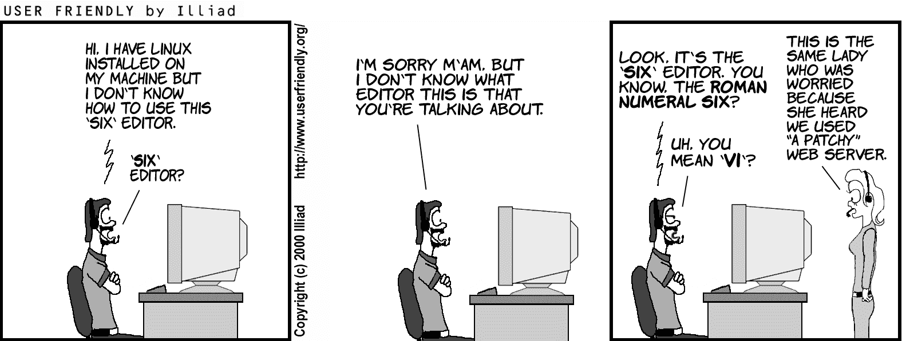

## 第 1 章. 介绍 `vi` 和 `Vim`

计算机日常最重要的用途之一就是处理文本：撰写新文本、编辑和重新排列现有文本、删除或重写错误和过时的文本。如果你使用 Microsoft Word 等文字处理程序，那就是你在做的事情！如果你是程序员，你也在处理文本：程序的源代码文件以及开发所需的辅助文件。文本编辑器处理任何文本文件的内容，无论这些文件包含数据、源代码还是句子。

本书关于使用两个相关的文本编辑器进行文本编辑：`vi` 和 `Vim`。`vi` 作为标准 Unix^(1) 文本编辑器有着悠久的传统。`Vim` 在 `vi` 的命令模式和命令语言的基础上构建，提供比原版多出至少一个数量级的强大功能和能力。

## 文本编辑器和文本编辑

开始吧。

### 文本编辑器

Unix 文本编辑器随着时间的推移而演进。最初，有 *行编辑器*，例如 `ed` 和 `ex`，用于在连续进纸打印机上使用的串行终端。（是的，人们真的在这种东西上编程！包括你们的作者之一。）行编辑器之所以被称为行编辑器，是因为你一次只处理程序的一行或几行。

随着具有光标寻址的阴极射线管（CRT）终端的引入，行编辑器演变为 *屏幕编辑器*，例如 `vi` 和 `Emacs`。屏幕编辑器让你一次处理一个全屏的文件，并让你可以轻松地在屏幕上的行之间移动。

随着图形用户界面（GUI）环境的引入，屏幕编辑器进一步演变为图形文本编辑器，在其中你使用鼠标滚动文件的可见部分、移动到文件中的特定位置并选择要执行操作的文本。基于 X Window 系统的此类文本编辑器的例子有基于 Gnome 系统的 `gedit` 和 MS-Windows 上的 `Notepad++`。还有其他。

对我们特别感兴趣的是，流行的屏幕编辑器已经演变为图形编辑器：^(2) GNU `Emacs` 提供多个 X 窗口，`Vim` 通过其 `gvim` 版本也提供。图形编辑器继续与原始的基于屏幕的版本完全相同地工作，使得过渡到 GUI 版本几乎是微不足道的。

在 Unix 系统上的所有 *标准* 编辑器中，`vi` 是你最应该掌握的。^(3) 与 `Emacs` 不同，它几乎以相同的形式存在于每个现代 Unix 系统上，从而提供了一种文本编辑的通用语言。^(4) 同样的话也可以说 `ed` 和 `ex`，但屏幕编辑器及其基于 GUI 的后代要容易得多使用。（事实上如此，以至于行编辑器通常已不再使用。）

`vi` 存在多种实现。有原始的 Unix 版本，还有多个“克隆”：从头编写的程序，其行为像 `vi` 一样，但不基于原始 `vi` 源代码。其中，[`Vim`](https://www.vim.org) 已成为最受欢迎的。

在 第一部分 的章节中，我们教你如何以一般意义上使用 `vi`。这些章节中的所有内容都适用于所有版本的 `vi`。然而，我们在 `Vim` 的上下文中进行讲解，因为这很可能是你系统上拥有的版本。阅读时，请随意将“`vi`”理解为代表“`vi` 和 `Vim`”。

#### 注意

`vi` 是 *可视* 编辑器的缩写，发音为“vee-eye”。这在 图 1-1 中以图形方式说明。




对许多初学者来说，`vi` 看起来不直观且笨重——与其使用专门的控制键来进行文字处理功能并让你正常输入，它几乎使用所有常规键盘按键来发出命令。当键盘按键用于发出命令时，编辑器被称为处于 *命令模式*。你必须进入特殊的 *插入模式* 才能在屏幕上输入实际文本。此外，似乎有那么多命令。

一旦你开始学习，你就会意识到编辑器设计得很好。你只需要几个按键就能让它执行复杂任务。随着你学习 `vi`，你会学习到快捷方式，将越来越多的编辑工作转移到计算机上——这才是它应有的位置。

`vi` 和 `Vim`（像任何文本编辑器一样）并不是“所见即所得”的字处理器。如果你想生成格式化的文档，你必须输入特定的指令（有时称为 *格式化代码*），这些指令由单独的格式化程序使用来控制打印副本的外观。例如，如果你想缩进几段文字，你就在缩进开始和结束处放置代码。格式化代码允许你尝试或更改打印文件的外观，在许多方面它们赋予你比字处理器更多的文档外观控制权。

格式化代码是更广义上所知的 *标记语言* 中的特定动词。^(5) 近年来，标记语言的流行度重新上升。值得注意的是 Markdown 和 AsciiDoc，^(6) 尽管还有其他。或许今天最广泛使用的标记语言是超文本标记语言（HTML），用于创建互联网网页。

除了刚刚提到的标记语言之外，Unix 还支持 `troff` 格式化包。^(7) [TeX](http://www.ctan.org) 和 [LaTeX](http://www.latex-project.org) 格式化程序是流行且常见可用的替代方案。使用这些标记语言最简单的方法是使用文本编辑器。

### Note
`vi` 确实支持一些简单的格式化机制。例如，你可以让它在到达行尾时自动换行，或自动缩进新行。此外，`Vim` 提供自动拼写检查。

像任何技能一样，你编辑得越多，基础就变得越容易，你能完成的事情就越多。一旦你习惯了编辑时拥有的所有功能，你可能永远不想再回到任何“更简单”的编辑器。

## Text Editing
编辑的组成部分是什么？首先，你想要 *插入* 文本（一句被遗忘的词或新的或缺失的句子），并且你想要 *删除* 文本（一处多余的字符或整段段落）。你还需要 *更改* 字母和单词（以更正拼写错误或反映对术语的想法改变）。你可能想要 *移动* 文本从一个位置到文件另一部分。偶尔，你想要 *复制* 文本以在文件另一部分重复它。

与许多字处理器不同，`vi` 的命令模式是初始或默认模式。复杂的交互式编辑只需几个按键即可完成。要插入原始文本，你只需给出几个“插入”命令之一然后开始输入。

基本命令使用一个或两个字符。例如：

`i`

: 

插入

`cw`

: 

更改单词

使用字母作为命令，你可以高速编辑文件。你不必记住一堆功能键或伸展手指去按尴尬的键组合。你永远不必把手从键盘上移开，或在多级菜单中乱搞！大多数命令可以通过执行它们的字母来记住。几乎所有命令都遵循相似的模式并且相互关联。

总体而言，`vi` 和 `Vim` 命令：
* 区分大小写（大写和小写按键含义不同；`I` 与 `i` 不同）。
* 在你输入时不会显示（或“回显”）在屏幕上。
* 不要求你在命令后按 ENTER。

还有一组命令会在屏幕底行回显。底行命令前面有不同的符号。斜杠（`/`）和问号（`?`）开始搜索命令，并在 第 3 章，“快速移动” 中讨论。冒号（`:`）开始所有 `ex` 命令。`ex` 命令是 `ex` 行编辑器使用的命令。`ex` 编辑器在你使用任何版本的 `vi` 时都可用，因为 `ex` 是底层编辑器，而 `vi` 实际上只是其“视觉”模式。`ex` 命令和概念在 第 5 章，“介绍 ex 编辑器” 中全面讨论，但本章向你介绍用于在不保存编辑的情况下退出文件的 `ex` 命令。

# A Brief Historical Perspective
在我们深入探讨 `vi` 和 `Vim` 的方方面面之前，了解 `vi` 对你环境的世界观会有所帮助。特别是，这将帮助你理解 `vi` 许多其他晦涩的错误信息，并欣赏 `Vim` 如何超越原始 `vi` 而演进。

`vi` 可追溯到计算机用户通过串行线路连接到中央小型计算机的 CRT 终端工作的时间。世界各地存在并使用着数百种不同的终端。它们都执行相同类型的操作（清除屏幕、移动光标等），但使它们执行这些操作的命令是不同的。此外，Unix 系统让你选择用于退格、生成中断信号以及其他在串行终端有用的命令（如暂停和恢复输出）的字符。这些功能由 `stty` 命令管理（并且至今仍在管理）。

原始的 Berkeley Unix 版本的 `vi` 将终端控制信息从代码中抽象出来（这很难更改），放入一个易于更改的文本文件数据库中，即 **终端** **功能**（这很容易更改），由 `termcap` 库管理。20 世纪 80 年代初，System V 引入了二进制 **终端** **信息** 数据库和 `terminfo` 库。这两个库在功能上大致等效。为了告诉 `vi` 你使用的是哪个终端，你必须设置 `TERM` 环境变量。这通常在 shell 启动文件（如你的个人 `*.profile` 或 `*.login`）中完成。

`termcap` 库不再使用。GNU/Linux 和 BSD 系统使用 `ncurses` 库，它提供了与 System V `terminfo` 库的数据库和功能兼容的超集。

今天，每个人都在图形环境中使用终端模拟器（如 Gnome Terminal）。系统几乎总是会为你设置 `TERM`。

### Note
当然，你也可以从 PC 的非 GUI 控制台使用 `Vim`。这在单用户模式下进行系统恢复工作时非常有用。不过，愿意定期这样工作的人已经不多了。

对于日常使用，你可能希望使用 `vi` 的 GUI 版本，例如 `gvim`。在 Microsoft Windows 或 macOS 系统上，这很可能是默认设置。然而，当你在终端模拟器内部运行 `vi`（或同年代的其他屏幕编辑器）时，它仍然使用 `TERM` 和 `terminfo` 并注意 `stty` 设置。而在终端模拟器内部使用它，与其他任何方式一样容易学习 `vi` 和 `Vim`。

关于 `vi` 的另一个重要事实是，它是在 Unix 系统比今天不稳定得多的时候开发的。过去的 `vi` 用户必须准备好系统在任意时间崩溃，因此 `vi` 包含在系统崩溃时正在编辑的文件恢复支持。^(8) 因此，当你学习 `vi` 和 `Vim` 并看到可能发生的各种问题的描述时，请牢记这些历史发展。


# 打开和关闭文件

你可以使用 `vi` 编辑任何文本文件。编辑器会将待编辑的文件复制到 *缓冲区*（在内存中临时保留的区域），显示缓冲区（尽管一次只能看到一屏内容），并允许你添加、删除和更改文本。当你保存修改时，编辑器会将编辑后的缓冲区复制回永久文件，替换同名旧文件。请记住，你始终在缓冲区中操作文件的 *副本*，并且你的修改在保存缓冲区之前不会影响原始文件。保存修改也称为“写入缓冲区”，或更常见地称为“写入文件”。

## 从命令行打开文件

`vim` 是 Unix 命令，用于为现有文件或全新文件调用 Vim 编辑器。`vim` 命令的语法是：

```
$ vim [filename]
```

or

```
$ vi [filename]
```

在现代系统中，`vi` 通常只是指向 Vim 的链接。这些命令行中显示的方括号表示 `filename` 是可选的。方括号不应输入。`$` 是 shell 提示符。

如果省略 `filename`，编辑器会打开一个无名缓冲区。你可以在将缓冲区写入文件时指定名称。不过现在，让我们坚持在命令行上命名文件。

`filename` 在其目录内必须是唯一的。（某些操作系统将目录称为 *文件夹*；它们是同一回事。）

在 Unix 系统中，`filename` 可以包含任何 8 位字符，除了斜杠（/），它被保留用作路径名中文件和目录之间的分隔符，以及 ASCII NUL，即所有位为零的字符。你甚至可以通过在空格前输入反斜杠（\\）在 `filename` 中包含空格。（MS-Windows 系统不允许在文件名中使用反斜杠 \[\\\] 和冒号 \[:\] 字符。）然而实际上，文件名通常由大写和小写字母、数字以及点号（.）和下划线（\_）的任意组合构成。请记住 Unix 是区分大小写的：小写字母与大写字母不同。还请记住，你必须按 `ENTER` 告诉 shell 你已完成命令输入。

当你想在目录中打开一个新文件时，使用 `vi` 命令指定新的 `filename`。例如，如果你想在当前目录中打开一个名为 `practice` 的新文件，你将输入：

```
$ vi practice
```

由于这是一个新文件，缓冲区为空，屏幕如下所示：

```
~
~
~
"practice" [New file]
```

屏幕左侧列中的波浪号（~）表示文件中没有文本，甚至没有空行。屏幕底部的提示行（也称为状态行）会回显文件的名称和状态。

你也可以通过指定其 `filename` 来编辑目录中的任何现有文本文件。假设存在一个 Unix 文件，其路径名为 `/home/john/letter`。如果你已在 `/home/john` 目录中，使用相对路径名。例如：

```
$ vi letter
```

将文件 `letter` 的副本带到屏幕上。

如果你在另一个目录中，提供完整路径名以开始编辑：

```
$ vi /home/john/letter
```

## 从图形界面打开文件

尽管我们（强烈）建议你熟悉命令行，你也可以直接从图形界面环境中对文件运行 Vim。通常，你右键单击文件，然后从弹出的菜单中选择类似“打开方式…”的选项。如果 Vim 已正确安装，它将是打开文件的可用选项之一。

通常，你也可以直接从菜单系统中启动 Vim，在这种情况下，你需要使用 `ex` 命令 `:e filename` 告诉它要编辑哪个文件。

我们无法提供更具体的说明，因为今天使用的图形界面环境实在太多。

## 打开文件时的问题

*   *你看到以下其中一条消息：*

    ```
    Visual needs addressable cursor or upline capability
    terminal: Unknown terminal type
    Block device required
    Not a typewriter
    ```

    你的终端类型未定义，或者你的 `terminfo` 条目可能有问题。输入 `:q` 退出。通常，将 `$TERM` 设置为 `vt100` 就足够开始使用了，至少以最基本的方式。如需进一步帮助，你可以使用互联网搜索引擎或流行的技术问答论坛，例如 [Stack Overflow](https://stackoverflow.com)。

*   *当你认为文件已存在时出现* `[new file]` *消息。*

    检查 `filename` 中的大小写是否正确（Unix 文件名区分大小写）。如果正确，那么你可能在错误的目录中。输入 `:q` 退出。然后检查你是否在该文件的正确目录中（在 shell 提示符下输入 `pwd`）。如果你在正确的目录中，检查目录中的文件列表（使用 `ls`），看看文件是否以稍有不同的名称存在。

*   *你调用* `vi` *但你得到一个冒号提示（表示你处于* `ex` *行编辑模式）。*

    你可能在 `vi` 绘制屏幕之前输入了中断（通常是 `CTRL-C`）。在 `ex` 提示符（`:`）下输入 `vi` 来进入 `vi`。

*   *以下其中一条消息出现：*

    ```
    [Read only]
    File is read only
    Permission denied
    ```

    “只读”意味着你只能查看文件；你无法保存所做的任何更改。你可能以 `view` 模式调用了 `vi`（使用 `view` 或 `vi -R`），或你对该文件没有写权限。请参阅章节 “从命令行打开文件”。

*   *以下其中一条消息出现：*

    ```
    Bad file number
    Block special file
    Character special file
    Directory
    Executable
    Non-ascii file
    file non-ASCII
    ```

    你调出编辑的文件不是普通文本文件。输入 `:q!` 退出，然后检查你想要编辑的文件，也许使用 `file` 命令。

*   *当你因为前面提到的一种困难而输入* `:q` *时，出现此消息：*

    ```
    E37: No write since last change (add ! to override)
    ```

    你在不知情的情况下修改了文件。输入 `:q!` 离开编辑器。本次会话的更改不会保存到文件中。

## 操作方式

如前所述，当前“模式”的概念是 `vi` 工作方式的基础。有两种模式，*命令模式* 和 *插入模式*。（`ex` 命令模式可以被视为第三种模式，但我们现在忽略它。）你从命令模式开始，在该模式下每个按键都代表一个命令。^(9) 在插入模式下，你输入的所有内容都成为文件中的文本。

有时，你可能会意外进入插入模式，反之，你也可能意外离开插入模式。在任何情况下，你输入的内容很可能会以你不希望的方式影响你的文件。

按 `ESC` 键强制编辑器进入命令模式。如果你已在命令模式中，按下 `ESC` 键时编辑器会发出蜂鸣声。（因此命令模式有时被称为“蜂鸣模式”。）

一旦安全地进入命令模式，你可以继续修复任何意外更改，然后继续编辑文本。（请参阅章节 “删除问题”，并参阅章节 “撤销”。）

## 保存并退出文件

你可以随时停止对文件的操作，保存修改并返回到命令提示符（如果你在终端窗口中运行）。退出并保存修改的命令是 `ZZ`。请注意 `ZZ` 是大写。

假设你确实创建了一个名为 `practice` 的文件来练习 `vi` 命令，并且输入了六行文本。要保存文件，首先通过按 `ESC` 确认你处于命令模式，然后输入 `ZZ`：

| 键入 || 结果 |

| --- | --- |

| 

`ZZ`

 || 

```
"practice" [New] 6L, 104C written
```

 |


输入写并保存命令，`ZZ`。你的文件将作为普通磁盘文件保存。

`$ ls`

`ch01.asciidoc ch02.asciidoc practice`

列出目录中的文件会显示你创建的新文件 `practice`。

你也可以使用 `ex` 命令保存修改。输入 `:w` 保存（写入）文件但不退出；输入 `:q` 在未做任何修改时退出；输入 `:wq` 既保存修改又退出。 （`:wq` 等价于 `ZZ`。）我们将在 第 5 章 中完整解释如何使用 `ex` 命令；目前，你只需记住几个用于写入和保存文件的命令。

## 不保存修改而退出

当你初学 Vim 时，尤其是如果你是个大胆的试验者，还有两个 `ex` 命令可以帮助你摆脱可能造成的混乱。

如果你想清除本次会话中所有的修改然后重新加载原始文件呢？命令如下：

```
:e! ENTER
```

会重新加载文件的最后保存版本，以便你重新开始。

然而，如果你想清除修改然后直接退出编辑器呢？命令如下：

```
:q! ENTER
```

会立即退出你正在编辑的文件并返回到命令提示符。使用这两个命令，你将丢失自上次保存文件以来缓冲区中的所有修改。编辑器通常不会让你丢弃修改。添加到 `:e` 或 `:q` 命令中的感叹号会使其覆盖此限制，即使缓冲区已被修改也会执行操作。

从现在开始，我们在 `ex` 模式命令中不再显示 ENTER 键，但你必须使用它才能让编辑器执行命令。

### 保存文件时出现的问题

*   *你尝试写入文件，但收到以下其中一条消息：*

    ```
    File exists
    File file exists - use w!
    [Existing file]
    File is read only
    ```

    输入 `:w!` `file` 覆盖现有文件，或输入 `:w` `newfile` 将编辑版本保存到新文件中。

*   *你想写入文件，但没有写入权限。你会收到“Permission denied.” 消息。*

    使用 `:w` `newfile` 将缓冲区写入新文件。如果你对目录有写入权限，可以使用 `mv` 命令用你的副本替换原始版本。如果你对目录没有写入权限，输入 `:w` `pathname/file` 将缓冲区写入你有写入权限的目录（例如你的主目录或 `/tmp`）。请注意不要覆盖该目录中已有的文件。

*   *你尝试写入文件，但收到文件系统已满的消息。*

    如今，500 GB 的硬盘被认为很小，这类错误通常很少见。如果确实发生这种情况，你有几种选择。首先，尝试将文件写入其他文件系统上的安全位置（例如 `/tmp`），以便保存数据。然后尝试使用 `ex` 命令 `:pre`（`:preserve` 的简写）强制系统保存缓冲区。如果仍不行，请查找一些可删除的文件，如下所示：

    *   打开图形文件管理器（例如 GNU/Linux 上的 Nautilus）并尝试找到不需要且可以删除的旧文件。

    *   使用 `CTRL-Z` 挂起 `vi` 并返回到 shell 提示符。然后你可以使用各种 Unix 命令尝试查找可删除的大文件：

        *   `df` 指示给定文件系统或整个系统上 **d**isk 空间 **f**ree 的多少。

        *   `du` 指示给定文件和目录使用了多少 **d**isk 块 **u**sed。`du -s * | sort -nr` 是一种轻松获取按使用空间降序排列的文件和目录列表的方法。

    删除文件完成后，使用 `fg` 将 `vi` 重新调回前台；然后你可以正常保存工作。

顺便说一下，除了使用 `CTRL-Z` 和作业控制外，你还应该知道可以输入 `:sh` 启动一个新的 shell 进行工作。输入 `CTRL-D` 或 `exit` 终止 shell 并返回到 `vi`。 （这甚至在 `gvim` 中也有效！）

你也可以使用类似 `:!du -s *` 的命令在 `vi` 内部运行 shell 命令，并在命令完成后返回编辑。

### 练习

唯一学习 `vi` 和 Vim 的方法就是练习。你现在已经足够了解如何创建新文件并返回命令提示符。创建一个名为 `practice` 的文件，插入一些文本，然后保存并退出文件。

在当前目录打开名为 `practice` 的文件：`$ vi practice`

进入插入模式：`i`

插入文本：`any text you like`

返回命令模式：`ESC`

退出 `vi`，保存修改：`ZZ`

^1 如今，“Unix”一词包括源自原始 Unix 代码库的商业系统以及源代码可用的 Unix 类似系统。Solaris、AIX 和 HP-UX 是前者的例子，而 GNU/Linux 和各种 BSD 衍生系统是后者的例子。 在此范畴下还包括 macOS 的终端环境、MS-Windows 上的 Windows Subsystem for Linux（WSL）以及 Windows 上的 Cygwin 和其他类似环境。除非另有说明，本书中的所有内容均适用于所有这些系统。

^2 也许就像 Pokémon 一样？

^3 如果你没有安装 `vi` 或 Vim，请参阅 附录 D，“vi 和 Vim：源代码和构建”⁠。

^4 GNU Emacs 已成为 Emacs 的通用版本。唯一的问题是它在大多数系统上不是标准配置；你必须自行获取并安装，即使在某些 GNU/Linux 系统上也是如此。

^5 源自使用红铅笔在排版样张或校样上“标记”更改。

^6 有关这些语言的更多信息，请分别参阅 [*https://en.wikipedia.org/wiki/Markdown*](https://en.wikipedia.org/wiki/Markdown) 和 [*http://asciidoc.org*](http://asciidoc.org)。本书使用 AsciiDoc 编写。

^7 `troff` 用于激光打印机和排版机。它的“双胞胎兄弟”是 `nroff`，用于行式打印机和终端。两者接受相同的输入语言。遵循常见的 Unix 惯例，我们都称之为 `troff`。今天，使用 `troff` 的任何人都使用 GNU 版本，[`groff`](http://www.gnu.org/software/groff)。

^8 值得庆幸的是，这类情况已很少见，尽管系统仍可能因外部原因（如停电）而崩溃。如果你为系统配备了不间断电源，或笔记本电脑电池健康，甚至这种担忧也会消失。

^9 请注意，`vi` 和 Vim 并没有针对每个可能按键的命令。相反，在命令模式下，编辑器期望接收代表命令的按键，而不是要输入到文件中的文本。我们将在后面的章节 “使用 map 命令” 中利用未使用的按键。
