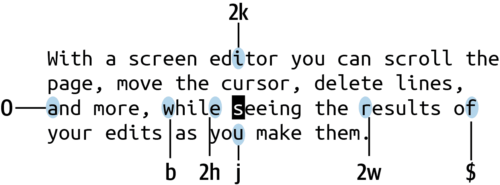
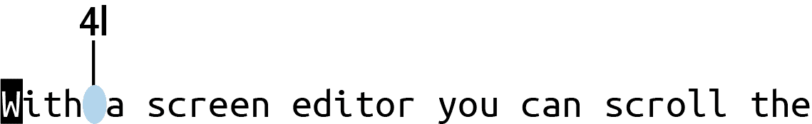
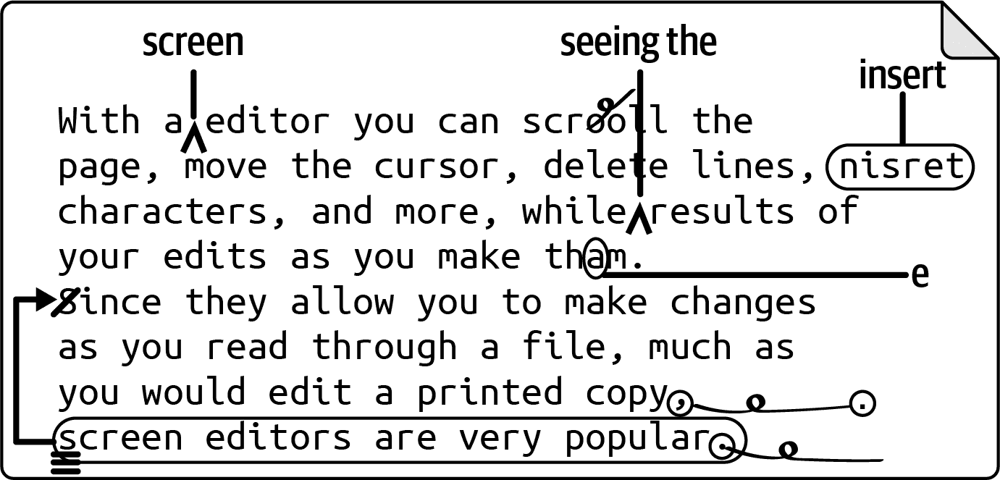
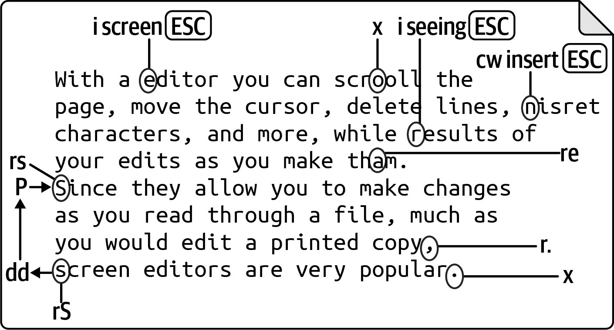

## 第 2 章. 简单编辑

本章向你介绍使用 `vi` 和 Vim 进行编辑，并以教程形式编写。在其中你将学习如何移动光标以及如何进行一些简单编辑。如果你从未使用过这些编辑器，你应该阅读整章。

后续章节将展示如何扩展技能以执行更快、更强大的编辑。对熟练用户来说，最大的优势之一是可以选择许多选项。当然，就像许多高级工具一样，对 `vi` 和 Vim 新手来说最大的 *缺点* 之一是需要学习如此多的不同编辑器命令。


你无法通过死记硬背每一个 `vi` 命令来学会使用编辑器。先从学习本章介绍的基本命令开始。注意这些命令在用法上共有的模式。我们在遇到时指出这些模式。

在学习过程中，注意寻找可以委托给编辑器完成的更多任务，然后找到实现它的命令。在后面的章节中你将学习 `vi` 和 `Vim` 的更多高级功能，但在掌握高级功能之前，你必须先掌握简单功能。

本章涵盖：
* 移动光标
* 简单编辑：添加、更改、删除、移动和复制文本
* 进入插入模式的更多方法
* 连接行
* 模式指示符

# vi 命令

正如我们所见，`vi` 和 `Vim` 有两种主要模式：*命令模式* 和 *插入模式*。命令行（或冒号提示），在其中发出 `ex` 命令，可以被视为第三种模式；其使用更为高级，将在后面的章节中介绍。

当你首次打开一个文件时，你处于命令模式，编辑器等待你输入命令。命令使你能够在文件中任意移动、执行编辑，或进入插入模式以添加新文本。命令也可以用于退出文件（保存或忽略你的编辑）以返回到 shell 提示符。

你可以将不同的模式视为代表两个不同的键盘。在插入模式下，你的键盘功能正常。在命令模式下，每个键都有新的含义或启动某种指令。

有几种方法可以告诉 `Vim` 你想要开始插入模式。其中最常见的是按 `i`。`i` 不会在屏幕上显示，但按下后，你输入的任何内容 *都会* 在屏幕上显示并进入缓冲区。光标标记当前插入点。^(1) 要告诉 `Vim` 你想要停止插入文本，请按 `ESC`。按下 `ESC` 会将光标向后移动一个空格（使其位于你键入的最后一个字符上）并返回到命令模式。

例如，假设你打开了一个新文件并想插入单词“introduction”。如果你键入击键 `iintroduction`，屏幕上显示的是：

```
introduction
```

当你打开一个新文件时，`Vim` 从命令模式开始并将第一个击键（`i`）解释为插入命令。插入命令后的所有击键都被视为文本，直到你按下 `ESC`。如果在插入模式下需要更正错误，请使用退格键并覆盖错误。根据你的终端及其设置，退格可能擦除你之前键入的内容或只是向后移动。在任何情况下，你向后移动的内容都会被删除。请注意，你不能使用退格键向后退回到你进入插入模式的点之前。（如果你已禁用 `vi` 兼容性，`Vim` 允许你在进入插入模式的点之前退格。大多数 GNU/Linux 发行版将 `Vim` 设置为禁用 `vi` 兼容性，因此这可能对你开箱即用。）

`Vim` 有一个选项可以让你定义右边界并在到达时自动提供回车。对于现在来说，在你插入文本时，按 `ENTER` 来换行。

有时你不知道自己处于插入模式还是命令模式。每当 `Vim` 的响应与你预期不符时，按一次或两次 `ESC` 来检查你所在的模式。当你听到蜂鸣声时，你处于命令模式。^(2)

## 命令模式下移动光标

在一次编辑会话中，你可能只花费少量时间在插入模式下添加新文本；大部分时间你将通过在文件中移动并发出命令来对现有文本进行编辑。

在命令模式下，你可以将光标定位在文件中的任何位置。由于你开始所有基本编辑（更改、删除和复制文本）都是通过将光标放在你想要更改的文本上，因此你希望能够尽可能快速地将光标移动到该位置。

有 `vi` 命令来移动光标：
* 向上、向下、向左或向右——每次移动一个 *字符*
* 通过 *文本* 块向前或向后，例如单词、句子或段落
* 通过文件向前或向后，每次移动一个 *屏幕*

在 图 2-1 中，第三行 *seeing* 中反视频的 `s` 标记当前光标位置。圆圈显示光标从当前位置移动到执行各种 `vi` 命令后将得到的位置。



### 单步移动

键 `h`、`j`、`k` 和 `l`，就在你的指尖下方，按如下方式移动光标：

`h`
:
向左移动一个空格

`j`
:
向下移动一行

`k`
:
向上移动一行

`l`
:
向右移动一个空格

你也可以使用光标箭头键（←、↓、↑、→）、`+` 和 `-` 来上下移动，`CTRL-P` 和 `CTRL-N` 也可上下移动，或 `ENTER` 和 `BACKSPACE` 键，但它们都位置不便。

起初，使用字母键而不是箭头进行光标移动可能感觉别扭。但过了一会儿，你会发现这是你最喜欢 `vi` 和 `Vim` 的事情之一——你可以在不将手指移离键盘中央的情况下移动。

在移动光标之前，按 `ESC` 以确保你处于命令模式。使用 `h`、`j`、`k` 和 `l` 从当前光标位置向前或向后移动文件。当你在一个方向上移动到尽可能远时，你会听到蜂鸣声且光标停止。例如，一旦你在行的开头或结尾，就不能使用 `h` 或 `l` 换行到上一行或下一行；你必须使用 `j` 或 `k`。^(3) 同样，你不能将光标移动到表示无文本行的波浪号（~）之后，也不能将光标移动到文本的第一行之上。

### 数字参数

通常，你可能希望多次重复一个命令。不要一次又一次地键入命令，你可以在命令前加上数字。这被称为 *重复计数* 或 *复制因子*。

图 2-2 显示了命令 `4l` 如何将光标向右移动四个字符位置，就像你键入 `l` 四次（`llll`）一样。



重复计数 *在* 它所量化的命令 *之前*，因为如果它在之后，`vi` 就永远不知道数字何时结束。

能够乘以命令为你学习的每个命令提供更多选项和能力。请记住这一点，因为我们将介绍更多命令。

### 行内移动

当你保存文件 `practice` 时，`Vim` 显示一条消息，告诉你该文件有多少行。*行* 不一定与屏幕上显示的可视行长度相同。行是 `ENTER` 键之间输入的任何文本。（*换行* 字符在插入模式下按下 `ENTER` 键时插入到文件中。）如果你在按下 `ENTER` 之前键入 200 个字符，`Vim` 将把所有这些字符视为单行（即使这些字符在屏幕上可见占据多行）。

我们在 第 1 章，“介绍 vi 和 Vim” 中顺便提到，`vi` 和 `Vim` 有一个选项，允许你设置一个距离行尾（行末）的距离，在该距离处它们自动插入换行符。该选项是 `wrapmargin`（其缩写为 `wm`）。你可以将 `wrapmargin` 设置为 10 个字符：

```
:set wm=10
```

该命令不影响你已键入的行。一旦设置，尝试输入一些新行，你会看到 `Vim` 自动为你换行，在单词之间断行。我们将在 第 7 章，“高级编辑” 中谈论更多关于设置选项的内容，但这个选项实在等不及了！

### 提示


# 移动

如果你将此命令放入主目录中名为 `*.exrc` 的文件中，编辑器在每次启动时都会自动执行它。我们将在本书后面介绍 `vi` 和 `Vim` 的启动文件。

如果你不使用自动的 `wrapmargin` 选项，你应该用 `ENTER` 换行以保持行长度可控。

涉及行内移动的两个有用命令是：

`0` (数字零)

:

移至行首。

`$`

:

移至行尾。

行号在以下示例中显示。（行号可以通过使用 `number` 选项来显示，该选项可通过在命令模式下输入 `:set nu` 来启用。此操作在 第 5 章 中描述。）请注意，行号不是文件内容的一部分；编辑器为方便你而显示它们：

```
1  With a screen editor you can scroll the page,
2  move the cursor, delete lines, insert characters,
   and more, while seeing the results of your edits
   as you make them.
3  Screen editors are very popular.
```

逻辑行数（三行）与你在屏幕上看到的可视行数（五行）不对应。如果光标位于单词 `delete` 中的 `d` 上，并且你输入了 `$`，光标将移动到单词 `them` 后的句点。如果输入 `0`，光标将移回第二行开头的单词 `move` 中的字母 `m`。

## 按文本块移动

你也可以通过文本块（如单词、句子、段落等）移动光标：

`w`

:

向前移动一个词（字母数字字符构成单词）

`W`

:

向前移动一个词（以空白分隔）

`b`

:

向后移动一个词（字母数字字符构成单词）

`B`

:

向后移动一个词（以空白分隔）

`G`

:

转到指定行

`w` 命令每次向前移动一个词，将符号和标点视为等同于单词。以下行显示了通过 `w` 的光标移动：

```
cursor, delete lines, insert characters,
```

你也可以使用 `W` 命令按词向前移动，不计符号和标点。（你可以将其视为“large”或“capital” `W`ord。）

使用 `W` 的光标移动如下所示：

```
cursor, delete lines, insert characters,
```

要向后按词移动，请使用 `b` 命令。大写 `B` 允许你按词向后移动，不计标点（按 Word）。

如前所述，移动命令接受数字参数；因此，使用 `w` 或 `b` 命令时可以乘以数字。`2w` 向前移动两个词；`5B` 向后移动五个词，不计标点。

要转到特定行，可以使用 `G` 命令。普通的 `G` 转到文件末尾，`1G` 转到文件顶部，`42G` 转到第 42 行。这在后面 “G（Go To）命令” 部分有更详细的描述。

我们在 第 3 章，“快速移动” 中讨论按句子和段落移动。现在，请练习使用你已知的光标移动命令，并结合数字乘数。

# 简单编辑

当你在文件中输入文本时，它很少是完美的。你会发现拼写错误或想要改进某个短语；有时你的程序有 bug。一旦输入文本，你必须能够更改它、删除它、移动它或复制它。图 2-3 显示了你可能想要对文件进行的编辑类型。编辑由校对标记表示。



在 `vi` 中，你可以使用几个基本按键执行这些编辑：`i` 用于插入（你已经见过）；`a` 用于追加；`c` 用于更改；和 `d` 用于删除。要移动或复制文本，你使用成对的命令。你用 `d` 表示“delete”，然后用 `p` 表示“put”来移动文本；你用 `y` 表示“yank”，然后用 `p` 表示“put”来复制文本。你也可以使用 `x` 删除单个字符和 `r` 替换单个字符。某些命令重复时，如 `dd`，表示“将命令应用于整行”。其他命令大写时，如 `P`，表示“在当前行上方执行操作，而不是下方”。本节描述了每种编辑类型。图 2-4 显示了你在 图 2-3 中标记的编辑所使用的 `vi` 命令。



你可以练习的文件文本是可用的；你可以从本书配套的 [GitHub 仓库](https://www.github.com/learning-vi/vi-files) 获取。有关更多信息，请参阅 “访问文件” 部分。

## 插入新文本

你已经见过插入命令 (`i`) 用于将文本输入到新文件中。你也在编辑现有文本时使用插入命令来添加缺失的字符、单词和句子。在文件 `practice` 中，假设你有以下句子：

```
you can scroll
the page, move the cursor, delete
lines, and insert characters.
```

光标位置如图所示。要在句子开头插入 `With a screen editor`，请输入以下内容：

| 按键 | 结果 |
|---|---|
| `2k` | 使用 `k` 命令将光标向上移动两行，到想要插入的行。 |
| `iWith□a□` | 按 `i` 进入插入模式并开始插入文本。□ 表示一个空格。 |
| `screen□editor□` `ESC` | 完成插入文本，并按 `ESC` 结束插入并返回命令模式。 |

## 追加文本

你可以使用追加命令 `a` 在文件的任何位置追加文本。这与 `i` 几乎相同，只是文本插入在光标 *之后* 而不是 *之前*。你可能注意到，当你按 `i` 进入插入模式时，光标在输入一些文本后才移动。相比之下，当你按 `a` 进入插入模式时，光标向右移动一个空格。当你输入文本时，它会出现在原始光标位置之后。

## 更改文本

你可以使用更改命令 `c` 替换文件中的任何文本。要告诉 `c` 要更改多少文本，你将 `c` 与移动命令组合起来。这样，移动命令就充当 `c` 命令影响的 `text object`。例如，`c` 可用于从光标处更改文本：

`cw`

:

到单词末尾

`c2b`

:

向后两个词

`c$`

:

到行尾

`c0`

:

到行首

发出更改命令后，你可以用任意数量的新文本替换已识别的文本，可以是零个字符、一个词或数百行。`c` 与 `i` 和 `a` 一样，会让你保持在插入模式，直到你按下 `ESC` 键。

当更改仅影响当前行时，`vi` 用 `$` 标记要更改的文本的末尾，以便你可以看到行中受影响的部分。如果不在兼容模式下，`Vim` 的行为不同；它只是删除要更改的文本并进入输入模式。

### 单词

要更改一个词，将 `c`（更改）命令与 `w` 用于词组合。你可以用更长或更短的词（或任意数量的文本）替换一个词（`cw`）。`cw` 可以被视为“删除标记的词并在按下 `ESC` 前插入新文本”。

假设你在文件 `practice` 中有以下行：

```
With an editor you can scroll the page,
```

并且想要将 `an` 更改为 `a screen`。你只需要更改一个词：

| 按键 | 结果 |
|---|---|
| `w` | 使用 `w` 移动到想要开始编辑的位置。 |


## 更改单词

按键 `cw` → 结果：
```
With  editor you can scroll the page,
```
给出更改单词命令。Vim 删除了 *an* 并进入插入模式。

按键 `a screen` `ESC` → 结果：
```
With a screen editor you can scroll the page,
```
输入替换文本，然后按 `ESC` 返回到命令模式。

`cw` 也适用于单词的一部分。例如，要将 *spelling* 改为 *spelled*，可以将光标定位在 *i* 上，输入 `cw`，然后输入 *ed*，最后按 `ESC` 结束。

## 行

要替换当前整行，请使用特殊更改命令 `cc`。`cc` 会更改整行，用在按下 `ESC` 之前输入的任意文本替换该行。光标在行上的位置无关紧要；`cc` 会替换整行文本。

在原始的 `vi` 中，像 `cw` 这样的命令与像 `cc` 这样的命令的工作方式不同。使用 `cw` 时，旧文本会保留直到你覆盖它，并且在按下 `ESC` 时，任何剩余的旧文本（直到 `$`）都会消失。而使用 `cc` 时，旧文本会先被清除，留下一个空白行供你插入文本。

“覆盖输入”方式适用于影响不到整行的任何更改命令，而“空白行”方式适用于影响一行或多行的任何更改命令。

在 Vim 中（如果未处于兼容模式），这两个命令都只是简单地删除指定的文本然后进入输入模式。

`C` 会替换从当前光标位置到行尾的字符。其效果等同于将 `c` 与特殊行尾指示符 `$` 组合 (`c$`)。

命令 `cc` 和 `C` 实际上是其他命令的快捷方式，因此它们不遵循 `vi` 命令的一般形式，即你不能指定文本对象作为命令结束的位置。在讨论删除和 yank 命令时，你会看到其他快捷方式。

## 字符

另一个替换编辑由 `r` 命令提供。`r` 用另一个单个字符替换单个字符。进行编辑后，你 *不* 需要按 `ESC` 返回到命令模式。以下行中有一个拼写错误：

```
Pith a screen editor you can scroll the page,
```

只需要更正一个字母。在这种情况下你不想使用 `cw`，因为你必须重新输入整个单词。相反，使用 `r` 来替换光标处的单个字符：

按键 `rW` → 结果：
```
With a screen editor you can scroll the page,
```
给出替换命令 `r`，后跟替换字符 *W*。

## 替换文本

假设你只想更改几个字符而不是整个单词。替换命令 (`s`) 单独使用时替换单个字符。加上前置计数，你可以替换相应数量的字符。与更改命令 (`c`) 一样，`vi` 会用 `$` 标记文本的最后一个字符，以便你可以看到将更改多少文本。Vim 只是简单地删除文本并进入输入模式。（你可以把 `s` 想象成 `r`，但进入插入模式而不是直接替换指定的字符[s]。）

`S` 命令，如同通常的大写命令一样，允许你更改整行。与 `C` 命令不同，`C` 命令从当前光标位置更改到行尾，而 `S` 命令会删除整行，无论光标位于何处。编辑器会将你在行首置于插入模式。前置计数会替换相应数量的行。（`S` 和 `cc` 在效果上基本等同。）

`s` 和 `S` 都将你置于插入模式；当你完成输入新文本后，按 `ESC`。

`R` 命令与它的小写对应命令一样用于替换文本。不同之处在于 `R` 只是进入 *overstrike mode*。你输入的字符会逐个替换屏幕上的内容，直到你输入 `ESC`。如果你在段落中间输入 `R`，最多只能覆盖一行；当你输入 `ENTER` 时，编辑器会打开新行， effectively 将你置于插入模式。

## 更改大小写

更改字母的大小写是一种特殊的替换形式。波浪号 (`~`) 命令会将小写字母改为大写，或将大写字母改为小写。将光标定位在你想要更改大小写的字母上，然后输入 `~`。字母的大小写会改变，光标移动到下一个字符。

提供数字前缀以更改多个字符的大小写。

如果你想一次更改多行文本的大小写，必须通过诸如 `tr` 之类的 Unix 命令过滤文本，详情请参阅 第 7 章。

## 删除文本

你也可以使用删除命令 `d` 删除文件中的任何文本。与更改命令一样，删除命令需要一个文本对象（要操作的文本量）。你可以按单词删除（`dw`）、按行删除（`dd` 和 `D`），或使用稍后会学到的其他移动命令。

对于所有删除操作，你先移动到想要编辑的位置，然后给出删除命令（`d`）和文本对象，例如 `w` 表示单词。

### 单词

假设文件中有以下文本：

```
Screen editors are are very popular,
since they allow you to make
changes as you read through a file.
```

光标定位如图所示。你想删除第一行中的一个 *are*：

按键 `2w` → 结果：
```
Screen editors are are very popular,
since they allow you to make
changes as you read through a file.
```
将光标移动到想要开始编辑的位置（*are*）。

按键 `dw` → 结果：
```
Screen editors are very popular,
since they allow you to make
changes as you read through a file.
```
给出删除单词命令（`dw`）以删除单词 *are*。

`dw` 会删除光标所在位置开始的单词。请注意，单词后面的空格也会被删除。

`dw` 也可以用于删除单词的一部分。在此示例中：

```
since they allowed you to make
```

你想从 *allowed* 的末尾删除 *ed*：

按键 `dw` → 结果：
```
since they allowyou to make
```
给出删除单词命令（`dw`）以删除从光标位置开始的单词剩余部分。

`dw` 总是会删除行上下一个单词之前的空格，但在本例中我们不想这样做。为了保留单词之间的空格，使用 `de`，它只删除到单词末尾。输入 `dE` 会删除到单词末尾，包括标点符号。^5

你也可以向后删除（`db`）或删除到行尾或行首（`d$` 或 `d0`）。

让我们澄清“words” 和 “Words” 之间的区别。假设文件中有以下文本：

```
This doesn't compute.
```

光标位于行首，按如下方式演示 `dw` 和 `dW` 之间的区别：

按键 `w` → 结果：
```
This doesn't compute.
```
将光标移动到 *d*。

按键 `dw` → 结果：
```
This 't compute.
```
删除光标下的单词，直到但不包括标点符号。

按键 `u` → 结果：
```
This doesn't compute.
```
将行恢复到之前的状态。

按键 `dW` → 结果：
```
This compute.
```
删除光标下的单词，直到下一个空白字符。

### 行

`dd` 命令删除光标所在整行。`dd` 不会删除部分行。与其对应命令 `cc` 一样，`dd` 是一个特殊命令。使用前面示例中的相同文本，光标定位在如图所示的第一行：

```
Screen editors are very popular,
since they allow you to make
changes as you read through a file.
```

你可以删除前两行：

按键 `2dd` → 结果：
```
changes as you read through a file.
```


Give the command to delete two lines (`2dd`). Note that even though the cursor was not positioned on the beginning of the line, the entire line is deleted.

The `D` command deletes from the cursor position to the end of the line. (`D` is a shortcut for `d$`.) For example, with the cursor positioned as shown:

```
Screen editors are very popular,
since they allow you to make
changes as you read through a file.
```

you can delete the portion of the line under and to the right of the cursor:

| 按键 | 结果 |
| --- | --- |
| `D` | ```
Screen editors are very popular,
since they allow you to make
changes 
``` |

Give the command to delete the portion of the line under and to the right of the cursor (`D`).

### 字符
Often you want to delete only one or two characters. Just as `r` is a special change command to replace a single character, `x` is a special delete command to delete a single character. `x` deletes only the character the cursor is on. In the line here:

```
zYou can move text by deleting text and then
```

you can delete the letter *z* by pressing `x`.^(6) A capital `X` deletes the character before the cursor. Prefix either of these commands with a number to delete that number of characters. For example, `5x` deletes the five characters under and to the right of the cursor. After using `x` or `X` you remain in command mode.

### 删除时的问题
* *你删除了错误的文本并且想要恢复它。*

There are several ways to recover deleted text. If you’ve just deleted something and you realize you want it back, simply type `u` to undo the last command (for example, a `dd`). This works only if you haven’t given any further commands, since `u` undoes only the most recent command. Alternatively, a `U` restores the line to its pristine state, the way it was before *any* changes were applied to it.

You can still recover a recent deletion, however, by using the `p` command, since `vi` saves the last nine deletions in nine numbered deletion registers. If you know, for example, that the third deletion back is the one you want to restore, type:

```
"3p
```

to “put” the contents of deletion register number three on the line below the cursor.

This works only for a deleted *line*. Words, or a portion of a line, are not saved in a register. If you want to restore a deleted word or line fragment, and `u` won’t work, use the `p` command by itself. This restores whatever you’ve last deleted.

Note that Vim supports “infinite” undo, which makes life much easier. See the section “扩展撤销” for more information.

#### 注
Undo undoes the last operation, whatever it was. Deleting two words by typing `dw` twice is two operations: `u` restores only the last deleted word. However, deleting two words by typing `2dw` is a single operation; `u` in this case restores both deleted words.

## 移动文本
Each time you delete a text block, that deletion is saved in a special, unnamed place, which we will call the *deletion register*.^(7) The register’s contents are overwritten upon each new deletion.

In `vi`, you move text by deleting it and then placing that deleted text elsewhere in the file, like a “cut and paste.” After deleting the text to be moved, move to another position in your file and use the put command (`p`) to place that text in the new position. You can move any block of text, although moving is more useful with lines than with words.

The put command (`p`) puts the text that is in the deletion register *after* the cursor position. The uppercase version of the command, `P`, puts the text *before* the cursor. If you delete one or more lines, `p` puts the deleted text on a new line (or lines) below the cursor, whereas `P` puts the text on a new line (or lines) above the cursor. If you delete less than an entire line, `p` puts the deleted text into the current line, after the cursor.

Suppose in your file *practice* you have the text:

```
You can move text by deleting it and then,
like a "cut and paste,"
placing the deleted text elsewhere in the file.
each time you delete a text block.
```

and you want to move the second line, *like a “cut and paste,”* below the third line. Using delete, you can make this edit:

| 按键 | 结果 |
| --- | --- |
| `dd` | ```
You can move text by deleting it and then,
placing the deleted text elsewhere in the file.
each time you delete a text block.
``` |

With the cursor on the second line, delete that line. The text is placed in the deletion register.

| 按键 | 结果 |
| --- | --- |
| `p` | ```
You can move text by deleting it and then,
placing that deleted text elsewhere in the file.
like a "cut and paste"
each time you delete a text block.
``` |

Give the put command, `p`, to restore the deleted line at the next line below the cursor. To finish reordering this sentence, you would also have to change the capitalization and punctuation (with `r`) to match the new structure.

#### 注
Once you delete text, you must restore it before the next change command or delete command. If you make another edit that saves text to the deletion register, your previously deleted text will be lost. You can repeat the put over and over, so long as you don’t make a new edit. In the section “使用寄存器”, you will learn how to save text you delete in a named register so that you can retrieve it later.

### 交换两个字母
You can use `xp` (delete character and put after cursor) to transpose two letters. For example, in the word *mvoe*, the letters *vo* are transposed (reversed). To correct a transposition, place the cursor on *v* and press `x`, then `p`. By coincidence, the word *transpose* helps you remember the sequence `xp`; `x` stands for *trans*, and `p` stands for *pose*.

There is no command to transpose words. The section “使用 map 命令” discusses a short sequence of commands that transposes two words.

## 复制文本
Often you can save editing time (and keystrokes) by copying a part of your file to use in other places. With the two commands `y` (for yank) and `p` (for put), you can copy any amount of text and put that copied text in another place in the file. A yank command copies the selected text into the deletion register, where it is held until another yank (or deletion) occurs. You can then place this copy elsewhere in the file with the put command.

As with change and delete, the yank command can be combined with any movement command (`yw`, `y$`, `y0`, `4yy`). Yank is most frequently used with a line (or more) of text, because to yank and put a word usually takes longer than simply to insert the word.

The shortcut `yy` operates on an entire line, just as `dd` and `cc` do. But the shortcut `Y`, for some reason, does not operate the way `D` and `C` do. Instead of yanking from the current position to the end of the line, `Y` yanks the whole line; that is, `Y` does the same thing as `yy`. (Use `y$` to yank from the current position to the end of the line.)

Suppose you have in your file *practice* the following text:

```
With a screen editor you can
scroll the page.
move the cursor.
delete lines.
```

You want to make three complete sentences, beginning each with *With a screen editor you can*. Instead of moving through the file and making this edit over and over, you can use a yank and put to copy the text to be added:

| 按键 | 结果 |
| --- | --- |
| `yy` | ```
With a screen editor you can
scroll the page.
move the cursor.
delete lines.
``` |

Yank the line of text that you want to copy into the register. The cursor can be anywhere on the line you want to yank (or on the first line of a series of lines).

| 按键 | 结果 |
| --- | --- |
| `2j` |  |


```
With a screen editor you can
scroll the page.
move the cursor.
delete lines.
```

将光标移动到想要放置提取的文本的位置。

`P`

```
With a screen editor you can
scroll the page.
With a screen editor you can
move the cursor.
delete lines.
```

使用 `P` 将提取的文本放在光标行上方。

`jp`

```
With a screen editor you can
scroll the page.
With a screen editor you can
move the cursor.
With a screen editor you can
delete lines.
```

将光标向下移动一行。然后使用 `p` 将提取的文本放在光标行下方。

提取使用与删除相同的寄存器。每次新的删除或提取都会替换删除寄存器的之前内容。如我们在 “使用寄存器” 中将会看到，最多可以借助 put 命令召回之前的九次提取或删除。你也可以直接将提取或删除操作放入最多 26 个命名寄存器中，这允许你同时处理多个文本块。

## 重复或撤销上一个命令

你输入的每个编辑命令都会保存在一个临时寄存器中，直到你输入下一个命令为止。例如，如果你在文件中的某个单词后插入 *the*，用于插入文本的命令以及你输入的文本会被暂时保存。

### 重复

只要你反复执行相同的编辑命令，就可以通过重复命令，即句点（`.`）来复制它，从而节省时间。将光标定位到想要重复编辑命令的位置，然后输入一个句点。

假设你的文件中只有以下几行：

```
With a screen editor you can
scroll the page.
With a screen editor you can
move the cursor.
```

你可以删除一行，然后要删除另一行，只需输入一个句点：

`dd`

```
With a screen editor you can
scroll the page.
move the cursor.
```

使用命令 `dd` 删除一行。

`.`

```
With a screen editor you can
scroll the page.
```

重复删除操作。

### 撤销

如前所述，如果你犯了错误，可以撤销上一个命令。只需按下 `u`。光标不必位于原始编辑所在的行。

为继续前面的示例，展示在文件 `practice` 中删除行的情况：

`u`

```
With a screen editor you can
scroll the page.
move the cursor.
```

`u` 撤销上一个命令并恢复被删除的行。

在 `vi` 中，`U`，即 `u` 的大写形式，会撤销单行上的所有编辑，*只要光标仍停留在该行*。一旦你移出该行，就不能再使用 `U`。`Vim` 没有此限制。

请注意，你可以用 `u` 撤销上一次的撤销操作，在两个版本的文本之间切换。`u` 也会撤销 `U`，而 `U` 会撤销对一行的任何更改，包括使用 `u` 所做的更改。

如果你使用的是 `Vim`，撤销的工作方式可能不同，只是依次撤销更改。`Vim` 允许你使用 `CTRL-R` 来“重做”已撤销的操作。结合无限撤销，你可以在文件的更改历史中向前和向后移动。有关更多信息，请参阅 “扩展撤销” 部分。

#### 提示

`u` 可以撤销自身这一事实提供了一种在文件中移动的巧妙方法。如果你想回到上次编辑的位置，只需撤销它即可。你将被带回到适当的行。当你撤销这次撤销时，你会停留在该行。

# 更多插入文本的方式

你已通过以下序列在光标前插入文本：

```
itext to be inserted ESC
```

你也已使用 `a` 命令在光标后插入文本。以下是一些用于在光标相对位置的不同位置插入文本的其他插入命令（其中一些之前已讨论过）：

`A`

: 在当前行末尾追加文本。

`I`

: 在当前行开头插入文本。

`o` (lowercase letter “o”)

: 在光标下方打开一个空行以输入文本。

`O` (uppercase letter “o”)

: 在光标上方打开一个空行以输入文本。

`s`

: 删除光标处的字符并替换文本。

`S`

: 删除当前行并替换文本。

`R`

: 从光标开始，用新字符覆盖现有字符。

所有这些命令都会使你进入插入模式。插入文本后，记得按下 `ESC` 返回命令模式。

`A`（追加）和 `I`（插入）让你无需在调用插入模式前将光标移动到行尾或行首。（`A` 命令比 `$a` 节省一次按键。虽然一次按键的节省似乎微不足道，但随着你成为更熟练——也更不耐烦的——编辑者，你会希望省略的按键会越来越多。）

`o` 和 `O`（打开）让你无需插入回车。你可以从行内的任何位置输入这些命令。

`s` 和 `S`（替换）允许你删除一个字符或整行，并用任意数量的新文本替换删除的内容。`s` 等同于两步命令 `c` `SPACE`，而 `S` 与 `cc` 相同。`s` 的最佳用途之一是将一个字符更改为多个字符。

`R`（“large” 替换）在你想要开始更改文本但不确定更改多少时很有用。例如，与其猜测是输入 `3cw` 还是 `4cw`，只需输入 `R` 然后输入替换文本即可。

## 插入命令的数字参数

除 `o` 和 `O` 外，刚才列出的插入命令（加上 `i` 和 `a`）都接受数字前缀。有了数字前缀，你可能会使用命令 `i`、`I`、`a` 和 `A` 来插入一行下划线或交替字符。例如，输入 `50i*` `ESC` 会插入 50 个星号，而输入 `25a*-` `ESC` 会追加 50 个字符（25 对星号和连字符）。最好只重复一个小的字符串。

使用数字前缀时，`r` 会用单个字符的重复实例替换该数量的字符。例如，在 C 或 C++ 代码中，要将 `||` 改为 `&&`，你将光标放在第一个竖线字符上并输入 `2r&`。

你可以使用数字前缀与 `S` 一起替换多行。不过，使用 `c` 加上移动命令会更快、更灵活。

使用 `s` 命令带数字前缀的一个好例子是当你想更改单词中间的几个字符时。输入 `r` 不正确，而输入 `cw` 会更改太多文本。使用带数字前缀的 `s` 与输入 `R` 差不多。

还有其他命令组合能自然地协同工作。例如，`ea` 用于在单词末尾追加新文本很有用。训练自己识别此类有用组合，使其成为自动反应是有帮助的。

# 使用 J 连接两行

有时在编辑文件时，你会得到一系列难以扫描的短行。

假设你的文件 `practice` 内容如下：

```
With a
screen editor
you can
scroll the page, move the cursor
```

当你想将两行合并为一行时，将光标放在第一行的任何位置，然后按 `SHIFT-J` 来连接这两行：

`J`

```
With a screen editor
you can
scroll the page, move the cursor
```

`J` 将光标所在的行与下面的行连接起来。

`.`

```
With a screen editor you can
scroll the page, move the cursor
```

使用 `.` 重复上一个命令（`J`）以将下一行与当前行连接。

使用数字参数与 `J` 一起会连接该数量的连续行。`1J` 和 `2J` 都将当前行与后面的行连接。三个或更大的数字参数会连接这么多行，包括光标所在的行。在此示例中，你本可以使用命令 `3J` 将前三行连接起来。

## vi 命令的问题


当你输入命令时，屏幕上的文字会乱跳，什么都不按预期工作。

请确保你输入的不是 `J` 命令而本意是 `j`。

你可能在不知情的情况下按到了 `CAPS LOCK` 键；`vi` 和 `Vim` 区分大小写——也就是说，大写命令（例如 `I`、`A`、`J`）与小写命令（`i`、`a`、`j`）不同——如果按到此键，你的所有命令都将被解释为大写命令而不是小写命令。再次按下 `CAPS LOCK` 键以返回小写，按下 `ESC` 以确保你处于命令模式，然后输入 `U` 恢复最近更改的行，或输入 `u` 撤消上一个命令。你可能还需要进行一些额外的编辑才能完全恢复文件被弄乱的部分。

# 模式指示器

如你所知，编辑器有两个模式——命令模式和插入模式。通常，仅凭屏幕无法判断你处于哪种模式。此外，在不使用 `CTRL-G` 或 `ex` `:.=` 命令的情况下，了解你在文件中的位置通常很有用。

两个选项可以解决这些问题：`showmode` 和 `ruler`。`Vim` 都有这两个选项，而 “Heirloom” 和 Solaris `/usr/xpg7/bin` 版本的 `vi` 具有 `showmode` 选项。

表 2-1 列出了每个编辑器中的特殊功能。

表 2-1. 位置和模式指示器

| Editor || With ruler, displays || With showmode, displays |
| --- | --- | --- |
| `vi` || N/A || 用于 open、input、insert、append、change、replace、replace one character 和 substitute 模式的单独模式指示器 |
| --- | --- | --- |
| `Vim` || 行和列 || 插入、替换和可视模式指示器 |

# 基本 vi 命令回顾

表 2-2 展示了通过将命令 `c`、`d` 和 `y` 与各种文本对象组合可以执行的几个命令。最后两行显示了用于编辑的附加命令。表 2-3 和 2-4 列出了一些其他基本命令。表 2-5 总结了本章描述的其余命令。

表 2-2. 编辑命令

| Text object || Change || Delete || Copy (yank) |
| --- | --- | --- | --- |
| 一个词 || `cw` || `dw` || `yw` |
| --- | --- | --- | --- |
| 两个词，以空白分隔 || `2cW` or `c2W` || `2dW` or `d2W` || `2yW` or `y2W` |
| 向后三个词 || `3cb` or `c3b` || `3db` or `d3b` || `3yb` or `y3b` |
| 一行 || `cc` || `dd` || `yy` or `Y` |
| 到行尾 || `c$` or `C` || `d$` or `D` || `y$` |
| 到行首 || `c0` || `d0` || `y0` |
| 单个字符 || `r` || `x` or `X` || `yl` or `yh` |
| 五个字符 || `5s` || `5x` || `5yl` |

表 2-3. 移动

| Movement || Commands |
| --- | --- |
| ←, ↓, ↑, → || `h`, `j`, `k`, `l` |
| --- | --- |
| ←, ↓, ↑, → || `BACKSPACE`, `CTRL-N` and `ENTER`, `CTRL-P`, `space bar` |
| 到下一行第一个字符 || `+` |
| 到上一行第一个字符 || `-` |
| 到词尾 || `e` or `E` |
| 按词向前 || `w` or `W` |
| 按词向后 || `b` or `B` |
| 到行尾 || `$` |
| 到行首 || `0` |
| 到特定行 || `G` |

表 2-4. 其他操作

| Operations || Commands |
| --- | --- |
| 从寄存器放置文本 || `p` or `P` |
| --- | --- |
| 启动 `vi`，如指定则打开文件 || `vi` `file` |
| 启动 `Vim`，如指定则打开文件 || `vim` `file` |
| 保存编辑，退出文件 || `ZZ` |
| 不保存编辑，退出文件 || `:q!` `ENTER` |

表 2-5. 文本创建、删除和操作命令

| Editing action || Command |
| --- | --- |
| 在当前位置插入文本 || `i` |
| --- | --- |
| 在行首插入文本 || `I` |
| 在当前位置追加文本 || `a` |
| 在行尾追加文本 || `A` |
| 在光标下方打开新行以输入新文本 || `o` |
| 在光标上方打开新行以输入新文本 || `O` |
| 将已删除的文本放在光标后或当前行下方 || `p` |
| 将已删除的文本放在光标前或当前行上方 || `P` |
| 替换光标下的字符 || `r` |
| 用新文本覆盖现有字符 || `R` |
| 删除当前字符并进入插入模式 || `s` |
| 删除行并替换文本 || `S` |
| 删除光标下的字符 || `x` |
| 删除光标前的字符 || `X` |
| 连接当前行和下一行 || `J` |
| 切换大小写 || `~` |
| 重复上一个操作 || `.` |
| 撤消上一次更改 || `u` |
| 将行恢复到原始状态 || `U` |

你可以使用这些表中列出的命令在 `vi` 和 `Vim` 中工作。然而，要发挥编辑器的真正威力（并提高你自己的生产力），你需要更多工具。以下章节将描述这些工具。

^(1) 有些版本会在状态行中显示你处于输入模式。这在 “模式指示器” 部分有讨论。

^(2) 如果你在系统上静音了，你就必须更努力地通过观察编辑器对你输入的响应来判断你处于什么模式。

^(3) 设置了 `nocompatible` 的 `Vim` 允许你使用 `l` 或 `space bar` “空格越过” 行尾到下一行。这很可能是默认值。

^(4) 这个终端键盘的图片可以通过在互联网上搜索轻松找到。——ADR

^(5) Robert P. J. Day 指出，与 `dw` 与 `de` 不同，命令 `cw` 和 `ce` 做的是同一件事。

^(6) `x` 的助记符是它据说就像用打字机 “x 掉” 错误。当然，现在谁还用打字机呢？

^(7) 旧的 `vi` 文档称此为 *deletion buffer*。我们使用 `Vim` 的术语 *register*，以避免与保存文件内容的缓冲区混淆。
