## 第 8 章。Vim（vi Improved）：概述及对 vi 的改进

> “看！天上！那是一只鸟！”
> “那是一架飞机！”
> “那是超人！”
>
> 是的，那是超人！来自另一个星球的奇异访客，拥有远超凡人男子的力量和能力。
>
> 1950 年代的 *Superman* 电视剧

虽然 Vim 既不奇怪也不来自另一个星球，但它 *确实* 拥有远超凡人文本编辑器的力量和能力！

本章介绍 Vim 相对于 `vi` 的众多技术进步中最值得注意的部分，并附带一些历史背景。我们继续提供指向特殊 Vim 模式和新手教学工具的提示。然后我们将介绍 Vim 相对于 `vi` 的一些改进，从多色语法定义到完整的脚本功能。

如果 `vi` 很优秀（确实如此），那么 Vim 就令人惊叹。在 第二部分 的这一第一章中，我们讨论 Vim 如何填补了用户抱怨 `vi` 中缺失的许多功能。本章介绍：

* `vi` 之上的编辑增强
* 内置帮助
* 启动和初始化选项
* 新的移动命令
* 扩展正则表达式
* 扩展撤销
* 增量搜索
* 左右滚动

剩余的 第二部分 章节涵盖：

* Vim 图形用户界面（GUI）
* 多窗口编辑
* 编程增强
* Vim 脚本
* 其他酷炫功能
* 一些 Vim 高级技巧

### 关于 Vim

[Vim](https://www.vim.org) 代表“`vi` improved”。^(1) 它由 Bram Moolenaar 编写并维护。今天，Vim 可能是使用最广泛的 `vi` 实现。截至本文撰写时，当前版本为 8.2。

从本书第七版到本版之间，计算机能力大幅提升。2008 年，1 GB 内存已算很多了。虽然内存变得越来越便宜且容量更大（即更多 GB），用户仍需配置应用程序和工具以共享可用计算资源。

如今看到 16 GB 内存已很常见，许多计算机配备超快的驱动器，通常是固态硬盘（SSD）。这些技术改进使许多旧习惯变得不再必要。因此，许多 Vim 配置建议提供了更高的上限以获得更强大的编辑能力。稍后，我们将讨论命令和搜索历史，以及撤销的更改历史。

不受标准或委员会的约束，Vim 的功能不断增长。围绕它形成了一个完整的社区。社区成员集体通过在开发周期中提名和投票建议来决定添加哪些新功能以及修改哪些现有功能。

在 Bram 坚定不移的热情和投票制度的启发下，Vim 拥有庞大的追随者。它通过与计算机行业以及相应的编辑需求一起成长和变化来保持其价值。例如，其上下文相关的语言编辑始于 C，并已扩展到涵盖 C++、Java，现在还有 C#。

Vim 包含许多有助于编辑多种新语言代码的功能。随着计算环境的改变，Vim 也随之演进。

如今 Vim 无处不在，尤其是在 Unix 及其变体（例如 BSD 和 GNU/Linux）中，以至于对许多（如果不是大多数）用户而言，Vim 与 `vi` 同义。事实上，几乎所有 GNU/Linux 发行版都默认安装 Vim 作为 `/usr/bin/vi` 二进制文件！

Vim 提供了 `vi` 中没有但被认为现代文本编辑器必不可少的特性，例如易用性、^(2) 图形终端支持、颜色、语法高亮和格式化，以及扩展自定义。

### 概述

本节提供了 Vim 及其许多增强功能的概述，并附有书中描述这些增强功能位置的交叉引用。

#### 作者与历史

Bram 在 1988 年下半年购买 Amiga 计算机后开始着手 Vim 的开发。^(3) 作为 Unix 用户，他一直使用名为 `stevie` 的类似 `vi` 的编辑器，他认为它远非完美。幸运的是，它附带了源代码，他开始使其更兼容 `vi` 并修复错误。过了一段时间，该程序变得相当可用。Vim 的第一个版本于 1991 年 11 月 2 日创建，并于 1992 年 1 月发布；Vim 1.14 版本发布在 Fred Fish 磁盘 591 上（Amiga 免费软件合集）。

其他人开始使用该程序，喜欢它，并开始帮助其开发。移植到 Unix 后，随后移植到 MS-DOS 和其他系统，随后 Vim 成为最广泛可用的 `vi` 克隆之一。更多功能逐渐被添加：多级撤销、多窗口等，还有许多其他功能。一些功能是 Vim 独有的，但许多功能受到了其他 `vi` 克隆的启发。目标是并且仍然是为用户提供最佳功能。

今天，Vim 可能是所有 `vi` 风格编辑器中最功能齐全的。联机帮助非常详尽。


Vim 的一个较为冷门的特性是其支持从右到左输入，这对于希伯来语和波斯语等语言很有用，也体现了 Vim 的多功能性。

作为专业软件开发者可以信赖的坚如磐石的编辑器是 Vim 的另一个设计目标。Vim 崩溃的情况很少见，而一旦发生，你也可以恢复你的修改。

Vim 的开发仍在继续。帮助添加功能并将 Vim 移植到更多平台的人群正在增长，不同计算机系统上移植的质量也在提高。Microsoft Windows 版本具有对话框和文件选择器，这使得难以学习的 `vi` 命令对大量用户开放。

## 为什么选择 Vim？

Vim 如此大幅度地扩展了传统的 `vi` 功能，以至于人们更可能问：“为什么 *不* 用 Vim？” `vi` 引入了其他克隆版本借鉴的标准，而 Vim 接过了接力棒并将其发扬光大。Vim 敢于激进地扩展功能，有时甚至将处理器推向其以足够响应时间完成 Vim 工作能力的极限。我们不知道 Bram 是否坚信处理器和内存速度会提高到足以跟上 Vim 的需求，但幸运的是，现代处理器和计算机即使处理最艰难的 Vim 任务也能游刃有余。

## 与 vi 的比较与对比

Vim 比 `vi` 更具通用性。几乎所有操作系统上都有某个版本的 Vim，而 `vi` 仅在 Unix 或类 Unix 系统上可用。

`vi` 是原版，多年来变化不大。它是 POSIX 标准的主力，履行其角色良好。Vim 在 `vi` 结束的地方开始，提供所有 `vi` 的功能，然后扩展以添加图形界面和诸如复杂选项和脚本等功能，这些功能远远超出了 `vi` 的原始能力。

Vim 附带了自己的内置文档，以专门的文本文件目录的形式提供。对该目录进行粗略检查（使用标准的 Unix 字数统计工具 `wc -l *.txt`）显示有 140 个文件，包含近 200,000 行文档！^(4) 这是 Vim 功能范围的第一个提示。Vim 通过其内部的 `help` 命令访问这些文件，这是 `vi` 中没有的另一项功能。我们稍后会更详细地研究 Vim 的帮助系统，并提供技巧以最大化你的学习体验。

在当前版本中，Vim 的 `vi_diff` 帮助文件概述了 Vim 与原始 `vi` 的不同之处。细节变得如此众多，以至于帮助文件对“不在 `vi` 中”的注释造成了太多混乱而被删除！

本章和以下章节涵盖了一些更有趣的 Vim 功能。从对历史 `vi` 的扩展到新功能，我们描述了最佳和最受欢迎的生产力功能。我们涵盖了普遍公认为有用增强的主题，例如语法颜色高亮。我们还研究了一些较为冷门的、用于提高生产力的功能。例如，在章节 “自动命令” 中，我们展示了如何自定义 Vim 状态行，以便在你移动光标时实时更新日期和时间。

## 功能分类

Vim 的功能涵盖了几乎任何文本编辑任务中常见的活动范围。一些功能只是扩展了用户希望原始 `vi` 完成的功能；其他功能则完全是新的，不在 `vi` 中。而且，如果你需要一些 *不存在* 的功能，Vim 提供了内置脚本以实现无限的扩展性和定制性。Vim 功能的一些类别包括：

### 初始化

Vim 与 `vi` 一样，使用配置文件在启动时定义会话，但 Vim 具有大大扩展的可定义行为范围。你可以像在 `vi` 中一样简单地设置几个选项，也可以编写一套完整的自定义设置，根据你定义的任何上下文定义你的会话。例如，你可以编写初始化文件以根据你正在编辑文件的目录预编译代码，或者你可以从某个实时源检索信息并在启动时将其合并到你的文本中。参见本章中 “启动和初始化选项” 部分。

### 无限撤销

Unix `vi` 只允许你撤销最后一次更改，或将当前行恢复到你在开始进行任何更改之前的状态。Vim 提供了“无限撤销”，能够不断撤销你的更改，一直到你在开始 *任何* 编辑之前文件的状态。参见本章稍后的 “扩展撤销” 部分了解更多信息。

### 图形用户界面（GUI）功能

Vim 通过允许像许多现代易用编辑器一样的点按编辑，将可用性扩展到更广泛的人群。所有强大的用户功能都获得了简单 GUI 可访问性的提升，用于更轻量和更简单的编辑任务。参见 第 9 章，“图形化 Vim（`gvim`）” 了解更多信息。

### 多窗口

如前所述，Vim 提供了同时打开多个窗口的能力，针对同一文件和不同文件。这在 第 10 章，“Vim 中的多个窗口” 中进行了充分讨论。

### 程序员辅助

尽管 Vim 并没有试图提供所有编程需求，但它提供了集成开发环境（IDEs）中通常找到的许多功能。从快速的编辑-编译-调试循环到关键字自动补全，Vim 具有专门的功能，让你做的不只是快速编辑——它帮助你编程。参见 第 11 章，“Vim 为程序员提供的增强功能” 了解更多信息。

当然，如果你愿意，你 *可以* 将 Vim 变成一个 IDE；参见 第 15 章，“Vim 作为 IDE：需要一些组装” 了解更多信息。

### 关键字补全

Vim 允许你使用上下文相关的补全规则补全部分输入的单词。例如，Vim 可以在字典中查找单词或在包含特定于语言的关键字的文件中查找。这在 “关键字和字典单词补全” 部分中进行了讨论。

### 语法扩展

Vim 让你控制文本的缩进和基于语法的颜色编码。你有许多选项来定义这种自动格式化。如果你不喜欢颜色高亮，你可以更改它。如果你需要某种缩进样式，Vim 提供了它，或者如果你有特殊需求，它允许你自定义环境。参见 “语法高亮” 部分了解更多信息。

### 脚本和插件

你可以编写自己的 Vim 扩展或从互联网下载插件。你甚至可以通过发布你的扩展供他人使用，为 Vim 社区做出贡献。参见 第 12 章，“Vim 脚本” 了解更多信息。

### 后处理

除了执行初始化功能外，Vim 还允许你定义在编辑文件 *之后* 要做什么。你可以编写清理例程以删除编译产生的临时文件，或在文件写回存储之前对文件进行实时编辑。例如，你可以检查 Python 代码布局是否一致遵守本地格式规则。你可以完全控制以自定义任何编辑后活动。

### 任意长度的行和二进制数据

历史版本的 `vi` 通常每行限制约为一千个字符；更长的行会被截断。Vim 处理任意长度的行。^(5)


Vim 具有 Unicode 感知能力，并在可能的情况下将多字节编码的 Unicode 字符显示为单个字形。Vim 也是 8 位干净的，这意味着它可以编辑包含任何 8 位字符的文件。如果需要，你甚至可以编辑二进制和可执行文件。这在某些时候非常有用。编辑二进制文件在 “编辑二进制文件” 小节中进行了讨论。另请参阅 “Vim 8.2 选项” 小节，了解有关选项的更多信息，特别是 `fileformat` 和 `filetype`。

有一个棘手的细节。传统的 `vi` 总是在文件末尾附加一个换行符后写入文件。编辑二进制文件时，这可能会在文件中添加一个字符并导致问题。Vim 默认与 `vi` 兼容并添加该换行符。你可以设置 `binary` 选项以防止这种情况发生。

### 会话上下文
Vim 将会话信息保存在一个文件中，`*.viminfo*`。重新访问和编辑文件时，你是否曾想过“我在何处？” `*.viminfo*` 配置文件解决了这个问题！你可以定义在会话之间保留多少以及何种类型的信息。例如，你可以定义要跟踪的“最近文档”或最后编辑文件的数量，每个文件要记住的编辑（删除、更改）数量，要从命令历史中记住的命令数量，以及要从之前的编辑操作（“puts”、“deletes”等）中保留的寄存器和行数。

Vim 还会记住你最近编辑的每个文件的所在行。如果你你在光标位于第 25 行时退出编辑会话，下次编辑该文件时它会将你重新定位到第 25 行。有关更多信息，请参阅 “viminfo：现在，我在哪？” 小节。

### 状态转换
Vim 管理状态转换。当你在会话中从缓冲区切换到缓冲区或从窗口切换到窗口（通常是同一件事）时，Vim 会自动执行预操作和后操作清理。

### 透明编辑
Vim 检测并自动解包归档或压缩文件。例如，你可以直接编辑 `myfile.txt.gz` 这样的压缩文件。你甚至可以编辑目录。Vim 让你可以使用熟悉的 `vi` 风格导航命令浏览目录并选择要编辑的文件。

### 元信息
Vim 提供了四个方便的只读寄存器，用户可以从中提取用于“puts”的元信息：当前文件名（`%`）、备用文件名（`#`）、最后执行的命令行命令（`:`）以及最后插入的文本（`.`，一个句点）。

### 黑洞寄存器
这是编辑寄存器的一个晦涩但有用的扩展。通常，文本删除会使用轮换方案将已删除的文本放入寄存器（请参阅 “使用寄存器” 小节），这对于循环浏览旧的删除以恢复旧的已删除文本非常有用。Vim 提供了“黑洞”寄存器作为一个地方，可以将已删除的文本丢弃，而不影响正常寄存器中已删除文本的轮换。如果你是一个 Unix 用户，这个寄存器就是 Vim 的 `/dev/null` 版本。来自 Vim 帮助文件 `change.txt`：

> 黑洞寄存器 `"_`
> 
> 写入此寄存器时，什么也不会发生。这可用于删除文本而不影响正常寄存器。 从此寄存器读取时，不会返回任何内容。

Vim 还允许你通过其 `compatible` 选项（`:set compatible`）退回到 `vi` 兼容模式。大多数时候你可能希望使用 Vim 的额外功能，但如果需要，提供向后兼容性是一个周到的举措。

## 哲学
Vim 的哲学与 `vi` 的非常接近。两者都提供了编辑的强大功能和优雅性。两者都依赖于模式（命令模式与输入模式）。两者都将编辑保持在键盘上；也就是说，你可以快速高效地完成所有编辑工作，而从不触摸鼠标。我们喜欢称之为“触摸编辑”，它类似于“触摸打字”，反映了两者在其各自任务中带来的相应速度和效率提升。

Vim 通过为经验不足的用户提供功能（GUI、视觉高亮模式）并为高级用户提供强大选项（脚本、扩展正则表达式、可配置语法和可配置缩进）来扩展这一哲学。

对于喜欢编码的超级高级用户，Vim 附带源代码。用户可以自由（甚至被鼓励）对改进进行改进。从哲学上讲，Vim 为 *所有* 用户的需求取得了平衡。

## 新用户的辅助和简易模式
认识到 `vi` 和 Vim 对新用户都有一定的学习要求，Vim 提供了多个功能使其更易于使用和学习：

### 图形化 Vim (`gvim`)
当你调用 `gvim` 命令时，Vim 显示一个丰富的图形窗口，提供完整的 Vim 功能，并增加了现代 GUI 程序流行的点选功能。在许多环境中，`gvim` 是一个不同的二进制文件，通过使用所有 GUI 选项打开编译 Vim 创建。它也可以通过 `vim -g` 调用。

### “简易” Vim (`evim`)
`evim` 命令用一些简单行为替代标准 `vi` 功能，对于不熟悉 `vi` 的用户来说，这可能是一种更直观的编辑文件方式。专家用户可能不会觉得这种模式容易，因为他们已经习惯了标准的 `vi` 行为。它也可以通过 `vim -y` 调用。

### `vimtutor`
Vim 附带 `vimtutor`，这是一个单独的命令，本质上是用一个特殊帮助文件启动 Vim。这种 Vim 调用为用户学习编辑器提供了另一个起点。`vimtutor` 大约需要 30 分钟完成。

你还可以在互联网上找到任意数量的交互式 Vim 教程。其中一个教程是 [OpenVim](https://www.openvim.com)。另一个是 [VIM Adventures](https://vim-adventures.com)，它将学习 Vim 视为一场冒险游戏。

## 内置帮助
如前所述，Vim 附带近二十万行的文档。几乎所有这些文档都可立即通过 Vim 的内置帮助设施获得。在最简单的形式中，你调用 `:help` 命令。这很有趣，因为它让用户首次体验到 Vim 的多窗口编辑。

虽然这很好，但它带来了一点鸡生蛋还是蛋生鸡的困境，因为内置帮助需要对 `vi` 导航技术有一定的了解；要真正有效，用户必须知道如何在标签之间跳转。我们将在此处概述帮助屏幕导航。

`:help` 命令会显示类似以下内容：


```
*help.txt*	For Vim version 8.2.  Last change: 2020 Aug 15

			VIM - main help file
									 k
      Move around:  Use the cursor keys, or "h" to go left,	       h   l
		    "j" to go down, "k" to go up, "l" to go right.	 j
Close this window:  Use ":q<Enter>".
   Get out of Vim:  Use ":qa!<Enter>" (careful, all changes are lost!).

Jump to a subject:  Position the cursor on a tag (e.g. |bars|) and hit CTRL-].
   With the mouse:  ":set mouse=a" to enable the mouse (in xterm or GUI).
		    Double-click the left mouse button on a tag, e.g. |bars|.
	Jump back:  Type CTRL-O.  Repeat to go further back.

Get specific help:  It is possible to go directly to whatever you want help
		    on, by giving an argument to the |:help| command.
		    Prepend something to specify the context:  *help-context*

			  WHAT			PREPEND    EXAMPLE	~
		      Normal mode command		   :help x
		      Visual mode command	  v_	   :help v_u
		      Insert mode command	  i_	   :help i_<Esc>
		      Command-line command	  :	   :help :quit
		      Command-line editing	  c_	   :help c_<Del>
		      Vim command argument	  -	   :help -r
		      Option			  '	   :help 'textwidth'
		      Regular expression	  /	   :help /[
		    See |help-summary| for more contexts and an explanation.

  Search for help:  Type ":help word", then hit CTRL-D to see matching
		    help entries for "word".
		    Or use ":helpgrep word". |:helpgrep|

  Getting started:  Do the Vim tutor, a 30-minute interactive course for the
		    basic commands, see |vimtutor|.
		    Read the user manual from start to end: |usr_01.txt|

Vim stands for Vi IMproved.  Most of Vim was made by Bram Moolenaar, but only
through the help of many others.  See |credits|.
```

值得庆幸的是，Vim 考虑到初学者的潜在导航问题，并在打开时贴心地提供了基本的导航指南，甚至告诉你如何退出帮助屏幕。我们建议将其作为起点，并鼓励你花时间探索帮助内容。

一旦你熟悉了 `:help`，你就可以通过在 Vim 命令行中使用 Tab 补全来扩展使用。对于命令提示符 (`:`) 处的任何命令，按下 TAB 都会触发上下文相关的命令行补全。例如，下面这个：

```
:e /etc/pasTAB
```

在任何 Unix 系统上都会展开为：

```
:e /etc/passwd
```

`:e` 命令意味着命令参数是一个文件，因此命令补全会查找与部分文件名匹配的文件以完成输入。

但 `:help` 有其自己的上下文，涵盖帮助主题。你输入的部分主题字符串会与任何可用的 Vim 帮助主题中的子字符串匹配。我们强烈鼓励你学习并使用此功能。它可以节省时间，并揭示你可能不知道的新颖有趣的功能。

例如，假设你想知道如何分割屏幕。从以下开始：

```
:help split
```

并按 TAB。在当前会话中，帮助命令会循环显示：`split()`；`:split`；`:split_f`；`splitfind`；`splitview`；`g:netrw_browse_split`；`:diffsplit`；`:dsplit`；`:isplit`；`:vsplit`；`+vertsplit`；`'splitright'`；`'splitbelow'`；等等。要查看任何主题的帮助，请在该主题高亮时按 ENTER 键。你不仅会看到你可能正在寻找的内容（`:split`），还会发现一些你没想到能做的事情，例如 `:vsplit`，即“垂直分割”命令。

# 启动和初始化选项

Vim 在启动时使用不同的机制来设置其环境。它会检查命令行选项。它还会进行自我检查（它是如何被调用的，以及使用什么名称？）。存在不同的编译二进制文件以满足不同的需求（GUI 与文本窗口）。Vim 还使用一系列初始化文件，其中可以定义和修改无数种行为组合。选项太多无法完全涵盖；我们将介绍其中一些有趣的选项。在接下来的章节中，我们按以下顺序讨论 Vim 的启动序列：

* 命令行选项
* 与命令名称关联的行为
* 配置文件（系统级和每个用户）
* 环境变量

本节向你介绍启动 Vim 的 *一些* 方法。有关更多选项的更详细讨论，请使用帮助命令：

```
:help startup
```

## 命令行选项

Vim 的命令行选项提供了灵活性和强大功能。一些选项会调用额外功能，而另一些则会覆盖并抑制默认行为。我们按在典型 Unix 环境中使用的方式讨论命令行语法。单字母选项以 `-`（一个连字符）开头，例如 `-b`，它允许编辑二进制文件。单词长度的选项以 `--`（两个连字符）开头，例如 `--noplugin`，它会覆盖加载插件的默认行为。单独的两个连字符作为命令行参数告诉 Vim 其余命令行不包含选项。这是标准的 Unix 行为。

在命令行选项之后，你可以可选地列出一个或多个要编辑的文件名。实际上，有一个有趣的情况，即文件名可以是一个连字符，告诉 Vim 输入来自标准输入，`stdin`，但这是一种高级用法。

以下是 `vi` 中不可用的 Vim 命令行选项的部分列表（所有 `vi` 选项在 Vim 中都可用）：

`-b`

:

以二进制模式编辑。这不言自明而且非常酷。编辑二进制文件是一种需要培养的品味，但这是编辑大多数其他工具无法处理的文件的强大方法。如果感兴趣，你应该阅读 Vim 关于编辑二进制文件的帮助部分。

`-c` `command`

:

将 `command` 作为 `ex` 命令执行。`vi` 也有此选项，但 Vim 允许在一个命令中使用多达 10 个 `-c` 实例。每个命令实例必须使用自己的 `-c` 标志。

`-C`

:

以兼容（`vi`）模式运行 Vim。显而易见的原因是，此选项永远不会出现在 `vi` 中。

`--cmd` `command`

:

在 `vimrc` 文件之前执行 `command`。这是 `-c` 选项的长格式。

`-d`

:

以差异模式启动。Vim 对两个、三个或四个文件执行 diff 并设置选项，使文件差异检查变得简单（`scrollbind`、`foldcolumn` 等）。Vim 使用本地文件差异程序，在 Unix 系统上为 `diff`。Windows 版本提供了一个可下载的可执行文件，Vim 可用它来执行 diff。

`-E`

:

以改进的 `ex` 模式启动。例如，改进的 `ex` 模式将使用扩展正则表达式。

`-F` or `-A`

:

分别为波斯语或阿拉伯语模式。这些需要键和字符映射才能使用，并且从右到左绘制屏幕。

`-g`

:

启动 `gvim`（GUI）。

`-M`

:

关闭写入选项。缓冲区将不可修改。虽然你无法修改缓冲区，但 Vim 通过禁用 `:w` 和 `:w!` `ex` 命令来确保没有更改。

`-o`[`n`]

:

在单独的窗口中打开所有文件。可选地，一个整数可以指定要打开的窗口数。命令行上命名的文件只填充该数量的窗口（其余的在 Vim 缓冲区中）。如果指定的窗口数超过列出的文件数，Vim 会打开空窗口以满足请求的窗口数量。

`-O`[`n`]

:

与 `-o` 类似，但打开垂直分割窗口。

`-y`

:

以“简单”模式运行 Vim。这会将选项设置为对初学者更直观的行为。虽然“简单”可能对新手有帮助，但经验丰富的用户会发现此模式令人困惑且恼人。

`-Z`

:

以受限模式运行。这基本上关闭了所有外部接口并阻止访问系统功能。例如，用户不能使用 `!G!sort` 从缓冲区中的当前行到文件末尾进行排序；过滤器 `sort` 将不可用。


# Vim 命令行选项和配置

## 远程服务器选项

以下是一系列相关选项，用于使用服务器 Vim 的远程实例。`--remote` 选项告诉远程 Vim（可能在同一台机器上运行，也可能不在）编辑文件或在该远程服务器中求值表达式。`--server` 选项告诉 Vim 发送到哪个服务器，或指示 Vim 可以将自身声明为服务器。`--serverlist` 仅列出可用的服务器：

* `--remote` `file`
* `--remote-expr` `expr`
* `--remote-send` `keys`
* `--remote-silent` `file`
* `--remote-tab`
* `--remote-tab-silent`
* `--remote-tab-wait`
* `--remote-tab-wait-silent`
* `--remote-wait` `file` …
* `--remote-wait-silent` `file` …
* `--serverlist`
* `--servername` `name`

如需更完整地讨论所有命令行选项，包括完整的 `vi` 集合，请参阅 “命令行语法” 部分。有关 `--remote` 选项的更多信息，请执行 Vim 命令 `:help remote`。

## 与命令名称关联的行为

Vim 主要有两种风格：图形化（在 Unix 变体中使用 X Window 系统，在其他操作系统中使用原生 GUI）和文本化，每种都可以在启动时具有特征子集。Unix 用户只需使用以下列表中的其中一个命令即可获得所需的行为：

`vim`:
启动基于文本的 Vim。

`gvim`:
启动 Vim 的图形模式。在许多环境中，`gvim` 是 Vim 的不同二进制文件，其所有 GUI 选项在编译期间均已打开。这与使用 `vim -g` 启动 Vim 的效果相同。

`view`, `gview`:
以只读模式启动 Vim 或 `gvim`。这与使用 `vim -R` 启动 Vim 的效果相同。

`rvim`:
以受限模式启动 Vim。所有对 shell 命令的外部访问均被禁用，以及使用 `^Z` 命令挂起编辑会话的能力。

`rgvim`:
这与使用 `rvim` 启动 Vim 的效果相同，但适用于图形版本。

`rview`:
类似于 `view`，但以受限模式启动。在受限模式下，用户无法访问过滤器、外部环境或操作系统功能。这与使用 `vim -Z` 启动 Vim 的效果相同（`-R` 选项仅调用前面描述的只读效果）。

`rgview`:
这与使用 `rview` 启动 Vim 的效果相同，但适用于图形版本。

`evim`, `eview`:
使用“简易”模式进行编辑或只读查看。Vim 设置选项和功能，使其对不熟悉 Vim 模式的人来说行为更直观。这与使用 `vim -y` 启动 Vim 的效果相同。专家用户可能不会觉得此模式容易，因为他们已经习惯了标准的 `vi` 行为。

请注意，这些命令没有类似的 `gXXX` 版本，因为据推测 `gvim` 本身已经很简单，或者至少易于学习，具有可预测的点按行为。

`vimdiff`, `gvimdiff`:
以“diff”模式启动并对输入文件执行差异比较。这在 “有什么不同？” 部分后面有深入介绍。

`ex`, `gex`:
使用行编辑 `ex` 模式。在脚本中很有用。这与使用 `vim -e` 启动 Vim 的效果相同。

MS-Windows 用户可以在程序列表（开始菜单）中访问类似的 Vim 版本选择。

## 系统和用户配置文件

Vim 按特定顺序查找初始化提示。它执行找到的第一组指令（以环境变量或文件的形式）并开始编辑。因此，以下列表中遇到的第一个元素是唯一会被执行的列表元素。顺序如下：

1. `VIMINIT`: 这是一个环境变量。如果它非空，Vim 会将其内容作为 `ex` 命令执行。
2. User `vimrc` files: `vimrc`（Vim 资源）初始化文件是一个跨平台概念，但由于操作系统和平台的细微差异，Vim 会按以下顺序在不同位置查找它：

`$HOME/.vimrc` Local `*.exrc` and `vimrc` files: 如果设置了 Vim `exrc` 选项，Vim 会查找另外三个配置文件：`*.vimrc`；`*.gvimrc`；和 `*.exrc`。在非 POSIX 系统上，文件名可能以除句点之外的字符开头。

`*.vimrc` 文件是配置 Vim 编辑特性的好地方。几乎任何 Vim 选项都可以在此文件中设置或取消设置，并且特别适合设置全局变量和定义函数、缩写、键映射等。以下是有关 `*.vimrc` 文件的一些注意事项：

* 注释以双引号 (`"`) 开头，双引号可以在行的任何位置。双引号及其之后的所有文本都会被忽略。
* `ex` 命令可以带或不带冒号指定。例如，`set` `autoindent` 与 `:set autoindent` 相同。
* 如果将大量选项定义拆分为单独的行，文件会更易于管理。例如：

```
set terse sw=1 ai ic wm=15 sm nows ruler wc=<Tab> more
```

等同于：

```
set terse     " short error and info messages
set shiftwidth=1
set autoindent
set ignorecase
set wrapmargin=15
set nowrapscan  " don't scan past end or top of file in searches
set ruler
set wildchar=<TAB>
set more
```

注意第二组命令的可读性好得多。第二种方法在通过删除、插入以及在调试配置文件设置时临时注释掉行时也更容易维护。例如，如果你想在启动配置中临时禁用行号，只需在配置文件中的 `set number` 行开头插入双引号 (`"`) 即可。

### 环境变量

许多环境变量会影响 Vim 的启动行为，甚至某些编辑会话行为。这些大多是透明的，如果未配置则使用默认值处理。

#### 如何设置环境变量

登录时拥有的命令环境（在 Unix 中称为 shell）设置变量以反映或控制其行为。环境变量尤其强大，因为它们会影响命令环境中调用的程序。以下说明并非 Vim 特有；可用于设置命令环境中所需的任何环境变量：

MS-Windows:
要设置环境变量：
1. 打开控制面板。
2. 双击 `System`。
3. 点击 `Advanced` 选项卡。
4. 点击 `Environment Variables` 按钮。

结果是一个窗口分为两个环境变量区域，`User` 和 `System`。初学者不应修改 `System` 环境变量。在 `User` 区域，你可以设置与 Vim 相关的环境变量并使其在登录会话之间保持不变。

Unix/Linux Bash 及其他 Bourne shell：
编辑适当的 shell 配置文件（如 Bash 用户的 `*.bashrc`）并插入类似的行：

```
VARABC=somevalue VARXYZ=someothervalue MYVIMRC=/path/to/my/vimrc/file
export VARABC VARXYZ MYVIMRC
```

这些行的顺序无关紧要。`export` 语句只是使变量对在 shell 中运行的程序可见，从而将其转换为环境变量。导出变量的值可以在导出之前或之后设置。

Unix/Linux C shell：
编辑适当的 shell 配置文件（如 `*.cshrc`）并插入类似以下的行：

```
setenv VARABC somevalue
setenv VARXYZ someothervalue
setenv MYVIMRC /path/to/my/vimrc/file
```

#### 与 Vim 相关的环境变量

以下列表显示了大多数 Vim 环境变量及其作用。


Vim 的 `-u` 命令行选项会覆盖 Vim 的环境变量并直接指向指定的初始化文件。`-u` 不会覆盖非 Vim 环境变量：

`EXINIT`:
与 `VIMINIT` 相同；如果未定义 `VIMINIT` 则使用。

`MYVIMRC`:
覆盖 Vim 对初始化文件的搜索。如果在启动时 `MYVIMRC` 有值，Vim 会假定该值是初始化文件的名称，并且如果文件存在，则从中获取初始设置。不会再咨询其他文件（请参阅上一节中的搜索顺序）。

`SHELL`:
指定 Vim 用于 shell 命令（`!!`、`:!` 等）的 shell 或外部命令解释器。在 MS-Windows 命令窗口中，如果未设置 `SHELL`，则改用 `COMSPEC` 环境变量。

`TERM`:
设置 Vim 内部的 `term` 选项。这有些多余，因为编辑器会自行认为合适地设置其终端。换句话说，Vim 可能比预定义变量更了解终端是什么。

`VIM`:
包含标准 Vim 安装信息所在系统目录的路径（仅供信息参考，Vim 本身不使用）。

`VIMINIT`:
指定 Vim 启动时要执行的 `ex` 命令。通过垂直条 (`|`) 分隔多个命令。

### 注意
如果机器上存在多个版本的 Vim，`VIM` 很可能会根据启动的版本反映不同的值。例如，在一位作者的机器上，Cygwin 版本将 `VIM` 环境变量设置为 `/usr/share/vim`，而 `vim.org` 包则将其设置为 `C:\\Program Files\\Vim`。

如果您要更改 Vim 文件，了解这一点很重要，因为如果编辑了错误的文件，更改可能不会生效！

`VIMRUNTIME`:
指向 Vim 支持文件，例如在线文档、语法定义和插件目录。Vim 通常会自行弄清楚这一点。如果您设置该变量——例如在 `.bashrc` 文件中——当安装了较新版本的 Vim 时可能会导致错误，因为您的个人 `VIMRUNTIME` 变量可能指向旧的、不存在的或无效的位置。

# 新的移动命令
Vim 提供了所有 `vi` 移动或 motion 命令，其中大多数列在 第 3 章，“快速移动” 中，并添加了另外一些，汇总在 表 8-1 中。

表 8-1. Vim 中的移动命令

| 命令 || 描述 |
| --- | --- |
| `n` `CTRL-END` || 转到文件末尾，即文件的最后一行的最后一个字符。如果指定了 `n`，则转到第 `n` 行的最后一个字符。 |
| --- | --- |
| `HOME` || 转到文件的第一行的第一个非空白字符。这与 `CTRL-END` 不同，因为 `HOME` 不会将光标移动到空白处。 |
| `count` `%` || 转到文件中的第 `count` 百分比的行，将光标放在第一个非空白行上。需要注意的是，Vim 的计算基于文件中的行数，而不是总字符数。这可能看起来不重要，但考虑一个包含 200 行的文件，其中前 195 行包含 5 个字符（例如价格如 `$4.98`），最后 4 行包含 1,000 个字符。在 Unix 中，考虑到换行符，该文件大约包含：(195 \* (5 + 1)) *(前五个字符行的字符数)*\+ 2 + (4 \* (1000 + 1)) *(千字符行的字符数)*或 5,200 个字符。按字符的 50% 计算会将光标放在第 96 行，而 Vim 的 50% 移动命令会将光标放在第 100 行。 |
| `:go n`  
:`n go` || 转到缓冲区中的第 `n` 个字节。所有字符，包括换行符，都被计算在内。 |

记号 `<C-xxx>` 是 Vim 以系统无关的方式描述键组合的方法。在这种情况下，前导的 `C-` 表示在按下 `xxx` 的其他键时按住 CTRL 键。例如，`<C-End>` 表示按下 CTRL 和 END。

## 可视模式移动
Vim 允许您可视化地定义选择并对可视选择执行编辑命令。这类似于您可能在图形编辑器中看到的，通过单击并拖动鼠标来突出显示区域。Vim 在其可视模式中提供的便利是，可以看到正在进行工作的选择 *和* 用于对可视选择的文本进行工作的所有强大的 Vim 命令。这使您能够对突出显示的文本进行比在较不先进的编辑器中传统的剪切和粘贴操作更复杂的工作。

您可以在 Vim 中以与其他编辑器相同的方式选择可视区域，通过单击并拖动鼠标。但 Vim 也允许您使用其强大的移动命令和一些特殊的可视模式命令来进行选择。

例如，您可以在命令模式下输入 `v` 来开始可视模式。一旦进入可视模式，任何移动命令都会移动光标 *并* 在光标移动到新位置时突出显示文本。因此，可视模式下的“下一个词”命令（`w`）会将光标移动到下一个词并突出显示所选文本。额外的移动会适当扩展所选区域。

在可视模式下，Vim 使用一些专门的命令，您可以方便地通过选择光标周围的文本对象来扩展所选文本。例如，光标可以位于“词”内，同时位于“句子”内，并且也位于“段落”内。Vim 允许您使用扩展突出显示区域到文本对象的命令来添加到可视选择。要可视选择一个词，您使用 `aw`（在可视模式下）。

您可以通过几种方式突出显示缓冲区的可视区域。在基于文本的模式下，只需输入 `v` 即可打开和关闭可视模式。打开时，可视模式会在光标移动时选择并突出显示缓冲区。在 `gvim` 中，只需单击并拖动鼠标跨越所需区域即可。这会设置 Vim 的可视标志。 表 8-2 显示了一些 Vim 的可视模式移动命令。

表 8-2. Vim 中的可视模式移动命令

| 命令 || 描述 |
| --- | --- |
| `n` `aw`, `n` `aW` || 选择 `n` 个词。包括中间的空白。这与 `iw` 略有不同（请参阅下一项）。小写的 `w` 查找以标点分隔的词，而大写的 `W` 查找以空白分隔的词。 |
| --- | --- |
| `n` `iw`, `n` `iW` || 选择 `n` 个词。添加词但不添加空白。小写的 `w` 查找以标点分隔的词，而大写的 `W` 查找以空白分隔的词。 |
| `as`, `is` || 添加句子，或内部句子。 |
| `ap`, `ip` || 添加段落，或内部段落。 |

有关文本对象及其在可视模式中的使用的更详细讨论，请使用帮助命令：

```
:help text-objects
```

我们建议您尝试使用可视模式并熟悉它。特别是，它是选择要应用替换命令的文本的好方法，或者当您想将文本发送通过过滤器时。

# 扩展正则表达式
`vi` 的搜索和替换正则表达式中可用的元字符在 第 6 章 的 “搜索模式中使用的元字符” 部分中进行了描述。

Vim 提供了扩展正则表达式，它们始终可用。其中一些附加的元序列提供的功能等同于 `egrep`（或在完全符合 POSIX 的系统上 `grep -E`）提供的功能。以下列表中的一些描述性文本借用了 Vim 文档：

`\|`:


# Vim 正则表达式

## 交替
表示交替。例如，`a\|b` 匹配 *a* 或 *b*。然而，此构造不限于单个字符：`house\|home` 匹配字符串 *house* 或 *home* 中的任一。

### `\&`
表示“连接”。连接匹配最后一个 `\&` 之后的部分，但仅当所有前面的部分都匹配时。Vim 帮助中给出了这些示例：`foobeep\&...` 在 *foobeep* 中匹配 *foo*，而 `.*Peter\&.*Bob` 在包含 *Peter* 和 *Bob* 的行中匹配。

### `\+`
匹配前一个正则表达式的一个或多个。这可以是单个字符或用括号括起来的字符组。注意 `\+` 与 `*` 之间的区别。`*` 允许匹配空内容，但使用 `\+` 时必须至少有一个匹配。例如，`ho(use\|me)*` 匹配 *ho* 以及 *home* 和 *house*，但 `ho(use\|me)\+` 不匹配 *ho*。

### `\=`
匹配前一个正则表达式的零个或一个。这与 `egrep` 的 `?` 运算符相同。

### `\?`
匹配前一个正则表达式的零个或一个。这与 `egrep` 的 `?` 运算符相同，并且对熟悉 `egrep` 和 `awk` 的人来说更自然。

### `\{…}`
定义 *区间表达式*。区间表达式描述重复次数。Vim 仅要求左大括号前面有反斜杠，而不是右大括号。在以下描述中，`n` 和 `m` 表示整数常量：

#### `\{n,m}`
尽可能匹配前一个正则表达式的 `n` 到 `m` 个。边界很重要，因为它控制在 `substitute` 命令期间将替换多少文本。^6 `n` 和 `m` 是非负数（包括零）。

#### `\{n}`
精确匹配前一个正则表达式的 `n` 次重复。例如，`(home\|house){2}` 匹配 *homehome*、*homehouse*、*househome* 和 *househouse*，但不匹配其他内容。

#### `\{n,}`
尽可能匹配前一个正则表达式的至少 `n` 个。可以将其视为“至少 `n` 次”重复。

#### `\{,m}`
尽可能匹配前一个正则表达式的零到 `m` 个。

#### `\{}` 
尽可能匹配前一个正则表达式的零个或多个（与 `*` 相同）。

#### `\{-n,m}`
尽可能最少匹配前一个正则表达式的 `n` 到 `m` 个。

#### `\{-n}`
匹配前一个正则表达式的 `n` 个。

#### `\{-n,}`
尽可能最少匹配前一个正则表达式的至少 `n` 个。

#### `\{-,m}`
尽可能最少匹配前一个正则表达式的零到 `m` 个。

### `~`
匹配最后给定的替换（即替换）字符串。

### `\(…\)`
为 `*`、`\+`、`\?` 和 `\=` 提供分组，并使匹配的子文本在 `substitute` 命令的替换部分可用（`\1`、`\2` 等）。

### `\1`
匹配由 `\(` 和 `\)` 中的第一个子表达式匹配的相同字符串。例如，`\([a-z]\).\1` 匹配 *ata*、*ehe*、*tot* 等。`\2`、`\3` 等可用于表示第二、第三等子表达式。

`isident`、`iskeyword`、`isfname` 和 `isprint` 选项定义标识符、关键字和文件名中出现的字符，以及可打印的字符。使用这些选项使正则表达式匹配非常灵活。

Vim 提供了一系列额外的特殊序列，可作为多个不可打印字符以及常用括号表达式的简写。Vim 将其称为 *字符类*，源自 Unix 文档中更早的原始用法。它们在 表 8-3 中列出。

表 8-3. Vim 正则表达式字符和字符类

| 序列 || 含义 |
| --- | --- |
| `\a` || 字母字符：与 `[A-Za-z]` 相同。 |
| --- | --- |
| `\A` || 非字母字符：与 `[^A-Za-z]` 相同。 |
| `\b` || Backspace。 |
| `\d` || 数字：与 `[0-9]` 相同。 |
| `\D` || 非数字：与 `[⁰-9]` 相同。 |
| `\e` || Escape。 |
| `\f` || 匹配由 `isfname` 选项定义的任何文件名字符。 |
| `\F` || 与 `\f` 类似，但排除数字。 |
| `\h` || 单词开头字符：与 `[A-Za-z_]` 相同。 |
| `\H` || 非单词开头字符：与 `[^A-Za-z_]` 相同。 |
| `\i` || 匹配由 `isident` 选项定义的任何标识符字符。 |
| `\I` || 与 `\i` 类似，但排除数字。 |
| `\k` || 匹配由 `iskeyword` 选项定义的任何关键字字符。 |
| `\K` || 与 `\k` 类似，但排除数字。 |
| `\l` || 小写字符：与 `[a-z]` 相同。 |
| `\L` || 非小写字符：与 `[^a-z]` 相同。 |
| `\n` || 匹配换行符。可用于匹配多行模式。 |
| `\o` || 八进制数字：与 `[0-7]` 相同。 |
| `\O` || 非八进制数字：与 `[⁰-7]` 相同。 |
| `\p` || 匹配由 `isprint` 选项定义的任何可打印字符。 |
| `\P` || 与 `\p` 类似，但排除数字。 |
| `\r` || 回车。 |
| `\s` || 匹配空白字符（恰好是空格或制表符）。 |
| `\S` || 匹配任何不是空格或制表符的内容。 |
| `\t` || 匹配制表符。 |
| `\u` || 大写字符：与 `[A-Z]` 相同。 |
| `\U` || 非大写字符：与 `[^A-Z]` 相同。 |
| `\w` || 单词字符：与 `[0-9A-Za-z_]` 相同。 |
| `\W` || 非单词字符：与 `[⁰-9A-Za-z_]` 相同。 |
| `\x` || 十六进制数字：与 `[0-9A-Fa-f]` 相同。 |
| `\X` || 非十六进制数字：与 `[⁰-9A-Fa-f]` 相同。 |
| `\_x` || 其中 `x` 是上述任何字符：匹配相同的字符类但包含换行符。 |

最后，Vim 提供了相当多额外、非常深奥的正则表达式匹配方式。如有兴趣，请参阅 `:help regexp` 获取完整细节。然而，我们认为本节中的列表和表格提供的功能足以让你暂时忙碌。

## 扩展撤销

除了撤销任意数量编辑的便利性之外，Vim 还提供了一种有趣的变体，称为 *分支* 撤销。

要使用此功能，首先决定你希望对撤销编辑有多少控制权。使用 `undolevels` 选项定义编辑会话中可撤销的更改次数。默认值为一千，这对大多数用户来说可能已经足够。如果想要 `vi` 兼容性，将 `undolevels` 设置为零：

```
:set undolevels=0
```

在 `vi` 中，撤销命令 (`u`) 基本上是在文件的当前状态和最近一次更改之间切换。第一次 *undo* 将恢复到最后一次更改之前的状态。接下来 *undo* 会重做已撤销的更改。Vim 的行为完全不同，因此命令的实现也不同。

而不是切换最近的更改，Vim 的撤销命令的重复调用会按顺序将文件状态回滚到最近的更改，最多可回滚 `undolevels` 选项定义的更改次数。由于撤销命令 `u` 只能向后移动，我们需要一个命令来向前滚动并“重做”更改。Vim 使用重做命令 `:redo` 或 `CTRL-R` 键来实现这一点。`CTRL-R` 键接受数字前缀以一次性重做多个更改。

使用重做和撤销命令在更改之间向前和向后滚动时，Vim 会维护文件状态的映射，并知道何时已执行最后一次可能的撤销。当所有可能的撤销都被撤销时，Vim 会重置文件的 *modified* 状态，这允许在不使用 `!` 后缀的情况下退出。虽然这对一般用户交互来说只是适度的好处，但在文件修改状态很重要的后台脚本中更有用。


对大多数用户来说，简单地撤销和重做更改就足够了。但请考虑一个更复杂的场景。如果你在文件中做了七次更改，然后撤销了三次？到目前为止，一切正常，没有什么异常需要考虑。但现在假设在撤销了七次更改中的三次之后，你进行的更改与 Vim 更改集合中的下一个向前更改不同；Vim 将更改历史中的该点定义为一个 *branch*，从该点产生不同的更改路径。有了这条路径，你现在可以按时间顺序在前后移动，额外的变化是，在分支点你可以沿着记录的更改的任何不同路径向前移动。

有关如何将更改作为树进行导航的更完整描述，请使用 Vim 的帮助命令：

```
:help usr_32.txt
```

对于 Vim 更改树的更深入分析，请查看 [*https://vimawesome.com/?q=undo*](https://vimawesome.com/?q=undo) 上的一些 `undo` 插件。

# Incremental Searching

当使用 *incremental searching* 时，编辑器会随着你输入搜索模式而在文件中移动光标，匹配文本 *as you type*。当你最终输入 ENTER 时，搜索结束。^(7) Vim 使用 `incsearch` 选项启用增量搜索。启用后，Vim 会突出显示与你迄今输入的内容匹配的文本，随着你在搜索模式中输入更多字符而改变高亮内容。

如果你以前从未见过它，起初会觉得相当不安。然而，过了一段时间你就会习惯它，最终你会想知道自己以前怎么没有它。我们强烈建议在你的 `.vimrc` 文件中添加 `set incsearch`。

# Left-Right Scrolling

默认情况下，`vi` 和 Vim 会将长行在屏幕上换行。因此，文件中的单行逻辑行可能在你的屏幕上占据多行物理行。

有时，让长行简单地从屏幕右侧边缘消失而不是换行会更可取。移动到该行然后向右移动会使屏幕“scroll”横向滚动。

在 Vim 中，一个数值选项（`sidescroll`，默认值零）控制屏幕滚动多少，而一个布尔选项（`wrap`，默认 true）控制行是换行还是从屏幕边缘消失。因此，要获得侧向滚动，你可以使用 `:set nowrap` 并为 `sidescroll` 设置一个合理的值，例如 8 或 16。

# Summary

多年来，`vi` 是 Unix 上的标准文本编辑工具。当时 `vi` 几乎具有革命性，其双模式取向和触摸编辑理念。Vim 在 `vi` 停下的地方继续前进，是强大编辑和文本管理的下一步进化：

* Vim 扩展了 `vi`，建立在旧编辑器所设定的优秀标准之上。虽然其他编辑器也建立在原始版本之上，但 Vim 已成为最流行和最广泛使用的 `vi` 克隆。
* Vim 提供的远（远！）不止 `vi`，多到足以成为新的标准。Vim 是事实上的标准，因为大多数类 Unix 操作系统将 `vi` 命令链接到 Vim。
* Vim 适合初学者 *and* 适合高级用户。对于初学者，它提供各种学习工具和“easy”模式，而对于专家，它提供对 `vi` 的强大扩展，以及一个平台，让高级用户能够根据自己的确切需求增强和调整 Vim。
* Vim 无处不在。如前所述，在 Vim 不可用的环境中，其他人介入并将其移植到大多数有用的操作系统平台。Vim 可能并非字面意义上的无处不在，但已经很接近了！
* Vim 是免费的。此外，Vim 是慈善软件。Bram Moolenaar 创建、改进、维护和维持 Vim 的工作是自由软件市场中真正非凡的成就之一。如果你喜欢 *his* 的工作，Bram 邀请你了解他最喜欢的事业，帮助乌干达的儿童。有关更多信息，请访问网站 [ICCF 荷兰](http://iccf-holland.org)，或简单使用 Vim 内置的帮助命令，主题“uganda”（`:help uganda`）。

^(1) 我们注意到 [维基百科](https://en.wikipedia.org/wiki/Vim_\(text_editor\)#History) 引用了 Vim 的 *original* 归属：“在其首次发布时，名称‘Vim’是‘Vi IMitation’的缩写。”

^(2) 易用性是主观的，但我们坚信，投入时间学习 Vim 扩展功能的用户会同意这一评估。

^(3) 本节改编自 Vim 作者 Bram Moolenaar 提供的材料。我们感谢他。你可以在 [Bram 的“Vim 25”演讲](https://www.youtube.com/watch?v=ayc_qpB-93o) 中找到有关 Vim 历史的更多信息。

^(4) 你可以从 Vim 会话中找到这些文件。帮助目录是 `$VIMRUNTIME` 目录下的 `doc`。输入 `ex` 命令 `:!ls $VIMRUNTIME/doc`。

^(5) 好吧，直到 C `long` 的最大值——在 32 位计算机上为 2,147,483,647，在 64 位系统上更大。

^(6) `*`、`\+` 和 `\=` 运算符可以分别简化为 `\{0,}`、`\{1,}` 和 `\{0,1}`，但前者使用起来方便得多。此外，区间表达式是在 Unix 正则表达式历史的后期才开发的。

^(7) Emacs 一直具有增量搜索。

## Chapter 9. Graphical Vim (gvim)

作为 `vi` 的衍生产品，Vim 最初是一个项目，旨在通过添加 `vi` 中不可用的功能来扩展 `vi`。作为一个独立的努力，Vim 在优秀的 `vi` 基础上进行了添加和改进，并且 Vim 可以基于用户反馈快速做到这一点，而无需 POSIX 要求的负担。

早在本书第七版时，Vim 就提供了本章讨论的成熟而全面的图形用户界面（GUI）功能。此后多年，Vim 不断增强 GUI，如今它比以往任何时候都更好。

`vi` 及其克隆版长期以来一直被诟病缺乏 GUI。尤其是那些陷入 Emacs 与 `vi` 宗教战争的人，`vi` 缺乏 GUI 是在讨论编辑器时认为 `vi` 不可取的终极王牌。那是一个早已得到解答的抱怨。

`vi` 克隆版和“work-alikes”创建了自己的 GUI 版本。图形化 Vim 称为 `gvim`。像其他 `vi` 克隆一样，`gvim` 提供强大且可扩展的 GUI 功能和特性。我们将在本章介绍其中最有用的功能。

`gvim` 的一些图形功能封装了常用的 Vim 功能，而其他功能则引入了大多数计算机用户现在期望的所见即所得的便利性。尽管一些资深 Vim 用户可能会对在他们的工作马编辑器上嫁接 GUI 的想法感到不快，但 `gvim` 是经过深思熟虑并实现的。`gvim` 提供跨越其用户能力范围的功能和特性，软化了 Vim 对初学者的陡峭学习曲线，并透明地为专家用户带来额外的编辑能力。这是一个不错的折中。

### Tip

MS-Windows 上的 `gvim` 带有标记为“easy `gvim`”的菜单项。这对从未使用过 Vim 的人确实很有价值，但具有讽刺意味的是，对专家用户来说它一点也不 *but* 容易。

在本章中，我们首先讨论一般的 `gvim` GUI 概念和功能，并附带关于鼠标交互的简要介绍部分。此外，我们围绕不同 `gvim` 环境的差异和你应该知道的事情来细化讨论。具体来说，我们关注 MS-Windows 和 X Window System，这两个主要的图形平台。^(1) 我们还提供了一份简短的 GUI 选项列表及其概要。

## General Introduction to gvim


`gvim` 提供了 Vim 的全部功能、强大性能和特性，同时增加了图形用户界面环境的便利性和直观性。从传统菜单到视觉高亮，`gvim` 提供了当今用户期望的 GUI 体验。对于习惯于基于控制台的文本环境 `vi` 的老用户，`gvim` 仍然提供了熟悉的核心强大功能，并且没有削弱使 `vi` 享有强大编辑器声誉的范式。

## 启动 gvim

你可以使用 `gvim` 命令或 `vim -g` 启动图形会话。在 MS-Windows 中，自安装的可执行文件会添加一个“使用 Vim 编辑”上下文菜单项。这通过将其集成到 Windows 环境中，为 `gvim` 提供了快速便捷的访问方式。

`gvim` 识别的配置文件和选项与 Vim 使用的略有不同。`gvim` 读取并执行两个启动文件：`.vimrc`，随后是 `.gvimrc`。虽然你可以在 `.vimrc` 中放置 `gvim` 特定的选项和定义，但最好将它们定义在 `.gvimrc` 中。这提供了普通 Vim 和 `gvim` 自定义之间的良好分离。它还确保启动时行为正确。例如，`:set columns=100` 在普通 Vim 中无效，并在启动 Vim 时生成错误。^(2)

如果存在系统 `gvimrc` 文件（通常位于 `$VIM/gvimrc`），它将被执行。管理员可以使用此系统范围的配置文件为其用户设置通用选项。这提供了一个基准配置，以便用户共享共同的编辑体验。

更有经验的 Vim 用户可以添加自己喜欢的自定义设置和功能。`gvim` 读取可选的系统配置后，会按以下顺序在四个位置查找额外的配置信息，并在找到其中任何一个后停止搜索：
* 存储在 `$GVIMINIT` 环境变量中的 `exrc` 命令。
* 用户的 `gvimrc` 文件，通常存储在 `$HOME/.gvimrc`。如果找到，则会被载入。
* 在 Windows 环境中，如果未设置 `$HOME`，`gvim` 会查找 `$VIM/_gvimrc`。这对于 Windows 用户来说是正常情况，但对于安装了类 Unix 工具且很可能设置了 `$HOME` 变量的用户来说，这是一个重要的区别。一个例子就是流行的 Cygwin Unix 工具套件。
* 如果未找到 `_gvimrc`，`gvim` 最后会查找 `.gvimrc`。

如果 `gvim` 找到一个非空的可执行文件，该文件的文件名将存储在 `$MYGVIMRC` 变量中，并且进一步的初始化停止。

还有一个自定义选项。如果在刚才描述的级联初始化序列中，`exrc` 选项被设置：
```
:set exrc
```
`gvim` 还会在当前目录中查找 `.gvimrc`、`.exrc` 或 `.vimrc`，如果该文件不是前面列出的文件之一（即尚未被发现为初始化文件并已执行），则载入该文件。

### 警告

在 Unix 环境中，包含配置文件（`.gvimrc` 和 `.vimrc`）的本地目录存在安全问题。`gvim` 默认通过在文件不属于用户所有时设置 `secure` 选项来强制执行一些限制，以限制可以从这些文件中执行的内容。这有助于防止恶意代码被执行。如果您想确保安全，请在 `.vimrc` 或 `.gvimrc` 文件中显式设置 `secure` 选项。有关 `secure` 选项的更多信息，请参阅 “Vim 8.2 选项” 部分。

## 使用鼠标

`gvim` 中的鼠标在每种编辑模式下都有用。让我们看看标准 Vim 编辑模式以及 `gvim` 在每种模式下如何处理鼠标：

### `ex` 命令模式

当你在窗口底部通过输入冒号（`:`）打开命令缓冲区时进入此模式。如果窗口处于命令模式，你可以使用鼠标将光标重新定位到命令行的任何位置。这默认启用，或在 `mouse` 选项中包含 `c` 标志时启用。

### 插入模式

这是输入文本的模式。如果你在处于插入模式的缓冲区中单击，鼠标会重新定位光标并让你立即在此位置开始输入文本。此模式默认启用，或在 `mouse` 选项中包含 `i` 标志时启用。

鼠标在插入模式下的行为提供了简单直观的点按定位。特别是，它避免了退出插入模式、使用鼠标导航、运动命令或其他方法，然后重新进入插入模式的需求。

表面上看，这似乎是个好主意，但在实践中它只会吸引一部分用户。对于经验丰富的 Vim 用户来说，它可能比有帮助更令人烦恼。

考虑当你在插入模式下离开 `gvim` 转到其他应用程序时会发生什么。当你再次单击 `gvim` 窗口时，你单击的位置现在就是文本的插入点，而这可能不是你想要的位置。在单窗口 `gvim` 会话中，你可能会落在与原来工作位置不同的地方；在多窗口 `gvim` 屏幕中，你可能会使鼠标进入完全不同的窗口。你可能会最终将文本输入到错误的文件中！

### `vi` 命令模式

这包括任何不在插入模式或命令行上的时间。在屏幕中单击鼠标，只会使光标停留在单击的字符上。此模式默认启用，或在 `mouse` 选项中包含 `n` 标志时启用。

`vi` 命令模式提供了一种直接且易于使用的光标定位方法，但它对超出可见窗口顶部或底部的移动支持很笨拙。按住鼠标并将其滑动到窗口顶部或底部；`gvim` 会相应地向上或向下滚动。如果滚动停止，将鼠标左右来回移动以使其恢复。不清楚 `vi` 命令模式为何如此工作。

`vi` 命令模式的另一个缺点是用户，尤其是初学者，可能会依赖点按作为首选的定位方法。这可能会阻碍他们学习 Vim 导航命令的动力，从而影响其强大的编辑方法。最后，它会产生与插入模式相同的潜在混淆。

此外，`gvim` 还提供 `visual` 模式，也称为 `select` 模式。此模式默认启用，或在 `mouse` 选项中包含 `v` 标志时启用。Visual 是最通用的模式，因为它允许你通过拖动鼠标来选择文本，从而高亮显示所选内容。它可以与命令、插入和 `vi` 命令模式组合使用。

可以在 `mouse` 选项中指定任何标志组合。以下命令说明了使用的语法：

`:set mouse=""`

禁用所有鼠标行为。

`:set mouse=a`

启用所有鼠标行为（默认值）。

`:set mouse+=v`

启用可视模式（`v`）。此示例使用 `+=` 语法将标志添加到当前的 `mouse` 设置中。

`:set mouse-=c`

禁用 `vi` 命令模式（`c`）中的鼠标行为。此示例使用 `-=` 语法从当前的 `mouse` 设置中移除标志。

初学者可能更喜欢更多“开启”的设置，而专家可能会完全关闭鼠标（如我们其中一人所做的）。

如果你使用鼠标，我们建议通过 `gvim` 的 `:behave` 命令选择熟悉的行为，该命令接受 `mswin` 或 `xterm` 作为参数。如参数名称所示，`mswin` 设置选项以紧密模仿 Windows 行为，而 `xterm` 则模仿 X Window System 上的窗口。

Vim 还有许多其他鼠标选项，包括 `mousefocus`、`mousehide`、`mousemodel` 和 `selectmode`。有关更多信息，请参阅 Vim 内置文档中这些选项的说明。


# 有用的菜单

如果你的鼠标带有滚轮，`gvim` 默认就能很好地处理它，无论如何设置 `mouse` 选项，都能可预测地上下滚动屏幕或窗口。

一个不错的特点是 `gvim` 为 GUI 环境带来的菜单操作，它简化了一些 Vim 更晦涩的命令。值得一提的有两个。

## `gvim`’s 窗口菜单

`gvim`’s *窗口* 菜单包含许多最有用和最常见的 Vim 窗口管理命令：命令将单个 GUI 窗口分割成多个显示区域。你可能会觉得值得“撕下”这个菜单，如 图 9-1 所示，以便方便地在窗口之间打开和切换。结果如 图 9-2 所示。（我们稍后会讨论可撕下菜单。）

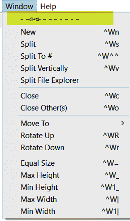

注意 图 9-2 中的菜单如何被移动并浮动在完全无关的应用程序之上。这是一种让常用菜单方便可用但又不妨碍编辑的好方法。这两者对于常见的选择、剪切、复制、删除和粘贴操作都很方便。其他 GUI 编辑器的用户经常使用这种功能，但即使对于长期使用 Vim 的用户也很有用。特别有用的是它以可预测的方式与 Windows 剪贴板交互。

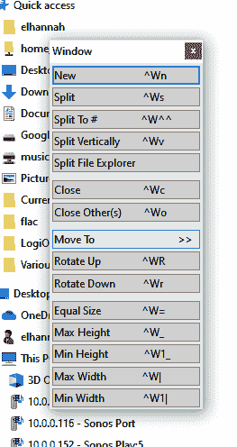

## `gvim`’s 右键弹出菜单

`gvim` 在你右键单击正在编辑的缓冲区时弹出 图 9-3 所示的菜单。

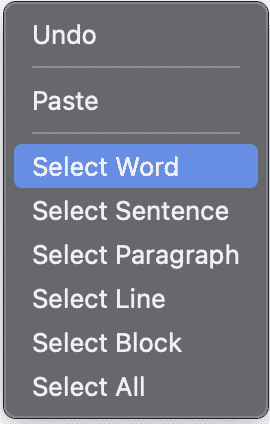

如果有任何文本被选中（高亮），右键单击时会出现另一个菜单，如 图 9-4 所示。

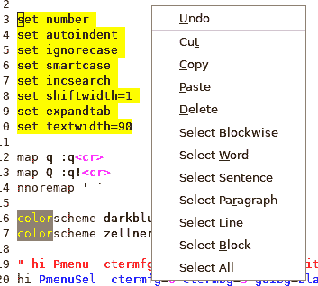

# 自定义滚动条、菜单和工具栏

`gvim` 提供了通常的 GUI 小部件，如滚动条、菜单和工具栏。与大多数现代 GUI 应用程序一样，这些小部件是可以定制的。

默认情况下，`gvim` 窗口在顶部显示多个菜单和工具栏，如 图 9-5 所示。

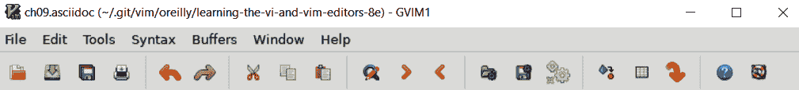

## 滚动条

滚动条可让你快速在文件中上下或左右导航，在 `gvim` 中是可选的。你可以使用本章末尾 “GUI 选项和命令概要” 部分描述的 `guioptions` 选项来显示或隐藏它们。

由于 Vim 的标准行为是显示文件中的所有文本（必要时在窗口中换行），因此值得注意的是，在通常配置的 `gvim` 会话中，水平滚动条没有任何作用。

通过在 `guioptions` 选项中包含或排除 `r` 或 `l` 来打开或关闭左右滚动条。`l` 确保屏幕始终具有左侧滚动条，而 `r` 使其始终具有右侧滚动条。大写变体 `L` 和 `R` 告诉 `gvim` 仅在有垂直分割窗口时显示左侧或右侧滚动条。

水平滚动条通过在 `guioptions` 选项中包含或排除 `b` 来控制。

而且，是的，你 *可以* 同时滚动左右滚动条！更准确地说，滚动其中一个会导致另一个向相应方向移动。在两侧配置滚动条可能非常方便。根据鼠标的位置，你只需单击并拖动最近的滚动条即可。

### 注意

许多选项，包括 `guioptions`，控制多种行为，因此默认情况下可以包含许多标志。甚至在 `gvim` 的未来版本中也可能添加新标志。因此，在 `:set guioptions` 命令中使用 `+=` 和 `-=` 语法非常重要，以避免删除期望的行为。例如，`:set guioptions+=l` 添加“滚动条始终在左侧”选项到 `gvim`，同时保持 `guioptions` 字符串中的其他组件不变。

## 菜单

`gvim` 具有完全可定制的菜单功能。在本节中，我们描述了默认的菜单特征，该特征之前在 图 9-5 中出现，并展示如何控制菜单布局。

图 9-6 显示了使用菜单的一个示例。在这种情况下，我们从 `Edit` 菜单中选择 `Global Settings`。

值得注意的是，这些菜单选项只是 Vim 命令的包装。事实上，这正是你可以创建和自定义自己的菜单条目的方法，我们稍后会讨论。

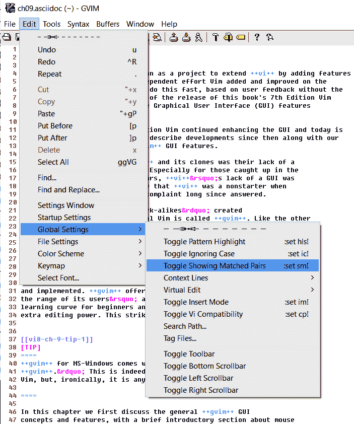

### 提示

如果你注意菜单，包括右侧显示的按键或命令，你可以随着时间的推移学习 Vim 命令。例如，在 图 9-6 中，虽然对于初学者来说，在编辑菜单中找到熟悉的撤销命令很方便，该命令在其他流行应用程序中也出现，但使用 Vim `u` 按键要 *非常* 快且更容易，该按键在菜单中显示。

如 图 9-6 所示，每个菜单都以一条包含剪刀图片的虚线开始。单击此行会“撕下”菜单以创建一个独立窗口，在该窗口中该子菜单的选项可在不进入菜单栏的情况下使用。如果你单击 图 9-6 中 `Toggle Pattern Highlight` 菜单选项上方的虚线，你会看到类似 图 9-7 的内容。你可以将自由浮动的菜单放置在桌面的任何位置。

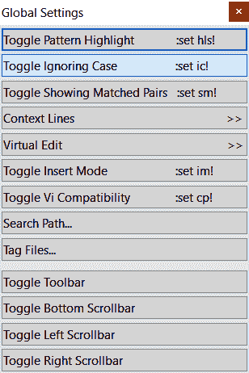

现在此子菜单上的所有命令都只需在子菜单窗口中单击一下即可立即使用。每个菜单选择都映射到一个按钮。如果菜单选择本身是子菜单，则它由一个按钮表示，该按钮的右侧带有大于号（看起来像右指向箭头）。单击这些箭头会展开子菜单。

### 基本菜单自定义

`gvim` 将菜单定义存储在名为 `$VIMRUNTIME/menu.vim` 的文件中。

定义菜单项类似于映射。如你在 “使用 map 命令” 部分所见，你可以像这样映射一个键：

```
:map <F12> :set syntax=html<CR>
```

菜单的处理方式非常相似。

假设我们不想将 F12 映射为设置语法为 `html`，而是希望在文件菜单上有一个特殊的“HTML”条目来执行此任务。使用 `:amenu` 命令：

```
:amenu File.HTML :set filetype=html<CR>
```

四个字符 `<CR>` 应按所示输入，是命令的一部分。

现在查看你的文件菜单。你应该看到一个新的 HTML 条目，如 图 9-8 所示。通过使用 `amenu` 而不是 `menu`，我们确保该条目在所有模式（命令、插入和普通）中都可用。

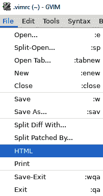

#### 注意

`menu` 命令仅在命令模式下将条目添加到菜单中；该条目在插入和普通模式下不会出现。

菜单条目的位置由一系列用句点（`.`）分隔的级联菜单名称指定。在我们的示例中，`File.HTML` 将菜单条目“HTML”添加到文件菜单中。系列中的最后一个条目是你想要添加的条目。这里我们将其添加到现有菜单中，但我们很快就会看到，我们可以同样轻松地创建一系列全新的级联菜单。

务必测试你的新菜单选择。例如，我们开始编辑 Vim 将其视为 XML 文件的文件，如 图 9-9 中的状态行所示（请参阅 “一个不错的 Vim Piggybacking 技巧” 部分，了解如何设置状态行）。我们已自定义状态行，以便 Vim 和 `gvim` 在最右侧显示当前活动的文件类型。


在调用我们新的 `HTML` 菜单项后，`Vim` 状态行会验证菜单项是否生效并且文件类型现在是 `HTML`——请参阅 图 9-10。


注意我们添加的 `HTML` 菜单项在右侧没有快捷键或命令。因此让我们重新添加菜单并包含此改进。

首先，删除现有条目：

```
:aunmenu File.HTML
```

#### 注意
如果您仅使用 `menu` 命令为 `ex` 命令模式添加菜单项，可以使用 `unmenu` 删除它。

接下来，添加一个新 HTML 菜单项以显示您与该项关联的命令：

```
:amenu File.HTML<TAB>filetype=html<CR> :set filetype=html<CR>
```

菜单项的指定现在后面跟着 `<TAB>`（字面输入）和 `filetype=html<CR>`。一般来说，要在菜单右侧显示文本，请将其放在字符串 `<TAB>` 之后并以 `<CR>` 结束。图 9-11 显示了结果的 `File` 菜单。

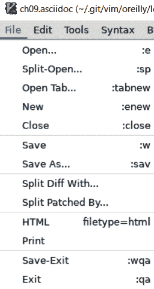

#### 注意
如果您希望菜单项的描述文本（或菜单名称本身）中包含空格，请用反斜杠 (`\`) 对空格进行转义。如果不这样做，`Vim` 会将第一个空格字符之后的所有内容用于菜单操作的定义。在前面的示例中，如果我们希望描述文本为 `:set` `filetype=html` 而不是仅 `filetype=html`，则 `:amenu` 命令必须为：

```
:amenu File.HTML<TAB>set\ filetype=html<CR> :set filetype=html<CR>
```

在大多数情况下，最好不要修改默认菜单定义，而是创建单独的、独立的条目。这需要定义根级别的新菜单，但这与向现有菜单添加条目一样简单。

继续我们的示例，让我们创建一个名为 `MyMenu` 的新菜单树到菜单栏，然后向其添加 HTML 菜单项。首先，从 `File` 菜单中删除 HTML 项：

```
:aunmenu File.HTML
```

接下来，输入命令：

```
:amenu MyMenu.HTML<TAB>filetype=html :set filetype=html<CR>
```

图 9-12 显示了菜单栏可能的外观。

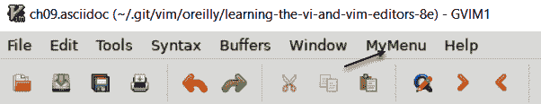

菜单命令提供了对菜单出现位置及其行为的更细微控制，例如命令是否指示任何活动，甚至菜单项是否可见。我们将在下一节中进一步讨论这些可能性。

### 更多菜单自定义

现在我们看到修改和扩展 `gvim` 菜单是多么容易，让我们来看更多自定义和控制的示例。

我们之前的示例没有指定将新的 `MyMenu` 菜单放在何处，`gvim` 任意将其放置在菜单栏的 `Window` 和 `Help` 之间。`gvim` 允许我们通过其 notion of *priority* 来控制位置，这只是一个分配给每个菜单的数值，以确定它在菜单栏上的位置。此值越高，菜单出现在越右侧。不幸的是，用户对优先级的思考方式与 `gvim` 定义的方式相反。要弄清优先级，请回顾 图 9-5 中的菜单顺序，并将其与 `gvim` 的默认菜单优先级进行比较，如 表 9-1 中所列。

表 9-1. `gvim` 的默认菜单优先级

| 菜单 || 优先级 |
| --- | --- |
| 文件 || 10 |
| --- | --- |
| 编辑 || 20 |
| 工具 || 40 |
| 语法 || 50 |
| 缓冲区 || 60 |
| 窗口 || 70 |
| 帮助 || 9999 |

大多数用户会认为 `File` 的优先级高于 `Help`（这就是为什么 `File` 在左侧而 `Help` 在右侧），但 `Help` 的优先级更高。因此只需将优先级值视为菜单出现在右侧多远的指示。

您可以通过在菜单命令前加上其数值来定义菜单的优先级。如果未指定值，则分配默认值 500，这解释了为什么 `MyMenu` 在我们之前的示例中最终位于该位置：它落在 `Window`（优先级 70）和 `Help`（优先级 9999）之间。

假设我们希望新菜单位于 `File` 和 `Edit` 菜单之间。我们需要为 `MyMenu` 分配一个大于 10 且小于 20 的数字优先级。以下命令将优先级分配为 15，从而产生所需的效果：

```
:15amenu MyMenu.HTML<TAB>filetype=html :set filetype=html<CR>
```

#### 注意
一旦菜单存在，其位置在整个编辑会话中都是固定的，不会因影响菜单的额外命令而改变。例如，您不能通过向其添加新项并在命令前加上不同的优先级值来更改菜单的位置。

为了增加优先级和菜单放置的混乱，您还可以通过指定优先级来控制菜单 *内部* 的项目放置。优先级较高的菜单项出现在优先级较低的项目下方，但语法与菜单的优先级定义不同。

我们将通过为 `HTML` 菜单项分配一个非常高的值（9999）来扩展我们之前的菜单示例之一，以便它出现在 `File` 菜单的底部：

```
:amenu File.HTML .9999 <TAB>filetype=html<CR> :set filetype=html<CR>
```

为什么 9999 前面有一个句点？您需要在此处指定两个优先级，用句点分隔：一个用于 `File`，一个用于 `HTML`。我们将 `File` 优先级留空，因为它是预先存在的菜单且无法更改。

一般来说，菜单项的优先级出现在该项的菜单放置位置和该项的定义之间。对于菜单层次结构中的每个级别，您必须指定一个优先级，否则包括一个句点以表示您将其留空。因此，如果您在菜单层次结构深处添加一个项——例如在 `Edit` → `Global Settings` → `Context lines` → `Display` 下——并且您希望将优先级 30 分配给最后一个项（`Display`），您将把优先级指定为 `…30`，并且放置位置连同优先级将如下所示：

```
Edit.Global\ Settings.Context\ lines.Display ...30
```

与菜单优先级一样，菜单项优先级一旦分配就固定了。

最后，您可以使用 `gvim` 的菜单分隔符控制菜单“空白”。使用与添加菜单项相同的定义，但不要使用普通命令名称，而是在其前后放置一个连字符 (`-`)。请参阅下一个示例中标识符为 `2` 和 `3` 的行。

### 综合起来

现在我们知道如何创建、放置和自定义菜单。让我们通过将我们讨论的命令添加到 `*.gvimrc` 文件中，使我们的示例成为 `gvim` 环境的永久组成部分。行序列应如下所示：

```
" add XML/HTML/XHTML menu between File and Edit menus
  15amenu MyMenu.XML<TAB>filetype=xml :set filetype=xml<CR>
  amenu .600 MyMenu.-Sep- :
  amenu .650 MyMenu.HTML<TAB>filetype=html :set filetype=html<CR>
  amenu .700 MyMenu.XHTML<TAB>filetype=xhtml :set filetype=xhtml<CR>
```

我们现在拥有一个顶级个性化菜单，其中包含三个最喜欢的文件类型命令可供我们快速使用。在此示例中有几件重要的事情需要注意：

*   第一个命令（）使用前缀 `15`，告诉 `gvim` 使用优先级 `15`。对于未自定义的环境，这会将新菜单放置在 `File` 和 `Edit` 菜单之间。

*   后续命令（、 和 ）*不*指定优先级，因为一旦确定优先级，就不会使用其他值。


我们已在第一个命令之后使用了子菜单优先级语法（、 和 ），以确保每个新项目的正确顺序。请注意，我们从 `.600` 的第一个定义开始。这确保子菜单项放置在我们定义的第一个项目后面，因为我们没有为 *那个* 优先级分配值，因此它默认为 500。

为了更方便地访问，请点击“剪刀”撕下线以获得您个性化的浮动菜单，如 图 9-13 所示。

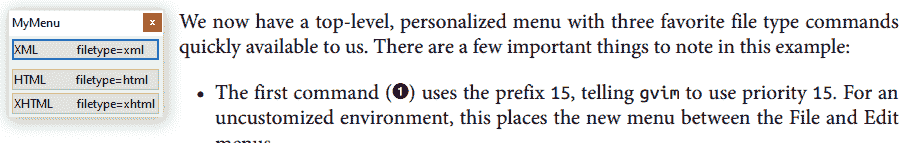

## 工具栏

工具栏是允许快速访问程序功能的图标长条。例如在 GNU/Linx 上，`gvim` 在窗口顶部显示 图 9-14 所示的工具栏。


表 9-2 显示了工具栏图标及其含义。

表 9-2. `gvim` 工具栏图标及其含义

| 图标 || 描述 || 图标 || 描述 |
| --- | --- | --- | --- |
|  || 打开文件对话框 ||  || 查找搜索模式的下一个出现位置 |
| --- | --- | --- | --- |
|  || 保存当前文件 ||  || 查找搜索模式的上一个出现位置 |
|  || 保存所有文件 ||  || 选择已保存的编辑会话进行加载 |
|  || 打印缓冲区 ||  || 保存当前编辑会话 |
|  || 撤销上次更改 ||  || 选择要运行的 Vim 脚本 |
|  || 重做上次操作 ||  || 使用 `make` 命令构建当前项目 |
|  || 将选择内容剪切到剪贴板 ||  || 为当前目录树构建标签 |
|  || 将选择内容复制到剪贴板 ||  || 跳转到光标下的标签 |
|  || 将剪贴板粘贴到缓冲区 ||  || 打开帮助 |
|  || 查找并替换 ||  || 搜索帮助 |

如果这些图标不熟悉或不直观，您可以让工具栏同时显示文本和图标。执行此命令：

```
:set toolbar="text,icons"
```

### 注意

与许多高级功能一样，Vim 要求在编译期间打开工具栏功能，以便不想要它们的人可以通过不包含它们来节省内存。工具栏不存在，除非 `+GUI_GTK`、`+GUI_Athena`、`+GUI_Motif` 或 `+GUI_​Photon` 中的其中一个功能编译到您的 `gvim` 版本中。附录 D，“vi 和 Vim：源代码和构建” 解释了如何重新编译 Vim，在此过程中会创建 `gvim` 可执行文件的链接。

我们修改工具栏的方式与修改菜单非常相似。事实上，我们使用相同的 `:menu` 命令，但带有额外的语法来指定图形。虽然存在一个算法可以帮助 `gvim` 找到与每个命令关联的图标，但我们建议显式指定图标图形。

`gvim` 将工具栏视为一维菜单。并且正如您可以控制新菜单的从右到左的位置一样，您可以通过在 `menu` 命令前加上一个数字来控制新工具栏条目的位置，该数字决定其位置 *优先级*。与菜单不同，没有创建新工具栏的概念。所有新的工具栏定义都出现在单个工具栏上。添加工具栏选择的语法是：

```
:amenu icon=/some/icon/image.bmp ToolBar.NewToolBarSelection Action
```

其中 `/some/icon/image.bmp` 是包含要在工具栏中显示的工具栏按钮或图像（通常是图标）的文件的路径，`NewToolBarSelection` 是工具栏按钮的新条目，而 `Action` 定义按钮的功能。

例如，让我们定义一个新工具栏选择，当点击或选择时，会在 Windows 中打开一个 DOS 窗口。假设 Windows 路径设置正确，我们将定义我们的工具栏选择以从 `gvim` 中启动 DOS 窗口，通过执行以下操作（这是其 `Action`）：

```
:!cmd
```

对于新选择的工具栏按钮或图像，我们使用一个显示 DOS 命令提示符的图标，如 图 9-15 所示，在我们的系统上存储在 `$HOME/dos.bmp` 中。


执行命令：

```
:amenu icon="c:$HOME/dos.bmp" ToolBar.DOSWindow :!cmd<CR>
```

这会创建一个工具栏条目并在工具栏末尾添加我们的图标。工具栏现在应如下所示 图 9-16。新图标出现在工具栏的最右侧。

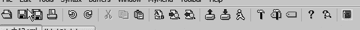

## 工具提示

`gvim` 允许您为菜单条目和工具栏图标定义工具提示。菜单工具提示在鼠标悬停在该菜单选择上时显示在 `gvim` 命令行区域。工具栏工具提示在鼠标悬停在工具栏图标上时以图形方式弹出。例如，图 9-17 显示了当我们将鼠标放在工具栏的“查找上一个”按钮上时弹出的工具提示。

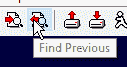

`:tmenu` 命令为菜单和工具栏项目定义工具提示。语法是：

```
:tmenu TopMenu.NextLevelMenu.MenuItem tool tip text
```

其中 `TopMenu.NextLevellMenu.MenuItem` 定义菜单从顶级一直级联到您希望为其定义工具提示的菜单项。因此，例如，文件菜单下“打开”菜单项的工具提示将使用以下命令定义：

```
:tmenu File.Open Open a file
```

如果您正在定义工具栏项目，请使用 `ToolBar` 作为顶级“菜单”（工具栏没有真正的顶级菜单）。

让我们为上一节中创建的 DOS 工具栏图标定义一个弹出工具提示。输入命令：

```
:tmenu ToolBar.DOSWindow Open up a DOS window
```

现在当您将鼠标悬停在新添加的工具栏图标上时，您可以看到工具提示，如 图 9-18 所示。

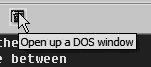

# gvim 在 Microsoft Windows 中

`gvim` 在 MS-Windows 用户中越来越受欢迎。经验丰富的 `vi` 和 Vim 用户会发现 Windows 版本非常出色，而且它可能是所有操作系统中最新的版本。

### 注意

自安装的可执行文件应自动且无缝地将 Vim 集成到 Windows 环境中。如果没有，请参阅 Vim 运行时目录中的 `gui-w32.txt` 帮助文件以获取 `regedit` 说明。由于这涉及编辑 Windows 注册表，如果您对此程序有丝毫的不安，请 *不要* 尝试。您可以找到更有经验的人来帮助您。这是一个常见但非微不足道的练习。

长期使用 Windows 的用户熟悉 *剪贴板*，这是一个存储文本和其他信息以便于复制、剪切和粘贴操作的存储区域。Vim 支持与 Windows 剪贴板的交互。只需在可视模式下突出显示文本并单击“复制”或“剪切”菜单项即可将 Vim 文本存储到 Windows 剪贴板中。然后您可以将该文本粘贴到其他 Windows 应用程序中。

# gvim 在 X Window System 中

熟悉 X 环境的用户可以定义和使用许多可调的 X 功能。例如，您可以使用 `.Xdefaults` 文件中通常定义的标准类定义来定义许多资源。

### 警告


请注意，这些标准 X 资源仅对 Motif 或 Athena 版本的 GUI 有用。显然，Windows 版本无法理解 X 资源。不太明显的是，X 资源也不会被 KDE 或 Gnome 拾取，而且在现代系统中，`gvim` 很可能基于其中之一的工具包。

# 在 Microsoft Windows WSL 中运行 gvim

截至本文撰写时，Microsoft 已发布了其对 GNU/Linux 发行版虚拟化支持的两个主要版本，*Windows Subsystem for Linux*（WSL）。它们通常被称为 WSL 和 WSL 2。

WSL 提供了兼容的接口，允许 GNU 应用程序运行，从而使完整的 GNU/Linux 发行版能够在 Windows 下运行。WSL 2 更进一步，提供了一个在虚拟环境中运行的原生 Linux 内核。深入的细节超出了本书的范围，但值得一提的是，我们中的一位经常且富有成效地使用 WSL，并证明当在 Microsoft 的 `Terminal` 应用程序（它是一个控制台应用程序）中执行时，Vim 的完整功能得以实现。虽然这是一个令人愉快的意外，但得知 Microsoft 正在为 WSL Linux 增加更多 GUI 支持则更加令人兴奋。

本节将帮助你从 WSL 2 运行 `gvim`，并在原生 Windows 中显示。对于熟悉 X11 的人来说，这种方法相当标准，但 Windows 需要一些配置调整，并且必须为目标 GNU/Linux 发行版安装合适的 `gvim` 包。

## 在 WSL 2 中安装 gvim

我们描述在 WSL 2 Ubuntu 发行版中 `gvim` 的安装和配置。

首先，为验证 `gvim` 是否存在，使用 `dpkg` 搜索 `gvim` 二进制文件。为消除误报结果（手册页、配置文件等），搜索 “`bin/gvim`”：

```
$ dpkg -S bin/gvim
vim-gui-common: /usr/bin/gvimtutor
```

不，`gvim` 不存在！`gvimtutor` 不是 `gvim`，当 `gvim` 未安装时它只是回退到基于终端的 Vim。

现在，以 root 身份（通过 `sudo`）安装 `gvim` 包。虽然我们恰好知道包名为 `vim-gtk3`，但有时让 Ubuntu 包管理器 `apt` 提供提示是有用的。只需让 `apt` 安装 `gvim`，你会看到三种可能性，其中 `vim-gtk3` 包是我们的选择：

```
vim@office-win10:~$ sudo apt install gvim
[sudo] password for vim:
Reading package lists... Done
Building dependency tree
Reading state information... Done
Package gvim is a virtual package provided by:
  vim-gtk 2:8.0.1453-1ubuntu1.4
  vim-athena 2:8.0.1453-1ubuntu1.4
  vim-gtk3 2:8.0.1453-1ubuntu1.4
You should explicitly select one to install.
```

现在我们知道了想要的包，并使用 `apt` 安装该包：

```
vim@office-win10:~$ sudo apt install vim-gtk3
...
```

在条件相同的情况下（我们无法涵盖所有安装失败的可能性，但这应该可靠），`gvim` 现在应该在你的 Linux 子系统中可用。因此，安装会更新你的 `PATH` 并将 `gvim` 重新哈希到你的可用命令中。使用 `type` 命令验证这一点：

```
$ type gvim
gvim is /usr/bin/gvim
```

好了，我们几乎完成了。你可以执行 `gvim`，但它还不是我们想要的样子。如果你执行 `gvim`，你会看到类似这样的响应：

```
$ gvim
E233: cannot open display
Press ENTER or type command to continue
```

当你按 ENTER 继续时，`gvim` 会回退到基于文本的终端 Vim。我们需要在 Windows 环境中建立一个 X Windows 服务器来完成 X Window 设置，并让 Linux `gvim` 图形化显示到它上面。^(3)

## 为 Windows 安装 X 服务器

正如刚才提到的，我们必须从 Microsoft Windows 建立一个服务器来接收图形请求，使我们的 WSL Linux `gvim` 实例能够透明地显示在 Windows 桌面上。在我们的示例中，我们将使用免费可用的 Windows 服务器 “`Xming`。”

下载最新的 [Xming](https://sourceforge.net/projects/xming) 服务器安装程序并执行它。安装程序启动横幅可在 图 9-19 中看到。

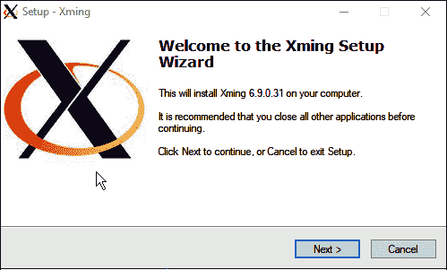

## 配置 Windows 的 X 服务器

`Xming` 安装了两个可执行文件：

*   `XLaunch`，一个简化 `Xming` 常见实例的配置向导
*   `Xming`，实际的 X 服务器

打开 Windows 应用程序菜单并找到 `Xming` 文件夹。你会看到类似 图 9-20 的内容。

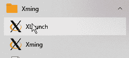

执行 `XLaunch` 来配置 `Xming`。`XLaunch` 会引导你完成标准的 X 相关设置。图 9-21 是 `XLaunch` 的第一屏。选择与这些图中看到相同的选项。

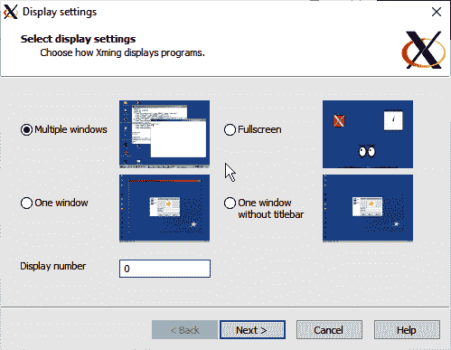

选择“多个窗口”，并将显示编号填为零，`0`。^(4)

下一个对话框定义 X “会话类型”，如 图 9-22 所示。

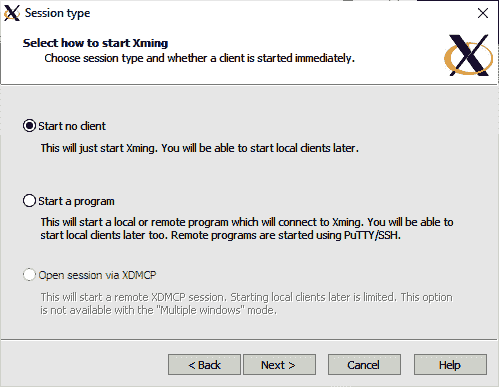

选择“不启动客户端”。这只是告诉 `XLaunch` 单独启动 `Xming` X Window 服务器。在此角色中，`Xming` 将等待并显示请求显示的应用程序，而在此情况下远程主机是我们的 WSL Linux 主机。

接下来，`XLaunch` 记录其他各种常见的 X Windows 参数。参见 图 9-23。

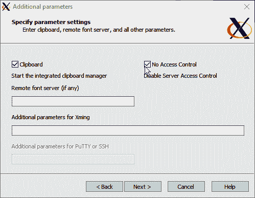

选择“剪贴板”和“无访问控制”。请注意，“无访问控制”选项未预先选中。

### 警告

我们选择“No Access Control”选项是为了方便，不必处理 X Windows 安全机制。我们这样做的前提是计算机处于“安全”环境中，例如家庭网络，其中不会对 `Xming` X 服务器发起攻击。在任何公共网络或办公场所环境中，这都*不是*正确的选择。

现在我们已经配置了 `Xming`，准备启动。 图 9-24 中的最终 `XLaunch` 对话框显示保存新配置（我们不会）的选项以及启动 `Xming`。

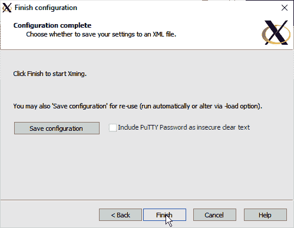

启动 `Xming` 后，通过在系统托盘中查找 `Xming` 图标来验证它是否正在运行并准备好显示 Ubuntu X Windows 应用程序（参见 图 9-25）。


因此，我们拥有启动 Ubuntu `gvim` 实例所需的所有工作组件，但我们还*没有*完全完成。如果你执行 `gvim`，它仍然会显示错误消息并降级为终端 Vim。

这是因为我们需要告诉 Ubuntu 系统*在哪里*显示 `gvim`。在这种情况下，我们必须告诉 Ubuntu 指向我们的 Microsoft Windows 桌面。虽然对我们来说*prima facie*显而易见，但 X Windows 应用程序按定义必须请求 X 服务器来显示其内容，而我们尚未这样做。

我们在 Ubuntu 中使用 Microsoft Windows 网络地址*及其*关联的 X 服务器显示来定义想要显示 `gvim` 的位置。^(5) 格式为 `hostname`:`DISPLAY`，其中 `hostname` 将是我们的 Windows IP 地址，而 `DISPLAY` 将为 `0`。

找到 Microsoft Windows IP 地址最简单的方法是查看 Ubuntu 中配置文件 `/etc/resolv.conf`，其中 Ubuntu 的“nameserver”是 Microsoft Windows 地址：

```
$ cat /etc/resolv.conf
# This file was automatically generated by WSL. To stop automatic generation of
# this file, add the following entry to /etc/wsl.conf:
# [network]
# generateResolvConf = false
nameserver 172.17.224.1
```

或者：

```
$ grep nameserver /etc/resolv.conf
nameserver 172.17.224.1
```


我们在案例中看到 Ubuntu 的名称服务器是 172.17.224.1。因此我们 X 服务器的定义将是 `172.17.224.1:0.0`.^(6)

有多种方法可以告知 `gvim` 在哪个显示器上呈现。最常见的方法是通过环境变量 `DISPLAY`，我们使用 shell `export` 命令来设置它：

```
$ export DISPLAY=172.17.224.1:0.0
```

现在我们准备好了。启动 `gvim`，你现在应该会看到一个作为窗口在你的桌面上运行的 GUI 版本。参见 图 9-26。请注意这是真实的：我们捕捉了撰写本书时的一个瞬间，`gvim` 正在编辑 *本* 章节。你会注意到在终端和命令行下方，我们编辑了真实的章节文件。很酷。☺

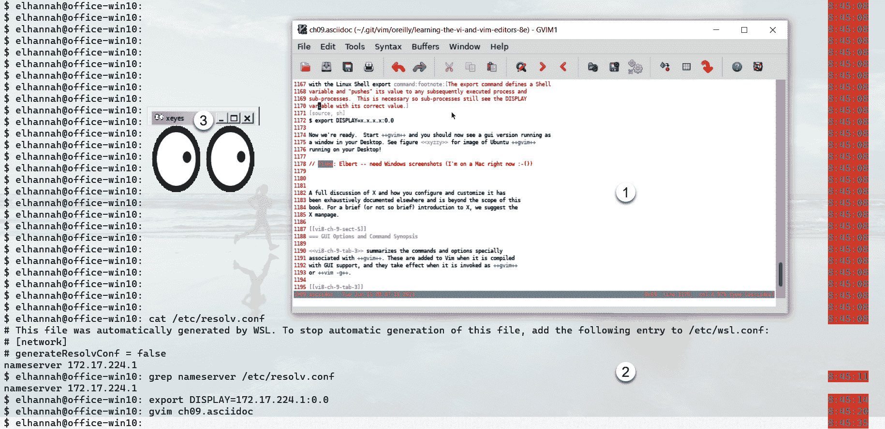

注意编号的标注：


:

这就是实际的 `gvim` 窗口，作为应用程序透明地运行在 Microsoft Windows 桌面上。


:

这是底层的 Microsoft 终端，我们在其中运行 Ubuntu 的 WSL 实例。你可以看到我们在正文中刚刚提到的已执行的命令行。


:

这是 `xeyes`，一个轻浮但流行的 X Windows 小应用程序，在我们工作时注视着我们。^(7)

我们现在向你展示了如何从 Microsoft Windows WSL Linux 实例配置和使用 `gvim` 并透明地显示该会话。有无数种设置和配置 X Windows 服务器和客户端的方法。你在这里学到的内容是使用 `gvim` *和* 理解 X Windows 基础知识的重要一步。对 X 及其配置和自定义的完整讨论已在其他地方详尽记录，超出了本书的范围。对于 X 的简要（或不那么简要）的介绍，我们建议查阅 X 手册页。

# GUI 选项和命令概要

表 9-3 总结了专门与 `gvim` 关联的命令和选项。这些是在编译时为 `Vim` 添加 GUI 支持后得到的，并且在以 `gvim` 或 `vim -g` 调用的情况下生效。

表 9-3. `gvim` 特定选项

| 命令、选项或标志 || 类型 || 描述 |
| --- | --- | --- |
| `guicursor` || 选项 || 光标形状和闪烁的设置 |
| --- | --- | --- |
| `guifont` || 选项 || 要使用的单字节字体名称 |
| `guifontset` || 选项 || 要使用的多字节字体名称 |
| `guifontwide` || 选项 || 双宽字符的字体名称列表 |
| `guiheadroom` || 选项 || 为窗口装饰保留的像素数 |
| `guioptions` || 选项 || 使用的组件和选项 |
| `guipty` || 选项 || 对 “:!” 命令使用伪 tty |
| `guitablabel` || 选项 || 选项卡页的自定义标签 |
| `guitabtooltip` || 选项 || 选项卡页的自定义工具提示 |
| `toolbar` || 选项 || 工具栏中显示的项目 |
| `-g` || 标志 || 启动 GUI（同时允许其他选项） |
| `-U` `gvimrc` || 标志 || 启动 GUI 时使用名为 `gvimrc` 或类似名称的 `gvim` 启动文件 |
| `:gui` || 命令 || 启动 GUI（仅在类 Unix 系统上） |
| `:gui filename…` || 命令 || 启动 GUI 并编辑指定的文件 |
| `:menu` || 命令 || 列出所有菜单 |
| `:menu menupath` || 命令 || 列出以 `menupath` 开头的菜单 |
| `:menu menupath action` || 命令 || 添加菜单 `menupath`，以执行 `action` |
| `:menu n menupath action` || 命令 || 添加具有位置优先级 `n` 的菜单 `menupath` |
| `:menu ToolBar.toolbarname action` || 命令 || 添加工具栏项目 `toolbarname` 以执行 `action` |
| `:tmenu menupath text` || 命令 || 为菜单项 `menupath` 创建工具提示，文本为 `text` |
| `:unmenu menupath` || 命令 || 删除菜单 `menupath` |

^(1) 尤其是现在 MS-Windows 提供了 Windows Subsystem for Linux（WSL），一个完整的 GNU/Linux 子系统，用户可以选择安装自己喜欢的 GNU/Linux 发行版。我们描述了一种在 WSL 中启动原生 Linux `gvim` 并在 Windows 中原生显示会话的方法。

^(2) 我们发现 `Vim` 并不会总是生成错误信息，实际上它会无错误信息启动。这一警告仍然成立，因为即使 `Vim` 没有生成错误，`Vim` 也会尝试相应地重新配置你的控制台/屏幕/终端的定义。某些终端或控制台能够正确适应，但更可能的是你会得到终端的半正确行为。这些影响会干扰依赖于并使用终端定义的其它应用程序的正确行为。

^(3) 这可能有点令人困惑。请耐心听我们解释。Windows 和 X Windows *并不相同*，但两者在这里都很重要。Windows 是 Windows，你熟悉的 Microsoft 桌面。X Windows 是在你的 Microsoft Windows 中运行的图形服务器，知道如何从远程系统显示图形。

^(4) 各种选项的解释超出了本书范围。简而言之，我们选择“多个窗口”，因为该选项允许 `gvim` 在 Windows 窗口中图形化显示。

^(5) 是的，你的 MS-Windows 计算机现在对 Linux 子系统可见一个网络接口。这就是 WSL 的工作原理，它是一个具有自己网络地址的虚拟计算机，因此需要真正的网络语义，以便 Linux 和 MS-Windows 能够相互通信。

^(6) 请注意显示号的 `0.0` 形式。这与显示器和可能的多个屏幕有关。对于大多数用例（简单的用例），显示器应为 `0.0`。

^(7) 你可能没有意识到，但整个练习也启用了 Ubuntu 实例中可用的所有 X Windows 应用程序，`xeyes` 就是其中之一。一旦你设置了 X 服务器并定义了网络和 `DISPLAY`，所有 X Windows 应用程序都使用相同的显示。恭喜！你刚刚完成了 X Windows 的一个有用练习。为了进一步验证，请尝试执行 X Windows 终端应用程序 `xterm`。

## 第 10 章. Vim 中的多个窗口

默认情况下，`Vim` 在单个窗口中编辑所有文件，在你在文件之间移动或在单个文件的不同部分之间移动时一次只显示一个缓冲区。但 `Vim` 还提供多窗口编辑，这可以使复杂的编辑任务变得更容易。这与在图形终端上启动多个 `Vim` 实例不同。本章介绍在单个运行的 `Vim` 进程实例中使用多个窗口，该实例我们称之为 *会话*。

你可以在编辑会话开始时使用多个窗口启动，也可以会话开始后创建新窗口。你可以添加窗口到编辑会话，直到理智所允许的限制，并且可以删除它们直至单个窗口。

在高分辨率显示器成为常态的今天，多窗口比以往更有意义。在本书第七版时，WXGA（1280x800）被认为是体面的分辨率。今天（2021 年底），以大致相同的价格，很容易找到约 400 美元的 4K 分辨率（超高清：3840x2160）显示器。那大约是 *九倍* 的分辨率！


# Vim 多窗口

*然后* Vim 的多窗口功能通过提供多个视口和同时查看单个文件或多个文件的预览，增强了用户的编辑体验。 这是强大编辑的一大进步，但通常是以牺牲空间为代价的，要么设置换行参数以使整行保持可见，要么设置行偏移选项，以便在行在窗口两侧被裁剪时左右滚动。

*现在*在高分辨率屏幕上，Vim 的多窗口提供了同样的强大功能，用户可以轻松地将窗口并排拆分，并且每个窗口仍能获得全宽文本显示。^(1)

以下是多窗口让你的生活更轻松的一些示例：

*   编辑多份需要以相同方式格式化的文件，在此过程中希望对其进行视觉比较
*   在多个文件或单个文件的多个部分之间快速、重复地剪切和粘贴文本
*   显示文件的某一部分以供参考，以便在同一文件的其他位置工作
*   比较文件的两个版本

Vim 提供了许多窗口管理便捷功能，包括：

*   水平或垂直拆分窗口
*   快速在窗口之间来回导航
*   在多个窗口之间复制和移动文本
*   移动和重新定位窗口
*   使用缓冲区，包括隐藏缓冲区（稍后描述）
*   使用外部工具，如 `diff` 命令配合多个窗口

在本章中，我们将指导你完成多窗口体验。我们将展示如何启动多窗口会话，讨论编辑会话的功能和技巧，并描述如何退出工作并确保所有工作得到妥善保存（或放弃，如果你愿意！）。以下主题将被涵盖：

*   初始化或启动多窗口编辑
*   多窗口 `:ex` 命令
*   在窗口之间移动光标
*   在显示器上移动窗口
*   调整窗口大小
*   缓冲区及其与窗口的交互
*   与窗口“捉迷藏”
*   选项卡式编辑（如现代互联网浏览器和对话框提供的选项卡）
*   关闭和退出窗口

## 启动多窗口编辑

你可以在启动 Vim 时启动多窗口编辑，也可以在编辑会话中拆分窗口。多窗口编辑是动态的，允许你在任何时候从大多数上下文中打开、关闭和在多个窗口之间导航。

### 从命令行启动多窗口

默认情况下，Vim 为一次会话仅打开一个窗口，即使你指定了多个文件。虽然我们不确定 Vim 为什么不对多个文件打开多个窗口，但这可能是因为仅使用单个窗口与 `vi` 一致。多个文件占用多个缓冲区，每个文件在自己的缓冲区中。（缓冲区将在稍后讨论。）

要从命令行打开多个窗口，请使用 Vim 的 `-o` 选项。例如：

```
$ gvim -o file1.txt file2.txt
```

这将以水平拆分为两个等大窗口的方式打开编辑会话，每个文件一个（参见 图 10-1）。对于命令行上命名的每个文件，Vim 都会尝试为其打开一个编辑窗口。如果 Vim 无法将屏幕拆分为足够的文件窗口，则命令行参数中列出的前几个文件会获得窗口，而剩余文件则会加载到对你不可见（但仍可用）的缓冲区中。

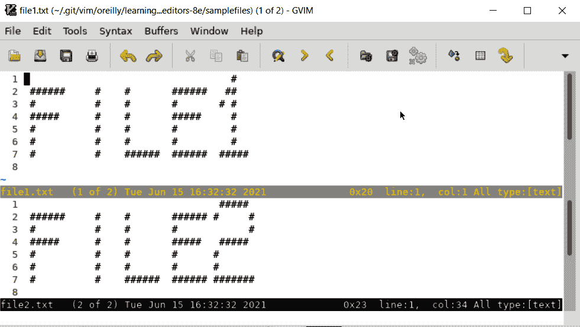

命令行的另一种形式通过在 `-o` 后附加数字 `n` 来预分配窗口：

```
$ gvim -o5 file1.txt file2.txt
```

这将打开一个会话，显示水平拆分为五个等大窗口，其中最上面的包含 `file1.txt`，第二个包含 `file2.txt`（参见 图 10-2）。

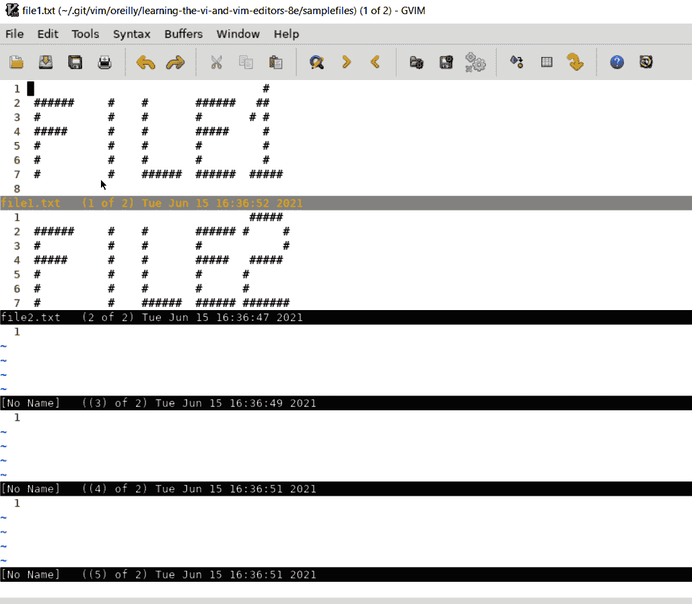

#### 提示

当 Vim 创建多个窗口时，其默认行为是为每个窗口创建状态行（而单个窗口的默认行为是不显示任何状态行）。你可以使用 Vim 的 `laststatus` 选项控制此行为，例如：

```
:set laststatus=1
```

将 `laststatus` 设置为 2，即可在单窗口模式下始终看到每个窗口的状态行。最好在你的 `*.vimrc` 文件中设置此项。

由于窗口大小会影响可读性和可用性，你可能希望控制 Vim 对窗口大小的限制。使用 Vim 的 `winheight` 和 `winwidth` 选项为当前窗口定义合理的限制（其他窗口可能会被调整大小以适应它）。

### Vim 内部的多窗口编辑

你可以在 Vim 内部启动和修改窗口配置。使用 `:split` 命令创建新窗口。这会将当前窗口一分为二，两半显示相同的缓冲区。现在你可以在同一文件的每个窗口中独立导航。

#### 注意

本章中的许多命令都有便捷的键序列。例如，在这种情况下，`CTRL-W` `S` 会拆分窗口。所有 Vim 窗口相关命令都以 `CTRL-W` 开头，其中 “W” 是 “window” 的助记符。为了讨论的目的，我们仅展示命令行方法，因为它们提供了可自定义默认行为的可选参数的额外功能。如果你经常使用命令，可以轻松地在 Vim 文档中找到相应的键序列，如 “内置帮助” 中所述。

类似地，你可以使用 `:vsplit` 命令创建新的垂直分隔编辑窗口（参见 图 10-3）。

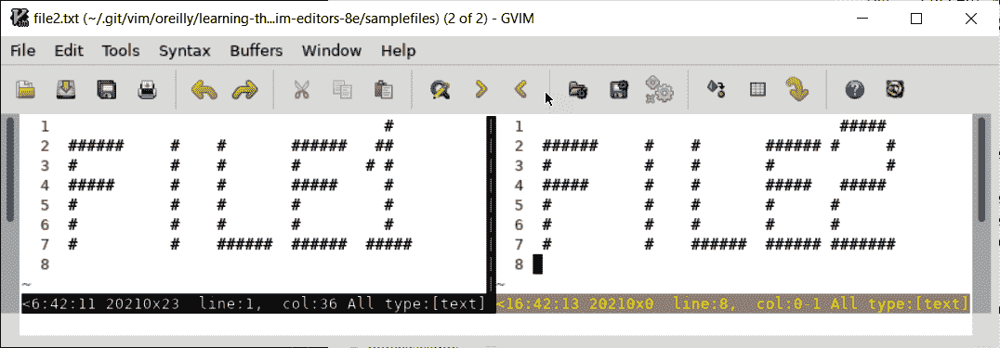

对于这些方法中的每一种，Vim 都会拆分窗口（水平或垂直），并且由于在 `:split` 命令行中未指定文件，因此你最终会使用两个视图或窗口编辑同一文件。

#### 提示

不相信你同时编辑的是同一个文件吗？拆分编辑窗口并滚动每个窗口，使每个窗口都显示文件的同一区域。进行更改。观察另一个窗口。魔法！

为什么或如何使用它是有用的？一个常见用途是在编写 shell 脚本或 C 程序时，编写一段描述程序用法的文本块。通常，当传递 `--help` 选项时，程序会显示该块。我们拆分显示，使一个窗口显示用法文本，并将其用作模板来编辑另一个窗口中的代码，该代码解析用法文本中描述的所有选项和命令行参数。通常（几乎总是）这段代码很复杂，并且最终距离用法文本足够远，以至于我们无法在一个窗口中显示所有内容。

如果你想在不丢失当前文件位置的情况下编辑或浏览另一个文件，请将新文件作为参数提供给你的 `:split` 命令。例如：

```
:split otherfile
```

下一节更详细地描述了拆分和取消拆分窗口。

## 打开窗口

本节深入介绍如何在拆分窗口时获得你想要的确切行为。

### 新窗口

如前所述，打开新窗口的最简单方法是发出 `:split`（水平分割）或 `:vsplit`（垂直分割）。下面将更深入地讨论许多命令和变体。我们还包括命令概要以供快速参考。

### 拆分时的选项

打开新水平窗口的完整 `:split` 命令是：

```
:[n]split [++opt] [+cmd] [file]
```

其中：

`n`

: 

告诉 Vim 在新窗口中显示多少行，该窗口位于顶部。

`opt`

: 


将 Vim 选项信息传递给新的窗口会话（注意它必须以两个加号开头）。

`cmd`

:

将命令传递到新窗口中执行（注意它必须以单个加号开头）。

`file`

:

指定在新窗口中编辑的文件。

例如，假设你正在编辑一个文件，并希望分割窗口以编辑另一个名为 `otherfile` 的文件。你希望会话使用 `fileformat` 为 `unix`（这确保使用换行符结束每一行，而不是回车符和换行符组合）。最后，你希望窗口高度为 15 行。输入：

```
:15split ++fileformat=unix otherfile
```

若要简单地分割屏幕，在两个窗口中显示同一文件并使用所有当前默认值，可以使用 `vi` 模式命令 `CTRL-W S`、`CTRL-W SHIFT-S` 或 `CTRL-W CTRL-S`。

### Tip

如果你希望窗口始终均等分割，设置 `equalalways` 选项，最好将其放入你的 `*.vimrc` 中以使其在会话间保持持久。默认情况下，设置 `equalalways` 会使水平和垂直窗口均等分割。添加 `eadirection` 选项（`hor`、`ver`、`both`，分别对应水平、垂直或两者）来控制哪个方向均等分割。

下面这种 `:split` 命令的形式会在之前的基础上打开一个新的水平窗口，但有一点细微差别：

```
:[n]new [++opt] [+cmd] [file]
```

除了创建新窗口外，`WinLeave`、`WinEnter`、`BufLeave` 和 `BufEnter` 自动命令会执行。（有关自动命令的更多信息，请参阅章节 “自动命令”。）

除了水平分割命令外，Vim 还提供类似的垂直命令。因此，例如，要分割垂直窗口，而不是使用 `:split` 或 `:new`，分别使用 `:vsplit` 和 `:vnew`。与水平分割命令一样，可用的可选参数相同。

有两个没有垂直对应项的水平分割命令：

`:sview` `filename`

:

将屏幕水平分割以打开新窗口并为该缓冲区设置 `readonly` 选项。`:sview` 需要文件名参数。

`:sfind [++opt] [+cmd] [filename]`

:

工作方式与 `:split` 类似，但会在 `path` 中查找 `filename`。如果 Vim 找不到该文件，则不会分割窗口。

## Conditional Split Commands

Vim 允许你指定一个命令，如果找到新文件则打开窗口。`:topleft` `cmd` 告诉 Vim 执行 `cmd`，如果 `cmd` 打开新文件，则显示一个新窗口并将光标置于左上角。该命令可能产生三种不同的结果：

* `cmd` 水平分割窗口，且新窗口占据 Vim 窗口顶部。
* `cmd` 垂直分割窗口，且新窗口占据 Vim 窗口左侧。
* `cmd` 不会分割窗口，而是将光标定位到当前窗口左上角。

除了条件分割命令 `:topleft` 外，Vim 还提供类似的命令 `:vertical`、`:leftabove` 和 `:aboveleft`、`:rightbelow` 和 `:belowright`，以及 `:botright`。你可以使用 Vim 的 `:help` 命令找到它们用法的详细描述。

## Window Command Summary

表 10-1 总结了分割窗口的命令。

Table 10-1. Summary of window commands

| `ex` 命令 || `vi` 命令 || 描述 |
| --- | --- | --- |
| 
```
:[n]split [++opt] [+cmd] [file]
```
 || 
`CTRL-W S`  
`CTRL-W SHIFT-S`  
`CTRL-W CTRL-S` 
 || 
将当前窗口从侧面分成两部分，光标置于新窗口中。可选的 `file` 参数将该文件置于新创建的窗口中。窗口尽可能均等创建大小，由可用窗口空间决定。
 |
| --- | --- | --- |
| 
```
:[n]new [++opt] [+cmd]
```
 || 
`CTRL-W N`  
`CTRL-W CTRL-N` 
 || 
与 `:split` 相同，但以空文件开始编辑新窗口。请注意，缓冲区在分配名称之前将没有名称。
 |
| 
```
:[n]sview [++opt] [+cmd] [file]
```
 ||  || 
`:split` 的只读版本。
 |
| 
```
:[n]sfind [++opt] [+cmd] [file]
```
 ||  || 
分割窗口并在新窗口中打开 `file`（如果指定）。在 `path` 中查找 `file`。
 |
| 
```
:[n]vsplit [++opt] [+cmd] [file]
```
 || 
`CTRL-W V`  
`CTRL-W CTRL-V` 
 || 
将当前窗口从上到下分成两部分，并在新窗口中打开 `file`（如果指定）。
 |
| 
```
:[n]vnew [++opt] [+cmd]
```
 ||  || 
`:new` 的垂直版本。
 |

# Moving Around Windows (Getting Your Cursor from Here to There)

在 `gvim` 和 Vim 中，使用鼠标在窗口间移动都很简单。`gvim` 默认支持鼠标点击，而在 Vim 中你可以使用 `mouse` 选项启用该行为。Vim 的一个良好默认设置是 `:set mouse=a`，它为所有用途激活鼠标：命令行、输入和导航。

如果你没有鼠标，或更喜欢通过键盘控制会话，Vim 提供了一整套导航命令，可快速准确地在会话窗口间移动。值得庆幸的是，Vim 在窗口导航中始终使用助记前缀按键 `CTRL-W`。其后的按键定义了移动或其他操作，窗口导航命令对经验丰富的 `vi` 和 Vim 用户来说应该很熟悉，因为它们与编辑的相同移动命令密切对应。

而不是描述每个命令及其行为，我们将考虑一个示例。然后命令概要表应不言自明。

要从当前 Vim 窗口移动到下一个窗口，输入 `CTRL-W J`（或 `CTRL-W ↓` 或 `CTRL-W CTRL-J`）。`CTRL-W` 是“窗口”命令的助记符，而 `j` 类似于 Vim 的 `j` 命令，该命令将光标移动到下一行。

表 10-2 总结了窗口导航命令。

### Note

如同许多 Vim 和 `vi` 命令一样，这些命令可以通过前缀计数多次执行。例如，`3 CTRL-W J` 告诉 Vim 跳到当前窗口下方第三个窗口。

Table 10-2. Window navigation commands

| 命令 || 描述 |
| --- | --- |
| `CTRL-W W`  
`CTRL-W CTRL-W` || 移动到下方或右侧的下一个窗口。请注意，与 `CTRL-W J` 不同，此命令会在所有 Vim 窗口中循环。当到达最下方的窗口时，Vim 重新开始循环并移动到最左上方的窗口。 |
| --- | --- |
| `CTRL-W ↓`  
`CTRL-W CTRL-J`  
`CTRL-W J` || 移动到下一个下方窗口。请注意，此命令不会在窗口间循环；它只是向下移动到当前窗口下方的下一个窗口。如果光标位于屏幕底部窗口中，此命令无效。此外，此命令会绕过其“向下”路径上的相邻窗口；例如，如果当前窗口右侧有窗口，命令不会跳到相邻窗口。（使用 `CTRL-W CTRL-W` 在窗口间循环。） |
| `CTRL-W ↑`  
`CTRL-W CTRL-K`  
`CTRL-W K` || 移动到下一个上方窗口。这是 `CTRL-W J` 命令的反向对应项。 |
| `CTRL-W ←`  
`CTRL-W H`  
`CTRL-W BACKSPACE` || 移动到当前窗口左侧的窗口。 |
| `CTRL-W →`  
`CTRL-W CTRL-L`  
`CTRL-W L` || 移动到当前窗口右侧的窗口。 |


| `CTRL-W SHIFT-W` || 移动到上方或左边的下一个窗口。这是 `CTRL-W W` 命令的向上对应项（注意大小写区别）。 |

| `CTRL-W T`  
`CTRL-W CTRL-T` || 移动到最左上角的窗口。 |

| `CTRL-W B`  
`CTRL-W CTRL-B` || 移动到最右下角的窗口。 |

| `CTRL-W P`  
`CTRL-W CTRL-P` || 移动到上一个（最后访问的）窗口。 |

# 移动窗口

你可以在 Vim 中以两种方式移动窗口。一种方式只是交换屏幕上的窗口。另一种方式改变实际的窗口布局。在第一种情况下，窗口大小保持不变，而窗口在屏幕上的位置发生变化。在第二种情况下，窗口不仅移动，而且会被调整大小以填满它们移动到的位置。

## 移动窗口（旋转或交换）

三个命令可以在不修改布局的情况下移动窗口。其中两个按一个方向（向右或向下）或另一个方向（向左或向上）位置旋转窗口，另一个交换两个可能不相邻的窗口的位置。这些命令*仅*对当前窗口所在的<|message|> 行或列起作用。

`CTRL-W R` 将窗口向右或向下旋转。其对应项是 `CTRL-W SHIFT-R`，它按相反方向旋转窗口。

想象这些工作的一种更简单的方法是把 Vim 窗口的一行或一列看作一个一维数组。`CTRL-W R` 将数组的每个元素向右移动一个位置，并将最后一个元素移入空出的第一个位置。`CTRL-W SHIFT-R` 只是按相反方向移动元素。

如果当前窗口所在列或行中没有其他窗口，此命令不执行任何操作。

Vim 旋转窗口后，光标仍保留在执行旋转命令的窗口中；因此，光标随窗口一起移动。

`CTRL-W X` 和 `CTRL-W CTRL-X` 可让你在窗口的行或列中交换两个窗口。默认情况下，Vim 将当前窗口与下一个窗口交换，如果没有下一个窗口，则尝试与上一个窗口交换。你可以在命令前加上计数来与第 `n` 个下一个窗口交换。例如，要将当前窗口与第三个下一个窗口交换，使用命令 `3 CTRL-W X`。

与前面两个命令一样，光标保留在执行交换命令的窗口中。

## 移动窗口并更改其布局

五个命令移动并重新布局窗口：两个将当前窗口移动到全宽的顶部或底部窗口，两个将当前窗口移动到全高的左侧或右侧窗口，第五个将当前窗口移动到另一个现有标签页。有关标签页编辑的信息，请参阅 "标签页编辑" 部分。前四个命令与其他 Vim 命令有熟悉的助记关系；例如，`CTRL-W SHIFT-K` 对应于 `k` 的传统概念，即 "上"。表 10-3 总结了这些命令。^(2)

表 10-3. 移动和重新布局窗口的命令

| 命令 || 描述 |
| --- | --- |
| `CTRL-W SHIFT-K` || 将当前窗口移动到屏幕顶部，使用屏幕的全部宽度。 |
| --- | --- |
| `CTRL-W SHIFT-J` || 将当前窗口移动到屏幕底部，使用屏幕的全部宽度。 |
| `CTRL-W SHIFT-H` || 将当前窗口移动到屏幕左侧，使用屏幕的全部高度。 |
| `CTRL-W SHIFT-L` || 将当前窗口移动到屏幕右侧，使用屏幕的全部高度。 |
| `CTRL-W SHIFT-T` || 将当前窗口移动到新标签页。 |

很难描述这些布局命令的确切行为。窗口移动并扩展到屏幕的全部高度或宽度后，Vim 会以合理的方式重新排列窗口布局。布局的行为也可以受某些窗口选项设置的影响。

## 窗口移动命令：概要

表 10-4 和 10-5 总结了本节介绍的命令。

表 10-4. 旋转窗口位置的命令

| 命令 || 描述 |
| --- | --- |
| `CTRL-W R`  
`CTRL-W CTRL-R` || 向下或向右旋转窗口。 |
| --- | --- |
| `CTRL-W SHIFT-R` || 向上或向左旋转窗口。 |
| `CTRL-W X`  
`CTRL-W CTRL-X` || 与下一个窗口交换位置，或如果使用计数 `n`，则与第 `n` 个下一个窗口交换。 |

表 10-5. 更改位置和布局的命令

| 命令 || 描述 |
| --- | --- |
| `CTRL-W SHIFT-K` || 将当前窗口移动到屏幕顶部并使用全部宽度。光标随移动的窗口保持不变。 |
| --- | --- |
| `CTRL-W SHIFT-J` || 将当前窗口移动到屏幕底部并使用全部宽度。光标随移动的窗口保持不变。 |
| `CTRL-W SHIFT-H` || 将当前窗口移动到屏幕左侧并使用全部高度。光标随移动的窗口保持不变。 |
| `CTRL-W SHIFT-L` || 将当前窗口移动到屏幕右侧并使用全部高度。光标随移动的窗口保持不变。 |
| `CTRL-W SHIFT-T` || 将当前窗口移动到新标签页。光标随移动的窗口保持不变。如果当前窗口是当前标签页中唯一的窗口，则不执行任何操作。 |

# 调整窗口大小

现在你对 Vim 的多窗口功能更熟悉了，需要对其进行更多控制。本节介绍如何更改当前窗口的大小，当然这会影响屏幕上其他窗口。Vim 提供了选项来控制窗口大小以及使用拆分命令打开新窗口时的窗口调整行为。

如果你宁愿 *sans* 命令控制窗口大小，请使用 `gvim`，让鼠标为你工作。只需用鼠标单击并拖动窗口边界即可调整大小。对于垂直分隔的窗口，请在竖线 (`|`) 字符的垂直分隔线上单击鼠标。水平窗口由其状态行分隔。

## 窗口调整大小命令

不出所料，Vim 有垂直和水平调整大小命令。与其他窗口命令一样，这些命令都以 `CTRL-W` 开头，并且映射到助记符，使其易于学习和记忆。

`CTRL-W =` 尝试将所有窗口调整为相等大小。这也会受 `winheight` 和 `winwidth` 的当前值影响，在下一节中讨论。如果可用屏幕空间不能平均分配，Vim 会将窗口调整为尽可能接近相等。

`CTRL-W -` 将当前窗口高度减少一行。Vim 还有一个 `ex` 命令可让你显式地减小窗口大小。例如，命令 `:resize -4` 将当前窗口减少四行，并将这些行给予其下方的窗口。

### 注意

还有另一种改变窗口大小的机制：`lines` 选项。通常 Vim 管理 `lines` 值，你可以通过使用 `ex` 命令 `set` 引用 `lines` 来查看（和）使用该值：

```
:set lines
```


然而，对于 `gvim`，你可以通过设置 `lines` 来更改图形窗口的大小。所有这些的一个副作用是，在只有一个窗口的终端中，如果你将 `lines` 设置为小于 `vim` 缓冲区窗口中行数的值，Vim 会将绘图区域调整为较小的计数。因此，Vim 会将分配给 `ex` 命令行的行数增加“丢失”到窗口缓冲区的行数。例如，如果你在 `*.vimrc` 文件中将 `lines` 设置为 15 并在 30 行的窗口中启动 `vim`，Vim 会分配 15 行作为编辑缓冲区。剩余的行分配给状态行（1 行）和 `ex` 命令缓冲区（14 行），这可能会令人困惑，因为 `ex` 命令缓冲区通常只有 1 行。为了避免这种副作用，我们建议你仅在 `*.gvimrc` 配置文件中使用 `:set lines=xx`。^(3)

`CTRL-W +` 将当前窗口大小增加一行。`:resize +n` 命令将当前窗口大小增加 `n` 行。一旦窗口达到最大高度，进一步使用此命令不会产生任何效果。

### 提示
请参阅 “调整窗口大小” 部分，其中有一对不错的键重映射，可使窗口调整大小变得更加容易。

`:resize n` 将当前窗口的水平大小设置为 `n` 行。它设置的是绝对大小，与之前描述的进行相对更改的命令形成对比。

`zn` 将当前窗口高度设置为 `n` 行。请注意，`n` 是 *不是* 可选的！省略它会导致 `vi`/Vim 命令 `z`，该命令将光标移动到屏幕顶部。

`CTRL-W <` 和 `CTRL-W >` 分别减小和增加窗口宽度。可以将助记设备“左移” (`<<`) 和“右移” (`>>`) 与这些命令的功能联系起来。

最后，`CTRL-W |` 将当前窗口调整为尽可能宽的大小（默认）。你也可以使用 `:vertical resize n` 明确指定如何更改窗口宽度。`n` 定义窗口的新宽度。

## 窗口大小选项
几个 Vim 选项会影响上一节中描述的调整大小命令的行为：

`winheight` 和 `winwidth`
当窗口变为活动状态时，它们分别定义最小窗口高度和宽度。例如，如果屏幕容纳两个各 45 行的等大窗口，默认的 Vim 行为是将其平均分割。如果你将 `winheight` 设置为大于 45 的值——比如 60——Vim 每次移动到的窗口都会调整为 60 行，而另一个窗口则调整为 30 行。这在同时编辑两个文件时非常方便；你在窗口之间和文件之间切换时会自动增加分配的窗口大小以获得最大上下文。

`equalalways`
这告诉 Vim 在分割或关闭窗口后始终将窗口调整为相等大小。这是一个不错的选项，可以确保在添加和删除窗口时窗口分配公平。

`eadirection`
这定义了 `equalalways` 的方向管辖范围。可能的值 `hor`、`ver` 和 `both` 分别告诉 Vim 使窗口在 *水平*、*垂直* 或 *两者* 方向上大小相等。每次分割或删除窗口时都会应用调整大小。

`cmdheight`
这设置命令行高度。如前所述，当只有一个窗口时减小窗口高度会增加命令行高度。你可以使用此选项保持命令行所需的高度。

`winminwidth` 和 `winminheight`
它们告诉 Vim 调整窗口大小的 *最小* 宽度和高度。Vim 将这些视为硬值，这意味着窗口永远不会被允许小于这些值。

## 调整大小命令概要
表 10-6 总结了调整窗口大小的方法。选项使用 `:set` 命令设置。

表 10-6. 窗口调整大小命令

| 命令或选项 | 类型 | 描述 |
|---|---|---|
| `CTRL-W =` | `vi` Command | 将所有窗口等比例调整大小。当前窗口遵守 `winheight` 和 `winwidth` 选项的设置。 |
| `:resize -n` | `ex` Command | 减小当前窗口大小。默认数量为一行。 |
| `CTRL-W -` | `vi` Command | 与 `:resize -n` 相同。 |
| `:resize +n` | `ex` Command | 增加当前窗口大小。默认数量为一行。 |
| `CTRL-W +` | `vi` Command | 与 `:resize +n` 相同。 |
| `:resize n` | `ex` Command | 设置当前窗口高度。默认是最大化窗口高度（除非指定了 `n`）。 |
| `CTRL-W CTRL-\_` / `CTRL-W _` | `vi` Command | 与 `:resize n` 相同。 |
| `z n ENTER` | `vi` Command | 将当前窗口高度设置为 `n`。 |
| `CTRL-W <` | `vi` Command | 减小当前窗口宽度。默认数量为一列。 |
| `CTRL-W >` | `vi` Command | 增加当前窗口宽度。默认数量为一列。 |
| `:vertical resize n` | `ex` Command | 将当前窗口宽度设置为 `n`。默认是使窗口尽可能宽。 |
| `CTRL-W |` | `vi` Command | 与 `:vertical resize n` 相同。 |
| `cmdheight` | Option | 设置命令行高度。 |
| `eadirection` | Option | 定义 Vim 是否在垂直、水平或两者方向上将窗口调整为相等大小。 |
| `equalalways` | Option | 当窗口数量发生变化时，无论是通过分割还是关闭窗口，都将其调整为相同大小。 |
| `winheight` | Option | 进入或创建窗口时，将其高度设置为至少指定的值。 |
| `winwidth` | Option | 进入或创建窗口时，将其宽度设置为至少指定的值。 |
| `winminheight` | Option | 定义最小窗口高度，适用于所有创建的窗口。 |
| `winminwidth` | Option | 定义最小窗口宽度，适用于所有创建的窗口。 |

# 缓冲区及其与窗口的交互
Vim 使用 *缓冲区* 作为工作的容器。完全理解缓冲区是一项需要培养的技能；有许多命令用于操作和导航它们。然而，熟悉一些缓冲区的基础知识并了解它们在整个 Vim 会话中存在的原因和方式是值得的。

一个好的起点是打开几个编辑不同文件的窗口。例如，通过打开 `file1` 启动 Vim。然后，在会话中执行 `:split file2`，然后执行 `:split file3`。你现在应该在三个单独的 Vim 窗口中有三个打开的文件。

现在使用命令 `:ls`、`:files` 或 `:buffers` 列出缓冲区。你应该看到三行，每行编号并包含文件名以及其他信息。这些是此会话的 Vim 缓冲区。每个文件有一个缓冲区，每个缓冲区都有一个唯一且不变的关联编号。在此示例中，`file1` 在缓冲区一中，`file2` 在缓冲区二中，`file3` 在缓冲区三中。


每个缓冲区上的附加信息可以通过在任意命令后附加感叹号 (`!`) 来显示。

每个缓冲区编号的右侧是状态标志。这些标志描述了缓冲区，如 表 10-7 所示。

### 表 10-7. 描述缓冲区的状态标志

| Code || Description |
| --- | --- |
| `u` || 未列出缓冲区。除非使用 `!` 修饰符，否则此缓冲区不会被列出。要查看未列出缓冲区的示例，请键入 `:help`。Vim 会拆分当前窗口以包含一个新窗口，其中内置帮助会显示出来。普通的 `:ls` 命令不会显示帮助缓冲区，但 `:ls!` 会包含它。 |
| --- | --- |
| `%` or `#` || `%` 是当前窗口的缓冲区。`#` 是你将通过 `:edit #` 命令切换到的缓冲区。这两者互斥。 |
| `a` or `h` || `a` 表示活动缓冲区。这意味着缓冲区已加载且可见。`h` 表示隐藏缓冲区。隐藏缓冲区存在但在任何窗口中都不可见。这两者互斥。 |
| `-` or `=` || `-` 表示缓冲区的 `modifiable` 选项已关闭。文件为只读。`=` 是一个只读缓冲区，无法使其可修改（例如，因为你没有文件系统权限写入文件）。这两者互斥。 |
| `+` or `x` || `+` 表示已修改的缓冲区。`x` 是存在读取错误的缓冲区。这两者互斥。 |

### 提示

`u` 标志是了解你在 Vim 中查看的帮助文件的一种有趣方式。例如，如果你先执行 `:help split` 然后执行 `:ls!`，你会看到未列出的缓冲区指的是内置的 Vim 帮助文件，`windows.txt`。

现在你能够列出 Vim 缓冲区，我们可以谈谈它们及其各种用途。

## Vim 的特殊缓冲区

Vim 使用一些称为 *特殊缓冲区* 的缓冲区用于自身目的。例如，前一节中描述的帮助缓冲区就是特殊的。通常，这些缓冲区不能被编辑或修改。

以下是 Vim 特殊缓冲区的四个示例：

`directory`

包含目录内容，即目录的文件列表（以及一些有用的额外命令提示）。这是在 Vim 内部的一个便捷工具，让你可以在此缓冲区中像在普通文本文件中一样移动，并通过按 `ENTER` 选择光标下的文件进行编辑。

`help`

包含 Vim 帮助文件，之前在 “内置帮助” 部分有描述。`:help` 将这些文本文件加载到此特殊缓冲区中。

`QuickFix`

包含由你的命令创建的错误列表（可通过 `:cwindow` 查看）或位置列表（可通过 `:lwindow` 命令查看）。不要编辑此缓冲区的内容！它帮助程序员在编辑-编译-调试循环中迭代。请参阅 第 11 章。

`scratch`

这些缓冲区包含用于一般目的的文本。此文本可有可无，可随时删除。

## 隐藏缓冲区

隐藏缓冲区是当前未在任何窗口中显示的 Vim 缓冲区。这使得在编辑多个文件时更容易，考虑到多个窗口有限的屏幕空间，而无需不断检索和重写文件。例如，想象你正在编辑 `myfile` 文件，但希望暂时编辑另一个文件 `myOtherfile`。如果设置了 `hidden` 选项，你可以通过 `:edit` `myOtherfile` 编辑 `myOtherfile`，导致 Vim 隐藏 `myfile` 缓冲区并在原处显示 `myOtherfile`。你可以使用 `:ls` 验证这一点，并看到两个缓冲区都被列出，其中 `myfile` 被标记为“hidden。”

## 缓冲区命令

有将近 50 个命令专门针对缓冲区。许多命令很有用，但大多超出了本次讨论的范围。随着你打开和关闭多个文件和窗口，Vim 会自动管理缓冲区。缓冲区命令套件允许你对缓冲区执行几乎任何操作。它们通常在脚本中使用来处理卸载、删除和修改缓冲区等任务。

由于其强大的功能，能够在多个文件上完成大量工作，因此有两种缓冲区命令值得一般用户了解：

`windo` `cmd`

简写为“window do”（至少我们认为这是一个不错的助记符），这个伪缓冲区命令（实际上是窗口命令）在每个窗口中执行命令 `cmd`。它就像你移动到屏幕顶部（`CTRL-W T`）并循环遍历每个窗口，在该窗口中将指定命令作为 `:cmd` 执行。它仅在当前标签页内起作用，并在 `:cmd` 产生错误的任何窗口处停止。发生错误的窗口将成为新的当前窗口。请参阅 “选项卡编辑” 部分，了解 Vim 标签页的讨论。

`cmd` 不允许更改窗口的状态；也就是说，它不能删除、添加或更改窗口的顺序。

### 注意

`cmd` 可以使用管道 (`|`) 符号连接多个 `ex` 命令。命令按顺序执行，首先第一个命令依次在所有窗口中执行，然后第二个命令在所有窗口中执行，以此类推。

作为 `:windo` 实际操作的示例，假设你正在编辑一组 Java 文件，原因不明，你有一个类名大小写不正确。你需要通过将 `myPoorlyCapitalizedClass` 的每个出现更改为 `MyPoorlyCapitalizedClass` 来修复它。使用 `:windo` 你可以这样做：

```
:windo %s/myPoorlyCapitalizedClass/MyPoorlyCapitalizedClass/g
```

很酷！

`bufdo[!]` `cmd`

这与 `windo` 类似，但作用于编辑会话中的所有缓冲区，而不仅仅是当前标签页中可见的缓冲区。`bufdo` 在遇到第一个错误时停止，就像 `windo` 一样，并将光标留在命令失败的缓冲区中。

以下示例将所有缓冲区更改为 Unix 文件格式：

```
:bufdo set fileformat=unix
```

## 缓冲区命令概要

表 10-8 并没有尝试描述与缓冲区相关的所有命令；相反，它总结了本节中描述的命令以及一些其他流行命令。

### 表 10-8. 缓冲区命令摘要

| Command || Description |
| --- | --- |
| 
```
:ls[!]
:files[!]
:buffers[!]
```
 || 列出缓冲区和文件名。如果包含 `!` 修饰符，则包含未列出的缓冲区。 |
| --- | --- |
| 
```
:ball
:sball
```
 || 编辑所有参数或缓冲区。（`sball` 在新窗口中打开它们。） |
| 
```
:unhide
:sunhide
```
 || 编辑所有 *已加载* 的缓冲区。（`sunhide` 在新窗口中打开它们。） |
| 
```
:badd file
```
 || 将 `file` 添加到列表中。 |
| 
```
:bunload[!]
```
 || 从内存中卸载当前缓冲区。`!` 修饰符强制在未保存的情况下卸载已修改的缓冲区。 |
| 
```
:bdelete[!]
```
 || 卸载当前缓冲区并将其从缓冲区列表中删除。`!` 修饰符强制在未保存的情况下卸载已修改的缓冲区。 |
| 
```
:buffer [n]
:sbuffer [n]
```
 || 移动到缓冲区 `n`。`sbuffer` 打开一个新窗口。 |
| 
```
:bnext [n]
:sbnext [n]
```
 || 移动到第 `n` 个下一个缓冲区。`sbnext` 打开一个新窗口。 |
| 
```
:bNext [n]
:sbNext [n]
:bprevious [n]
:sbprevious [n]
```
 || 移动到第 `n` 个下一个或上一个缓冲区。`sbNext` 和 `sbprevious` 打开一个新窗口。 |
| 
```
:bfirst
:sbfirst
```
 || 移动到第一个缓冲区。`sbfirst` 打开一个新窗口。 |


```
:blast
:sblast
```

移动到最后一个缓冲区。`sblast` 打开一个新窗口。

```
:bmod [n]
:sbmod [n]
```

移动到第 `n` 个已修改的缓冲区。`sbmod` 打开一个新窗口。

# 使用窗口进行标签跳转

Vim 通过在多个窗口中提供相同的标签遍历机制，将 `vi` 的标签功能扩展到窗口中。（请参阅章节 “使用标签” 了解 `vi` 标签的讨论。）跟随标签也可以在新窗口中打开文件并定位到相关位置。

标签窗口命令会分割当前窗口，并跟随标签到匹配该标签的文件，或跟随光标下的文件名到匹配的文件：

`:stag[!]` `tag`

此命令会分割窗口以显示找到的标签的位置。包含匹配标签的新文件成为当前窗口，光标置于匹配的标签上。如果未找到标签，命令失败，且不会创建新窗口。

### Tip

提示

随着你对 Vim 帮助系统的熟悉程度提高，你可以使用 `:stag` 在帮助系统中进行分割浏览，而不是在同一窗口中从一个文件跳到另一个文件。

`CTRL-W \]` or `CTRL-W ^`

这些命令会分割窗口并在当前窗口上方打开一个窗口。新窗口成为当前窗口，光标置于匹配的标签上。如果标签没有匹配项，命令失败。

`CTRL-W G`

此命令会分割窗口并在当前窗口上方创建新窗口。在新窗口中，Vim 执行命令 `:tselect` `tag`，其中 `tag` 为光标下的标签标识符。光标置于新窗口中，且该新窗口成为当前窗口。如果不存在匹配的标签，命令失败。

`CTRL-W G CTRL-\]`

此命令与 `CTRL-W G` 完全相同，只是它执行 `:tjump` 而不是 `:tselect`。

`CTRL-W F` or `CTRL-W CTRL-F`

这些命令会分割窗口并编辑光标下的文件名。Vim 会按顺序在选项变量 `path` 中设置的文件中查找文件。如果文件在任何 `path` 目录中都不存在，命令失败且不会创建新窗口。

`CTRL-W SHIFT-F`

此命令会分割窗口并编辑光标下的文件名。光标置于编辑该文件的新窗口中，并定位到与第一个窗口中文件名后跟随的数字相匹配的行号。

`CTRL-W G F`

此命令在新标签页中打开光标下的文件。如果文件不存在，则不会创建新标签页。

`CTRL-W G SHIFT-F`

此命令在新标签页中打开光标下的文件，并将光标定位到第一个窗口中文件名后跟随的数字所指定的行。如果文件不存在，则不会创建新标签页。

# 标签页编辑

你知道除了在多个窗口中编辑之外，还可以创建多个 *标签页* 吗？Vim 允许你创建新的标签页，每个标签页都独立运行。在每个标签页中，你可以分割屏幕、编辑多个文件——几乎可以在单个窗口中进行的任何操作；但现在所有工作都可以在一个带标签的窗口中轻松管理。

许多 Chrome 和 Firefox 用户非常熟悉并依赖于标签页浏览，他们会认识到此功能为强大编辑带来的价值。^(4) 对于初学者来说，值得一试。

你可以在普通 Vim 和 `gvim` 中使用标签页，但 `gvim` 更美观也更易用。创建和管理标签页的一些更重要方法包括：

`:tabnew` `filename` or `:tabedit` `filename`

打开一个新标签页并编辑文件（可选）。如果未指定文件，Vim 会打开一个包含空缓冲区的标签页。

`:tabclose`

关闭当前标签页。

`:tabonly`

关闭所有其他标签页。如果其他标签页有已修改的文件，除非设置了 `autowrite` 选项，否则它们不会被移除，在这种情况下，所有已修改文件都会在关闭其他标签页之前写入。

在 `gvim` 中，你只需点击屏幕顶部的标签即可激活任意标签。如果你配置了鼠标（请参阅 `mouse` 选项），也可以在基于字符的终端中使用鼠标激活标签。此外，使用 `CTRL PAGEDOWN`（向右移动一个标签页）和 `CTRL PAGEUP`（向左移动一个标签页）在标签页之间左右移动也很简单。如果你位于最左或最右的标签页并尝试分别向左或向右移动，Vim 会移动到最右或最左的标签页。

`gvim` 为标签提供右键弹出菜单，你可以从中打开新标签页（有或没有新文件进行编辑）并关闭标签页。

图 10-4 是标签页集合的示例（注意标签弹出菜单）。图 10-5 是终端模拟器中的相同示例。

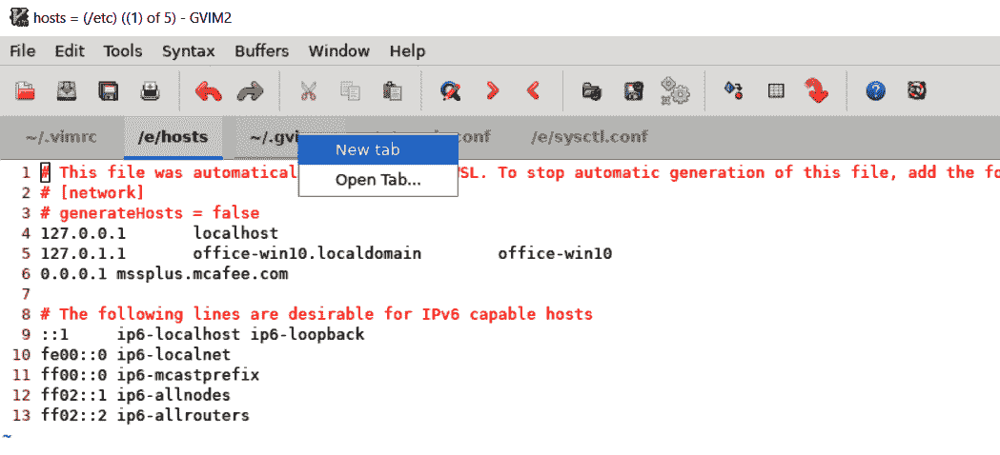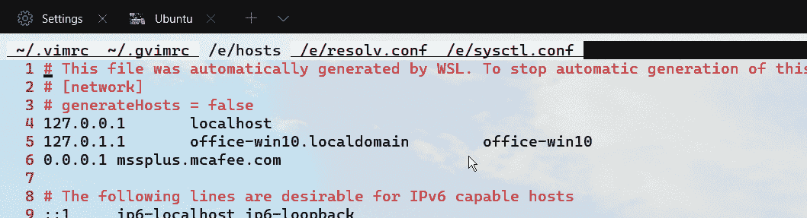

### Tip

提示

Vim 命令行选项 `-p` 打开多个文件，使每个文件占据一个单独的标签页。我们在图 10-4 和 10-5 中的示例就是这样调用的：

```
gvim -p ~/.vimrc ~/.gvimrc /etc/hosts /etc/resolv.conf/etc/sysctl.conf
vim -p ~/.vimrc ~/.gvimrc /etc/hosts /etc/resolv.conf/etc/sysctl.conf
```

# 关闭和退出窗口

有四种不同的方法可以关闭窗口，这些方法特定于窗口编辑——*退出*、*关闭*、*隐藏* 和 *关闭其他所有窗口*：

`CTRL-W Q` or `CTRL-W CTRL-Q`

这些实际上只是 `:quit` 命令的窗口版本。在最简单的形式中（即在仅有一个窗口的单个会话中），它们的行为与 `vi` 的 `:quit` 命令完全相同。如果设置了 `hidden` 选项且当前窗口是屏幕上引用该文件的最后一个窗口，则窗口关闭但文件缓冲区被保留并隐藏（可以检索）。换句话说，Vim 仍在存储该文件，你稍后可以返回编辑。如果 `hidden` 未设置，窗口是引用该文件的最后一个窗口，并且存在未保存的更改，命令会失败以避免丢失更改。但如果其他窗口显示该文件，则当前窗口关闭。

`CTRL-W C` or `:close[!]`

这些命令关闭当前窗口。如果设置了 `hidden` 选项且这是引用该文件的最后一个窗口，Vim 会关闭窗口并隐藏缓冲区。如果该窗口位于标签页上并且是该标签页的最后一个窗口，则窗口 *和* 标签页都会关闭。只要你不使用 `!` 修饰符，此命令就不会放弃任何有未保存更改的文件。`!` 修饰符告诉 Vim 无条件关闭当前窗口。

### Note

注意

请注意，此命令不使用 `CTRL-W CTRL-C`，因为 Vim 使用 `CTRL-C` 来 *取消* 命令。因此，如果你尝试使用 `CTRL-W CTRL-C`，`CTRL-C` 只会取消该命令。

同样，虽然 `CTRL-W` 命令与 `CTRL-S` 和 `CTRL-Q` 结合使用，但 *一些* 用户可能会发现他们的终端模拟器冻结，因为某些终端模拟器将 `CTRL-S` 和 `CTRL-Q` 解释为控制字符，用于停止和开始向屏幕显示信息。如果你在使用这些组合时发现屏幕神秘冻结，请尝试其他列出的组合。

`CTRL-W O`, `CTRL-W CTRL-O`, and `:only[!]`


这些只关闭当前窗口之外的所有窗口。如果设置了 `hidden` 选项，所有关闭的窗口都会隐藏其缓冲区。如果未设置，任何引用有未保存更改的文件的窗口仍会保留在屏幕上，除非你包含 `!` 修饰符，在这种情况下所有窗口都会关闭并且文件将被放弃。此命令的行为会受到 `autowrite` 选项的影响：如果设置了它，所有窗口都会关闭，但包含未保存更改的窗口会在退出前将其写入磁盘文件。

`:hide` [`cmd`]

这会退出当前窗口，如果没有其他窗口引用它则隐藏缓冲区。如果提供了可选的 `cmd`，缓冲区将被隐藏，并执行该命令。

表 10-9 提供了这些命令的总结。

表 10-9. 关闭和退出窗口的命令

| 命令 | 按键 | 描述 |
|---|---|---|
| `:quit[!]` | `CTRL-W Q`<br>`CTRL-W CTRL-Q` | 退出当前窗口。 |
| `:close[!]` | `CTRL-W C` | 关闭当前窗口。 |
| `:only[!]` | `CTRL-W O`<br>`CTRL-W CTRL-O` | 使当前窗口成为唯一窗口。 |
| `:hide[cmd]` |  | 关闭当前窗口并隐藏缓冲区。如果存在则执行 `cmd`。 |

## 总结

如你现在所欣赏的，Vim 凭借其众多窗口功能提升了编辑能力。Vim 让你可以轻松地即时创建和删除窗口。此外，Vim 提供了底层原始缓冲区命令的强大功能，缓冲区是 Vim 管理窗口编辑的基础文件管理基础设施。这再次完美地展示了 Vim 如何为初学者带来多窗口编辑，同时为高级用户提供他们调整窗口体验所需的工具。

^(1) 当然，正如本章所述，你仍然可以选择将窗口切分成非常小的尺寸，以满足你的编辑需求。

^(2) 这里的大写或大写字母是一种管理窗口的放大方式。记住，使用这些命令时你是在移动窗口，而不是光标。

^(3) 你 *可以* 使用 `cmdheight` 选项修改 `ex` 命令空间的高度（不要与 `cmdwinheight` 选项混淆）。

^(4) 哇，当本书第七版发布时，Chrome 甚至还不存在！而今天所有浏览器都有标签页，所有用户都应该熟悉它们。

## 第 11 章. 面向程序员的 Vim 增强功能

文本编辑只是 Vim 的众多强项之一。优秀的程序员要求强大的工具以确保高效熟练的工作。好的编辑器只是起点，单独使用是不够的。许多现代编程环境试图提供全面的解决方案，而实际上真正需要的只是一个功能强大且高效的编辑器，再加上一些额外的智能。

编程工具提供的额外功能从具有语法着色、自动缩进和格式、关键字补全等的编辑器，到具有复杂集成构建完整开发生态系统的全功能集成开发环境（IDE）不等。这些 IDE 可能是昂贵的（例如，Visual Studio^(1)）或免费的（Eclipse），即使计算机资源需求不再那么主导，通常轻量级的东西就足够了。Vim 通过提供一些类似 IDE 的功能，并在社区提供的插件的帮助下接近 IDE 功能，填补了 *轻量级* 空间。（有关使用 Vim IDE 插件开发的更深入介绍，请参阅 第 15 章，“Vim 作为 IDE：需要一些组装”。）

程序员的任务各不相同，他们的技术需求也各不相同。小型开发任务可以用简单的编辑器轻松完成，这些编辑器提供的功能仅比文本编辑多一点。大型的多组件、多平台和多人员项目 *几乎* 需要 IDE 提供的重型支持。但从轶事经验来看，许多资深程序员认为 IDE 提供的只是额外的复杂性，而成功概率并没有更高。

Vim 在简单编辑器和庞大的 IDE 之间取得了很好的平衡。它具有直到最近才在昂贵的 IDE 中可用的功能。它让你无需 IDE 的开销和学习曲线即可完成快速简单的编程任务。

众多特别适合让程序员生活更轻松的选项、功能、命令和函数范围从将代码行折叠成一行到语法着色和自动格式化不等。Vim 为程序员提供了许多工具，只有通过使用才能充分体会其价值。在高端，它提供了一种名为 `QuickFix` 的迷你 IDE，但它也具有针对各种编程任务的便利功能。本章介绍以下主题：

* 折叠
* 自动和智能缩进
* 关键字和词典单词补全
* 标签和扩展标签
* 语法高亮和高亮编写（自行制作）
* `QuickFix`, Vim 的迷你 IDE

## 折叠和大纲（大纲模式）

折叠让你定义文件中显示的部分。例如，在代码块中，你可以隐藏大括号内的任何内容，或隐藏所有注释。折叠是一个两阶段的过程。首先，使用几种折叠方法中的任何一种（我们很快会描述），你定义构成要折叠的文本块的内容。然后，当你使用折叠命令时，Vim 会隐藏指定的文本，并在其位置留下一个单行占位符。图 11-1 显示了 Vim 中折叠的外观。你可以使用折叠占位符管理被折叠隐藏的行。

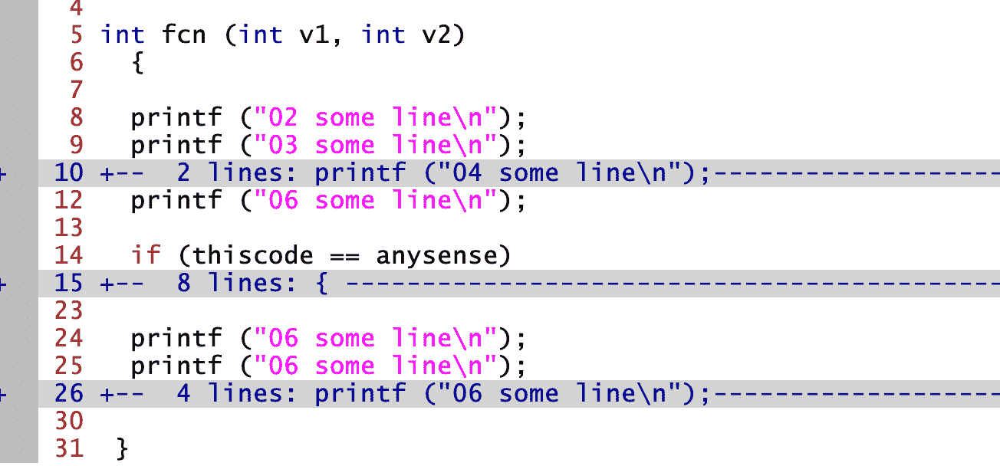

在示例中，第 11 行被从第 10 行开始的双行折叠隐藏。一个从第 15 行开始的八行折叠隐藏了第 15 行到第 22 行。而一个从第 26 行开始的四行折叠隐藏了第 26 行到第 29 行。

你可以创建的折叠数量几乎没有限制。你甚至可以创建嵌套折叠（折叠中的折叠）。

若干选项控制 Vim 如何创建和显示折叠。此外，如果你花时间创建了许多折叠，Vim 提供了便捷命令 `:mkview` 和 `:loadview` 来在会话之间保留折叠，这样你就不必再次创建它们。

折叠需要一些学习努力，但掌握后，它提供了一种强大的方式来控制显示什么以及何时显示。不要低估这种能力带来的力量。正确且可维护的程序需要在多个层面上具有健壮的设计，因此良好的编程通常需要着眼于森林而不是树木^(2)——换句话说，忽略实现细节以便看到文件的整体结构。

对于高级用户，Vim 提供了六种不同的定义、创建和操作折叠的方法。这种灵活性让你在不同上下文中创建和管理折叠。最终，一旦创建，折叠的打开和关闭以及行为对于整个折叠命令集来说是相似的。

创建折叠的六种方法如下：

`diff`

两个文件之间的差异定义了折叠。

`expr`

正则表达式定义折叠。

`indent`

折叠和折叠级别对应于文本的缩进以及选项 `shiftwidth` 的值。

`manual`

折叠和折叠级别源于用户 Vim 命令（例如，折叠一个段落）。

`marker`

文件中预定义的（但也可由用户定义）标记指定折叠边界。

`syntax`


Folds correspond to the semantics of a file’s language (e.g., a C program’s function blocks could fold).

You use these terms as the value of the `foldmethod` option. The manipulation of folds (opening and closing, deleting, etc.) is the same for all methods. We’ll examine manual folds and discuss Vim fold commands in detail. We address some details for the other methods, but they are complex, specialized, and beyond the scope of this introduction. We hope our coverage will prompt you to explore the richness of these other methods.

So let’s take a brief look at the important fold commands and go through a short example of what folds look like.

## The Fold Commands

Fold commands all begin with `z`. As a mnemonic to remember this, think of the side view of a folded piece of paper (when folded correctly) and how it looks like the letter “z.”

There are about 20 `z` fold commands. With these commands you create and delete folds, open and close folds (hide and expose text belonging to folds), and toggle the expose/hide state of the folds. Here are short descriptions:^(3)

`zA`

Toggle the state of folds, recursively.

`zC`

Close folds, recursively.

`zD`

Delete folds, recursively.

`zE`

Delete *all* folds.

`zf`

Create a fold from the current line to the one where the following motion command takes the cursor.

`[count] zF`

Create a fold covering `count` lines, starting with the current line.

`zM`

Set option `foldlevel` to zero.

`zN`, `zn`

Set (`zN`) or reset (`zn`) the `foldenable` option.

`zO`

Open folds, recursively.

`za`

Toggle the state of one fold.

`zc`

Close one fold.

`zd`

Delete one fold.

`zi`

Toggle the value of the `foldenable` option.

`zj`, `zk`

Move the cursor to the start (`zj`) of the next fold or to the end (`zk`) of the previous fold. Note the mnemonic of the `j` and `k` motion commands and how they are analogous to motions within the context of folds.

`zm`, `zr`

Decrement (`zm`) or increment (`zr`) the value of the `foldlevel` option by one.

`zo`

Open one fold.

### Warning

Don’t confuse *deleting a fold* with *deleting text*. Use the “delete fold” (`zd`) command to remove, or undefine, a fold. A deleted fold has no effect on the text contained in that fold. You may notice we mention this more than once. It’s important to know. One of us has lost work thinking he merely deleted folds when, in fact, he deleted content. Of course this is something that is always discovered inconveniently late.

`zA`, `zC`, `zD`, and `zO` are called recursive because they operate on all folds nested within the one where you issue the commands.

## Manual Folding

If you know Vim motion commands, you already know half of what you must learn to be proficient with manual fold commands.

For example, to hide three lines in a fold, enter either of the following:

```
3zF
2zfj
```

`3zF` executes the `zF` folding command over three lines, starting with the current one. `2zfj` executes the `zf` folding command from the current line to the line where `j` moves the cursor (two lines down).

Let’s try a more sophisticated command of use to C programmers. To fold a block of C code, position the cursor over the beginning or ending brace (`{` or `}`) of a block of code and type `zf%`. (Remember that `%` moves to the matching brace.)

Create a fold from the cursor to the beginning of the file by typing `zfgg`. (`gg` goes to the beginning of the file.)

It is easier to understand folds by seeing an example. We’ll take a simple file, create and manipulate folds, and watch the behavior. We’ll also see some of the enhanced visual folding cues that Vim provides.

First consider the example file in Figure 11-2, which contains some (meaningless) lines of C code. Initially, there are no folds.

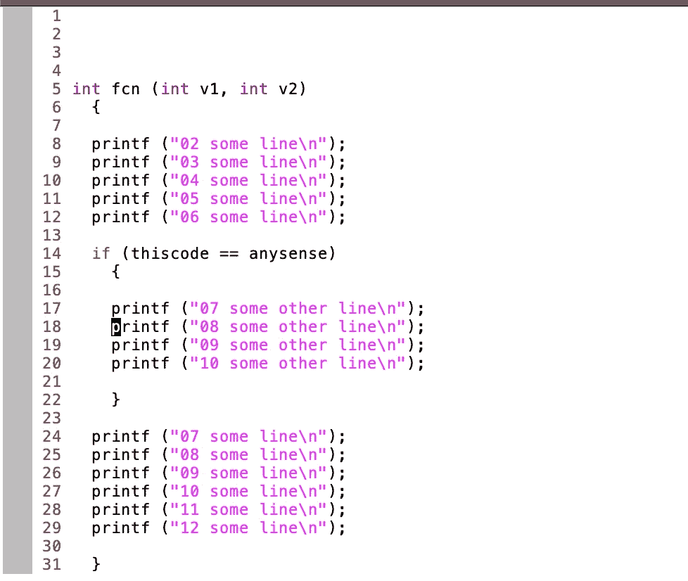

There are a few things to note in this picture. First, Vim displays line numbers on the left side of the screen. We recommend that you always turn them on (using the `number` option) for added visual information about file location, and in this context the information becomes more valuable when you fold lines out of view. Vim tells you how many lines are not displayed, and the line numbers confirm and reinforce that information.

Also notice the gray columns to the left of the line numbers. These columns are reserved for more folding visual cues. As we create and use folds, we will see the visual cues that Vim inserts into these columns.

In Figure 11-2, notice that the cursor is on line 18. Let’s fold that line and the two following lines into one fold. We type `zf2j`. Figure 11-3 shows the result.

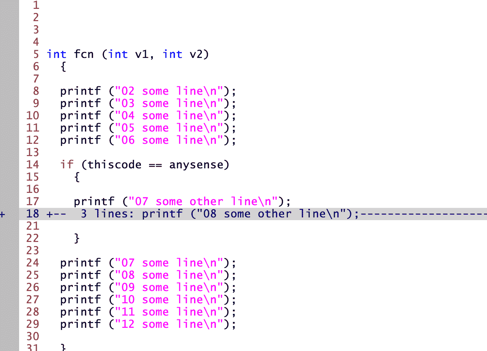

Notice how Vim creates an easily identified marker with the `+--` as a prefix, and how it displays text from the first folded line in the *fold* placeholder. Now notice where Vim inserted the `+` at the far left side of the screen. This is another visual cue.

In the same file, we’ll next fold the block of code between and including the braces after the `if` statement. Position the cursor on either one of the braces and type `zf%`.^(4) The file now appears as in Figure 11-4.

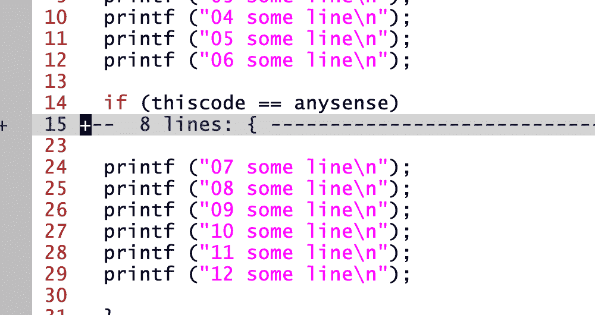

Now there are eight lines of code folded, three of which are contained in a previously created fold. This is called a *nested* fold. Note that there is no indication of the nested fold.

Our next experiment is to position the cursor on line 25 and fold all lines up to and including the function declaration for `fcn`. This time we use the Vim *search* motion. We initiate the fold command with `zf`, search backward to the beginning of the `fcn` function using `?int fcn` (the backward search command in Vim), and press the ENTER key. The screen now looks like Figure 11-5.

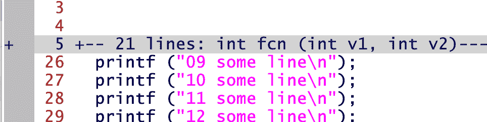

### Note

If you count lines and create a fold that spans another fold (for example, `3zf`), all lines contained in the spanned fold count as one line. For example, if the cursor is on line 30, and lines 31–35 are hidden in a fold on the next screen line so that the next line on the screen displays line 36, `3zf` creates a new fold containing three lines as they appear on the screen: the text line 30, the five lines contained in the fold holding lines 31–35, and the text line 36 displayed in the next line on the screen. Confusing? A little. You might say that the `zf` command counts lines in accordance with the rule “What you see is what you fold.”

Let’s try some other features. First, open all the folds with the command `zO` (that’s `z` followed by the letter O, not `z` followed by a zero). Now we start seeing some visual cues in the left margin about the folds we made, as shown in Figure 11-6. Each of the columns in this margin is called a fold column.

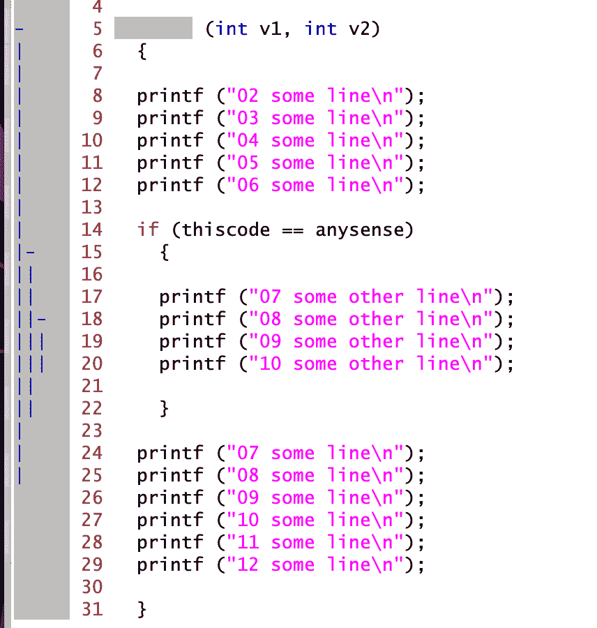

In this figure, the first line of each fold is marked with a minus sign (`–`), and all the other lines of the fold are marked by a vertical bar or pipe character (`|`). The largest (outermost) fold is in the leftmost column, and the innermost fold is in the rightmost column. As you see in our picture, lines 5–25 represent the lowest fold level (in this case, one), lines 15–22 represent the next fold level (two), and lines 18–20 represent the highest fold level.

### Tip


默认情况下，这个有用的视觉隐喻是关闭的（我们不知道为什么——也许是因为它占用屏幕空间）。使用以下命令将其打开并定义其宽度：

```
:set foldcolumn=n
```

其中 `n` 是要使用的列数（最大为十二，默认值为零）。在图中，我们使用 `foldcolumn=5`。对于仔细观察的人来说，是的，以前的图中的 `foldcolumn` 设置为三。我们更改了该值以获得更好的视觉效果。

现在创建更多折叠以观察其效果。

首先，重新折叠最深的折叠，该折叠覆盖第 18–20 行，将光标定位在该折叠范围内的任意一行并输入 `zc`（关闭折叠）。图 11-7 显示了结果。

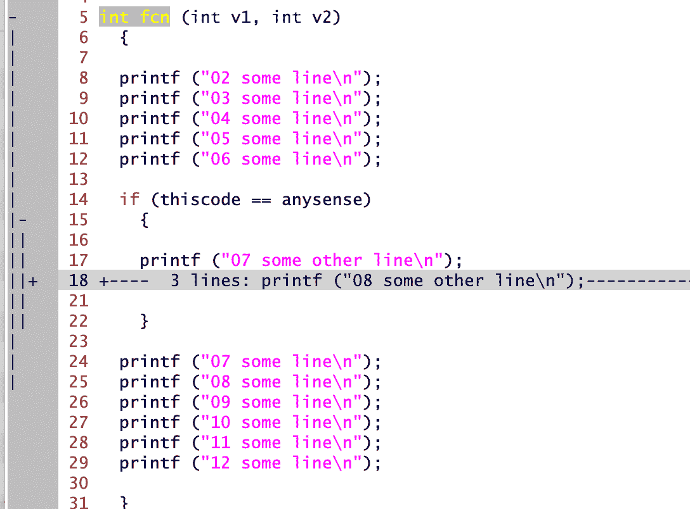

看到灰色边距的变化了吗？Vim 保持视觉提示，使折叠的可视化和管理变得容易。

现在让我们看看典型的“一行”命令对折叠做了什么。将光标定位在折叠行（18）上。输入 `~~`（切换当前行中所有字符的大小写）。请注意，当 Vim 选项 `tildeop` 设置时，这是内联更改大小写的用法；否则命令应为 `g~~`。请记住，在 Vim 中，`~` 是一个对象操作符（除非设置了 `compatible` 选项），因此应切换该行中所有字符的大小写。接下来，通过输入 `zo`（打开折叠）打开折叠。代码现在看起来像 图 11-8。

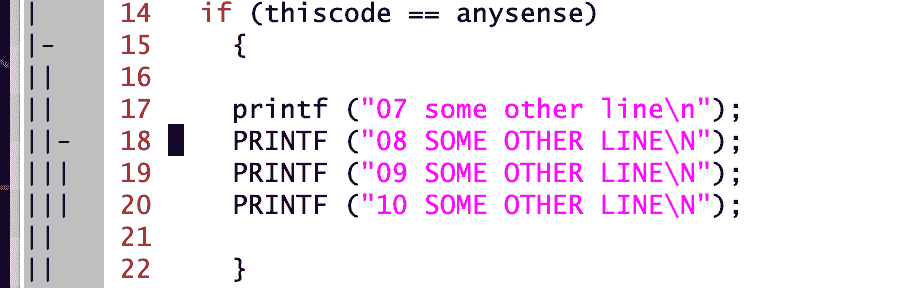

这是一个强大的功能。行命令或操作符作用于折叠行所代表的整个文本！承认这可能看起来像一个牵强的例子，但它很好地说明了这种技术的潜力。

### 注意

正如我们刚才看到的，对折叠的任何操作都会影响整个折叠。例如，在 图 11-7 中，如果将光标定位在第 18 行——一个隐藏第 18 到 20 行的折叠——并输入 `dd`（删除行），所有三行都会被删除并且折叠被移除。

还需要注意的是，Vim 将所有编辑操作都当作没有折叠一样管理，因此任何撤销都会撤销整个编辑操作。因此，如果我们在之前的更改后输入 `u`（撤销），之前被删除的所有三行都会被恢复。撤销功能与本节讨论的“一行”操作是分开的，尽管有时它们似乎作用相似。

现在是熟悉折叠列边距中视觉提示的好时机。它们使你能够轻松看到即将操作的折叠。例如，`zc`（关闭折叠）命令关闭光标所在行的最内层折叠。你可以通过折叠列中的垂直条看到此折叠的大小。一旦掌握，打开、关闭和删除折叠等操作就会成为第二天性。

## 大纲

考虑以下使用制表符进行缩进的简单（且人为构造的）文件：

```
1. This is Headline ONE with NO indentation and NO fold level.
    1.1 This is sub-headline ONE under headline ONE
        This is a paragraph under the headline.  Its fold
        level is 2.
    1.2 This is sub-headline TWO under headline ONE.
2. This is Headline TWO.  No indentation, so no folds!
    2.1 This is sub-headline ONE under headline TWO.
        Like the indented paragraph above, this has fold level 2.
            - Here is a bullet at fold level 3.
                A paragraph at fold level 4.
            - Here is the next bullet, again back at fold level 3.
        And, another set of bullets:
            - Bullet one.
            - Bullet two.
    2.2 This is sub-heading TWO under Headline TWO.
3. This is Headline THREE.
```

你可以使用 Vim 折叠将文件视为伪大纲。将折叠方法定义为 `indent`：

```
:set foldmethod=indent
```

在我们的文件中，我们将 `shiftwidth`（制表符的缩进级别）定义为 4。现在我们可以根据行的缩进打开和关闭折叠。对于缩进的行，每增加一个 `shiftwidth`（在这种情况下为四列的倍数），其折叠级别增加一。例如，我们文件中子标题缩进了一个 `shiftwidth`，即四列，因此折叠级别为一。缩进八列（两个 `shiftwidth`）的行折叠级别为二，以此类推。

你可以使用 `foldlevel` 命令控制看到的折叠级别。它接受一个整数作为参数，并仅显示折叠级别 *小于或等于* 该参数的行。在我们的文件中，我们可以通过以下方式只查看最高级别的标题：

```
:set foldlevel=0
```

我们的屏幕现在看起来像 图 11-9。

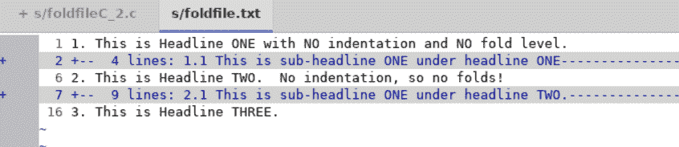

通过将 `foldlevel` 设置为二来显示包括项目符号在内的所有内容。然后折叠级别 *大于或等于* 二的内容将被显示，如 图 11-10 所示。

使用此技术检查文件时，你可以使用 Vim 的折叠递增（`zr`）和递减（`zm`）命令快速展开和折叠你所看到的细节级别。

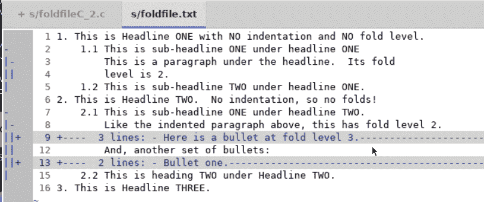

## 关于其他折叠方法的简述

我们无法涵盖所有其他折叠方法，但为了引起你的兴趣，我们将快速浏览一下 `syntax` 折叠方法。

我们使用与之前相同的 C 文件，但这次让 Vim 根据 C 语法决定折叠内容。C 语言中折叠的规则很复杂，但这段简单的代码片段足以演示 Vim 的自动功能。

首先，确保通过输入 `zE`（消除所有折叠）清除所有折叠。屏幕现在显示所有代码，折叠列中没有视觉标记。

使用以下命令确保折叠已打开：

```
:set foldenable
```

对于手动折叠，你之前不需要这样做，因为默认情况下 `foldenable` 已启用并且 `foldmethod` 设置为 `manual`。现在输入这两个 Vim `ex` 命令：

```
:syntax on
:set foldmethod=syntax
```

折叠显示如下 图 11-11。

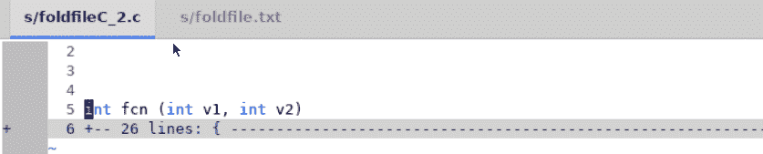

Vim 折叠了所有带括号的代码块，因为它们是 C 语言中的逻辑语义块。如果你在该示例的第 6 行输入 `zo`，Vim 将展开折叠并显示内部折叠。

每种折叠方法使用不同的规则来定义折叠。我们鼓励你卷起袖子（折叠起来？）在 Vim 文档中阅读更多关于这些强大方法的介绍。

Vim 的 diff 模式（也通过 `vimdiff` 命令调用）是折叠、窗口和语法高亮的强大组合，我们稍后会讨论这一功能。如 图 11-12 所示，该模式显示文件之间的差异，通常是同一文件的两个版本之间的差异。

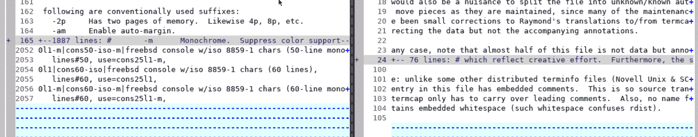

# 自动与智能缩进

Vim 提供了四种日益复杂和强大的自动缩进文本方法。在最简单的形式中，Vim 的行为几乎与 `vi` 的 `autoindent` 选项完全相同，事实上它也使用相同的名称来描述该行为。（参见章节 “缩进控制” 了解 `vi` 如何进行自动缩进。）

你只需在 `:set` 命令中指定即可选择缩进方法，例如：

```
:set cindent
```

Vim 提供了以下方法，按日益复杂的顺序列出：

`autoindent`

: 

自动缩进几乎模仿了 `vi` 的 `autoindent`。它在缩进被删除后光标放置位置上略有不同。

`smartindent`

: 

这比 `autoindent` 稍微强大，但它识别了一些用于定义缩进级别的基本 C 语法原语。

`cindent`

: 


正如其名所示，`cindent` 体现了对 C 语法更丰富的感知，并引入了超越简单缩进级别的复杂自定义。例如，`cindent` 可以配置为匹配你（或你老板）的喜爱的编码风格规则，包括但不限于大括号（`{}`）的缩进方式、大括号的放置位置、大括号是否一个或两个都被缩进，以及缩进如何匹配包含的文本。

`indentexpr`
:
这让你可以定义自己的表达式，Vim 会在你开始的每一行新行的上下文中对其进行求值。有了此功能，你可以编写自己的规则。我们将你引向 第 12 章，“Vim 脚本”，以及 Vim 文档以获取详细信息。如果其他三个选项不能为自动缩进提供足够的灵活性，`indentexpr` 一定可以。

## Vim autoindent 对 vi 的 autoindent 的扩展

Vim 的 `autoindent` 几乎与 `vi` 的行为相同，并且可以通过设置 `compatible` 选项使其完全相同。`vi` 的 `autoindent` 的一个不错的扩展是 Vim 能够识别文件“类型”并在文件中的注释行换行到新行时插入适当的注释字符。此功能可与 `wrapmargin` 选项（文本在右边界的 `wrapmargin` 列内换行）或 `textwidth` 选项（当一行中的字符数超过 `textwidth` 字符时文本换行）协同工作。图 11-13 显示了使用 Vim 的 `autoindent` 和使用 `vi` 的相同输入的结果。

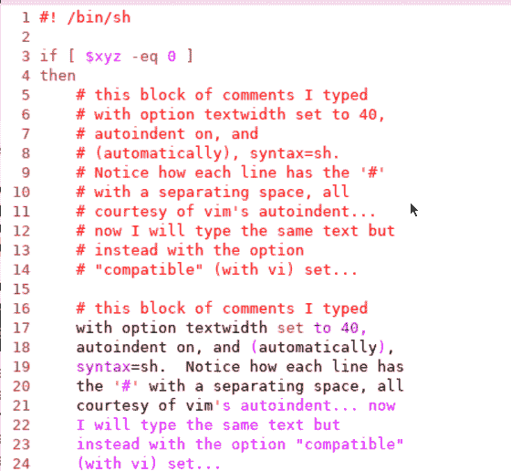

请注意，在第二块文本（第 16 行及以后）中没有前导注释字符。此外，设置了 `compatible` 选项（以模仿 `vi` 的行为）时，`textwidth` 选项不被识别，现在文本仅因为 `wrapmargin` 选项有值而换行。

## smartindent

`smartindent` 稍微扩展了 `autoindent`。它很有用，但如果你正在编写语法相当复杂的 C 类编程语言的代码，使用 `cindent` 会更好。

`smartindent` 在以下情况下自动插入缩进：
* 新行跟随包含左大括号（`{`）的行。
* 新行以包含在选项 `cinwords` 中的关键字开头。
* 在以右大括号（`}`）开头的行之前创建新行，*如果*光标位于包含大括号的行上并且用户使用 `O`（在上方打开行）命令创建新行。
* 新行是结束的，或右大括号（`}`）。

### Note
通常，使用 `smartindent` 时应打开 `autoindent`：
```
:set autoindent
```

## cindent

使用 C 类语言编程的常规 Vim 用户希望使用 `cindent` 或 `indentexpr` 进行编码。尽管 `indentexpr` 更强大、更灵活且可定制，但对于大多数编程任务，`cindent` 更实用。它为大多数程序员的需求（以及企业标准）提供了充足的设置。用其默认设置试用一段时间，然后如果你的标准不同则对其进行自定义。

### Note
如果 `indentexpr` 选项非空，它将覆盖 `cindent` 的操作。

三个选项定义 `cindent` 的行为：
`cinkeys`
:
定义触发 Vim 重新评估缩进的键盘键。
`cinoptions`
:
定义缩进样式。
`cinwords`
:
定义触发 Vim 在后续行中添加额外缩进的关键字。

`cindent` 使用 `cinkeys` 定义的字符串作为规则集来定义如何缩进。我们将检查 `cinkeys` 的默认值，然后查看你可以定义的其他设置以及它们的工作方式。

### The cinkeys option

`cinkeys` 是一个逗号分隔的值列表：
```
0{,0},0),:,0#,!^F,o,O,e
```
以下是按其各自的上下文拆分的值，以及每个行为的简要描述：
`0{`
:
`0`（零）为以下字符 `{` 设置一个 *行首* 上下文。也就是说，如果你将字符 `{` 作为一行的第一个字符输入，Vim 将重新评估该行的缩进。

不要将此选项中的零与行为“在此处使用零缩进”混淆，这是 C 缩进中的常见做法。此处的零表示“如果字符在行开头输入”，而不是“强制字符出现在行开头”。

`{` 的默认缩进为零：除当前级别外没有额外缩进。以下示例显示了典型结果：
```
main ()
{
    if ( argv[0] == (char *)NULL )
    { ...
```

`0}`, `0)`
:
与前面的描述一样，这两个设置定义了 *行首* 上下文。因此，如果你在行开头输入 `}` 或 `)`，Vim 将重新评估缩进。

`}` 的默认缩进与匹配的左大括号定义的缩进相同。`)` 的默认缩进为一个 `shiftwidth`。

`:`
:
这是 C 标签或 `case` 语句上下文。如果在标签或 `case` 语句末尾输入 `:`（冒号），Vim 将重新评估缩进。

`:` 的默认缩进为第一列，即一行的第一列。不要将其与零缩进混淆，零缩进会使新行保持与上一行相同的缩进级别。当缩进为一时，新行的第一个字符会向左移动 *一直* 到第一列。

`0#`
:
同样，这是一个 *行首* 上下文。当 `#` 是在行中输入的第一个字符时，Vim 将重新评估缩进。

默认缩进，如前定义，将整行移动到第一列。这与将宏定义（`#define …`）开始于第一列的做法一致。

`!^F`
:
特殊字符 `!` 将其后的任何字符定义为重新评估当前行缩进的触发器。在这种情况下，触发字符是 `^F`，它代表 `CTRL-F`，因此默认行为是只要你输入 `CTRL-F`，Vim 就会重新评估行的缩进。

`o`
:
此上下文定义你创建的任何新行，无论是通过在 `insert` 模式下按 `ENTER` 键还是使用 `o`（打开新行）命令。

`O`
:
此上下文涵盖使用 `O`（在上方打开新行）命令在当前行 *上方* 创建新行。

`e`
:
这是 *else* 上下文。如果以单词 `else` 开始一行，Vim 将重新评估缩进。Vim 直到输入 *else* 的最后一个“e”才识别此上下文。

### cinkeys syntax rules

每个 `cinkeys` 定义由一个可选前缀（`!`、`*` 或 `0` 之一）和缩进被重新评估的键组成。前缀的含义如下：
`!`
:
表示一个键（默认 `CTRL-F`）导致 Vim 重新评估当前行的缩进。你可以通过使用 `+=` 语法添加额外的键定义作为命令，而不会覆盖 preexisting 命令。换句话说，你可以提供多个键来触发行缩进。你添加到 `!` 定义的任何键仍会执行其旧功能。

`*`
:
告诉 Vim 在插入键之前重新评估当前行的缩进。

`0`
:
设置 *行首* 上下文。你在 `0` 之后指定的键仅在作为行的第一个字符输入时才触发缩进重新评估。

### Note


## cinkeys

注意 `vi` 和 Vim 中“行中第一个字符”与“行中第一列”之间的区别。你已经知道输入 `^` 会移动到行的第一个字符，而不一定是第一列（靠左对齐）；使用 `I` 插入时也是如此。同样，`0` 前缀适用于将字符输入为行的第一个字符，而不论其是否靠左对齐。

`cinkeys` 具有特殊键名，并提供覆盖任何保留字符的方法，例如用作前缀字符的字符。以下是特殊键选项：

**`<>`**

使用此形式可按字面定义键。对于特殊不可打印键，使用拼写形式。例如，你可以用 `<:>` 定义字面字符“：”。另一个非输入键的例子是将“上箭头”定义为 `<Up>`。

**`^`**

使用插入符号 (`^`) 表示控制字符。例如，`^F` 定义键 CTRL-F。

**`o`, `O`, `e`, `:`**

我们在 `cinkeys` 的默认值中见过这些特殊键。

**`=` `word`, `=~` `word`**

使用这些来定义应接收特殊行为的词。一旦字符串 `word` 被匹配，如果它是新行上的第一个文本，Vim 会重新评估缩进。

形式 `=~` `word` 与 `=` `word` 相同，只是它忽略大小写。

#### 注意

术语 `word` 是一个不幸的误称。更准确地说，它代表单词的开头，因为触发条件是在字符串匹配时立即发生，但并不要求匹配的字符串末尾也是单词的末尾。Vim 的文档以 `end` 同时匹配 `end` 和 `endif` 为例。

### The cinwords option

`cinwords` 定义当键入时会在下一行触发额外缩进的关键字。该选项的默认值是：

```
if,else,while,do,for,switch
```

这涵盖了 C 编程语言中的标准关键字。

#### 注意

这些关键字区分大小写。在检查它们时，Vim 甚至会忽略 `ignorecase` 选项的设置。如果需要关键字的不同大小写变体，你必须在 `cinwords` 字符串中指定所有组合。

### The cinoptions option

`cinoptions` 控制 Vim 如何在其 C 上下文中重新缩进文本行。它包括用于控制多种代码格式标准的设置，例如：
* 大括号括起来的代码块缩进多远
* 是否在条件语句后的大括号前插入换行符
* 如何相对于其包含的大括号对齐代码块

`cinoptions` 使用其默认值定义 28 个设置：

```
s,e0,n0,f0,{0,}0,⁰,:s,=s,l0,b0,gs,hs,ps,ts,is,+s,c3,C0,/0,(2s,us,U0,w0,W0,
        m0,j0,)20,*30
```

该选项本身的长度就让你感受到 Vim 允许你自定义缩进的方式有多少。大多数使用 `cinoptions` 的自定义定义了上下文块中的细微差异。一些自定义定义了扫描范围（在文件中向前和向后移动多少行）以建立正确的上下文并正确评估缩进。

修改各种上下文缩进量的设置可以增加或减少缩进级别。此外，你还可以重新定义用于缩进的列数。例如，设置 `cinoptions=f5` 会使左大括号 (`{`) 缩进五列，只要它不在其他大括号内部。

定义缩进增量的另一种方式是 `shiftwidth` 的某个倍数（不必是整数）。如果在前面的例子中你在定义后附加 `w`（即 `cinoptions=f5w`），左大括号将移动五个 `shiftwidth`。

在任何数值前插入减号 (`-`) 以将缩进级别向左更改（负缩进）。

#### 警告

此选项及其字符串值应谨慎修改。记住，当你使用 `=` 语法时，你会完全重新定义一个选项。由于 `cinoptions` 包含许多可能的设置，请使用非常细粒度的命令进行更改：`+=` 添加设置，`-=` 移除现有设置，以及 `-=` 后跟 `+=` 来更改现有设置。

以下是你最有可能更改的选项简要列表。它是 `cinoptions` 中设置的很小一部分，你可能会发现其他设置也有用以自定义：

**`>` `n`** (default is `s`)

任何需要缩进的行应缩进 `n` 个位置。此默认值是 `s`，意味着行的默认缩进为一个 `shiftwidth`。

**`f` `n`, `{` `n`**

`f` 定义非嵌套左大括号 (`{`) 缩进多远。默认值是零，因此大括号与其逻辑对应项对齐。例如，跟随 `while` 语句行的左大括号会放在 `while` 的 `w` 下方。

`{` 的行为与 `f` 相同，但适用于嵌套的左大括号。同样，它的默认缩进级别为零。

Figures 11-14 and 11-15 show two examples of identical text entry in Vim—the first example with `cinoptions=s,f0,{0`, and the second with `cinoptions=s,fs,{s`. For both examples, option `shiftwidth` has the value `4` (four columns)。

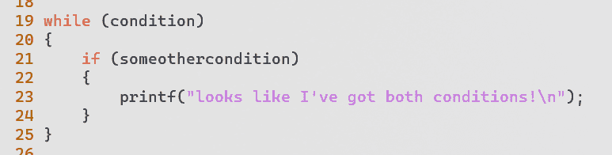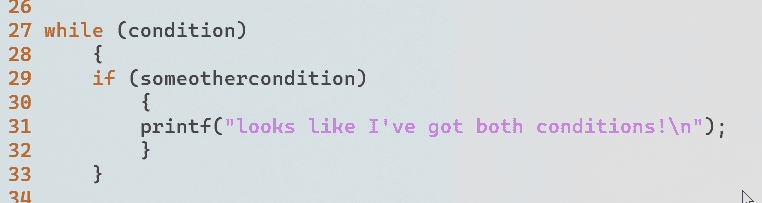

**`}` `n`**

使用此设置定义右大括号相对于其匹配大括号的偏移量。默认值为零（与匹配大括号对齐）。

**`^` `n`**

如果左大括号位于第一列，则在大括号 (`{…}`) 内的当前缩进上加上 `n`。

**`:` `n`, `=` `n`, `b` `n`**

这三项控制 `case` 语句中的缩进。使用 `:`，Vim 将 `case` 标签缩进 `n` 个字符，距离其对应的 `switch` 语句的位置。默认值为一个 `shiftwidth`。

`=` 设置定义代码行相对于其对应 `case` 标签的偏移量。默认是将语句缩进一个 `shiftwidth`。

`b` 设置定义 `break` 语句的放置位置。默认值（零）将 `break` 与对应 `case` 块内的其他语句对齐。任何非零值都会将 `break` 与其对应的 `case` 标签对齐。

**`)` `n`, `*` `n`**

这两个设置告诉 Vim 扫描多少行以查找未闭合的括号（默认 20 行）和未闭合的注释（默认 30 行）。

#### 提示

表面上，这最后两个设置限制了 Vim 为查找匹配而工作的强度。凭借当今强大的计算机，你应考虑增加这些值以确保更完整的范围管理来匹配注释和括号。尝试将它们分别加倍到 40 和 60 作为起点。

## indentexpr

如果定义了 `indentexpr`，它将覆盖 `cindent`，以便你可以定义缩进规则并精确地根据你的语言编辑需求进行定制。

`indentexpr` 定义一个表达式，每当文件中创建新行时都会对其进行求值。该表达式解析为一个整数，Vim 将其用作新行的缩进。

此外，选项 `indentkeys` 可以以与 `cinkeys` 关键字定义缩进重新评估后的行相同的方式定义有用的关键字。

坏消息是，为任何语言从头编写自定义缩进规则是一个非平凡的项目。好消息是，很可能工作已经完成。查看 `$VIMRUNTIME/indent` 目录，看看你喜欢的语言是否已包含在内。今天（版本 8.2）快速查看一下会发现超过 120 个缩进文件。


最常见的编程语言均有代表，包括 *ada*、*awk*、*docbook*（缩进文件名为 `docbk`）、*eiffel*、*fortran*、*html*、*java*、*lisp*、*pascal*、*perl*、*php*、*python*、*ruby*、*scheme*、*sh*、*sql* 和 *zsh*。甚至还为 `xinetd` 定义了缩进文件！

你可以通过在 `*.vimrc` 文件中加入命令 `filetype indent on` 来让 Vim 自动检测文件类型并加载缩进文件。现在 Vim 会尝试检测你正在编辑的文件类型并为你加载相应的 *缩进* 定义文件。如果缩进规则无法满足你的需求——例如，如果它们以某种不熟悉或不想要的方式缩进——请使用命令 `:filetype indent off` 关闭这些定义。

我们鼓励高级用户探索并学习 Vim 自带的缩进定义文件。如果你开发了新的定义文件或对现有文件的改进，我们鼓励你将它们提交到 [*vim.org*](https://www.vim.org) 以便可能加入到 Vim 包中。

# 缩进的最后说明

在结束讨论之前，值得注意以下关于使用自动缩进的工作要点：

### 自动缩进不适用时

只要在启用自动缩进的编辑会话中对某行进行操作并手动更改该行的缩进，Vim 就会标记该行，并且不再尝试自动定义其缩进。

### 复制和粘贴

当你在启用自动缩进的文件中粘贴文本时，Vim 会将其视为常规输入并应用所有自动缩进规则。在大多数情况下，这可能不是你想要的。粘贴文本中的任何缩进都会附加到已应用的缩进规则上。通常结果是文本逐渐向屏幕右侧倾斜，缩进很大且左侧没有相应的回退。

为避免这种尴尬情况并在不产生副作用的情况下完整粘贴文本，请在添加导入文本之前设置 Vim 的 `paste` 选项。`paste` 会全面重新配置 Vim 的所有自动功能，以忠实地合并粘贴的文本。要返回自动模式，只需使用命令 `:set nopaste` 重置 `paste` 选项即可。

# 关键字和词典单词补全

Vim 提供了全面的 *插入补全* 功能。从特定编程语言的关键字到文件名、词典单词，甚至整行，Vim 都知道如何为部分输入的文本提供可能的补全。不仅如此，Vim 还将基于词典的补全的语义抽象出来，以包含基于同义词词典中完成的单词的同义词补全！

本节我们将介绍不同的补全方法、它们的语法以及它们的工作原理说明和示例。补全方法包括：

* 整行
* 当前文件关键字
* `dictionary` 选项关键字
* `thesaurus` 选项关键字
* 当前和 *包含的* 文件关键字
* 标签（如 `ctags`）
* 文件名
* 宏
* Vim 命令行
* 用户定义
* Omni
* 拼写建议
* `complete` 选项关键字

除 `complete` 关键字外，所有补全命令都以 `CTRL-X` 开头。第二个键专门定义 Vim 尝试的补全类型。例如，自动补全文件名的命令是 `CTRL-X CTRL-F`。不幸的是，并非所有命令都如此易记。Vim 使用未映射的键，这使你可以通过适当映射将大多数这些命令缩短为仅第二个按键。例如，你可以将 `CTRL-X CTRL-N` 映射为仅 `CTRL-N`。

所有补全方法的行为几乎相同：当你重新输入第二个按键时，它们会循环显示候选补全列表。因此，如果你通过 `CTRL-X CTRL-F` 选择文件名自动补全并且第一次没有得到正确的词，你可以重复按 `CTRL-F` 来查看其他选项。此外，如果你按 `CTRL-N`（表示“下一个”），你会向前移动可能性，而 `CTRL-P`（表示“上一个”）则向后移动。

让我们通过示例来看一下这些自动补全方法，并考虑它们可能如何有用。

## 插入补全命令

这些方法（在插入模式下使用）在功能上从简单地在当前文件中查找单词到涵盖整个代码套件中的函数、变量、宏和其他名称的范围不等。最后一种方法结合了其他方法的特性，在功能和复杂性之间取得了很好的平衡。

### 提示

你可能想找到你最喜欢的补全方法并将其映射到一个易于使用的单个键。我们中的一位将其映射到 `TAB` 键：

```
:imap Tab <C-P>
```

这可能会牺牲轻松插入制表符的能力，但它允许他使用与在命令行环境（如 DOS 和 shell（`xterm`、`konsole` 等））中用于补全相同的键。

记住，你始终可以通过使用 `CTRL-V` 对其进行引用来插入制表符。将 `TAB` 键映射也对应于 Vim `ex` 命令模式中的正常补全键。

以下小节描述了 Vim 允许你进行补全的众多方式。

### 补全整行

你可以通过输入 `CTRL-X CTRL-L` 来补全整行。该方法会在当前文件中向后查找与你已输入字符匹配的行。我们将尝试一个示例，让你了解补全的工作原理。

考虑一个包含终端或控制台定义的文件，这些定义描述了终端的特性以及如何操作它们。假设你的屏幕类似于 图 11-16。

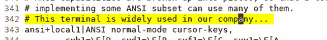

注意包含 “This terminal is widely used in our company…” 的高亮行。你需要在许多地方使用这一行，因为你要将终端标记为公司“广泛使用”。只需输入足够使该行唯一或接近唯一的部分，然后输入 `CTRL-X CTRL-L`。因此，图 11-17 包含部分输入行：

```
# This
```

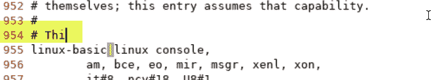

`CTRL-X CTRL-L` 会导致 Vim 显示一组可能的补全行，基于文件中之前输入的行。补全列表显示在 图 11-18。

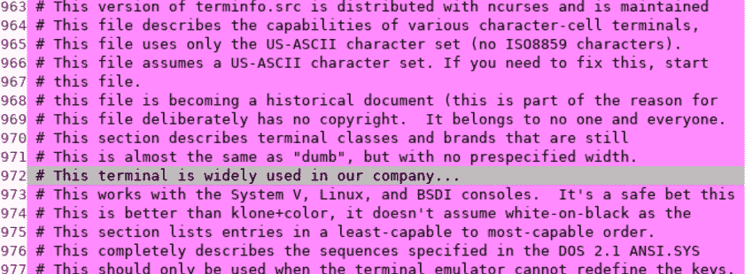

在灰度中（在印刷书籍中）很难看到，但屏幕提供了一个彩色弹出窗口，其中包含与我们部分行开头匹配的行的多个出现。还显示了但在屏幕截图中不可见的信息，描述匹配项所在的位置。此方法使用 `complete` 选项来定义搜索匹配的范围。范围将在本节的最后一种方法中详细讨论。

弹出^(5) 列表会在你向前（`CTRL-N`）或向后（`CTRL-P`）移动列表时高亮显示选择。你也可以使用箭头键在列表中上下移动。按 `ENTER` 选择匹配项。如果不想选择列表中的任何选项，输入 `CTRL-E` 以停止匹配方法而不替换任何文本。你的光标会返回到同一部分输入的原始位置。

图 11-19 显示了从列表中选择所需选项后的结果。

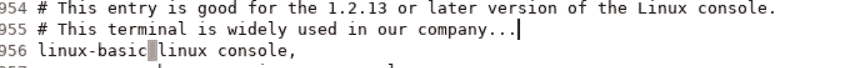

### 按文件中关键字补全

`CTRL-X CTRL-N` 会在当前文件中向前搜索与光标前关键字匹配的关键字。输入这些按键后，你可以使用 `CTRL-N` 和 `CTRL-P` 分别向前或向后搜索。按 `ENTER` 选择匹配项。你也可以使用箭头键在列表中上下移动。

### 注意


请注意，“keyword” 的定义比较宽松。虽然它可能匹配程序员熟悉的关键字，但实际上它可以匹配文件中的任何单词。单词被定义为 `iskeyword` 选项中的一组连续字符。`iskeyword` 的默认值相当合理，但如果你想包含或排除某些标点符号，可以重新定义该选项。`iskeyword` 中的字符可以直接指定（例如 `a–z`），也可以通过其对应的 ASCII 码指定（例如使用 `97-122` 表示 `a–z`）。

例如，默认值允许下划线作为单词的一部分，但将句点或连字符视为分隔符。这对于类 C 语言来说工作良好，但对于其他环境可能不是最佳选择。

## Completion by dictionary

`CTRL-X CTRL-K` 会向前搜索 `dictionary` 选项定义的文件，查找与光标前关键字匹配的关键字。

默认设置下 `dictionary` 选项未定义。存在一些常见的字典文件位置，你也可以自行定义。最常见的字典文件有：
* `/usr/share/dict/words` (Cygwin on MS-Windows, Ubuntu GNU/Linux)
* `/usr/share/dict/web2` (FreeBSD)
* `$HOME/.mydict` (personal list of dictionary words)

## Completion by thesaurus

`CTRL-X CTRL-T` 会向前搜索 `thesaurus` 选项定义的文件，查找与光标前关键字匹配的关键字。

此方法提供了一个有趣的变化。当 Vim 找到匹配项时，如果 thesaurus 文件中的行包含多个单词，Vim 会将该行中的所有单词都包含在补全候选列表中。

表面上（并且由选项名称暗示），此方法提供同义词，但允许*你*自行定义标准。考虑包含以下行的示例文件：^(6)
```
fun,enjoyable,desirable
funny,hilarious,lol,rotfl,lmao
retrieve,getchar,getcwd,getdireentries,getenv,getgrent,getgrgid,...
```
前两行是典型的英语同义词（分别匹配“fun”和“funny”），而第三行可能对经常插入以 `get` 开头的函数名的 C 程序员有用。我们对这些函数使用的同义词是“retrieve”。

在实际使用中，我们会将英语 thesaurus 与 C 语言的区分开，因为 Vim 可以搜索多个 thesauruses。

在输入模式下，输入单词 `fun` 然后按 `CTRL-X CTRL-T`。 图 11-20 显示了 `gvim` 中出现的弹出窗口。

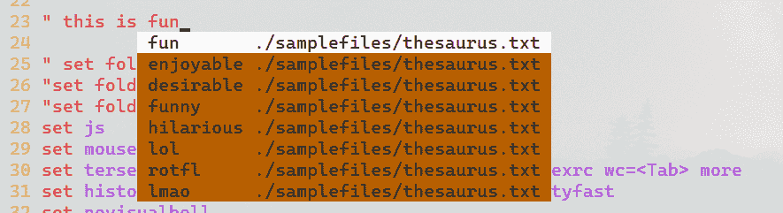

请注意以下几点：
* Vim 会匹配 thesaurus 条目中能找到的*任何*单词，而不仅仅是 thesaurus 文件中每行中的第一个单词。
* Vim 会包含 thesaurus 中所有与光标前关键字匹配的行中的候选单词。因此，在本例中，它会同时找到“fun”和“funny”的匹配项。

#### Note
`thesaurus` 的另一个有趣且可能出乎意料的行为是，匹配可以发生在 thesaurus 文件中一行中*除*第一个单词之外的单词上。例如，在前一个示例文件中的这一行：
```
funny hilarious lol rotfl lmao
```
如果你输入 `hilar` 并完成它，Vim 将把该行中从 `hilarious` 开始的所有单词都包含在列表中，即“hilarious”、“lol”、“rotfl”和“lmao”。有趣！

你是否注意到补全候选列表中的额外信息？你可以通过将值 `preview` 添加到 `completeopt` 选项来在弹出菜单中获取 Vim 找到匹配项位置的信息。

现在考虑一个示例，使用与之前相同的文件，其中你输入部分单词 `retrie`。这匹配“retrieve”，是我们用作“获取”事物的助记符的同义词，并且我们将所有“get”函数名作为同义词包含在内。现在 `CTRL-X CTRL-T` 会在 `gvim` 中给出所有函数作为补全选择的弹出菜单。参见 图 11-21。

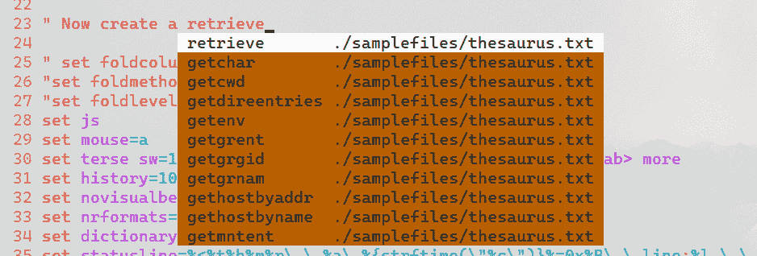

与其它补全方法一样，按 ENTER 选择匹配项。

#### Note
Thesaurus 补全不应与拼写检查混淆，拼写检查是 Vim 的另一个不错功能。请访问章节 “拼写它！(i-t)” 以了解 Vim 拼写检查的讨论。

## Completion by keyword in the current file and in included files

此功能对 C 和 C++ 程序员很有用，其中大量使用 `#include` 文件。`CTRL-X CTRL-I` 会向前搜索当前文件和包含文件，查找与光标前关键字匹配的关键字。此方法与“搜索当前文件”方法（`CTRL-X CTRL-P`）不同之处在于 Vim 会检查当前文件中的 *include* 文件引用并搜索这些文件。

Vim 使用 `include` 中的值来检测引用 *include* 文件的行。默认情况下是一个模式，告诉 Vim 查找匹配标准 C 构造的行：
```
# include <somefile.h>
```
在这种情况下，Vim 会在系统标准 *include* 文件目录中查找文件 `somefile.h` 中的匹配项。Vim 还使用 `path` 选项作为搜索包含文件的目录列表。

## Completion by tag

`CTRL-X CTRL-\]` 会向前搜索当前文件和包含文件，查找与 *tags* 匹配的关键字。参见章节 “使用标签” 以了解标签的讨论。

## Completion by filename

`CTRL-X CTRL-F` 搜索与光标前关键字匹配的文件名。请注意，这会导致 Vim 用*文件名*完成关键字，而不是用文件中找到的单词。

#### Note
从 Vim 8.2 开始，Vim *仅* 在当前目录中搜索可能匹配文件名的文件。这与许多使用 `path` 选项查找文件的 Vim 功能形成对比。Vim 文档暗示这种行为是临时的，指出“尚未”使用 `path`。然而，这已经持续了十多年……

## Completion by macro and definition names

`CTRL-X CTRL-D` 会向前搜索当前文件和包含文件，查找由 `#define` 指令定义的宏名称和定义。

## Completion method with Vim commands

此方法通过 `CTRL-X CTRL-V` 调用，适用于 Vim 命令行，尝试猜测单词的最佳补全。此上下文提供给正在开发 Vim 脚本的用户。

## Completion by user functions

此方法通过 `CTRL-X CTRL-U` 调用，让你用自己的函数定义补全方法。Vim 使用 `completefunc` 选项指向的函数进行补全。参考 第 12 章 以了解脚本编写和编写 Vim 函数的讨论。

## Completion by omni function

此方法通过 `CTRL-X CTRL-O` 调用，使用用户定义的函数，与之前的用户函数方法类似。显著区别在于此方法期望函数是文件类型特定的，因此在文件加载时确定并加载。Omni 补全文件已为 C、CSS、HTML、JavaScript、PHP、Python、Ruby、SQL 和 XML 提供。

## Completion for spelling correction

此方法通过 `CTRL-X CTRL-S` 调用。光标前的单词用作基准词，Vim 为其提供补全候选。如果单词看起来拼写错误，Vim 会建议“更正确”的拼写。

## Completion with the complete option

这是最通用的选项，通过 `CTRL-N` 调用，可将所有其它搜索组合成一次搜索。对于许多用户来说，这可能是最令人满意的，因为它不需要理解更具体方法的细微差别。


你通过在 `complete` 选项中设置可用源的逗号分隔列表来定义此补全的行为方式和位置。每个可用源（通常）由单个字符表示。选项包括：

`.` (句点)
搜索当前缓冲区。

`w`
搜索其他窗口中的缓冲区（在包含你的 Vim 会话的屏幕内）。

`b`
搜索缓冲区列表中其他已加载的缓冲区（可能在任何 Vim 窗口中都不可见）。

`u`
搜索缓冲区列表中的未加载缓冲区。

`U`
搜索缓冲区列表中 *不* 存在的缓冲区。

`k`
搜索词典文件（列在 `dictionary` 选项中）。

`kspell`
使用当前拼写检查方案（这是唯一不是单个字符的选项）。

`s`
搜索同义词库文件（列在 `thesaurus` 选项中）。

`i`
搜索当前文件和包含的文件。

`d`
搜索当前文件和包含文件中定义的宏。

`t`, `]`
搜索标签补全。

## 关于 Vim 自动补全的一些最终评论

我们已经涵盖了大量与自动补全相关的材料，但还有更多内容。自动补全方法在你投入时间掌握其使用时能带来丰厚回报。如果你编辑得 *很多*，并且存在 *任何* 需要补全的文本概念或上下文，请找到最适合的方法并学习它。

一个最后的提示：双击键组合（如果你是典型的 Unix 用户并将键组合计为“多于一个”）容易出错，尤其是它们与 `CTRL` 键组合时。如果你认为会大量使用自动补全，请考虑将你喜欢的自动补全映射到仅一个击键或键组合。大量自动补全命令缩短一半长度会带来更多效率。

以下示例说明了我们为何认为这种自定义如此有价值。我们中的一位将 `TAB` 键映射到通用关键字匹配，如前所述。在使用 DocBook XML 标签编辑本书（第七版）时，你的作者键入（使用保守的 `grep` 扫描文件）“emphasis”超过 1,200 次！使用关键字补全，他知道部分“emph”始终匹配一个选择，即他想要的“emphasis”标签。因此，对于该词的每次出现，他至少节省了三个击键（假设完美输入前三个字母），总共至少节省了 3,600 个击键！

这里是另一种衡量此方法效率的方式：你的作者已经知道他大约每秒输入四个字符，因此仅针对 *一个关键字* 的输入节省为 3,600 除以 4，即节省了 *15 分钟*。对于相同的 DocBook 文件，他以同样的方式完成了另外 20 到 30 个关键字。时间的节省迅速累积！

# 标签堆叠

标签堆叠在前面已描述，见章节 “标签堆栈”。

除了在搜索的标签之间来回移动外，你还可以从多个匹配标签中选择。你也可以用一个命令完成标签选择和窗口分割。用于处理标签的 Vim `ex` 模式命令在 表 11-1 中提供。

表 11-1. Vim 标签命令

| 命令 || 功能 |
| --- | --- |
| `ta`[`g`][`!`] [`tagstring`] || 编辑 `tags` 文件中定义的包含 `tagstring` 的文件。`!` 强制 Vim 在当前缓冲区已修改但未保存时切换到新文件。文件是否写入取决于 `autowrite` 选项的设置。 |
| [`count`]`ta`[`g`][`!`] || 跳转到标签堆栈中第 `count` 个较新的条目。 |
| [`count`]`po`[`p`][`!`] || 从堆栈中弹出一个光标位置，将光标恢复到其先前位置。如果提供，则转到第 `count` 个较旧的条目。 |
| `tags` || 显示标签堆栈的内容。 |
| `ts`[`elect`][`!`] [`tagstring`] || 列出与 `tagstring` 匹配的标签，使用 `tags` 文件中的信息。如果未给出 `tagstring`，则使用标签堆栈中的最后一个标签名。 |
| `sts`[`elect`][`!`] [`tagstring`] || 类似于 `:tselect`，但为所选标签分割窗口。 |
| [`count`]`tn`[`ext`][`!`] || 跳转到第 `count` 个下一个匹配标签（默认为一个）。 |
| [`count`]`tp`[`revious`][`!`] || 跳转到第 `count` 个上一个匹配标签（默认为一个）。 |
| [`count`]`tN`[`ext`][`!`] ||  |
| [`count`]`tr`[`ewind`][`!`] || 跳转到第一个匹配标签。带 `count` 时，跳转到第 `count` 个匹配标签。 |
| `tl`[`ast`][`!`] || 跳转到最后一个匹配标签。 |

通常，Vim 会显示它已跳转到的匹配标签中有多少个。例如：

```
tag 1 of >3
```

它使用大于号 (`>`) 来表示尚未尝试所有匹配项。你可以使用 `:tnext` 或 `:tlast` 来尝试更多匹配项。如果此消息因其他消息而未显示，请使用 `:0tn` 来查看它。

以下是 `:tags` 命令的输出，其中当前位置用大于号 (`>`) 标记：

```
# TO tag      FROM line in file
1  1 main             1  harddisk2:text/vim/test
> 2  2 FuncA           58  -current-
3  1 FuncC          357  harddisk2:text/vim/src/amiga.c
```

`:tselect` 命令让你从多个匹配标签中选择。“优先级” (`pri` 字段) 表示匹配的质量（全局与静态、精确大小写与大小写无关等）；这在 Vim 文档中有更详细的描述：

```
 nr pri kind tag                file ~
  1 F   f    mch_delay          os_amiga.c
                mch_delay(msec, ignoreinput)
> 2 F   f    mch_delay          os_msdos.c
                mch_delay(msec, ignoreinput)
  3 F   f    mch_delay          os_unix.c
                mch_delay(msec, ignoreinput)
Enter nr of choice (<CR> to abort):
```

`:tag` 和 `:tselect` 命令可以给定以 `/` 开头的参数。在这种情况下，命令将其用作正则表达式，Vim 将找到所有匹配给定正则表达式的标签。

例如，`:tag /normal` 将找到宏 `NORMAL`、函数 `normal_cmd` 等。使用 `:tselect /normal` 并输入你想要的标签的编号。

Vim 命令模式命令在 表 11-2 中描述。除了使用键盘外，如果你的 Vim 版本启用了鼠标支持，你也可以使用鼠标。

表 11-2. Vim 命令模式标签命令

| 命令 || 功能 |
| --- | --- |
| `^]` || 在 `tags` 文件中查找光标下标识符的位置并移动到该位置。当前位置会自动推入标签堆栈。 |
| `g <LeftMouse>`<br>`CTRL-<LeftMouse>`<br>`^T` || 返回标签堆栈中的上一个位置，即弹出一个元素。前面的计数指定要从堆栈中弹出的元素数量。 |

影响标签搜索的 Vim 选项在 表 11-3 中描述。

表 11-3. Vim 标签管理选项

| 选项 || 功能 |
| --- | --- |
| `taglength`, `tl` || 控制要查找的标签中有效字符的数量。默认值零表示所有字符都有效。 |


| `tags` || 其值是用于查找标签的文件名列表。作为一种特殊情况，如果文件名以 `./` 开头，则点将被当前文件路径名的目录部分替换，从而可以使用不同目录中的 `tags` 文件。默认值是 `./tags,tags`。 |
| `tagrelative` || 当设置为 true（默认值）并且使用另一个目录中的 `tags` 文件时，该 `tags` 文件中的文件名被视为相对于 `tags` 文件所在的目录。 |

Vim 可以使用 Emacs 风格的 `etags` 文件，但这仅用于向后兼容；该格式未在 Vim 文档中记录，也不鼓励使用 `etags` 文件。

最后，Vim 还会查找光标所在的整个单词，而不仅仅是从光标位置向前部分的单词。

# 语法高亮

Vim 对 `vi` 最强大的增强之一是其语法高亮。Vim 的语法格式在很大程度上依赖于颜色的使用，但在不支持颜色的屏幕上也能优雅降级。本节我们讨论三个主题：入门、自定义以及自行创建。Vim 的语法高亮包含超出本书范围的功能，因此我们专注于提供足够的信息，让你熟悉它并能够将其扩展以满足你的需求。

### 注释

由于 Vim 语法高亮的影响在彩色显示中最为显著，而本书并非彩色印刷，我们强烈建议你尝试语法高亮，以充分体会颜色在定义上下文方面的威力。我们从未遇到过尝试过它后不再一直使用的人。^(7)

## 入门

显示文件的语法高亮很简单。只需执行以下命令：

```
:syntax enable
```

如果一切正常，当你编辑具有正式语法的文件（如编程语言）时，你应该会看到以各种颜色显示的文本，所有颜色均由上下文和语法决定。如果没有任何变化，请尝试打开语法高亮：

```
:syntax on
```

启用语法高亮时，Vim 会通过一个检查清单进行设置。无需陷入太多技术细节，我们只需说 Vim 最终会确定你的文件类型，找到适当的语法定义文件并为你加载它。语法文件的标准位置是 `$VIMRUNTIME/syntax` 目录。

为了了解语法定义的全面覆盖范围，Vim 语法文件目录包含 *几乎 500 个语法文件*。可用的语法涵盖从语言（C、Java、HTML）到内容（日历）再到知名配置文件（`fstab`、`xinetd`、`crontab`）的各个方面。如果 Vim 不识别你的文件类型，请尝试在 `$VIMRUNTIME/syntax` 目录中查找与之接近的语法文件。

## 自定义

一旦开始使用语法高亮，你可能会发现某些颜色不适合你。它们可能难以辨认或只是不符合你的口味。Vim 有几种自定义和调整颜色的方法。

在采取更激进的措施（例如，编写自己的语法描述，如下一节所述）之前，这里有一些可以尝试的方法来使语法高亮适合你。

语法高亮失控最常见且最明显的两个症状是：

* 对比度差，颜色过于相似，很难明显区分彼此
* 颜色太多或变化太大，使文本看起来刺眼

尽管这些是主观上的不足，很高兴 Vim 允许你进行修正。两个命令 `colorscheme` 和 `highlight`，以及一个选项 `background`，很可能可以将颜色调整到令人满意的平衡。

还有一些其他命令和选项可以用来自定义语法高亮。在简要介绍 *语法组* 之后，我们将在以下各节中讨论这些命令和选项，重点放在刚才提到的三个上。

### 语法组

Vim 将不同类型的文本分类为组。这些组各自接收颜色和高亮定义。此外，Vim 允许组中包含组。你可以在不同层级上引用定义。如果为包含子组的组分配定义，除非另有定义，否则每个子组都会继承父组的定义。

语法高亮的一些高级组包括：

`Comment`

:

特定于编程语言的注释，例如：

```
// I am both a C++ and a JavaScript comment
```

`Constant`

:

任何常量——例如，`TRUE`。

`Identifier`

:

变量和函数名。

`Type`

:

声明，例如 C 中的 `int` 和 `struct`。

`Special`

:

特殊字符，例如分隔符。

从前面的列表中取 `special` 组，我们可以看一个子组的示例：

* `SpecialChar`
* `Tag`
* `Delimiter`
* `SpecialComment`
* `Debug`

在对语法高亮、组和子组有了基本了解后，我们现在已足够了解如何修改语法高亮以符合我们的口味。

### 配色方案命令

此命令通过重新定义这些语法组来更改不同语法高亮（如注释、关键字或字符串）的颜色。Vim 附带以下配色方案选择：^(8)

| `blue` || `delek` || `evening` || `murphy` || `ron` || `torte` |
| --- | --- | --- | --- | --- | --- |
| `darkblue` || `desert` || `koehler` || `pablo` || `shine` || `zellner` |
| `default` || `elflord` || `morning` || `peachpuff` || `slate` ||  |

这些文件位于 `$VIMRUNTIME/colors` 目录。你可以使用以下命令激活其中任何一个：

```
:colorscheme scheme_name
```

在 Vim 和 `gvim` 中，你可以这样快速在不同方案之间切换：输入部分命令 `:color`，按 TAB 开始命令补全，按空格键，然后反复按 TAB 在不同选择之间循环。

在 `gvim` 中，选择甚至更简单。点击 Edit 菜单，将鼠标移到 Colorscheme 子菜单上，然后将其撕下。现在你可以通过点击每个按钮查看所有选择。

有 *许多* 配色方案可供使用，均由 Vim 用户社区贡献。你可能对 [GitHub 仓库](https://github.com/flazz/vim-colorschemes/tree/master/colors) 感兴趣，从中可以下载近一千个配色方案。

### 设置背景选项

当 Vim 设置颜色时，它首先尝试确定屏幕的背景颜色类型。Vim 对背景只有两个分类：深色或浅色。根据 Vim 的判断，它会为每种情况设置不同的颜色，希望最终得到一套与该背景配合良好的颜色（即对比度好且色彩兼容性好）。尽管 Vim 会尽力而为，正确的评估很棘手，将其分配为深色或浅色也是主观的。有时对比度会使会话看起来不舒服，有时甚至无法阅读。

因此如果颜色看起来不理想，请尝试显式选择 `background` 设置。首先确保识别当前设置：

```
:set background?
```

这样你就知道自己正在更改设置。然后执行类似以下命令：

```
:set background=dark
```

将 `background` 选项与 `colorscheme` 命令一起使用，以微调屏幕颜色。这两者结合通常可以产生令人满意且舒适的调色板。

### 高亮命令


Vim 的 `highlight` 命令让你操作不同的组并控制它们在编辑会话中的高亮方式。此命令功能强大。你可以以列表形式检查各种组的设置，或请求特定组的高亮信息。例如：

```
:highlight comment
```

返回 图 11-22。第一个字段列出高亮名称（在此示例中为“Comment”）。第二个字段始终显示字符串“`xxx`”，其显示方式由终端或 GUI 中的高亮定义决定。

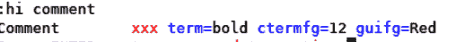

输出显示了此文件中注释的显示方式。`xxx` 在印刷页面上为深灰色，但在屏幕上为红色.^(9) `term=bold` 的输出意味着在不支持颜色的终端上，`Comments` 将以粗体显示。`ctermfg=12` 意味着在彩色终端上，例如彩色显示器上的 `xterm`，`Comments` 的前景色将为对应的 DOS 颜色蓝色。最后，`guifg=Red` 意味着 GUI 界面将以红色前景色显示 `Comments`。

#### 注
DOS 颜色方案比现代 GUI 集合的颜色更受限制。在此方案中，只有八种颜色：`black`、`red`、`green`、`yellow`、`blue`、`magenta`、`cyan` 和 `white`。每个颜色都可以设置为文本前景或背景，并且可选地定义为“亮”，即屏幕上更亮的颜色。Vim 在非 GUI 窗口中定义文本颜色时使用类似的映射，例如在 `xterm` 中。

GUI 窗口提供几乎无限的颜色定义。Vim 允许你使用 `Blue` 等常用名称定义一些颜色，但你也可以使用红、绿、蓝值来定义这些颜色。格式为 `#rrggbb`，其中 `#` 为字面量，而 `rr`、`gg` 和 `bb` 是表示每种颜色等级的十六进制数字。例如，红色可以用 `#ff0000` 定义。

使用 `highlight` 命令更改你不喜欢的颜色组的设置。例如，我们可以发现此文件中标识符在我们的 GUI 界面中为深青色，如 图 11-23 输出所示：

```
:highlight identifier
```

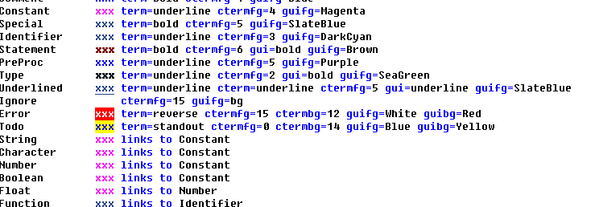

我们可以用以下命令重新定义标识符的颜色：

```
:highlight identifiers guifg=red
```

现在屏幕上的所有标识符都是（相当难看的）红色。这种定制相当不灵活：它适用于所有文件类型，并且不适应不同的背景或配色方案。

要查看存在多少高亮定义及其值是多少，再次使用 `highlight`：

```
:highlight
```

图 11-24 显示了 `highlight` 命令结果的一个小样本。

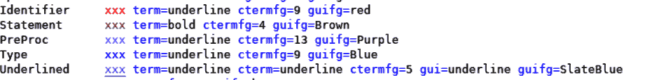

注意有些行包含完整定义（列出 `term`、`ctermfg` 等），而其他行则从父组继承属性（例如，`String` 链接回 `Constant`）。

### 覆盖语法文件
在上一节中，我们学习了如何为组的全部实例定义语法组属性。假设你只想为一个或少数几个语法定义更改某个组。Vim 允许你使用 `after` 目录来实现这一点。这是一个目录，你可以在其中创建任意数量的 `after` 语法文件，Vim 会在正常语法文件之后执行这些文件。

为此，只需在包含在 `runtimepath` 选项中的名为 `after` 的目录中的特定文件中包含高亮命令（或任何处理命令——“after”处理的概念是通用的）。现在当 Vim 为你的文件类型设置语法高亮规则时，它也会执行 `after` 文件中的自定义命令。

例如，让我们对使用 `xml` 语法的 XML 文件进行定制。这意味着 Vim 从语法目录中的名为 `xml.vim` 的文件加载了语法定义。如前例所示，我们希望标识符始终为红色。因此我们在名为 `~/.vim/after/syntax` 的目录中创建自己的名为 `xml.vim` 的文件。在我们的 `xml.vim` 文件中，我们放入以下行：

```
highlight identifier ctermfg=red guifg=red
```

在此定制生效之前，我们必须确保 `~/.vim/after/syntax` 在 `runtimepath` 路径中：

```
:set runtimepath+=~/.vim/after/syntax      In our .vimrc file
```

为了使更改永久生效，当然该行应放入我们的 `.vimrc` 文件中。

现在，每当 Vim 为 `xml` 加载语法定义时，它将使用我们的自定义覆盖 `identifier` 的定义。

## 自行创建
凭借前几节的构建模块，我们现在有足够的知识来编写自己的语法文件，尽管它们可能很简单。在我们能够完全开发一个语法文件之前，还有许多方面需要学习。

我们将逐步构建自己的语法文件。由于语法定义可能极其复杂，让我们考虑一个足够简单易于理解，但又足够复杂以展示其潜在威力的例子。

考虑一个生成的拉丁文件 `loremipsum.latin` 的摘录：

```
Lorem ipsum dolor sit amet, consectetuer adipiscing elit. Proin eget
tellus. Suspendisse ac magna at elit pulvinar aliquam. Pellentesque
iaculis augue sit amet massa. Aliquam erat volutpat. Donec et dui at
massa aliquet molestie. Ut vel augue id tellus hendrerit porta. Quisque
condimentum tempor arcu. Aenean pretium suscipit felis. Curabitur semper
eleifend lectus. Praesent vitae sapien. Ut ornare tempus mauris. Quisque
ornare sapien congue tortor.

In dui. Nam adipiscing ligula at lorem. Vestibulum gravida ipsum iaculis
justo. Integer a ipsum ac est cursus gravida. Etiam eu turpis. Nam laoreet
ligula mollis diam. In aliquam semper nisi. Nunc tristique tellus eu
erat. Ut purus. Nulla venenatis pede ac erat.

...
```

你通过创建该语法名称的新文件来创建新的语法文件，在本例中为 `latin`。对应的 Vim 文件是 `latin.vim`，你可以在个人 Vim 运行时目录 `$HOME/.vim/syntax` 中创建它。然后只需使用 `syntax keyword` 命令创建一些关键字即可开始语法定义。选择 `lorem`、`dolor`、`nulla` 和 `lectus` 作为关键字，你可以用以下行启动语法文件：

```
syntax keyword identifier lorem dolor nulla lectus
```

编辑 `loremipsum.latin` 时仍然没有语法高亮。在高亮自动生效之前还需要做更多工作。但就目前而言，使用以下命令激活语法：

```
:set syntax=latin
```

文本现在应类似于 图 11-25。


在屏幕上，文本单词为黑色，关键字为红色。在印刷书籍中，更难区分；关键字为深灰色而不是黑色。

你可能注意到 `Lorem` 的第一次出现没有被高亮。默认情况下，语法关键字区分大小写。在语法文件顶部添加以下行：

```
:syntax case ignore
```

然后你应该现在看到 `Lorem` 作为高亮关键字包含在内。

在再次尝试之前，让我们使其自动工作。Vim 在尝试检测任何文件类型后，会选择性地在你的 `runtimepath` 中的名为 `ftdetect` 的目录中检查其他定义，甚至覆盖定义（不推荐）。因此，在 `$HOME/.vim` 下创建该目录，并在其中创建名为 `latin.vim` 的文件，包含以下单行：

```
au BufRead,BufNewFile *.latin set filetype=latin
```


## 语法高亮示例

这告诉 Vim 任何后缀为 `*.latin` 的文件都是 `latin` 文件，因此在显示这些文件时 Vim 应执行 `$HOME/.vim/syntax/latin.vim` 中的语法文件。

现在当你编辑 `loremipsum.latin` 时，你会看到 图 11-26。


首先，注意到语法立即生效，因为 Vim 正确检测到了你的新语法文件类型，`latin`。而且关键字现在匹配时不区分大小写。

为了实现更有趣的扩展，定义一个 `match` 并将其分配给组 `Comment`。`match` 方法使用正则表达式来定义要高亮的内容。例如，我们将定义所有以 `s` 开头并以 `t` 结尾的单词为 `Comment` 语法（记住，这只是一个例子！）。我们的正则表达式是：`\<s[^\t ]*t\>`。我们还将定义一个区域并将其高亮为 `Number`。区域使用 `start` 和 `end` 正则表达式定义。

我们的区域以 `Suspendisse` 开始，以 `sapien\.` 结束。为了增加更多变化，我们决定关键字 `lectus` 在我们的区域内是 `contained` 的。我们的 `latin.vim` 语法文件现在看起来像：

```
syntax case ignore
syntax keyword identifier lorem dolor nulla lectus
syntax keyword identifier lectus  contained
syntax match comment /\<s[^\t ]*t\>/
syntax region number start=/Suspendisse/ end=/sapien\./ contains=identifier
```

现在当我们编辑 `loremipsum.latin` 时，我们看到 图 11-27。


有几件事需要注意，如果你运行示例并以彩色查看结果会更容易看到：

* 新的匹配高亮出现了。在第一行，dolor sit 被高亮为红色，因为它满足了 `match` 的正则表达式。
* 新的区域高亮出现了。段落中从 Suspendisse 开始到 sapien. 为止的整个部分被高亮为紫色（恶心）。
* 关键字仍像之前一样被高亮。
* 在高亮的区域内，关键字 `lectus` 仍被高亮为红色，因为我们将组 `identifier` 定义为 `contained`，并将区域定义为 `contains identifier`。

这个示例只是触及了语法高亮丰富功能的冰山一角。虽然这个特定示例有些无用，但我们希望它能充分展示该功能的能力，并鼓励你进行实验并创建自己的语法定义。

# 使用 Vim 编译和检查错误

Vim 不是一个 IDE，但它试图通过将编译集成到编辑会话中并提供快速简便的方式来查找和纠正错误，从而让程序员的生活更轻松一些。

此外，Vim 还提供一些便捷函数来跟踪和导航文件中的位置。我们讨论一个简单示例：使用 Vim 内置功能及其相关命令和选项，以及便捷函数进行的编辑-编译-编辑循环。所有这些都依赖于同一个 Vim `Quickfix List` 窗口。

作为一个简单的起点，Vim 允许你每次更改文件时使用 `make` 编译文件。Vim 使用默认行为来管理构建结果，以便你可以在编辑和编译之间轻松切换。编译错误会出现在 Vim 特殊的 `Quickfix List` 窗口中，在那里你可以检查、跳转并纠正错误。

对于本次讨论我们使用一个生成斐波那契数的小 C 程序。^(10) 在其正确且可编译的形式中，代码如下：

```
# include <stdio.h>
# include <stdlib.h>

int main(int argc, char *argv[])
  {
  /*
   * arg 1: starting value
   * arg 2: second value
   * arg 3: number of entries to print
   *
  */

  if (argc - 1 != 3)
    {
    printf ("Three command line args: (you used %d)\n", argc-1);
    printf ("usage: value 1, value 2, number of entries\n");
    return (1);
    }


  /* count = how many to print */
  int count = atoi(argv[3]);

  /* index = which to print */
  long int index;

  /* first and second passed in on command line */
  long int first, second;

  /* these get calculated */
  long int current, nMinusOne, nMinusTwo;

  first  = atoi(argv[1]);
  second = atoi(argv[2]);
  printf("%i fibonacci numbers with starting values: %li, %li\n", count, first,
      second);
  printf("=======================================\n");

  /* print the first 2 from the starter values */
  printf("%i %04li\n", 1, first);
  printf("%i %04li  ratio (golden?) %.3f\n", 2, second, (double) second/first);

  nMinusTwo = first;
  nMinusOne = second;

  for (index=1; index<=count; index++)
    {
    current = nMinusTwo + nMinusOne;
    printf("%li %04li  ratio (golden?) %.3f\n",
            index,
            current,
            (double) current/nMinusOne);
    nMinusTwo =  nMinusOne;
    nMinusOne = current;
    }
  }
```

从 Vim 编译此程序（假设文件名是 `fibonacci.c`），使用命令：

```
:make fibonacci
```

默认情况下，Vim 将 `make` 命令传递给外部 shell 并将结果捕获到特殊的 `Quickfix List` 窗口中。编译完前面的代码后，带有 `Quickfix List` 窗口的屏幕看起来像 图 11-28。


### 注意

如果你看不到 QuickFix 窗口（它没有自动打开），你可以使用 Vim `ex` 命令 `:copen` 打开它。

接下来，我们更改程序中的足够多行以引入大量错误。

Change:

```
  long int current, nMinusOne, nMinusTwo;
```

改为以下无效声明：

```
  longish int current, nMinusOne, nMinusTwo;
```

Change:

```
  nMinusTwo = first;
  nMinusOne = second;
```

改为拼写错误的变量 `xfirst` 和 `xsecond`：

```
  nMinusTwo = xfirst;
  nMinusOne = xsecond;
```

Change:

```
  printf("%d %04li  ratio (golden?) %.3f\n", 2, second, (double) second/first);
```

改为以下，缺少逗号：

```
  printf("%d %04li  ratio (golden?) %.3f\n", 2 second (double) second/first);
```

现在重新编译程序。图 11-29 显示了 `QuickFix List` 窗口现在包含的内容。


`Quickfix List` 窗口的第 1 行显示了执行的编译命令。如果没有错误，这将是窗口中唯一的行。但由于存在错误，第 3 行开始列出错误及其上下文。

Vim 在 `Quickfix List` 窗口中列出所有错误，并让你访问代码，其中错误以多种方式指示。Vim 首先通过高亮 `Quickfix List` 窗口中的第一个错误来提供便捷行为。然后它重新定位源文件（必要时滚动）并将光标放在与错误对应的源代码行的开头。

当你修复错误时，你可以通过两种方式之一导航到下一个错误：输入命令 `:cnext`，或将光标定位到 `Quickfix List` 窗口中的错误行并按 ENTER。同样，Vim 在必要时滚动源文件，并将光标定位到有问题的源代码行的开头。

在你做出更改并确信已纠正错误后，你就可以使用相同技术再次开始编译-编辑循环。如果你的开发环境是标准的（对于 Unix/Linux 机器几乎总是如此），Vim 的默认行为将无需任何调整即可按所述处理编辑-编译-编辑。


如果 Vim 的默认设置找不到合适的编译程序，它提供了一些选项供你使用，以定义实用程序的位置，从而让你完成工作。有关编程环境和编译器的细节超出了本次讨论的范围，但我们在此介绍这些 Vim 选项作为起点，以防你需要调整环境：

`:cnext`, `:cprevious`

将光标移动到 *下一个* 和 *上一个* 错误位置的命令，分别如 `Quickfix List` 窗口中所定义。

`:colder`, `:cnewer`

Vim 会记住最近的 10 个错误列表。这些命令在 `QuickFix List` 窗口中加载下一个 *较旧* 或下一个 *较新* 的错误列表。每个命令都接受一个可选的整数 `n`，以加载第 `n` 个较旧或较新的错误列表。

`errorformat`

一个定义 Vim 用于匹配编译返回错误时的格式的选项。Vim 的内置文档对此定义提供了更详细的信息，但默认设置几乎总是有效。如果需要调整该选项，请使用以下命令查看其详情：

```
:help errorformat
```

`makeprg`

包含开发环境 `make` 或 `compile` 程序名称的选项。

## 快捷修复列表窗口的更多用途

Vim 还允许你构建文件内位置的自定义列表，通过类似 `grep` 的语法指定位置。`QuickFix List` 窗口以与前面描述的编译过程返回的行非常相似的格式返回你请求的结果。这是通过 `:vimgrep` 命令完成的，其语法为：

```
:vimgrep[!] /pattern/[g][j] file(s)
```

这本质上是标准 `grep`(1) 工具的内置版本。它在 `files` 中搜索匹配 `pattern` 的行，并将结果放入 QuickFix 窗口。（请参阅 Vim 文档以了解标志的详细信息及其含义。）

此功能对于重构等任务很有用。例如，我们使用 AsciiDoc 编写了本文稿。在撰写过程中，我们在某一点将所有出现的“++vim++”的标记从 `++vim++` 改为 `__vim__`。^(11) 因此，像这样的每个出现：

```
++vim++
```

需要更改为：

```
__vim__
```

执行此命令后：

```
:vimgrep /++vim++/ *.asciidoc
```

`Quickfix List` 窗口包含了信息，如 图 11-30 所示。


#### 注意

请记住使用 Vim `ex` 命令打开 QuickFix 窗口：

```
:copen
```

否则你将看不到结果。

请注意在 图 11-30 中 Vim 如何显示 `:vimgrep` 输出。左侧是 QuickFix 缓冲区的行号，仅表示输出中有多少行；它们可以使用 Vim `ex` 命令关闭：

```
:set nonumber
```

`:vimgrep` 输出包含三个由管道字符 (`|`) 分隔的字段。第一个字段是 `vimgrep` 匹配 `pattern` 的文件名称。第二个字段描述了匹配 `pattern` 找到的行和列。第三个字段是匹配行的实际文本。

你可以通过将光标移动到感兴趣的行来导航到任何匹配项，或者双击感兴趣的行。Vim 在另一个（拆分）窗口中打开该文件，并将光标定位在第一个匹配模式字符上。

在 图 11-30 中，高亮的行（阅读起来有点困难，尽管我们尝试选择尽可能易读的配色方案）是指向文件 `ch04.asciidoc` 中第 98 行、第 32 列的指针。有关双击该行后的结果，请参阅 图 11-31；你可以看到 Vim 如何在对应的窗口中将光标放置在 `ch04.asciidoc` 的正确行和列中。


因此，浏览所有出现的位置并快速更改为新值变得非常简单。

#### 注意

这个例子似乎可以用这个简单的命令更轻松地解决这个问题：

```
:%s/++vim++/__vim__/g
```

但请记住，`vimgrep` 更通用，并且可在多个文件上操作。这是一个 `vimgrep` 的示例，而不是执行此任务的确定性方法。在 Vim 中，通常有许多方法可以完成某项任务。

## 关于 Vim 编程的最后一些想法

本章我们探讨了许多强大的功能。花一些时间掌握这些技巧，你将获得极高的生产力。如果你是长期使用 `vi` 的用户，你已经攀登过一次陡峭的学习曲线。学习 Vim 额外功能的额外努力是值得的第二次学习曲线。

如果你是一名程序员，我们希望本章能展示 Vim 为你的编程任务提供了多少帮助。我们鼓励你尝试这些功能，甚至扩展 Vim 以满足你自己的需求。也许你会创建扩展来回馈 Vim 社区。现在，去编程吧！

^(1) 不要与免费且优秀的 Microsoft VS Code 混淆。

^(2) 也许这实际上是“需要看树木而不是森林”。也许两者兼而有之。折叠功能提供了这一点！

^(3) 请注意并小心不要将“删除折叠”与 Vim 的 `delete` 命令混淆。删除折叠会移除隐藏行的视觉语义。删除折叠的内容正是这样做的！

^(4) 折叠是通用的；你可以使用在 第一部分 中介绍的文本对象概念。因此，你可以在 *对象* 内的任何位置折叠——在本例中，在大括号内的任何位置。`vi` 命令将是 `za{`。

^(5) 弹出窗口在 `gvim` 中；Vim 的行为略有不同。

^(6) 请注意，同义词每行的单词以逗号分隔。要在单词中包含逗号，请用反斜杠引用它。

^(7) 好吧，除了我们的一位审阅者之外！

^(8) 我们注意到某些 Vim 实例可能具有略有不同的默认配色方案集。

^(9) 要以彩色查看图 11-22 至 11-27，请访问 [O’Reilly 网站](https://oreil.ly/LhSuQ)。

^(10) 该文件可在本书的 [GitHub 仓库](https://www.github.com/learning-vi/vi-files) 中获取；请参阅 “访问文件” 部分。

^(11) 标记后来又发生了更多更改。
