## 第 12 章 Vim 脚本

有时仅靠自定义不足以满足你的编辑环境。Vim 允许你在 `*.vimrc` 文件中定义你最喜欢的所有设置，但也许你想要更动态或“即时”的配置。Vim 脚本可以做到这一点。

从检查缓冲区内容到处理不可预见的外部因素，Vim 的脚本语言让你能够完成复杂任务并基于 *你的* 需求做出决策。

如果你有一个 Vim 配置文件（`*.vimrc`、`*.gvimrc` 或两者），你已经在 Vim 中进行脚本编写了；你只是不知道而已。所有 Vim 命令和选项都是脚本的有效输入。而且，正如你所期望的，Vim 提供了任何语言中典型的所有标准流程控制语句（`if…then…else`、`while` 等）、变量和函数。


在本章中，我们将通过一个示例逐步构建脚本。我们将查看简单的结构，使用 Vim 的一些内置函数，并检查编写行为良好且可预测的 Vim 脚本时必须考虑的规则。

# 你最喜欢的颜色（方案）是什么？

开始于最简单的配置。我们将环境自定义为我们*偏好*的颜色方案。这很简单，并且使用了 Vim 脚本的基础之一，即简单的 Vim 命令。

Vim 自带 17 个自定义颜色方案。^(1) 你可以通过在 `.vimrc` 或 `.gvimrc` 文件中放置 `colorscheme` 命令来选择并激活颜色方案。一位作者最喜欢的“低调”颜色方案是 desert 方案：

```
:colorscheme desert
```

在配置文件中放入类似的 `colorscheme`，然后每次使用 Vim 编辑时你都会看到你喜欢的颜色。

因此我们的第一个脚本非常简单。如果你的颜色方案口味更复杂怎么办？如果喜欢不止一种颜色方案怎么办？如果一天中的时间与你的偏好相关怎么办？Vim 脚本很容易让你做到这一点。

### 注意

根据一天中的时间选择替代颜色方案似乎很陈词滥调，但也许没有你想象的那么多。即使是 Google 也会在一天中改变你的 *iGoogle* 主页的颜色和基调。

## 条件执行

我们中的一位喜欢将一天分为四个分区，每个分区都有自己的专用颜色方案：

`darkblue` : 午夜至上午 6 点

`morning` : 上午 6 点至中午

`shine` : 中午至下午 6 点

`evening` : 下午 6 点至午夜

我们将为此目的构建一个嵌套的 `if…then…else…` 代码块。你可以使用几种不同的语法来编写此块。其中一种更传统，具有明确的布局语法：

```
if cond expr
  line of vim code
  another line of vim code
  ...
elseif some secondary cond expr
  code for this case
else
  code that runs if none of the cases apply
endif
```

`elseif` 和 `else` 块是可选的，你可以包含多个 `elseif` 块。Vim 还允许这种更简洁且类似 C 的结构：

```
cond ? expr 1 : expr 2
```

Vim 检查条件 `cond`。如果为真，则执行 `expr 1`；否则执行 `expr 2`。

### 使用 strftime() 函数

现在我们可以在条件执行代码，我们需要弄清楚一天中的哪个部分。Vim 有内置的 *函数* 返回此类信息。在我们的例子中，我们使用 `strftime()` 函数。`strftime()` 接受两个参数，其中第一个定义时间字符串的输出格式。此格式依赖于系统且不可移植，因此在选择格式时必须格外小心。幸运的是，大多数主流格式在各系统间通用。第二个可选参数是以 1970 年 1 月 1 日为基准的秒数（标准 C 时间表示）。此可选参数默认为当前时间。对于我们的示例，我们可以使用时间格式 `%H`，生成 `strftime("%H")`，因为决定颜色方案所需的所有信息就是一天中的小时。

现在我们知道如何使用条件代码，我们有 Vim 内置函数来提供关于一天中时间的信息，以此选择匹配的颜色方案。将此代码放入你的 `.vimrc` 文件中：

```
" progressively check higher values... falls out on first "true"
if strftime("%H") < 6
  colorscheme darkblue
  echo "setting colorscheme to darkblue"
elseif strftime("%H") < 12
  colorscheme morning
  echo "setting colorscheme to morning"
elseif strftime("%H") < 18
  colorscheme shine
  echo "setting colorscheme to shine"
else
  colorscheme evening
  echo "setting colorscheme to evening"
endif
```

请注意，我们引入了另一个 Vim 脚本命令 `echo`。作为方便，我们添加此命令来向自己回显当前方案；它还让我们检查代码是否实际运行并产生了期望的结果。消息应出现在 Vim 的命令状态窗口中或作为弹出窗口，具体取决于 `echo` 命令在启动序列中的位置。

### 注意

当我们发出 `colorscheme` 命令时，我们使用方案的名称（例如 `desert`）*不带* 引号，而当我们使用 `echo` 命令时，我们*确实* 对名称加引号（`"desert"`）。这是一个重要的区别！

在脚本中 `colorscheme` 命令的情况下，我们正在发出直接的 Vim 命令，并且该命令的参数是一个字面量。如果我们包含 surrounding 引号，`colorscheme` 会将引号解释为颜色方案名称的一部分。这是错误，因为没有任何方案的名称包含引号。

另一方面，`echo` 命令将不带引号的单词解释为表达式（返回值的计算）或函数。因此，我们需要对所选颜色方案的名称加引号。

## 变量

如果你是一名程序员，你可能看到了我们刚刚展示的脚本中的一个问题。虽然在我们尝试做的事情中这不太可能成为大问题，但我们通过在每个条件点调用 `strftime()` 函数来执行一天中小时数的条件检查。从技术上讲，我们在有条件地检查一件事，但我们多次将其作为表达式进行求值，可能在执行中途发生变化的值上做出条件决策。

与其每次都执行函数，让我们只求值一次并将结果存储在 Vim 脚本 *变量* 中。然后我们可以在条件中使用该变量任意多次，而无需承担函数调用的开销。

你可以使用 `:let` 命令为变量赋值：

```
:let var = "value"
```

就我们的目的而言，我们可以根据需要以任何方式定义变量（上下文允许），因为我们只使用一次（尽管以后会改变）。现在，我们让 Vim 默认将其视为全局变量。稍后我们将看到你可以使用特殊前缀来定义变量的作用域。

让我们将变量命名为 `currentHour`。^(2) 通过只将 `strftime()` 的结果赋值一次，我们现在拥有一个更高效的脚本：

```
" progressively check higher values... falls out on first "true"
let currentHour = strftime("%H")
echo "currentHour is " currentHour
if currentHour < 6
  colorscheme darkblue
  echo "setting colorscheme to darkblue"
elseif currentHour < 12
  colorscheme morning
  echo "setting colorscheme to morning"
elseif currentHour < 18
  colorscheme shine
  echo "setting colorscheme to shine"
else
  colorscheme evening
  echo "setting colorscheme to evening"
endif
```

我们可以通过引入一个名为 `colorScheme` 的变量来进一步清理代码并去掉几行。此变量保存我们根据时间确定的颜色方案的值。我们将添加一个大写 *S* 以将变量与 `colorscheme` 命令的名称区分开，但我们本可以使用完全相同的字母也没关系——Vim 可以根据上下文判断什么是命令什么是变量：

```
" progressively check higher values... falls out on first "true"
let currentHour = strftime("%H")
echo "currentHour is " . currentHour
if currentHour < 6
  let colorScheme ="darkblue"
elseif currentHour < 12
  let colorScheme = "morning"
elseif currentHour < 18
  let colorScheme = "shine"
else
  let colorScheme = "evening"
endif
echo "setting color scheme to " . colorScheme
colorscheme colorScheme
```


注意使用 `echo` 命令中的点 (`.`) 记法。此操作符将表达式连接成一个字符串，而 `echo` 最终会显示它。在此例中，我们连接了一个字面字符串 `"setting color scheme to "` 和变量 `colorScheme` 赋予的值。

### 警告

我们对在该脚本中执行命令做出了错误的假设。如果你跟着示例一起编码，你已经知道这一点。我们将在下一节中纠正这个错误。

## execute 命令

到目前为止，我们已经改进了选择配色方案的方式，但上一次的更改引入了一个小小的变化。最初，我们决定根据一天中的时间执行一个独立的 `colorscheme` 命令。我们的上一次改进看起来是正确的，但在定义了一个变量 (`colorScheme`) 来保存配色方案的值之后，我们发现命令：

```
colorscheme colorScheme
```

结果在 图 12-1 中显示的错误。

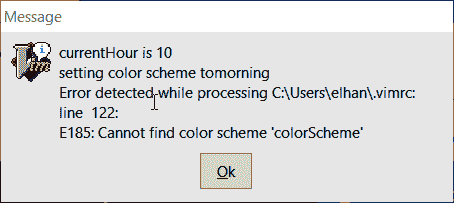

我们需要一种方法来执行引用变量而不是字面字符串（如 `darkblue`）的 Vim 命令。为此 Vim 提供了 `execute` 命令。当传入一个命令时，它会计算变量和表达式并将其值代入命令。我们可以利用这一特性以及上一节中展示的连接，将变量的值传递给 `colorscheme` 命令：

```
execute "colorscheme " . colorScheme
```

精确的语法（特别是引号）可能令人困惑。`execute` 命令期望变量或表达式，但 `colorscheme` 只是一个普通字符串，不是变量或表达式。我们不想让 `execute` 计算 `colorscheme`；我们只想让它原样接受名称。因此我们通过将其括在引号中把命令名变成字面字符串。顺便说一下，我们在最后的引号前添加一个空白。这很重要，因为我们需要在命令和值之间有一个空格。

我们的变量 `colorScheme` 必须在引号 *之外*，以便由 `execute` 计算。可以这样理解 `execute` 的行为：
* 普通单词会被计算为变量或表达式，`execute` 会用其值替换它们。
* 用引号括起来的字符串会被原样对待；`execute` 不会尝试计算它们以返回一个值。

使用 `execute` 修复了我们的错误，Vim 现在按预期加载了配色方案。

加载 Vim 后，你可以验证是否加载了正确的配色方案。`colorscheme` 命令会设置它自己的变量 `colors_name`。除了回显脚本中设置的变量值之外，你还可以手动执行 `echo` 命令并检查 `colors_name` 变量，以查看我们的脚本是否确实根据一天中的时间执行了正确的 `colorscheme` 命令：

```
:echo colors_name
```

## 定义函数

到目前为止，我们已经创建了一个对我们来说运行良好的脚本。现在让我们创建可以在会话期间任何时间执行的代码，而不仅仅是在 Vim 启动时。我们很快会给出一个示例，但在那之前，我们需要先创建一个包含脚本代码的 `function`。

Vim 允许你使用 `function…endfunction` 语句定义自己的函数。以下是用户自定义函数的一个示例骨架：

```
function MyFunction(arg1, arg2...)
  line of code
  another line of code
endfunction
```

我们可以轻松地将脚本转换为函数。请注意，我们不需要传入任何参数，因此函数定义中的括号为空：

```
function SetTimeOfDayColors()
  " progressively check higher values... falls out on first "true"
  let currentHour = strftime("%H")
  echo "currentHour is " . currentHour
  if currentHour < 6
    let colorScheme = "darkblue"
  elseif currentHour < 12
    let colorScheme = "morning"
  elseif currentHour < 18
    let colorScheme = "shine"
  else
    let colorScheme = "evening"
  endif
  echo "setting color scheme to " . colorScheme
  execute "colorscheme " . colorScheme
endfunction
```

### 注意

Vim 用户自定义函数名必须以大写字母开头。

现在我们在 `*.gvimrc` 文件中定义了一个函数。但如果不调用它，代码永远不会执行。你可以使用 Vim 的 `call` 语句调用函数。在我们的示例中它看起来像：

```
call SetTimeOfDayColors()
```

现在我们可以在 Vim 会话中的任何时间、任何位置设置配色方案。一个选择就是将之前的 `call` 行放入我们的 `*.gvimrc` 中。结果与我们早先的示例相同，即在不使用函数的情况下运行代码。但在下一节中，我们将看到一个巧妙的 Vim 技巧，它会反复调用我们的函数，以便在会话期间定期设置配色方案，从而在一天中动态变化！当然，这也引入了我们必须解决的其他问题。

## 一个不错的 Vim 搭便车技巧

在上一节中，我们定义了一个 Vim 函数 `SetTimeOfDayColors()`，我们调用它一次来定义配色方案。如果我们想反复检查一天中的时间并相应地更改配色方案怎么办？显然，`*.gvimrc` 中的一次性调用并不能实现这一点。为此，我们引入了一个使用 `statusline` 选项的巧妙 Vim 技巧。

大多数 Vim 用户都理所当然地使用 Vim 状态行。默认情况下，`statusline` 没有值，但你可以定义它以在状态行中显示 Vim 中几乎任何可用的信息。而且由于状态行可以显示动态信息，例如当前行和列，Vim 在编辑状态发生变化时就会重新计算并重新显示状态行。Vim 中的几乎任何操作都会触发状态行重绘。因此，我们将利用这一点作为技巧来调用我们的配色方案函数并动态更改配色方案。但正如我们很快会看到的，这是一种不完美的方法。

`statusline` 接受一个表达式，计算它并在状态行中显示它。这包括函数。我们利用此功能在每次状态行更新时调用 `SetTimeOfDayColors()`，而状态行更新很频繁。由于此功能会覆盖默认状态行，而我们不想丢失默认情况下获得的有价值信息，让我们在以下状态行的初始定义中加入大量信息：

```
set statusline=%<%t%h%m%r\ \ %a\ %{strftime(\"%c\")}%=0x%B\
    \\ line:%l,\ \ col:%c%V\ %P
```

### 注意

`statusline` 的定义跨了两行。Vim 将以反斜杠 (`\`) 作为首个非空白字符的行视为上一行的延续，并忽略反斜杠之前的全部空白。因此，如果你使用我们的定义，请确保它被完全复制并准确输入。如果无法使其工作，你可以恢复到以未定义的 `statusline` 开始。

你可以在 Vim 文档中查找百分号前各种字符的含义。该定义会产生如下所示的状态行：

```
ch12.asciidoc   Thu 26 Aug 2021 12:39:26 PM EDT     0x3C line:1,  col:1 Top
```

本章的重点不是状态行可以显示什么，而是利用 `statusline` 选项来计算函数。

现在我们将 `SetTimeOfDayColors()` 函数添加到 `statusline` 中。通过使用 `+=` 而不是普通的等号，我们是在末尾添加内容，而不是替换之前定义的内容：

```
set statusline += \ %{SetTimeOfDayColors()}
```

现在我们的函数已成为状态行的一部分。虽然它没有为状态行贡献有趣的信息，但它现在会检查一天中的时间，并在一天中的小时推移时可能更新我们的配色方案。这存在两个问题：


* 我们现在有一个 Vim 脚本函数，每当 Vim 状态行更新时都会检查一天中的小时。之前，我们为提高效率而努力减少了几次对 `strftime()` 的调用，但现在我们向会话中添加了如此多的调用，以至于数量令人眼花缭乱。
* 当我们的会话恰好在一天中的正确时间评估 `statusline` 时，它会按我们想要的方式工作并更改配色方案。但按我们定义的方式，它会检查时间并重置配色方案，而不管是否有变化。

在下一节中，我们将通过使用函数外部的全局变量来探讨实现目标的更高效方法。

# 使用全局变量调整 Vim 脚本

Vim 提供标量变量（数字和字符串）以及数组。此外，您可以指定变量的作用域。

## 变量作用域

Vim 变量相当直接，但在讨论全局变量之前，有几件事需要了解和管理。具体来说，我们必须管理变量的 *作用域*。Vim 通过依赖于名称 *前缀* 的约定来定义变量的作用域。前缀包括：

`a:` : 一个函数参数。
`b:` : 一个 Vim 缓冲区中识别的变量。
`g:` : 一个全局识别的变量——即它可以在 *任何地方* 引用。
`l:` : 一个在函数内识别的变量（局部变量）。
`s:` : 一个在源 Vim 脚本内识别的变量。
`t:` : 一个在单个 Vim 标签页中识别的变量。
`v:` : 一个 Vim 变量——由 Vim 控制（这些也是全局变量）。
`w:` : 一个在单个 Vim 窗口中识别的变量。

#### 注意
如果您没有使用前缀定义变量的作用域，则在函数外部定义时默认为全局 (`g:`)，在函数内部定义时默认为局部 (`l:`)。

## 全局变量

正如我们在对 Vim 脚本的最后一次修改中所发现的那样，我们 *几乎* 达到了期望的行为。我们的函数在每次 Vim 状态行更新时都会被调用，但由于这种情况经常发生，因此在多个层面上存在问题。

首先，由于它被调用得如此频繁，我们可能会担心它对计算机处理器造成的负载。幸运的是，以今天的计算机而言，这不太可能是大问题，但如此频繁地一遍又一遍地重新定义配色方案仍然是不良做法。如果这只是唯一的问题，我们可能会认为脚本已完成并且不再费心进一步调整它。然而，事实并非如此。

如果你已按照示例进行编码，你已经知道问题所在。在编辑会话中移动时不断重新建立配色方案会产生明显且令人厌烦的闪烁，因为每次定义配色方案，即使它与当前配色方案相同，也需要 Vim 重新读取配色方案定义脚本，重新解释文本，并重新应用所有颜色语法高亮规则。即使是计算能力极强的计算机，也可能没有足够的图形处理能力来无闪烁地渲染持续更新。我们需要修复这个问题。

我们可以一次性定义配色方案，然后在条件块内每次确定配色方案是否发生变化，从而是否需要定义和绘制。我们通过利用 `colorscheme` 命令设置的全局变量 `colors_name` 来实现这一点。让我们重写我们的函数以考虑这一点：

```
function SetTimeOfDayColors()
  " progressively check higher values... falls out on first "true"
  let currentHour = strftime("%H")
  if currentHour < 6
    let colorScheme = "darkblue"
  elseif currentHour < 12
    let colorScheme = "morning"
  elseif currentHour < 18
    let colorScheme = "shine"
  else
    let colorScheme = "evening"
  endif
  " if our calculated value is different, call the colorscheme command.
  if g:colors_name !~ colorScheme
    echo "setting color scheme to " . colorScheme
    execute "colorscheme " . colorScheme
  endif
endfunction
```

现在我们有一个动态且高效的函数。我们在下一节中做最后一次改进。

## 数组

如果能以某种方式在不使用扩展的 `if…then…else` 块的情况下提取配色方案值就好了。有了 Vim 数组，我们可以改进脚本，使其更加易读。

你通过将变量的值定义为方括号内的逗号分隔值列表来创建数组。我们为函数引入一个名为 `Favcolorschemes` 的数组。我们本可以在函数的作用域内定义它，但为了保留在会话其他地方访问数组的可能性，我们将它在函数外部作为全局数组定义：

```
let g:Favcolorschemes = ["darkblue", "morning", "shine", "evening"]
```

此行应放在你的 `*.gvimrc` 文件中。现在我们可以通过其下标引用数组变量 `g:Favcolorschemes` 中的任何值，从元素零开始。例如，`g:Favcolorschemes[2]` 等于字符串 `"shine"`。

利用 Vim 对数学函数的处理方式，其中整数除法的结果为整数（余数会被截断），我们现在可以快速轻松地根据一天中的小时获取首选配色方案。让我们看一下我们函数的最终版本：

```
function SetTimeOfDayColors()
  " currentHour will be 0, 1, 2, or 3
  let g:CurrentHour = strftime("%H") / 6
  if  g:colors_name !~ g:Favcolorschemes[g:CurrentHour]
    execute "colorscheme " . g:Favcolorschemes[g:CurrentHour]
    echo "execute " "colorscheme " . g:Favcolorschemes[g:CurrentHour]
    redraw
  endif
endfunction
```

`echo …` 语句打印信息并“宣布”脚本操作刚刚发生的更改。`redraw` 语句告诉 Vim 立即重绘屏幕。

恭喜！你已经构建了一个完整的 Vim 脚本，该脚本考虑了构建任何你想要的有用脚本所需的许多因素。

# 通过脚本进行动态文件类型配置

让我们看另一个巧妙的脚本示例。通常，在编辑新文件时，Vim 判断文件类型并设置 `filetype` 的唯一线索是文件的扩展名。例如，`*.c` 表示该文件是 C 代码。Vim 很容易确定这一点并加载正确的行为以便轻松编辑 C 程序。

但并非所有文件都需要扩展名。例如，虽然创建 shell 脚本时使用 `*.sh` 扩展名已成为常见惯例，但我们不喜欢也不遵守这一惯例，尤其是在该惯例流行之前我们就已创建了数千个脚本。Vim 实际上训练有素，可以通过查看文件内部的文本来识别 shell 脚本，而无需文件扩展名这一拐杖。然而，它只能在第二次编辑时做到这一点，此时文件提供了确定类型的上下文。Vim 脚本可以修复这个问题！

## 自动命令

在我们的第一个脚本示例中，我们依赖于 Vim 不断更新状态行的习惯，并在状态行中“隐藏”我们的函数以按时间设置配色方案。我们用于动态确定文件类型的脚本依赖于更正式的 Vim 惯例，`autocommands`。

自动命令包含任何有效的 Vim 命令。Vim 使用 *事件* 来执行命令。以下是一些事件，所有这些事件在发生时都会触发关联的命令：

`BufNewFile` : 当 Vim 开始编辑新文件时。
`BufReadPre` : 在 Vim 切换到新缓冲区之前。
`BufRead`, `BufReadPost` : 编辑新缓冲区时，但在读取文件 *之后*。
`BufWrite`, `BufWritePre` :


# Vim 自动命令文件类型检测

## Vim 事件

在写入缓冲区到文件之前。

`FileType`:
设置 `filetype` 之后。

`VimResized`:
Vim 窗口大小发生变化后。

`WinEnter`, `WinLeave`:
分别在进入或离开 Vim 窗口时。

`CursorMoved`, `CursorMovedI`:
分别在 `vi` 命令模式或插入模式中每次光标移动时。

总共有近 80 个 Vim 事件。对于这些事件中的任何一个，你都可以定义一个自动 `autocmd`，在该事件发生时执行。`autocmd` 的格式是：

```
autocmd [group] event pattern [nested] command
```

## Autocmd 格式

此格式的元素如下：

`group`:
一个可选的命令组（稍后描述）。

`event`:
将触发 `command` 的事件。

`pattern`:
匹配 `command` 应执行的 文件名的模式。

`nested`:
如果存在，允许此自动命令嵌套在其他命令中。

`command`:
事件发生时要执行的 Vim 命令、函数或用户定义脚本。

我们的目标是识别打开的任何新文件的文件类型，因此我们对 `pattern` 使用 `*`。

下一个决定是使用哪个事件来触发我们的脚本。因为我们希望尽可能早地尝试识别文件类型，所以有两个不错的候选者：`CursorMoved` 和 `CursorMovedI`。

`CursorMoved` 在光标移动时触发事件，这似乎很浪费，因为仅仅移动光标不太可能提供有关文件类型的更多信息。相比之下，`CursorMovedI` 在输入文本时触发，因此似乎是最好的候选者。

我们必须编写一个函数来每次执行工作。让我们称之为 `CheckFileType()`。我们现在有足够的信息来定义我们的 `autocmd` 命令。它看起来像这样：

```
autocmd CursorMovedI * call CheckFileType()
```

## 检查选项

在我们的 `CheckFileType()` 函数中，我们需要检查 `filetype` 选项的值。Vim 脚本使用特殊变量通过在选项名称（我们这里是 `filetype`）前加上与号（`&`）字符来提取选项的值。因此我们在函数中使用变量 `&filetype`。

我们从 `CheckFileType()` 的简单版本开始：

```
function CheckFileType()
 if &filetype == ""
   filetype detect
 endif
endfunction
```

Vim 命令 `filetype detect` 是安装在 `$VIMRUNTIME` 目录中的 Vim 脚本。它会遍历许多标准并尝试为你的文件分配文件类型。通常这只发生一次，因此如果文件是新的并且 `filetype` 无法确定文件类型，编辑会话就无法分配语法格式。

有一个问题：我们在输入模式下每次光标移动时都会调用函数，不断尝试检测文件类型。为了解决这个问题，我们首先检查文件是否已有文件类型，这意味着函数在之前的执行中已成功，因此不再需要再次执行。我们不会担心异常情况，例如错误识别或从一种编程语言开始编辑文件然后决定改为另一种语言。

让我们编辑一个新 shell 脚本文件并查看结果：

```
$ vim ScriptWithoutSuffix
```

输入以下内容：

```
#! /bin/sh

inputFile="DailyReceipts"
```

到现在为止，Vim 已打开颜色语法，如 图 12-2 所示。

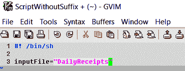

从图片可以看出 Vim 对字符串使用灰色，但印刷图像未显示 `#! /bin/sh` 为蓝色，`inputFile=` 为黑色，而 `"Daily​Re⁠ceipts"` 为紫色。不幸的是，这些不是 shell 语法高亮的颜色！通过命令 `:set filetype` 快速检查 `filetype` 选项会显示 图 12-3 所示的消息。


Vim 将文件类型 `conf` 分配给了我们的文件，这不是我们想要的。出了什么问题？

如果你尝试这个示例，你会看到 Vim 在第一个 `CursorMovedI` 事件中输入第一个字符 `#` 时立即分配了文件类型。Unix 实用程序和守护进程的配置文件通常使用 `#` 字符来开始注释，因此 Vim 的启发式方法假设行首的 `#` 是配置文件中注释的开始。我们必须教会 Vim 更有耐心一些。

让我们修改函数以允许更多上下文。不要在第一个可用机会就尝试检测文件类型，让用户先输入大约 20 个字符。

## 缓冲区变量

我们需要在函数中引入一个变量，告诉 Vim 暂缓并 *不要* 尝试检测文件类型，直到 `CursorMovedI` 自动命令调用该函数超过 20 次。我们对什么是新文件以及要在该文件中输入多少字符的认识是特定于缓冲区的。换句话说，编辑会话中其他缓冲区的光标移动不应计入检查。因此，我们使用缓冲区变量并将其命名为 `b:countCheck`。

接下来，我们修改函数以检查输入模式下光标至少移动 20 次（意味着大约输入了 20 个字符），同时检查是否已分配文件类型：

```
function CheckFileType()
  let b:countCheck += 1

  " Don’t start detecting until approximately 20 chars.
  if &filetype == "" && b:countCheck > 20
    filetype detect
  endif
endfunction
```

但现在我们得到了 图 12-4 所示的错误。

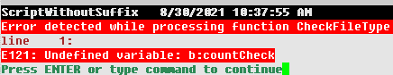

这是一个熟悉的错误。和以前一样，我们在变量定义之前就大胆地递增了它。而这次完全是我们的错，因为我们的脚本负责定义 `b:countCheck`。我们将在下一节处理这个微妙之处。

## exists() 函数

了解如何管理所有变量和函数很重要：Vim 要求你在任何类型的求值引用它之前就已定义每个变量和函数，使其 `exists`。

我们可以通过检查 `b:countCheck` 是否存在并使用前面显示的 `:let` 命令为其分配值来轻松解决脚本错误：

```
function CheckFileType()
  if exists(“b:countCheck”) == 0
    let b:countCheck = 0
  endif

  let b:countCheck += 1

  " Don't start detecting until approx. 20 chars.
  if &filetype == "" && b:countCheck > 20
    filetype detect
  endif
endfunction
```

现在测试代码。图 12-5 显示了达到 20 个字符限制之前的时刻，而 图 12-6 显示了输入第 21 个字符的效果。

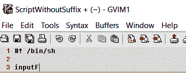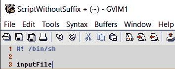

`/bin/sh` 文本突然有了语法颜色高亮。通过 `set filetype` 快速检查可以验证 Vim 已做出正确的分配，如 图 12-7 所示。

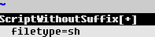

在所有实际用途上，我们已经有一个完整且令人满意的解决方案，但为了形式更规范，我们添加另一个检查，以在输入大约 200 个字符后停止 Vim 尝试检测文件类型：

```
function CheckFileType()
  if exists("b:countCheck") == 0
    let b:countCheck = 0
  endif

  let b:countCheck += 1

  " Don't start detecting until approx. 20 chars.
  if &filetype == "" && b:countCheck > 20 && b:countCheck < 200
    filetype detect
  endif
endfunction
```


现在，即使 `CheckFileType()` 在每次 Vim 光标移动时都被调用，我们的开销也很小，因为初始检查会在检测到文件类型或超过 200 个字符的阈值时退出函数。尽管这可能已足以实现合理的功能和最小的处理开销，但我们将继续研究更多机制，以提供更完整、更令人满意的解决方案，该方案不仅开销极小，而且在不需要时实际上会“消失”。

### Note
你可能已经注意到，我们对阈值计数 20 个字符的确切含义描述得有些模糊。这种模糊是有意为之的。因为我们是在计数光标移动，在输入模式下，合理地假设每次光标移动都对应一个新字符，从而增加 `CheckFileType()` 用于确定文件类型的“足够”上下文文本。

然而，输入模式下的*所有*光标移动都会被计数，因此为纠正输入错误而进行的任何退格操作也会计入阈值计数器。为了确认这一点，请尝试我们的示例，输入 `#`，然后退格覆盖它并重新输入 10 次。第 11 次时应显示出带颜色的 `#`，并且文件类型现在会被（错误地）设置为 `conf`。

## Autocommands and Groups
到目前为止，我们的脚本忽略了每次光标移动时调用函数所引入的任何副作用。我们通过合理性检查来最小化开销，避免不必要地调用耗费的 `filetype detect` 命令。但如果我们函数的最小代码也很昂贵怎么办？我们需要一种方法，在不需要时停止调用代码。为此我们利用了 Vim 对 autocommand *groups* 的概念及其根据组关联删除命令的能力。

我们通过首先将由 `CursorMovedI` 事件调用的函数与一个组关联来修改示例。Vim 提供了 `augroup` 命令来实现这一点。其语法是：

```
augroup groupname
```

所有后续的 `autocmd` 定义都会与组 `groupname` 关联，直到以下语句：

```
augroup END
```

如果命令未在 `augroup` 块中输入，则还有一个默认组。

现在我们将之前的 `autocmd` 命令与我们自己的组关联：

```
augroup newFileDetection
  autocmd CursorMovedI * call CheckFileType()
augroup END
```

我们的 `CursorMovedI` 触发的函数是 autocommand 组 `newFileDetection` 的一部分。我们将在下一节探讨其用处。

## Deleting Autocommands
为了尽可能干净地实现我们的函数，我们希望它仅在必要时保持有效。我们希望在它超过有用寿命后取消其引用（即一旦我们检测到文件类型或决定无法检测到）。Vim 允许你仅通过引用事件、文件名必须匹配的模式或其组来删除一个 autocommand：

```
autocmd! [group] [event] [pattern]
```

通常的 Vim“强制”字符——感叹号（`!`）——跟在 `autocmd` 关键字之后，表示与组、事件或模式关联的命令将被删除。

由于我们之前将函数与用户定义的组 `newFileDetection` 关联，现在我们可以控制它并通过在 autocommand 删除语法中引用该组来删除它。我们这样做：

```
autocmd! newFileDetection
```

这会删除与组 `newFileDetection` 关联的所有 autocommand，在我们的例子中只有我们的函数。

我们通过在启动 Vim 时（创建新文件时）使用命令查询 Vim 来验证 autocommand 的定义和删除：

```
:autocmd newFileDetection
```

Vim 的响应如 图 12-8 所示。

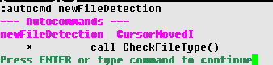

在检测到并分配文件类型*或*超过 200 个字符的阈值后，我们不再希望保留 autocommand 定义。因此我们对代码做了最后的润色。结合我们的 `augroup` 定义、我们的 `autocmd` 命令和我们的函数，我们的 `*.vimrc` 中的行如下所示：

```
augroup newFileDetection
  autocmd CursorMovedI * call CheckFileType()
augroup END

function CheckFileType()
  if exists("b:countCheck") == 0
    let b:countCheck = 0
  endif

  let b:countCheck += 1

  " Don't start detecting until approx. 20 chars.
  if &filetype == "" && b:countCheck > 20 && b:countCheck < 200
    filetype detect
  " If we’ve exceeded the count threshold (200), OR a filetype has been detected
  " delete the autocmd!
  elseif b:countCheck >= 200 || &filetype != ""
    autocmd! newFileDetection
  endif
endfunction
```

在语法颜色高亮开始后，我们可以通过输入与进入缓冲区时相同的命令来验证我们的函数是否自行删除：

```
:autocmd newFileDetection
```

Vim 的响应如 图 12-9 所示。


现在注意 `newFileDetection` 组中没有定义的 autocommand。你可以按如下方式删除自动组：

```
augroup! groupname
```

但这样做*不会*删除关联的 autocommand，并且每次引用这些 autocommand 时 Vim 都会产生错误条件。因此，请确保在删除组之前先删除组内的 autocommand。

### Warning
不要将删除 autocommand 与删除自动组混淆。

恭喜！你已完成了第二个 Vim 脚本。此脚本扩展了你的 Vim 知识，并让你一窥脚本可访问的不同功能。

# Some Additional Thoughts About Vim Scripting
我们只涵盖了整个 Vim 脚本宇宙的一小部分，但我们希望你能感受到 Vim 的强大。几乎你可以用 Vim 交互完成的所有操作都可以在脚本中编码。

在本节中，我们将查看内置 Vim 文档中包含的一个不错的示例，更详细地讨论我们之前触及的概念，并查看一些新功能。

## A Useful Vim Script Example
Vim 的内置文档包含一个我们认为你会想要使用的实用脚本。它专门针对在 HTML 文件的 `<meta>` 行中保持当前时间戳，但它也可以轻松用于许多其他类型的文件，对于这些文件，将文件的最近修改时间放在文件文本中是有用的。

以下是该示例基本保持原样（我们稍作修改）：

```
autocmd BufWritePre,FileWritePre *.html   mark s|call LastMod()|'s
fun LastMod()
 " if there are more than 20 lines, set our max to 20, otherwise, scan
 " entire file.
 if line("$") > 20
   let lastModifiedline = 20
 else
   let lastModifiedline = line("$")
 endif
 exe "1," . lastModifiedline . "g/Last modified: .*/s//Last modified: " .
 \ strftime("%Y %b %d")
endfun
```

以下是 `autocmd` 命令的简要分解：

`BufWritePre`, `FileWritePre`

这些是触发命令的事件。在这种情况下，Vim 在文件或缓冲区写入存储设备*之前*执行 autocommand。

`*.html`

对任何文件名以 `*.html` 结尾的文件执行此 autocommand。

`mark s`

我们为可读性从原始版本更改了这一点。取而代之的是 `ks`，我们使用了等效但更明显的命令 `mark s`。这只是在文件中创建名为 `s` 的标记位置，以便我们稍后返回此点。

`|`

管道字符分隔在 autocommand 定义中执行的多个 Vim 命令。这些是简单的分隔符，与 Unix shell 管道无关。

`call LastMod()`


这调用了我们用户定义的 `LastMod()` 函数。

`|`:
与之前相同。

`'s`:
返回到我们用名称 `s` 标记的行。

值得通过编辑一个 `*.html` 文件来验证此脚本，添加以下行：

```
Last modified:□
```

并执行 `w` 命令。

### 注意

此示例很有用，但就其所述目标——替换 HTML `<meta>` 语句而言，它在规范上并不正确。更恰当地说，如果它确实是要处理 `<meta>` 语句，则替换应查找 `<meta>` 语句中的 `content=…` 部分。尽管如此，此示例仍是解决该问题的良好起点，也是其他文件类型的有用示例。

## 关于变量的更多内容

我们现在更详细地讨论构成 Vim 变量的内容以及它们的使用方式。Vim 有五种变量类型：

Number:
一个有符号的 32 位数字。该数字可以用十进制、十六进制（例如，`0xffff`）或八进制（例如，`0177`）表示。如果编译器支持，Vim 支持 64 位数字。`ex` 命令 `:version` 显示 64 位是否得到支持或已编译到编辑器中。参见 图 12-10。

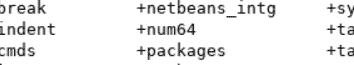

String:
一串字符。

Funcref:
对函数的引用。

List:
这是 Vim 的数组版本。它是有序的值列表，可以包含任意混合的 Vim 值作为元素。

Dictionary:
这是 Vim 的 `hash` 版本，通常也称为 `associative array`。它是一组无序的值对集合，第一项是可用于检索关联 `value` 的 `key`。

## 表达式

Vim 以相当直接的方式求值表达式。表达式可以简单到一个数字或字面字符串，也可以复杂到一个复合语句本身由表达式组成。

需要注意的是，Vim 的数学函数仅处理整数。如果需要浮点数和精度，则需要使用扩展，例如对外部数学处理例程的系统调用。

## 扩展

Vim 提供了许多扩展和与其他脚本语言的接口。值得注意的是，这些包括 Perl、Python 和 Ruby，这三种最流行的脚本语言。有关使用详情，请参阅 Vim 的内置文档。

## 关于 autocmd 的一些更多评论

在 “通过脚本进行动态文件类型配置” 部分，我们使用了 Vim 的 `autocmd` 命令来响应调用我们用户定义函数的事件。这非常强大，但不要忽视 `autocmd` 的更简单用法。例如，您可以使用 `autocmd` 为不同文件类型调整特定的 Vim 选项。

一个好的示例可能是为不同文件类型更改 `shiftwidth` 选项。具有大量缩进和嵌套级别的文件类型可能受益于更适度的缩进。您可能希望将 HTML 的 `shiftwidth` 定义为 2，以防止代码“走”出屏幕右侧，但对 C 程序使用 `shiftwidth` 为 4。要实现这种区别，请在您的 `*.vimrc` 或 `*.gvimrc` 文件中包含以下行：

```
autocmd BufRead,BufNewFile *.html set shiftwidth=2
autocmd BufRead,BufNewFile *.c,*.h set shiftwidth=4
```

## 内部函数

除了所有 Vim 命令之外，您还可以访问约 200 个内置函数。超出我们的范围去识别和记录所有这些函数，但了解有哪些类别或类型的函数是很有用的。以下类别取自 Vim 内置帮助文件 `usr_41.txt`：

String manipulation:
这些函数包含了程序员期望的标准字符串函数，从转换例程到子字符串例程等。

List functions:
这是一整套数组函数。它们与 Perl 中找到的数组函数非常相似。

Dictionary (associative array) functions:
这些函数包括提取、操作、验证和其他类型的函数。同样，这些与 Perl 的哈希函数非常相似。

Variable functions:
这些函数是“获取器”和“设置器”，用于在 Vim 窗口和缓冲区中移动变量。还有一个 `type()` 函数用于确定变量类型。

Cursor and position functions:
这些函数允许在文件和缓冲区中移动，并创建标记以便记住并返回位置。还有一些函数提供位置信息（例如，光标行和列）。

Text in current buffer functions:
这些函数操作缓冲区内的文本——例如，修改一行、检索一行等。还有搜索函数。

System and file manipulation functions:
这些包括用于导航 Vim 运行的操作系统的函数，例如在路径中查找文件、确定当前工作目录以及创建和删除文件。该组包括 `system()` 函数，它将命令传递给操作系统以供外部执行。

Date and time functions:
这些对日期和时间格式进行各种操作。

Buffer, window, and argument list functions:
这些函数提供收集有关缓冲区及其各自参数信息的机制。例如，当 Vim 启动时，文件列表构成了其参数列表，而函数 `argc()` 返回该列表的计数。参数列表函数特定于从 Vim 命令行传递的参数。缓冲区函数提供特定于缓冲区和窗口的信息。共有 25 个函数。有关更详细的信息，请在 Vim 的 `usr_41.txt` 帮助文件中搜索 `Buffers, windows, and the argument list`。或者您可以使用 `ex` 命令快速获取 Vim 函数的类型：

```
:help function-list
```

Command-line functions:
这些函数获取命令行位置、命令行、命令行类型并设置命令行内的光标位置。

QuickFix and location lists functions:
这些函数检索和修改 QuickFix 列表。

Insert mode completion functions:
这些函数用于命令和插入补全功能。

Folding functions:
这些函数提供折叠的信息并展开关闭折叠时显示的文本。

Syntax and highlighting functions:
这些函数检索有关语法高亮组和语法 ID 的信息。

Spelling functions:
这些函数查找疑似拼写错误的单词并提供建议的正确拼写。

History functions:
这些函数获取、添加和删除历史记录项。

Interactive functions:
这些函数为用户提供接口，用于文件选择等活动。

GUI functions:
这里有三个简单的函数，用于获取当前字体的名称、获取 GUI 窗口的 `x` 坐标以及获取 GUI 窗口的 `y` 坐标。

Vim server functions:
这些函数与（可能远程的）Vim 服务器通信。

Window size and position functions:
这些函数获取窗口信息并允许保存和恢复窗口“视图”。

Various functions:
这些是杂项“其他”函数，不太适合之前的类别。它们包括诸如 `exists()` 的函数，用于检查 Vim 项目是否存在，以及 `has()`，用于检查 Vim 是否支持某项功能。

# 资源


我们希望已经引起了足够的兴趣，并提供了足够的信息，让你开始使用 Vim 脚本。整个一本书都可以用在 Vim 脚本这个主题上。幸运的是，还有其他资源可以求助。

一个好的起点是前往[Vim 本身的源](https://www.vim.org/scripts/index.php)并访问专门用于脚本的页面。在这里你会找到超过两千个可供下载的脚本。整个作品集都是可搜索的，你受邀通过为脚本评分甚至贡献自己的脚本来参与其中。

我们也提醒你，内置的 Vim 帮助是无价的。我们推荐的最有成效的帮助主题是：

```
help autocmd
help scripts
help variables
help functions
help usr_41.txt
```

不要忘记 Vim 运行时目录中的众多 Vim 脚本。所有后缀为 `.vim` 的文件都是脚本，它们为通过示例学习编程提供了极佳且肥沃的练习场。

去玩吧。这是学习最好的方式。

^(1) 我们听说其他人报告了略有不同的数字和默认配色方案，但这已经相当接近了。

^(2) 技术审阅者的一个观察，我们同意：变量名 `currentHour` 有点名不副实，因为它的值实际上并不是一个小时。这个当前名称反映了它的传承，但另外，我们也可以根据其用途命名变量：`colorIndex`。不过，我们仍将脚本保持其原始形式。

## 第 13 章. Vim 中的其他酷炫功能

第 8 章到第 12 章涵盖了我们认为你应该了解的强大 Vim 功能和技术，以便有效地使用编辑器。从实时拼写检查（附带建议的更正）到编辑二进制文件和管理你的 Vim 会话状态，本章对 Vim 做了一个更轻松的审视。它是一些未能纳入之前主题的功能、关于编辑和 Vim 哲学的想法以及一些关于 Vim 的有趣事物的集合（并非之前的章节不有趣！）。

## 拼写它！(i-t)

Vim 的拼写检查在速度和灵活性方面表现出色。根据 Vim 自身拼写检查内置帮助，Vim 建议用 Vim 内置的拼写检查功能替换 `vimspell` 插件。查看帮助文件 `spell.txt`，或使用 `ex` 命令查找帮助：

```
:help spell
```

Vim 默认不进行拼写检查。使用 `ex` 命令打开拼写检查：

```
:setlocal spell
```

以及拼写检查区域：

```
:setlocal spelllang=en_us
```

Vim 会标记“坏”词（因为一个人的拼写错误词可能是另一个人的“好”词，因此区分“坏”和“好”而不是“正确”和“不正确”）、未大写的句子开头词、“罕见”词（别问）和“本地”（地区性）词。请参阅图 13-1 以了解 Vim 如何突出显示标记为“坏”和“cap”的词的示例，并参阅图 13-2 以了解突出显示词的示例。

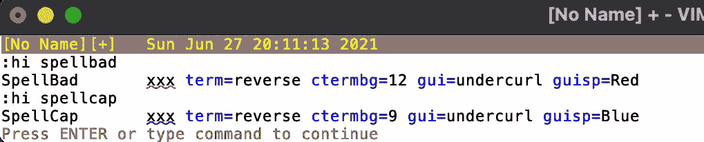

一旦打开拼写检查，你可以使用 `vi` 命令模式命令 `]s` 和 `s` 分别前进到下一个或上一个坏词。当光标位于坏词的任何位置时，`vi` 命令 `z=` 会建议一个编号列表来替换该坏词。输入相应的数字并按 ENTER 即可替换坏词。或者如果你在 GUI Vim 会话中或已启用鼠标，可以通过点击你的选择来选择替换词。要取消操作，请在未选择的情况下输入 ESC 或 ENTER。

Vim 通过将编码的词文件加载到内存中并应用两种主要算法来检测拼写错误来管理拼写列表。一种是快的；另一种是慢的。Vim 允许你打开或关闭其中任何一个。*快速*拼写检查假设拼写错误的词会与正确拼写的词非常接近，并且错误很可能是字符的转置或缺少字符。这些拼写错误的词被认为与正确性“距离很短”，因此该算法高效且快速。

*慢速*算法假设该词可能与正确性相距“很远”。例如，你可能按发音拼写了该词，而不知道真正正确的写法。

根据 Vim 的文档，如果你拼写很好，你的错误很可能属于快速算法的类型，并且 Vim 为提高效率建议你只使用该选项。你通过选择 `fast` 或 `double` 其中之一作为 Vim 选项 `spellsuggest` 的值来选择你偏好的拼写检查方法。^([1)

我们在表 13-1 中列出了更常见的 `vi` 命令模式命令。

表 13-1. 常见的 Vim 命令模式拼写检查命令

| Command || Action |
| --- | --- |
| `]s` || 将光标前进到下一个拼写错误词的出现位置。 |
| --- | --- |
| `[s` || 将光标前进到上一个拼写错误词的出现位置。 |
| `zg` || 将光标下的词添加到好词列表中。 |
| `zG` || 将光标下的词添加到 `internal-wordlist` 中的好词列表（参见 Vim 帮助）。添加到 `internal-wordlist` 的词被视为临时性的，并在退出 Vim 时被丢弃。 |
| `zw` || 将光标下的词添加到坏词列表中。如果该词在好词列表中，它将被从那里移除。 |
| `zW` || 将光标下的词添加到 `internal-wordlist` 中的坏词列表中。与 `zG` 相同，此添加在退出 Vim 时会被丢弃。 |
| \[`number`] `z=` || 显示替换坏词的建议列表。Vim 将建议显示为编号列表，你通过输入相应数字来选择替换词。如果你用数字前缀 `z=`，Vim 会自动将坏词替换为与 `number` 匹配的建议词。 |

一些说明：

* Vim 选项 `wrapscan` 适用于 `]s` 和 `s`。也就是说，如果在当前位置和缓冲区末尾（或开头，取决于命令方向）之间没有更多拼写错误词，光标不会前进。
* Vim 将词区分开为“好”或“坏”，而不是“拼写正确”或“拼写不正确”，因为在上下文中可能存在正确但不一定是实际词的术语。
* 对于 `zg` 和 `zG`，你添加到好词列表和坏词列表中的词都会添加到 Vim 选项 `spellfile` 定义的文件中。这使得这些添加的词与更全局的 Vim 拼写文件分开。
* 对于 `z=`，如果你使用的是 GUI Vim 或已启用鼠标操作，可以通过点击建议词来选择替换词。

Vim 文档提示最常见的数字前缀可能是 `1`，假设第一个建议很可能是用来替换坏词的那个。

[表 13-2 列出了 `ex` 命令及其使用方法。

表 13-2. 常见的 Vim `ex` 拼写检查命令

| Command || Action |
| --- | --- |
| `:[n]spellgood word` || 将 `word` 添加到好词列表中。如果命令前面有计数，则将 `word` 添加到 `spellfile` 定义的文件列表中的第 `n` 个文件。如果没有对应的第 `n` 个文件（例如计数为三，但 Vim `spellfile` 选项只定义了两个文件），Vim 会标记错误，且不会添加任何词。 |
| --- | --- |
| `:spellgood! word` || 将 `word` 添加到 `internal-list` 中的好词列表。Vim 在每次会话后丢弃 `internal-list`。 |
| `:spellwrong word` || 将 `word` 添加到坏词列表。 |


| `:spellwrong! word` || 将 `word` 添加到 `internal-list` 中的坏词列表中。Vim 在每次会话后丢弃 `internal-list`。 |

Vim 文档提供了超出简单检查拼写错误的详细说明。例如，你可以定义自己的词文件，Vim 的帮助文件 `spell.txt` 第 3 节“生成拼写文件”展示了如何从起始集合（如 OpenOffice 的词）创建词文件。你可以使用公开可用的文件，自己创建，或两者结合。访问 Vim 的文档 (`:help spell`) 以获取有关设置自定义拼写配置以及更多可用命令和选项的更详细说明。

## 对词语的另一种尝试，试试同义词库

不要与拼写检查混淆，Vim 还提供基于同义词库的词补全。有关 Vim 同义词库选项的更详细讨论，请参阅 “通过同义词库补全”。它很有趣，迷人，幽默，吸引人，美丽，令人信服，好奇，令人愉快，吸引人，异国情调，迷人，令人印象深刻，引人入胜，可爱，令人愉悦，挑衅，可读，令人耳目一新，刺激，醒目。☺

# 编辑二进制文件

正式来说，Vim 与 `vi` 一样是 *text* 编辑器。但在紧急情况下，Vim 也允许你编辑包含人类通常无法阅读的数据的文件。

你为什么会想编辑二进制文件？二进制文件之所以是二进制的，不是有原因的吗？二进制文件通常不是由某个应用程序以明确且特定的格式生成的吗？

确实，二进制文件通常由计算机或模拟过程创建，并不打算手动编辑。例如，数码相机通常以 JPEG 格式存储图片，这是一种用于数字图片的压缩二进制格式。它们是二进制的，但具有定义明确的段或块来存储标准信息（前提是它们按照规范实现）。JPEG 格式的数字图片将图片元信息（拍摄时间、分辨率、相机设置、日期等）存储在与压缩的数字图片数据分开的保留块中。实际应用可能会使用 Vim 的二进制文件编辑功能编辑一个 JPEG 图片目录，以更改“created”块中的所有 `year` 字段，从而修正图片的“创建日期”字段。

### 警告

虽然我们喜欢 Vim 的二进制编辑功能，但我们并未深入讨论编辑二进制文件时需要考虑的潜在严重问题。例如，一些二进制文件包含数字签名或校验和以确保文件完整性。编辑文件可能会损坏其完整性并使其无法使用。因此，请不要将其视为对随意二进制编辑的认可。

图 13-3 显示了对 JPEG 文件的编辑会话。请注意光标如何定位在日期字段上。你可以通过更改此处显示的字段直接编辑有关此图片的信息。

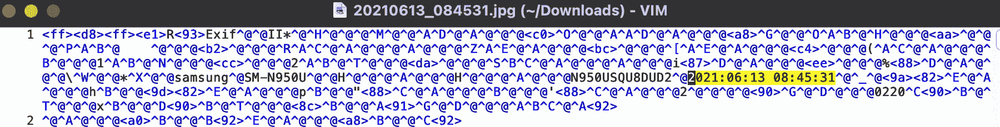

对于熟悉特定二进制格式的熟练用户来说，Vim 在直接进行更改方面非常方便，否则可能需要使用其他工具进行繁琐、重复的操作。

编辑二进制文件主要有两种方法。你可以从 Vim 命令行设置 `binary` 选项：

```
:set binary
```

或使用 `-b` 选项启动 Vim。

为了便于二进制编辑 *并* 保护 Vim 不会损坏文件的完整性，Vim 会相应地设置以下选项：

* `textwidth` 和 `wrapmargin` 选项被设置为零。这可以阻止 Vim 在文件中插入虚假的换行序列。
* `modeline` 和 `expandtab` 选项被取消设置（`nomodeline` 和 `noexpandtab`）。这可以阻止 Vim 将制表符扩展为 `shiftwidth` 个空格，并防止它解释 modeline 中的命令，而这些命令可能会设置选项从而引入意外且不想要的副作用。

### 注意

在使用二进制模式时，在窗口之间或缓冲区之间切换时要小心。Vim 使用进入和退出事件来设置和更改切换缓冲区和窗口的选项，你可能会使其混淆并移除上面列出的一些保护措施。我们建议在编辑二进制文件时使用单窗口、单缓冲区的会话。

# 双字符输入：非 ASCII 字符

你说 *Messiah* 是由 George Frideric *Händel* 而不是 George Frideric *Handel* 创作的吗？你认为你的 *résumé* 比 *resume* 更有魅力吗？使用 Vim 的双字符输入来输入特殊字符。

即使是英语文本文件偶尔也需要特殊字符，尤其是在引用全球化世界时。英语以外的语言的文本文件需要大量特殊字符。

术语 *digraph* 传统上描述代表单个语音的两个字母组合，例如 “digraph” 或 “phonetic” 中的 *ph*。Vim 借用两个字母组合的概念来描述其用于具有特殊特征的字符的输入机制，通常是重音或其他标记，例如 *ä* 上的变音符号。这些特殊标记正确称为 *diacritics*，或 *diacritical marks*。换句话说，Vim 使用双字符输入来创建变音符号。（很高兴能澄清这一点。）

Vim 允许你以多种方式输入特殊字符（变音符号），其中两种相对简单直观。一种使用前缀字符（CTRL-K）定义双字符输入。另一种在两个键盘字符之间使用 BACKSPACE 键。（其他方法更适合通过原始数值输入字符，指定为十进制、十六进制或八进制数字。虽然功能强大，但这些方法不利于双字符输入的易记助记。）

第一个变音符号输入方法是三字符序列，由 CTRL-K、基础字母和表示要添加的重音或标记的标点字符组成。例如，要创建带 cédille 的 *c*（ç），输入 CTRL-K C ,。要创建带重音符的 *a*（à），输入 CTRL-K a !。

希腊字母是通过输入相应的拉丁字母后跟星号创建的（例如，输入 CTRL-K P \* 得到小写 π）。俄语字母是通过输入相应的拉丁字母后跟等号（\=）或在少数地方使用百分号（%）创建的。使用 CTRL-K ? SHIFT-I 输入倒置问号（¿）和使用 CTRL-K S S 输入德语变音 *S*（ß）。

要使用 Vim 的第二种方法，设置 `digraph` 选项：

```
:set digraph
```

现在你可以通过输入两字符组合的第一个字符，然后是退格字符（BACKSPACE），然后是创建标记的标点来创建特殊字符。因此，使用 C BACKSPACE , 输入 *ç*，使用 A BACKSPACE ! 输入 *à*。

设置 `digraph` 选项并不妨碍你使用 CTRL-K 方法输入双字符输入。如果你的打字不够出色，请考虑 *只* 使用 CTRL-K 方法。否则，在退格并输入修正时，你可能会不经意地比想要的更频繁地输入双字符输入。

使用 `:digraph` 命令显示所有默认序列；更详细的说明可以通过 `:help digraph-table` 获得。图 13-4 显示了来自 `:digraph` 命令的部分列表。

在显示中，每个双字符输入由三列表示。显示有点杂乱，因为 Vim 在每行上尽可能多地挤入三列组合，具体取决于屏幕允许的数量。对于每个组，第一列显示双字符输入的两个字符组合，第二列显示双字符输入，第三列列出双字符输入的十进制 Unicode 值。

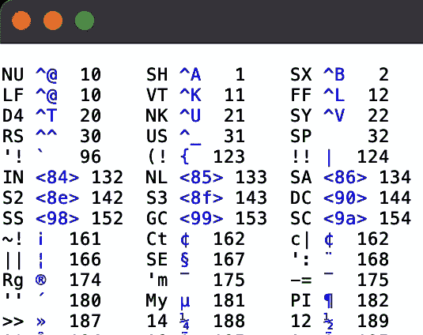


为了方便起见，表 13-3 列出了在序列中作为最后一个字符使用的标点符号，以输入最常用的重音符号和标记。

### 表 13-3. 如何输入重音符号和其他标记

| 标记 | 示例 | 作为双字母组合一部分需要输入的字符 |
|---|---|---|
| 锐音符号 | fiancé | 撇号 (`'`) |
| 短音符号 | publică | 左括号 `(` |
| 哈切克 | Dubček | 小于号 (`<`) |
| 尾音符 | français | 逗号 (`,`) |
| 抑扬符或尖音符 | português | 大于号 (`>`) |
| 重音符号 | voilà | 感叹号 (`!`) |
| 长音符号 | ātmā | 连字符 (`-`) |
| 斜线 | Søren | 斜杠 (`/`) |
| 波浪号 | señor | 问号 (`?`) |
| 分音符号或抑扬符 | Noël | 冒号 (`:`) |

## 在其他位置编辑文件

借助网络协议的无缝集成，`Vim` 让你可以像编辑本地文件一样编辑远程机器上的文件！只要为文件名指定一个 URL，`Vim` 就会在窗口中打开它，并将你的更改写入远程系统。（这取决于你的访问权限。）例如，下面的命令编辑系统 `flavoritlz` 上用户 `elhannah` 拥有的 shell 脚本。远程机器在端口 122 上提供 SSH 安全协议（这是一个非标准端口，通过隐蔽性提供额外的安全性）：

```
$ vim scp://elhannah@flavoritlz:122//home/elhannah/bin/scripts/manageVideos.sh
```

因为我们正在编辑远程机器上 `elhannah` 的主目录中的文件，所以我们可以使用简单文件名来缩短 URL。它被视为相对于远程系统上用户主目录的路径名：

```
$ vim scp://elhannah@flavoritlz:122/bin/scripts/manageVideos.sh
```

让我们拆解完整的 URL，以便你学习如何为自己的环境构建 URL：

- `scp:`  
  第一个部分，直到冒号，表示传输协议。在此示例中，协议是 `scp`，这是一种基于安全外壳（SSH）协议构建的文件复制协议。下面的 `:` 是必需的。

- `//`  
  这引入主机信息，对于大多数传输协议，其形式为 [`user`@]`hostname`[:`port`]。

- `elhannah@`  
  这是可选的。对于 `scp` 等安全协议，它指定在远程机器上以哪个用户登录。省略时，默认为本地机器上的用户名。当提示输入密码时，你必须输入远程机器上该用户的密码。

- `flavoritlz`  
  这是远程机器的符号名称，也可以用数字 IP 地址指定，例如 `192.168.1.106`。

- `:122`  
  这是可选的，指定提供协议的端口。冒号将端口号与前面的主机名分隔开。所有标准协议都使用众所周知的端口，因此如果使用标准端口，则可以省略此 URL 元素。在此示例中，122 *不是* `scp` 协议的标准端口，并且由于 `flavoritlz` 系统的管理员选择在端口 122 上提供服务，因此此指定是必需的。

- `/home/elhannah/bin/scripts/manageVideos.sh`  
  这是我们想要编辑的远程机器上的文件。我们以两个斜杠开头，因为我们指定的是绝对路径。相对路径或简单文件名只需要一个斜杠将其与前面的主机名分隔开。相对路径相对于你登录为的用户的主目录。（在此示例中，它将相对于 `/home/elhannah`。）

以下是受支持协议的部分列表：

- `ftp:` 和 `sftp:`  
  普通 FTP 和安全 FTP。

- `scp:`  
  通过 SSH 的安全远程复制。

- `http:`  
  使用标准浏览器协议的文件传输。

- `dav:`  
  一种相对较新但流行的用于网页传输的提议开放标准。

- `rcp:`  
  远程复制。请注意此协议不安全；*你绝不要使用它*。

我们到目前为止所描述的内容足以允许远程编辑，但该过程可能不如本地编辑文件那样透明。也就是说，由于需要从远程主机移动数据，你在工作时可能会被提示输入密码。这可能会变得乏味，如果你习惯在编辑时定期将文件写入磁盘，因为每次“写入”都会被中断以提示你输入密码来完成交易。

前述列表中的所有传输协议都允许你配置服务以允许免密码访问，但细节各不相同。请使用服务的文档获取特定协议的详细信息和配置。^2

## 导航和更改目录

如果你大量使用过 `Vim`，你可能偶然发现可以使用与文件操作类似的按键来查看目录并在其中移动。

让我们考虑一个包含两个仓库目录的目录，`/home/elhannah/.git/vim`（这些是两个不同的 *git* 目录）。使用以下命令编辑 `/home/elhannah/.git/vim`：

```
$ vim /home/elhannah/.git/vim
```

图 13-5 是与你可能看到的内容类似的部分屏幕截图。

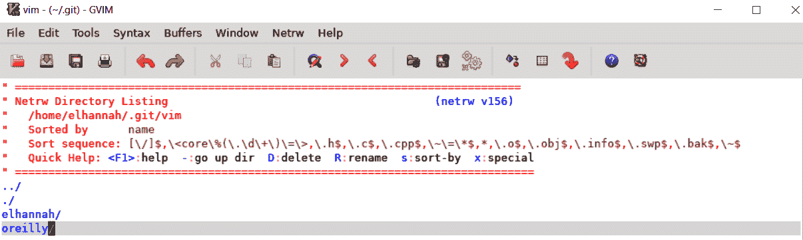

`Vim` 显示三种类型的信息：介绍性注释（用等号包围）、目录（以斜杠结尾显示）和文件。每个目录或文件都占一行。

有很多种使用此功能的方法，但只需稍加努力，你就可以立即直观地使用标准 `Vim` 移动命令（例如 `w` 移动到下一个词，`j` 或向下箭头向下移动一行）以及通过单击鼠标在条目上操作。这里是目录模式的一些特定功能：

- 当光标位于目录名上时，按 `ENTER` 键进入该目录。

- 如果光标位于文件名上，按 `ENTER` 会编辑该文件。

#### 提示

如果你想保留目录窗口以便在该目录中继续工作，通过键入 `o` 编辑光标下的文件，`Vim` 将分割窗口，并在新创建的窗口中编辑文件。当光标位于目录名上时，移动到另一个目录也同样适用；`Vim` 会分割窗口，并在新窗口中“编辑”你移动到的目录。

- 你可以删除和重命名文件和目录。你通过键入 `SHIFT-R` 来执行此操作。可能有点违反直觉，`Vim` 会创建一个命令行提示符，你可以在其中执行重命名。它应该看起来像 图 13-6。

要完成重命名，请编辑第二个命令行参数。

删除文件的工作方式类似。只需将光标定位到要删除的文件名上，然后键入 `SHIFT-D`。`Vim` 会提示你确认删除文件。与重命名功能一样，`Vim` 会在屏幕的命令行区域提示确认。

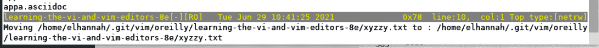

- 编辑目录的一个优点是可以快速使用 `Vim` 的搜索功能访问文件。例如，假设你想编辑前面描述的 `/home/elhannah/.git/vim/oreilly/learning-the-vi-and-vim-editors-8e` 目录中的文件 `ch12.asciidoc`。要快速导航并编辑此文件，你可以搜索文件名的部分或全部。在此情况下我们只需搜索数字 `12`：

```
 /12
```

然后在光标位于该文件名上时，按 `ENTER` 或 `O`。

#### 注意


当你阅读目录编辑的在线帮助时，你会看到 Vim 将其描述为与网络协议一起编辑文件的整个套件的一部分，该内容已在上一节中描述。我们将目录编辑作为独立主题，是因为它很有用，并且因为它可能在关于网络协议编辑的大量细节中丢失。

# 使用 Vim 进行备份

Vim 通过让你备份编辑的文件来帮助你防止意外丢失数据。对于严重出错的编辑会话，这很有用，因为你可以恢复之前的文件。

备份由两个选项的设置控制：`backup` 和 `writebackup`。备份的创建位置和方式由另外四个选项控制：`backupskip`、`backupcopy`、`backupdir` 和 `backupext`。

如果 `backup` 和 `writebackup` 选项都关闭（即 `nobackup` 和 `nowritebackup`），Vim 不会创建任何备份文件。如果 `backup` 打开，Vim 会删除旧备份并为当前文件创建备份。如果 `backup` 关闭而 `writebackup` 打开，Vim 会在编辑会话期间创建备份文件，并在之后删除备份。

`backupdir` 是一个以逗号分隔的目录列表，Vim 在其中创建备份文件。例如，如果你希望备份始终创建在系统的临时目录中，将 `backupdir` 设置为 Windows 下的 `C:\TEMP` 或 Unix 和 GNU/Linux 下的 `/tmp`。

### 提示

如果你希望始终在当前目录中创建文件的备份，可以指定“`.`”（一个点）作为备份目录。或者，你可以先尝试在隐藏子目录中创建备份（如果存在），然后如果隐藏子目录不存在则在当前目录中创建备份。通过将 `backupdir` 的值定义为类似 `./.mybackups,.` 的内容来实现（末尾的单个点表示文件当前目录）。这是一个灵活的选项，支持多种定义备份位置的策略。

如果你想在编辑时进行备份但不是所有文件，使用 `backupskip` 选项定义一个以逗号分隔的模式列表。Vim 不会对匹配任何模式的文件进行备份。例如，你可能永远不想备份在 `/tmp` 或 `/var/tmp` 目录中编辑的任何文件。通过将 `backupskip` 设置为 `/tmp/*,/var/tmp/*` 来阻止 Vim 这样做。

默认情况下，Vim 使用与原始文件相同的名称并加上后缀 `~`（波浪号）来创建备份。这是一个相当安全的后缀，因为以该字符结尾的文件名很少见。使用 `backupext` 选项将后缀更改为你喜欢的后缀。例如，如果你希望备份的后缀为 `*.bu`，将 `backupext` 设置为字符串 `.bu`。

最后，`backupcopy` 选项定义了 *如何* 创建备份副本。我们建议将此选项设置为 `auto`，以便让 Vim 做出最佳方法的计算选择。

# 将文本转为 HTML

你是否曾经需要向一组人展示你的代码或文本？你是否曾经尝试进行代码审查，但使用的是别人的 Vim 配置而无法弄清楚？考虑将你的文本或代码转换为 HTML 并从浏览器中查看。

Vim 提供了三种方法来创建文本的 HTML 版本。它们都会创建一个新缓冲区，其名称与原始文件相同并添加后缀 `*.html`。Vim 会分割当前会话窗口并在新窗口中显示文件的 HTML 版本：

### `gvim` “转换为 HTML”

这是最友好的方法，并且内置于 `gvim` 图形编辑器中（在 第 9 章 中描述）。在 `gvim` 中打开语法菜单并选择“转换为 HTML。”

### `2html.vim` 脚本

这是上一个项目中描述的“转换为 HTML”菜单选项所调用的底层脚本。通过以下命令调用它：

```
:runtime!syntax/2html.vim
```

它不接受范围；它转换整个缓冲区。

### `tohtml` 命令

这比 `2html.vim` 脚本更灵活，因为你可以指定要转换的确切行范围。例如，要转换缓冲区中的第 25 行到第 44 行，输入：

```
:25,44tohtml
```

### 注意

虽然 Vim 发行版仍在插件（和自动加载）目录中包含 `tohtml.vim`，但我们未能成功使用此功能。效果因人而异。其他转换是可以工作的。

使用 `gvim` 进行 HTML 转换的一个优点是 GUI 能够准确检测颜色并创建相应的正确 HTML 指令。这些方法在非 GUI 环境中仍然有效，但结果的准确性较难保证，可能不太有用。

### 注意

管理新创建的文件由你负责。Vim 不会为你保存它；它只是创建了一个缓冲区。我们建议提供管理策略来保存和同步文本文件的 HTML 版本。例如，你可以创建一些自动命令来触发 HTML 文件的创建和保存。

保存的 HTML 文件可以在任何网页浏览器中查看。有些人可能不熟悉如何在浏览器中打开本地系统上的文件。但其实很简单：几乎所有浏览器都在文件菜单中提供“打开文件”菜单选项，并显示文件选择对话框，让你导航到包含 HTML 文件的文件夹。如果你计划定期使用此功能，我们建议为所有文件建立书签集合。

# 有什么区别？

不同版本文件之间的更改通常很微妙，而一个能够一目了然查看精确差异的工具可以节省数小时的工作。Vim 将众所周知的 Unix `diff` 命令集成到一个非常复杂的可视化界面中，通过其 `vimdiff` 命令调用。

有两种等效的方法可以调用此功能——作为独立命令和作为 Vim 的选项：

```
$ vimdiff old_file new_file
$ vim -d old_file new_file
```

通常，第一个比较的文件是文件的旧版本，第二个是较新版本，但这只是约定。事实上，反转顺序是有道理的。

图 13-7 显示了 `vimdiff` 输出的一个示例。由于空间有限，我们压缩了宽度并关闭了 Vim 的 `wrap` 选项以便说明差异。

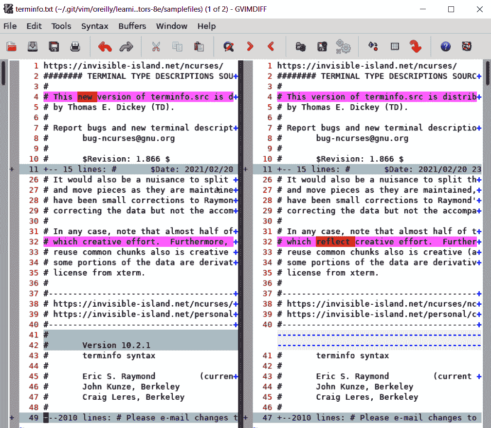

尽管该图无法传达印刷书籍中视觉内容的全部影响，但它展示了一些关键的特征行为：

* 在第 4 行，你可以看到左侧行中右侧行中没有的单词 *new*。这是一个高亮显示（红色）的单词，表示两行之间的差异。同样，在第 32 行，右侧行以红色高亮显示左侧行中没有的单词 *reflect*。
* 在两侧的第 11 行，Vim 创建了一个 15 行折叠。这两个文件中的 15 行是相同的，因此 Vim 将它们折叠以最大化屏幕上的“diff”信息。
* 左侧的第 41–42 行被高亮显示，而在右侧的相应位置，短划线字符串 (`-`) 表示行缺失。从这一点开始行号不同，因为右侧少了两行，但两个文件中的对应行在水平方向上仍然对齐。
* 左侧的第 49 行，对应右侧的第 47 行，显示了另一个折叠，这个折叠为 2010 行，这表明对于两个文件剩余的 2010 行，内容是相同的。

`vimdiff` 功能随所有类 Unix 的 Vim 安装一起提供，因为 `diff` 命令是 Unix 标准。非 Unix 的 Vim 安装应附带 Vim 自身的 `diff` 版本。Vim 允许 `diff` 命令的即插即用替换，只要它们创建标准的 `diff` 输出即可。


The `diffexpr` variable defines the replacement expression for the default `vimdiff` behavior and is typically implemented as a script that operates on the following variables:

`v:fname_in`: 要比较的第一个输入文件。

`v:fname_new`: 要比较的第二个文件。

`v:fname_out`: 捕获 `diff` 输出的文件。

# viminfo：现在，我在哪儿？

大多数文本编辑器从第 1 行、第 1 列开始编辑文件。也就是说，每次编辑器启动时，文件都会被加载，编辑从第 1 行开始。如果你多次编辑同一个文件，逐步推进它，你会发现从上次结束的地方开始新的会话会更方便。Vim 正好允许你这样做。

有两种不同的方法可以保存会话信息以供将来使用：`viminfo` 选项和 `:mksession` 命令。本节将介绍这两种方法。

## viminfo 选项

Vim 使用 `viminfo` 选项来定义保存编辑会话信息的什么内容、如何保存以及保存位置。该选项是一个以逗号分隔参数的字符串，告诉 Vim 保存多少信息以及保存到哪里。`viminfo` 的一些子选项由以下内容定义：

`<n>`: 告诉 Vim 为每个寄存器保存行数，最大为 `n` 行。

### 提示

如果你未为此选项指定任何值，*所有* 行都会被保存。虽然乍一看这似乎是一个正常且合理的默认值，但请考虑你是否经常编辑非常大的文件并对这些文件进行大量更改。例如，如果你经常编辑一个 10,000 行的文件并删除所有行（可能是为了减少由某些外部应用程序引起的快速增长），然后保存它，所有 10,000 行都会被保存到该条目的 `*.viminfo` 文件中。如果你经常对许多文件这样做，`*.viminfo` 文件会变得非常大。然后你可能会注意到启动 Vim 时出现长时间延迟，即使对于与大文件无关的文件也是如此，因为 Vim 每次启动时都必须处理 `*.viminfo` 文件。

我们建议指定一个合理但有用的限制。我们使用 50。

`/n`: 要保存的搜索模式历史项数。如果未指定，Vim 使用 `history` 选项中的值。

`:n`: 要保存的命令行历史命令的最大数量。如果未指定，Vim 使用 `history` 选项中的值。

`'n`: Vim 维护信息的最大文件数。如果你定义了 `viminfo` 选项，此参数是必需的。

以下是 Vim 在 `viminfo` 文件中保存的内容：

* 命令行历史
* 搜索字符串历史
* 输入行历史
* 寄存器
* 文件标记（例如，由 `mx` 创建的标记会被保存，并且在重新编辑文件时你可以移动光标到标记 `x`）
* 最后的搜索和替换模式
* 缓冲区列表
* 全局变量

这个选项对于在会话之间保持连续性非常方便。例如，如果你编辑一个正在更改模式的大文件，搜索模式会被记住，以及光标在文件中的位置。要在新会话中继续搜索，你只需输入 `n` 即可移动到搜索模式的下一个出现位置。

## mksession 命令

Vim 使用其 `:mksession` 命令保存特定于会话的所有信息。`sessionoptions` 选项包含一个以逗号分隔的字符串，指定要保存的会话组件。这种保存会话信息的方式比 `viminfo` 更全面但也更具体。这种方式保存的会话信息特定于当前会话中的所有文件、缓冲区、窗口等，并且 `mksession` 保存信息以便整个会话可以重建。正在编辑的所有文件以及所有选项的所有设置，甚至窗口大小，都会被保存，以便重新加载信息后可以精确重建会话。这与 `viminfo` 形成对比，后者仅按文件为基础恢复编辑信息。

要以这种方式保存会话，请输入：

```
:mksession [filename]
```

其中 `filename` 指定保存会话信息的文件。Vim 创建一个脚本文件，后续使用 `source` 命令执行时可重建会话。如果未指定，默认文件名是 `Session.vim`。因此，如果你使用以下命令保存会话：

```
:mksession mysession.vim
```

你可以稍后使用以下命令重新建立会话：

```
:source mysession.vim
```

以下是你可以从会话中保存的内容，以及在 `sessionoptions` 选项中保存它的参数：

`blank`: 空窗口。

`buffers`: 隐藏和未加载的缓冲区。

`curdir`: 当前目录。

`folds`: 手动创建的折叠、打开/关闭的折叠以及本地折叠选项。

### 注意

保存除手动创建的折叠之外的任何内容都没有意义！自动创建的折叠将被自动重新创建！

`globals`: 全局变量，以大写字母开头并包含至少一个小写字母。

`help`: 帮助窗口。

`localoptions`: 在窗口中本地定义选项。

`options`: 由 `:set` 设置的选项。

`resize`: Vim 窗口的大小。

`sesdir`: 会话文件所在的目录。

`slash`: 文件名中的反斜杠替换为正斜杠。

`tabpages`: 所有标签页。

### 注意

如果你在 `sessionoptions` 字符串中未指定此项，则仅将当前标签会话作为独立实体保存。这使你能够灵活地在标签级别或跨所有标签全局定义会话。

`unix`: Unix 换行格式。

`winpos`: Vim 窗口在屏幕上的位置。

`winsize`: 屏幕上缓冲区窗口的大小。

因此，例如，如果你想保存会话以保留所有缓冲区、所有折叠、全局变量、所有选项、窗口大小和窗口位置的所有信息，你将使用以下方式定义 `sessionoptions` 选项：

```
:set sessionoptions=buffers,folds,globals,options,resize,winpos
```

# 我的行大小是什么？

Vim 允许行具有几乎无限的长度。你可以让它们换行到多行屏幕行，以便无需水平滚动即可看到全部内容，或者你可以将每行的开头显示在一行屏幕行上并向右滚动以查看隐藏部分。

如果你更喜欢每行屏幕一行文本，请关闭 `wrap` 选项：

```
:set nowrap
```

使用 `nowrap`，Vim 会显示屏幕宽度允许的尽可能多的字符。将屏幕想象成一个视口或窗口，通过它可以看到宽行。例如，一个 100 字符的行对于宽度为 80 列的屏幕来说多了 20 个字符。根据屏幕第一列显示哪个字符，Vim 会确定 100 字符行中哪些字符不显示。例如，如果屏幕的第一列是该行的第五个字符，则字符 1–4 在可见屏幕左侧，因此不可见——也就是说，它们不显示。字符 5–84 在屏幕中可见，而剩余字符，从 85 到 100，在屏幕右侧，也不可见。

Vim 管理长行中左右移动时行的显示方式。Vim 将行左右移动至少 `sidescroll` 个字符。你可以按如下方式设置其值：

```
:set sidescroll=n
```


其中 `n` 是滚动的列数。我们建议将 `sidescroll` 设置为 1，因为现代 PC 很容易提供必要的处理能力来平滑地一次滚动一列。如果你的屏幕变慢且响应时间滞后，你可能需要将值增加到更高的数值以最小化屏幕重绘。

The `sidescroll` value defines a *最小* shift. As you probably expect, Vim shifts far enough to complete any motion commands. For example, typing `w` moves the cursor to the next word in the line. However, Vim’s treatment of the movement is a bit tricky. If the next word is partially visible (on the right), Vim moves to the first character of that word but does not shift the line. The next `w` command shifts the line to the left far enough to position the cursor over the first character of the next word, but only far enough to expose this first character.

You can control this behavior with the `sidescrolloff` option. `sidescrolloff` defines the minimum number of columns to maintain to the right and left of the cursor. So, for example, if you defined `sidescrolloff` to be 10, Vim maintains at least 10 characters of context as the cursor nears either side of the screen. Now when you move left and right on a line, your cursor will never get closer than 10 columns from either side of the screen, as Vim shifts enough text into view to maintain that context. This is probably a better way to configure Vim in `nowrap` mode.

Vim provides convenient visual cues with the `listchars` option. `listchars` defines how to display characters when Vim’s `list` option is set. Vim also provides two settings in this option that control whether to use characters to indicate if there are more characters to the left or right of the visible screen for long lines. For example:

```
:set listchars=extends:>
:set listchars+=precedes:<
```

tells Vim to display a `<` in column one if a long line contains more characters to the left of the visible screen, and a `>` in the last column to indicate there are more characters to the right of the visible screen. 图 13-8 shows an example.


In contrast, if you prefer to see a whole line without scrolling, tell Vim to wrap the lines with the `wrap` option:

```
:set wrap
```

Now the line appears as in 图 13-9.

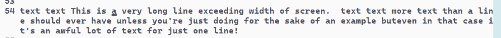

Very long lines that can’t be entirely displayed on the screen are displayed with the single character `@` in the first position, until the cursor and file are positioned in such a way that the line can be displayed completely. The line in 图 13-9 appears as shown in 图 13-10 when it is near the bottom of the screen.


Finally, Vim lets you make space characters visible. Sometimes for a quick visual check we define the period as the representation of a space, and we later remove it. To make space characters visible, add the period to `listchars` like so:

```
:set list
:set listchars+=space:.
```

To remove it:

```
:set list
:set listchars-=space:.
```

# Vim 命令和选项的缩写

There are so many commands and options in Vim that we recommend learning them by name first. Almost all commands and options (at least any that have more than a few characters) have some associated short form. These can save time, but *务必* you know what you’re abbreviating! We have had some embarrassing and unexpected results using short forms thought to be one thing that turned out to be something quite different.

As you become more experienced and develop your favorite subset of Vim commands and options, using some of the abbreviated forms for commands and options saves time. Vim typically tries for Unix-like abbreviations for options and allows for the shortest unique initial substring for command abbreviations.

Some abbreviations for common commands include:

| `n` || `next` |

| --- | --- |

| `prev` || `previous` |

| `q` || `quit` |

| `se` || `set` |

| `w` || `write` |

Some abbreviations for common options include:

| `ai` || `autoindent` |

| --- | --- |

| `bg` || `background` |

| `ff` || `fileformat` |

| `ft` || `filetype` |

| `ic` || `ignorecase` |

| `li` || `list` |

| `nu` || `number` |

| `sc` || `showcmd` (*不是* `showcase`—there is no such option) |

| `sm` || `showmatch` |

| `sw` || `shiftwidth` |

| `wm` || `wrapmargin` |

Short forms for commands and options save time when you know your commands and options well. But for scripting and setting up sessions with commands in your `*.vimrc` or `*.gvimrc` files, you’re more likely to save time in the long run by sticking with full command and option names. Your configuration file and scripts are easier to read and debug when you use full names.

### 注意

Note that this is not the approach taken with the suite of Vim script files (`syntax`, `autoindent`, `colorscheme`, etc.) in the Vim distribution, though we take no issue with their approach. We just recommend, for ease of managing your own scripts, that you stay with full names.

# 一些小技巧（不一定特定于 Vim）

We now offer several techniques—some of which are offered by basic `vi` as well as Vim—that are worth remembering and having handy:

### 快速交换

A common typing error is to enter two characters in the wrong order. Position the cursor over the first wayward character and type `xp` (delete character, put character). (This was mentioned earlier, in the section “交换两个字母”.)

### 另一个快速交换

Got two lines you’d rather swap? Position the cursor on the top line, and type `ddp` (delete line, put line after current line).

### 快速帮助

Don’t forget about Vim’s built-in help. A quick tap on the `F1` function key splits your screen and displays the introduction to the online help. (This is true of `gvim`. If you’re in a terminal emulator, that program may preempt `F1` for itself.)

### 我用的是什么好命令？

In its simplest form, Vim lets you access recently executed commands by using the arrow keys in the command line. Moving up and down with the arrow keys, Vim displays recent commands, any one of which you may edit. Whether or not you edit a command from Vim’s history, you can execute the command by pressing the `ENTER` key.

You can get even more sophisticated by invoking Vim’s built-in command history editing. Do this by entering `CTRL-F` on the command line. A small “command” window opens up (with the default height of 7) in which you can navigate with normal Vim motion commands. You can search as if in a normal Vim buffer and make changes.

In the command editing window, you can easily find a recent command, modify it if necessary, and execute it by pressing `ENTER`. You can write the buffer to a filename of your choice to record the command history for future reference.

### 提示

For a more detailed exercise using the command-line history window as a tool, see the section “介绍历史窗口”.

### 一点幽默

Try entering the command:

```
:help "the weary"
```

and read Vim’s reply.

# 更多资源

Helpful online resources include HTML renditions of Vim’s built-in help for the two most recent major Vim releases, [Vim 7](http://vimdoc.sourceforge.net/htmldoc/version7.html) and [Vim 8](https://vimhelp.org).^(3)


此外，[`https://vimhelp.org/vim_faq.txt.html`](https://vimhelp.org/vim_faq.txt.html) 是一个 Vim 常见问题列表。它不会将问题链接到答案，但所有内容都在同一页面上。我们建议向下滚动到包含答案的部分并从那里扫描。

官方 Vim 页面曾托管 Vim 技巧，但由于垃圾邮件发送者的问题，管理员将技巧移至 [wiki](http://vim.wikia.com/wiki/Category:Integration)，在那里垃圾邮件更容易管理。

^(1) 还有第三种方法 `best`，Vim 建议它最适合英文文本，但最快仍然是 `fast`。

^(2) 我们已验证并成功设置了 `scp:` 远程访问，可在无需输入密码的情况下编辑远程文件。设置 `scp:`（以及其他协议）超出了我们的范围，但我们认为它对于便捷且透明的远程编辑是值得的。

^(3) 感谢 Carlo Teubner，他维护着当前的 Vim HTML 文档，并向他致敬。

## 第 14 章. 一些 Vim 高级技巧

本章展示了我们在学习和使用 Vim 的多年（太多？）岁月中获得的一些经验教训。调整一些默认值并重新映射默认命令，能让数小时的日常 Vim 使用变得更加愉快。我们希望这些想法和技巧能促使你产生新想法，并创造出自己的高级技巧。

## 若干便捷映射

Vim 中的命令模式拥有足够多的操作和命令，以至于几乎没有键可以在不改变默认行为的情况下自由使用。幸运的是，Vim 大多做得正确，虽然你可能一开始并不完全同意它的选择，但你几乎总是能迅速为自己喜欢使用的命令形成肌肉记忆。

我们通过替换那些不合逻辑、冗余且由多个键提供服务，或更适合简单映射到更有用功能上的映射，选择了一些便捷的替代方案。

### 简化退出 Vim

早在 “保存和退出文件” 一节中，我们介绍了退出 `vi` 和 Vim 的几种选项。正如 图 5-1 所展示的那样，并非每个人第一次就能掌握。事实上，“如何退出 Vim 编辑器？” 是 [Stack Overflow 上最受欢迎的问题之一](https://stackoverflow.blog/2017/05/23/stack-overflow-helping-one-million-developers-exit-vim)，已被超过一百万用户提问！

我们可以利用这些简单的键重新映射，将退出 Vim 所需的三个或四个击键轻松减少到仅一个：

```
:nmap q :q<cr>
:nmap Q :q!<cr>
```

`:nmap` 是标准 `ex` `:map` 命令的一个变体。Vim 还有多个此类变体。我们不会详细介绍；请参阅 `:help :map-modes`。

这两个映射让你只需一个击键即可退出 Vim，分别是正常退出（Q）或强制退出（SHIFT-Q）！

### 调整窗口大小

我们喜欢能够按需轻松调整窗口大小。GUI Vim 实现通过让你抓取并拖动窗口之间的状态行来使此操作变得简单，尽管作为纯粹主义者，我们更喜欢避免从键盘切换到鼠标。因此我们找到了两个相邻的键 `_`（下划线，即 SHIFT 加减号）和 `+`，它们不仅与其它更易访问的键冗余^(1)，而且幸运的是，分别在记忆上对应“变小”和“变大”。^(2)

具体来说，我们将 `_` 映射为减小当前聚焦窗口大小，并将 `+` 作为其补充映射为增大当前聚焦窗口大小。你可以通过输入以下行（作为 `ex` 命令）来查看行为，或将它们添加到你的 `.vimrc` 文件中：

```
map _ :resize -1<CR>
map + :resize +1<CR>
```

现在在任何窗口中，你都可以用 `_` 或 `+` 分别减小或增大窗口。这很有用！并且在我们稍后讨论 Vim 的命令历史窗口时也会派上用场。

### 双倍乐趣

我们中的一位还有两个更喜欢的重新映射，他认为这些更符合 Vim 的整体哲学。那就是，在 `vi` 命令模式中，当一个命令字符被重复时，通常是默认或直观行为的快捷方式。例如，`dw` 删除一个词，而重复的 `d`（`dd`）删除当前行。类似地，`yy` 复制当前行。

我们将这一哲学应用于两个映射，使 Vim 功能能够通过更直观的击键快速访问。这些配置激活了 Vim 强大的命令和搜索历史，两者在激活时都会出现在一个新的水平分割窗口中。

#### 介绍历史窗口

Vim 有一个看似鲜为人知的功能，我们认为它是其最强大的功能之一：命令行窗口。Vim 存储了你的 `ex` 命令历史和搜索模式历史。这些存储的命令和模式在 Vim 的命令行窗口中访问，该窗口由在屏幕底部打开的一个新的、较短的窗口组成。此窗口用于两种历史。命令和搜索模式分别存储、访问和操作。

你可以通过两种方式（各两种）进入命令行或搜索模式窗口。Vim 默认行为使用 `CTRL-F` 或 `q:`（一个 `vi` 命令模式命令）来打开命令行窗口。有关更详细的信息，请使用 Vim 的帮助阅读关于命令行窗口的内容：

```
:help c_CTRL-F
```

与任何 Vim 窗口一样，使用常规 `:q` 命令关闭它。

我们稍后会谈到在这个窗口中可以做的一些很酷的事情。但首先，让我们使其更易于打开且更直观。（`CTRL-F` 和 `q:` 很容易，但真的直观吗？）

那么让我们通过映射来访问命令行窗口。

#### 两个冒号胜过一个

遵循“重复-*某物* 做 *某物*-增强且 hopefully 直观”的原则，我们决定将冒号重复是一个不错的选择，冒号本身就启动 `ex` 命令。双冒号 `::` 通过打开命令行窗口来“增强 `ex`”是合乎逻辑的。

请记住，我们正在定义一个映射并假设它在命令模式下被调用。此外，重要的是，由于我们将 `::` 映射到包含 `q` 的序列，让我们通过要求它不被重新映射来使其更安全。这需要 `:noremap` 命令。

与 `:map` 命令一样，Vim 也有多个 `:noremap` 命令的变体。这里也不详细说明（请参阅 `:help :map-modes`），要正确映射 `::`，我们希望使用 `:nnoremap` 命令。命令如下：

```
:nnoremap :: q:
```

现在让我们试试。交互式输入此命令，或将其添加到你的 `.vimrc` 文件中。然后在命令模式下，快速输入两个冒号。你现在应该会看到命令行窗口，光标位于最后一行。从 `vi` 命令模式访问时，这将 *始终* 是一个空白行。

为什么？存在两种不同的行为。如果你正在输入 `ex` 命令中间并输入 `CTRL-F`，Vim 会以 `vi` 命令模式打开命令行历史窗口，光标位于最后一行的末尾，显示你正在输入的部分命令。

当从 `vi` 命令模式进入命令行窗口时，没有正在进行的 `ex` 命令，因此光标位于空白行。

#### 两个斜杠胜过一个

我们同样认为使用双斜杠（`//`）快速激活命令行搜索历史窗口是直观的。


The default ways to activate the search history window are `q/` and `q?`. Analogous to the previous section’s `::` to activate the command-line window for command history, the same approach makes logical sense for visiting Vim’s search-pattern history. Just as `/` initiates a search from command mode, we chose `//` as the intuitive mapping for the search history window. Since `?` activates a backward search, we also provide a mapping for `??`.

As with `::`, which we assumed is invoked in `vi` command mode, we use the `:nnoremap` command. The commands are:

```
:nnoremap // q/
:nnoremap ?? q?
```

Now let’s try it out. In command mode, quickly type two slashes. You should now see the pattern history window with the cursor placed on the last line, which is the last-used search pattern.

Note that Vim inserts a single character in the leftmost column of the command-line window indicating which mode the window is in, using `:` for command-line history, and `/` or `?` for search-pattern history.

#### Caution

You are in a window of commands (or search patterns). This window is special; there are some `ex` commands that you cannot use. In particular, the commands `:e`, `:grep`, `:help`, and `:sort` are unavailable. Nor can you use the commands that move you to another window, leaving this window open, such as `CTRL-W CTRL-W`. While these restrictions do not diminish the power of the command-line window, they do emphasize that the window is a special-purpose one.

Some points to be aware of:
* You can navigate this buffer like any other Vim buffer. Don’t be shy! Play around with your favorite Vim commands:
  * `:w filename`
    To save the buffer to a file.
  * `:r filename`
    To read a file into the command-line buffer.
* You can write/save the contents of the command-line buffer much like any other buffer.
* Going the other way, you can read files into the command-line buffer.

These final two points are important, as they give you the flexibility to save command-line history you may find useful for later. You can then “load up” a file containing commands into a session and selectively find and execute your very best commands.

# Moving into the Fast Lane

Now that we’ve tamed the command-line window, let’s do some other interesting things.

## Finding a Hard-to-Remember Command

We’ll start by discussing different ways to find that *one* command you need to execute.

### Directly searching for the command

You know you used a Vim command to save a lot of time, but you don’t remember what it was, nor do you even remember if it was very recent. You *do* remember that it was related to converting some *TEST* descriptions to *PROD*. So you type `::`, and you’re ready to find that command. There are various approaches, all leveraging Vim to find Vim commands.

For example, probably the easiest, most direct approach is to simply search backward in the command-line command history buffer. You know you used something with *TEST* and then *PROD* in the same command. Simply search up through the commands with the search:

```
?.*TEST..*PROD
```

and Vim positions the cursor on the first found line matching that regular expression. Now you can simply re-execute that command by hitting `ENTER`. Vim closes the command-line window and executes the command automatically.

If the first match *isn’t* what you’re seeking, the `vi` command `n` moves you to the next match. Use `n` as many times as necessary until you find your desired command.

#### Note

When searching back through commands in the command-line window, Vim honors your `wrapscan` setting.^(3) If you’ve set `nowrapscan` and there is no occurrence of your pattern between the current line position and the top of buffer (or the bottom, depending on the direction of the search), Vim displays “search hit top…” (or bottom) without finding the pattern.

### Filtering the buffer

You may not like searching as described in the previous section for various reasons; there are many similar commands, the commands are scattered, and so on.

You can filter/alter the command-line window buffer the same way you filter text in regular Vim windows. Continuing with the previous example, assume that you’re interested in finding versions of commands with *TEST* and then *PROD* somewhere in the commands.

Rather than simply searching up through the buffer, declutter the buffer by inverting a global search (`:vg`) to delete lines *not* matching your target:

```
:vg/.*TEST..*PROD/d
```

Now you have *only* lines matching your target. Choose your match and execute.

Lines deleted in this way stay deleted (inaccessible) until the end of your editing session. But the next time you open the file in Vim, all the saved command lines will be there.

### Massaging the filter results

Since Vim provides editing in the command-line window itself, it’s a natural next step to consider more than simply finding commands and re-executing them. Often the task at hand is similar but not identical to tasks completed earlier whose commands are in the history buffer. However, the task is similar *enough* to use commands from the history buffer with slight modifications.

Continuing again with the previous example, consider that we want to do the same Vim commands but instead of transforming *TEST* to *PROD*, we want to transform *PROD* to *QA*.

As before, start by finding and perhaps filtering candidate commands from the history buffer. Now change *PROD* to *QA*, and change *TEST* to *PROD* (assuming it’s that simple a translation). Hit `ENTER` on the edited history line to execute it, and you’re done!

## Analyzing a Famous Speech

One of us found the back-and-forth concerning a particular political speech fascinating. There was much said and argued about the speech and what it said and meant. So he had an idea. Why not edit the speech transcript with Vim and filter the transcript by word frequency?

#### Note

This use case references a very famous and politically charged speech. It is not our intent to make inferences or imply ideology. It is simply an example of how one of us quickly used Vim as a tool to analyze information not normally thought of as the kind of editing one would expect to use Vim for.

To make life easy, the speech is included in the book’s [GitHub repository](https://www.github.com/learning-vi/vi-files) (see the section “Accessing the Files”) in the file `book_examples/famous-speech.txt`.

With the speech in hand, your author invoked `awk` to begin incrementally developing a command, iterating until he achieved the desired end result. Remember that you can replace a range of lines in a buffer with the output of a command performed on that range. In this case, in `vi` command mode he typed:

```
:%!awk 'END { print NR }'
```

knowing that it would simply replace the buffer with the line count of the buffer. This is *not* what he wanted, but it made a good starting point.

Now that the “seed” of a command was in Vim’s command history, it was easy to start improving. In the course of less than ten minutes he iterated in Vim’s command-line history window as follows (line numbers added for annotation, long lines wrapped to stay on the page):


```
 1 1,$!awk '{ while (i = 1; i <= NF; i++) word[$i]++ } END { print word }'
 2 1,$!/usr/bin/awk '{ while (i = 1; i<= NF; i++) word[$i]++ }
            END { print word }'
 3 1,$!/usr/bin/awk '{ for (i = 1; i<= NF; i++) word[$i]++ }
            END { print word }'
 4 1,$!/usr/bin/awk '{ for (i = 1; i<= NF; i++) word[$i]++ }
                          END { for (words in word) print word[words], words }'
 5 1,$!/usr/bin/awk '{ for (i = 1; i<= NF; i++) word[$i]++ }
                          END { for (words in word) print word[words], words }'
 6 1,$!/usr/bin/awk '{ for (i = 1; i<= NF; i++) word[$i]++ }
            END { for (words in word) print word[words], words }' | sort
 7 1,$!/usr/bin/awk '{ for (i = 1; i<= NF; i++) word[$i]++ }
            END { for (words in word) print word[words], words }' | sort
 8 wq
 9 1,$!/usr/bin/awk '{ for (i = 1; i<= NF; i++) word[$i]++ }
            END { for (words in word) print word[words], words }' | sort -n
10 g/fight
11 1,$!/usr/bin/awk 'BEGIN { FS= "[,. ]+" } { for (i = 1; i<= NF; i++) word[$i]++ }
            END { for (words in word) print word[words], words }' | sort -n
12 g//
13 g/law
```

### 提示

你可能会注意到前述列表中 `awk` 的不同调用方式。这是由作者频繁在不同计算机和操作系统之间切换造成的产物。我们保留了这些变体可见，并期望你使用在你的环境中可用的那个。

### 注意

*非常重要的* 是要理解，前述列表中累积的增量命令是迭代一个命令的结果。迭代完成后，结果就是命令行历史窗口中的这些命令。

例如，在更改第 1 行（换行）后：

```
1,$!awk '{ while (i = 1; i <= NF; i++) word[$i]++ }
         END { print word }'
```

改为（换行）：

```
1,$!/usr/bin/awk '{ while (i = 1; i<= NF; i++) word[$i]++ }
                  END { print word }'
```

下次访问命令行命令历史窗口时，这些将是该窗口中最后两个非空白行。

第 2 行修正了第 1 行以指向 `awk` 的正确位置。执行时（因为范围指定为 `1,$`），`Vim` 用以下内容替换了整个缓冲区：

```
awk: cmd. line:1: { while (i = 1; i <= NF; i++) word[$i]++ } END { print word }
awk: cmd. line:1:               ^ syntax error
awk: cmd. line:1: { while (i = 1; i <= NF; i++) word[$i]++ } END { print word }
awk: cmd. line:1:                             ^ syntax error
```

这很糟糕。幸运的是，输入 `u` 会将缓冲区重置为原始演讲稿。^(4)

请记住，输入 `::` 可编辑上一个命令以匹配上面的下一个示例命令。第 3 行修复了一个语法错误。第 4 行又修复了另一个。这有点尴尬。

最后，下一个行（第 5 行，为适应页面而换行）：

```
1,$!/usr/bin/awk '{ for (i = 1; i<= NF; i++) word[$i]++ }
                  END { for (words in word) print word[words], words }'
```

得到了真实的结果！缓冲区中的前几行现在看起来像这样：

```
3 weeks.
4 State
1 you’ve
1 written
25 you’re
1 telephone
1 Congress
1 ever,
5 biggest
38 are
```

我们现在可以看到演讲中每个词都有一行，前面有一个计数表示出现次数。这很酷，但有点杂乱。所以让我们对结果进行排序（第 6 行，换行）：

```
1,$!/usr/bin/awk '{ for (i = 1; i<= NF; i++) word[$i]++ }
                  END { for (words in word) print word[words], words }' | sort
```

这好一点，但数值排序更好…为此，将 `-n` 选项（数值排序）添加到 `sort`（我们现在在第 9 行，换行）：

```
1,$!/usr/bin/awk '{ for (i = 1; i<= NF; i++) word[$i]++ }
              END { for (words in word) print word[words], words }' | sort -n
```

这是一个好得多的结果。缓冲区中的最后几行现在看起来像这样：

```
115 that
125 they
134 you
146 in
167 I
203 a
227 and
265 of
326 to
394 the
```

常见词 *the* 是出现频率最高的，这并不奇怪。

让我们做最后一次迭代。如果你注意到我们刚才查看的倒数第二次迭代中，一些词仍然带有附加的标点符号。这会导致像 “car”、“car,” 和 “car.” 这样的词的计数产生误导，它们很可能应该被视为同一个词。因此，对于最后一次更改，让我们在 `awk` 的 `BEGIN` 规则中将字段分隔符定义为正则表达式（第 11 行，再次换行）：

```
1,$!/usr/bin/awk 'BEGIN { FS= "[,. ]+" } { for (i = 1; i<= NF; i++) word[$i]++ }
              END { for (words in word) print word[words], words }' | sort -n
```

注意计数的差异，这表明我们可能更接近真实结果：

```
144 that
153 in
155 you
168 I
203 a
210
227 and
266 of
328 to
394 the
```

### 注意

请记住在每次迭代后执行撤销（`u`），以便将原始文本传递给下一个命令。

我们的示例依赖于 `awk` 作为当日的过滤器，但在 Unix 和 GNU/Linux 的精神下，有 *许多* 强大的命令，应用于 `Vim` 缓冲区时也能产生同样有用的结果。我们俩都 *偏爱* `awk`，但我们经常使用，按偏好顺序排列，`sed`、`grep`、`wc`、`head`、`tail`、`sort` 等等。还值得注意的是，管道只需工作即可增强处理 `Vim` 缓冲区的强大功能。

虽然这可能看起来像一个有点人为的例子，但作者在讨论该演讲时做了这个练习，结果被用来解决“争论”。从初始 `awk` 命令迭代到最终的精炼命令所花费的时间只有几分钟。这些结果成为关于演讲中 *有什么* 的激烈讨论的试金石。我们对此不发表意见，但强调这 *是* 在社交环境中富有成效且有用的练习。是的，`Vim` 可能不是社交聚会中的常见参与者，但也许可以。☺

## 更多用例

如前所述，演讲示例可能看起来很人为，但它是我们在不求助于外部工具的情况下处理文件以提取有用信息的方法之一。其他示例包括：

导出文件

: 

我们中的一人通过几个应用程序跟踪他的锻炼。他最喜欢的是 [Garmin™](https://www.garmin.com/en-US)。Garmin 导出文件是 CSV 文本文件（请参阅 图 14-1 作为示例）。请考虑如何以类似我们示例的方式提取信息。

系统日志文件

: 

我们已使用相同的技术来提取、处理和格式化 Unix 系统日志文件（例如 `/var/log/messages`）。虽然有许多实时和补充工具 *确实* 监控和分析这些文件（如 [Splunk](https://www.splunk.com)），有时只需直接进入并从 `Vim` 的命令行历史窗口快速应用自定义命令就足够了。

厂商日志文件

: 

过滤这些与过滤系统日志文件类似。

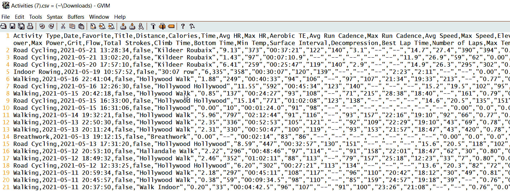

### 提示

我们之前提到过，将 `Vim` 保存的命令历史数量设置为一个大数字是有用的，我们想在这里再次提及。这由 `viminfo` 选项设置，应在你的 `*.vimrc` 配置文件中定义：

```
" example
set viminfo='50,:1000
```


有趣的是，当你在命令行历史缓冲区中编辑一条命令时，如果编辑上下文可以提供补全，TAB 键会弹出一个补全菜单，反复按 TAB 会在列表中循环。你也可以使用方向键。按 ENTER 选择期望的匹配项。请注意，这会立即触发修改后命令的执行。图 14-2 显示了选项部分匹配的补全。图 14-3 展示了文件名补全的示例。（命令行补全在“内置帮助”一节中进行了讨论。）

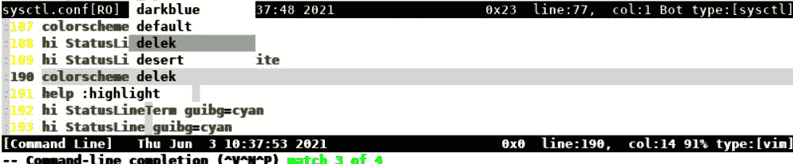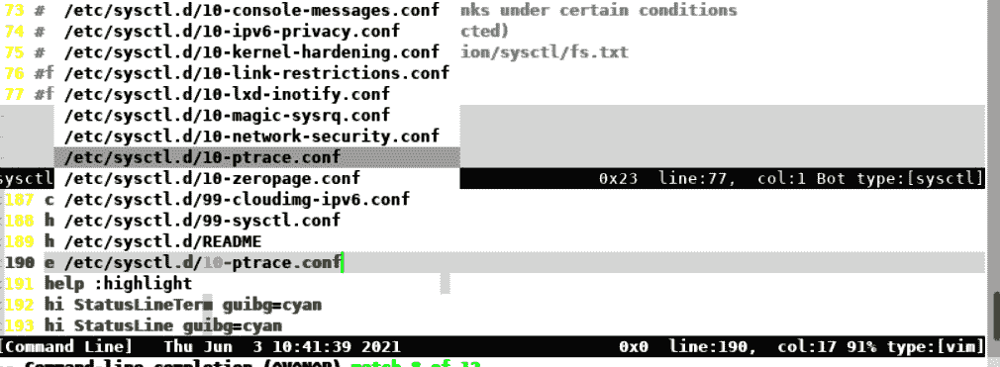

另外，为了确保你已保存了开发的重要命令，并且它们不会超出保存命令的限制，你可能会发现将这些命令整理并存储在文本文件中很有用。这些文件随后可以“加载”到你的命令行历史窗口中。

# 达到速度极限

我们已对命令行历史做了类似处理，现在让我们考虑一些使搜索模式历史更有用的方法。我们使用模式搜索历史窗口来编辑、迭代和改进搜索。并且一旦调优，搜索就可以轻松检索。

请回顾我们为了更直观地打开模式搜索窗口而设置的键映射：

```
:nnoremap // q/
:nnoremap ?? q?
```

Vim 的搜索模式窗口实际上与命令行历史窗口是同一个缓冲区；一次只能有一个处于活动状态。唯一的区别是加载到窗口中的内容以及在缓冲区中按 ENTER 时采取的操作（执行一个 `ex` 命令 vs 搜索模式）。因此，如前所述的相同功能都存在。你可以搜索之前搜索过的任何模式。是的，我们是在搜索搜索，这有点元。如果你的搜索模式历史足够大，很可能包含之前使用过的有效搜索。

在此窗口中，你使用正常的 Vim 编辑功能来导航、修改并执行来自过去搜索的搜索。

正如我们之前使用命令行历史窗口通过迭代命令逐步构建有用的过滤器一样，我们也可以使用相同技术，通过逐步构建搜索模式来完善搜索。

Vim 使用正则表达式进行搜索，这可能相当复杂。考虑这样一个例子：文件可能包含生产可执行文件的名称，这些名称按惯例命名以标识其角色。例如，生产可执行文件可能按惯例命名，其中用点分隔的字段描述该可执行文件的属性（例如，`production.accounting.receivables.east.rollup`）。要求是第一个字段必须是 `production`、`test` 或 `devel` 之一，并且整个名称包含五个字段。

我们不会像在开发之前的命令那样详细（见“进入快车道”一节），但从查找包含 `production` 的行开始已经足够简单：

```
/production/
```

这将找到行中任何位置包含 `production` 的所有行。快速按 `//` 会带我们进入搜索模式历史窗口，然后快速编辑插入必需的分隔符“`.`”即可缩小搜索范围（请注意，我们已删除斜杠，因为它们在搜索模式历史窗口中*不会*出现）：

```
production\.
```

最终，可行的结果可能看起来像：

```
\(production\|test\|devel\)\(\.[[:alnum:]_]*\)\{3}\.[[:alnum:]_]\{1,}
```

我们曾使用过类似的模式，并在 `.vimrc` 文件中创建了一个 `match` 命令，以便在编辑文件时自动高亮可执行文件的名称，补充正常的语法高亮。

### 注意

我们把最终正则表达式的解码留给你。重点不在于正则表达式及其工作原理，而在于实现手段：如何使用 Vim 的搜索模式历史窗口开发强大的正则表达式。

正如命令行历史示例中一样，你可以整理并保存喜欢的正则表达式，以便稍后加载到搜索模式窗口缓冲区中。

# 增强状态行

Vim 出于某种原因，提供了一个缺乏太多有用信息的状态行（见图 14-4）。

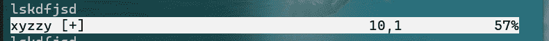

在不深入细节且仅提供最少解释的情况下（完整内容请参阅 `:help statusline`），以下 `.vimrc` 行提供了有关当前文件的增强信息：

```
set statusline=%<%t%h%m%r\ \ %a\ %{strftime(\"%c\")}%=0x%B\ \ line:%l,\ \ col:%c%V\ %P\ %v
```

请参阅图 14-5，了解使用这些设置的状态行示例。


此示例来自的 Elbert 的 `.vimrc` 文件可在本书的[GitHub 仓库](https://www.github.com/learning-vi/vi-files)中获得；请参阅“访问文件”一节。

以下是示例中使用的内置标志的简要说明。所有标志都以 `%` 字符开头：

`%a`

: 
参数列表状态。例如，如果 Vim 正在编辑八个文件中的第四个文件，状态行将显示 `(4 of 8)`。

`%B`

: 
光标下字符的十六进制表示。

`%c`

: 
当前列号。

`%h`

: 
缓冲区“help”标志（本例中不显示，因为我们没有编辑帮助文件）。

`%l`

: 
当前行号。

`%m`

: 
修改标志（如果缓冲区已修改则为 `[+]`；否则不存在）。

`%P`

: 
缓冲区中当前位置的百分比。

`%r`

: 
只读标志（如果缓冲区为只读则为 `[RO]`；否则不存在）。

`%{strftime…}`

: 
在花括号内运行命令的结果（本例中为 `strftime`）。传递 `%c` 会请求标准日期和时间。

`%t`

: 
当前文件名（文件名的最后一部分，等同于 `basename(1)` 的输出）。

`%v`

: 
正在编辑的文件类型。这不仅仅是检查文件名的扩展名。Vim 根据文件内容检测文件类型。虽然我们无法证明，但似乎 Vim 使用的机制与 `file` 命令相似或相同。（如感兴趣，请参阅 `file(1)` 手册页。）

`%V`

: 
当前虚拟列号。

`%=`

: 
围绕此锚点居中信息（之前的内容左对齐；之后的内容右对齐）。

`%<`

: 
如果状态行过长，则在此处截断。

# 总结

我们希望本章介绍的材料能激发你进一步探索 Vim 功能的兴趣。你会发现 Vim 总有更多东西可学。做到这一点将使你的工作更轻松、更高效。

^(1) 减号键本质上与 `k` 重复，稍有不同的是它将光标定位到第一个非空白字符，而 `+` 字符完全与 ENTER 重复，实际上可以重新映射而不会丢失任何功能。

^(2) 是的，严格来说，Shift 键代表 *下划线* 和 *加号*，但记忆点在于键的并置，一个带有 *减号* 的键与另一个带有 *加号* 的键相邻。（仅此而已。）

^(3) 这也适用于搜索模式在命令行窗口中的行为。


^(4) 使用 `u` 使在缓冲区中迭代不同的操作变得很容易。一旦你对它形成肌肉记忆，就会变得非常自然。
