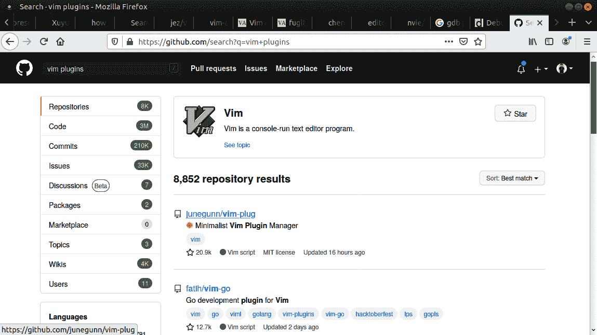
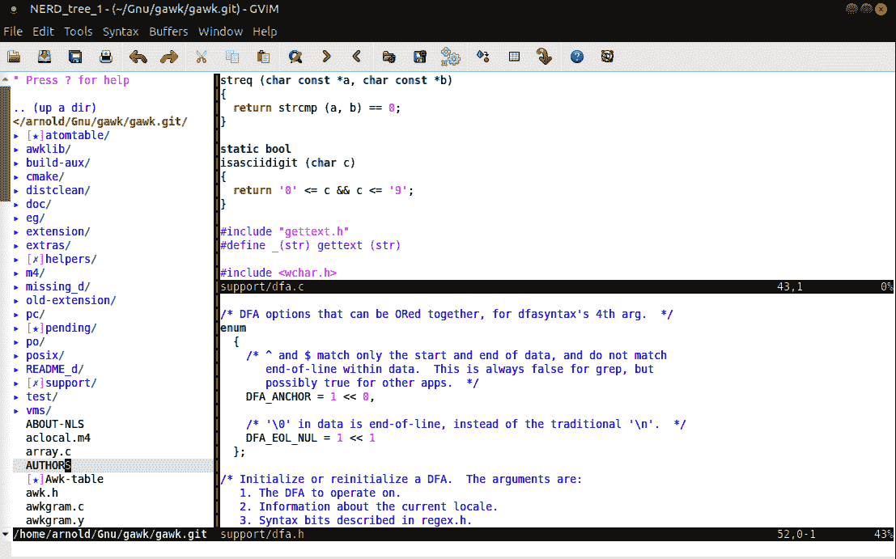
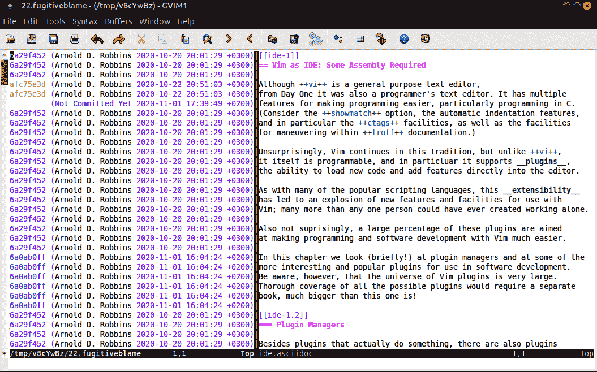
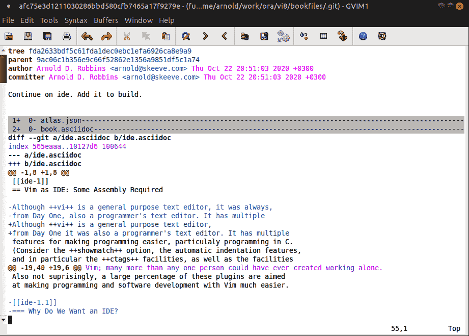
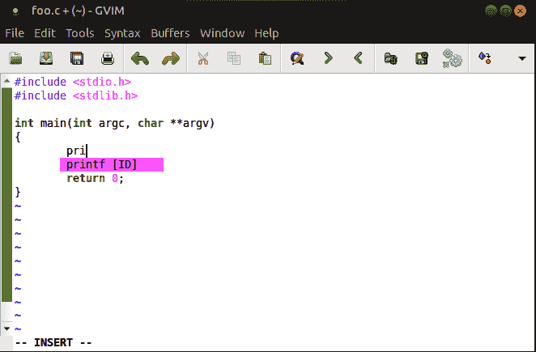
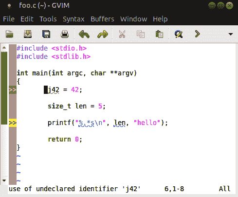
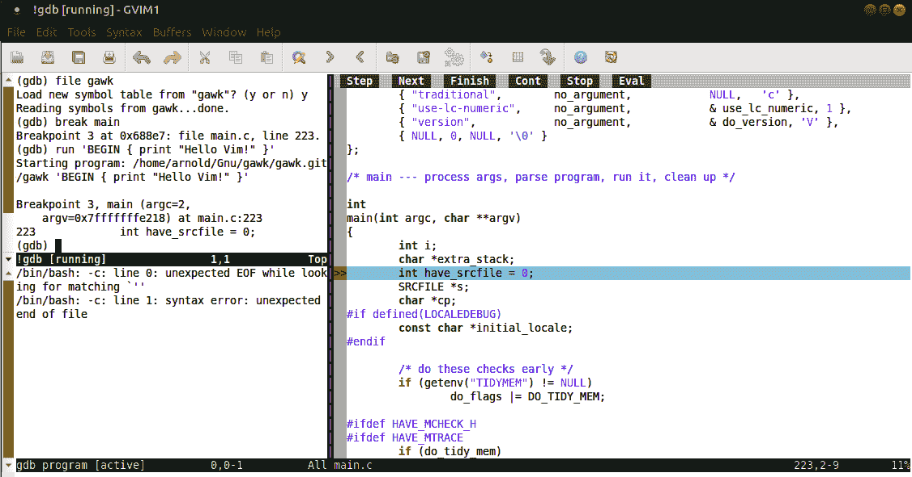

## 第 15 章. Vim 作为 IDE：需要自行组装
虽然 `vi` 是一款通用文本编辑器，从第一天起它也是程序员的文本编辑器。它具有多项使编程更轻松的功能，特别是 C 语言编程。（可考虑 `showmatch` 选项、自动缩进功能，尤其是 `ctags` 设施，以及在 `troff` 文档中移动的设施。）
不出所料，Vim 延续了这一传统，但与 `vi` 不同的是，它本身是可编程的，特别是它支持 *插件*，能够加载新代码并直接向编辑器添加功能。
与许多流行的脚本语言一样，这种 *可扩展性* 导致了可用于 Vim 的新功能和设施的爆炸式增长——远超任何一个人独自工作所能创造的。
同样不出所料，这些插件中很大一部分旨在使使用 Vim 进行编程和软件开发变得更加容易。
在本章中，我们将（简要地！）介绍插件管理器以及用于软件开发的一些更有趣、更受欢迎的插件。
然而，请注意，Vim 插件的宇宙非常庞大。对所有可能的插件进行全面覆盖需要一本单独的书——一本比这本大得多的书！因此，我们在此的处理比本书其他章节要少得多“手把手”的指导；请在阅读时牢记这一点。

### 插件管理器
除了真正执行功能的插件外，还有管理其他插件的插件。它们的工作是加载和初始化插件，并使你无需手动下载它们或向 `.vimrc` 文件添加大量插件特定代码即可轻松安装和使用插件。
Vim 拥有自己的插件管理器，可通过 `:packadd`（“package add”）命令访问。你可以使用此命令配合 Vim 自带的插件，或任何符合 `:help packadd` 中给出标准的其他插件（我们这里不深入）。我们稍后会展示其中一个标准插件，并鼓励你查看 Vim 附带的其它插件。
最受欢迎的插件管理器之一称为 [Vundle](https://github.com/VundleVim/Vundle.vim)（“Vim bundle”的缩写）。网站上有“快速开始”说明，我们在此尝试总结，假设为 GNU/Linux 或其他 POSIX 风格系统：
1. 确保你的系统已安装 `Git` 和 `curl`。
2. 将你的 `.vimrc` 文件和 `.vim` 目录的副本保存到安全位置，以防万一。
3. 直接将 Vundle 克隆到其位置：
```
git clone https://github.com/VundleVim/Vundle.vim.git ~/.vim/bundle/Vundle.vim
```
4. 配置你的插件。这就是你的 `.vimrc` 应该看起来像的样子（或者你可以从 Vundle 主页复制/粘贴）；我们省略了一些注释以保持简短：
```
set nocompatible              " be iMproved, required
filetype off                  " required

" set the runtime path to include Vundle and initialize
set rtp+=~/.vim/bundle/Vundle.vim
call vundle#begin()
" alternatively, pass a path where Vundle should install plugins
"call vundle#begin('~/some/path/here')

" let Vundle manage Vundle, required
Plugin 'VundleVim/Vundle.vim'

" The following are examples of different formats supported.
" Keep Plugin commands between vundle#begin/end.
" plugin on GitHub repo
Plugin 'tpope/vim-fugitive'
...

" All of your Plugins must be added before the following line
call vundle#end()            " required
filetype plugin indent on    " required
" To ignore plugin indent changes, instead use:
"filetype plugin on
"
...
"
" see :h vundle for more details or wiki for FAQ
" Put your non-Plugin stuff after this line
```
5. 选择并挑选你的插件，并将它们放在 `vundle#begin()` 和 `vundle#end()` 的调用之间。（这是困难的部分。☺）
6. 安装你在 `.vimrc` 文件中列出的插件。你可以使用 `:PluginInstall` Vim 命令或从命令行执行此操作：
```
vim +PluginInstall +qall
```
这将启动 Vim，安装插件，然后退出。每次在 `.vimrc` 文件中添加新插件时运行 `:PluginInstall`；Vundle 然后会为你处理插件的下载和安装。

### 找到合适的插件
有数千个 Vim 插件。其中许多（也许甚至大多数）托管在 GitHub 上，但并非全部。找到适合你需求的插件可能是一项艰巨的任务。（参见 图 15-1。）

幸运的是，你不是第一个注意到这一点的人。[Vim Awesome](https://vimawesome.com) 的人们在互联网上搜集插件并将有关它们的信息集中在一个地方方面做了令人惊叹的工作。参见 图 15-2。

不仅可以在 [Vim Awesome](https://vimawesome.com) 搜索插件信息，而且还可以设置自己的私有数据库副本。执行此操作的源代码和说明位于 [*https://github.com/vim-awesome/vim-awesome*](https://github.com/vim-awesome/vim-awesome)。

### 为什么我们想要一个 IDE？
集成开发环境（IDE）正如其名——一个提供软件开发所需一切的单一环境。存在许多此类环境，既有商业的也有开源的。如果你是一名软件开发者，很可能你至少熟悉其中一个。
IDE 通常至少提供以下功能：
* 文本编辑（当然）。
* 查看和浏览软件项目的目录树。
* 源对象之间的导航（例如，从函数调用跳转到函数的定义）。
* 与一个或多个源代码控制系统的集成。就我们的目的而言，我们需要与 `Git` 的集成。
* 输入时的文本补全。例如，当你输入函数名时，IDE 会显示期望的参数。
* 语义错误高亮。如果你的程序中有语义错误（例如未声明的变量），IDE 会突出显示该错误，通常通过在其下方绘制彩色波浪线。
* 集成调试。IDE 在调试器在源代码中移动时显示源代码。
鉴于许多程序员花费大量时间在 Vim 中工作，自然希望 Vim 提供类似 IDE 的功能，因为它们能提高生产力。我们很快就会看到 Vim 插件如何提供这些功能，以及如何将 Vim 自定义为适合个人需求的 IDE。

### 自己动手
早期的 Unix 系统值得注意的是它们关注机制而非策略。也就是说，系统为用户提供了执行许多事情的能力，而不强制单一的工作方式。


Vim 以类似的方式体现了其 Unix 血统：你拥有构建几乎任何你想要的东西的设施。当然，这意味着你必须投入时间和精力去学习如何构建你想要的东西！这项投资的回报是一个完全适合你需求的环境。

幸运的是，正如我们之前所见，很可能已经存在一个 Vim 插件来完成你几乎需要的任何事情。你只需要去找它就行了！

在下面的小节中，我们将查看软件开发中最受欢迎的几个插件。稍后，我们将概述几种将 Vim 转变为 IDE 的一体化解决方案。

在你审阅本节时，请记住，这项调查仅触及了表面，还有更多内容等待探索！

## EditorConfig: 一致的文本编辑设置

在我们的研究中，我们遇到了 [EditorConfig](https://editorconfig.org) 项目。该项目的目标是定义不同文本编辑器和 IDE 应如何格式化不同类型文件的规范。例如，对于一种文件，你可能希望所有编辑器都使用四个空格缩进，而对于其他文件，你可能希望它们使用真正的 TAB 字符进行缩进。单个 `*.editorconfig` 文件就能实现这一点。你的编辑器，无论是什么，都读取此文件然后相应地格式化你的工作。

大量 IDE 开箱即支持 `*.editorconfig` 文件。Vim 需要一个插件，可以在 [`https://github.com/editorconfig/editorconfig-vim`](https://github.com/editorconfig/editorconfig-vim) 找到。安装说明已包含在内。另请参阅 [`https://www.vim.org/scripts/script.php?script_id=3934`](https://www.vim.org/scripts/script.php?script_id=3934) 以获取更多信息和说明。

## NERDTree: Vim 内的文件树遍历

[NERDTree 插件](https://github.com/preservim/nerdtree) 是让 Vim 像标准 IDE 一样功能的重要进步。安装后，你可以使用 `:NERDTreeToggle` 命令打开和关闭其窗口。文档建议将其映射到 `CTRL-N` 等键盘序列，如下所示：

```
map <C-n> :NERDTreeToggle<CR>
```

此命令在屏幕左侧打开一个新窗口，显示标准文件树。在 NERDTree 窗口中输入 `?` 可查看可用于展开或收缩目录以及在当前或新窗口中打开文件的命令列表。行为取决于 NERDTree 窗口中当前行是文件还是目录。其中一些命令是：

`?`

: 

切换 NERDTree 帮助的显示。

`i`

: 

使用 `:split` 命令在新窗口中打开文件。

`o`

: 

展开/收缩目录。对于文件，在前一个窗口中打开文件。

`s`

: 

使用 `:vsplit` 命令在新窗口中打开文件。

`t`

: 

在新标签页中打开文件或目录。标签页在 “标签页编辑” 小节中进行了描述。

`T`

: 

静默地在新标签页中打开文件或目录。

还有相当多的其他功能。综合文档提供在文件 `doc/NERDTree.txt` 中。

（什么？没有图？耐心点。见下一节。）

## nerdtree-git-plug-in: 带有 Git 状态指示的 NERDTree

NERDTree 本身就非常有用。然而，如今 *每个人* 都使用源代码控制系统，通常是 Git。许多 IDE 可以在其文件资源管理器中显示文件的源代码控制状态（已修改、未纳入源代码控制、子目录包含未跟踪文件等等）。位于 [`https://github.com/Xuyuanp/nerdtree-git-plugin`](https://github.com/Xuyuanp/nerdtree-git-plugin) 的 `nerdtree-git-plugin` 插件增强了 NERDTree 的这一功能。

图 15-3 显示了两个编辑窗口和左侧带有 `nerdtree-git-plugin` 插件的 NERDTree 窗口。在该窗口中我们看到 `atomtable` 目录未跟踪（未签入 Git），并且 `support` 目录包含一个已修改的文件，`helpers` 目录也是如此。其他图标（此处未显示）指示给定文件的已修改/未跟踪状态。所有这些都使你项目文件的 Git 状态易于辨认。



## Fugitive: 在 Vim 内部运行 Git

使用 Git 管理文件的 Vim 用户在发出 Git 命令时需要在 Vim 窗口和终端窗口之间来回切换。[Fugitive 插件](https://github.com/tpope/vim-fugitive) 允许你在处理 Git 时留在 Vim 中。

需要做的更改非常简单。不要在终端模拟器中运行 `git` 命令，而是使用 `:Git`（甚至只是 `:G`）并照常继续（`:Git add`、`:Git status`、`:Git commit` 等）。Fugitive 在必要时将 Git 的任何输出放入新的临时缓冲区中。提交文件时，你在当前 Vim 实例中编辑提交消息。

引用其网页，Fugitive 做的不仅仅是为你运行 `git` 命令：

> *   默认行为是直接回显命令的输出。像 `:Git add` 这样安静的命令避免了令人厌恶的“按 ENTER 或输入命令继续”提示。

> *   `:Git commit`、`:Git rebase -i` 以及其他调用编辑器的命令都在当前 Vim 实例中进行编辑。

> *   `:Git diff`、`:Git log` 以及其他冗长、分页的命令会将其输出加载到临时缓冲区中。使用 `:Git --paginate` 或 `:Git -p` 强制对任何命令使用此行为。

> *   `:Git blame` 使用带有额外排查映射的临时缓冲区。按 Enter 键查看该行更改的提交，或按 `g?` 查看其他可用映射。省略文件名参数，则当前编辑的文件将在垂直的、滚动绑定的拆分中进行归责。

> *   `:Git mergetool` 和 `:Git difftool` 将其更改集加载到快速修复列表中。

> *   不带参数调用时，`:Git` 打开一个摘要窗口，其中包含脏文件以及未推送和未拉取的提交。按 `g?` 调出用于众多操作的映射列表，包括差异、暂存、提交、变基和暂存。（这是旧的 `:Gstatus` 的继任者。）

> *   此命令（以及所有其他命令）始终使用当前缓冲区的存储库，因此你不必担心当前工作目录。

为了演示，图 15-4 显示了对本章执行 `:Git blame` 的输出。



将光标移动到第四行（提交 ID `afc75e3d`）并按 `ENTER` 会显示 图 15-5 所示的视图。



有几个“屏幕录像”演示了 Fugitive 的功能。这些值得一看：

*   [“命令行 git 的补充”](http://vimcasts.org/e/31)

*   [“使用 git 索引”](http://vimcasts.org/e/32)

*   [“使用 vimdiff 解决合并冲突”](http://vimcasts.org/e/33)

*   [“浏览 git 对象数据库”](http://vimcasts.org/e/34)

*   [“探索 git 仓库的历史”](http://vimcasts.org/e/35)

我们建议你查看它们并花一些时间来掌握这个插件。只用了几分钟，我们就上瘾了！

## 补全


IDEs 提供最强大的功能之一是 *补全*。取决于 IDE、你正在使用的编程语言以及可能的一些设置，在你输入时，IDE 会提供帮助完成你的输入。例如，它可能会为你填入长函数的名字——或者在你输入函数调用的左括号时，它可能会显示参数的预期类型，让你填入适当的值。本节我们将详细查看 Vim 的一个补全插件，并提供指向其他几个插件的链接。

## YouCompleteMe：动态补全与语义检查

[YouCompleteMe 插件](https://github.com/ycm-core/YouCompleteMe)非常强大。它为多种编程语言提供即时输入补全和语义错误检查。截至本文撰写时，它支持 C、C++、C#、Go、JavaScript、Python、Rust 和 TypeScript。你可能需要为你的语言安装额外的软件才能使其工作。

你可以直接从源代码安装 YouCompleteMe——说明包含在 GitHub 站点上。然而，你也可以使用系统的包管理器安装它，我们发现这种方式更容易。

在我们其中一台 Ubuntu GNU/Linux 系统上，步骤如下：

```
sudo apt install vim-addon-manager
sudo apt install vim-youcompleteme
vim-addon-manager install youcompleteme
```

第一个命令安装了 `vim-addon-manager`，它又是 Vim 的一个插件管理器。使用它与 Vundle 没有冲突。

第二个命令安装 YouCompleteMe。第三个命令将其安装到 Vim 中，但仅对当前用户有效（它是在没有 `sudo` 的情况下运行的）。

安装后，Vim 在你输入时开始在弹出窗口中为你提供补全选项。按 TAB 在选项之间循环。随着你继续输入，YouCompleteMe 会减少弹出窗口中的补全选项数量。参见图 15-6。

本身而言，这已经非常酷了。但 YouCompleteMe 更进一步，提供对你代码的语义分析。对于 C 和 C++，它使用 LLVM 编译器套件的一部分 `clangd` 来持续重新编译你的程序。对于其他语言，它使用不同的引擎，你可能需要安装它们。

对于 C 和 C++，要启用语义分析，你必须让 YouCompleteMe 知道你是如何编译程序的。这取决于项目是如何构建的（`Make`、`CMake`、`Gradle` 等）而有所不同。

对于基于 Makefile 的项目，^(1)这相当容易。你需要安装一个名为 `compiledb` 的简单 Python 程序，如下所示（这里也是针对 Ubuntu；其他 GNU/Linux 系统应该有等效机制）：

```
sudo apt install python3-pip
sudo pip3 install compiledb
compiledb make
```



你只需要运行一次 `compiledb make`（除非你更改编译选项）。这会在项目的顶层目录中创建一个 `compile_commands.json` 文件，YouCompleteMe 可以使用它。完成后，Vim 会标记带有编译错误和编译警告的行。参见图 15-7。



在图 15-7 中，第一个问题指示器以红色突出显示，表示编译错误。将光标移动到该行会使 Vim 在状态行中显示错误。这里是一个未声明的变量。

第二个问题指示器以黄色突出显示，表示警告。这里的问题是类型不匹配，一个是无符号的 `size_t` 参数，另一个是 `int` 参数，而 `printf()` 期待的是 `int`。

注意两个问题区域都用波浪线下划线标出以显示错误所在位置（错误为红色，警告为蓝色）。一旦你修复错误，问题指示器就会消失。这 *极其* 有诱惑力——我们希望早几年就知道这个插件！

### Tip

配置 YouCompleteMe 可能具有挑战性。将以下内容放入 `~/.ycm_extra_conf.py` 中在用 C 而不是 C++ 工作时可能会有帮助。或者在你的 `compile_commands.json` 文件中拥有 `'-std=c99'` 也可能足够。说实话，我们发现 YouCompleteMe 的这一部分令人沮丧。然而，拥有语义警告是值得的！

```
import os
import ycm_core

flags = [
  '-fexceptions',
  '-ferror-limit=10000',
  '-DNDEBUG',
  '-std=c99',
  '-xc',
  '-isystem/usr/include/',
  ]

SOURCE_EXTENSIONS = [ '.cpp', '.cxx', '.cc', '.c', ]

def FlagsForFile( filename, **kwargs ):
  return {
  'flags': flags,
  'do_cache': False # True
  }
```

有趣的是，YouCompleteMe 不限于程序源代码。它在编辑几乎任何内容时都有效，例如 `ChangeLog` 文件，甚至是本书的 AsciiDoc 文本！

## 其他补全和检查引擎

Vim 有许多其他补全引擎。以下是一些：

* [异步 Lint 引擎 (ALE)](https://github.com/dense-analysis/ale)。它专注于程序的动态 linting（语义检查），支持多种语言并提供一些补全支持。

* [Syntastic](https://github.com/vim-syntastic/syntastic)。一个功能强大的语法检查引擎，支持多种语言，常与其他插件一起使用。

* [Conquer of Completion](https://github.com/neoclide/coc.nvim)。这是一个通用插件，支持多种语言和文件格式。

* [Jedi-vim](https://github.com/davidhalter/jedi-vim)。它提供 Python 自动补全。YouCompleteMe 在 Python 下使用的就是它。

* [Kite](https://www.kite.com)。该插件为 Vim 以及许多其他编辑器和 IDE 提供基于 AI 的自动补全。它支持 Python、C、C++、C#、Go、Java、Bash 和许多其他语言。它是商业软件，提供免费版本和付费专业版本。

同时使用这些引擎和 YouCompleteMe 看起来不会工作。你需要尝试它们并为自己选择最佳设置。

## Termdebug：在 Vim 内部直接使用 GDB

从 Vim 8.1 开始，可以在 Vim 窗口内拥有一个终端会话。这让你可以在窗口内运行与用户交互的程序。Vim 附带一个名为 Termdebug 的插件，利用了这一功能，让你可以在 Vim 内部运行 `GDB`（GNU 调试器）。

要做到这一点，首先开始编辑一个文件。然后使用 Vim 内置的包管理器 (`:packadd`) 加载 Termdebug 插件并启动它，如下所示：

```
:packadd termdebug
:Termdebug
```

这将屏幕分成三个窗口。顶部窗口运行 `GDB`。中间窗口显示正在调试的命令的输出，底部窗口是源文件。你可能希望将源文件移到右侧，如图 15-8 所示。章节“移动窗口”描述了如何重新排列 Vim 窗口的布局。

在图中，你可以看到左上角的 `GDB` 交互。左下角是之前 `run` 命令的输出，作者在其中输入错误了命令（哎呀！）。



右侧窗口显示源代码，突出显示并标记了断点命中的行。顶部的按钮让你继续调试。

这是 `GDB` 与 Vim 的良好集成，甚至比 Clewn 提供的更好（参见章节“Clewn GDB 驱动”）。

如果你预计会频繁使用 `GDB`，你应该将 `:packadd termdebug` 命令放入你的 `*.vimrc` 文件中。

# 一体化 IDE


到目前为止，如果你一直在添加我们介绍过的插件，Vim 就已经提供了 IDE 大部分的功能。难怪很多人都在我们之前走过这条路，并提供了将 Vim 打造成 IDE 的自己的配方。

以下是我们发现的一些，你可能想去查看一下。至少，它们为你提供了我们没有介绍的有用插件的线索。

买家自负：我们并没有尝试所有这些，而且我们尝试过的那些，也只尝试了很短的时间。把这个列表当作你自己探索的起点吧：

### Vim as an IDE

这更像是一份关于用于软件开发的 Vim 插件的教程，而不是即拿即用的方案。其价值在于提供了许多指向更多信息的来源的链接。参见 [`https://github.com/jez/vim-as-an-ide`](https://github.com/jez/vim-as-an-ide)。

### vimspector

这是一个“适用于 Vim 的多语言图形化调试器”。这里的重点是调试代码，而不是成为功能齐全的 IDE。参见 [`https://github.com/puremourning/vimspector`](https://github.com/puremourning/vimspector)。

### C/C++ IDE

这组插件组合在一起为 C 和 C++ 提供 IDE。引用自[网页](https://github.com/kingofctrl/vim.cpp)，你将获得：

> * 自动下载 [sic] 最新版本的 `libclang` 并编译 `YCM` 所需的 `ycm_core` 库
> * 一键安装
> * 支持所有 GNU/Linux
> * 按需加载以加快启动时间
> * 语义自动补全
> * 语法检查
> * C++11/14 语法高亮
> * 保留历史记录
> * 即时预览 Markdown 文件

以下适用于 Python：

### Python-mode

引用自[该网页](https://github.com/python-mode/python-mode)：

> 该插件包含了在 Vim 中开发 Python 应用所需的一切。
>
> * 支持 Python 及 3.6+
> * 语法高亮
> * Virtualenv 支持
> * 运行 Python 代码 (`<leader>r`)
> * 添加/移除断点 (`<leader>b`)
> * 改进的 Python 缩进
> * Python 移动和操作符 (`]]`, `3[[`, `]]M`, `vaC`, `viM`, `daC`, `ciM`, …)
> * 改进的 Python 代码折叠
> * 同时运行多个代码检查器 (`:PymodeLint`)
> * 自动修复 PEP8 错误 (`:PymodeLintAuto`)
> * 在 Python 文档中搜索 (`<leader>K`)
> * 代码重构
> * IntelliSense 代码补全
> * 转到定义 (`<C-c>g`)

### Vim and Python—A Match Made in Heaven

来自 Real Python 的人士的[此页面](https://realpython.com/vim-and-python-a-match-made-in-heaven)提供了逐步说明，教你如何将 Vim 配置为 Python IDE。

### Vim Upgrade 2017

[此页面](https://haridas.in/vim-upgrade-2017.html)类似，提供了配置 Vim 的说明并推荐了日常编程的不同插件。

### Vim as a Python IDE

[再次引用](https://rapphil.github.io/vim-python-ide)：

> 本项目旨在将 Vim 用作功能强大且完整的 Python IDE。为此，我们整理了社区中可用的优秀插件列表，并为这套插件提供了自动安装程序。

这个项目有趣之处在于它不留任何偶然。它会检出、配置并构建特定版本的 Vim，以确保一切都能正常工作。如果你想用 Vim 进行 Python 开发，并且对它为你做的选择感到满意，这可能是最简单的方法。

### chenfjm’s VimPlugins

这是一组 Vim 配置文件，由 24 个不同的插件构建成 IDE。里面有简洁的英文安装说明和中文教程。尽管如此，由于它使用了如此多的插件，它也是指向你可能想要调查的额外插件的良好来源。参见 [`https://github.com/chenfjm/VimPlugins`](https://github.com/chenfjm/VimPlugins)。

# 编程很棒，但如果我是作家呢？

有很多插件旨在帮助人们使用 Vim 进行写作，而不仅仅是软件开发。

Tomas Fernández 在博客文章 [“作家用的 Vim 插件 Top 10”](https://tomfern.com/posts/vim-for-writers) 中提供了一个不错的列表。最简单的方法就是直接引用文章中插件的列表、描述和链接：

### vim-pencil

我最喜欢的写作插件。`vim-pencil` 带来了大量不错的功能，如导航辅助、基于标点的更智能撤销，以及适当的软换行。参见 [`https://github.com/reedes/vim-pencil`](https://github.com/reedes/vim-pencil)。

### vim-ditto

`vim-ditto` 会突出显示段落中重复的单词，正是我需要避免反复使用词语的。参见 [`https://github.com/dbmrq/vim-ditto`](https://github.com/dbmrq/vim-ditto)。

### vim-goyo

Vim 的 Writeroom 仿制品，`goyo` 移除了所有分散注意力的元素，如状态行和行号。参见 [`https://github.com/junegunn/goyo.vim`](https://github.com/junegunn/goyo.vim)。

### vim-colors-pencil

一种优雅、低对比度的配色方案，专为写作而设计。参见 [`https://github.com/reedes/vim-colors-pencil`](https://github.com/reedes/vim-colors-pencil)。

### vim-litecorrect

`Litecorrect` 会自动纠正常见的打字错误，比如把 “teh” 改为 “the”。参见 [`https://github.com/reedes/vim-litecorrect`](https://github.com/reedes/vim-litecorrect)。

### vim-lexical

拼写检查器和同义词词典合一。`Vim-lexical` 让我可以用 `]s`、`[s` 在拼写错误之间导航，并用 `<leader> t` 快速查找同义词。参见 [`https://github.com/reedes/vim-lexical`](https://github.com/reedes/vim-lexical)。

### vim-textobj-sentence

一个用于更好句子导航的插件。我可以用 `(` 和 `)` 在句子之间移动，用 `dis` 剪切一个句子。依赖于 [`vim-textobj-user`](https://github.com/kana/vim-textobj-user)。参见 [`https://github.com/reedes/vim-textobj-sentence`](https://github.com/reedes/vim-textobj-sentence)。

### vim-textobj-quote

这个插件智能地创建“引号”，我就不必自己动手了。参见 [`https://github.com/reedes/vim-textobj-quote`](https://github.com/reedes/vim-textobj-quote)。

### ALE

Asynchronous Lint Engine 是一个多语言分析工具，不限于代码。它支持许多风格检查器，如 [`proselint`](http://proselint.com) 和 [`LanguageTool`](https://languagetool.org)。参见 [`https://github.com/dense-analysis/ale`](https://github.com/dense-analysis/ale)。

文章还有更多内容；值得通读全文。

# 结论

Vim Awesome 的朋友们说得对：Vim 真的很棒！本章只触及了 Vim 插件世界冰山一角。我们希望你能搭建自己的 IDE，并充分利用 Vim 的强大功能和能力，这些能力远远超出了普通文本编辑器的范围。

只是请记住，在探索所有可用的选项时偶尔也要浮出水面透口气。祝好运！

^1 真正的程序员只使用 `Make`。
