## 第 16 章. vi 无处不在

## 引言


我们已经描述了许多使 `vi` 和 `Vim` 成为它们所拥有的强大编辑器的特性。但 `vi` 不仅仅是一个编辑器。它是一种哲学。它是一种以不同方式 *思考* 单词的方法。它让我们将文本视为 *对象*。这些对象一旦学会，就形成了一种与“点选”和“所见即所得”（WYSIWYG）截然不同的编辑方法。文本即对象是一种有趣的抽象，它如此流行，以至于影响到了其他工具，其中一些可能会让你感到惊讶。本章介绍了 `vi`-思维的一些常见实例以及一些不太常见（但出人意料地有用）的实例。

## 改善命令行体验

正如 `vi` 用户是高级用户，他们的“能力”可以扩展到文本编辑之外。多年来，命令行工具（终端模拟器、DOS 窗口等）提供了初级的命令行编辑和历史功能。越来越多地，开源贡献为命令行环境带来了显著的改进。`vi` 是许多命令行环境中命令行历史管理最受欢迎的实现之一。

在 Unix 中，命令行被称为 *shell*。有许多 shell。其中最受欢迎的有 `sh`（原始的 Bourne shell）、`Bash`（GNU Bourne-again shell）、`csh`（C shell）^(1)、`ksh`（Korn shell）和 `zsh`（Z shell）。

大多数但并非所有现代 shell 都提供 `vi`-模式命令行编辑，正如我们即将看到的。

## 共享多个 Shell

### 警告

在你测试我们即将介绍的内容之前，我们 *强烈建议* 你遵循我们即将给出的指示。我们没有这样做，结果丢失了一个包含近 8,000 条存储历史命令的历史文件！

在下面的示例中，我们简要描述了启用命令历史编辑所需的选项，以及如何使用 `vi` 按键导航你的命令历史。由于你必然会调用不同的 shell 来测试不同的选项，你将创建每个 shell 都有其自身“环境”概念的 shell 实例，即特定于每个 shell 的变量和行为。然而，一些 shell 对历史文件有默认值，当你启动或调用它们时，它们不会费心覆盖历史文件的现有定义。

例如，如果你经常使用 `zsh` 并调用不同的 shell（`ksh`），这样做不会改变历史文件变量（`HISTFILE`）的值，`ksh` 命令会被忠实地记录在 `zsh` 历史文件中。当你退出 `ksh` 时，现有的 `zsh` 会变得不知所措，并且历史文件还被损坏了！虽然这不是世界末日，但如果你想要历史记录的强大功能，就不要让这种情况发生在你身上！所以你应该这样做：

1. 在你的主目录中，为每个 shell 创建或编辑一个启动文件：`ksh`（`*.kshrc`）、`Bash`（`*.bashrc`）和 `zsh`（`*.zshrc`）。确保不要覆盖你已有的任何此类文件。

2. 在每个这些启动文件中，通过添加或验证以下行是否存在，确保不会丢失任何有价值的历史数据：

```
# make BACKSPACE key do what it should do
stty sane

# set command-line editing to vi mode.
set -o vi

# keep history files in a hidden folder please.
myhistorydir=${HOME}/.history
# make the directory, fail silently if it's already there
mkdir -p ${myhistorydir}

# save lots of commands.  computer memory is cheap and reliable.
HISTSIZE=5000
HISTFILESIZE=5000
# save command history in this file.  Note that we incorporate the shell's name
# into the file name.  this prevents collisions and corrupt history
# files inadvertently assigned by different shells (it happens!)
HISTFILE=${myhistorydir}/.$(basename $0).history
```

这样做的结果是，每个 shell 的历史记录都存储在单独的文件中，基于 shell 的名称。

## readline 库

许多 GNU 和 GNU/Linux 工具使用 `readline` 库进行交互式输入。`readline` 库允许 C（或 C++）程序读取用户输入，同时在输入行上提供行编辑。

### Bash Shell

使用 Emacs 或 `vi` 命令集对 shell 命令行进行交互式编辑，最早是在 1980 年代的 Korn shell 中引入的。GNU Bourne-again shell（`Bash`）选择提供相同的功能，但构建在名为 `readline` 的独立可重用库之上。

当启用 `readline` 时，你将在终端中获得一个单命令“窗口”，你可以在此使用你喜欢的文本编辑器的熟悉命令（无论是 Emacs 还是 `vi`）进行任何编辑。要启用行编辑，你可以使用 `set -o emacs` 进入 Emacs 模式，或使用 `set -o vi` 进入 `vi` 模式。我们当然更喜欢后者。通常，你会将其中一个命令放入主目录中的 `*.bashrc` 文件中，以便始终设置你想要的选项。

此外，`readline` 会存储你已执行的命令历史，因此你可以上下移动命令列表以回忆然后编辑之前的命令。例如，`k` 在历史列表中向上移动，`j` 向下移动。`h` 和 `l` 提供当前行内的正常水平移动。

除了常规的 `vi` 命令外，`readline` 在命令模式下还提供了一些执行在命令行上有用的扩展的附加命令。这些描述在 表 16-1 中。

表 16-1. 在 shell 中使用的附加 `vi` 命令

| Command || Action |
| --- | --- |
| `#` || 在行首插入 `#`，注释掉该行 |
| --- | --- |
| `=` || 列出具有给定前缀的文件 |
| `*` || 插入具有给定前缀的所有文件的展开结果 |
| `TAB` || 取前面的前缀，并尽可能展开，同时保持唯一性，例如，有多个 `chapterXX` 文件，前缀为 `ch` 时，TAB 会将 `ch` 展开为 `chapter` |

#### Bash 中的命令行编辑

以一个真实的例子来说，我们中的一位通过探索各种 Unix 命令目录（`/bin`、`/usr/bin`、`/usr/local/bin` 等）自学了 Unix。利用在 shell 提示符下编写复杂命令的能力，他编写了一个即时脚本，以便使用 `man` 命令轻松检查各种命令，如下所示。`$` 是主或 *主要* 提示符；`>` 是 Bash 知道命令尚未完成时发出的 *次要* 提示符：

```
$ cd /usr/bin
$ for man in a*
> do
>   printf "\n\n\n$man, look at man page? "
>   read yesno
>   if [ ${yesno:-yes} = "yes" ]
>   then
>     man $man
>   fi
>   printf "\n\nhit enter to continue "
>   read dummy
> done
```

shell 对 `/usr/bin` 中以字母 *a* 开头的每个文件运行一个问答循环。为了查看以其他字母开头的命令，他通过输入 ESC K 使用 Bash 的 `vi` 编辑模式来编辑刚刚运行的命令行，以便使用新字母执行。编辑单行命令在 Bash 中很直接。然而，多行命令有点混乱。前面的命令在被召回时，会以单行、非常长的形式呈现，并在屏幕上换行：

```
$ for man in b*; do         printf "n\n\n$man, look at man page? ";
read yesno;         if [ ${yesno:-yes} = "yes" ];         then
man $man;         fi;         printf "\n\nhit enter to continue ";
read dummy; done
```

请注意，shell 分隔符 `;` 分隔了所有行，并且 Bash 保留了所有空格。要移动到每一行新行，先使用 `f;` 移动到第一个分号。使用 `;` 移动到下一个出现位置，使用 `,` 移动到上一个出现位置，每一行都可以轻松找到以便编辑，尽管方式有点笨拙。


在我们的示例中，作者希望将 `a` 改为 `b` 或其他字符。为此，他使用自己喜欢的 `vi` 命令移动到 `a*` 并进行修改。命令行编辑结合庞大的存储历史，使他能够随时通过在 `Bash` 历史记录中定位该“脚本”并再次编辑它来返回。

## Bash 中的多行命令

`Bash` 确实有一个选项可以让编辑多行命令更愉快：`shopt -s lithist`。这会导致 `Bash` 将多行命令以多行形式存储在历史文件中，而不是压缩到一行并用分号分隔。当启用时，召回的命令看起来像这样：

```
$ for man in a*
do
  printf "\n\n\n$man, look at man page? "
  read yesno
  if [ ${yesno:-yes} = "yes" ]
  then
    man $man
  fi
  printf "\n\nhit enter to continue "
  read dummy
done
```

你仍然必须使用水平移动命令在召回的文本中移动；`j` 和 `k` 在历史列表中上下移动，而不是在召回的多行命令内部。然而，你可以添加额外的键绑定在物理屏幕行之间移动。执行此操作的 `readline` 命令是 `next-screen-line` 和 `previous-screen-line`.^(2) 你在你的 `.inputrc` 文件中这样做；请参阅章节 “.inputrc 文件”，以及 `readline`(3) 手册页。

## 使用 Vim 编辑 Bash 命令

如果内置编辑器对你来说不够用，你只需输入 `v` 就可以在你想要更改的命令上调用你喜欢的编辑器。这会将命令行内容放入由你的 `EDITOR` 环境变量定义的编辑器中。我们当然期望这将是 `vi` 或 `Vim`；然而，你可以选择任何你喜欢的编辑器。

### 警告

这里有个问题。`Bash` 在编辑器退出时会立即执行编辑器缓冲区中的任何内容。假设你输入类似这样的内容：

```
$ rm -fr /
```

然后输入 ESC 并输入 `v` 进入编辑器。如果你随后决定什么都不做并退出编辑器（`:q` 或 `:q!`），原始文本就会执行，然后就炸了！

安全退出 `Vim` 并避免此副作用的方法是使用 `:cq` 命令退出。这会告诉 `Vim` 以非零返回码退出。反过来，这会告诉 `Bash` 发生了错误且不应执行任何命令。

由于被此功能坑过，Elbert 认为这足以成为考虑 `Z shell`（见下文）的理由。

## 其他程序

`Bash` 并不是唯一使用 `readline` 的程序。如果在程序构建时可用，`GDB`（GNU 调试器）会使用它，GNU Awk（`gawk`）也为其内置的 AWK 调试器使用它。在大多数 GNU/Linux 系统上，用于交互式互联网文件传输的 `ftp` 程序也使用它。

在 `GDB` 中集成 `readline` 特别有帮助，因为调试通常涉及输入重复命令，能够轻松搜索和编辑之前的命令会使调试变得不那么繁琐。例如，考虑在链表中跟踪一条“next”指针链。

## .inputrc 文件

> 等等！还有更多！

> 几乎每个深夜电视广告都是这样做的

你可以通过在初始化文件中放置命令来自定义 `readline` 的行为。`INPUTRC` 环境变量指向此文件。如果未设置 `INPUTRC`，则 `readline` 会在你的主目录中查找名为 `.inputrc` 的文件。如果该文件不可用，`readline` 会回退到 `/etc/inputrc`。

`readline`(3) 手册页描述了此文件的格式和可能的内容。该库会随着时间的推移而增长和发展，因此我们在这里不会提供所有内容的描述。相反，我们展示一位作者个人的 `.inputrc` 文件：

```
set editing-mode vi
set horizontal-scroll-mode On
control-h: backward-delete-char
set comment-begin #
set expand-tilde On
"\C-r": redraw-current-line
```

以下是这些行各自作用的简要说明：

`set editing-mode vi`

这会打开 `vi` 编辑模式。默认是 `Emacs` 模式。因此，即使在 `GDB`、`ftp` 或任何其他使用 `readline` 的程序中，也会使用 `vi` 命令集。

`set horizontal-scroll-mode On`

这会导致 `readline` 仅在屏幕上显示单行。不是换行，长行的右边界会用 `>` 字符标记。向右移动超过 `>` 会滚动该行。当行的左侧移出屏幕时，左侧会用 `<` 字符标记。

`control-h: backward-delete-char`

这会导致 `^H`（通常由 `BACKSPACE` 键发送）删除字符。

`set comment-begin #`

这会导致在发出 `#` 命令（“插入注释”）时，`readline` 插入 `#` 字符。对于 shell 来说，这会注释掉当前行，但将其插入历史记录以便以后召回和编辑。无论如何，这对 `Bash` 来说是默认设置，但我们的作者的文件自 2002 年以来就没有更改过！

`set expand-tilde On`

这会导致 `readline` 在进行词展开时执行波浪线展开。如果 `readline` 与不执行波浪线展开的 shell（如 `rc` shell）一起使用，这很有用。

`"\C-r": redraw-current-line`

这会导致 `CTRL-R` 重绘当前行。如果系统输出与你的输入混合在一起，这很有用。^(3)

查看 `readline` 手册页；还有许多其他选项，包括一些可在支持颜色的终端模拟器上使输出着色的选项。

# 其他 Unix Shell

原始具有命令行编辑的 shell 是 Korn shell（`ksh`），最初由 David Korn 在贝尔实验室开发。要启用 `vi` 模式，请使用 `set -o vi`（`Bash` 就是从这里得到的）。`ksh` 的编辑器不基于 `readline` 库.^(4)

同样，`Z shell`（`zsh`）也有自己的 `vi` 命令行模式；它与 `ksh` 和 `Bash` 的有所不同，如果你习惯了其中一个 shell，可能需要添加额外的键绑定。我们将在下一节更详细地讨论 `Z shell` 的具体内容。好的一面是，`zsh` 可以轻松编辑多行命令。

最后，`tcsh`（“Tenex `csh`”）也提供 `vi` 模式，可通过 `bindkey -v` 启用。由于我们都不是 `tcsh` 用户，我们对此没有太多可说的。

## Z Shell (zsh)

如前所述，[Z Shell](https://www.zsh.org) 具有自己的命令行模式，并配备强大的多行历史编辑器。考虑之前的示例。以下说明了 `zsh` 中的差异，这些差异通过专门的提示提供了更清晰的视觉上下文：

```
{elhannah,/usr/bin} for man in a*
for> do
for>    printf "\n\n\n$man, look at man page? "
for>    if [ ${yesno:-yes} = "yes" ]
for if> then
for then>       man $man
for then> fi
for>    printf "\n\nhit enter to continue "
for>    read dummy
for> done 
```

现在我们来到了命令行编辑的真正区别！这里我们展示在输入 `ESC K` 后，`zsh` 如何在编辑模式下呈现多行命令：

```
{elhannah,/usr/bin} for man in a*
do
             printf "\n\n\n$man, look at man page? "
             if [ ${yesno:-yes} = "yes" ]
then
             man $man
fi
             printf "\n\nhit enter to continue "
             read dummy
done
```

你现在拥有一个迷你的 `vi` 会话，可以进行更精确的编辑。

### 警告


虽然这个迷你会话允许你使用 `o` 和 `O` 插入（“打开”）新的代码行，但请注意你必须用 `ESC` 结束插入的行。如果你按下 `ENTER`，`zsh` 会立即执行整个文本块。

## 尽可能保留历史记录

到现在为止，你应该已经体会到命令行历史记录和编辑的价值。在 “共享多个 Shell” 一节中，我们向你展示了如何“保存你的工作”，我们在那里这样定义了 `history` 变量（与要保存的命令数量相关）：

```
HISTSIZE=5000
HISTFILESIZE=5000
HISTFILE=${myhistorydir}/.$(basename $0).history
```

把你在喜爱的 shell 中发出的命令历史、你的对话想象成一个大文件。现在你的命令行历史是一个活文档，再加上命令行编辑带来的快速而强大的检索功能，可以迅速找回很久以前发出的命令。`HISTSIZE` 的值越大，你的 shell 的记忆就越久远。

现代计算机拥有充足的内存和磁盘存储。这使得过去那种需要仔细控制历史记录大小的老式需求变得不再必要。我们选择 5,000 作为一个折中值。我们发现这个数字提供了可搜索的、按年计算的命令历史记录。

以下用例说明了命令行历史记录和编辑如何利用“我们以前做过的事情”而变得强大。我们中的一位偶尔会处理图形和视频。然而，他经常从事其他项目，有时数天、数周甚至数月都不会使用任何视频/图形应用程序或命令。但只要知道命令的片段，或核心应用程序或实用程序的名称，他就能轻松找到旧示例来刷新对用法的记忆，*并且*会得到可编辑的命令以实现即时生产力。例如，他大量使用 `ffmpeg` 命令，该命令具有 *许多* 选项和参数组合。只需搜索（`ESC` `/ffmpeg` `ENTER`）并使用 `n` 或 `N` 迭代，所有保存的 `ffmpeg` 命令都能轻松检索并可供编辑。

## 命令行编辑：一些收尾思考

当你开始使用 `vi` 模式命令行编辑时，请记住你的命令历史就像一个可编辑的文件。之前的命令就在你的指尖（就在 `HOME` 键上，毫不夸张！）。利用这一点，通过检索之前的命令来提高你对应用程序的掌握程度（“那个命令的语法是什么来着？”）。将你的保存命令设置调得 *大* 一点！让机器来做工作。我们已经为你提供了入门的 *怎么做* 集合。现在你应该探索 `man` 手册并查找历史设置（有很多）。

### 提示

记住在 shell 中输入的任何内容都会被解释为好像你在输入脚本。知道这一点后，利用 shell 的一些行为。例如，利用 `#` 符号之后（包括该符号）的内容会被视为注释且不被执行这一事实。在你可能想要轻松记住的命令中添加策略性注释，就多了一种查找旧命令的方法。虽然这是一种糟糕的安全做法，但我们中的一位在更改计算机密码时，经常在 `echo` 命令后附加 `# system name passwd`。然后他就可以轻松搜索历史记录找到最近的密码。

# Windows PowerShell

`PowerShell` 是微软的面向对象命令行环境。它是微软提供快速而强大自动化的一种方式，避免了经常繁琐的 GUI 导航。外观和感觉让人想起 Unix shell，其面向对象的特性将 Unix 的“一切皆文本”哲学扩展为“一切皆对象”。命令行解析对任何使用 MS-DOS `command.com`/`cmd.exe` 控制台的用户来说都很熟悉，并且内置了一些 IntelliSense 便利功能。对我们来说，这还不够！幸运的是，你可以使用 `vi` 命令导航 PowerShell 控制台。在 PowerShell 提示符下，只需输入以下命令：

```
Set-PSReadlineOption -EditMode vi
```

要使此设置永久生效，你必须将此命令添加到 PowerShell 的 `*.profile` 版本中。由于 PowerShell 至少有六个不同的配置文件，我们把选择文件的决定留给你，作为读者习以为常的练习之一。

# Developer Tools

开发人员使用 *许多* 开发工具，并且随着技术不断更新，他们经常需要学习新工具。开发工具中具备 `vi` 功能会让熟悉 `vi` 和 `Vim` 的开发人员觉得它们更易于立即使用且更舒适。

在本节中，我们将介绍具有 `vi` 功能的调试工具，以及适用于 Microsoft `Visual Studio`© IDE 两个版本的 `Vim` 插件。

## The Clewn GDB Driver

> `Clewn` 在 `vim` 编辑器中实现了完整的 `gdb` 支持：断点、监视变量、`gdb` 命令补全、汇编窗口等。
>
> [...]
>
> `Clewn` 是一个通过 `netBeans` 套接字接口控制 `vim` 的程序，它与 `vim` 并发运行并与 `vim` 通信。`Clewn` 只能与 `gvim` 一起使用，即 `vim` 的图形实现，因为终端上的 `vim` 不支持 `netBeans`。
>
> [Clewn 项目主页](http://clewn.sourceforge.net)

`Clewn` 是一个有趣的程序。它允许你在 `GDB` 中调试时使用 `Vim` 查看源代码。`Clewn` 通过 `NetBeans` 接口控制 `Vim`。^(5)

要使用 `Clewn`，在终端窗口中启动它。`Clewn` 会用 `(gdb)` 提示符提示你，并导致 `gvim` 打开另一个窗口来显示你的源代码。这在 图 16-1 中有所说明。

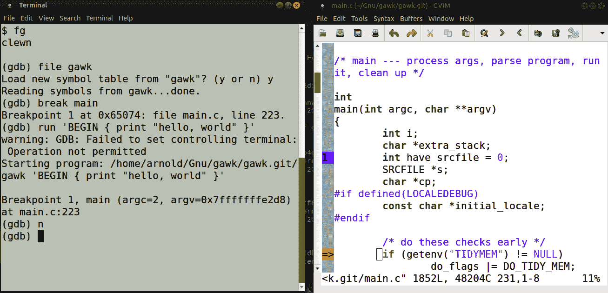

遗憾的是，`Clewn` 已不再维护。然而，我们中的一位定期使用它，它仍然可以“开箱即用”地编译，并在当前的 GNU/Linux 系统上正常工作。

Clewn 项目主页位于 [`http://clewn.sourceforge.net`](http://clewn.sourceforge.net)。`Clewn` 的源代码包含在本书的 [GitHub 仓库](https://www.github.com/learning-vi/vi-files) 中。有关更多信息，请参阅 “访问文件” 一节。

## CGDB: Curses GDB

> `CGDB` 是 GNU 调试器的一个非常轻量的控制台前端。它提供了一个分屏界面，下方显示 `GDB` 会话，上方显示程序的源代码。界面模仿了 `vim` 的设计，因此 `vim` 用户使用起来应该会感到宾至如归。
>
> [CGDB GitHub 页面](https://github.com/cgdb/cgdb)

调试似乎是这里的一个主题。这也许并不令人惊讶，因为 `vi` 和 `Vim` 首先是程序员的编辑器，因此当一个软件开发工具也提供类似 `Vim` 的界面时，它会更易于接受。

你在使用终端模拟器窗口中使用 `CGDB`。`CGDB` 将屏幕分为两部分，下方窗口显示 `(gdb)` 命令提示符，上方窗口显示你的源代码。好处是源代码会用不同颜色进行语法高亮。参见 图 16-2。

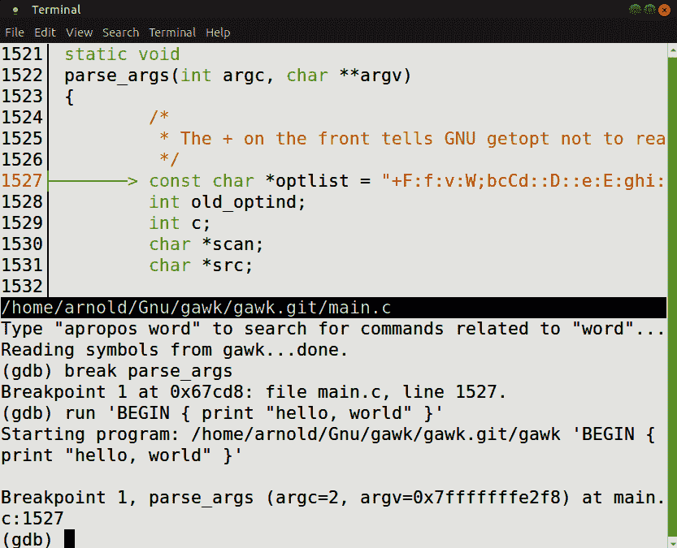

你使用 `i` 从命令窗口移动到源代码窗口，使用 `ESC` 返回到命令窗口。一旦进入源代码窗口，你就可以使用 `Vim` 搜索命令在其中移动，包括使用正则表达式。

`CGDB` 附带一份完整的 Texinfo 手册来解释其用法。它为 `Clewn` 提供了一个不错的替代方案，并且比 `GDB` 自带的文本用户界面（`gdb -tui`）好得多。

CGDB 项目主页位于 [`https://github.com/cgdb/cgdb`](https://github.com/cgdb/cgdb)。快去看看吧！

## Vim Inside Visual Studio

Microsoft 的 `Visual Studio` 也许是世界上使用最广泛的 IDE。它可以通过插件，也称为 *extensions* 来扩展。


[VsVim](https://github.com/VsVim/VsVim) 是开源扩展，提供在 Visual Studio 内部使用的 Vim 模拟器。截至本文撰写时，它支持 Visual Studio 2017 和 2019，并且项目正在积极开发和维护中。

如果你必须使用 Visual Studio 但更喜欢 Vim 风格的编辑，应该查看一下这个。

# Visual Studio Code 的 Vim

### 注意

我们讨论面向 Visual Studio *和* Microsoft Visual Studio Code 的 Vim 插件。这是因为它们不同。虽然它们经常被混淆为同一应用程序，但事实并非如此，因此插件也不同。

## Visual Studio Code：快速介绍

Visual Studio Code 是 Microsoft 其旗舰 IDE Visual Studio 的轻量级版本。常被称为 *VS Code*。VS Code 与其非自由的商业大哥一样，是一个强大的开发和项目管理集成生态系统。虽然它提供了许多相同的功能，但差异足以使 Vim 插件选项也不同。这大多是吹毛求疵，因为在任一应用程序中添加 Vim 插件都很容易。

显然，第一步是 [下载并安装](https://code.visualstudio.com) VS Code。安装非常简单直接。

## VS Code 扩展

VS Code 的附加组件可互换地称为 *扩展* 或 *插件*。最快访问 VS Code 功能的方法是知道并使用通用的“执行此操作”命令。只需在 Microsoft Windows 和 GNU/Linux 上输入命令 `CTRL SHIFT-P`，或在 MacOS 上输入 `COMMAND SHIFT-P`。（有趣的是，`F1` 在三个操作系统上也能执行此操作。）开始输入 `install extensions`，VS Code 将显示下拉选择列表。参见 图 16-3。

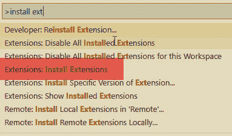

VS Code 显示一个垂直的左侧窗口，汇总已安装的扩展并提供对已安装扩展以及（庞大的）插件生态系统中可用扩展的搜索。在搜索框中输入 `vim`，你应该会看到类似 图 16-4 的内容。

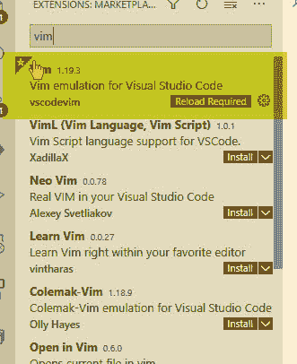

高亮的项目 `vscodevim` 是插件选择。点击“Install”按钮。这会弹出 图 16-5 所示的对话框。

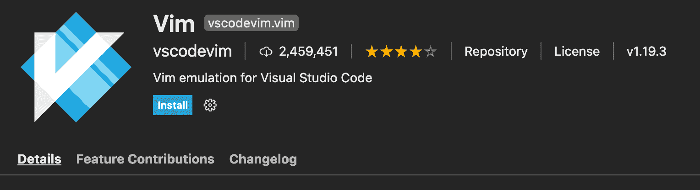

任何时候你想禁用或卸载扩展，都可以像之前一样找到该扩展。这会弹出 图 16-6 中的对话框。现在点击“Disable”或“Uninstall。”

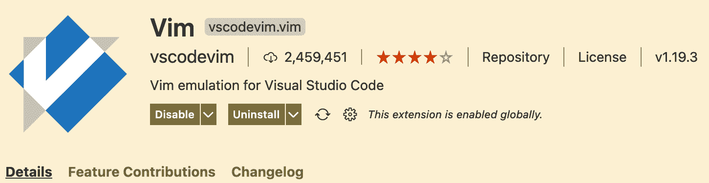

## vscodevim 设置

要查看 `vscodevim` 插件的可用设置，请使用 VS Code 通用命令 `CTRL SHIFT-P`，并搜索 *设置*。可能有很多，但请选择“Preferences: Open `Settings` (UI)。”参见 图 16-7。

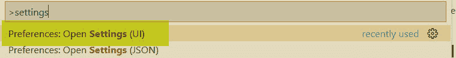

现在在 *设置* 对话框中搜索，你会看到与 `vim` 相关的设置几乎有 100 个，如 图 16-8 所示。

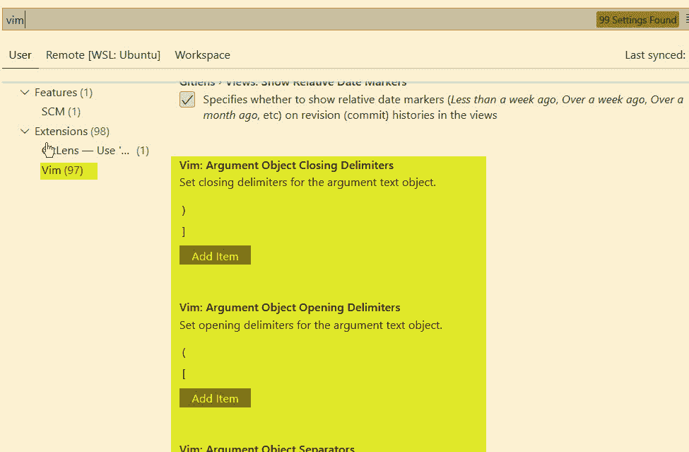

我们把偏好设置留给你自行整理。请注意，许多偏好设置只是提供了一个链接来打开 VS Code 的 JSON 设置文件。不幸的是，一些常见的 Vim 自定义需要你熟悉编辑此文件。

例如，如章节 “简化 Vim 退出” 中所述，我们喜欢通过在 `vi` 命令模式下将 `q` 和 `Q` 映射到 `:q^M` 和 `:q!^M` 分别来简化退出 Vim（退出 Vim 和 *真正* 退出 Vim！）。^(6) 你无法在 VS Code 扩展偏好设置中执行此操作。以下是创建映射的 JSON 代码块：

```
"vim.normalModeKeyBindingsNonRecursive": [
        {
                "before": ["q"],
                "commands": [":q"]
        },
        {
                "before": ["Q"],
                "commands": [":q!"]
        },
        {
                "before": ["ctrl+v"],
                "commands": ["Ctrl+Shift+G"]
        }
    ],
```

### 注意

由于此操作发生在 VS Code 内部，IntelliSense 对于补全 `vim.XX` 非常有用，其中 *XX* 是正在使用的 `vscodevim` 设置。请注意，在前面的示例中，我们对 `normalModeKeyBindings` 使用版本 `"NonRecursive"`，以防止 `q` 被重新解释为需要再次映射。这是在 Vim 映射中常见且众所周知的技术，通过在上下文中用 `noremap` 前缀映射命令来定义。（参见 “使用 map 命令” 以更完整地讨论映射 `vi` 命令。）

## Vim 不仅适用于 VS Code

我们选择 VS Code 来讨论 IDE 的 Vim 插件。VS Code 已变得极受欢迎，因为 Microsoft 积极关注其开发和演进。

然而，VS Code 只是众多 IDE 中的一个，几乎所有 IDE 都提供自己的 Vim 编辑仿真或 readily available 的类 Vim 插件。我们已在 NetBeans、Eclipse、PyCharm 和 JetBrains 中使用并验证了 Vim 插件或仿真。还有许多其他。很可能你的 IDE 也有 Vim 插件。

# Unix 实用工具

`vi` 抽象隐藏在许多你可能不了解的 Unix/Linux 实用工具中。以下是一些实用工具的示例，以及 `vi` 命令如何在不编辑时提高你的效率。

## More or Less？

`more` 是原始的基于屏幕的 *分页器* 程序：一种旨在一次呈现一屏数据的程序。它作为 BSD Unix 的一部分开发，与原始 `vi` 大致同期。除了显示文件内容外，`more` 在未给出任何文件时读取标准输入，使其易于在管道末尾使用。

在 `more` 成为标准一段时间后，`less`（其名称是对 `more` 的双关）作为增强型分页器被编写。今天，两者通常都可在现代系统上获得。

我们认为（具有讽刺意味）`more` 实际上更少，而 `less` 更多。`more` 是具有基本分页和交互的传统 Unix 工具，而 `less` 几乎是一个流编辑器。`less` 缺乏真正的编辑功能，但提供了类似 Vim 的强大导航。

我们中的一位在他的个人电脑（GNU/Linux）上总是将 `more` 重命名为 `more_or_less`，并将 `/usr/bin/less` 链接到 `/usr/bin/more`（从而使所有 `more` 皆为 `less`）。

如果你没有管理权限或共享系统而他人可能反对，你可以使用 `alias` 设置相同的内容，该别名可添加到你的个人 `.bashrc` 文件中：

```
alias 'more=less'
```

### 警告

我们的一位技术审阅者警告说，重命名 `more` 并将 `less` 链接到 `more` 可能会导致意外行为和混淆，可能影响期望 `more` 原始行为的脚本和安装程序的执行。我们同意该警告，此建议值得注意。你应谨慎进行这些修改。

为记录在案，自 `less` 命令出现以来，我们在每台 GNU/Linux 安装上都进行了上述修改，从未注意到系统有任何不良影响。尽管如此，因人而异。

另一个选项是设置 `.bashrc` 文件中的 `PAGER` 环境变量，使 `less` 代替 `more` 使用（至少大部分时间）：

```
export PAGER=less
```

这样，“说的越少越好。”以下是 `less` 的类 Vim 功能：

`b`, `d`

: 

分别向上或向下翻一页（`more` 中不可用）。

`gg`, `G`

: 

分别跳转到输入文件或流的开头或末尾（`more` 中不可用）。

`/pattern`, `?pattern`, `n`, `N`

: 


向前或向后搜索 `pattern`，并在同一方向或相反方向找到下一个匹配项。

`v`

: 

用 `EDITOR` 环境变量指定的编辑器打开当前文件。这仅适用于文件，不适用于标准输入。

## 配置 less 的显示

`less` 的一个有些晦涩的特性是可以配置其显示文本的方式。对于大多数用途来说这并不有趣，但现在我们已将 `less` 换成 `more`，一个真正的差异和不错的增强会通过发出以下命令改变你查看手册页的方式。尝试在执行前后查看几页手册以欣赏视觉效果（例如，`man man`）：

```
# variables and dynamic settings to improve less
export LESS="-ces -r -i -a -PM"
# Green:
export LESS_TERMCAP_mb=$(tput bold; tput setaf 2)
# Cyan:
export LESS_TERMCAP_md=$(tput bold; tput setaf 6)
export LESS_TERMCAP_me=$(tput sgr0)
# Yellow on blue:
export LESS_TERMCAP_so=$(tput bold; tput setaf 3; tput setab 4)
export LESS_TERMCAP_se=$(tput rmso; tput sgr0)
# White:
export LESS_TERMCAP_us=$(tput smul; tput bold; tput setaf 7)
export LESS_TERMCAP_ue=$(tput rmul; tput sgr0)
export LESS_TERMCAP_mr=$(tput rev)
export LESS_TERMCAP_mh=$(tput dim)
export LESS_TERMCAP_ZN=$(tput ssubm)
export LESS_TERMCAP_ZV=$(tput rsubm)
export LESS_TERMCAP_ZO=$(tput ssupm)
export LESS_TERMCAP_ZW=$(tput rsupm)
```

此文件可在本书的 [GitHub 仓库](https://www.github.com/learning-vi/vi-files) 中获取。参见 “访问文件” 部分。

还有更多功能。我们将剩余部分留给你探索。提示：在 `less` 提示符下，输入 `h` 可获取帮助。

## screen

`screen` 是一个终端会话多路复用器，可在一个终端窗口内提供多个并发工作会话。鉴于今天可用的终端模拟器具有多个会话，通常通过标签页实现，什么使得 `screen` 值得使用？我们将在介绍如何使用 `screen` 之后回答这个问题，特别是展示一个有用的示例配置文件之后。请耐心等待。

`screen` 为其会话提供忠实的终端行为，因此需要你使用一个特殊的[content]
向前或向后搜索 `pattern`，并在同一方向或相反方向找到下一个匹配项。

`v`

: 

用 `EDITOR` 环境变量指定的编辑器打开当前文件。这仅适用于文件，不适用于标准输入。

## 配置 less 的显示

`less` 的一个有些晦涩的特性是可以配置其显示文本的方式。对于大多数用途来说这并不有趣，但现在我们已将 `less` 换成 `more`，一个真正的差异和不错的增强会通过发出以下命令改变你查看手册页的方式。尝试在执行前后查看几页手册以欣赏视觉效果（例如，`man man`）：

```
# variables and dynamic settings to improve less
export LESS="-ces -r -i -a -PM"
# Green:
export LESS_TERMCAP_mb=$(tput bold; tput setaf 2)
# Cyan:
export LESS_TERMCAP_md=$(tput bold; tput setaf 6)
export LESS_TERMCAP_me=$(tput sgr0)
# Yellow on blue:
export LESS_TERMCAP_so=$(tput bold; tput setaf 3; tput setab 4)
export LESS_TERMCAP_se=$(tput rmso; tput sgr0)
# White:
export LESS_TERMCAP_us=$(tput smul; tput bold; tput setaf 7)
export LESS_TERMCAP_ue=$(tput rmul; tput sgr0)
export LESS_TERMCAP_mr=$(tput rev)
export LESS_TERMCAP_mh=$(tput dim)
export LESS_TERMCAP_ZN=$(tput ssubm)
export LESS_TERMCAP_ZV=$(tput rsubm)
export LESS_TERMCAP_ZO=$(tput ssupm)
export LESS_TERMCAP_ZW=$(tput rsupm)
```

此文件可在本书的 [GitHub 仓库](https://www.github.com/learning-vi/vi-files) 中获取。参见 “访问文件” 部分。

还有更多功能。我们将剩余部分留给你探索。提示：在 `less` 提示符下，输入 `h` 可获取帮助。

## screen

`screen` 是一个终端会话多路复用器，可在一个终端窗口内提供多个并发工作会话。鉴于今天可用的终端模拟器具有多个会话，通常通过标签页实现，什么使得 `screen` 值得使用？我们将在介绍如何使用 `screen` 之后回答这个问题，特别是展示一个有用的示例配置文件之后。请耐心等待。

`screen` 为其会话提供忠实的终端行为，因此需要你使用一个特殊的[content]
向前或向后搜索 `pattern`，并在同一方向或相反方向找到下一个匹配项。

`v`

: 

用 `EDITOR` 环境变量指定的编辑器打开当前文件。这仅适用于文件，不适用于标准输入。

## 配置 less 的显示

`less` 的一个有些晦涩的特性是可以配置其显示文本的方式。对于大多数用途来说这并不有趣，但现在我们已将 `less` 换成 `more`，一个真正的差异和不错的增强会通过发出以下命令改变你查看手册页的方式。尝试在执行前后查看几页手册以欣赏视觉效果（例如，`man man`）：

```
# variables and dynamic settings to improve less
export LESS="-ces -r -i -a -PM"
# Green:
export LESS_TERMCAP_mb=$(tput bold; tput setaf 2)
# Cyan:
export LESS_TERMCAP_md=$(tput bold; tput setaf 6)
export LESS_TERMCAP_me=$(tput sgr0)
# Yellow on blue:
export LESS_TERMCAP_so=$(tput bold; tput setaf 3; tput setab 4)
export LESS_TERMCAP_se=$(tput rmso; tput sgr0)
# White:
export LESS_TERMCAP_us=$(tput smul; tput bold; tput setaf 7)
export LESS_TERMCAP_ue=$(tput rmul; tput sgr0)
export LESS_TERMCAP_mr=$(tput rev)
export LESS_TERMCAP_mh=$(tput dim)
export LESS_TERMCAP_ZN=$(tput ssubm)
export LESS_TERMCAP_ZV=$(tput rsubm)
export LESS_TERMCAP_ZO=$(tput ssupm)
export LESS_TERMCAP_ZW=$(tput rsupm)
```

此文件可在本书的 [GitHub 仓库](https://www.github.com/learning-vi/vi-files) 中获取。参见 “访问文件” 部分。

还有更多功能。我们将剩余部分留给你探索。提示：在 `less` 提示符下，输入 `h` 可获取帮助。

## screen

`screen` 是一个终端会话多路复用器，可在一个终端窗口内提供多个并发工作会话。鉴于今天可用的终端模拟器具有多个会话，通常通过标签页实现，什么使得 `screen` 值得使用？我们将在介绍如何使用 `screen` 之后回答这个问题，特别是展示一个有用的示例配置文件之后。请耐心等待。

`screen` 为其会话提供忠实的终端行为，因此需要你使用一个特殊的[content]
向前或向后搜索 `pattern`，并在同一方向或相反方向找到下一个匹配项。

`v`

: 

用 `EDITOR` 环境变量指定的编辑器打开当前文件。这仅适用于文件，不适用于标准输入。

## 配置 less 的显示

`less` 的一个有些晦涩的特性是可以配置其显示文本的方式。对于大多数用途来说这并不有趣，但现在我们已将 `less` 换成 `more`，一个真正的差异和不错的增强会通过发出以下命令改变你查看手册页的方式。尝试在执行前后查看几页手册以欣赏视觉效果（例如，`man man`）：

```
# variables and dynamic settings to improve less
export LESS="-ces -r -i -a -PM"
# Green:
export LESS_TERMCAP_mb=$(tput bold; tput setaf 2)
# Cyan:
export LESS_TERMCAP_md=$(tput bold; tput setaf 6)
export LESS_TERMCAP_me=$(tput sgr0)
# Yellow on blue:
export LESS_TERMCAP_so=$(tput bold; tput setaf 3; tput setab 4)
export LESS_TERMCAP_se=$(tput rmso; tput sgr0)
# White:
export LESS_TERMCAP_us=$(tput smul; tput bold; tput setaf 7)
export LESS_TERMCAP_ue=$(tput rmul; tput sgr0)
export LESS_TERMCAP_mr=$(tput rev)
export LESS_TERMCAP_mh=$(tput dim)
export LESS_TERMCAP_ZN=$(tput ssubm)
export LESS_TERMCAP_ZV=$(tput rsubm)
export LESS_TERMCAP_ZO=$(tput ssupm)
export LESS_TERMCAP_ZW=$(tput rsupm)
```

此文件可在本书的 [GitHub 仓库](https://www.github.com/learning-vi/vi-files) 中获取。参见 “访问文件” 部分。

还有更多功能。我们将剩余部分留给你探索。提示：在 `less` 提示符下，输入 `h` 可获取帮助。

## screen

`screen` 是一个终端会话多路复用器，可在一个终端窗口内提供多个并发工作会话。鉴于今天可用的终端模拟器具有多个会话，通常通过标签页实现，什么使得 `screen` 值得使用？我们将在介绍如何使用 `screen` 之后回答这个问题，特别是展示一个有用的示例配置文件之后。请耐心等待。

`screen` 为其会话提供忠实的终端行为，因此需要你使用一个特殊的[content]
向前或向后搜索 `pattern`，并在同一方向或相反方向找到下一个匹配项。

`v`

: 

用 `EDITOR` 环境变量指定的编辑器打开当前文件。这仅适用于文件，不适用于标准输入。

## 配置 less 的显示

`less` 的一个有些晦涩的特性是可以配置其显示文本的方式。对于大多数用途来说这并不有趣，但现在我们已将 `less` 换成 `more`，一个真正的差异和不错的增强会通过发出以下命令改变你查看手册页的方式。尝试在执行前后查看几页手册以欣赏视觉效果（例如，`man man`）：

```
# variables and dynamic settings to improve less
export LESS="-ces -r -i -a -PM"
# Green:
export LESS_TERMCAP_mb=$(tput bold; tput setaf 2)
# Cyan:
export LESS_TERMCAP_md=$(tput bold; tput setaf 6)
export LESS_TERMCAP_me=$(tput sgr0)
# Yellow on blue:
export LESS_TERMCAP_so=$(tput bold; tput setaf 3; tput setab 4)
export LESS_TERMCAP_se=$(tput rmso; tput sgr0)
# White:
export LESS_TERMCAP_us=$(tput smul; tput bold; tput setaf 7)
export LESS_TERMCAP_ue=$(tput rmul; tput sgr0)
export LESS_TERMCAP_mr=$(tput rev)
export LESS_TERMCAP_mh=$(tput dim)
export LESS_TERMCAP_ZN=$(tput ssubm)
export LESS_TERMCAP_ZV=$(tput rsubm)
export LESS_TERMCAP_ZO=$(tput ssupm)
export LESS_TERMCAP_ZW=$(tput rsupm)
```

此文件可在本书的 [GitHub 仓库](https://www.github.com/learning-vi/vi-files) 中获取。参见 “访问文件” 部分。

还有更多功能。我们将剩余部分留给你探索。提示：在 `less` 提示符下，输入 `h` 可获取帮助。

## screen

`screen` 是一个终端会话多路复用器，可在一个终端窗口内提供多个并发工作会话。鉴于今天可用的终端模拟器具有多个会话，通常通过标签页实现，什么使得 `screen` 值得使用？我们将在介绍如何使用 `screen` 之后回答这个问题，特别是展示一个有用的示例配置文件之后。请耐心等待。

`screen` 为其会话提供忠实的终端行为，因此需要你使用一个特定前缀字符来激活其命令和功能。默认是 CTRL-A。例如，要显示大多数可用 `screen` 命令的摘要，`screen` 命令是 `?`。因此你必须输入 CTRL-A ? 来显示摘要。在试验 `screen` 时请记住这一点。

### Note

以下介绍假定使用 GNU/Linux 或 Unix 系统并且 `screen` 应用程序可用。使用 shell 提示符下的 `type` 命令验证你的系统是否具有 `screen`：

```
$ type screen
```

类似 `screen is /usr/bin/screen` 的响应是好的。如果没有得到此类响应，请使用你的包管理器安装 `screen`。如果你想或需要从源代码构建 `screen`，请从 [*https://www.gnu.org/software/screen*](https://www.gnu.org/software/screen) 开始。

### Getting started with screen

`screen`，像许多 Unix 应用程序一样，读取一个可选的用户配置文件来设置选项和定义会话。`screen` 配置文件 `.screenrc` 位于你的主目录中。为了便于跟随讨论，你可以从本书的 [GitHub 仓库](https://www.github.com/learning-vi/vi-files) 复制 `.screenrc` 文件，或自行创建该文件并放入以下行：

```
startup_message off
defscrollback 20000

# Help screen, key bindings:
bindkey -k k9 exec sed -n '/^# Help/s/^/^M/p;/^# F[1-9]/p' $HOME/.screenrc
# F2 : list windows:
bindkey -k k2 windowlist
# F3 : detach screen (retains active sessions -- can reconnect later):
bindkey -k k3 detach
# F10: previous window (e.g., window 4 -> window 3):
bindkey -k k; prev
# F11: next window (e.g., window 2 -> window 3):
bindkey -k F1 next
# F12: kill all windows and quit screen (you will be prompted):
bindkey -k F2 quit

screen -t "edits for chapter 1"
screen -t "manage screen captures"
screen -t "manage todos"
screen -t "email and messages"
screen -t "git status and commits"
screen -t "system status"
screen -t "remote login to NAS" ssh 10.0.0.999
screen -t "solitaire"

select 1
```

现在启动 `screen`：

```
$ screen
```

你应该看到一个正常的会话，即窗口中的命令行提示符。前面代码块中的最后一行 `select 1` 告诉 `screen` 在第一个窗口或会话（定义为“edits for chapter 1”）中开始你的交互。`screen` 的美妙之处在于你处于一个会话中，是配置文件中定义的八个会话之一，每个会话都完全独立于其他会话。

`screen` 有多种选择会话和在它们之间导航的方式。我们想要说明的是 `vi` 风格的导航。

### Tip

`screen` 对大多数操作使用单字符命令。这些单字符操作必须以 `screen` 的 leader 命令字符为前缀，默认是 CTRL-A。

### The screen menu

`screen` 显示可用会话列表的命令是双引号 (`"`)。因此，记住之前的提示，你可以使用两个按键 CTRL-A " 显示会话菜单。执行后，你应该会看到类似 图 16-9 的内容。

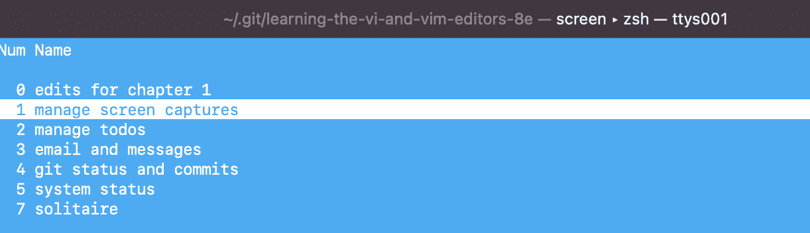

虽然它非常基础，但你可以使用标准的上下行 `vi` 命令 `k` 和 `j` 选择会话行。这并不是很多 `vi`，但显然在这种上下文中其他东西真的没有必要。关键是这是一种移动哲学，而 `screen` 的开发者选择了 `vi`。

### Navigating your session’s output

`screen` 会话本身还有更多 `vi` 交互。`screen` 在你的会话期间缓冲文本，你可以通过输入 CTRL-A ESC 使用 `vi` 命令导航这些保存的文本。默认情况下，`screen` 只存储大约 100 行文本。如我们在上面的配置中所见，我们将该默认值更改为 20,000。在现代系统上这更合理。真的，确保你设置了这个。一百行缓存的文本真的不多。

每个会话的缓冲区是单独维护的。因此，除了你可以搜索、编辑和重新执行的命令行历史之外，你还可以 `vi` 风格地访问你的命令 *和* 你的命令的输出！

搜索 `screen` 缓冲区的基础始于 `vi` 基础。输入 CTRL-A ESC 后，你可以使用移动命令搜索缓冲区（向上行是 `k`，向下行是 `j`，向上滚动是 `^B`，向下滚动是 `^F` 等）。正向搜索，如你所料，使用 `/` 启动，反向搜索使用 `?` 启动。请注意，如果你在缓冲区的底部进行第一次正向搜索使用 `?`，将找不到任何内容，因为你已经在底部了。要获得更完整的 `screen` 的 `vi` 风格说明，请转到 `screen` 的 man 手册页并搜索“vi-like”。参见 图 16-10。

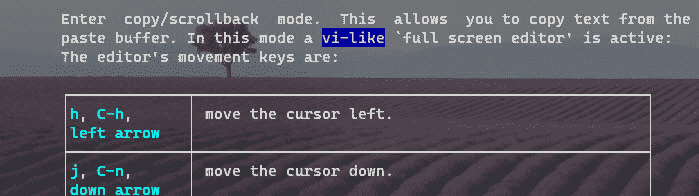

有了 `screen` 及其 `vi` 风格的缓冲区导航，你可以访问你可能认为已经丢失的信息。这在我们身上不止一次发生过。

### Take advantage of screen’s key bindings

在前面显示的示例 `.screenrc` 代码中，有一些与定义终端会话无关的行。这些是我们推荐的键绑定。例如，以下行：

```
# F2 : list windows
bindkey -k k2 windowlist
```


bind function key 2 (`k2` denoting F2) to the command `windowlist`, which is normally invoked within a `screen` session by `CTRL-A` " ". This is a more intuitive shortcut for an action you’ll probably use all the time: seeing the menu of available running `screen` sessions.

将功能键 2（`k2` 表示 F2）绑定到命令 `windowlist`，该命令通常在 `screen` 会话中通过 `CTRL-A` " " 调用。这是更直观的快捷方式，用于你可能经常使用的操作：查看正在运行的 `screen` 会话菜单。

The others mapped in our sample configuration include:

我们的示例配置中还包括以下映射：

**F3**: Detach totally from the `screen` session.

**F3**：完全从 `screen` 会话中分离。

**F10**: Move to the `screen` session numerically minus one from the current session (e.g., if you are in session four, go to session three).

**F10**：移动到比当前会话数值小一的 `screen` 会话（例如，如果你在会话四，则转到会话三）。

**F11**: This is the complement to F10: go to the next available session.

**F11**：这是 F10 的补充：转到下一个可用会话。

**F12**: Kill *all* sessions and quit `screen`. You probably won’t use this often, but when you want to, it’s nice to have a function key ready to use.

**F12**：终止 *所有* 会话并退出 `screen`。你可能不会经常使用它，但在需要时，有一个功能键随时可用是很方便的。

So now you know how to nicely map keys to common or interesting `screen` commands, but how do you keep track or remember what you mapped? For that, see the binding to F9:

现在你知道如何将键很好地映射到常用的或有趣的 `screen` 命令，但如何跟踪或记住你映射的内容呢？为此，请查看对 F9 的绑定：

```
# Help screen, key bindings:
bindkey -k k9 exec sed -n '/^# Help/s/^/^M/p;/^# F[1-9]/p' $HOME/.screenrc
```

We have bound F9 to execute the `sed` stream editor. It extracts the commented portion of all of the configuration file key mappings and displays that output at your prompt. Just like in the shell, everything including and beyond the `#` symbol is a comment. Typing F9 ends up looking something like this:

我们将 F9 绑定为执行 `sed` 流编辑器。它提取配置文件中所有键映射的注释部分并在你的提示符处显示该输出。就像在 shell 中一样，从 `#` 符号开始及之后的所有内容都是注释。输入 F9 的结果看起来像这样：

```
$                                      F9 pressed
# Help screen, key bindings
# F2 : list windows
# F3 : detach screen (retains active sessions -- can reconnect later)
# F10: previous window (e.g., window 4 -> window 3)
# F11: next window (e.g., window 2 -> window 3)
# F12: kill all windows and quit screen (you will be prompted)
```

We chose F9 because some terminal emulators reserve F1 for their own help.

我们选择 F9 是因为某些终端模拟器为自己的帮助保留了 F1。

## What makes screen great

## 什么让 screen 很棒

Earlier, we posed the question, “With terminal emulators available today with multiple sessions, usually implemented across tabs, what makes `screen` worthwhile?”

早些时候，我们提出了这个问题：“在今天有多个会话的终端模拟器（通常在标签页中实现）可用时，什么让 `screen` 值得使用？”

The answer is that *you can leave the sessions and return to them*. They are maintained and active. As was just explained, we defined F3 to detach from `screen`. Try it. You are returned to the command prompt and shell you were in *before* you entered `screen`. Try F2 now and verify it does nothing since you are not part of a `screen` session.

答案是 *你可以离开会话并返回它们*。它们被维护并保持活动状态。正如刚才解释的，我们将 F3 定义为从 `screen` 分离。试试看。你将被返回到进入 `screen` *之前* 所在的命令提示符和 shell。现在试试 F2，验证它什么也不做，因为你不再是 `screen` 会话的一部分。

You can discover which `screen` session(s) you can attach to with the `screen -list` command:

你可以使用 `screen -list` 命令发现可以附加到的 `screen` 会话：

```
$ screen -list
There is a screen on:
            8491.pts-0.office-win10 (04/06/21 18:58:39)     (Detached)
    1 Socket in /run/screen/S-elhannah.
```

Reattach and resume any and all work in that set of `screen` sessions with the attach option. You attach by entering the ID number:

使用 attach 选项重新附加并恢复该组 `screen` 会话中的所有工作。你通过输入 ID 号来附加：

```
$ screen -Ar 8491
```

You are now back in your set of sessions within `screen`. No worries about closing the window that is running `screen`; that qualifies as a “detach,” and you reattach as just described! We have used this feature and sustained multiple sessions within `screen` (typically between 5 and 8), detaching and reattaching from various remote logins, and kept those sessions active for more than three months at a time!

你现在已回到 `screen` 内的会话组中。无需担心关闭正在运行 `screen` 的窗口；这算作“分离”，你可以通过刚才描述的方式重新附加！我们使用过此功能，并在 `screen` 中维持多个会话（通常在 5 到 8 个之间），从各种远程登录中分离和重新附加，并让这些会话保持活动超过三个月！

# And …, Browsers!

# 而且…，浏览器！

In many ways, internet browsers have been playing catch-up with technology since the day they were introduced. When browsers first appeared, they were crude (by today’s standards), displaying information with links to click on and other information. Graphics were primitive, printing didn’t exist, and a hodgepodge of standards created an unpleasant and inconsistent user experience.

在许多方面，自从互联网浏览器问世以来，它们一直在追赶技术。当浏览器首次出现时，它们很粗糙（以今天的标准衡量），以可点击的链接和其他信息显示信息。图形很原始，打印不存在，而各种标准的拼凑造成了不愉快且不一致的用户体验。

Thankfully, standards have matured and merged, graphics and presentation became powerful, compatible, and portable (mostly), and browsers today are consistent and usable by casual users. Recently, third parties have provided extensions that bring Vim abstractions to the browser experience.

值得庆幸的是，标准已经成熟并合并，图形和呈现变得强大、兼容且可移植（大多如此），而今天的浏览器对普通用户来说是一致且可用的。最近，第三方提供了将 Vim 抽象引入浏览器体验的扩展。

We have two favorite Chrome extensions we’ll demonstrate: Wasavi, an implementation of Vim for editing text fields in the browser (e.g., filling out a text area in a customer feedback form), and Vimium, a way to navigate pages, bookmarks, URLs, and searches using Vim-like abstractions. Both of these extensions can dramatically improve your browsing efficiency.

我们有两个最喜欢的 Chrome 扩展将进行演示：Wasavi，是在浏览器中编辑文本字段的 Vim 实现（例如，在客户反馈表单中填写文本区域），以及 Vimium，使用类似 Vim 的抽象来导航页面、书签、URL 和搜索。这两个扩展都可以显著提高你的浏览效率。

### Note

### 注意

These examples are for Chrome, implying they are available for any Chromium-based browser. This is good news for Microsoft Edge users, as Microsoft provides Chrome extension compatibility with Edge.

这些示例适用于 Chrome，意味着它们适用于任何基于 Chromium 的浏览器。这对 Microsoft Edge 用户来说是个好消息，因为 Microsoft 为 Edge 提供了 Chrome 扩展兼容性。

## Wasavi

## Wasavi

[Wasavi](https://chrome.google.com/webstore/detail/wasavi/dgogifpkoilgiofhhhodbodcfgomelhe) is an open source plug-in for Chrome. The source code is available on [GitHub](https://github.com/akahuku/wasavi).

[Wasavi](https://chrome.google.com/webstore/detail/wasavi/dgogifpkoilgiofhhhodbodcfgomelhe) 是 Chrome 的开源插件。源代码可在 [GitHub](https://github.com/akahuku/wasavi) 上获得。

Let’s take a look. Figure 16-11 presents a text widget with lines that need to be moved.

让我们看一下。图 16-11 展示了一个需要移动行的文本控件。

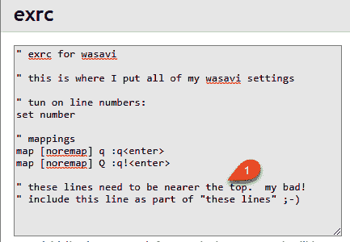

1. Lines to be moved to a different location in a text widget. Let’s do it the `vi` way with Wasavi.

1. 需要移动到文本控件中不同位置的行。让我们用 Wasavi 以 `vi` 的方式来做。

Figure 16-12 presents the same text widget, but with Wasavi in action.

图 16-12 展示了同一个文本控件，但此时 Wasavi 正在运行。

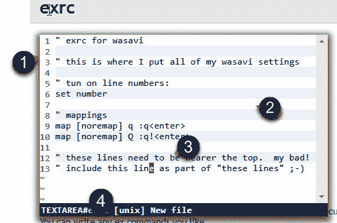

1. Numbered lines give us a visual cue we are in `vi`.
2. The alternating background shade gives us another visual cue.
3. We can use `vi` commands to move these lines.
4. Wasavi’s `vi` status line!

1. 编号的行给我们一个视觉提示，我们处于 `vi` 中。
2. 交替的背景色给我们另一个视觉提示。
3. 我们可以使用 `vi` 命令移动这些行。
4. Wasavi 的 `vi` 状态行！

Finally, Figure 16-13 shows the same text widget after we’ve rearranged the contents.

最后，图 16-13 显示了重新排列内容后的同一个文本控件。

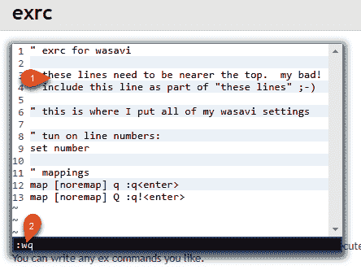

1. The simple `vi` steps `11G`, `3dd`, `gg`, `p` do the trick. (`11G` goes to line 11; `3dd` deletes the three lines that we want to move; `gg` goes to the top of the file; and `p` puts the three lines we deleted into their new location.)
2. Saving the “file.”

1. 简单的 `vi` 步骤 `11G`、`3dd`、`gg`、`p` 就能解决问题。（`11G` 跳到第 11 行；`3dd` 删除我们想要移动的三个行；`gg` 跳到文件顶部；`p` 将我们删除的三个行放到新位置。）
2. 保存“文件”。

## Vim + Chromium = Vimium

## Vim + Chromium = Vimium

Vimium is a Chrome extension providing a Vim-like experience. You can read about it at its [home page](https://chrome.google.com/webstore/detail/vimium/dbepggeogbaibhgnhhndojpepiihcmeb?hl=en). It’s also available in some form for other browsers, e.g., Firefox and Safari, for example.

Vimium 是一个提供类似 Vim 体验的 Chrome 扩展。你可以在其 [主页](https://chrome.google.com/webstore/detail/vimium/dbepggeogbaibhgnhhndojpepiihcmeb?hl=en) 上阅读相关信息。它也以某种形式适用于其他浏览器，例如 Firefox 和 Safari。

Vimium lets you navigate the internet in a `vi`-like way. Since a browser is *not* an editor, of course, it makes sense that there is not a one-to-one mapping of Vim commands to Vimium actions. However, if you are familiar with and comfortable in Vim, the learning curve is pretty easy, and the Vim-isms make sense (mostly). Very much in the flavor of Vim, Vimium transforms the browser experience from a point-and-click exercise to the familiar “do everything from the keyboard” one. We find Vimium to be a must for browsing.

Vimium 让你以类似 `vi` 的方式在互联网上导航。由于浏览器 *不是* 编辑器，当然，Vim 命令与 Vimium 操作之间不存在一一映射是有道理的。然而，如果你熟悉 Vim 并且使用起来很舒服，学习曲线相当容易，而且 Vim 的特性是有意义的（大多如此）。非常符合 Vim 的风格，Vimium 将浏览器体验从点按练习转变为熟悉的“从键盘完成一切”的方式。我们认为 Vimium 是浏览必备。

### Keep the Vimium control handy

### 保持 Vimium 控制在手边

We recommend pinning the Vimium extension to the Chrome list of extensions; that is, keep it visible. This provides a visual cue indicating whether Vimium is *active* or *inactive*. It also serves as a toggle should you need to temporarily turn Vimium off for bad behavior, which happens occasionally. It’s rare that you would toggle Vimium on; for most websites where Vimium is off, it’s off for a reason—on Google Mail, for example, where Google has already provided a full suite of key mappings to navigate mail.

我们建议将 Vimium 扩展固定到 Chrome 扩展列表中；也就是说，保持它可见。这提供了一个视觉提示，指示 Vimium 是 *活动* 还是 *非活动*。它还充当切换开关，如果你需要暂时关闭 Vimium 以应对不良行为（偶尔会发生），就可以使用。很少会切换 Vimium 开启；对于大多数 Vimium 关闭的网站，它关闭是有原因的——例如在 Google 邮件上，Google 已经提供了完整的键映射来导航邮件。

There are so many things Vimium does. We’ll highlight some useful features to get you going.

Vimium 有很多功能。我们将突出一些有用的功能来帮助你入门。

### Finding links, and going to a link without clicking

### 查找链接，并在不点击的情况下转到链接

Vimium abstracts the Vim `f` command by highlighting all visible links in the browser with *badges*. Typically these badges take the form of unique one- or two-character IDs. This powerful feature lets you quickly go to links, bypassing the need to slide the mouse and (accurately) click a link. For pages with minimal links, this usually takes only two keystrokes. The first keystroke is always `f`, and the second is the one- or two-character ID of the link. For a small number of links, Vimium tries to minimize IDs to a single character.

Vimium 通过使用 *徽章* 突出浏览器中所有可见链接来抽象 Vim `f` 命令。通常这些徽章采用唯一的单字符或双字符 ID 的形式。这个强大的功能让你可以快速转到链接，无需移动鼠标并（准确地）点击链接。对于链接很少的页面，这通常只需要两个击键。第一个击键始终是 `f`，第二个是链接的单字符或双字符 ID。对于少量链接，Vimium 会尝试将 ID 最小化为单个字符。


对于包含许多链接的网页，除了让访问链接变得快速便捷之外，Vimium 还提供统一的 ID 展示，并使页面上存在哪些链接一目了然。请参阅 图 16-14 中的示例 Facebook 页面，其中对页面各部分进行了编号说明。根据您媒体的分辨率，徽章/ID 可能无法辨认——浏览时它们是清晰的。

1. `SC` 跳转到作者的 Facebook 个人资料。
2. `AD` 跳转到作者的好友列表。
3. `FD` 跳转到作者的群组列表。
4. `DE` 跳转到“Vim 文本编辑器”Facebook 论坛的快捷方式。
5. `XX`，其中 `XX` 是与联系人匹配的任意 ID，可发起与该联系人的消息。

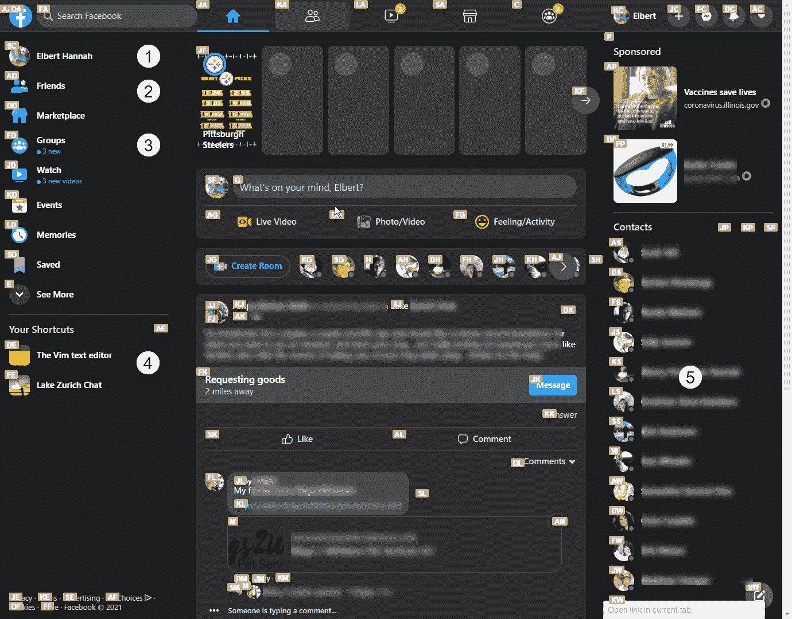

Vimium 对 Vim `F` 命令的处理方式与对 `f` 的处理类似，但更进一步，会在新标签页中打开与该 ID 关联的链接。

### 文本搜索

就像 `/` 在 Vim 中启动搜索一样，Vimium 也是以同样的方式启动搜索。重要的是通过查看浏览器窗口底部的输入框来确认搜索已启动。参见 图 16-15。


大多数精明的浏览器用户都知道 `CTRL-F` 或 Mac 上的 `CMD-F` 会调用浏览器原生搜索，但在 Vim 体验的精神下，`/` 是一种更自然、更方便的“保持在主键盘区”体验。随着您输入搜索字符串，浏览器会滚动到第一个匹配项并高亮匹配的模式。按下 `ENTER` 会结束搜索字符串。

就像 `n` 和 `N` 在 Vim 中分别跳转到搜索模式的下一个和上一个匹配项一样，Vimium 也以相同的方式将浏览器定位到下一个和上一个匹配项。

#### 注

Vimium 默认使用纯文本搜索，即所见即所得。它确实支持正则表达式，相关选项留给您自行探索。

### 浏览器导航

Vimium 抽象了 Vim 的移动操作，用于导航浏览器历史记录和浏览器标签页。以下是您应该熟悉的简要总结：

`j`, `k`

: 逐行向上和向下滚动浏览器。

`H`, `L`

: 分别前往“后退”和“前进”页面。请注意大小写——区分大小写！

`K`, `J`

: 分别前往右侧和左侧的相邻标签页。同样区分大小写！

我们使用这两个熟悉的 Vim 命令前往网页顶部或底部：

`gg`

: 前往网页顶部。

`G`

: 前往网页底部。

其他命令有助于在页面和标签页之间移动：

`]]`, `[`

: 对于将多个页面链接为前后系列的网站，前往下一页或上一页。通常此类页面底部有左右箭头按钮，或提供链接的“NEXT”和“PREV”按钮。

一个很好的例子是购物网站上的产品评论列表，该网站有多页评论。此外，对于带有烦人点击诱饵幻灯片的网站，这种机制非常适合在幻灯片中浏览，而无需对抗“点击我”。

`^`（上箭头或插入符号）

: 访问上次访问的标签页。例如，如果您打开了许多标签页并且正在关注两个彼此相距甚远的标签页，`^` 字符可以快速在两个最近使用的标签页之间来回跳转。

### 有用的键重映射

我们发现 `K`（前往右侧相邻标签页）和 `J`（前往左侧相邻标签页）命令令人困惑地违背了直观且符合自然顺序的感觉。也就是说，由于 `k` 是“向上滚动”，因此 `K` 移动到左侧相邻标签页而不是右侧相邻标签页似乎更自然。幸运的是，这可以在 Vimium 选项中重新映射，而我们就是这么做的。

同样，在 [“标记位置” 部分，我们描述了 `vi` 命令 `''`（两个单引号）如何返回到上一个标记或上下文所在行的开头。我们发现将 `''` 映射到 Vimium 的 `visitPreviousTab` 命令（与刚才描述的 `^` 相同）很有用。这使您可以通过连续输入单引号在标签页之间来回跳转。

为此，打开 Vimium 选项并输入自定义键映射，如 图 16-16 所示。这包括全部三个键重映射，以及 `q` 的新映射。

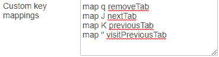

### 当你迷路和困惑时

在 Vimium 处于活动状态的任何网页中，您可以通过输入 `?` 快速获取帮助。Vimium 会在页面上叠加命令及其操作的摘要。值得注意且方便的是，Vimium 操作在 Vimium 自身的帮助页面上也有效。这在搜索特定功能时非常有用。`ESC` 键会将您返回到原始网页。图 16-17 提供了 Vimium 帮助覆盖层的部分快照。

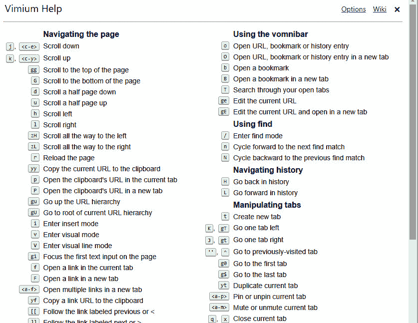

### 一个用例

考虑一个常见活动：在大型电子商务网站等在线购买笔记本电脑。

一个重要要求是新笔记本电脑具有出色的电池续航。一旦确定候选产品，就很容易去查看所有评论，因为事先知道评论是跨若干“下一页”和“上一页”排列的。从第一页开始，我们使用 `/battery ENTER` 搜索任何关于 *battery* 的引用。现在我们可以在评论页面中上下导航，查看所有关于评论者对电池续航评论的实例和引用。

接下来，由于 Vimium 知道通往下一页和上一页序列的常见链接，我们使用 `[[` 和 `]]` 在评论页面中前后移动。Vimium 会记住搜索模式，因此使用 `n` 和 `N` 查找与 *battery* 相关的更多评论变得很容易。这是我们快速研究产品时常用的练习。思考产品的续航、可靠性和许多其他期望特性。

# vi for MS Word 和 Outlook

许多在 Unix 或 GNU/Linux 环境中工作的软件开发人员发现自己在办公环境中不得不使用 Microsoft Word 进行文档编写和使用 Microsoft Outlook 发送电子邮件。

作为软件开发人员，我们共同的经验是，在长时间使用 Vim 进行编码后切换思路总是一个减速带。如果能在 Word 中使用 `vi` 命令进行编辑，像我们这样的开发人员就能更快地创建更好的文档。现状是，我们尽可能快地进出 Word。

同样，我们发现 Outlook 是我们必须与之抗争的东西，而不是舒适地使用它。一个简单且常见的用例是对话线程，其中引用线程中的评论很重要。我们更愿意找到相关文本并通过复制粘贴到我们的叙述中来引用它。*If only* 我们能使用 `/` 搜索文本，`y` yank 它，然后 `''`（返回上次位置）和 `p`，节省的时间将是巨大的。而且避免在导航、高亮、复制和粘贴上消耗精力的效率提升将改善思维过程。无需分心使用鼠标、滚动、获取内容并粘贴它，我们可以依靠 `vi` 肌肉记忆，更自然地快速操作文本，同时将重要的精神能量集中在我们想要表达的内容上。这与 `vi` 的口号“editing at the speed of thought.”一致。

幸运的是，有一个商业插件可用于 Word 和 Outlook 来解决这些问题：[ViEmu](http://www.viemu.com)。


Arnold 不再使用 Word 或 Outlook。Elbert 使用。起初他持怀疑态度，但 Elbert 还是尝试了一下，最终买下了该插件。由于 Outlook 的编辑范式本质上与 MS Word 相同，且插件适用于两者，我们就简单称之为“Word”，但请注意所有内容都适用于 Word 和 Outlook。

ViEmu 的行为非常 `vi`-like，且插件可轻松激活和停用以满足您的需求。由于我们到目前为止已经多次描述过 `vi` 的使用方式，因此我们不会详细说明如何使用 ViEmu。只需知道 `vi`-ness 足够多，以至于 Vim 用户会立即理解并欣赏其使用方法即可。

下载免费试用版并安装 [ViEmu](http://www.viemu.com)。安装后，您可以通过应用程序底部黄色的状态栏验证插件是否处于活动状态。见 图 16-18。

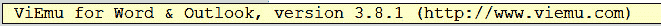

通过输入 `CTRL ALT SHIFT-V` 关闭 ViEmu。图 16-19 显示 ViEmu 不活跃时的状态栏。

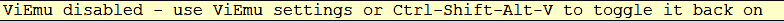

图 16-20 显示插件的可用选项/首选项。

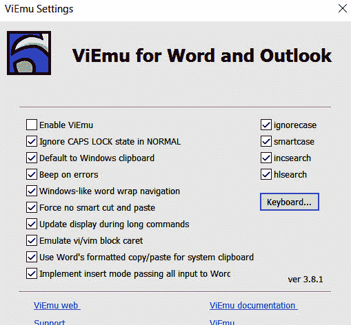

ViEmu 在仿真 `vi` 功能和忠于 Word 之间取得了平衡。插件的行为有一些需要注意的地方，其中一些是由于每个 `vi` 操作或命令最终都通过 Word 传递并由其处理的结果。请考虑以下几点：

* 字体在文档上下文中得以保留。
* 有序列表在被 `vi` 命令重新排列时会自动重新编号（例如，删除列表项并将其放在列表中的其他位置）。我们稍后会展示一个示例。
* 由于 Word 对文档中行组成的理解不同，插件以一种双重性对待文本块。对于正常的上下导航，光标会直观地在屏幕上一行一行地上下移动，就像使用箭头键一样。然而，由于 Word 将段落视为块，插件在使用删除行命令 `dd` 时会删除整个段落。这种工作方式立即可以识别。

下面是一个有序列表魔法的例子，使用 Stephen R. Covey《*高效人士的七个习惯*》（Simon & Schuster）中的前三个习惯。在输入列表时（见 图 16-21），我们意识到习惯的顺序是错误的。请注意光标位于第 2 个习惯上。

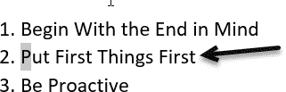

我们输入 `vi` 命令交换行，`ddp`，瞧！它们现在顺序正确了。见 图 16-22。

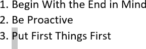

再次强调，所有这些行为都会变得舒适且熟悉。作为对 ViEmu 健壮性的开胃菜和保证，这里是一份已观察并验证的功能部分列表：

* 在对象中更改/删除：
  * 在圆括号中：`ci(`, `di(`
  * 在方括号中：`ci[`, `di[`
  * 在大括号中：`ci{`, `di{`
* 删除对象（删除*包括*包围字符）：
  * 在圆括号处：`da(`
  * 在方括号处：`da[`
  * 在大括号处：`da{`
* 完整且可选的正则表达式支持。您可以设置插件以遵循您喜欢的正则表达式风格。
* 完整文档位于 [*http://www.viemu.com/wo/viemu\_doc.html*](http://www.viemu.com/wo/viemu_doc.html)—永远是一个大加分项！

如何使用 ViEmu 的其余部分留给您自行探索。如果您经常使用 Word 并偏好 Vim 行为，值得一看。

插件网站描述了可用选项和定价。

# 值得一提：具有部分 vi 功能的工具

很难定义什么是 *是* 和什么 *不是* `vi`。以正则表达式为例，它在 `vi` 和 Vim 出现前多年就已存在。然而，一些工具内置了一些便利功能，值得提及，因为它们具有 `vi` 的某些精髓：强大的快速编辑、强大的搜索和替换等等。我们在此提及它们是为了突出具有此类功能的工具确实存在且值得寻找。

## Google Mail

Google Mail 有自己的一套映射键盘快捷键。您会发现其中一些导航映射相当熟悉。对于大多数交互，`j` 和 `k` 足以浏览邮件列表。`s` “选择”当前行以进行任何操作。`x` 删除由 `s` 选择的任何邮件。`mU` 将选中的邮件标记为未读。`ENTER` 打开当前邮件。

在打开的邮件中，`x` 删除邮件，而 `u` 将您“上移”到邮件列表。

要获取键盘快捷键的完整列表，请在列表面板中输入 `?`（不在输入模式下）。

## Microsoft PowerToys

微软有一个附加组件，[PowerToys](https://docs.microsoft.com/en-us/windows/powertoys)，它提供了大量酷炫的附加功能来改进 Windows。其中大多数超出了本书的范围。然而，一个值得提及的工具是 PowerToys 的 PowerRename 实用程序。它提供了一种稳健的方式，使用标准一次性重命名许多文件，从而完成通常需要长时间且繁琐的逐个操作。PowerRename 与类似工具的区别在于能够使用正则表达式来识别要重命名的文件并确定重命名的方式。

PowerToys 还具有强大的键盘映射工具 Keyboard Manager，可让您按自己的喜好映射键盘。虽然在 Windows 桌面上导航不太可能感觉像 `vi` 体验，但至少现在有一种简单的方法可以将操作映射到类似 `vi` 的击键。其他、之前的键盘管理器要么不是免费的，要么不易管理，或两者兼有。

# 总结

从众所周知的命令行历史编辑示例，到 IDE 等软件生态系统，再到互联网浏览器，很明显 `vi` 是一种流行的编辑范式。据说，Microsoft Word ViEmu 插件的作者 Jon 收到了微软工程师对他插件的请求！我们发现几乎所有评分最高和最受欢迎的文本编辑器要么包含 Vim 仿真设置，要么具有仿真 Vim 行为的插件。甚至 Emacs 也有 Viper，这是一个可安装的 `vi` 仿真插件！（见章节 “味道好，填充少”。）因此，如果您坐到一个新环境，请环顾四周或询问他人 `vi`/Vim 设置或插件在哪里。它很可能存在。

^(1) 我们不会讨论 `csh`，除非提到原始的 `csh` 和 `vi` 由同一个人编写：Bill Joy，当时他在加州大学伯克利分校读研究生。我们还注意到几乎所有 shell 都实现 Bourne shell 语言，而 `csh` 则不同。

^(2) 感谢 Bash 的维护者 Chet Ramey 提供此提示。

^(3) 对于 Emacs 用户，这通常是您的反向历史搜索键组合。`vi` 的反向搜索 simply 是 `/`（通过按 `ESC` 启动历史搜索模式后）。

^(4) Korn shell 仍然 [可用](https://github.com/ksh93/ksh) 并且正在更新。

^(5) [NetBeans](https://netbeans.org) 是一个用于 Java、JavaScript、HTML5、PHP、C/C++ 等语言的开源 IDE。Vim 的 NetBeans 接口允许它在 NetBeans 内用作编辑器。

^(6) 请记住，`^M` 是 Vim 显示回车的方式，您可以通过输入 `CTRL-V CTRL-M` 输入。见章节 “使用 map 命令”。
