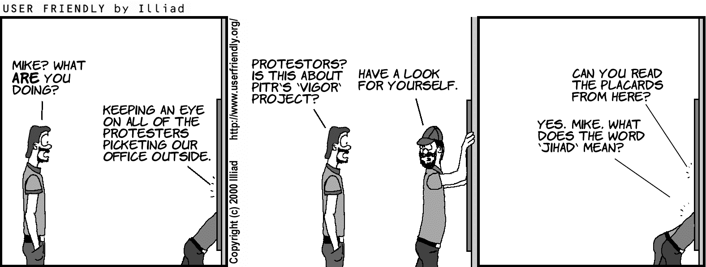
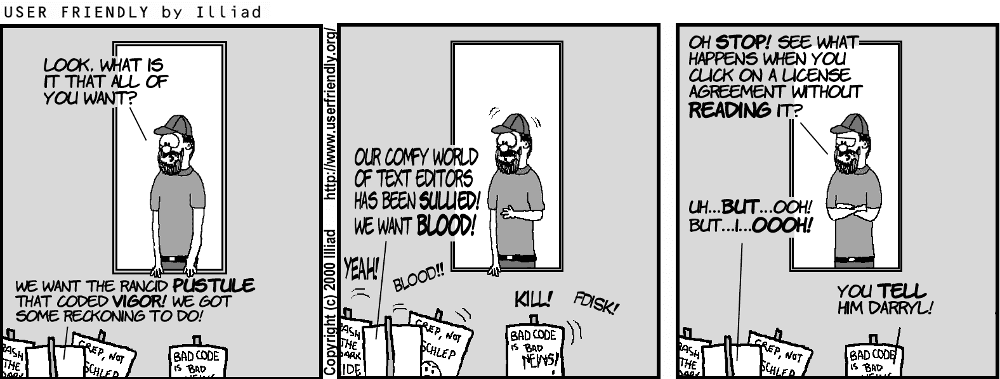
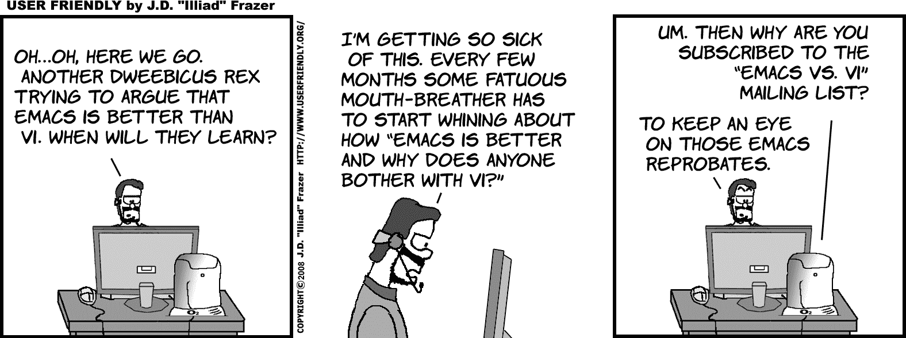

## 附录 B. 设置选项
本附录描述了“ Heirloom ” `vi`、Solaris `/usr/xpg7/bin/vi` 和 Vim 8.2 的重要 `set` 命令选项。

## Heirloom 和 Solaris vi 选项
表 B-1 包含重要的 `set` 命令选项的简要描述。第一列按字母顺序列出选项；如果选项可以缩写，则该缩写会显示在括号中。第二列显示 `vi` 使用的默认设置，除非你发出显式的 `set` 命令（手动或在 `*.exrc` 文件中）。最后一列描述启用该选项时选项的作用。

表 B-1. “Heirloom” 和 Solaris `vi set` 选项

| 选项 || 默认值 || 描述 |
| --- | --- | --- |
| `autoindent (ai)` || `noai` || 在插入模式下，将每一行缩进到与上方或下方行相同的级别。与 `shiftwidth` 选项一起使用。 |
| --- | --- | --- |
| `autoprint (ap)` || `ap` || 在每个编辑器命令后更改显示。对于全局替换，显示最后一次替换。 |
| `autowrite (aw)` || `noaw` || 如果文件已更改，则在用 `:n` 打开另一个文件之前或在用 `:!` 给出 Unix 命令之前自动写入（保存）文件。 |
| `beautify (bf)` || `nobf` || 在输入期间忽略所有控制字符（除制表符、换行符或换页符外）。 |
| `directory (dir)` || `/var/tmp` || 指定 `ex`/`vi` 存储缓冲区文件的目录。该目录必须可写。 |
| `edcompatible` || `noedcompatible` || 记住最近一次替换命令（全局、确认）使用的标志，并将其用于下一次替换命令。尽管名称如此，没有任何版本的 `ed` 实际执行此操作。 |
| `errorbells (eb)` || `noerrorbells` || 发生错误时响铃。 |
| `exrc (ex)` || `noexrc` || 允许执行位于用户主目录之外的 `*.exrc` 文件。 |
| `flash (fp)` || `fp` || 闪烁屏幕而不是响铃。 |
| `hardtabs (ht)` || `8` || 定义终端硬件制表符的边界。 |
| `ignorecase (ic)` || `noic` || 搜索时忽略大小写。 |
| `lisp` || `nolisp` || 以适当的 Lisp 格式插入缩进。`( )`、`{ }`、`[[` 和 `]]` 被修改以对 Lisp 有意义。 |
| `list` || `nolist` || 将制表符打印为 `^I`；用 `$` 标记行尾。 |
| `magic` || `magic` || 通配符 `.`（点）、`*`（星号）和 `[]`（括号）在模式中有特殊含义。 |
| `mesg` || `mesg` || 在 `vi` 中编辑时允许系统消息显示在终端上。 |
| `novice` || `nonovice` || 要求使用长的 `ex` 命令名称，例如 `copy` 或 `read`。仅限 Solaris `vi`。 |
| `number (nu)` || `nonu` || 在编辑会话期间在屏幕左侧显示行号。 |
| `open` || `open` || 允许从 `ex` 进入 *打开* 或 *可视* 模式。虽然不在 Solaris `vi` 中，但该选项传统上存在于 `vi` 中，可能存在于你的 Unix 版本的 `vi` 中。 |
| `optimize (opt)` || `noopt` || 打印多行时取消行尾的回车符；这在打印带有前导空白（空格或制表符）的行时可加快在哑终端上的输出。 |
| `paragraphs (para)` || `IPLPPPQP` `LIpplpipbp` || 定义由 `{` 或 `}` 移动的段落分隔符。值中的字符对是开始段落的 `troff` 宏的名称。 |
| `prompt` || `prompt` || 当给出 `vi` 的 `Q` 命令时显示 `ex` 提示符（:）。 |
| `readonly (ro)` || `noro` || 除非在写入后使用 `!`，否则文件的任何写入（保存）都会失败（适用于 `w`、`ZZ` 或 `autowrite`）。 |
| `redraw (re)` ||  || 每当进行编辑时重绘屏幕（换句话说，插入模式会覆盖现有字符，已删除的行会立即闭合）。默认值取决于线路速度和终端类型。在哑终端的低速下，`noredraw` 很实用：已删除的行显示为 `@`，插入的文本看起来会覆盖现有文本，直到你按下 ESC。此选项本质上已过时；让 `vi` 选择如何设置它。 |
| `remap` || `remap` || 允许嵌套映射序列。 |
| `report` || `5` || 每当你进行影响至少特定行数的编辑时，在状态行上显示消息。例如，`6dd` 报告消息“已删除 6 行”。 |
| `scroll` || [*½ window*] || 使用 `^D` 和 `^U` 命令滚动的行数。 |
| `sections (sect)` || `SHNHH HU` || 定义 `[[` 和 `]]` 移动的节分隔符。值中的字符对是开始节的 `troff` 宏的名称。 |
| `shell (sh)` || `/bin/sh` || 用于 shell 转义（`:!`）和 shell 命令（`:sh`）的 shell 的路径名。默认值源自 shell 环境，在不同系统上有所不同，但通常为 `/bin/sh`。 |
| `shiftwidth (sw)` || `8` || 定义使用 `autoindent` 选项时向后（`^D`）制表符中的空格数，以及 `<<` 和 `>>` 命令的空格数。 |
| `showmatch (sm)` || `nosm` || 在 `vi` 中，输入 `)` 或 `}` 时， briefly 将光标移动到匹配的 `(` 或 `{`。（如果没有匹配，则响错误消息铃。）对编程非常有用。 |
| `showmode` || `noshowmode` || 在插入模式下，在提示行上显示消息，指示你正在进行的插入类型，例如“OPEN MODE”或“APPEND MODE”。 |
| `slowopen (slow)` ||  || 在插入期间暂停显示。默认值取决于线路速度和终端类型。 |
| `sourceany` || `nosourceany` || 允许读取不由当前用户拥有的 `*.exrc` 文件。“Heirloom” `vi` 仅限。 |
| `tabstop (ts)` || `8` || 定义编辑会话期间制表符缩进的空格数。（打印机仍使用系统制表符 8。） |
| `taglength (tl)` || `0` || 定义标签中重要的字符数。默认值（零）表示所有字符都重要。 |
| `tags` || `tags` `/usr/lib/tags` || 定义包含标签的文件的路径名。参见 Unix `ctags` 命令。默认情况下，`vi` 在当前目录和 `/usr/lib/tags` 中搜索文件 `tags`。 |
| `tagstack` || `tagstack` || 启用在堆栈上堆叠标签位置。仅限 Solaris `vi`。 |
| `term` ||  || 设置终端类型。 |
| `terse` || `noterse` || 显示更短的错误消息。具有讽刺意味的是，此选项没有缩写。 |
| `timeout (to)` || `timeout` || 键盘映射在 1 秒后超时。^a |
| `ttytype` ||  || 设置终端类型。这只是 `term` 的另一个名称。 |
| `warn` || `warn` || 显示警告消息“自上次更改以来未写入”。 |
| `window (w)` ||  || 在屏幕上显示文件的特定行数。默认值取决于线路速度和终端类型。 |
| `wrapmargin (wm)` || `0` || 定义右边界。如果大于零，则自动插入回车符以换行。 |
| `wrapscan (ws)` || `ws` || 将搜索在文件两端环绕。 |
| `writeany (wa)` || `nowa` || 允许保存到任何文件。 |
| ^a 当你有多个键的映射（例如，`:map zzz 3dw`）时，你可能希望使用 `notimeout`。否则，你需要在 1 秒内输入 `zzz`。当你为光标键设置插入模式映射（例如，`:map! ^OB ^[ja`）时，你应使用 `timeout`。否则，`vi` 在你输入另一个键之前不会对 ESC 做出反应。 |
| --- |

## Vim 8.2 选项
在前一节中，我们列出了所有 46 个“Heirloom” 和 Solaris `set` 命令选项。Vim 8.2 有超过 400 个 (!) `set` 命令选项。[表 B-2 列出了我们认为最有用的选项。

大多数 表 B-1 中描述的选项在此未重复。

本表中摘要出于必要非常简短。有关每个选项的更多信息可在 Vim 的在线帮助文件 `options.txt` 中找到。

表 B-2. Vim 8.2 `set` 选项

| 选项 || 默认值 || 描述 |
| --- | --- | --- |
| `autoread (ar)` || `noautoread` || 检测 Vim 内部的文件是否被 Vim 以外的外部修改，并自动使用更改后的文件版本刷新 Vim 缓冲区。 |
| --- | --- | --- |
| `background (bg)` || `dark` or `light` || Vim 尝试使用适合特定终端的背景和前景颜色。默认值取决于当前终端或窗口系统。 |
| `backspace (bs)` || `0` || 控制是否可以退格到换行符上和/或插入开始处。值为 0 表示 `vi` 兼容；1 表示退格到换行符和缩进上；2 表示退格到换行符、插入和缩进的开始处。 |
| `backup (bk)` || `nobackup` || 在覆盖文件之前创建备份，并在文件成功写入后保留该备份。若要在文件写入期间仅保留备份文件，请使用 `writebackup` 选项。另请参阅 `writebackup`。 |
| `backupdir (bdir)` || `., ~/tmp/, ~/` || 备份文件的目录列表，以逗号分隔。备份文件将在列表中第一个可行的目录中创建。如果为空，则无法创建备份文件。名称 `.`（点）表示与编辑文件相同的目录。 |
| `backupext (bex)` || `~` || 附加到文件名以构成备份文件名的字符串。 |
| `binary (bin)` || `nobinary` || 更改若干其他选项以便于编辑二进制文件。当 `bin` 重新关闭时，这些选项的先前值会被记住并恢复。每个缓冲区都有自己的保存选项值集。在编辑二进制文件之前应设置此选项。你也可以使用 `-b` 命令行选项。 |
| `breakat (brk)` || `" ^I!@*-+;:,./?"` || 如果 `set` 选项 `linebreak` 打开，则在 `breakat` 字符串中的任意字符处换行。另请参阅选项 `breakindent`、`linebreak` 和 `showbreak` 以自定义此功能。 |
| `breakindent (bri)` || `nobreakindent` || 缩进由 `breakat` 选项换行的行。 |
| `cdpath (cd)` || Same as value in environment variable `CDPATH` || Vim 将使用 `ex` 命令 `cd` 或 `lcd` 搜索的目录列表，其方式与 shell 中 `$CDPATH` 的工作方式相同。如果你已在 shell 中使用它，这将是熟悉的行为。 |
| `cindent (cin)` || `nocindent` || 启用自动智能 C 程序缩进。 |
| `cinkeys (cink)` || `0{,0},:,0#,!^F, o,O,e` || 一组键，在插入模式下输入时会导致当前行重新缩进。只有在 `cindent` 打开时才会发生。 |
| `cinoptions (cino)` ||  || 影响 `cindent` 重新缩进 C 程序中行的方式。详情请参阅在线帮助。 |
| `cinwords (cinw)` || `if`, `else`, `while`, `do`, `for`, `switch` || 当设置 `smartindent` 或 `cindent` 时，这些关键字会在下一行开始额外缩进。对于 `cindent`，这仅在适当位置（在 `{…}` 内）执行。 |
| `cmdwinheight (cwh)` || number (default 7) || 命令行窗口中的行数。 |
| `colorcolumn (cc)` || empty string || 高亮以逗号分隔列表中列出的列。这对于垂直文本对齐很有用。 |
| `columns (co)` || `80` or terminal width || 通常由 Vim 设置。如果你在启动时有偏好，可以为你的 GUI 实例定义它（如我们其中一人所做的）。另请参阅 `lines`。 |
| `comments (com)` || `s1:/*,mb:*,ex:*/,://, b:#,:%,:XCOMM,n:>,fb:-` || 可以开始注释行的字符串的逗号分隔列表。详情请参阅在线帮助。 |
| `compatible (cp)` || `cp`; `nocp` when a `*.vimrc` or Vim runtime `defaults.vim` file is found || 使 Vim 在太多方面更像 `vi`，无法在此描述。它默认打开，以避免意外。拥有 `*.vimrc` 会关闭 `vi` 兼容性；通常这是理想的副作用。^a |
| `completeopt (cot)` || `menu,preview` || 插入模式补全的选项逗号分隔列表。 |
| `cpoptions (cpo)` || `aABceFs` || 单字符标志的序列，每个标志表示 Vim 会或不会完全模仿 `vi` 的不同方式。当为空时，使用 Vim 默认值。详情请参阅在线帮助。 |
| `cursorcolumn (cuc)` || `nocursorcolumn` || 使用 `CursorColumn` 高亮显示光标所在的屏幕列。这对于垂直对齐文本很有用。可能会减慢屏幕显示速度。 |
| `cursorline (cul)` || `nocursorline` || 使用 `CursorRow` 高亮显示光标所在的屏幕行。使编辑会话中查找当前行变得容易。与 `cursorcolumn` 结合使用可产生十字准线效果。可能会减慢屏幕显示速度。 |
| `cursorlineopt (culopt)` || `string, ""` || 定义 `cursorline` 的行为（必须设置 `cursorline` 才能生效）。最有用的效果是将其设置为 `number`。这仅高亮行号。虽然高亮整行可能有用，但与语法着色一起使用时会变得令人困惑，因为高亮会改变行的颜色和背景。 |
| `define (def)` || `^#\s*define` || 描述宏定义的搜索模式。默认值适用于 C 程序。对于 C++，使用 `^\(#\s*define\ |[a-z]*\s*const\s*[a-z]*\)`。使用 `:set` 命令时，需要将反斜杠加倍。 |
| `dictionary (dict)` || empty string || 用于 `keyword` 补全的文件名逗号分隔列表。 |
| `digraph (dg)` || `nodigraph` || 用于使用 *character1*、BACKSPACE、*character2* 输入双字符。参见讨论 in “Digraphs: 非 ASCII 字符”。 |
| `directory (dir)` || `., ~/tmp, /tmp` || 交换文件的目录名列表，以逗号分隔。交换文件将在第一个可行的目录中创建。如果为空，则不会使用交换文件且无法恢复！名称 `.`（点）表示将交换文件放在与编辑文件相同的目录中。建议在列表中首先使用 `.`，以便两次编辑同一文件时会发出警告。 |
| `equalprg (ep)` ||  || 用于 `=` 命令的外部程序。当此选项为空时，使用内部格式化函数。 |
| `errorfile (ef)` || `errors.err` || quickfix 模式的错误文件名。当使用 `-q` 命令行参数时，`errorfile` 将设置为以下参数。 |
| `errorformat (efm)` || (Too long to print) || 错误文件中行的格式的类似 `scanf` 的描述。 |
| `expandtab (et)` || `noexpandtab` || 插入制表符时，将其扩展为相应数量的空格。 |
| `fileformat (ff)` || `unix` || 描述读取/写入当前缓冲区时终止行的约定。可能的值为 `dos`（CR/LF）、`unix`（LF）和 `mac`（CR）。Vim 通常会自动设置此选项。 |
| `fileformats (ffs)` || `dos,unix` || 列出 Vim 在读取文件时尝试应用的行终止约定。多个名称可启用读取文件时的自动行尾检测。 |
| `fixendofline (fixeol)` || `boolean, on` || 这确保在写入文件时在文件的最后一行附加适当的换行符。如果你不想要此功能，请确保将其关闭。例如，如果你正在编辑二进制文件，则不希望此功能。 |
| `formatoptions (fo)` || Vim default: `tcq`; `vi` default: `vt` || 描述如何进行自动格式化的字母序列。详情请参阅在线帮助。 |
| `gdefault (gd)` || `nogdefault` || 使替换命令更改所有实例。 |
| `guifont (gfn)` ||  || 启动 Vim GUI 版本时尝试的字体逗号分隔列表。 |
| `hidden (hid)` || `nohidden` || 在从窗口卸载时隐藏当前缓冲区，而不是放弃它。 |
| `history (hi)` || Vim default: 20; `vi` default: 0 || 控制命令历史中记住的 `ex` 命令、搜索字符串和表达式的数量。将此设置为一个大数字。计算机内存很便宜！参见章节 “快速通道” 以了解利用命令行历史的示例。 |
| `hlsearch (hls)` || `nohlsearch` || 高亮最近搜索模式的所有匹配项。 |
| `icon` || `noicon` || Vim 尝试更改其运行窗口关联的图标名称。会被 `iconstring` 选项覆盖。 |
| `iconstring` ||  || 用于窗口图标名称的字符串值。 |
| `ignorecase (ic)` || `noignorecase` || 搜索时忽略大小写。另请参阅 `smartcase`。 |
| `include (inc)` || `^#\s*include` || 定义查找 `include` 命令的搜索模式。默认值适用于 C 程序。 |
| `incsearch (is)` || `noincsearch` || 启用增量搜索。 |
| `isfname (isf)` || `@,48-57,/,.,-,_, +,,,$,:,~` || 可以包含在文件名和路径名中的字符列表。非 Unix 系统有不同的默认值。@ 字符代表任何字母字符。它也用于下面描述的其他 `is` *`XXX`* 选项。 |
| `isident (isi)` || `@,48-57,_,192-255` || 可以包含在标识符中的字符列表。非 Unix 系统可能有不同的默认值。 |
| `iskeyword (isk)` || `@,48-57,_,192-255` || 可以包含在关键字中的字符列表。非 Unix 系统可能有不同的默认值。关键字用于搜索和识别，许多命令如 `w`、`[i` 等都使用它。 |
| `isprint (isp)` || `@,161-255` || 可以显示的字符列表。 |
| `laststatus (ls)` || 2 || 控制最后一个窗口何时具有状态行。零表示从不，一表示只有至少有两个窗口时，二表示总是。 |
| `linebreak (lbr)` || `nolinebreak` || 在 `breakat` 定义的字符处换行。Vim 会换行以保持整行可见。 |
| `lines` || `24` or terminal height || 通常由 Vim 设置。如果你使用 GUI 并希望在启动 Vim 时定义行数，这可能很有用。另请参阅 `columns`。 |
| `listchars (lcs)` || eol:$ || 自定义 `list` 选项设置时 Vim 的显示内容。适用于将空格定义为点。（更精细的做法是使用 `lead:.` 和 `trail:.` 定义来定义前导和尾随空格：`:set listchars+=lead:.,trail:.`。） |
| `makeef (mef)` || `/tmp/vim##.err` || `:make` 命令的错误文件名。非 Unix 系统有不同的默认值。`##` 会被数字替换以使名称唯一。 |
| `makeprg (mp)` || `make` || 用于 `:make` 命令的程序。值中的 `%` 和 `#` 会被展开。 |
| `matchpairs (mps)` || `(:),{:},[:]` || 冒号分隔的匹配字符对的逗号分隔定义。这些必须是两个不同的字符。添加 `<:>` 用于 HTML 匹配很有用。`:set matchpairs+="<:>"` |
| `modifiable (ma)` || `modifiable` || 关闭时，不允许对缓冲区进行任何更改。 |
| `mouse` || `a` for GUI, MS-DOS, and Win32 || 在非 GUI 版本的 Vim 中启用鼠标。这适用于 MS-DOS、Win32、QNX `pterm` 和 `xterm`。详情请参阅在线帮助。 |
| `mousehide (mh)` || `nomousehide` || 在输入期间隐藏鼠标指针。当鼠标移动时恢复指针。 |
| `numberwidth (nuw)` || `vi` default: `8`; Vim default: `4` || 定义数字列宽度（使用 `number` 或 `relativenumber` 设置）。Vim 总是使用最后一个位置作为分隔 `space`。我们建议将其设置为至少六。 |
| `paste` || `nopaste` || 更改大量选项，以便使用鼠标将文本粘贴到 Vim 窗口中时不会破坏粘贴的文本。关闭它会将这些选项恢复到先前的值。详情请参阅在线帮助。 |
| `relativenumber (rnu)` || `norelativenumber` || 相对于当前行对窗口左侧的行编号。例如，当前行显示正确的行号，所有上方和下方的行显示相对于当前行的偏移。这对于块命令很有用，无需计数行。 |
| `ruler (ru)` || `noruler` || 显示光标位置的行号和列号。 |
| `scrollbind (scb)` || `noscrollbind` || 将当前窗口绑定为与也设置了 `scrollbind` 的其他窗口一起滚动。适用于 `diff` 比较。 |
| `scrolloff (s0)` || `0` (`5` in `defaults.vim`) || 设置滚动时光标上方或下方最小的行数。适用于在当前位置周围强制显示上下文行。我们喜欢将 `scrolloff` 设置为三。 |
| `scrollopt (sbo)` || `ver,jump` || 定义 `scrollbind` 行为。`ver` 在 `scrollbind` 窗口之间绑定垂直滚动。有关详细讨论，请参阅 Vim 帮助。 |
| `secure` || `nosecure` || 在启动文件中禁用某些类型的命令。如果不拥有 `*.vimrc` 和 `*.exrc` 文件，则自动启用。 |
| `shellpipe (sp)` ||  || 用于将 `:make` 的输出捕获到文件中的 shell 字符串。默认值取决于 shell。 |
| `shellredir (srr)` ||  || 用于将过滤器的输出捕获到临时文件中的 shell 字符串。默认值取决于 shell。 |
| `showbreak (sbr)` || empty string || 在换行的行前插入此字符串。 |
| `showcmd (sc)` || Vim `showcmd`, Unix `noshowcmd`, defined also in `defaults.vim` || 在输入时显示 `vi` 命令模式命令。Vim 在 `ex` 命令模式行的右侧显示命令。例如，`vi` 命令 `5cw` 用于更改五个单词，会在输入时逐步显示。适用于在构建命令时跟踪命令。 |
| `showmode (smd)` || Vim default: `smd`; `vi` default: `nosmd` || 在状态行中为插入、替换和可视模式放置消息。 |
| `sidescroll (ss)` || `0` || 水平滚动多少列。值为零时将光标放在屏幕中间。 |
| `smartcase (scs)` || `nosmartcase` || 如果搜索模式包含大写字符，则覆盖 `ignorecase` 选项。 |
| `spell` || `nospell` || 打开拼写检查。 |
| `spelllang (spl)` || `en` || 拼写检查语言文件的逗号分隔列表。 |
| `suffixes` || `*.bak,~,.o,.h,.info,.swp` || 当文件名补全期间多个文件匹配模式时，此变量的值为它们设置优先级，以便选择 Vim 将使用的文件。 |
| `taglength (tl)` || `0` || 定义标签中重要的字符数。默认值（零）表示所有字符都重要。 |
| `tagrelative (tr)` || Vim default: `tr`; `vi` default: `notr` || 来自其他目录的 `tags` 文件中的文件名被视为相对于 `tags` 文件所在的目录。 |
| `tags (tag)` || `./tags,tags` || `:tag` 命令的文件名，以空格或逗号分隔。开头的 `./` 会被替换为当前文件的完整路径。 |
| `tildeop (top)` || `notildeop` || 使 `~` 命令像操作符一样行为。 |
| `undolevels (ul)` || `1000` || 可以撤销的最大更改数。值为 0 表示 `vi` 兼容性：一个撤销级别且 `u` 会撤销自身。非 Unix 系统可能有不同的默认值。 |
| `viminfo (vi)` ||  || 启动时读取 `viminfo` 文件，退出时写入。值很复杂；它控制 Vim 将存储在文件中的不同类型的信息。详情请参阅在线帮助。 |
| `writebackup (wb)` || `writebackup` || 在覆盖文件之前创建备份。备份在文件成功写入后被删除，除非 `backup` 选项也打开。 |
| ^a 自 Vim 8.0 起，如果存在 Vim 运行时文件 `defaults.vim` 或系统范围的 `defaults.vim`，Vim 会关闭 `compatible`。这是更好的默认行为，解决了新手尝试 Vim 但看不到 Vim 特定行为时的长期抱怨和困惑。 |
| --- |

## 附录 C. vi 的轻松一面
> *当然，`vi` 是用户友好的。它只是对交朋友的对象很挑剔。*
> 
> Anonymous

本附录涉及广泛的 `vi` 相关主题。它涵盖：
* 访问本书中所述以及本书前面所述的文件。
* 第 I 部分 中引用的在线 `vi` 教程。
* 用于您网站的 *vi Powered* 标志（以及其他标志）。
* `vi` 相关周边产品。
* Vim 夹子。
* 多年来人们使用 `vi` 完成的一些不寻常和惊人的事情。
* [*Vi* 爱好者主页](https://thomer.com/vi/vi.html)。
* 一个 *不同的* `vi` 克隆。
* `vi` 与 Emacs 的简要提及。
* 一些不错的 `vi` 相关引言。

## 访问文件
我们在此介绍的许多零碎内容过去曾在互联网上自由可用。可惜现在不再如此。为了解决这个问题，我们创建了一个包含各种文件的 GitHub 仓库。只需克隆 `https://www.github.com/learning-vi/vi-files` 即可制作仓库的自己的副本：

```
```


```
git clone https://www.github.com/learning-vi/vi-files
```

## 示例文件

用作示例的一些文件在 第一部分，“vi 和 Vim 基础” 中，这些文件位于 `book_examples` 目录中。

## clewn 的源代码

`clewn` 程序在 “Clewn GDB 驱动程序” 部分中提到，提供在 `clewn-1.15` 目录中。要构建和安装它，请使用以下简单步骤：

```
cd clewn-1.15
./configure
make
sudo make install
```

# 在线 vi 教程

首先是 Walter Zintz 在 *UnixWorld* 杂志上的在线教程，该教程在 第一部分 中多次提到。

本教程已从其原始网站上消失，但我们在互联网上找到了一个副本，地址为 [*https://www.ele.uri.edu/faculty/vetter/Other-stuff/vi/009-index.html*](https://www.ele.uri.edu/faculty/vetter/Other-stuff/vi/009-index.html)。为了避免在本书出版后仍需依赖该网站保持活跃，我们已将其副本放入我们的 [GitHub 仓库](https://www.github.com/learning-vi/vi-files)。^(1)

在我们的 GitHub 仓库中，教程位于 `unix-world-tutorial` 目录下。如果您使用 Firefox 作为浏览器（例如），只需执行以下操作即可：

```
$ cd unix-world-tutorial
$ firefox ./009-index.html &          Use the browser of your choice
```

本教程涵盖以下主题：

* 编辑器基础
* 行模式地址
* `g`（global）命令
* 替换命令
* 编辑环境（`set` 命令、tags 和 `EXINIT` 和 `.exrc`）
* 地址和列
* 替换命令 `r` 和 `R`
* 自动缩进
* 宏

本教程在多个章节末尾包含测验问题，您可以用它来检验自己对教程内容的吸收程度。或者您可以直接尝试这些问题，看看我们用这本书做得如何！

# vi 驱动！

接下来是 *vi Powered* 标志（图 C-1）。这是一个小 GIF 文件，您可以将其添加到个人网页中以表明您使用 `vi` 创建了它。


该标志位于 [GitHub 仓库](https://www.github.com/learning-vi/vi-files) 中的 `vi-powered` 目录中。

*vi Powered* 标志（由 Antonio Valle 创建）的原始主页是 *http://www.abast.es/~avelle/vi.html*。该页面用西班牙语编写，现已不复存在。现在有一个 [英语主页](https://darryl.com/vi.shtml)，并且它提供了 [添加标志的说明](https://darryl.com/addlogo.html)，包含几个简单的步骤：

1. 下载标志。可从我们的 GitHub 仓库获取，或在您的（图形）网页浏览器中输入 [*https://darryl.com/vipower.gif*](https://darryl.com/vipower.gif)，然后将标志保存到文件，或使用命令行网页检索工具，例如 `wget`。
2. 在适当的位置将以下代码添加到您的网页中：

```
<A HREF="https://darryl.com/vi.shtml">

</A>
```

这会将标志放入您的页面并使其成为超文本链接，选择时将转到 *vi Powered* 主页。您可能希望为非图形浏览器用户在 `` 标签上添加 `ALT="This Web Page is vi Powered"` 属性。
3. 将以下代码添加到您网页的 `<HEAD>` 部分：

```
<META name="editor" content="/usr/bin/vi">
```


正如真正的程序员会放弃所见即所得的文字处理器而选择 `troff`，真正的网页管理员也会放弃花哨的 HTML 作者工具而选择 `vi`。你可以用 `vi Powered` 标志自豪地展示这一事实。☺

你可以在 [`www.vim.org/logos.php`](https://www.vim.org/logos.php) 找到多种变体的 `Vim` 标志。多个用于网站的 `Vim Powered` 标志位于 [`www.vim.org/buttons.php`](https://www.vim.org/buttons.php)。

# Java 爱好者的 vi

尽管标题如此，本小节讲的是你喝的咖啡，而不是你编程用的 Java。

我们假设的真正的程序员在使用 `vi` 编写她的 C++ 代码、`troff` 文档和网页时，无疑偶尔会想要一杯咖啡。她现在可以从印有 `vi` 命令参考的马克杯中喝咖啡！

所以这里是我们的第三项：`vi` 参考马克杯、T 恤、运动衫、烧烤围裙、婴儿兜布，甚至鼠标垫都可以在 [`www.cafepress.com/geekcheat/366808`](https://www.cafepress.com/geekcheat/366808) 购买。

## Vim 离合器

如果用手在 `vi` 或 `Vim` 中切换模式让你感到麻烦，你可能想制作自己的“Vim 离合器”。这个 USB 连接的脚踏板在按下时发送 `i`，释放时发送 `ESC`。

该项目在 [`github.com/alevchuk/vim-clutch`](https://github.com/alevchuk/vim-clutch) 有详细描述，包括零件、链接、说明和照片。

另一个 Vim 离合器展示在 [`l-o-o-s-e-d.net/vim-clutch`](https://l-o-o-s-e-d.net/vim-clutch)。在介绍过程中，作者还描述了除他自己之外几个其他的 Vim 离合器项目。

## 惊艳你的朋友！

与 `vi` 相关的有用物品集合曾经在 [alf.uib.no](http://alf.uib.no/) 的 FTP 档案中提供。原始档案位于 `ftp://afl.uib.no/pub/vi`。该集合被镜像在 `ftp://ftp.uu.net/pub/text-processing/vi`。这两个站点现在都已不可用。

幸运的是，Clement Cole 将他的档案副本提供给我们，以便收录到我们的 [GitHub 仓库](https://www.github.com/learning-vi/vi-files) 中，我们对此表示感谢。^2

不幸的是，这些文件最后更新于 1995 年 5 月。幸运的是，`vi` 的基本功能没有改变，档案中的许多信息和宏仍然有用。原始档案有四个子目录：

* `docs`
: 关于 `vi` 的文档，还有一些 `comp.editors` 帖子。

* `macros`
: `vi` 宏。

* `comp.editors`
: 发布到 `comp.editors` 的各种资料。

* `programs`
: 各种平台的 `vi` 克隆（以及其他程序）的源代码。

由于该目录今天大多已无关紧要，我们未包含 `programs` 目录。

`docs` 和 `macros` 最有趣。`docs` 目录包含大量文章和参考资料，包括初学者指南、错误解释、快速参考，以及许多简短的“如何做”类文章（例如，如何在 `vi` 中仅大写句子的第一个字母）。甚至还有一首关于 `vi` 的歌曲！

`macros` 目录中有 50 多个文件，各自执行不同的功能。我们在此仅提及其中三个。原始归档名称以 `.tar.Z` 结尾的文件已在我们的 [GitHub 仓库](https://www.github.com/learning-vi/vi-files) 中展开为独立目录。

* `evi-tar`
: 一个 Emacs“模拟器”。其思路是将 `vi` 变成无模式编辑器（始终处于输入模式，命令通过控制键执行）。实际上它是通过一个替换 `EXINIT` 环境变量的 shell 脚本实现的。

* `hanoi`
: 这或许是 `vi` 的不寻常用途中最著名的：一个解决汉诺塔编程问题的宏集。该程序仅显示移动步骤；它不会实际绘制圆盘。为有趣起见，我们已在 “汉诺塔，vi 版本” 中重印了它。

* `turing-tar`
: 该程序使用 `vi` 实现了一台真正的图灵机！观看它执行程序相当令人惊叹。

除此之外还有许多、许多有趣的宏；请自行查看！

## Vi 爱好者主页

[Vi 爱好者主页](http://www.thomer.com/vi/vi.html) 包含以下内容：

* 所有已知 `vi` 克隆的表格，并附有源代码或二进制发行版的链接
* 指向其他 `vi` 站点的链接
* 大量指向不同级别的 `vi` 文档、手册、帮助和教程的链接
* 用于编写 HTML 文档和解决汉诺塔问题的 `vi` 宏，以及其他宏集的 FTP 站点
* 杂项 `vi` 链接：诗歌、关于 `vi`“真实历史”的故事、`vi` 与 Emacs 的讨论，以及 `vi` 咖啡杯（参见章节 “Java 爱好者的 vi”）

请注意，该网站似乎很久没有更新了。许多链接有效，但许多无效。

## 另一种 vi 克隆

图 C-2 至 C-9 中描绘了 `vigor` 的故事，这是一种不同的 `vi` 克隆。



`vigor` 的源代码可在 [`vigor.sourceforge.net`](http://vigor.sourceforge.net) 获取。

## 味道好，填充少

```
vi is [[13~^[[15~^[[15~^[[19~^[[18~^ a
muk[^[[29~^[[34~^[[26~^[[32~^ch better editor than this emacs. I know
I^[[14~'ll get flamed for this but the truth has to be
said. ^[[D^[[D^[[D^[[D ^[[D^[^[[D^[[D^[[B^
exit ^X^C quit :x :wq dang it :w:w:w :x ^C^C^Z^D
```


> — Jesper Lauridsen 来自 `alt.religion.emacs`
>
> rorschak@daimi.aau.dk

我们无法在讨论 Unix 文化中的 `vi` 时不承认 Unix 社区中或许是最持久的争论：`vi` 与 `Emacs`。^(3)

关于哪个更好的讨论在 `comp.editors`（以及其他新闻组）中年复一年地出现。（这在图 C-10 中得到了很好的说明。）



支持 `vi` 的一些更好论点如下：

* `vi` 可在每个 Unix 系统上使用。如果你正在安装系统或在系统间迁移，你可能无论如何都得使用 `vi`。
* 你通常可以让手指保持在键盘的主行上。对于盲打用户来说这是一个很大的优势。
* 命令通常是一个（有时是两个）普通字符；它们比 `Emacs` 所需的所有控制键和元字符要容易得多。
* `vi` 通常比 `Emacs` 更小、资源消耗更少。启动时间明显更快，有时快达十倍。
* 现在 `Vim`（以及其他 `vi` 克隆）已添加诸如增量搜索、多个窗口和缓冲区、图形界面、语法高亮和智能缩进，以及通过扩展语言实现的编程能力等功能，两者之间的功能差距已显著缩小，甚至可以说完全消失了。

为了完整起见，还应提及一点。虽然 GNU `Emacs` 一直有 `vi` 仿真包，但它们通常并不太好。然而，`viper-mode` 据称是优秀的 `vi` 仿真。它可以作为希望学习 `Emacs` 的用户的桥梁。

总之，请始终记住你是程序实用性的最终评判者。你应该使用能让你最高效的工具，对于许多任务来说，`vi` 和 `Vim` 都是优秀的工具。

# vi 名言

最后，这里还有一些 `vi` 名言，谨致谢于 `Vim` 的作者 Bram Moolenaar：

> 定理：`vi` 是完美的。
>
> 证明：VI 用罗马数字表示为 6。小于 6 且能整除 6 的自然数是 1、2 和 3。1 + 2 + 3 = 6。所以 6 是完全数。因此，`vi` 是完美的。
>
> —Arthur Tateishi

Nathan T. Oelger 的回应：

> 那么，以上说法把 `Vim` 放在什么位置呢？VIM 用罗马数字可能表示为：(1000 – (5 + 1)) = 994，这恰好等于 2*496+2。496 可被 1、2、4、8、16、31、62、124 和 248 整除，且 1+2+4+8+16+31+62+124+248 = 496。所以，496 是完全数。因此，`Vim` 比 `vi` 完美两倍，外加一些额外的好东西。☺
>
> 也就是说，`Vim` 比完美更好。

这段引言似乎总结了真正的 `vi` 爱好者的观点：

> 对我来说 `vi` 就是禅。用 `vi` 就是修行禅。每条命令都是一个公案。对使用者而言意味深长，对初学者则难以理解。你每次使用它时都会发现真理。
>
> —Satish Reddy

^(1) 本复印件中的网页页脚指向我们找到它们的来源。当你查看我们的复印件时，该网站可能在线也可能不在线。

^(2) 同时也要感谢 Bakul Shah，他指出了我们在 [*https://web.archive.org/web/19970209203017/http://archive.uwp.edu/pub/vi/*](https://web.archive.org/web/19970209203017/http://archive.uwp.edu/pub/vi/) 可在线获取的复印件。

^(3) 好吧，这其实是一场宗教战争，但我们尽量保持礼貌。另一场宗教战争，BSD 与 System V，已由 POSIX 解决。System V 获胜，尽管 BSD 获得了重大让步。☺
