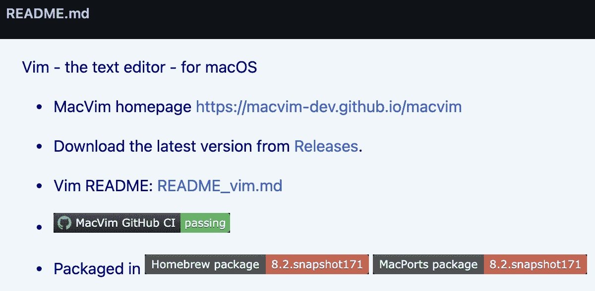
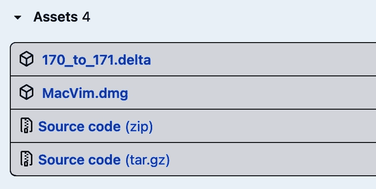

## 附录 D. vi 和 Vim：源代码与构建

万一你的系统上尚未安装 `vi` 或 `Vim`，本附录描述了如何获取这两个编辑器的源代码，以及大多数流行操作系统的预编译可安装二进制文件。

## 与原版不同

许多年里，原版 `vi` 的源代码在没有 Unix 源代码许可的情况下无法获得。虽然教育机构能够以相对低廉的成本获得许可，但商业许可一直很昂贵。这一事实促使 `Vim` 以及许多其他 `vi` 克隆的诞生。

2002 年 1 月，V7 和 32V UNIX 的源代码在类开源许可下发布。^(1) 这使得几乎所有为 BSD Unix 开发的代码都可以访问，包括 `ex` 和 `vi`。

原始代码在现代系统（如 GNU/Linux）上无法“开箱即用”编译，移植它也很困难。^(2) 幸运的是，这项工作已经完成。如果你想使用原始的、“真正的” `vi`，你可以下载源代码自行构建。有关更多信息，请参阅 [*https://github.com/n-t-roff/heirloom-ex-vi*](https://github.com/n-t-roff/heirloom-ex-vi)。

我们只是在 Ubuntu GNU/Linux 系统上按照 `README` 文件中的说明操作，就毫无问题地构建了“传家宝” `vi`。

## 如何获取 Vim

大多数现代类 Unix 操作系统使用 `Vim` 作为 `vi` 的标准版本。^(3) 也就是说，当你执行 `vi` 时，得到的是 `Vim`。

此类系统中的许多系统略微落后于最新 `Vim`。例如，截至本出版物（第八版，2021 年底），当前版本为 `Vim` 8.2，而大多数系统仍使用 `Vim` 8.0。

本节简要讨论如何在 GNU/Linux（本例中为 Ubuntu）上安装最新版本的 `Vim`（或你喜欢的任何版本）。对于其他 GNU/Linux 发行版，过程基本相同。

如果 `vi` 或 `vim` 命令无法启动你的编辑器，要么它未安装，要么你的路径不包含 `Vim` 的可执行目录。请确保你的 `PATH` 环境变量包含以下目录。（如果失败，可能 `Vim` 未安装。请继续阅读安装 `Vim` 的说明。）

/usr/bin               This should be in your $PATH anyway
/bin                   So should this
/opt/local/bin
/usr/local/bin

使用 `ex` 命令 `version` 验证你的 `Vim` 版本。`Vim` 会显示类似以下内容：

```
VIM - Vi IMproved 8.2 (2019 Dec 12, compiled May  8 2021 05:44:12)
macOS version
Included patches: 1-2029
Compiled by root@apple.com
Normal version without GUI.  Features included (+) or not (-):
+acl               -farsi             +mouse_sgr         +tag_binary
-arabic            +file_in_path      -mouse_sysmouse    -tag_old_static
+autocmd           +find_in_path      -mouse_urxvt       -tag_any_white
+autochdir         +float             +mouse_xterm       -tcl
-autoservername    +folding           +multi_byte        -termguicolors
-balloon_eval      -footer            +multi_lang        +terminal
-balloon_eval_term +fork()            -mzscheme          +terminfo
-browse            -gettext           +netbeans_intg     +termresponse
+builtin_terms     -hangul_input      +num64             +textobjects
+byte_offset       +iconv             +packages          +textprop
+channel           +insert_expand     +path_extra        +timers
+cindent           -ipv6              -perl              +title
-clientserver      +job               +persistent_undo   -toolbar
+clipboard         +jumplist          +popupwin          +user_commands
+cmdline_compl     -keymap            +postscript        -vartabs
+cmdline_hist      +lambda            +printer           +vertsplit
```


+cmdline_info      -langmap           -profile           +virtualedit
+comments          +libcall           +python/dyn        +visual
-conceal           +linebreak         -python3           +visualextra
+cryptv            +lispindent        +quickfix          +viminfo
+cscope            +listcmds          +reltime           +vreplace
+cursorbind        +localmap          -rightleft         +wildignore
+cursorshape       -lua               +ruby/dyn          +wildmenu
+dialog_con        +menu              +scrollbind        +windows
+diff              +mksession         +signs             +writebackup
+digraphs          +modify_fname      +smartindent       -X11
-dnd               +mouse             -sound             -xfontset
-ebcdic            -mouseshape        +spell             -xim
-emacs_tags        -mouse_dec         +startuptime       -xpm
+eval              -mouse_gpm         +statusline        -xsmp
+ex_extra          -mouse_jsbterm     -sun_workshop      -xterm_clipboard
+extra_search      -mouse_netterm     +syntax            -xterm_save

系统 vimrc 文件：`"$VIM/vimrc"`
用户 vimrc 文件：`"$HOME/.vimrc"`
第二个用户 vimrc 文件：`"~/.vim/vimrc"`
用户 exrc 文件：`"$HOME/.exrc"`
默认文件：`"$VIMRUNTIME/defaults.vim"`
$VIM 的回退：`"/usr/share/vim"`

编译：`gcc` -c -I. -Iproto -DHAVE_CONFIG_H   -DMACOS_X_UNIX  -g -O2
-U_FORTIFY_SOURCE -D_FORTIFY_SOURCE=1
链接：`gcc`   -L`/usr/local/lib` -o vim  -lm -lncurses  -liconv -framework Cocoa

如果你看到最新发行版/版本，并且这就是你想要的，那么就完成了。如果想要不同版本，请继续阅读。

### 注意

有趣的是，在作者的一台安装了 OS X 版本 10.4.10 的 Mac mini 上，不仅 `vi` 命令调用了 Vim，而且文档（“man 手册页”）也引用了 Vim！

如果以上任何措施都不起作用，你可能没有安装 Vim。Vim 有多种形式适用于多种平台，并且通常相对容易获取和安装。以下各节将指导你为你的平台获取 Vim，顺序如下：

* Unix 及变体，包括 GNU/Linux 和 Cygwin
* Windows XP 及更高版本
* Macintosh macOS

### 注意

这里描述的安装过程需要能够编译源代码的开发环境。虽然大多数 Unix 变体都提供编译器和相关工具，但有些（尤其是 Ubuntu GNU/Linux 的当前发行版）要求你在体验编译代码的乐趣之前下载并安装额外的软件包。

也有预打包的 Vim 套件，为 GNU/Linux（Red Hat RPMs、Debian pkgs）、Solaris（Companion Software）和 HP-UX 提供易于标准的安装。Vim 主页为所有这些系统提供了链接。对于不常见的系统，互联网搜索无疑会证明很有帮助。

快速检查 `gcc` 可以判断你是否已准备好编译 Vim：

```
$ type gcc
gcc is /usr/bin/gcc
```

## 在 Unix 和 GNU/Linux 上获取 Vim

许多现代 Unix 环境已自带某种版本的 Vim。大多数 GNU/Linux 发行版只是将默认的 `vi` 位置 `/usr/bin/vi` 链接到 Vim 可执行文件。大多数用户永远不需要安装它。如书中前面所述，Solaris 11 的 `vi` 实际上就是 Vim！

在 Ubuntu GNU/Linux 系统上，`vi` 安装的是 Vim 的精简版。要获得包含 GUI 的完整版本，请执行：

```
sudo apt install vim-gtk3
```

在其他系统上，你需要使用系统的包管理器执行类似操作。

由于 Unix 有很多变体，且某些变体（如 Solaris、HP-UX、*BSD 以及所有 GNU/Linux 发行版）又有许多分支，如果你无法使用包管理器安装 Vim，那么最直接的方法就是下载其源代码、编译并安装它。

Vim 以压缩的 tar 文件分发（使用 `gzip` 或 `bzip2` 文件——分别为 `.gz` 和 `.bz2`）。除了 tar 文件外，每个主要版本还附带一些补丁，用于修复在前一主要版本发布后发现的问题或错误。

可以下载 tar 文件和补丁文件，然后逐个应用补丁以便从最新源代码构建。然而，这个过程很繁琐，因为任何给定版本通常都有数百个补丁文件。

相反，直接从 GitHub 上的 [Vim 的 Git 仓库](https://github.com/vim/vim) `clone` 源代码要容易得多。这样做会产生类似以下的输出：

```
$ git clone git://github.com/vim/vim
Cloning into 'vim'...
remote: Enumerating objects: 34, done.
remote: Counting objects: 100% (34/34), done.
remote: Compressing objects: 100% (27/27), done.
Receiving objects: 100% (113446/113446), 90.87 MiB | 1.07 MiB/s, done.
Resolving deltas: 100% (95729/95729), done.
Updating files: 100% (3347/3347), done.
```

要构建，请切换到 `src` 目录并运行 `configure`。在运行之前，你可能需要先在网上查阅有关 `configure` 选项的信息。输出非常庞大：

```
$ cd vim/src
$ ./configure
configure: creating cache auto/config.cache
checking whether make sets $(MAKE)... yes
checking for gcc... gcc
checking whether the C compiler works... yes
checking for C compiler default output file name... a.out
checking for suffix of executables...
...
```

下一步是运行 `make`。这里的输出同样非常庞大：

```
$ make
/bin/sh install-sh -c -d objects
touch objects/.dirstamp
CC="gcc -Iproto -DHAVE_CONFIG_H       " srcdir=. sh ./osdef.sh
gcc -c -I. -Iproto -DHAVE_CONFIG_H     -g -O2 -U_FORTIFY_SOURCE
-D_FORTIFY_SOURCE=1        -o objects/arabic.o arabic.c
gcc -c -I. -Iproto -DHAVE_CONFIG_H     -g -O2 -U_FORTIFY_SOURCE
-D_FORTIFY_SOURCE=1        -o objects/arglist.o arglist.c
gcc -c -I. -Iproto -DHAVE_CONFIG_H     -g -O2 -U_FORTIFY_SOURCE
-D_FORTIFY_SOURCE=1        -o objects/autocmd.o autocmd.c
...
```


完成后，你将拥有一个名为 `vim` 的可执行文件。要安装它，请切换到 `root` 用户并运行 `make install`。就这样！

## 获取 Windows 环境下的 Vim

### MS Windows gvim

Microsoft Windows 有三种主要选项。第一个是自安装的可执行文件 `gvim82.exe`，可从 Vim 主页获得。下载并运行它，它应该会完成剩余工作。我们已在不同的 Windows 机器上使用此可执行文件安装 Vim，并且它一直都能干净地运行。该二进制文件应能正确安装在 Windows XP 及更高版本的所有 MS-Windows 系统上。

#### 注

安装过程中某个阶段，会弹出一个 DOS 窗口并给出关于某些内容无法验证的警告。我们从未见过这成为问题。

### Cygwin for Windows

Windows 用户的第二个选项是安装 [Cygwin](http://www.cygwin.com)，一套移植到 Windows 平台的常用 GNU 工具。它几乎是 Unix 平台上使用的所有主流软件的完整实现。Vim 是标准 Cygwin 安装的一部分，并在 Cygwin shell 控制台中运行。

### Windows Subsystem for Linux 和 Vim

Windows Subsystem for Linux (WSL) 是一个具有完整 Linux 内核兼容性的虚拟环境。它是 Microsoft 用于安装和运行 GNU/Linux 发行版的平台。发行版列表不断增长，大多数喜爱的 GNU/Linux 发行版都可用。

有关 WSL 的更多讨论，请参阅章节 “在 Microsoft Windows WSL 中运行 gvim”。

#### 注

WSL 是 Microsoft Windows 的一个相对较新的补充。虽然我们没有详细介绍 WSL，但我们认为它是一个更好的选择，并推荐在 WSL 中使用 GNU/Linux 和 Vim 而非前面提到的 Cygwin。

## 获取 Macintosh 环境下的 Vim

在 macOS 下使用 Vim 有两种选项。您可以使用原生版本，也可以使用 Homebrew 安装图形版本。本节介绍这两种选项。

### 原生 macOS Vim

macOS 将 Vim 作为标准工具包含在内。由于操作系统更新也会保持 Vim 最新，使用 Apple 的默认版本最简单。值得注意的是，macOS 的 Vim 不是 GUI，但有一个流行的第三方 GUI 版本的 Vim，名为 MacVim，我们推荐使用。

MacVim 积极维护，并且具有熟悉的类似 Macintosh 的外观和感觉，因为其维护者遵循常见的 Macintosh 风格和人体工程学。

在 [MacVim 的 GitHub 页面](https://github.com/macvim-dev/macvim) 底部，您会找到 图 D-1 中显示的 `README.md` 信息。



从“从 Releases 下载最新版本”中点击 `Releases`。在该页面底部附近，查看 `Assets`。 （参见 图 D-2。）我们建议下载 `MacVim.dmg` 并执行标准的 macOS 安装。



#### 提示

我们中的一位在他的 MacBook Pro 上使用 `zsh` 别名，通过在他的 `.zshrc` 配置文件中添加这一行：

```
alias vi='/Applications/MacVim.app/Contents/bin/mvim'
```

### 使用 Homebrew 安装 Vim

喜欢更像 GNU 的操作系统的 Macintosh 用户可能熟悉 [Homebrew](https://brew.sh)，它是一个为 Macintosh 计算机提供 GNU 包的应用程序管理器。

Homebrew 的 GNU 包安装命令 simply 为 `brew install gnu-package`，其中 `gnu-package` 是任何可用的 Homebrew 包。要使用 Homebrew 安装 Vim，请执行以下命令：

```
brew install vim
```


Visit [“Homebrew Formulae”](https://formulae.brew.sh/formula/vim) for more detailed information about Homebrew Vim options.

## Other Operating Systems

Vim’s *vi\_diff.txt* help file lists more environments for which Vim is supported. Read this file for more information. The environments include:

*   IBM OS/390
*   OpenVMS
*   QNX

A number of now-obsolete systems were supported in the past, but they are likely no longer of interest.

^(1) For more information about this, see the [Unix Heritage Society website](https://www.tuhs.org).

^(2) We know. We tried.

^(3) The exceptions tend to be legacy Unix-based systems, such as HP/UX and AIX, where the standard `vi` is the original one.
