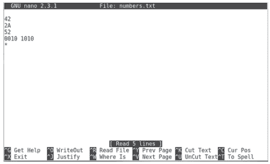
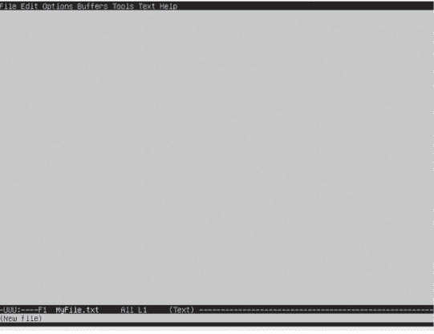
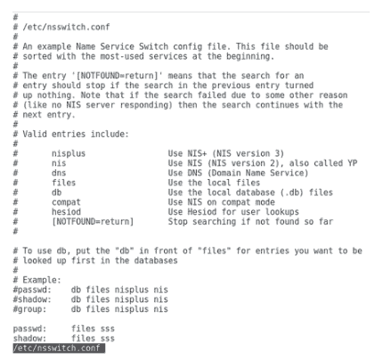

## 第 1 章

## 探索 Linux 命令行工具

### 目标

- ✓ 103.1 在命令行工作
- ✓ 103.2 使用过滤器处理文本流
- ✓ 103.4 使用流、管道和重定向
- ✓ 103.7 使用正则表达式搜索文本文件
- ✓ 103.8 基本文件编辑


在 Linux 的早期岁月里，要完成任何事情，你都必须使用 *GNU/Linux shell*。shell 是一种特殊的交互式实用工具，允许用户运行程序、管理文件、监督进程等。shell 提供了一个提示符，你可以在其中输入基于文本的命令。这些命令实际上是程序。尽管这些程序多达数千个，但本章将重点介绍一些基本命令以及 shell 的基础概念。

### 了解命令行基础

你很可能已经多次接触过本章中许多命令，但你可能并不了解所有命令，而且可能存在一些你使用不当的 shell 命令。此外，你可能对发行版持有错误的观念。因此，我们将从基础开始，例如发行版差异、如何进入 shell、可用的各种 shell 选项、如何使用 shell 等等。

### 讨论发行版

在探讨 shell 之前，一个重要的讨论话题是发行版（也称为 *distros*）。尽管很容易认为 Linux 发行版都大同小异，仅存在少数差异，但这是一种谬误。将 Linux 内核视为汽车的发动机，将发行版视为汽车的功能。在不同制造商和车型之间，汽车功能通常各不相同。如果你使用租来的汽车，在驾驶之前，你需要花几分钟调整座椅、查看各种汽车控件，并弄清楚如何使用它们。不同的发行版也是如此。尽管它们都以 Linux 内核（汽车发动机）为核心，但其各种功能各不相同，这可能包括命令行上的差异。

> 如果你希望跟随本书尝试其中的各种命令，了解应使用哪些发行版会很有帮助。由于 LPIC-1 V5.0 认证考试发布后不会更改，因此最好使用考试开发期间可用的一系列 Linux 发行版。认为使用发行版的最新版本更好是错误的。相反，使用我们撰写本书时所用的相同发行版也是可以的，它们分别是 CentOS 7 Everything、Ubuntu Desktop 18.04 LTS、Fedora 29 Workstation 和 openSUSE 15 Leap 发行版。

### 进入 shell

安装 Linux 系统或虚拟环境发行版，设置并启动后，你通常可以通过按下 Ctrl+Alt+F2 键组合（进入 tty2 终端）到达命令行终端，并使用标准用户帐户（不具备超级用户权限）登录。通常，在安装 Linux 发行版时会创建标准用户帐户。

如果你想使用 Linux 发行版的图形用户界面 (GUI)，可以登录，然后打开终端模拟器，通过以下方式进入命令行：

- 在 Ubuntu Workstation 发行版上，按 Ctrl+Alt+T。
- 在 CentOS 7 Everything 和 Fedora 29 Workstation 发行版上，单击 Activities 菜单选项，在搜索栏中输入 **term**，然后选择出现的终端图标。
- 在 openSUSE 15 Leap 发行版上，单击屏幕左下角的 Application Menu 图标，在搜索栏中输入 **term**，然后选择出现的终端图标之一。

### 探索 Linux Shell 选项

当你成功登录到 tty 终端（例如 tty2）或打开 GUI 终端模拟器程序以到达命令行提示符时，提供该提示符的程序就是 shell。虽然 Bash shell 程序是最流行的，也是各种 Linux 发行版最常用的，但还有几种你需要了解：

### Bash

GNU Bourne Again shell (Bash) 最初于 1989 年发布，通常用作 Linux 用户帐户的默认 shell。Bash shell 由 GNU 项目开发，用于取代标准 Unix 操作系统 shell（即 Bourne shell，以其创建者命名）。它也可用于 Windows 10、macOS 和 Solaris 操作系统。

### Dash

Debian Almquist shell (Dash) 最初于 2002 年发布。这个较小的 shell 不允许命令行编辑或命令历史（本章后面将介绍），但它提供更快的 shell 程序（也称为 _脚本_）执行。

### KornShell

KornShell 最初于 1983 年发布，但在 2000 年之前是专有软件。它由 Bell Labs 的 David Korn 发明。它是一种与 Bourne shell 兼容的编程 shell，但支持高级编程功能，例如 C 编程语言中可用的功能。

### tcsh

TENEX C shell 最初于 1981 年发布，是 C Shell 的升级版。它添加了命令补全功能，这是 TENEX 操作系统中的一个不错的功能。此外，tcsh 将 C 编程语言的元素融入 shell 脚本中。

### Z shell

Z shell 首次发布于 1990 年。这个高级 shell 结合了 Bash、tcsh 和 KornShell 的功能。它提供的扩展 Bourne shell 组件包括高级编程功能、共享历史文件和主题提示符等。

在查看 shell 时，理解 /bin/sh 文件的历史和当前用法非常重要。最初，这个文件是系统 shell 的位置。例如，在 Unix 系统上，你通常会发现此处安装了 Bourne shell。在 Linux 系统上，/bin/sh 文件现在是指向 shell 的符号链接（第 4 章将介绍）。通常，该文件指向 Bash shell (bash)，如 CentOS 发行版上的清单 1.1 所示，通过 readlink 命令显示。

### 清单 1.1：显示 CentOS 发行版上 /bin/sh 指向的 shell

```
$ readlink /bin/sh
bash
$
```

始终检查该文件链接到哪个 shell 是个好主意。在清单 1.2 中，你可以看到 /bin/sh 文件是指向 Dash shell (dash) 的符号链接。

### 清单 1.2：显示 Ubuntu 发行版上 /bin/sh 指向的 shell

```
$ readlink /bin/sh
dash
$
```

要快速确定命令行中使用的是哪个 shell，可以使用环境变量（环境变量将在本章后面详细介绍）以及 echo 命令。echo 命令允许你将数据显示到屏幕上。在清单 1.3 中，在 CentOS 发行版上，环境变量 (SHELL) 的数据（当前 shell 程序）通过 echo 命令显示。在变量名称前添加 $ 是为了访问该变量中存储的数据。

### 清单 1.3：显示 CentOS 发行版上的当前 shell

```
$ echo $SHELL
/bin/bash
$
$ echo $BASH_VERSION
4.2.46(2)-release
$
```

请注意，在清单 1.3 中，当前 shell 是 Bash (/bin/bash) shell。你也可以通过 BASH_VERSION 环境变量显示 Bash shell 的当前版本，如清单所示。

在探索 shell 环境时，你还应该了解系统 Linux 内核的相关信息。uname 实用工具对此很有帮助。清单 1.4 中显示了一些示例。


## 列表 1.4：在 Ubuntu 发行版中显示当前 shell

```
$ uname
Linux
$
$ uname -r
4.15.0-46-generic
$
$ uname -a
Linux Ubuntu1804 4.15.0-46-generic #49-Ubuntu SMP Wed Feb 6
09:33:07 UTC 2019 x86_64 x86_64 x86_64 GNU/Linux
$
```

单独使用时，`uname` 命令仅显示内核名称（Linux）。如果你想了解当前内核版本（称为 _修订版_），请添加 `-r` 命令选项，如列表 1.4 所示。要查看此实用程序提供的所有系统信息，例如处理器类型 (`x86_64`) 和操作系统名称 (`GNU/Linux`)，请向 `uname` 命令添加 `-a` 选项。

### 使用 Shell

要从 shell 运行程序，只需在命令行上输入其命令，使用正确的语法，然后按 Enter 执行它。之前使用过的 `echo` 命令是一个很好的入门程序。其基本语法如下：

```
echo [OPTION]... [STRING]...
```

在 `echo` 命令的语法结构中，`[OPTION]` 表示可以添加各种选项（也称为 _开关_）来修改显示。方括号表示这些开关是可选的。`[STRING]` 参数允许你指定要显示的字符串。同样，如方括号所示，它也是可选的。

示例有助于理解 `echo` 命令的语法。在列表 1.5 中，`echo` 命令在没有参数或选项的情况下使用，仅显示一个空行。在第二次使用中，该命令显示作为 `echo` 程序参数提供的字符串。

## 列表 1.5：使用 echo 命令

```
$ echo

$ echo I Love Linux
I Love Linux
$
```

### 引用元字符

`echo` 命令很方便地演示了另一个有用的 shell 功能：shell 引用。在 Bash shell 中有几个字符具有特殊含义和功能。这些字符称为 *元字符*。Bash shell 元字符包括以下内容：

- ? [ ] ' " \ $ ; & ( ) | ^ < >

例如，美元符号 (`$`) 通常表示其后的字符是变量名。当与 `echo` 命令一起使用时，程序将尝试检索变量的值并显示它。示例显示于列表 1.6 中。

## 列表 1.6：使用带有 $ 元字符的 echo 命令

```
$ echo $SHELL
/bin/bash
$
$ echo It cost $1.00
It cost .00
$
```

由于 `$` 元字符，`echo` 命令将 `$SHELL` 和 `$1` 都视为变量。由于在第二个 `echo` 命令中 `$1` 不是变量且没有值，因此在其输出中 `echo` 对 `$1` 不显示任何内容。要解决此问题，你可以使用 *shell 引用*。shell 引用允许你将元字符用作普通字符。要对单个字符进行 shell 引用，请使用反斜杠 (`\`)，如列表 1.7 所示。

## 列表 1.7：使用 echo 命令并对单个元字符进行 shell 引用

```
$ echo It cost \$1.00
It cost $1.00
$
$ echo Is Schrödinger\'s cat alive or dead\?
Is Schrödinger's cat alive or dead?
$
```

虽然反斜杠对 shell 引用单个元字符很方便，但当有多个元字符时会显得麻烦。对于多个元字符，请考虑根据情况将它们用单引号或双引号括起来。列表 1.8 中显示了这种 shell 引用方法的几个示例。

## 列表 1.8：使用 echo 命令并对多个元字符进行 shell 引用

```
$ echo Is "Schrödinger's" cat alive or "dead"?
Is Schrödinger's cat alive or dead?
$
$ echo "Is Schrodinger's cat alive or dead?"
Is Schrodinger's cat alive or dead?
$
$ echo 'Is Schrodinger's cat alive or dead?'
> ^C
$
```

请注意，列表 1.8 中前两种引用方法有效。最后一种 *不* 有效。当要 shell 引用的元字符是单引号时，你需要采用另一种 shell 引用方法，例如反斜杠或双引号。

### 浏览目录结构

Linux 系统上的文件存储在一个名为 *虚拟目录* 的单一目录结构中。虚拟目录包含计算机所有存储设备的文件，并将它们合并为一个目录结构。此结构有一个称为 *根目录* 的单个基目录，通常简称为 *根*。

登录 Linux 系统时，你的进程的 *当前工作目录* 是你的帐户的 *主目录*。当前工作目录是你的进程在虚拟目录结构中当前使用的目录。可以将当前工作目录视为你在家中当前所在的房间。

你可以通过 `cd` 命令浏览此虚拟目录结构。`cd` 的一个有用伙伴是 `pwd` 命令。`cd` 命令将你的工作目录移动到虚拟目录结构中的新位置，而 `pwd` 程序显示（打印）当前工作目录。列表 1.9 中显示了几个示例。

## 列表 1.9：使用 cd 和 pwd 命令

```
$ pwd
/home/Christine
$
$ cd /etc
$ pwd
/etc
$
```

> **注意** 了解你的当前工作目录至关重要，尤其是在遍历虚拟结构时。默认情况下，许多 shell 命令在当前工作目录上运行。

使用 `cd` 命令时，可以使用绝对目录引用或相对目录引用。*绝对目录引用* 总是以正斜杠 (`/`) 开头，以根目录为参考，并使用目录位置的完整名称。列表 1.9 包含绝对目录引用。

相对目录引用允许你使用较短的目录参数，通过 `cd` 命令相对于当前工作目录移动到目录结构中的新位置。列表 1.10 中显示了相对移动的示例。

## 列表 1.10：使用带有相对目录引用的 cd 命令

```
$ pwd
/etc
$ cd cups
$ pwd
/etc/cups
$ cd ..
$ pwd
/etc
$
```

在列表 1.10 中，当前工作目录是 `/etc`。通过发出 `cd cups` 命令（这是一个相对目录引用），你将当前工作目录更改为 `/etc/cups`。请注意，`pwd` 始终使用绝对目录引用显示目录。最后的命令 (`cd ..`) 也是一个相对移动。两个点 (`..`) 表示当前目录上方的目录，即父目录。

> 你还可以使用单点 (`.`) 目录引用，它指当前工作目录。虽然单点不用于 `cd` 命令，但它通常用于复制或移动文件等任务。

除了两个点之外，`cd` 命令还有几个其他快捷方式可供使用。例如，要将当前工作目录更改为用户帐户的主目录，请使用以下之一：

- cd
- cd ~
- cd $HOME

你还可以通过使用 `cd -` 快捷命令快速返回到最近的工作目录。示例显示于列表 1.11 中。

## 列表 1.11：使用 cd - 快捷命令

```
$ pwd
/etc
$
$ cd /var
$ pwd
/var
$
$ cd -
/etc
$ pwd
/etc
$
```

### 了解内部命令和外部命令

在 shell 中，你在命令行上输入的一些命令是 shell 程序的一部分（内部命令）。这些内部命令有时称为内置命令。其他命令是外部程序，因为它们不是 shell 的一部分。

你可以通过 `type` 命令判断命令是内部程序还是外部程序。列表 1.12 中显示了几个示例。

## 列表 1.12：使用 type 确定命令是外部还是内部

```
$ type echo
echo is a shell builtin
$
$ type pwd
pwd is a shell builtin
$
$ type uname
uname is /usr/bin/uname
$
```

请注意，在列表 1.12 中，`echo` 和 `pwd` 命令都是内部（内置）程序。但是，`uname` 命令是一个外部程序，这由 `type` 命令显示的 `uname` 程序在虚拟目录结构中的绝对目录引用指示。

> 命令可能同时在 shell 内部和外部可用。在这种情况下，了解它们的差异很重要，因为它们可能产生略有不同的结果或需要不同的选项。

### 使用环境变量

环境变量跟踪特定系统信息，例如登录 shell 的用户名、用户的默认主目录、shell 使用的搜索路径


要查找可执行程序，等等。表 1.1 列出了一些更常用的环境变量。

### 表 1.1 常用环境变量

| 名称 | 描述 |
| :--- | :--- |
| BASH_VERSION | 当前Bash shell实例的版本号（第1章） |
| EDITOR | 部分shell命令使用的默认编辑器（第1章） |
| GROUPS | 用户帐户的组成员身份（第7章） |
| HISTFILE | 用户shell命令历史文件的名称（第1章） |
| HISTSIZE | 历史文件中存储的命令最大数量（第1章） |
| HOME | 当前用户的主目录名称（第1章） |
| HOSTNAME | 当前系统的主机名（第8章） |
| LANG | shell的语言环境类别（第6章） |
| LC_* | 覆盖LANG的各种语言环境设置（第6章） |
| LC_ALL | 覆盖LANG的shell语言环境类别（第6章） |
| LD_LIBRARY_PATH | 在搜索标准库目录之前要搜索的库目录的冒号分隔列表（第2章） |
| PATH | 用于搜索命令的目录的冒号分隔列表（第1章） |
| PS1 | 主shell命令行界面提示符字符串（第1章） |
| PS2 | 次shell命令行界面提示符字符串 |
| PWD | 用户帐户的当前工作目录（第1章） |
| SHLVL | 当前shell级别（第1章） |
| TZ | 用户的时区，如果与系统时区不同（第6章） |
| UID | 用户帐户的用户识别号（第7章） |
| VISUAL | 部分shell命令使用的默认屏幕编辑器（第1章） |

你可以使用set命令显示shell中可用的活动环境变量的完整列表，如清单1.13所示。

### 清单 1.13：使用set显示活动环境变量

```
$ set
[...]
BASH=/bin/bash
[...]
HISTFILE=/home/Christine/.bash_history
[...]
HISTSIZE=1000
HOME=/home/Christine
HOSTNAME=localhost.localdomain
[...]
PS1='$ '
PS2='> '
[...]
SHELL=/bin/bash
[...]
$
```


> 除了set实用程序外，还可以使用env和printenv命令显示变量。env和printenv实用程序允许您查看本地定义的变量，例如在shell脚本中创建的变量（将在第9章介绍）以及环境变量。

当你在shell提示符处输入程序名（命令）时，shell会在PATH环境变量中列出的所有目录中搜索该程序。如果shell找不到该程序，您将收到命令未找到错误消息。清单1.14显示了一个示例。

### 清单 1.14：查看PATH如何影响命令执行

```
$ echo $PATH
/usr/local/bin:/usr/bin:/usr/local/sbin:/usr/sbin:
/home/Christine/.local/bin:/home/Christine/bin
$
$ ls /home/Christine/Hello.sh
/home/Christine/Hello.sh
$
$ Hello.sh
bash: Hello.sh: command not found...
$
```

请注意，在清单1.14中，程序Hello.sh位于不在PATH环境变量目录中的目录中。因此，当在shell提示符处输入Hello.sh程序名时，会显示命令未找到错误消息。

要运行不位于PATH目录位置中的程序，必须在命令行处输入程序名时提供命令的绝对目录引用，如清单1.15所示。

### 清单 1.15：在PATH目录外执行程序

```
$ /home/Christine/Hello.sh
Hello World
$
```

在这些情况下，which实用程序非常有用。它会搜索PATH目录以查找程序。如果找到程序，它会显示其绝对目录引用。这样可以节省您自己查看PATH变量输出的麻烦，如清单1.16所示。

### 清单 1.16：使用which实用程序

```
$ which Hello.sh
/usr/bin/which: no Hello.sh in (/usr/local/bin:/usr/bin:
/usr/local/sbin:/usr/sbin:/home/Christine/.local/bin:/home/Christine/bin)
$
$ which echo
/usr/bin/echo
$
```

请注意，which实用程序未找到Hello.sh程序并显示它搜索的所有PATH目录。但是，它确实找到了echo命令。

如果程序位于PATH目录中，可以通过简单地输入命令名来运行它。如果需要，还可以包含其绝对目录引用来执行它，如清单1.17所示。

### 清单 1.17：使用不同引用来运行命令

```
$ echo Hello World
Hello World
$
$ /usr/bin/echo Hello World
Hello World
$
```

你可以修改环境变量。容易更改的是控制shell提示符的变量（PS1）。更改此变量的示例显示在清单1.18中。

### 清单 1.18：设置PS1变量

```
$ PS1="My new prompt: "
My new prompt:
```

请注意，要更改环境变量，只需输入变量名，后跟等号（=），然后键入新值。因为PS1变量控制shell提示符，所以更改它的效果会立即显示。

但是，如果使用这种修改环境变量的简单方法，可能会遇到问题。例如，该设置不会在进入子shell后保留。当执行某些任务（例如运行shell脚本（将在第9章介绍）或运行特定命令）时，会创建子shell（有时称为子shell）。

你可以通过查看SHLVL环境变量中存储的数据来确定进程当前是否在子shell中。1表示你不在子shell中，因为子shell有更高的编号。因此，如果SHLVL包含高于1的数字，则表示你在子shell中。

bash命令会自动创建一个子shell，这有助于演示使用简单环境变量修改方法的暂时性，如清单1.19所示。

### 清单 1.19：演示子shell对PS1变量的影响

```
My new prompt: echo $SHLVL
1
My new prompt: bash
$
$ echo $PS1
$
$ echo $SHLVL
2
$ exit
exit
My new prompt:
```

请注意，SHLVL环境变量设置为1，直到通过bash命令进入子shell。还要注意，控制提示符的PS1环境变量不会在进入子shell后保留。

要保留环境变量的设置，需要使用export命令。可以在键入原始变量定义时使用export，如清单1.20所示，也可以在定义变量后使用它，在命令行提示符处键入export variable-name。

### 清单 1.20：使用export保留环境变量的定义

```
My new prompt: export PS1="KeepPrompt: "
KeepPrompt:
KeepPrompt: bash
KeepPrompt:
KeepPrompt: echo $SHLVL
2
KeepPrompt:
KeepPrompt: PS1="$ "
$ export PS1
$
```

请注意，在清单1.20中，第一种方法在同一行上使用了export命令来设置PS1环境变量，并且该定义在子shell中保留。对PS1变量的第二次更改先定义它，然后使用export命令，因此它也会在子shell中保留。

如果变量最初设置为空（空白），例如通常情况下的EDITOR环境变量，可以通过使用unset命令简单地撤销对变量所做的任何修改。此示例显示在清单1.21中。

### 清单 1.21：使用unset命令

```
$ echo $EDITOR
$ export EDITOR=nano
$
$ echo $EDITOR
nano
nano
$
$ unset EDITOR
$
$ echo $EDITOR
$
$
```


使用unset命令时要小心。如果在环境变量（如PS1）上使用它，可能会引起令人困惑的事情。如果变量在修改之前有不同的定义，最好将其改回原始设置，而不是在变量上使用unset。

### 获取帮助

在命令行使用各种实用程序时，有时需要对命令的选项或语法获得额外帮助。虽然搜索引擎很有用，但有时您可能无法访问互联网。幸运的是，Linux系统通常在本地安装了man页面。man页面包含有关命令用途、各种选项、程序语法等内容的文档。这些信息通常由编写实用程序的程序员创建。

要访问特定程序的man页面（例如uname命令），只需在命令行处键入man uname。这个基于文本的帮助系统将接管整个终端显示，允许您阅读所选命令的文档。

默认情况下，man页面使用less分页实用程序（将在本章后面介绍），允许您使用PageUp或PageDown键在显示中前后移动。也可以根据需要使用箭头键或空格键。

> 如果使用man页面阅读内置命令的文档，将到达Bash内置命令的通用命令手册页。
> 
> 使用键查找此页面上的命令可能很乏味。相反，键入/并后跟命令名称。可能需要这样做两到三次才能到达实用程序的文档，但这比不断按箭头键或PageDown键要快得多。

man实用程序的一个便利功能是能够在文档中搜索关键字。只需使用-k选项，如清单1.22所示。

### 清单 1.22：使用man -k命令搜索关键字

```
$ man -k passwd
[...]
passwd (1)             - update user's authentication tokens
[...]
passwd (5)             - password file
[...]
smbpasswd (5)          - The Samba encrypted password file
[...]
$
```

> 而不是使用man -k，可以使用apropos命令。例如，在命令行处输入apropos passwd。但是，man -k更容易键入。


注意在清单 1.22 中，使用关键字搜索在 man 页面中找到了若干项。在实用程序名称旁边，括号中显示 man 页面的章节号。man 页面有九个章节，包含各种类型的文档。在命令行键入 **man man** 以查看使用 man 页面及不同章节名称的帮助信息。

虽然 man 页面包含不仅仅是命令文档这一功能很不错，但如果实用程序与其他项目（例如 `passwd` 文件）同名，可能会给你带来问题。通常 `man` 命令遵循预定义的搜索顺序，在名称重复的情况下，只会显示该实用程序的 man 页面。如果你需要查看不同的页面，请将章节号与项目名称一起使用。要做到这一点，有几种方法，以下面在第 5 节中记录的 passwd 文件为例：

```
man -S 5 passwd
man -s 5 passwd
man 5 passwd
```

如果你使用 `man` 实用程序并收到类似 "nothing appropriate" 的消息，首先检查搜索词的拼写。如果拼写正确，则 `man` 实用程序的数据库可能未更新。你需要使用超级用户权限并发出 `makewhatis` 命令（在旧版 Linux 发行版上）或 `mandb` 命令。

除了从 man 页面获取帮助外，你还可以从你的 _命令行历史记录_ 中获取帮助。shell 会跟踪你最近使用的所有命令，并将其存储在你的登录会话历史记录列表中。要查看你的历史记录列表，请在 shell 提示符处输入 **history**，如清单 1.23 所示。

### 清单 1.23：使用 history 命令查看最近的命令

```
$ history
[...]
915 echo $EDITOR
916 export EDITOR=nano
917 echo $EDITOR
918 unset EDITOR
919 echo $EDITOR
920 man -k passwd
[...]
$
```

请注意，每个命令前都有一个编号。这样你可以通过编号从历史记录列表中调用命令并自动执行，如清单 1.24 所示。

### 清单 1.24：重新执行命令历史记录中的命令

```
$ !920
man -k passwd
[...]
passwd (1)      - update user's authentication tokens
[...]
passwd (5)      - password file
[...]
$
```

请注意，要重新运行命令，必须在数字前加上感叹号 (!)。shell 将显示你正在调用的命令，然后执行它，这很方便。

> 如果 history 命令对你不起作用，你的用户帐户可能正在使用与 Bash shell 不同的 shell。你可以在命令行输入 `echo $SHELL` 以快速检查。如果未显示 /bin/bash，则存在问题。修改你的用户帐户以使用 /bin/bash 作为默认 shell（修改用户帐户的内容在第 7 章中介绍）。你需要退出并重新登录，更改才能生效。

要重新执行你最近的命令，请在命令行输入 !! 并按 Enter。更快的替代方法是按向上箭头键，然后按 Enter。此最后一种方法的另一个优点是，你可以在运行前根据需要编辑命令。

历史记录列表在登录会话之间保存于由 $HISTFILE 环境变量指定的文件中。它通常是你主目录下的 .bash_history 文件，如清单 1.25 所示。

### 清单 1.25：查看历史记录文件名

```
$ echo $HISTFILE
/home/Christine/.bash_history
$
```

请记住，历史记录文件不会包含你在当前登录会话中使用的命令。这些命令仅存储在历史记录列表中。

如果你希望更新历史记录文件或当前历史记录列表，需要使用正确的选项发出 history 命令。以下是简短的 history 选项列表，帮助你做出正确选择：

- -a 将当前历史记录列表中的命令追加到历史记录文件末尾。
- -n 将当前 Bash shell 会话的历史记录文件命令追加到当前历史记录列表。
- -r 使用历史记录文件中存储的命令覆盖当前历史记录列表中的命令。

如果你想删除命令行历史记录，这相当容易。首先，在命令行键入 **history -c** 清除当前历史记录列表。之后，通过发出 **history -w** 命令擦除历史记录文件，该命令将现在空白的历史记录列表复制到 .bash_history 文件中，覆盖其内容。

### 编辑文本文件

管理 Linux 系统时，经常需要处理文本。无论你需要修改配置文件还是创建 shell 脚本，能够在命令行使用交互式文本文件编辑器都是一项重要技能。

### 查看文本编辑器

三个流行的 Linux 命令行文本编辑器是

- emacs
- nano
- vim

如果你从未使用过编辑器或仅使用过 GUI 编辑器，nano 编辑器是一个开始使用的不错文本编辑器。要开始使用 nano 文本编辑器，请键入 **nano**，后跟要编辑或创建的文件名。图 1.1 显示了 nano 文本编辑器正在编辑名为 numbers.txt 的文件。

### 图 1.1 使用 nano 文本编辑器



快捷键列表是 nano 文本编辑器最有用的功能之一。该列表位于窗口底部，显示最常用的命令及其关联的快捷键。列表中的插入符 (^) 符号表示必须使用 Ctrl 键。例如，要向下移动一页，请按住 Ctrl 键，然后按 V 键。要查看更多命令，请按 Ctrl+G 组合键获取帮助。

在 nano 文本编辑器的帮助子系统中，你会看到一些以 M-k 表示的键组合。例如，M-W 用于重复搜索。这些是元字符键组合，M 代表 Esc、Alt 或 Meta 键，具体取决于你的键盘设置。k 仅表示一个键盘键，例如 W。

nano 文本编辑器非常适合用于简单的文本文件修改。但是，如果你需要更强大的文本编辑器来创建程序或 shell 脚本，流行的选择包括 emacs 和 vim 编辑器。

### 现实场景

### 处理默认编辑器

某些实用程序（例如第 9 章中介绍的 crontab）使用默认编辑器（也称为标准编辑器），例如 vim。如果你是文本编辑新手，可能更喜欢使用相当易于使用的文本编辑器，因此被迫使用高级编辑器是有问题的。

你可以通过 EDITOR 和 VISUAL 环境变量更改帐户的标准编辑器。EDITOR 变量最初用于基于行的编辑器，例如旧的 ed 实用程序。VISUAL 变量用于基于屏幕的编辑器（占据整个屏幕的文本编辑器，例如 nano、emacs 和 vim）。

例如，在命令行键入 export EDITOR=nano 将标准编辑器更改为所需的编辑器。对 VISUAL 环境变量也做同样的操作。更好的做法是，将这些行添加到环境文件（第 9 章中介绍）中，这样每次登录 Linux 系统时都会自动为你设置它们。

要开始使用 emacs 文本编辑器，请键入 emacs，后跟要编辑或创建的文件名。图 1.2 显示 emacs 文本编辑器屏幕正在编辑名为 MyFile.txt 的新创建文件。

### 图 1.2 使用 emacs 文本编辑器



添加和修改文本以及在该编辑器中移动都相当简单。但是，要发挥 emacs 编辑器的强大功能，你需要学习各种快捷键。以下是一些示例：

- 按 Ctrl+X，然后按 Ctrl+S 组合键，将编辑器缓冲区的内容保存到文件。
- 按 Ctrl+X，然后按 Ctrl+C 组合键，退出编辑器。
- 按 Ctrl+H 组合键，然后按 T 键，进入 emacs 教程。

请注意，在 emacs 编辑器文档中，Ctrl 键由单个字母 C 表示，要添加额外的键，文档使用连字符 (-)，而不是传统的加号 (+)。

虽然刚开始使用 emacs 命令时有点棘手，但学习 emacs 编辑器的好处包括：

- emacs 中使用的编辑命令也可以用于快速编辑在 shell 命令行中输入的命令。
- emacs 编辑器具有具有相同编辑功能的 GUI 版本。
- 你可以专注于你最需要的编辑器功能，稍后再学习其高级功能。

> emacs 文本编辑器通常默认不安装。软件安装在第 2 章中介绍。其软件包名称也是 emacs。

在我们了解如何使用 vim 编辑器之前，需要先讨论 vim 与 vi 的区别。vi 编辑器是一种 Unix 文本编辑器，当它被重写为开源工具时，得到了改进。因此，vim 代表“vi improved”。


通常你会发现 vi 命令会启动 vim 编辑器。在其他发行版中，只有 vim 命令才会启动 vim 编辑器。有时两个命令都有效。清单 1.26 演示了使用 which 实用程序来确定 CentOS 发行版正在使用哪个命令。

### 清单 1.26：使用 which 确定编辑器命令

```
$ which vim
/usr/bin/vim
$
$ which vi
alias vi='vim'
/usr/bin/vim
$
```

清单 1.26 显示，此 CentOS 发行版已将 vi 命令别名指向 vim 命令。因此，对于此发行版，vi 和 vim 命令都会启动 vim 编辑器。

> 某些发行版（例如 Ubuntu）默认未安装 vim 编辑器。相反，它们使用一个名为 vim.tiny 的替代品，它不允许你尝试此处讨论的所有各种 vim 命令。你可以通过获取 vim 程序文件名来检查你的发行版是否安装了 vim。键入 type vi 并按 Enter，如果收到错误或别名，则键入 vim。收到程序的目录和文件名后，键入命令 readlink -f，后跟目录和文件名——例如，readlink -f /usr/bin/vi。如果你看到 /usr/bin/vi.tiny，则需要切换到其他发行版来练习 vim 命令，或者安装 vim 软件包（参见第 2 章）。

要开始使用 vim 文本编辑器，请根据你的发行版键入 vim 或 vi，后跟你要编辑或创建的文件名。图 1.3 显示了 vim 文本编辑器的运行画面。

### 图 1.3 使用 vim 文本编辑器


在图 1.3 中，正在编辑的文件名为 numbers.txt。vim 编辑器在内存缓冲区中处理文件数据，该缓冲区显示在屏幕上。如果在不带文件名的情况下打开 vim，或者你输入的文件名不存在，vim 将启动一个新的缓冲区用于编辑。

vim 编辑器在底部附近有一个消息区域。如果你刚刚打开一个已创建的文件，它将显示文件名，以及读入缓冲区的行数和字符数。如果你正在创建新文件，你将在消息区域中看到 [新文件]。

### 了解 vim 模式

vim 编辑器有三种标准模式，如下所示：

- **命令模式** 这是你首次进入缓冲区时 vim 使用的模式，有时也称为普通模式。在这里，你输入按键来执行命令。例如，按下 J 键会将光标向下移动一行。命令模式是快速在缓冲区中移动的最佳模式。

- **插入模式** 插入模式也称为编辑或输入模式。这是你可以执行简单编辑的模式。命令或特殊模式按键不多。你从命令模式按下 I 键进入此模式。此时，消息 --插入-- 将显示在消息区域中。你按下 Esc 键退出此模式。

- **Ex 模式** 这种模式有时也称为冒号命令，因为在此处输入的每个命令都以冒号 (:) 开头。例如，要退出 vim 编辑器且不保存任何更改，你键入 :q 并按 Enter 键。

### 探索基本文本编辑过程

由于你进入 vim 编辑器缓冲区时处于命令模式，因此了解此模式下几种常用的移动命令会很有帮助。表 1.2 包含多个移动命令。

### 表 1.2 常用 vim 命令模式移动命令

| 按键 | 描述 |
| --- | --- |
| h | 将光标向左移动一个字符。 |
| l | 将光标向右移动一个字符。 |
| j | 将光标向下移动一行（文本中的下一行）。 |
| k | 将光标向上移动一行（文本中的上一行）。 |
| w | 将光标向前移动一个单词到下一个单词的开头。 |
| e | 将光标移动到当前单词的末尾。 |
| b | 将光标向后移动一个单词。 |
| ^ | 将光标移动到行首。 |
| $ | 将光标移动到行尾。 |
| gg | 将光标移动到文件的第一行。 |
| G | 将光标移动到文件的最后一行。 |
| nG | 将光标移动到文件第 n 行。 |
| Ctrl+B | 向上滚动近一整屏。 |
| Ctrl+F | 向下滚动近一整屏。 |
| Ctrl+U | 向上滚动半屏。 |
| Ctrl+D | 向下滚动半屏。 |
| Ctrl+Y | 向上滚动一行。 |
| Ctrl+E | 向下滚动一行。 |

如果你有一个大型文本文件并需要搜索某些内容，命令模式中也有按键可以执行此操作。键入 ? 开始向前搜索，或键入 / 开始向后搜索。该按键将显示在 vim 编辑器底部，并允许你键入要查找的文本。如果找到的第一个项目不是你需要的，请按 Enter，然后继续按 n 键移动到下一个匹配的文本模式。

在 vim 编辑器缓冲区中快速移动很有用。不过，还有几个编辑命令可以帮助加快修改过程。表 1.3 列出了更常用的命令模式编辑命令。请密切关注每个字母的大小写，因为小写按键通常执行与大写按键不同的操作。

### 表 1.3 常用 vim 命令模式编辑命令

| 按键 | 描述 |
| --- | --- |
| a | 在光标后插入文本。 |
| A | 在文本行末尾插入文本。 |
| dd | 删除当前行。 |
| dw | 删除当前单词。 |
| i | 在光标前插入文本。 |
| I | 在文本行开头插入文本。 |
| o | 在光标下方打开新文本行，并切换到插入模式。 |
| O | 在光标上方打开新文本行，并切换到插入模式。 |
| p | 在光标后粘贴复制的文本。 |
| P | 在光标前粘贴复制（提取）的文本。 |
| yw | 提取（复制）当前单词。 |
| yy | 提取（复制）当前行。 |

在命令模式中，你可以通过使用完整语法来进一步使用编辑命令，其语法如下：

```
COMMAND [NUMBER-OF-TIMES] ITEM
```

例如，如果你想删除三个单词，你将按 D、3 和 W 键。如果你想复制（提取）从光标到文本行末尾的文本，你将按 Y $ 键，移动到你想粘贴文本的位置，然后按 P 键。

> 请记住，有些人会留在命令模式中直到在文件中到达所需位置，然后按 I 键跳转到插入模式以便更轻松地编辑文本。这是一种方便的方法。

第三种 vim 模式是 Ex 模式，它有更多实用命令。你必须处于命令模式才能进入 Ex 模式。你不能从插入模式直接跳转到 Ex 模式。因此，如果你当前处于插入模式，请先按 Esc 键返回命令模式。

### 表 1.4 常用 vim Ex 模式命令

| 按键 | 描述 |
| --- | --- |
| `:! command` | 执行 shell `command` 并显示结果，但不退出编辑器。 |
| `:r! command` | 执行 shell `command` 并将结果包含在编辑器缓冲区中。 |
| `:r file` | 读取 `file` 内容并将其包含在编辑器缓冲区中。 |

### 保存更改

在 vim 缓冲区中完成所需的文本更改后，是时候保存你的工作了。你可以使用表 1.5 所示的众多方法之一。在命令模式下键入 ZZ 可将缓冲区写入磁盘并从 vim 编辑器退出。

### 表 1.5 在 vim 文本编辑器中保存更改

| 模式 | 按键 | 描述 |
| --- | --- | --- |
| Ex | :x | 将缓冲区写入文件并退出编辑器。 |
| Ex | :wq | 将缓冲区写入文件并退出编辑器。 |
| Ex | :wq! | 将缓冲区写入文件并退出编辑器（覆盖保护）。 |
| Ex | :w | 将缓冲区写入文件并留在编辑器中。 |
| Ex | :w! | 将缓冲区写入文件并留在编辑器中（覆盖保护）。 |
| Ex | :q | 退出编辑器且不将缓冲区写入文件。 |
| Ex | :q! | 退出编辑器且不将缓冲区写入文件（覆盖保护）。 |
| Command | ZZ | 将缓冲区写入文件并退出编辑器。 |

通读完各种模式命令后，你可能会明白为什么有些人讨厌 vim 编辑器。有很多晦涩难懂的命令需要了解。然而，有些人喜欢 vim 编辑器，因为它非常强大。


一些发行版默认安装了 vim 教程。这是学习使用 vim 编辑器的便捷方式。要开始，只需在命令行中输入 vimtutor。如果需要在教程完成前退出，只需输入 Ex 模式命令 :q 退出。

只学一种文本编辑器而忽略其他编辑器很诱人。在日常 Linux 工作中，至少掌握两种文本编辑器很有用。对于简单的修改，nano 文本编辑器非常出色。对于更复杂的编辑，vim 和 emacs 编辑器更受青睐。它们都值得花时间掌握。

### 使用过滤器处理文本

在 Linux 命令行中，您经常需要查看文件或文件的部分内容。此外，您可能需要使用工具来收集数据块或文件统计信息，以用于故障排除或分析目的。本节中的实用程序可以协助完成所有这些活动。

### 文件合并命令

将短文本文件组合在一起以在屏幕上查看并比较它们是很有用的。此处介绍的文件合并命令将正好做到这一点。

查看完整文本文件的基本实用程序是连接命令。尽管此工具的主要目的是连接文本文件并显示它们，但它通常只是用于显示单个小文本文件。要查看小文本文件，请使用 cat 命令，其基本语法如下：

```
cat [OPTION]... [FILE]...
```

cat 命令使用简单。您只需输入命令，后跟要读取的任何文本文件，如清单 1.27 所示。

### 清单 1.27：使用 cat 命令显示文件

```
$ cat numbers.txt
42
2A
52
0010 1010
*
$
```

cat 命令会将整个文本文件输出到屏幕上。当您重新获得提示符时，您知道提示符上方的行是文件的最后一行。

注意：有一个名为 bat 的 cat 命令的便捷新克隆。它的开发者称其为“有翅膀的 cat”，因为 bat 实用程序具有许多附加功能。您可以在 github.com/sharkdp/bat 上阅读其功能。

### 清单 1.28：使用 cat 命令连接文件

```
$ cat numbers.txt random.txt
42
2A
52
0010 1010
*
42
Flat Land
Schrodinger's Cat
0010 1010
0000 0010
$
```

清单 1.28 中显示的两个文件都将数字 42 作为其第一行。这是您唯一能分辨一个文件在哪里结束、另一个文件从哪里开始的方法，因为 cat 实用程序在其输出中不标记文件的开始或结束。

不幸的是，cat 实用程序的许多有用格式化选项常常被忽略。表 1.6 列出了几个更常用的开关。

### 表 1.6 cat 命令的常用选项

| 短选项 | 长选项 | 描述 |
| --- | --- | --- |
| -A | --show-all | 相当于使用选项 `-vET` 组合。 |
| -E | --show-ends | 遇到换行进纸时显示 `$`。 |
| -n | --number | 对所有文本文件行编号并在输出中显示该编号。 |
| -s | --squeeze-blank | 不显示重复的空白文本文件行。 |
| -T | --show-tabs | 遇到制表符字符时显示 `^I`。 |
| -v | --show-nonprinting | 遇到时使用 `^` 和/或 M- 符号显示非打印字符。 |

使用 cat 命令显示非打印字符很方便。如果您有一个文本文件，在处理它时会造成某种奇怪的问题，您可以快速查看是否有任何非打印字符嵌入其中。清单 1.29 显示了这种方法的示例。

### 清单 1.29：使用 cat 命令显示非打印字符

```
$ cat bell.txt
```

```
$ cat -v bell.txt
^G
$
```

在清单 1.29 中，第一个 cat 命令显示文件，看似只包含一个空行。但是，当使用 -v 选项时，您可以看到文件中存在一个非打印字符。^G 是插入符号表示法，表示非打印 Unicode 字符 BEL 嵌入在文件中。显示文件时，该字符会发出蜂鸣声。

cat 命令有几个有趣的变体——bzcat、xzcat 和 zcat。这些实用程序用于显示压缩文件的内容。（文件压缩在第 4 章中介绍。）

如果您想并排显示两个文件，并且不介意输出有多凌乱，可以使用 paste 命令。就像学校用的糨糊一样，它会将它们粘合在一起，但结果不一定美观。清单 1.30 显示了使用 paste 命令的示例。

### 清单 1.30：使用 paste 命令并排连接文件

```
$ cat random.txt
42
Flat Land
Schrodinger's Cat
0010 1010
0000 0010
$
```

```
$ cat numbers.txt
42
2A
52
0010 1010
*
$
```

```
$ paste random.txt numbers.txt
42	42
Flat Land	2A
Schrodinger's Cat	52
0010 1010	0010 1010
0000 0010	*
```

> 如果您需要比 paste 提供的更好的显示效果，请考虑使用 pr 命令。如果文件在特定字段中共享相同的数据，也可以使用 join 命令。

### 文件转换命令

以不同方式查看文件的数据不仅有助于故障排除，也有助于测试。本节将介绍一些有用的文件转换命令。

### 使用 od 揭秘

偶尔您可能需要对文件进行一些侦查工作。这些情况可能包括查看图形文件或排除由程序修改的文本文件的故障。od 实用程序可以提供帮助，因为它允许您以八进制（基数 8）、十六进制（基数 16）、十进制（基数 10）和 ASCII 显示文件的内容。其基本语法如下：

```
od [OPTION]... [FILE]...
```

默认情况下，od 以八进制显示文件的文本。清单 1.31 显示了一个示例。

### 清单 1.31：使用 od 命令以八进制显示文件的文本

```
$ cat fourtytwo.txt
42
fourty two
quarante deux
zweiundvierzig
forti to
$
$ od fourtytwo.txt
0000000 031064 063012 072557 072162 020171 073564 005157 072561
0000020 071141 067141 062564 062040 072545 005170 073572 064545
0000040 067165 073144 062551 075162 063551 063012 071157 064564
0000060 072040 005157
0000064
```

od 命令输出的第一列是每个显示行的索引编号。例如，在清单 1.31 中，以 0000040 开头的行表示第三行在文件中从八进制 40（十进制 32）字节处开始。

您可以使用其他选项来提高 od 命令显示的“可读性”或查看不同的输出（有关其他 od 实用程序选项及其表示，请参见 man 页面）。清单 1.32 是使用 -cb 选项显示文件中的字符，以及文本文件中每个字符的八进制字节位置的示例。

### 清单 1.32：使用 od -cb 命令显示附加信息

```
$ od -cb fourtytwo.txt
0000000 4 2 \n f o u r t y t w o \n q u
064 062 012 146 157 165 164 162 171 040 164 167 157 012 161 165
0000020 a r a n t t e d e u x \n z w e i
141 162 141 156 164 145 040 144 145 165 170 012 172 167 145 151
0000040 u n d v i e r z i g \n f o r t i
165 156 144 166 151 145 162 172 151 147 012 146 157 162 164 151
0000060 t o \n
040 164 157 012
0000064
$
```

> 桌面上有一项提案，建议为 od 命令添加 -u 选项。该选项将允许显示所有 Unicode 字符，而不仅仅是当前可用的 ASCII 字符子集。这将是一个方便的补充，因此请留意此潜在实用程序改进。

#### 使用 split 分离

一个很好的命令是 split。此实用程序允许您将大文件分割成较小的块，当您想要快速创建较小的文本文件用于测试目的时，这很方便。split 命令的基本语法如下：

```
split [OPTION]... [INPUT [PREFIX]]
```

您可以使用大小、字节、行数等来分割文件。原始文件（INPUT）保持不变，并根据所选命令选项创建其他新文件。清单 1.33 显示了使用选项按行数分割文件的示例。

### 清单 1.33：使用 split -l 命令按行数分割文件

```
$ cat fourtytwo.txt
42
```


forty two
quarante-deux
zweiundvierzig
forty-two
$
$ split -l 3 fortytwo.txt split42
$
$ ls split42*
split42aa   split42ab
$
$ cat split42aa
42
forty two
quarante-deux
$
$ cat split42ab
zweiundvierzig
forty-two
$

注意，要按行数拆分文件，需要使用 -l（小写字母 L）选项，并提供要尝试放入每个新文件的文本文件行数。在示例中，原始文件有五行文本，因此一个新文件（split42aa）获取原始文件的前三行，第二个新文件（split42ab）包含最后两行。请注意，即使您指定了新文件的名称（PREFIX），split 实用程序也会将诸如 aa 和 ab 之类的额外字符附加到名称上，如清单 1.33 所示。

> tr 命令是另一个方便的文件转换命令。它将在本章后面介绍。

### 文件格式化命令

通常，为了理解文本文件中的数据，您需要以某种方式重新格式化数据。有几个简单的实用程序可用于此目的。

### 使用 sort 进行组织

sort 实用程序对文件的数据进行排序。请记住，它不会对原始文件做任何更改；仅对输出进行排序。此命令的基本语法如下：

```
sort [OPTION]... [FILE]...
```

如果要使用系统的标准排序顺序对文件内容进行排序，请输入 sort 命令，后跟要排序的文件名。清单 1.34 展示了此示例。

### 清单 1.34: 使用 sort 命令

```
$ cat alphabet.txt
Alpha
Tango
Bravo
Echo
Foxtrot
$
$ sort alphabet.txt
Alpha
Bravo
Echo
Foxtrot
Tango
$
```

如果文件包含数字，使用 sort 实用程序时数据可能不在您想要的顺序中。要获得正确的数字顺序，请向命令添加 -n 选项，如清单 1.35 所示。

### 清单 1.35: 使用 sort -n 命令

```
$ sort counts.txt
105
37
42
54
8
$ sort -n counts.txt
8
37
42
54
105
$
```

在清单 1.35 中，请注意，首次使用不带选项的 sort 命令尝试按数字顺序排列文件时，结果不正确。然而，第二次尝试使用 sort -n 命令，正确地按数字顺序排列了文件。

如果要将 sort 命令的输出保存到文件，只需添加 -o 开关即可。例如，sort -o newfile.txt alphabet.txt 将对 alphabet.txt 文件进行排序，并将排序后的内容存储在 newfile.txt 文件中。

### 使用 nl 进行编号

另一个有用的文件格式化命令是 nl 实用程序（行号实用程序）。这个小命令允许您以强大的方式对文本文件中的行进行编号。它甚至允许您使用正则表达式（将在本章后面介绍）来指定要编号的行。nl 命令的语法非常简单：

```
nl [OPTION]... [FILE]...
```

如果不为 nl 实用程序使用任何选项，它将仅对非空文本行进行编号。示例如清单 1.36 所示。

### 清单 1.36: 使用 nl 命令为非空行添加行号

```
$ nl ContainsBlankLines.txt
 1 Alpha
 2 Tango

 3 Bravo
 4 Echo

 5 Foxtrot
$
```

如果要对文件的所有行（包括空行）进行编号，则需要使用 -ba 开关。示例如清单 1.37 所示。

### 清单 1.37: 使用 nl -ba 命令对所有文本文件行进行编号

```
$ nl -ba ContainsBlankLines.txt
 1 Alpha
 2 Tango
 3
 4 Bravo
 5 Echo
 6
 7
 8 Foxtrot
$
```

### 文件查看命令

在命令行下操作时，查看文件是日常活动。对于短文本文件，使用 cat 命令就足够了。但是，当您需要查看大文件或其部分内容时，有其他命令比 cat 工作得更好，本节将介绍这些命令。

### 使用 more 或 less

阅读大文本文件的一种方法是使用分页器。分页器实用程序允许您一次查看一个文本页面，并按照自己的节奏在文本中移动。最常用的两个分页器是 more 和 less 实用程序。

虽然 more 实用程序很简单，但它是一个很好的小型分页器实用程序。该命令的语法如下：

```
more [OPTION] FILE [...]
```

使用 more 时，您可以按空格键（向下翻一页）或 Enter 键（向下移动一行）在文本文件中向前移动。但是，您不能向后移动文件。该实用程序在屏幕底部显示您在文件中的进度。当您希望退出 more 分页器时，必须按 Q 键。

一个更灵活的分页器是 less 实用程序。图 1.4 显示在 /etc/nsswitch.conf 文本文件上使用 less 实用程序。

### 图 1.4 使用 less 文本分页器



虽然在语法上以及一次可以在文件中移动一页（或一行）这一事实方面与 more 实用程序类似，但此分页器实用程序还允许您向后移动。然而，less 实用程序的功能远不止于此，这促成了对该分页器的著名描述：“少即是多”。

less 分页器实用程序允许更快的文件遍历，因为它在显示文件的第一页之前不会读取整个文件。您还可以使用上下箭头键遍历文件，使用空格键向前翻页，并使用 Esc+V 键组合向后翻页。您可以按 ? 键、输入要查找的单词，然后按 Enter 键在文件中向后搜索特定单词。将 ? 键替换为 / 键，即可向前搜索。与 more 分页器一样，您需要使用 Q 键退出。

默认情况下，Linux man 页面实用程序使用 less 作为其分页器。学习 less 实用程序的命令将使您能够轻松搜索各种手册页面。

less 实用程序具有惊人的功能。花时间浏览 less 分页器的 man 页面，并在大文本文件上尝试其各种文件搜索和遍历命令，绝对值得。

### 使用 head 查看文件

另一个方便的显示文本文件部分内容的工具是 head 实用程序。head 命令的语法如下：

```
head [OPTION]... [FILE]...
```

默认情况下，head 命令显示文本文件的前 10 行。示例如清单 1.38 所示。

### 清单 1.38: 使用 head 命令

```
$ head /etc/passwd
root:x:0:0:root:/root:/bin/bash
bin:x:1:1:bin:/bin:/sbin/nologin
daemon:x:2:2:daemon:/sbin:/sbin/nologin
adm:x:3:4:adm:/var/adm:/sbin/nologin
lp:x:4:7:lp:/var/spool/lpd:/sbin/nologin
sync:x:5:0:sync:/sbin:/bin/sync
shutdown:x:6:0:shutdown:/sbin:/sbin/shutdown
halt:x:7:0:halt:/sbin:/sbin/halt
mail:x:8:12:mail:/var/spool/mail:/sbin/nologin
operator:x:11:0:operator:/root:/sbin/nologin
$
```

一个不错的命令选项可让您覆盖仅显示文件前 10 行的默认行为。要使用的开关是 -n（或 --lines=），后跟一个参数。该参数决定要显示的文件行数，如清单 1.39 所示。

### 清单 1.39: 使用 head 命令显示更少行

```
$ head -n 2 /etc/passwd
root:x:0:0:root:/root:/bin/bash
bin:x:1:1:bin:/bin:/sbin/nologin
$
$ head -2 /etc/passwd
root:x:0:0:root:/root:/bin/bash
bin:x:1:1:bin:/bin:/sbin/nologin
$
```

请注意，在清单 1.38 中，与 head 命令一起使用的 -n 2 开关和参数仅显示文件的前两行。但是，第二个命令消除了开关中的 n 部分，该命令的行为与第一个命令完全相同。

### 使用 tail 查看文件

如果要显示文件的最后几行而不是第一行，请使用 tail 实用程序。其一般语法与 head 命令的语法相似，如下所示：

```
tail [OPTION]... [FILE]...
```

默认情况下，tail 命令将显示文件的最后 10 个文本行。但是，您可以通过将 -n（或 --lines=）开关与参数一起使用来覆盖该行为。该参数告诉 tail 要从文件底部显示多少行。如果在参数前加上加号（+），tail 实用程序将从指定的行号开始显示文件的文本行，直到文件末尾。清单 1.40 中列出了三种以这种方式使用 tail 的示例。

### 清单 1.40: 使用 tail 命令

```
$ tail /etc/passwd
saslauthd:x:992:76:Saslauthd user:/run/saslauthd:/sbin/nologin
pulse:x:171:171:PulseAudio System Daemon:/var/run/pulse:/sbin/nologin
gdm:x:42:42::/var/lib/gdm:/sbin/nologin
setroubleshoot:x:991:985::/var/lib/setroubleshoot:/sbin/nologin
rpcuser:x:29:29:RPC Service User:/var/lib/nfs:/sbin/nologin
nfsnobody:x:65534:65534:Anonymous NFS User:/var/lib/nfs:/sbin/nologin
sssd:x:990:984:User for sssd:/:/sbin/nologin
gnome-initial-setup:x:989:983::/run/gnome-initial-setup:/sbin/nologin
```


```
tcpdump:x:72:72::/sbin/nologin
avahi:x:70:70:Avahi mDNS/DNS-SD Stack:/var/run/avahi-daemon:/sbin/nologin
$
$ tail -n 2 /etc/passwd
tcpdump:x:72:72::/sbin/nologin
avahi:x:70:70:Avahi mDNS/DNS-SD Stack:/var/run/avahi-daemon:/sbin/nologin
$
$ tail -n +42 /etc/passwd
gnome-initial-setup:x:989:983::/run/gnome-initial-setup:/sbin/nologin
tcpdump:x:72:72::/sbin/nologin
avahi:x:70:70:Avahi mDNS/DNS-SD Stack:/var/run/avahi-daemon:/sbin/nologin
$
```

tail 实用程序最有用的功能之一是它能够监视日志文件。日志文件通常会将新消息追加到文件末尾。边添加边观察新消息非常方便。在 tail 命令上使用 -f（或 --follow）开关，并提供要监视的日志文件名作为命令参数。您将立即看到一些最近的日志文件条目。在继续观看时，新增的消息会在添加到日志文件时显示出来。

> 在各种 Linux 发行版中，一些日志文件已被替换，现在消息保存在由 journald 管理的日志文件中。要监视添加到日志文件的消息，请使用 journalctl --follow 命令。

要使用 tail 结束监控会话，必须使用 Ctrl+C 键组合。使用 tail 实用程序监视日志文件的示例如清单 1.41 所示。

**Listing 1.41: Watching a log file with the tail command**

```
$ sudo tail -f /var/log/auth.log
[sudo] password for Christine:
Aug 27 10:15:14 Ubuntu1804 sshd[15662]: Accepted password [...]
Aug 27 10:15:14 Ubuntu1804 sshd[15662]: pam_unix(sshd:sess[...]
Aug 27 10:15:14 Ubuntu1804 systemd-logind[588]: New sessio[...]
Aug 27 10:15:50 Ubuntu1804 sudo: Christine : TTY=pts/1 ; P[...]
Aug 27 10:15:50 Ubuntu1804 sudo: pam_unix(sudo:session): s[...]
Aug 27 10:16:21 Ubuntu1804 login[10703]: pam_unix(login:se[...]
Aug 27 10:16:21 Ubuntu1804 systemd-logind[588]: Removed se[...]
^C
$
```

如果您在自己的系统上跟随本书中的命令进行操作，您的 Linux 发行版可能没有 `/var/log/auth.log` 文件。请改尝试 `/var/log/secure` 文件。

### File-Summarizing Commands

在分析问题和理解文件时，汇总信息非常有用。本节介绍的几个实用程序将帮助您汇总活动。

### Counting with wc

确定文本文件中计数最简单、最常用的实用程序是 wc 实用程序。该命令的基本语法如下：

```
wc [OPTION]... [FILE]...
```

不带任何选项执行 wc 命令并传递文件名时，该实用程序将按顺序显示文件的行数、单词数和字节数。清单 1.42 显示了一个示例。

**Listing 1.42: Employing the wc command**

```
$ wc random.txt
5 9 52 random.txt
$
```

wc 命令有几个有用且常用的选项。如表 1.7 所示。

**TABLE 1.7** The wc command's commonly used options

| Short | Long | Description |
| :--- | :--- | :--- |
| -c | --bytes | 显示文件的字节数。 |
| -L | --max-line-length | 显示文件最长行的字节数。 |
| -l | --lines | 显示文件的行数。 |
| -m | --chars | 显示文件的字符数。 |
| -w | --words | 显示文件的单词数。 |

用于排查配置文件问题的一个有趣的 wc 选项是 -L 开关。一般来说，配置文件的行长度小于 150 字节，但也有例外。因此，如果您刚编辑过配置文件且该服务不再工作，请检查文件的最长行长度。异常长的行长度表明您可能意外合并了两行配置文件。示例如清单 1.43 所示。

**Listing 1.43: Using the wc command to check line length**

```
$ wc -l /etc/nsswitch.conf
72 /etc/nsswitch.conf
$
```

在清单 1.43 中，文件的行长度显示正常的最大行长度为 72 字节。如果您有其他无法处理超过特定行长度的文本文件的实用程序，此 wc 命令开关也可能很有用。

### Pulling Out Portions with cut

在大型文本文件中筛选数据时，快速提取小数据段很有帮助。cut 实用程序是为此目的设计的便捷工具。它允许您查看文件记录中的特定字段。该命令的基本语法如下：

```
cut OPTION... [FILE] ...
```

在深入使用此命令之前，需要了解关于 cut 命令的一些基础知识。它们如下：

- **Text File Records** 文本文件记录是以换行符（即 ASCII 字符 LF）结尾的单行文件。您可以通过 cat -E 命令查看文本文件是否使用此行结束字符。它会将每个换行符显示为 $。如果文本文件记录以 ASCII 字符 NULL 结尾，您也可以对其使用 cut，但必须使用 -z 选项。
- **Text File Record Delimiter** 要正确使用 cut 命令的一些选项，每个文本文件记录中必须存在字段。这些字段不是数据库风格的字段，而是由某个 _分隔符_ 分隔的数据。分隔符是记录中不同数据项之间创建边界的一个或多个字符。单个空格可以是分隔符。密码文件 /etc/passwd 使用冒号 (:) 来分隔记录中的数据项。
- **Text File Changes** 与其名称相反，cut 命令不会更改文本文件中的任何数据。它只是复制您希望查看的数据并将其显示给您。请放心，不会对文件进行任何修改。

cut 实用程序有几个您会经常使用的选项。这些选项列于表 1.8 中。

**TABLE 1.8** The cut command's commonly used options

| Short | Long | Description |
|---|---|---|
| -c nlist | --characters nlist | 仅显示 nlist（例如，1-5）中指定的记录字符。 |
| -b blist | --bytes blist | 仅显示 blist（例如，1-2）中指定的记录字节。 |
| -d d | --delimiter d | 将记录的字段分隔符指定为 d。这会替换默认的 Tab 分隔符。请将 d 放在引号中以避免意外结果。 |
| -f flist | --fields flist | 仅显示 flist（例如，1,3）指示的记录字段。 |
| -s | --only-delimited | 仅显示包含指定分隔符的记录。 |
| -z | --zero-terminated | 将记录的行结束字符指定为 ASCII 字符 NUL。 |

**Listing 1.44: Employing the cut command**

```
$ head -2 /etc/passwd
root:x:0:0:root:/root:/bin/bash
bin:x:1:1:bin:/bin:/sbin/nologin
$
$ cut -d ":" -f 1,7 /etc/passwd
root:/bin/bash
bin:/sbin/nologin
[...]
$
```

在清单 1.44 中，head 命令显示密码文件的前两行。此文本文件使用冒号 (:) 来分隔每条记录中的字段。cut 命令的第一次使用通过 -d 选项指定冒号分隔符。请注意，冒号被放在引号中以避免意外结果。-f 选项指定仅应显示字段 1（用户名）和 7（shell）。

偶尔保存 cut 命令的输出很有价值。您可以通过重定向标准输出来完成此操作，本章后面将介绍该内容。

### Discovering Repeated Lines with uniq

在文本文件中查找重复行的快速方法是使用 uniq 实用程序。只需键入 uniq，后跟要检查内容的文件名即可。

uniq 实用程序仅在重复的文本行紧挨着时才会查找它们。不带任何选项使用时，该命令将仅显示唯一（非重复）行。使用此命令的示例如清单 1.45 所示。

**Listing 1.45: Using the uniq command**

```
$ cat NonUniqueLines.txt
A
C
C
A
$
$ uniq NonUniqueLines.txt
A
C
A
$
```

请注意，在 cat 命令的输出中，此文件实际上有两组重复行。一组是 C 行，另一组是 A 行。由于 uniq 实用程序仅识别文本文件中相邻的重复行，因此仅从显示中删除了一个 C 文本行。两个 A 行仍然都会显示。

### Digesting an MD5 Algorithm

md5sum 实用程序基于 MD5 消息摘要算法。它最初是为在密码学中使用而创建的。由于各种已知漏洞，它不再以此方式使用。但是，它仍然非常适合检查文件的完整性。一个简单示例如清单 1.46 所示。

**Listing 1.46: Using md5sum to check the original file**

```
$ md5sum fortytwo.txt
0ddaa12f06a2b7dcd469ad779b7c2a33 fortytwo.txt
$
```

md5sum 生成 128 位哈希值。如果将文件复制到网络上的另一台系统，请在复制的文件上运行 md5sum。如果发现原始文件和复制文件的哈希值匹配，则表示传输过程中未发生文件损坏。


A malicious attacker can create two files that have the same MD5 hash value. However, at this point in time, a file that is not under the attacker’s control cannot have its MD5 hash value modified. Therefore, it is imperative that you have checks in place to ensure that your file was not created by a third-party malicious user. An even better solution is to use a stronger hash algorithm.

恶意攻击者可以创建两个具有相同 MD5 哈希值的文件。但是，在现阶段，不在攻击者控制下的文件无法修改其 MD5 哈希值。因此，必须建立检查机制，确保您的文件不是由第三方恶意用户创建的。更好的解决方案是使用更强的哈希算法。

### Securing Hash Algorithms

### 保护哈希算法

The Secure Hash Algorithms (SHA) is a family of various hash functions. Though typically used for cryptography purposes, they can also be used to verify a file’s integrity after it is copied or moved to another location.

安全哈希算法（SHA）是一系列各种哈希函数的家族。虽然通常用于密码学目的，但也可用于验证文件在复制或移动到其他位置后的完整性。

Several utilities implement these various algorithms on Linux. The quickest way to find them is via the method shown in Listing 1.47. Keep in mind your particular distribution may store them in the /bin directory instead.

Linux 上有几个实用程序实现了这些各种算法。找到它们的最快方法是通过清单 1.47 中所示的方法。请记住，您的特定发行版可能将它们存储在 /bin 目录中。

### Listing 1.47: Looking at the SHA utility names

### 清单 1.47：查看 SHA 实用程序名称

```
$ ls -l /usr/bin/sha???sum
/usr/bin/sha224sum
/usr/bin/sha256sum
/usr/bin/sha384sum
/usr/bin/sha512sum
$
```

Each utility includes the SHA message digest it employs within its name. Therefore, sha256sum uses the SHA-256 algorithm. These utilities are used in a similar manner to the md5sum command. A few examples are shown in Listing 1.48.

每个实用程序在其名称中包含它所使用的 SHA 消息摘要。因此，sha256sum 使用 SHA-256 算法。这些实用程序的使用方式与 md5sum 命令类似。清单 1.48 中显示了一些示例。

### Listing 1.48: Using sha256sum and sha512sum to check a file

### 清单 1.48：使用 sha256sum 和 sha512sum 检查文件

```
$ sha256sum fourtytwo.txt
0b2b6e2d8eab41e73baf0961ec707ef98978bcd8c7
74ba8d32d3784aed4d286b  fourtytwo.txt
$
$ sha512sum fourtytwo.txt
ac72599025322643e0e56cff41bb6e22ca4fbb76b1d
7fac1b15a16085edad65e5f5bbc733b8b68367723ced
3b080dbaedb7669197a51b3b6a31db814802e2f31  fourtytwo.txt
$
```

Notice in Listing 1.48 the different hash value lengths produced by the different commands. The sha512sum utility uses the SHA-512 algorithm, which is the best to use for security purposes and is typically employed to hash salted passwords in the /etc/shadow file on Linux.

请注意清单 1.48 中不同命令生成的哈希值长度不同。sha512sum 实用程序使用 SHA-512 算法，这是用于安全目的的最佳算法，通常用于对 Linux 上 /etc/shadow 文件中加盐的密码进行哈希处理。

You can use these SHA utilities, just like the md5sum program was used in Listing 1.46, to ensure a file’s integrity when it is transferred. That way, file corruption is avoided as well as any malicious modifications to the file.

您可以使用这些 SHA 实用程序，就像清单 1.46 中使用 md5sum 程序一样，以确保文件在传输时的完整性。这样，既可以避免文件损坏，也可以避免文件的任何恶意修改。

### Using Regular Expressions

### 使用正则表达式

Many commands use regular expressions. A regular expression is a pattern template you define for a utility such as grep, which then uses the pattern to filter text. Employing regular expressions along with text-filtering commands expands your mastery of the Linux command line.

许多命令使用正则表达式。正则表达式是您为 grep 等实用程序定义的模板，然后使用该模式过滤文本。将正则表达式与文本过滤命令结合使用，将扩展您对 Linux 命令行的掌握。

### Using grep

### 使用 grep

A wonderful tool for sifting text is the grep command. The grep command is powerful in its use of regular expressions, which will help with filtering text files. But before we cover those, peruse Table 1.9 for commonly used grep utility options.

grep 命令是筛选文本的绝佳工具。grep 命令在使用正则表达式方面非常强大，这将有助于过滤文本文件。但在介绍那些内容之前，请浏览表 1.9 了解常用的 grep 实用程序选项。

### TABLE 1.9 The grep command's commonly used options

### 表 1.9 grep 命令的常用选项

| Short | Long | Description |
| :--- | :--- | :--- |
| -c | --count | Display a count of text file records that contain a PATTERN match. |
| -d action | --directories=action | When a file is a directory, if action is set to read, read the directory as if it were a regular text file; if action is set to skip, ignore the directory; and if action is set to recurse, act as if the -R, -r, or --recursive option was used. |
| -E | --extended-regexp | Designate the PATTERN as an extended regular expression. |
| -i | --ignore-case | Ignore the case in the PATTERN as well as in any text file records. |
| -R, -r | --recursive | Search a directory's contents, and for any sub-directory within the original directory tree, consecutively search its contents as well (recursively). |
| -v | --invert-match | Display only text files records that do not contain a PATTERN match. |

| 短选项 | 长选项 | 描述 |
| :--- | :--- | :--- |
| -c | --count | 显示包含 PATTERN 匹配项的文本文件记录计数。 |
| -d action | --directories=action | 当文件是目录时，如果 action 设置为 read，则将目录读作普通文本文件；如果 action 设置为 skip，则忽略该目录；如果 action 设置为 recurse，则就像使用了 -R、-r 或 --recursive 选项一样操作。 |
| -E | --extended-regexp | 将 PATTERN 指定为扩展正则表达式。 |
| -i | --ignore-case | 忽略 PATTERN 以及任何文本文件记录中的大小写。 |
| -R, -r | --recursive | 搜索目录的内容，并对原始目录树中的任何子目录连续搜索其内容（递归）。 |
| -v | --invert-match | 仅显示不包含 PATTERN 匹配项的文本文件记录。 |

The basic syntax for the grep utility is as follows:

grep 实用程序的基本语法如下：

```
grep [OPTION] PATTERN [FILE...]
```

A simple example is shown in Listing 1.49. No options are used, and the grep utility is used to search for the word root (PATTERN) within /etc/passwd (FILE).

清单 1.49 中显示了一个简单示例。未使用任何选项，并使用 grep 实用程序在 /etc/passwd（文件）中搜索单词 root（模式）。

### Listing 1.49: Using a simple grep command to search a file

### 清单 1.49：使用简单的 grep 命令搜索文件

```
$ grep root /etc/passwd
root:x:0:0:root:/root:/bin/bash
operator:x:11:0:operator:/root:/sbin/nologin
$
```

Notice that the grep command returns each file record (line) that contains an instance of the PATTERN, which in this case was the word root.

请注意，grep 命令返回包含 PATTERN 实例的每个文件记录（行），在本例中即单词 root。

You can also use a series of patterns stored in a file with a variation of the grep utility. An example of doing this is shown in Listing 1.50.

您还可以使用 grep 实用程序的变体来使用存储在文件中的一系列模式。清单 1.50 中显示了这样做的示例。

### Listing 1.50: Using the grep command to search for patterns stored in a text file

### 清单 1.50：使用 grep 命令搜索存储在文本文件中的模式

```
$ cat accounts.txt
sshd
Christine
nfsnobody
$
```

```
$ fgrep -f accounts.txt /etc/passwd
sshd:x:74:74:Privilege-separated SSH:/var/empty/sshd:/sbin/nologin
Christine:x:1001:1001::/home/Christine:/bin/bash
nfsnobody:x:65534:65534:Anonymous NFS User:/var/lib/nfs:/sbin/nologin
$
```

```
$ grep -F -f accounts.txt /etc/passwd
sshd:x:74:74:Privilege-separated SSH:/var/empty/sshd:/sbin/nologin
Christine:x:1001:1001::/home/Christine:/bin/bash
nfsnobody:x:65534:65534:Anonymous NFS User:/var/lib/nfs:/sbin/nologin
$
```

The patterns are stored in the accounts.txt file, which is first displayed using the cat command. Next, the fgrep command is employed, along with the -f option to indicate the file that holds the patterns. The /etc/passwd file is searched for all the patterns stored within the accounts.txt file, and the results are displayed.

模式存储在 accounts.txt 文件中，首先使用 cat 命令显示。接下来，使用 fgrep 命令，并使用 -f 选项指示保存模式的文件。将在 /etc/passwd 文件中搜索 accounts.txt 文件中存储的所有模式，并显示结果。

Also notice in Listing 1.49 that the third command is the grep -F command. The grep -F command is equivalent to using the fgrep command, which is why the two commands produce identical results.

还请注意，在清单 1.49 中，第三个命令是 grep -F 命令。grep -F 命令等同于使用 fgrep 命令，这就是为什么两个命令产生相同结果的原因。

### Understanding Basic Regular Expressions

### 理解基本正则表达式

Basic regular expressions (BREs) include characters, such as a dot followed by an asterisk (.*) to represent multiple characters and a single dot (.) to represent one character. They also may use brackets to represent multiple characters, such as [a,e,i,o,u] (you do *not* have to include the commas) or a range of characters, such as [A-z]. When brackets are employed, it is called a _bracket expression_.

基本正则表达式（BRE）包括字符，例如点号后跟星号（.*）表示多个字符，单个点号（.）表示一个字符。它们还可以使用方括号表示多个字符，例如 [a,e,i,o,u]（*不*需要包含逗号）或字符范围，例如 [A-z]。当使用方括号时，这称为_括号表达式_。

To find text file records that begin with particular characters, you can precede them with a caret (^) symbol. For finding text file records where particular characters are at the record’s end, append them with a dollar sign ($) symbol. Both the caret and the dollar sign symbols are called _anchor characters_ for BREs, because they fasten the pattern to the beginning or the end of a text line.

要查找以特定字符开头的文本文件记录，可以在其前面加上插入符号（^）符号。要查找特定字符位于记录末尾的文本文件记录，可以在其后加上美元符号（$）符号。插入符号和美元符号都称为 BRE 的_锚定字符_，因为它们将模式固定在文本行的开头或结尾。

You will see in documentation and technical descriptions different names for regular expressions. The name may be shortened to regex or regexp.

在文档和技术描述中，您会看到正则表达式的不同名称。名称可能缩写为 regex 或 regexp。

Using a BRE pattern is fairly straightforward with the grep utility. Listing 1.51 shows some examples.

在 grep 实用程序中使用 BRE 模式非常简单。清单 1.51 显示了一些示例。

### Listing 1.51: Using the grep command with a BRE pattern

### 清单 1.51：使用带 BRE 模式的 grep 命令

```
$ grep daemon.*nologin /etc/passwd
daemon:x:2:2:daemon:/sbin:/sbin/nologin
[...]
daemon:/dev/null:/sbin/nologin
[...]
$
$ grep root /etc/passwd
root:x:0:0:root:/root:/bin/bash
operator:x:11:0:operator:/root:/sbin/nologin
$
$ grep ^root /etc/passwd
root:x:0:0:root:/root:/bin/bash
$
```

In the first snippet grep example within Listing 1.51, the grep command employs a pattern using the BRE .* characters. In this case, the grep utility will search the password file for any instances of the word daemon within a record and display that record if it _also_ contains the word nologin after the word daemon.

在清单 1.51 中的第一个 grep 示例中，grep 命令使用 BRE .* 字符模式。在这种情况下，grep 实用程序将在密码文件中搜索记录中任何出现的单词 daemon，如果该记录在单词 daemon 之后*还*包含单词 nologin，则显示该记录。

The next two grep examples in Listing 1.51 are searching for instances of the word root within the password file. Notice that the one command displays two lines from the file. The next command employs the BRE ^ character and places it before the word root. This regular expression pattern causes grep to display only lines in the password file that _begin_ with root.

清单 1.51 中的接下来两个 grep 示例正在搜索密码文件中单词 root 的实例。请注意，其中一个命令显示文件中的两行。下一个命令使用 BRE ^ 字符并将其放在单词 root 之前。此正则表达式模式导致 grep 仅显示密码文件中*以* root 开头的行。

If you would like to get a better handle on regular expressions, there are several good resources. Our favorite is Chapter 20 in the book *Linux Command Line and Shell Scripting Bible* by Blum and Bresnahan (Wiley, 2015). You can also look at the man pages, section 7, on regular expressions (called regex(7) in the certification objectives). View this information by typing `man 7 regex` or `man -S 7 regex` at the command line.

如果您想更好地掌握正则表达式，有几个很好的资源。我们最喜欢的是 Blum 和 Bresnahan 所著 *Linux 命令行和 Shell 脚本圣经*（Wiley, 2015）中的第 20 章。您还可以查看第 7 节 man 页中关于正则表达式的信息（在认证目标中称为 regex(7)）。可以在命令行键入 `man 7 regex` 或 `man -S 7 regex` 来查看此信息。

The `-v` option is useful when auditing your configuration files with the `grep` utility. It produces a list of text file records that *do not* contain the pattern. Listing 1.52 shows an example of finding all the records in the password file that `do not` end in `nologin`. Notice that the BRE pattern puts the `$` at the end of the word. If you were to place the `$` before the word, it would be treated as a variable name instead of a BRE pattern.

使用 `grep` 实用程序审核配置文件时，`-v` 选项非常有用。它会生成一个*不*包含该模式的文本文件记录列表。清单 1.52 显示了一个示例，用于查找密码文件中*`不*`以 `nologin` 结尾的所有记录。请注意，BRE 模式将 `$` 放在单词末尾。如果将 `$` 放在单词之前，它将被视为变量名而不是 BRE 模式。

## Listing 1.52: Using the grep command to audit the password file

## 清单 1.52：使用 grep 命令审核密码文件

```
$ grep -v nologin$ /etc/passwd
root:x:0:0:root:/root:/bin/bash
sync:x:5:0:sync:/sbin:/bin/sync
[...]
Christine:x:1001:1001:/home/Christine:/bin/bash
$
```

If you need to filter out all the blank lines in a file (display only lines with text), use `grep` with the `-v` option to invert the matching pattern. Then employ the `^` and `$` anchor characters like `grep -v ^$ filename` at the command line.

如果需要过滤文件中的所有空行（仅显示带文本的行），请使用 `grep` 及其 `-v` 选项来反转匹配模式。然后在命令行使用 `grep -v ^$ filename` 等 `^` 和 `$` 锚定字符。

A special group of bracket expressions are *character classes*. These bracket expressions have predefined names and could be considered bracket expression shortcuts. Their interpretation is based on the `LC_CTYPE` locale environment variable (locales are covered in Chapter 6). Table 1.10 shows the more commonly used character classes.

*字符类*是一组特殊的括号表达式。这些括号表达式具有预定义名称，可以被视为括号表达式快捷方式。其解释基于 `LC_CTYPE` 区域设置环境变量（区域设置在第 6 章中介绍）。表 1.10 显示了更常用的字符类。

## TABLE 1.10 Commonly used character classes

## 表 1.10 常用字符类

| Class | Description |
| :--- | :--- |
| [:alnum:] | Matches any alphanumeric characters (any case), and is equal to using the [0-9A-Za-z] bracket expression |
| [:alpha:] | Matches any alphabetic characters (any case), and is equal to using the [A-Za-z] bracket expression |

| 类 | 描述 |
| :--- | :--- |
| [:alnum:] | 匹配任何字母数字字符（不区分大小写），等同于使用 [0-9A-Za-z] 括号表达式 |
| [:alpha:] | 匹配任何字母字符（不区分大小写），等同于使用 [A-Za-z] 括号表达式 |


| 类 | 描述 |
| :--- | :--- |
| [:blank:] | 匹配任何空白字符，例如制表符和空格 |
| [:digit:] | 匹配任何数字字符，相当于使用 [0–9] 括号表达式 |
| [:lower:] | 匹配任何小写字母字符，相当于使用 [a–z] 括号表达式 |
| [:punct:] | 匹配标点字符，例如 !、#、$ 和 @ |
| [:space:] | 匹配空格字符，例如制表符、换页符和空格 |
| [:upper:] | 匹配任何大写字母字符，相当于使用 [A–Z] 括号表达式 |

在将字符类与 grep 命令一起使用时，需要在另一组括号中括起该字符类。使用带有数字字符类的 grep 示例如清单 1.53 所示。

### 清单 1.53：使用 grep 命令和字符类

```
$ cat random.txt
42
Flat Land
Schrodinger's Cat
0010 1010
0000 0010
$
$ grep [[:digit:]] random.txt
42
0010 1010
0000 0010
$
```

请注意，正确使用字符类需要额外的括号。因此，要使用 [:digit:]，在将此字符类与 grep 命令一起使用时，必须输入 [[:digit:]]。


如果需要在文件中搜索在表达式或命令行中具有特殊含义的字符（例如 $ 锚字符），请在其前加上反斜杠 (\)。这样可让 grep 实用程序知道您正在搜索该字符，而非在表达式中使用它。

### 了解扩展正则表达式

扩展正则表达式 (EREs) 允许更复杂的模式。例如，竖线符号 (|) 允许您指定两个可能的单词或字符集进行匹配。您还可以使用括号来指定其他子表达式。

使用 ERE 模式可能颇为棘手。一些使用带有 ERE 的 grep 的示例非常有帮助，例如清单 1.54 中所示的示例。

### 清单 1.54：使用带有 ERE 模式的 grep 命令

```
$ grep -E "^root|^dbus" /etc/passwd
root:x:0:0:root:/root:/bin/bash
dbus:x:81:81:System message bus:/:/sbin/nologin
$
$ egrep "(daemon|s).*nologin" /etc/passwd
bin:x:1:1:bin:/bin:/sbin/nologin
daemon:x:2:2:daemon:/sbin:/sbin/nologin
[...]
$
```

在第一个示例中，grep 命令使用 -E 选项来指示该模式为扩展正则表达式。如果未使用 -E 选项，可能会出现不可预测的结果。ERE 模式周围的引号可防止其被误解。该命令搜索密码文件中以单词 root 或单词 dbus 开头的任何记录。因此，插入符号 (^) 放置在每个单词之前，竖线 (|) 分隔单词以指示记录可以以任一单词开头。

在清单 1.54 的第二个示例中，请注意使用了 egrep 命令。egrep 命令等同于使用 grep -E 命令。此处的 ERE 模式也使用引号以避免误解，并使用括号来引出子表达式。子表达式由一个选择组成，由竖线 (|) 指示，介于单词 daemon 和字母 s 之间。同样，在 ERE 模式中，.* 符号用于指示文本文件记录中子表达式选择与单词 nologin 之间可以有任何内容。

深吸一口气。内容量很大。然而，无论 BRE 和 ERE 模式多么难以掌握，将其与 grep 命令一起使用以从文本文件中筛选数据都是值得的。

### 使用流、重定向和管道

命令行命令的一大好处是，您可以使用复杂的框架。这些结构允许您从其他命令构建命令，将一个程序的输出用作另一个程序的输入，组合实用程序以执行自定义操作，等等。

### 重定向输入和输出

在处理和过滤文本文件时，您可能想要保存生成的数据。此外，您可能需要合并多个优化步骤以获得所需的信息。

### 处理标准输出

需要注意的是，Linux 将每个对象视为文件。这包括输出过程，例如在屏幕上显示文本文件。每个文件对象均使用 _文件描述符_ 进行标识，这是对进程打开的文件进行分类的整数。标识命令或脚本文件输出的文件描述符是 1。它也由缩写 STDOUT 标识，用于描述标准输出。

默认情况下，STDOUT 将输出定向到当前终端。您进程的当前终端由 /dev/tty 文件表示。

讨论标准输出时，一个简单的命令是 echo 命令。发出 echo 命令并附上一个字符串，该字符串将显示在您进程的 STDOUT 上，通常是终端屏幕。示例如清单 1.55 所示。

### 清单 1.55：使用 echo 命令将文本显示到 STDOUT

```
$ echo "Hello World"
Hello World
$
```

STDOUT 的妙处在于，您可以通过命令行上的 _重定向运算符_ 将其重定向。重定向运算符允许您更改输入和输出发送到何处的默认行为。对于 STDOUT，您使用 > 重定向运算符重定向输出，如清单 1.56 所示。

### 清单 1.56：使用 STDOUT 重定向运算符

```
$ grep nologin$ /etc/passwd
bin:x:1:1:bin:/bin:/sbin/nologin
daemon:x:2:2:daemon:/sbin:/sbin/nologin
[...]
$ grep nologin$ /etc/passwd > NologinAccts.txt
$
$ less NologinAccts.txt
bin:x:1:1:bin:/bin:/sbin/nologin
daemon:x:2:2:daemon:/sbin:/sbin/nologin
[...]
$
```

在清单 1.56 中，正在通过 grep 命令审计密码文件，以查找所有使用 /sbin/nologin shell 的账户。grep 命令的输出很长，在清单中已截断。将 STDOUT 重定向到文件会方便得多。在清单 1.56 中，通过发出相同的 grep 命令并在命令末尾追加重定向运算符 > 和文件名来完成此操作。其效果是将命令输出发送到文件 NoLoginAccts.txt 而不是屏幕。现在可以使用 less 实用程序查看该数据文件。

> **警告** 如果使用 > 重定向运算符并将输出发送到已存在的文件，该文件的当前数据将被删除。使用此运算符时请谨慎。

要将数据追加到预先存在的文件，需要使用略有不同的重定向运算符。>> 运算符会将数据追加到预先存在的文件。如果文件不存在，则会创建该文件，并将输出数据添加到其中。清单 1.57 显示了使用此重定向运算符的示例。

### 清单 1.57：使用 STDOUT 重定向运算符追加文本

```
$ echo "Nov 16, 2019" > AccountAudit.txt
$
$ wc -l /etc/passwd >> AccountAudit.txt
$
$ cat AccountAudit.txt
Nov 16, 2019
44 /etc/passwd
$
```

清单 1.57 中的第一个命令将日期戳写入 AccountAudit.txt 文件。由于需要保留该日期戳，下一个命令使用 >> 重定向运算符将 STDOUT 追加到文件中。该文件可继续使用 >> 运算符为未来命令追加内容。

### 重定向标准错误

另一个可重定向的实用项目是标准错误。标识命令或脚本文件错误的文件描述符是 2。它也由缩写 STDERR 标识，用于描述标准错误。与 STDOUT 类似，STDERR 默认发送到您的终端 (/dev/tty)。

将 STDERR 发送到文件的基本重定向运算符是 2> 运算符。如果需要追加到文件，请使用 2>> 运算符。清单 1.58 显示了重定向标准错误的截断示例。

### 清单 1.58：使用 STDERR 重定向运算符

```
$ grep -d skip hosts: /etc/*
grep: /etc/anacrontab: Permission denied
grep: /etc/audisp: Permission denied
[...]
$
$ grep -d skip hosts: /etc/* 2> err.txt
/etc/nsswitch.conf:#hosts:      db files nisplus nis dns
/etc/nsswitch.conf:#hosts:      files dns myhostname
[...]
$
$ cat err.txt
grep: /etc/anacrontab: Permission denied
grep: /etc/audisp: Permission denied
[...]
$
```

清单 1.58 中的第一个命令旨在查找 /etc/ 目录中包含 hosts: 指令的任何文件。不幸的是，由于用户没有超级用户权限，会生成多个“权限被拒绝”错误消息。这会使输出变得杂乱，并难以查看哪些文件包含此指令。

为了清理输出，清单 1.58 中的第二个命令使用 2> 重定向运算符将 STDERR 重定向到 err.txt 文件。这样更容易查看哪些文件包含 hosts: 指令。如有需要，可以查看错误消息，因为它们现在位于 err.txt 文件中。

有时您希望将标准错误和标准输出发送到同一个文件。在这种情况下，请使用 &> 重定向运算符来实现目标。

如果您不在乎保留错误消息的副本，可以随时将其丢弃。方法是将 STDERR 重定向到 /dev/null 文件，如清单 1.59 中的截断示例所示。

### 清单 1.59：使用 STDERR 重定向运算符删除错误消息

```
$ grep -d skip hosts: /etc/* 2> /dev/null
/etc/nsswitch.conf:#hosts:      db files nisplus nis dns
/etc/nsswitch.conf:#hosts:      files dns myhostname
[...]
$
```

/dev/null 文件有时被称为黑洞。这个名称来源于这样一个事实：放入其中的任何内容都无法取回。

### 规范标准输入

默认情况下，标准输入通过键盘和/或其他输入设备进入您的 Linux 系统。标识命令或脚本文件输入的文件描述符是 0。它也由缩写 STDIN 标识，用于描述标准输入。


与 STDOUT 和 STDERR 类似，你可以重定向 STDIN。基本的重定向运算符是 `<` 符号。tr 命令是少数几个需要你重定向标准输入的实用程序之一。示例见清单 1.60。

## 清单 1.60: 使用 STDIN 重定向运算符

```
$ cat Grades.txt
89 76 100 92 68 84 73
$
$ tr " " "," < Grades.txt
89,76,100,92,68,84,73
$
```

在清单 1.60 中，文件 Grades.txt 包含以空格分隔的各种整数。第二个命令使用 tr 实用程序将每个空格更改为逗号 (,)。由于 tr 命令需要 STDIN 重定向符号，因此在第二个命令中也使用了它，后跟文件名。请记住，此命令未更改 Grades.txt 文件。它仅将这些更改后的文件外观显示到 STDOUT。

拥有重定向运算符的简洁摘要很好。因此，我们在表 1.11 中提供了一个。

### 表 1.11 常用重定向运算符

| 运算符 | 描述 |
| --- | --- |
| `>` | 将 STDOUT 重定向到指定文件。如果文件存在，则覆盖它。如果不存在，则创建它。 |
| `>>` | 将 STDOUT 重定向到指定文件。如果文件存在，则追加到它。如果不存在，则创建它。 |
| `2>` | 将 STDERR 重定向到指定文件。如果文件存在，则覆盖它。如果不存在，则创建它。 |
| `2>>` | 将 STDERR 重定向到指定文件。如果文件存在，则追加到它。如果不存在，则创建它。 |
| `&>` | 将 STDOUT 和 STDERR 重定向到指定文件。如果文件存在，则覆盖它。如果不存在，则创建它。 |
| `&>>` | 将 STDOUT 和 STDERR 重定向到指定文件。如果文件存在，则追加到它。如果不存在，则创建它。 |
| `<` | 将 STDIN 从指定文件重定向到命令。 |
| `<>` | 将 STDIN 从指定文件重定向到命令，并将 STDOUT 重定向到指定文件。 |

### 在程序间传输数据

如果你真的想在 Linux 命令行上实现强大且快速的结果，则需要探索管道。管道是一个由 ASCII 字符 124 (|) 表示的简单重定向运算符，称为垂直条、竖线或垂直线。

**提示**
请注意，某些键盘和文本显示的垂直条不是单一垂直线。相反，它看起来像垂直双横线。

使用管道，你可以在单个命令行中在多个命令之间重定向 STDOUT、STDIN 和 STDERR。这才是强大的重定向。

使用管道符号进行重定向的基本语法如下：

```
COMMAND1 | COMMAND2 [| COMMANDN]...
```

管道重定向的语法表明，将执行第一个命令 COMMAND1。其 STDOUT 被重定向为第二个命令 COMMAND2 的 STDIN。此外，你可以将两个以上的命令组合在一起。请记住，管道中任何命令的 STDOUT 都被重定向为管道中下一个命令的 STDIN。清单 1.61 显示了管道重定向的简单用法。

### 清单 1.61: 使用管道重定向

```
$ grep /bin/bash$ /etc/passwd | wc -l
3
$
```

在清单 1.61 中，管道中的第一个命令在密码文件中搜索以 /bin/bash 结尾的任何记录。这本质上是查找使用 Bash shell 作为默认帐户 shell 的所有用户帐户。管道中第一个命令的输出作为输入传递到管道中的第二个命令。wc -l 命令将计算 grep 命令生成了多少行。结果表明，此 Linux 系统上只有三个帐户将 Bash shell 设置为其默认 shell。

使用管道重定向可以非常有创意。清单 1.62 显示了一个在管道中使用四个不同实用程序的命令，以审计使用 /sbin/nologin 默认 shell 的帐户。

### 清单 1.62: 对多个命令使用管道重定向

```
$ grep /sbin/nologin$ /etc/passwd | cut -d ":" -f 1 | sort | less
abrt
admin
avahi
bin
chrony
[...]
:
```

在清单 1.62 中，grep 命令的输出作为输入传入 cut 命令。cut 实用程序仅从每个密码记录中删除第一个字段，即帐户用户名。cut 命令的输出作为输入用于 sort 命令，该命令按字母顺序对用户名进行排序。最后，sort 实用程序的输出作为输入通过管道传入 less 命令，以便悠闲地浏览帐户用户名。

在希望同时保留命令管道输出副本并查看它的情况下，tee 命令会很有帮助。类似于管道工程中的三通管件，水流被送往多个方向，tee 命令允许你将输出同时保存到文件并显示到 STDOUT。清单 1.63 包含这个实用命令的示例。

### 清单 1.63: 使用 tee 命令

```
$ grep /bin/bash$ /etc/passwd | tee BashUsers.txt
root:x:0:0:root:/root:/bin/bash
user1:x:1000:1000:Student User One:/home/user1:/bin/bash
Christine:x:1001:1001::/home/Christine:/bin/bash
$
$ cat BashUsers.txt
root:x:0:0:root:/root:/bin/bash
user1:x:1000:1000:Student User One:/home/user1:/bin/bash
Christine:x:1001:1001::/home/Christine:/bin/bash
$
```

清单 1.63 中的第一个命令在密码文件中搜索以 /bin/bash 结尾的任何用户帐户记录。该输出通过管道传入 tee 命令，该命令同时显示输出并将其保存到 BashUsers.txt 文件。当你从命令行安装软件并既想查看正在发生的事情，又想保存事务日志文件以供日后审查时，tee 命令非常有用。

### 使用 sed

另一个有趣的命令行程序是流编辑器。有时你想要编辑文本而无需调出功能齐全的文本编辑器。流编辑器修改通过文件或管道输出传递给它的文本。此编辑器使用特殊命令在文本“streams”通过编辑器实用程序时对其进行更改。

调用流编辑器的命令是 sed。sed 实用程序基于你预先提供的一组命令编辑文本数据流。它是一个非常快速的编辑器，因为它只对文本进行一遍处理以应用修改。

sed 编辑器基于输入到命令行或存储在文本文件中的命令更改数据。编辑器经历的过程如下：

- 1. 从输入流一次读取一行文本
- 2. 将该文本与提供的编辑器命令进行匹配
- 3. 按命令中指定的内容修改文本
- 4. 显示修改后的文本

在 sed 编辑器将所有指定命令与一行文本匹配后，它会读取下一行文本并重复编辑过程。一旦 sed 到达文本行的末尾，它就会停止。

在查看一些 sed 示例之前，了解命令的基本语法很重要。语法如下：

```
sed [OPTIONS] [SCRIPT]... [FILENAME]
```

默认情况下，sed 将使用来自 STDIN 的文本，并根据指定的命令对其进行修改。示例见清单 1.64。

### 清单 1.64: 使用 sed 修改 STDIN 文本

```
$ echo "I like cake." | sed 's/cake/donuts/'
I like donuts.
$
```

请注意，echo 命令的文本输出作为输入通过管道传入流编辑器。sed 实用程序的 s 命令（替换）指定，如果找到第一个文本字符串 cake，则将其更改为输出中的 donuts。请注意，sed 之后的整个命令被视为 SCRIPT，并用单引号括起来。还要注意，文本单词通过正斜杠 (/) 与 s 命令、引号以及彼此分隔。

请记住，仅使用 s 命令不会更改文本流中单词的所有实例。清单 1.65 显示了一个示例。

### 清单 1.65: 使用 sed 全局修改 STDIN 文本

```
$ echo "I love cake and more cake." | sed 's/cake/donuts/'
I love donuts and more cake.
$
$ echo "I love cake and more cake." | sed 's/cake/donuts/g'
I love donuts and more donuts.
$
```

在清单 1.65 的第一个命令中，仅修改了单词 cake 的第一个出现。但是，在第二个命令中，在 sed 脚本末尾添加了 g（表示全局）。这导致 cake 的所有出现都更改为 donuts。

你也可以修改存储在文件中的文本。清单 1.66 显示了一个示例。

### 清单 1.66: 使用 sed 修改文件文本

```
$ cat cake.txt
Christine likes chocolate cake.
Rich likes lemon cake.
Tim only likes yellow cake.


萨曼莎不喜欢蛋糕。
$
$ sed 's/cake/donuts/' cake.txt
克里斯汀喜欢巧克力甜甜圈。
里奇喜欢柠檬甜甜圈。
蒂姆只喜欢黄色甜甜圈。
萨曼莎不喜欢甜甜圈。
$
$ cat cake.txt
克里斯汀喜欢巧克力蛋糕。
里奇喜欢柠檬蛋糕。
蒂姆只喜欢黄色蛋糕。
萨曼莎不喜欢蛋糕。
$

在清单 1.66 中，文件包含包含单词 cake 的文本行。当将 cake.txt 文件作为参数添加到 sed 命令时，其数据会根据脚本进行修改。请注意，文件中的数据未被修改。流编辑器仅将修改后的文本显示到 STDOUT。如果需要，可以通过 STDOUT 重定向操作符将修改后的文本保存到另一个文件名。

> 可能会诱人地认为 sed 实用程序是对整个文本文件进行操作，但实际上并非如此。流编辑器会分别对每个文本文件行应用其命令。因此，在我们之前的示例中，如果单词 cake 在单个文本文件行中出现多次，则需要使用 g 全局命令来更改所有实例。

迄今为止，我们仅向您展示了 sed 替换命令，但您也可以使用流编辑器删除行。要做到这一点，您在 sed 命令的 SCRIPT 中使用 'PATTERN/d' 语法。示例显示在清单 1.67 中。请注意，包含单词 Christine 的 cake.txt 文件行未显示到 STDOUT。它在输出中被“删除了”，但仍然存在于文本文件中。

### 清单 1.67: 使用 sed 删除文件文本

```
$ sed '/Christine/d' cake.txt
Rich likes lemon cake.
Tim only likes yellow cake.
Samantha does not like cake.
$
```

您也可以更改整行文本。要实现此目的，您在 sed 命令的 SCRIPT 中使用 'ADDRESScNEWTEXT' 语法。ADDRESS 指文件的行号，NEWTEXT 是您希望显示的不同文本行。此方法的示例显示在清单 1.68 中。

### 清单 1.68: 使用 sed 更改整行文件文本

```
$ sed '4cI am a new line' cake.txt
Christine likes chocolate cake.
Rich likes lemon cake.
Tim only likes yellow cake.
I am a new line
$
```

流编辑器有一些非常有用的命令选项。更常用的选项显示在表 1.12 中。

### 表 1.12 sed 命令的常用选项

| 简短 | 长 | 描述 |
| :--- | :--- | :--- |
| -e script | --expression=script | 将 script 中的命令添加到文本处理中。script 作为 sed 命令的一部分编写。 |
| -f script | --file=script | 将 script 中的命令添加到文本处理中。script 是一个文件。 |
| -r | --regexp-extended | 在 script 中使用扩展正则表达式。 |

一个实用的选项是 -e 选项。这允许您在 sed 命令中使用多个脚本。示例显示在清单 1.69 中。

### 清单 1.69: 使用 sed -e 使用多个脚本

```
$ sed -e 's/cake/donuts/ ; s/like/love/' cake.txt
Christine loves chocolate donuts.
Rich loves lemon donuts.
Tim only loves yellow donuts.
Samantha does not love donuts.
$
```

请密切关注清单 1.69 中的语法变化。不仅使用了 -e 选项，脚本也略有不同。现在，脚本中两个脚本命令之间包含分号 (;)。这允许在文本流上处理两个命令。

### 生成命令行

创建命令行命令是一项有用的技能。您可以使用几种不同的方法。其中一种方法使用 xargs 实用程序。这个工具最好的一点是，当你发音时听起来像个海盗，但它还有其他实际价值。通过将其他命令的 STDOUT 管道输入到 xargs 实用程序，您可以即时构建命令行命令。清单 1.70 显示了一个示例。

### 清单 1.70: 使用 xargs 命令

```
$ touch EmptyFile1.txt EmptyFile2.txt EmptyFile3.txt
$
$ ls EmptyFile?.txt
EmptyFile1.txt EmptyFile2.txt EmptyFile3.txt
$
$ ls -l EmptyFile?.txt | xargs -p /usr/bin/rm
/usr/bin/rm EmptyFile1.txt EmptyFile2.txt EmptyFile3.txt ?...n
$
```

在清单 1.70 中，使用 touch 命令创建了三个空文件。第三个命令使用了管道。管道中的第一个命令列出了名称匹配 EmptyFile?.txt 的所有文件。ls 命令的输出被管道输入到 xargs 实用程序的 STDIN 中。xargs 命令使用 -p 选项。该选项会导致 xargs 实用程序在执行构建的命令行命令之前停止并请求许可。请注意，使用了 rm 命令的绝对目录引用（rm 命令将在第 4 章中详细介绍）。在使用 xargs 时，有时需要这样做，具体取决于您的发行版。

清单 1.70 中创建的命令试图使用一个 rm 命令删除所有三个空文件。我们输入 n 并按回车键，以保留这三个文件而不是删除它们，因为它们在下一个示例中需要用到。

另一种即时创建命令行命令的方法使用 shell 扩展。此技术将要执行的命令放在括号内，并以美元符号开头。此方法的示例显示在清单 1.71 中。

### 清单 1.71: 使用 $() 方法创建命令

```
$ rm -i $(ls EmptyFile?.txt)
rm: remove regular empty file 'EmptyFile1.txt'? y
rm: remove regular empty file 'EmptyFile2.txt'? y
rm: remove regular empty file 'EmptyFile3.txt'? y
$
```

在清单 1.71 中，再次使用 ls 命令列出名称匹配 EmptyFile?.txt 的所有文件。由于命令由 $() 符号包围，它不会显示到 STDOUT。相反，文件名被传递到 rm -i 命令，该命令会询问是否删除每个找到的文件。此方法允许您在即时构建命令时发挥很大创造力。

### 摘要

理解基本 shell 概念，并能够在 shell 命令行上有效且迅速地使用正确的命令，对您的日常工作非常重要。这使您能够收集信息、浏览文本文件、过滤数据等等。

本章的目的是提升您的 Linux 命令行工具包。这不仅将帮助您处理日常工作，还将帮助您成功通过 LPI 认证考试。

### 考试要点

- **表达不同的基本 shell 概念。** shell 程序提供命令行提示符，可以通过 tty 终端访问，也可以使用 GUI 终端模拟器。有多种 shell 程序，但最流行的是 Bash shell，通常位于 /bin/bash 文件中。/bin/sh 文件通常链接到 Bash shell 程序，但也可能链接到其他 shell，例如 Dash shell (/bin/dash)。可通过使用 echo 实用程序显示 SHELL 环境变量的内容来检查当前使用的 shell。可以使用 uname -a 命令显示当前 Linux 内核。

- **总结可用于读取文本文件的各种实用程序。** 要读取整个小型文本文件，可以使用 cat 和 bat 实用程序。如果只需读取文本文件的第一行或最后一行，请使用 head 或 tail 命令。对于文件中的单个文本行，grep 实用程序很有用。要逐页查看文件，可以使用 less 或 more 分页实用程序。

- **描述用于编辑文本的各种方法。** 编辑文本文件是系统管理员生活的一部分。您可以使用全屏编辑器，例如相当复杂的 vim 文本编辑器，或简单易用的 nano 编辑器。对于快速且强大的文本流编辑，请使用 sed 及其脚本。

- **总结用于处理文本文件的各种实用程序。** 使用 grep、egrep、fgrep 和 cut 等实用程序可以大大简化文本文件数据的过滤。过滤数据后，您可能希望使用 sort、nl，甚至 cat 实用程序将其格式化以供查看。如果需要文本文件的一些统计信息（例如它包含的行数），wc 命令很方便。

- **解释重定向的结构和命令。** 使用 STDOUT、STDERR 和 STDIN 重定向可以实现对文本的相当复杂的过滤和处理。echo 命令可以协助此过程。您还可以使用命令管道来执行重定向并生成用于审查的优秀数据。此外，还可以将管道与 xargs 等实用程序结合使用，即时创建命令。


### 复习题

答案可在附录中找到。

- 1. 在 Linux 系统中，哪个文件通常现在指向 shell 程序，而不是包含 shell 程序？
  - A. /bin/bash
  - B. /bin/dash
  - C. /bin/zsh
  - D. /bin/sh
  - E. /bin/tcsh

- 2. 若只想查看当前 Linux 内核版本，应使用哪个命令？
  - A. uname
  - B. echo $BASH_VERSION
  - C. uname -r
  - D. uname -a
  - E. echo $SHELL

- 3. echo ^New ^Style 命令将显示什么？
  - A. \^New \^Style
  - B. New Style
  - C. Style New
  - D. ^New ^Style
  - E. \ew \tyle

- 4. 你需要确定 fortytwo.sh 程序是否位于 $PATH 目录中。以下哪些命令可协助你完成此任务？（全部选出）
  - A. which fortytwo.sh
  - B. cat fortytwo.sh
  - C. echo $PATH
  - D. fortytwo.sh
  - E. /usr/bin/fortytwo.sh

- 5. 想要编辑 SpaceOpera.txt 文件并决定使用 vim 编辑器完成此任务。以下哪些是你可能使用的 vim 模式？（全部选出）
  - A. 插入
  - B. 替换
  - C. 命令
  - D. Ex
  - E. 编辑

- 6. 你有一个名为 FileA.txt 的长文件。head -15 FileA.txt 命令将做什么？
  - A. 显示文件除最后 15 行外的所有行
  - B. 显示文件除前 15 行外的所有行
  - C. 显示文件的前 15 行
  - D. 显示文件的最后 15 行
  - E. 生成错误消息

- 7. 你正试图浏览一个相当大的文本文件。同事建议你使用分页器。以下哪项最能描述你同事的推荐？
  - A. 使用一种实用工具，允许你查看文件的前几行。
  - B. 使用一种实用工具，允许你一次查看一个文本页面。
  - C. 使用一种实用工具，允许你在文件中搜索。
  - D. 使用一种实用工具，允许你过滤文件中的文本。
  - E. 使用一种实用工具，允许你查看文件的最后几行。

- 8. 以下哪项不描述 less 实用工具？
  - A. 它在显示文件首页之前不会读取整个文件。
  - B. 你可以使用上下箭头键在文件中移动。
  - C. 按空格键向前翻页。
  - D. 你可以使用 Esc+V 键组合向后翻页。
  - E. 你可以按 X 键退出实用工具。

- 9. 输入 cat -E MyFile.txt 命令后，每一行显示的末尾都有一个 $。
  这意味着什么？
  - A. 文本文件以某种方式损坏。
  - B. 文本文件记录以 ASCII 字符 NULL 结尾。
  - C. 文本文件记录以 ASCII 字符 LF 结尾。
  - D. 文本文件记录以 ASCII 字符 $ 结尾。
  - E. 文本文件记录末尾包含 $。

- 10. cut 实用工具通常需要定界符来处理文本记录。以下哪项最能描述定界符？
  - A. 一个或多个字符，用于指定记录中行的开头
  - B. 一个或多个字符，用于指定记录中行的结尾
  - C. 一个或多个字符，用于向命令行文本处理实用工具指定文本文件的结尾
  - D. 一个空格或冒号 (:)，用于在记录中不同数据项之间创建边界
  - E. 一个或多个字符，用于在记录中不同数据项之间创建边界

- 11. 以下哪些实用工具会更改文件中的文本？（全部选出）
  - A. cut
  - B. sort
  - C. vim
  - D. nano
  - E. sed

- 12. 需要浏览一个采用 Unicode 编码的文本文件 MyUCode.txt。在决定使用哪种实用工具查看文件内容之前，你对其使用了 wc 命令。该实用工具向 STDOUT 显示 2020 6786 11328。以下哪项是正确的？（全部选出）
  - A. 该文件有 2,020 行。
  - B. 该文件有 2,020 个字符。
  - C. 该文件有 6,786 个单词。
  - D. 该文件有 11,328 个字符。
  - E. 该文件有 11,328 行。

- 13. grep 实用工具可以在其 PATTERN 中使用正则表达式。以下哪项最能描述正则表达式？
  - A. 你为实用工具定义的一系列字符，该实用工具使用这些字符匹配文本文件中的相同字符
  - B. 实用工具用于过滤文本的 ASCII 字符，如 LF 和 NUL
  - C. 实用工具用于过滤文本的通配符字符，如 * 和 ?
  - D. 你为实用工具定义的模式模板，该实用工具使用该模式过滤文本
  - E. 用于字符周围的引号（单引号或双引号），用于防止意外结果

- 14. 以下哪项是可与 grep 命令一起使用的 BRE 模式？（全部选出）
  - A. Sp?ce
  - B. "Space, the .*frontier"
  - C. ^Space
  - D. (lasting | final)
  - E. frontier$

- 15. 你需要搜索一个大文本文件，找到任何记录开头包含 Luke 或 Laura 的记录。此外，短语 “Father is” 必须位于记录中间的某个位置。以下哪项是可与 egrep 命令一起使用的 ERE 模式，用于查找此记录？
  - A. "Luke$|Laura$.*Father is"
  - B. "^Luke|^Laura.Father is"
  - C. "(^Luke|^Laura).Father is"
  - D. "(Luke$|Laura$).*Father is$"
  - E. "(^Luke|^Laura).*Father is.*"

- 16. 以下哪项最能定义文件描述符？
  - A. 一个环境变量，如 $PS1
  - B. 表示进程打开的文件的数字
  - C. 文件名称的另一个术语
  - D. 表示标准输出的六字符名称
  - E. 表示文件分类的符号

- 17. 文件 data.txt 需要按数字排序，并将输出保存到新文件 newdata.txt。以下哪些命令可以完成此任务？（全部选出）
  - A. sort -n -o newdata.txt data.txt
  - B. sort -n data.txt > newdata.txt
  - C. sort -n -o data.txt newdata.txt
  - D. sort -o newdata.txt data.txt
  - E. sort data.txt > newdata.txt

- 18. 默认情况下，STDOUT 发送到哪个项目？
  - A. /dev/tty$n$，其中 $n$ 是一个数字
  - B. /dev/null
  - C. >
  - D. /dev/tty
  - E. pwd

- 19. 以下哪个命令会将 SpaceOpera.txt 文件显示到输出，并将其副本保存到 SciFi.txt 文件中？
  - A. cat SpaceOpera.txt | tee SciFi.txt
  - B. cat SpaceOpera.txt > SciFi.txt
  - C. cat SpaceOpera.txt 2> SciFi.txt
  - D. cat SpaceOpera.txt SciFi.txt
  - E. cat SpaceOpera.txt &> SciFi.txt

- 20. 以下哪个命令会将生成的任何错误消息放入黑洞中？
  - A. sort SpaceOpera.txt 2> BlackHole
  - B. sort SpaceOpera.txt &> BlackHole
  - C. sort SpaceOpera.txt > BlackHole
  - D. sort SpaceOpera.txt 2> /dev/null
  - E. sort SpaceOpera.txt > /dev/null
