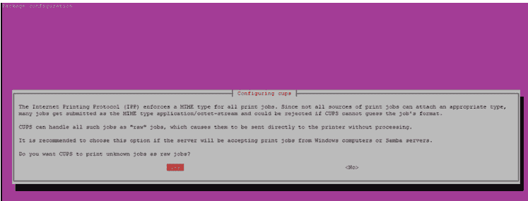
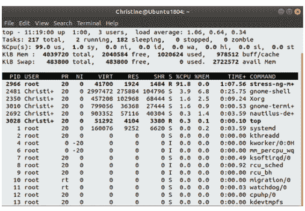
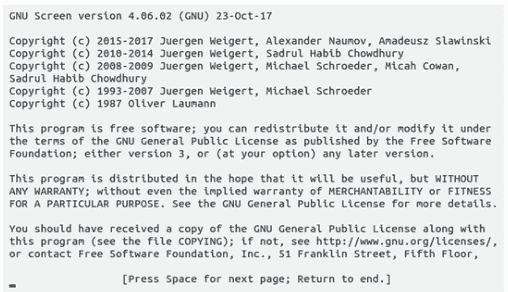
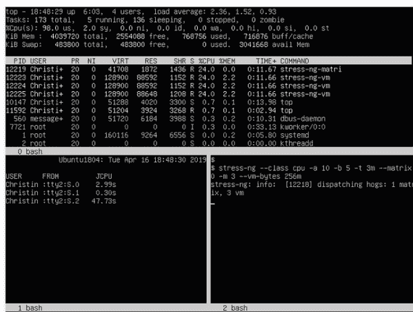
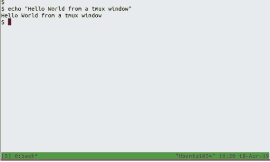
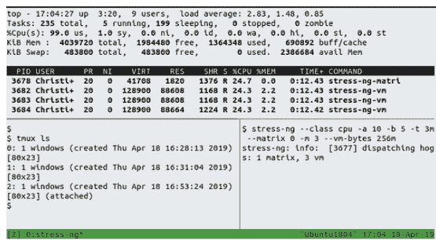

## 第 2 章

### 管理软件和进程

### 目标

- 102.3 管理共享库
- 102.4 使用 Debian 包管理
- 102.5 使用 RPM 和 YUM 包管理
- 103.5 创建、监视和终止进程
- 103.6 修改进程执行优先级


Linux 系统的好坏取决于你在其上安装的软件。Linux 内核本身相当乏味；你需要网络服务器、数据库服务器、浏览器和文字处理工具等应用程序，才能在 Linux 系统上做任何有用的事情。本章讨论了软件在你的 Linux 系统中的作用，以及如何获取和管理软件。

我们还将讨论 Linux 如何处理系统上运行的应用程序。Linux 必须跟踪大量同时运行的不同程序。作为 Linux 管理员，你的目标是确保一切顺利运行！本章展示了 Linux 如何跟踪所有活动程序，以及如何查看这些信息。你还将了解如何使用命令行工具管理 Linux 系统上运行的程序。

### 查看包概念

大多数 Linux 用户希望下载应用程序并使用它。因此，Linux 发行版创建了一种用于分发已编译应用程序的捆绑系统。这个捆绑包称为软件包，它包含运行单个应用程序所需的大部分文件。然后，你可以将整个应用程序作为一个软件包来安装、删除和管理，而不是作为一组零散的文件。

在 Linux 系统上跟踪软件包称为包管理。Linux 通过使用数据库来跟踪系统上已安装的软件包来实现包管理。包管理数据库不仅跟踪已安装哪些软件包，还跟踪每个应用程序所需的精确文件和文件位置。确定系统上安装了哪些应用程序，只需查询包管理数据库即可。

如你所料，不同的 Linux 发行版创建了不同的包管理系统。然而，多年来，其中两个系统脱颖而出成为标准：

- Red Hat 包管理 (RPM)
- Debian 包管理 (Apt)

每个包管理系统使用不同的方法来跟踪应用程序软件包和文件，但它们都跟踪类似的信息：

- 应用程序文件：软件包数据库跟踪每个单独的文件以及它所在的文件夹。


- 库依赖项：软件包数据库跟踪每个应用程序所需的库文件，并在您安装软件包时依赖的库文件不存在时发出警告。

- 应用程序版本：软件包数据库跟踪应用程序的版本号，以便您知道何时有应用程序的更新版本可用。

以下各节将讨论使用这些软件包管理系统的工具。

### 使用 RPM

在 Red Hat 开发的 RPM 软件包管理器 (RPM) 实用程序可让您安装、修改和删除软件包。它还简化了更新软件的过程。


递归缩写将缩写本身作为组成它的单词的一部分。Linux 世界中的一个著名示例是 GNU，它代表“GNU 不是 Unix”。RPM 是一个递归缩写。

### RPM 发行版和约定

Red Hat Linux 发行版以及其他基于 Red Hat 的发行版（如 Fedora 和 CentOS）使用 RPM。此外，还有其他非基于 Red Hat 的发行版，例如 openSUSE 和 OpenMandriva Lx，也使用 RPM。

RPM 软件包文件具有 .rpm 文件扩展名，并遵循以下命名格式：

```
PACKAGE-NAME-VERSION-RELEASE.ARCHITECTURE.rpm
```

**PACKAGE-NAME** PACKAGE-NAME 与您所期望的一样——即软件包的名称。例如，如果您想要安装 emacs 文本编辑器，则其 RPM 文件的软件包名称很可能是 emacs。但是，请注意，不同的发行版可能为同一程序使用不同的 PACKAGE-NAME，且软件包名称可能与程序名称不同。

**VERSION** VERSION 是程序的版本号，表示比旧版本号更新的软件修改。传统上，软件包的版本号格式为由点（.）分隔的两到三个数字和/或字母。示例包括 1.13.1 和 7.4p1。

**RELEASE** RELEASE 也称为构建号。它表示比版本号更小的程序修改。此外，由于持续软件交付模式的兴起，您通常会在点号后的发行版本号中找到版本控制系统（VCS）编号。示例包括 22 和 94.gitb2f74b2。某些发行版在构建号中包含发行版版本。例如，您会在点号后找到 el7（Red Hat Enterprise Linux v7）或 fc29（Fedora，以前称为 Fedora Core，v29）。

**ARCHITECTURE** 这是软件包所针对的 CPU 架构的标识。通常对于 64 位处理器，您会看到列出的 x86_64。有时会使用 noarch，表示软件包在架构上是中立的。旧的 CPU 架构标识包括 i386（x86）、ppc（PowerPC）以及 i586 和 i686（Pentium）。

> RPM 软件包有两种类型：源代码包和二进制包。大多数情况下，您需要二进制包，因为它包含成功运行软件所需的程序包。源代码 RPM 包含程序的源代码，可用于分析（或用于整合您自己的软件包自定义内容）。您可以通过以下方式区分这两种软件包文件类型：源代码 RPM 的 ARCHITECTURE 在 RPM 文件名中为 src。

查看一些示例 RPM 文件很有帮助。清单 2.1 显示了我们在 CentOS 发行版上下载的四个不同的 RPM 文件。

### 清单 2.1: 在 CentOS 发行版上查看 RPM 软件包文件

```
# ls -l *.rpm
docker-1.13.1-94.gitb2f74b2.el7.centos.x86_64.rpm
emacs-24.3-22.el7.x86_64.rpm
openssh-7.4p1-16.el7.x86_64.rpm
zsh-5.0.2-31.el7.x86_64.rpm
#
```

请注意版本号和发行版本号之间的命名格式差异。虽然确定版本号何时结束、发行版本号何时开始可能比较困难，但诀窍是在文件名中查找第二个短划线（-），它将它们分隔开。

> 如果要在基于 Red Hat 的发行版（如 CentOS 或 Fedora）上获取 RPM 文件副本，请使用 yumdownloader 实用程序。例如，使用超级用户权限并在命令行中输入 **yumdownloader emacs**，将 emacs RPM 文件下载到当前工作目录。在 openSUSE 上，您需要使用超级用户权限执行 zypper install -d package-name 命令。这将把 RPM 软件包文件下载到 /var/cache/zypp/packages/ 子目录中。

### rpm 命令集

处理 RPM 文件的主要工具是 *rpm* 程序。*rpm* 实用程序是一个命令行程序，用于安装、修改和删除 RPM 软件包。其基本格式如下：

```
rpm ACTION [OPTION] PACKAGE-FILE
```

*rpm* 命令的一些常见操作在表 2.1 中有所描述。

### 表 2.1 rpm 命令操作

| 短选项 | 长选项 | 描述 |
| --- | --- | --- |
| -e | --erase | 删除指定的软件包 |
| -F | --freshen | 仅在存在早期版本时才升级软件包 |
| -i | --install | 安装指定的软件包 |
| -q | --query | 查询指定的软件包是否已安装 |
| -U | --upgrade | 安装或升级指定的软件包 |
| -V | --verify | 验证软件包文件是否存在以及软件包的完整性 |

### 安装和更新 RPM 软件包

要使用 *rpm* 命令，您必须将 .rpm 软件包文件下载到系统中。虽然可以使用 `-i` 操作安装软件包，但更常见的是使用 `-U` 操作，它会安装新软件包，或在软件包已安装时进行升级。


> 安装或更新软件包时，您始终需要获取超级用户权限。许多其他软件包管理命令也需要这些权限。您通常可以通过登录 root 账户或使用 sudo 实用程序获得所需权限，后者要求您的账户已配置为能够执行此操作（有关详细信息，请参见第 10 章）。

添加 -vh 选项是一种常用的组合，可显示更新的进度及其正在执行的操作。清单 2.2 展示了示例。请注意，您需要使用超级用户权限来安装和/或更新软件包。

### 清单 2.2: 安装/升级 RPM 软件包文件

```
# rpm -Uvh zsh-5.0.2-31.el7.x86_64.rpm
Preparing...                ########################################### [100%]
Updating / installing...
   1:zsh-5.0.2-31.el7        ########################################### [100%]
#
```

没人愿意输入那些冗长的软件包文件名。由于有大量的短划线、点号和数字，很容易出现拼写错误。相反，请使用 shell 的命令补全功能（也称为 Tab 自动补全）。输入软件包文件名的 PACKAGE-NAME 部分，然后按 Tab 键。只要没有名称相似的其他文件，shell 就会为您完成软件包文件名的其余部分。这是一个很棒的功能！

### 查询 RPM 软件包

使用 -q 操作可针对已安装软件包的软件包管理数据库执行简单查询。清单 2.3 显示了示例。请注意，对于已安装的软件包（例如 zsh），会显示完整的软件包文件名（不带 .rpm 文件扩展名）。

### 清单 2.3: 对 RPM 软件包执行简单查询

```
# rpm -q zsh
zsh-5.0.2-31.el7.x86_64
#
# rpm -q docker
package docker is not installed
#
```

您可以向查询操作添加多个选项以获取更详细的信息。表 2.2 列出了一些更常用的查询选项。

### 表 2.2 rpm 命令查询操作选项

| 短选项 | 长选项 | 描述 |
| --- | --- | --- |
| -c | --configfiles | 列出软件包配置文件的名称和绝对目录引用 |
| -i | --info | 提供详细信息，包括版本、安装日期和签名 |
| N/A | --provides | 显示软件包提供的功能 |
| -R | --requires | 显示各种软件包要求（依赖项） |
| -s | --state | 提供软件包中不同文件的状态，例如正常（已安装）、未安装或已替换 |
| N/A | --what-provides | 显示文件属于哪个软件包 |

-qi 选项提供大量有关软件包的信息，如清单 2.4 所示。

### 清单 2.4: 对 RPM 软件包执行详细查询

```
# rpm -qi zsh
Name        : zsh
Version     : 5.0.2
Release     : 31.el7
Architecture: x86_64
Install Date: Tue 09 Apr 2019 02:51:26 PM EDT
Group       : System Environment/Shells
Size        : 5854390
License     : MIT
Signature   : RSA/SHA256, Mon 12 Nov 2018 09:49:55 AM EST, Key ID 24c6a[...]
Source RPM  : zsh-5.0.2-31.el7.src.rpm
Build Date  : Tue 30 Oct 2018 12:48:17 PM EDT
Build Host  : x86-01.bsys.centos.org
Relocations : (not relocatable)
Packager    : CentOS BuildSystem <http://bugs.centos.org>
Vendor      : CentOS
URL         : http://zsh.sourceforge.net/
Summary     : Powerful interactive shell
Description :
The zsh shell is a command interpreter usable as an interactive login
[...]
#
```

请注意，通过此详细查询，您可以确定软件包的版本号、安装日期、签名等信息。但是，缺少一些数据项，例如软件包的依赖项。


> > **提示**
> > 要显示系统中使用 RPM 包管理的所有已安装软件包列表，请在命令行键入 `rpm -qa`。有趣的是，如果你输入 `rpm -qa PACKAGE-NAME`，对于特定软件包也能获得与使用 `-qi` 选项相同的详细信息。

发现已安装软件包的依赖项（要求）是一款实用的故障排除工具。可以通过使用 -qR 选项轻松确定，如清单 2.5 所示。

### 清单 2.5：确定 RPM 软件包的依赖项

```
# rpm -qR zsh
[...]
libc.so.6()(64bit)
libc.so.6(GLIBC_2.11)(64bit)
[...]
libncursesw.so.5()(64bit)
librt.so.1()(64bit)
librt.so.1(GLIBC_2.2.5)(64bit)
libtinfo.so.5()(64bit)
[...]
#
```

示例：使用 -qc 选项确定哪些配置文件属于某个软件包，如清单 2.6 所示。

### 清单 2.6：确定属于 RPM 软件包的配置文件名

```
# rpm -qc zsh
/etc/skel/.zshrc
/etc/zlogin
/etc/zlogout
/etc/zprofile
/etc/zshenv
/etc/zshrc
#
```

> > **提示**
> > 有时候，你可能希望从未安装的软件包文件中确定诸如 RPM 软件包签名或许可证等信息。这很简单。只需在查询中添加 -p 选项，并将软件包文件名作为参数。例如，要查询我们示例中使用的 zsh 软件包文件的依赖信息，请在命令行键入 `rpm -qRp zsh-5.0.2-31.el7.x86_64.rpm`。

另一个实用的 RPM 软件包数据库查询使用 -q --whatprovides 选项，可让你查看某个文件属于哪个软件包。示例如清单 2.7 所示。请注意，查询时需要提供文件的绝对目录路径。

### 清单 2.7：确定文件属于哪个 RPM 软件包

```
# rpm -q --whatprovides /usr/bin/zsh
zsh-5.0.2-31.el7.x86_64
#
```

### 验证 RPM 软件包

密切关注系统中的软件包是一项重要的安全措施。对于这些操作，rpm 实用程序的验证操作很有帮助。如果 rpm -V 命令没有任何输出或只返回一个点（.），那说明一切正常。表 2.3 显示了潜在的完整性响应代码及其含义。

### 表 2.3 rpm 命令验证操作的响应代码

| 代码 | 说明 |
|---|---|
| ? | 无法执行验证测试 |
| 5 | 摘要编号已更改 |
| c | 文件是软件包的配置文件 |
| D | 设备号（主设备号或次设备号）已更改 |
| G | 组所有权已更改 |
| L | 链接路径已更改 |
| missing | 文件丢失 |
| M | 模式（权限或文件类型）已更改 |
| P | 功能已更改 |
| S | 文件大小已更改 |
| T | 时间戳（修改时间）已更改 |
| U | 用户所有权已更改 |

验证过程示例如清单 2.8 所示。

### 清单 2.8：检查 RPM 软件包的完整性

```
# rpm -V zsh
.....UGT.  /bin/zsh
.....T.  c /etc/zlogin
missing  c /etc/zprofile
#
```

在此示例中，清单 2.8 的完整性检查中出现了响应代码。列出了每个存在差异的文件。使用表 2.3 中的代码解释，你可以确定 /bin/zsh 文件的所有者和组均已更改，且修改时间戳与软件包数据库中的不同。/etc/zlogin 文件是 zsh 软件包的配置文件，其修改时间戳也已更改。请还注意，/etc/zprofile 配置文件丢失。

> 如果由于缺少库文件而导致程序出现问题，可以使用 ldd 命令查看应用程序使用的各种库，从而开始故障排除过程。本章后面将介绍此实用程序。

### 删除 RPM 软件包

要删除已安装的软件包，只需对 rpm 命令使用 -e 操作。示例如清单 2.9 所示。

### 清单 2.9：删除 RPM 软件包

```
# rpm -e zsh
warning: file /etc/zprofile: remove failed: No such file or directory
#
# rpm -q zsh
package zsh is not installed
#
```

-e 操作不会显示是否成功，但如果删除过程中出错，会显示错误消息。请注意，在这种情况下，通过清单 2.8 中 rpm -V 命令发现丢失的 /etc/zprofile 文件也会在删除过程中被标记。

### 从 RPM 中提取数据

有时你可能需要从 RPM 软件包文件中提取文件，而无需安装它。在这些情况下，rpm2cpio 实用程序很有帮助。它允许你从 RPM 文件构建 cpio 归档（第 4 章将详细介绍），如清单 2.10 所示。这是提取文件的第一步。请注意，需要使用 > 重定向符号（第 1 章介绍了 STDOUT 重定向）来创建归档文件。

### 清单 2.10：从 RPM 软件包创建 cpio 归档

```
$ rpm2cpio emacs-24.3-22.el7.x86_64.rpm > emacs.cpio
$
```

下一步是将文件从 cpio 归档移动到目录中。这是通过使用 -id 选项的 cpio 命令完成的。-i 开关使用复制入模式，允许从归档文件中复制文件。-d 开关在当前工作目录中创建子目录，其名称与归档中的目录名称匹配，只是在每个名称前添加一个点（.）。清单 2.11 显示了精简示例。请注意，我们添加了详细选项 (-v)，以在创建所需子目录和提取文件时显示命令正在执行的操作。

### 清单 2.11：从 cpio 归档中提取文件

```
$ cpio -idv < emacs.cpio
./usr/bin/emacs-24.3
./usr/share/applications/emacs.desktop
./usr/share/applications/emacsclient.desktop
./usr/share/icons/hicolor/128x128/apps/emacs.png
./usr/share/icons/hicolor/16x16/apps/emacs.png
./usr/share/icons/hicolor/24x24/apps/emacs.png
./usr/share/icons/hicolor/32x32/apps/emacs.png
./usr/share/icons/hicolor/48x48/apps/emacs.png
./usr/share/icons/hicolor/scalable/apps/emacs.svg
./usr/share/icons/hicolor/scalable/mimetypes/emacs-document.svg
28996 blocks
$
$ ls ./usr/bin/emacs-24.3
./usr/bin/emacs-24.3
```

从 RPM 软件包文件及随后的 cpio 归档中最终提取文件后，可根据需要浏览它们。

### 使用 YUM

rpm 命令是有用的工具，但存在局限性。如果你要查找要安装的新软件包，需要自行寻找。此外，如果软件包依赖其他软件包才能安装，则需要自行先按正确顺序安装这些软件包。跟踪这些可能会变得有些麻烦。

为解决该问题，每个 Linux 发行版都有自己的中央软件包清算中心，称为 _存储库_。存储库包含已在发行版环境中测试并确认可正确安装和运行的软件包。通过将所有已知软件包放入单个存储库，Linux 发行版可以为安装所有应用程序创建一站式购物场所。

大多数 Linux 发行版创建和维护自己的软件包存储库。还有用于处理软件包存储库的其他工具。这些工具可以直接与软件包存储库交互，以查找新软件，甚至自动查找和安装应用程序运行所需的任何依赖软件包。

互联网上还出现了许多第三方软件包存储库，包含未作为官方 Linux 发行版存储库一部分分发的专用或自定义软件包。存储库工具也允许你检索这些软件包。

用于处理 Red Hat 存储库的核心工具是 YUM 实用程序（Yellowdog Update Manager 的缩写，最初为 YellowDog Linux 发行版开发）。其 yum 命令允许你直接从官方 Red Hat 存储库查询、安装和删除系统上的软件包。

yum 命令使用 /etc/yum.repos.d/ 目录来保存列出其检查软件包的不同存储库的文件。对于默认 CentOS 系统，该目录包含多个存储库文件，如清单 2.12 所示。

### 清单 2.12：查看 CentOS 发行版上的 /etc/yum.repos.d/ 存储库文件

```
$ ls /etc/yum.repos.d/
CentOS-Base.repo		 CentOS-CR.repo
CentOS-Debuginfo.repo	 CentOS-fasttrack.repo
CentOS-Media.repo		 CentOS-Sources.repo
CentOS-Vault.repo
$
```

yum.repos.d 文件夹中的每个文件都包含有关存储库的信息，例如其 URL 地址以及存储库中其他软件包文件的位置。yum 程序会检查每个定义的存储库，查找命令行请求的软件包。

基本 yum 命令语法是

```
yum [OPTIONS] [COMMAND] [PACKAGE...]
```


yum 程序非常通用，表 2.4 显示了您可以与其使用的一些命令。

### 表 2.4 yum 命令

| 命令 | 说明 |
|---|---|
| check-update | 检查存储库中已安装软件包的更新 |
| clean | 删除安装期间下载的临时文件 |
| deplist | 显示指定软件包的依赖项 |
| groupinstall | 安装指定的软件包组 |
| info | 显示有关指定软件包的信息 |
| install | 安装指定的软件包 |
| list | 显示已安装软件包的信息 |
| localinstall | 从指定的 RPM 文件安装软件包 |
| localupdate | 从指定的 RPM 文件更新系统 |
| provides | 显示文件属于哪个软件包 |
| reinstall | 重新安装指定的软件包 |
| remove | 从系统中删除软件包 |
| resolvedep | 显示与指定依赖项匹配的软件包 |
| search | 在存储库软件包名称和描述中搜索指定关键字 |
| shell | 进入 yum 命令行模式 |
| update | 将指定软件包更新到存储库中的最新版本 |
| upgrade | 更新指定软件包但删除过时软件包 |

使用 yum 安装新应用程序轻而易举，如清单 2.13 所示。

### 清单 2.13：在 CentOS 发行版中使用 yum 安装软件

```
# yum install emacs
[...]
Resolving Dependencies
--> Running transaction check
---> Package emacs.x86_64 1:24.3-22.el7 will be installed
--> Processing Dependency: emacs-common = 1:24.3-22.el7 for
package: 1:emacs-24.3-22.el7.x86_64
[...]
package:
--> Running transaction check
---> Package ImageMagick.x86_64 0:6.7.8.9-16.el7_6 will be installed
[...]
--> Finished Dependency Resolution

Dependencies Resolved
==============================================================
Package Arch Version Repository Size
==============================================================
Installing:
emacs x86_64 1:24.3-22.el7 base 2.9 M
Installing for dependencies:
ImageMagick x86_64 6.7.8.9-16.el7_6 updates 2.1 M
[...]
Transaction Summary
==============================================================
Install 1 Package (+8 Dependent packages)

Total download size: 26 M
Installed size: 92 M
Is this ok [y/d/N]: y
Downloading packages:
(1/9): OpenEXR-libs-1.7.1-7.el7.x86_64.rpm | 217 kB 00:01
[...]
(9/9): emacs-common-24.3-22.el7.x86_64.rpm | 20 MB 00:22
--------------------------------------------------------------------------------
Total 1.2 MB/s | 26 MB 00:22
Running transaction check
Running transaction test
Transaction test succeeded
Running transaction
[...]
Installing : ImageMagick-6.7.8.9-16.el7_6.x86_64 8/9
Installing : 1:emacs-24.3-22.el7.x86_64 9/9
[...]
Verifying : ImageMagick-6.7.8.9-16.el7_6.x86_64 8/9
Verifying : 1:emacs-24.3-22.el7.x86_64 9/9

Installed:
emacs.x86_64 1:24.3-22.el7

Dependency Installed:
ImageMagick.x86_64 0:6.7.8.9-16.el7_6 [...]
emacs-common.x86_64 1:24.3-22.el7 [...]
libXaw.x86_64 0:1.0.13-4.el7 [...]
libotf.x86_64 0:0.9.13-4.el7 [...]

Complete!
#
```

yum 的一个出色功能是能够将软件包分组以进行分发。
无需下载特定环境所需的所有软件包
（例如，使用 Apache、MySQL 和 PHP 服务器的 Web 服务器），您可以下载
将软件包捆绑在一起的软件包组。使用 yum grouplist 命令查看可用的各种软件包组列表，
并使用 yum groupinstall group-package-name 在系统上更轻松地安装软件包。

> 最近，另一种 RPM 包管理工具正在变得流行。dnf 程序（dandified yum 的缩写）作为 Fedora Linux 发行版的一部分包含在内，用于替代 yum。正如其名称所示，dnf 提供了一些 yum 缺少的高级功能。此类功能之一是加速使用库文件解析依赖项搜索。

yum 的另一个出色功能是能够重新安装软件包。如果发现软件包文件丢失或以某种方式被修改，可以通过软件包重新安装轻松修复。示例代码片段在清单 2.14 中显示。

### 清单 2.14：使用 yum 实用程序重新安装软件

```
# rpm -V emacs
missing    /usr/bin/emacs-24.3
#
# yum reinstall emacs
[...]
---> Package emacs.x86_64 1:24.3-22.el7 will be reinstalled
[...]
Total download size: 2.9 M
Installed size: 14 M
Is this ok [y/d/N]: y

[...]
Installed:
  emacs.x86_64 1:24.3-22.el7

Complete!
#
# rpm -V emacs
#
```

注意在清单 2.14 中，`rpm -V emacs` 命令发现软件包中缺少文件。使用 `yum reinstall` 功能可以快速解决问题。
使用 `yum` 删除软件包与安装它一样容易。示例代码片段在清单 2.15 中显示。

### 清单 2.15：使用 yum 实用程序删除软件

```
# yum remove emacs
[...]
Remove  1 Package

Installed size: 14 M
Is this ok [y/N]: y
[...]
Removed:
  emacs.x86_64 1:24.3-22.el7

Complete!
#
```

通常不需要修改存储在 /etc/yum.conf 文件中的主要 YUM 配置。该文件包含设置（也称为指令），用于确定诸如在哪里记录 YUM 日志数据等事项。虽然您可以通过编辑主要配置文件或手动创建 /etc/yum.repos.d/ 存储库文件来添加第三方存储库，但不建议这样做。推荐的方法是通过 RPM 或 YUM 安装新存储库。

### 使用 ZYpp

openSUSE Linux 发行版使用 RPM 包管理系统并在 .rpm 文件中分发软件，但不使用 yum 或 dnf 工具。相反，openSUSE 创建了自己的包管理工具，称为 ZYpp（也称为 libzypp）。它的 zypper 命令允许您直接从 openSUSE 存储库查询、安装和删除系统上的软件包。表 2.5 列出了更常用的 zypper 实用程序命令。

### 表 2.5 zypper 命令

| 命令 | 说明 |
| :--- | :--- |
| help | 显示总体常规帮助信息或指定命令的帮助 |
| install | 安装指定的软件包 |
| info | 显示有关指定软件包的信息 |
| list-updates | 显示存储库中已安装软件包的所有可用软件包更新 |
| lr | 显示存储库信息 |
| packages | 列出所有可用软件包或列出来自指定存储库的可用软件包 |
| what-provides | 显示文件属于哪个软件包 |
| refresh | 刷新存储库的信息 |
| remove | 从系统中删除软件包 |
| search | 搜索指定的软件包 |
| update | 更新指定的软件包，或者如果未指定软件包，则将当前安装的所有软件包更新到存储库中的最新版本 |
| verify | 验证已安装的软件包是否已满足所需依赖项 |

对于软件包安装，zypper 的操作方式与 yum 实用程序类似。示例代码片段在清单 2.16 中显示。

### 清单 2.16：使用 zypper 实用程序安装软件

```
$ sudo zypper install emacs
[sudo] password for root:
[...]
Reading installed packages...
Resolving package dependencies...

The following 9 NEW packages are going to be installed:
emacs emacs-info emacs-x11 etags liblm17n0 libotf0 libXaw3d8 m17n-db
m17n-db-lang

The following recommended package was automatically selected:
m17n-db-lang

9 new packages to install.
Overall download size: 0 B. Already cached: 27.4 MiB. After the operation,
additional 111.6 MiB will be used.
Continue? [y/n/...? shows all options] (y): y

[...]
Checking for file conflicts: .............................................[done]
[...]
(9/9) Installing: emacs-x11-25.3-lp150.2.3.1.x86_64 ......................[done]
$
```

info 命令很有帮助，因为它显示指定软件包的信息，如清单 2.17 中所示。

### 清单 2.17：使用 zypper info 命令显示软件包信息

```
$ zypper info emacs
[...]
Information for package emacs:
--------------------------------
Repository   : openSUSE-Leap-15.0-Update
Name         : emacs
Version      : 25.3-lp150.2.3.1
Arch         : x86_64
```


Vendor		: openSUSE
Installed Size	: 67.7 MiB
Installed		: 是
Status		: 最新
Source package	: emacs-25.3-lp150.2.3.1.src
Summary		: GNU Emacs 基础包
Description	：
GNU Emacs 编辑器的基本软件包。需要 emacs-x11 或 emacs-nox。

```
$
```

zypper 实用程序易于使用，并不断提供有用的消息来指导你的软件包管理过程。例如，在清单 2.18 中，使用了确定特定文件所属软件包的旧方法（what-provides）。作为回应，zypper 实用程序不仅执行该命令，还提供未来应采用的较新方法的信息。

### 清单 2.18：确定文件所属的软件包

```
$ which emacs
/usr/bin/emacs
$
$ zypper what-provides /usr/bin/emacs
Command 'what-provides' is replaced by 'search --provides --match-exact'.
See 'help search' for all available options.
Loading repository data...
Reading installed packages...
```

| 状态 | 名称 | 摘要 | 类型 |
|---|---|---|---|
| i+ | emacs | GNU Emacs 基础包 | 软件包 |

你可以轻松地通过其手册页面获取 zypper 工具的帮助，并使用 zypper help 获取一般帮助或使用 zypper help 命令获取特定帮助。此外，zypper 实用程序允许你缩短一些命令。例如，你可以将 install 缩短为 in，将 remove 缩短为 re，将 search 缩短为 se，如清单 2.19 所示。

### 清单 2.19：使用 zypper search 命令搜索软件包

```
$ zypper se nmap
Loading repository data...
Reading installed packages...
```

| 状态 | 名称 | 摘要 | 类型 |
|---|---|---|---|
| | nmap | 端口扫描器 | 软件包 |
| | nmap4 | Nmap 的图形前端 | 软件包 |
| | zenmap | Nmap 的图形前端 | 软件包 |

使用 zypper 删除软件包也很简单。命令、过程和实用程序的有用消息示例在清单 2.20 中有截取显示。

### 清单 2.20：使用 zypper remove 命令删除软件包

```
$ sudo zypper remove emacs
[sudo] password for root:
[...]
The following application is going to be REMOVED:
"GNU Emacs"

The following 2 packages are going to be REMOVED:
emacs emacs-x11

2 packages to remove.
After the operation, 99.6 MiB will be freed.
Continue? [y/n/...? shows all options] (y): y
(1/2) Removing emacs-25.3-lp150.2.3.1.x86_64 .....................................[done]
(2/2) Removing emacs-x11-25.3-lp150.2.3.1.x86_64 .............................[done]
There are some running programs that might use files deleted by recent upgrade. You may wish to check and restart some of them. Run 'zypper ps -s' to list these programs.
$
```

一旦你了解何时以及如何使用每个实用程序，使用 RPM、YUM 和 ZYpp 管理软件包就非常简单。Debian 软件包管理也是如此。

### 使用 Debian 软件包

你可能已经猜到，Debian 软件包管理系统主要用于基于 Debian 的 Linux 发行版，例如 Ubuntu。使用此系统，你可以安装、修改、升级和删除软件包。我们将在本节中探讨这个流行的软件包管理系统。

### Debian 软件包文件命名约定

Debian 将应用程序文件打包成单个 .deb 软件包文件以供分发，其使用以下文件名格式：

```
PACKAGE-NAME-VERSION-RELEASE_ARCHITECTURE.deb
```

.deb 软件包的这种文件命名约定与 .rpm 文件格式非常相似。但是，在 ARCHITECTURE 中，通常会找到 amd64，表示它针对 AMD64/Intel64 CPU 架构进行了优化。有时会使用 all，表示该软件包在架构上是中立的。清单 2.21 中显示了几个 .deb 软件包文件。

### 清单 2.21：使用 .deb 文件命名约定的软件包

```
$ ls -1 *.deb
docker_1.5-1build1_amd64.deb
emacs_47.0_all.deb
openssh-client_1%3a7.6p1-4ubuntu0.3_amd64.deb
vim_2%3a8.0.1453-1ubuntu1_amd64.deb
zsh_5.4.2-3ubuntu3.1_amd64.deb
$
```

请记住，软件包命名约定是可接受的标准，但（在一定范围内）软件包开发者不必遵循。因此，你可能会遇到变体。

> 如果要在基于 Debian 的发行版（如 Ubuntu）上获取 Debian 软件包文件的副本，请使用 apt-get download 命令。例如，使用超级用户权限，在命令行中键入 sudo apt-get download vim 以将 vim Debian 软件包文件下载到当前工作目录。

### dpkg 命令集

处理 .deb 文件的核心工具是 dpkg 程序，这是一个命令行实用程序，具有用于在 Linux 系统上安装、更新和删除 .deb 软件包文件的选项。dpkg 命令的基本格式如下：

```
dpkg [OPTIONS] ACTION PACKAGE-FILE
```

ACTION 参数定义要对文件执行的操作。表 2.6 列出了你需要使用的更常见的操作。

### 表 2.6 dpkg 命令操作

| 短选项 | 长选项 | 描述 |
|---|---|---|
| -c | --contents | 显示软件包文件的内容 |
| -C | --audit | 查找已损坏的已安装软件包并建议如何修复它们 |
| N/A | --configure | 重新配置已安装的软件包 |
| N/A | --get-selections | 显示当前已安装的软件包 |
| -i | --install | 安装软件包；如果软件包已安装，则将其升级 |
| -I | --info | 显示未安装软件包文件的信息 |
| -l | --list | 列出与指定模式匹配的所有已安装软件包 |
| -L | --listfiles | 列出与软件包关联的已安装文件 |
| -p | --print-avail | 显示已安装软件包的信息 |
| -P | --purge | 删除已安装的软件包，包括配置文件 |
| -r | --remove | 删除已安装的软件包但保留配置文件 |
| -s | --status | 显示指定软件包的状态 |
| -S | --search | 查找拥有指定文件的软件包 |

每个操作都有一组可用于修改其基本行为的选项，例如强制覆盖已安装的软件包或忽略任何依赖错误。要使用 dpkg 程序，系统上必须有 .deb 软件包可用。通常，你可以在应用程序网站上找到可分发的应用程序 .deb 版本。此外，大多数发行版都维护一个用于下载软件包的中心位置。


Debian 发行版还在 www.debian.org/distrib/packages 提供 Debian 软件包的中央清算所。

获得 .deb 软件包后，你可以使用 dpkg -I 命令查看文件中存储的软件包信息，包括版本号和任何依赖项。示例在清单 2.22 中有截取显示。

### 清单 2.22：使用 dpkg -I 命令查看未安装的 .deb 软件包

```
$ dpkg -I zsh_5.4.2-3ubuntu3.1_amd64.deb
new Debian package, version 2.0.
size 689912 bytes: control archive=2544 bytes.
    909 bytes,    20 lines     control
   3332 bytes,    42 lines     md5sums
[...]
Package: zsh
Version: 5.4.2-3ubuntu3.1
Architecture: amd64
Maintainer: Ubuntu Developers <ubuntu-devel-discuss@lists.ubuntu.com>
Installed-Size: 2070
Depends: zsh-common (= 5.4.2-3ubuntu3.1), libc6 (>= 2.15),
libcap2 (>= 1:2.10), libtinfo5 (>= 6)
Recommends: libc6 (>= 2.23), libncursesw5 (>= 6), libpcre3
Suggests: zsh-doc
Section: shells
Priority: optional
Homepage: https://www.zsh.org/
Description: shell with lots of features
 Zsh is a UNIX command interpreter (shell) usable as an
[...]
Original-Maintainer: Debian Zsh Maintainers <pkg-zsh-devel@li[...]
$
```

如果要查看软件包文件的内容，请将 -I 选项替换为 --contents 开关。请注意，你可能需要将输出通过管道传送到分页实用程序（参见第 1 章）以便更轻松地查看。

当你确定已获得正确的软件包时，请使用 dpkg 及其 -i 操作来安装它，如清单 2.23 所示。（请注意，如果软件已安装，此过程会将其升级到软件包文件中的版本。）

### 清单 2.23：使用 dpkg -i 命令安装 .deb 软件包

```
$ sudo dpkg -i zsh_5.4.2-3ubuntu3.1_amd64.deb
Selecting previously unselected package zsh.
(Reading database ... 171250 files and directories currently installed.)
```


```
Preparing to unpack zsh_5.4.2-3ubuntu3.1_amd64.deb ...
Unpacking zsh (5.4.2-3ubuntu3.1) ...
dpkg: dependency problems prevent configuration of zsh:
zsh depends on zsh-common (= 5.4.2-3ubuntu3.1); however:
Package zsh-common is not installed.

dpkg: error processing package zsh (--install):
dependency problems - leaving unconfigured
Processing triggers for man-db (2.8.3-2ubuntu0.1) ...
Errors were encountered while processing:
zsh
$
```

你可以在这个示例中看到，包管理软件会检查以确保任何必需的包都已安装，如果缺少任何包，就会产生一条错误消息。这能让你了解需要安装哪些其他包。

安装后，你可以通过 dpkg -s 命令查看包的状态。示例在清单 2.24 中给出。注意，命令的输出显示该包已安装，以及其版本号和依赖项。

## 清单 2.24：使用 dpkg -s 命令显示已安装包的状态

```
$ dpkg -s zsh
Package: zsh
Status: install ok unpacked
Priority: optional
Section: shells
Installed-Size: 2070
Maintainer: Ubuntu Developers <ubuntu-devel-discuss@lists.ubuntu.com>
Architecture: amd64
Version: 5.4.2-3ubuntu3.1
Depends: zsh-common (= 5.4.2-3ubuntu3.1), libc6 (>= 2.15), libcap2 (>= 1:2.10),
libtinfo5 (>= 6)
Recommends: libc6 (>= 2.23), libncursesw5 (>= 6), libpcre3
Suggests: zsh-doc
Description: shell with lots of features
[...]
$
```

如果你想查看系统上安装的所有包，请使用 -l（小写字母 L）选项，如清单 2.25 所示。

## 清单 2.25：使用 dpkg -l 命令显示所有已安装的包

```
$ dpkg -l
Desired=Unknown/Install/Remove/Purge/Hold
| Status=Not/Inst/Conf-files/Unpacked/half-conf/Half-inst/trig-aWait/Trig
|/ Err?=(none)/Reinst-required (Status,Err: uppercase=bad)
||/ Name Version Architecture Description
+++-==========-==========-============-========================================
ii accountsservice 0.6.45-1ubuntu amd64 query and manipulate accounts
ii acl 2.2.52-3build amd64 Access control list utilities
ii acpi-support 0.142 amd64 scripts for handling ACPI
ii acpid 1:2.0.28-1ub amd64 Advanced Config and Power
ii adduser 3.116ubuntu1 all add and remove users
[...]
iU zsh 5.4.2-3ubuntu amd64 shell with lots of features
$
```

注意在清单 2.25 中，已安装包的名称前带有状态代码。dpkg 命令输出的前几行显示了可能的包状态代码。例如，显示 zsh 包的最后一行显示 iU 代码。这意味着，虽然该包已安装（i），但它处于已解包（U）状态，尚未配置，这是一个问题。在清单 2.23 中，我们安装了包，安装过程指出缺少一个依赖项 zsh-common。

想象一下不必处理缺少包依赖项！好吧，包管理中的一新趋势可能正好能做到这一点。它围绕构建软件包，不仅包含主应用程序，还包含其所有依赖项。采用这种新颖而令人兴奋方法的一种新包管理系统是面向 Ubuntu 发行版的 Snappy。它使用 .snap 文件扩展名。这些包称为 snap 包，使用 Snappy 需要安装 snapd 守护进程。

对于缺少依赖项的问题，你可以通过 dpkg -s 操作快速检查特定包或库是否已安装，如清单 2.26 所示。请注意，正如预期的那样，所需的 zsh-common 包未安装。

## 清单 2.26：使用 dpkg -s 命令显示未安装包的状态

```
$ sudo dpkg -s zsh-common
dpkg-query: package 'zsh-common' is not installed and
no information is available
[...]
$
```

如果你需要删除一个包，有两个选项。-r 操作会删除包，但保留与该包关联的任何配置和数据文件。如果你只是想重新安装现有包，又不想重新配置东西，这很有用。

如果你确实想删除整个包，请使用 -P 选项，它会从系统中清除整个包，包括配置文件和数据文件。示例在清单 2.27 中给出。

## 清单 2.27：使用 dpkg -P 命令清除已安装包

```
$ sudo dpkg -P zsh
(Reading database ... [...]
Removing zsh (5.4.2-3ubuntu3.1) ...
Purging configuration files for zsh (5.4.2-3ubuntu3.1) ...
Processing triggers for man-db (2.8.3-2ubuntu0.1) ...
$
```

> 使用 -p 和 -P 选项时要非常小心。它们很容易混淆。-p 选项列出包，而 -P 选项清除包。差别很大！

dpkg 工具让你直接访问包管理系统，从而更轻松地在基于 Debian 的系统上安装和管理应用程序。

### 查看 APT 套件

高级包工具（APT）套件用于处理 Debian 仓库。这包括提供包数据库信息的 apt-cache 程序，以及执行安装、更新和删除包工作的 apt-get 程序。

> 就像 dnf 用于 RPM 包管理一样，Debian 包管理也有一个日益流行的新工具——apt。（这个实用程序不应与 APT 套件或在 Linux Mint 上使用同一名称的 Python 包装器混淆。）新的 apt 工具提供了改进的用户界面功能和管理 Debian 包的更简单命令。此外，apt 使用更易于理解的操作名称，例如 full-upgrade。其迅速的流行度引起了足够的关注，使其被列入 LPIC-1 认证考试。

APT 工具套件依赖于 /etc/apt/sources.list 文件来识别查找仓库的位置。默认情况下，每个 Linux 发行版都会在该文件中输入其自身的仓库位置。但是，如果你安装了发行版不支持的第三方应用程序，可以添加其他仓库位置。

### 使用 apt-cache

以下是 apt-cache 程序中用于显示包信息的几个有用命令选项：

- depends：显示包所需的依赖项
- pkg names：显示系统上安装的所有包
- search：显示与指定项匹配的包名称
- showpkg：列出有关指定包的信息
- stats：显示系统的包统计信息
- unmet：显示所有已安装包或指定已安装包的任何未满足依赖项

通常你可以在不使用超级用户权限的情况下发出 apt-cache 命令。一个方便的命令是 apt-cache pkg names，它显示系统上安装的所有 Debian 包。示例在清单 2.28 中给出。请注意，管道符号（|）和 grep 命令（在第 1 章中都有介绍）被用于快速确定当前是否安装了任何 nano 包。

## 清单 2.28：使用 apt-cache pkg names 命令显示所有已安装包

```
$ apt-cache pkg names | grep ^nano
nano
[...]
nano-tiny
[...]
$
```

如果你需要查找要安装的特定包，apt-cache search 命令很有用。示例在清单 2.29 中给出。

## 清单 2.29：使用 apt-cache search 命令搜索包

```
$ apt-cache search zsh
zsh - shell with lots of features
zsh-common - architecture independent files for Zsh
zsh-dev - shell with lots of features (development files)
zsh-doc - zsh documentation - info/HTML format
[...]
$
```

当你找到所需的包后，可以通过 apt-cache showpkg 命令浏览其详细信息。清单 2.30 中的示例提供了有关 zsh 包的数据。

## 清单 2.30：使用 apt-cache showpkg 命令显示包信息

```
$ apt-cache showpkg zsh
Package: zsh
Versions:
5.4.2-3ubuntu3.1 [...]
[...]
Reverse Depends:
usrmerge,zsh 5.2-4~
zsh-static,zsh
zsh:i386,zsh
zsh-common,zsh 5.0.2-1
[...]
Dependencies:
5.4.2-3ubuntu3.1 - [...]
5.4.2-3ubuntu3 - [...]
Provides:
5.4.2-3ubuntu3.1 -
5.4.2-3ubuntu3 -
Reverse Provides:
$
```

apt-cache 实用程序提供了几种发现包信息的方法。但你需要另一个程序来处理其他包管理功能。

### 使用 apt-get

APT 工具套件的主力是 apt-get 程序。它是你用来从 Debian 包仓库安装、更新和删除包的程序。表 2.7 列出了 apt-get 命令。

## 表 2.7 apt-get 程序的操作命令

| 操作 | 描述 |
| --- | --- |
| autoclean | 删除不再在仓库中的包的相关信息 |
| check | 检查包管理数据库中是否存在不一致 |
| clean | 清理数据库以及任何临时下载文件 |
| dist-upgrade | 升级所有包，但会监控包依赖关系 |


| 操作 | 描述 |
| :--- | :--- |
| dselect-upgrade | 完成任何未完成的包更改 |
| install | 安装或更新包并更新包管理数据库 |
| remove | 从包管理数据库中删除包 |
| source | 检索指定包的源代码包 |
| update | 检索仓库中包的更新信息 |
| upgrade | 将所有已安装包升级到最新版本 |

从仓库安装新包，只需使用 install 操作指定包名即可。使用 apt-get 安装 zsh 包的代码示例显示于 清单 2.31 中。

### 清单 2.31: 使用 apt-get install 命令安装包

```
$ sudo apt-get install zsh
Reading package lists... Done
Building dependency tree
Reading state information... Done
The following additional packages will be installed:
  zsh-common
Suggested packages:
  zsh-doc
The following NEW packages will be installed:
  zsh zsh-common
0 upgraded, 2 newly installed, 0 to remove and 0 not upgraded.
[...]
Unpacking zsh (5.4.2-3ubuntu3.1) ...
Setting up zsh-common (5.4.2-3ubuntu3.1) ...
Processing triggers for man-db (2.8.3-2ubuntu0.1) ...
Setting up zsh (5.4.2-3ubuntu3.1) ...
$
```

如果需要任何依赖项，apt-get 程序也会检索并自动安装它们。请注意在 清单 2.31 中，zsh-common 包（即 zsh 的依赖项）也会被安装。


dist-upgrade 操作是保持整个基于 Debian 的系统与分发仓库中发布的包保持最新状态的绝佳方式。运行该命令将确保你的包安装了所有安全和错误修复，且不会因未满足的依赖项而损坏包。然而，这也意味着你完全信任分发开发者仅将经过测试的包放入仓库。偶尔，某个包可能在未经过完全测试就进入仓库，并导致问题。

install 操作不仅用于安装包。你也可以升级单个包。升级 emacs 软件的示例代码片段显示于 清单 2.32 中。

### 清单 2.32: 使用 apt-get install 命令升级包

```
$ sudo apt-get install emacs
Reading package lists... Done
Building dependency tree
Reading state information... Done
The following packages will be upgraded:
emacs
1 upgraded, 0 newly installed, 0 to remove and 0 not upgraded.
1 not fully installed or removed.
Need to get 1,748 B of archives.
After this operation, 17.4 kB disk space will be freed.
[...]
Preparing to unpack .../archives/emacs_47.0_0_all.deb ...
Unpacking emacs (47.0) over (46.1) ...
Setting up emacs (47.0) ...
$
```

APT 套件对管理软件包很有帮助。你只需记住何时使用 apt-cache 和何时使用 apt-get。


在现代 Ubuntu 发行版中，已配置无人值守升级。这允许软件自动安全升级，且无需人工干预。如果要关闭此功能，请将 /etc/apt/apt.conf.d/10periodic 中的 APT::Periodic::Update-Package-Lists 指令从 1 改为 0。在命令行中键入 man unattended-upgrade 可了解有关此功能的更多信息。

### 重新配置包

通常，每个人都需要修改配置文件以满足系统和用户的需求。但是，如果你所做的更改导致严重的意外问题，你可能希望将包返回到其初始安装状态。

如果包在安装时需要配置，那你很幸运！与其清除包并重新安装它，不如使用方便的 `dpkg-reconfigure` 工具。

要使用它，只需输入命令，后跟需要重新配置的包名即可。例如，如果需要修复 cups（第 6 章中介绍的打印软件）实用程序，则会输入

```
sudo dpkg-reconfigure cups
```

该命令将进入基于文本的菜单屏幕，引导你完成一系列简单的配置问题。该屏幕的示例显示于 图 2.1。

### 图 2.1 使用 dpkg-reconfigure 实用程序



同时使用 debconf-show 实用程序也是个好主意。该工具允许你查看包的配置。示例显示于 清单 2.33。

### 清单 2.33: 使用 debconf-show 实用程序显示包的配置

```
$ sudo debconf-show cups
* cupsys/backend: lpd, socket, usb, snmp, dnssd
* cupsys/raw-print: true
$
```

运行 debconf-show 命令并在运行 dpkg-reconfigure 实用程序前后记录设置是有价值的。这样，你就会有包重新配置前后的配置文档。

包管理中另一个有趣的趋势不仅包括包中包含的内容，还包括包的应用程序如何执行。使用虚拟化概念（第 5 章中介绍），Flatpak 将包管理、软件部署和应用程序沙箱（隔离在独立环境中）全部结合在一个实用程序中。它提供所有所需的包依赖项以及用于应用程序执行的沙箱。因此，你可以在受限的虚拟化环境中运行应用程序，保护系统的其余部分免受任何应用程序影响。

### 管理共享库

在管理系统应用程序时，你需要了解库，更具体地说，共享库。在本节中，我们将了解监督这些资源的几种方法。

### 库原则

系统库是项目的集合，例如程序函数。函数是自包含的代码模块，在应用程序中执行特定任务，例如打开和读取数据文件。

将函数拆分到单独的库文件中的好处是，多个使用相同函数的应用程序可以共享相同的库文件。这些充满函数的文件使分发应用程序更加容易，但也使跟踪哪些库文件随哪些应用程序安装变得更加复杂。

Linux 支持两种不同类型的库。一种是静态库（也称为静态链接库），在编译应用程序时会被复制到应用程序中。另一种是共享库（也称为动态库），其中库函数在程序启动时被复制到内存并绑定到应用程序。这称为加载库。

如果你曾使用过 Microsoft 的 Windows Server，那么很可能已经处理过具有 .dll 文件扩展名的动态链接库（DLL）文件。DLL 与 Linux 共享库类似。

在 Linux 中，与应用程序包一样，库文件有命名约定。共享库文件采用以下文件名格式：

```
libLIBRARYNAME.so.VERSION
```

请记住，与包一样，这些是命名准则（类似于海盗法则），而不是法律。

### 查找库文件

当程序使用共享函数时，系统会按特定顺序查找函数的库文件；即查找存储在以下位置中的目录：

- 1. LD_LIBRARY_PATH 环境变量
- 2. 程序的 PATH 环境变量
- 3. /etc/ld.so.conf.d/ 文件夹
- 4. /etc/ld.so.conf 文件
- 5. /lib*/ 和 /usr/lib*/ 文件夹

请注意，#3 和 #4 的顺序在你的系统上可能会互换。这是因为 /etc/ld.so.conf 文件从 /etc/ld.so.conf.d/ 文件夹加载配置文件。CentOS 发行版中此文件的示例（连同 /etc/ld.so.conf.d 目录中驻留的文件）显示于 清单 2.34 中。

### 清单 2.34: 在 CentOS 上显示 /etc/ld.so.conf 文件内容

```
$ cat /etc/ld.so.conf
include ld.so.conf.d/*.conf
$
$ ls -l /etc/ld.so.conf.d/
dyninst-x86_64.conf
kernel-3.10.0-862.9.1.el7.x86_64.conf
kernel-3.10.0-862.el7.x86_64.conf
kernel-3.10.0-957.10.1.el7.x86_64.conf
libiscsi-x86_64.conf
mariadb-x86_64.conf
$
```

如果另一个库位于 /etc/ld.so.conf 文件中且列在 include 操作上方，那么系统将在 /etc/ld.so.conf.d/ 文件夹中的文件之前搜索该库目录。如果你在排查库问题，这是需要牢记的一点。

> 需要知道的是，/lib*/ 文件夹，例如 /lib/ 和 /lib64/，
> 是供驻留在 /bin/ 和 /
> sbin/ 目录中的系统实用程序所需的库，而 /usr/lib*/ 文件夹，例如 /usr/lib/ 和
> /usr/lib64/，是供附加软件（例如数据库实用程序 MariaDB）所需的库。

如果你查看 /etc/ld.so.conf.d/ 文件夹中的任何一个文件，你会发现它包含一个共享库目录名称。在该特定目录中，有应用程序所需的共享库文件。示例显示于 清单 2.35。


## 清单 2.35: 查看 CentOS 上 /etc/ld.so.conf.d/ 文件的内容

```
$ cat /etc/ld.so.conf.d/mariadb-x86_64.conf
/usr/lib64/mysql
$
$ ls /usr/lib64/mysql
libmysqlclient.so.18  libmysqlclient.so.18.0.0  plugin
$
```

### 动态加载

当程序启动时，_动态链接器_（也称为 _动态链接器/加载器_）负责查找程序所需的库函数。定位后，动态链接器会将其复制到内存中并将其绑定到程序。

从历史上看，动态链接器可执行文件的名称类似于 `ld.so` 和 `ld-Linux.so*`，但其实际名称和您的 Linux 发行版中的位置可能有所不同。您可以使用 `locate` 实用程序（在第 4 章中有更详细的介绍）来查找其实际名称和位置，如 CentOS 发行版中的清单 2.36 所示。

## 清单 2.36: 在 CentOS 上定位动态链接器可执行文件

```
$ locate ld-linux
/usr/lib64/ld-linux-x86-64.so.2
/usr/share/man/man8/ld-linux.8.gz
/usr/share/man/man8/ld-linux.so.8.gz
$
```

定位动态链接器实用程序后，您可以尝试使用它手动加载程序及其库（它也会运行该程序）。在 CentOS 发行版上使用 `echo` 实用程序的示例如清单 2.37 所示。

## 清单 2.37: 使用动态链接器实用程序加载和运行 echo 命令

```
$ /usr/lib64/ld-linux-x86-64.so.2 /usr/bin/echo "Hello World"
Hello World
$
```

不幸的是，在清单 2.37 中，您无法看到动态链接器在启动 `echo` 实用程序时加载的所有共享库。但是，如果需要，您可以使用 `ldd` 命令查看程序所需的库，这将在本章后面介绍。

### 库管理命令

库目录不是管理和排查应用程序库的唯一资源。还有几个有用的工具可供您使用。除了这些实用程序外，还有几个您应该了解的其他库概念。

### 管理库缓存

库缓存是库目录及其中包含的所有各种库的目录。系统在加载程序时读取此缓存文件以快速查找所需的库。这使得加载库的速度比搜索特定所需库文件的所有可能目录位置要快得多。

当向系统添加新库或库目录时，必须更新此库缓存文件。但是，这不是您可以直接编辑的简单文本文件。相反，您必须使用 ldconfig 命令。

幸运的是，通过包管理器安装软件时，ldconfig 命令通常会自动运行。因此，无需您干预即可更新库缓存。不幸的是，对于您自己开发的任何应用程序，您都必须手动运行 ldconfig 命令。

### 现实世界场景

### 开发新库

假设您在一个开源开发团队中，正在为 Linux 应用创建一个新的动态函数库，该库将在您喜爱的发行版的软件库中提供。库文件存储在开发目录 (/home/devops/library) 中，并已准备好进行测试。

为了适应新创建的程序库的测试，您需要修改 LD_LIBRARY_PATH 环境变量，将程序包含在其定义中，如下所示：

```
`export LD_LIBRARY_PATH=$LD_LIBRARY_PATH:/home/devops/library/`
```

新函数库的测试和改进完成后，将库文件移动到其生产文件夹（很可能在 /usr/lib* 目录树中的某个位置）。然后在 /etc/ld.so.conf.d/ 目录中创建一个指向库文件位置的库配置文件。

完成这些操作后，您需要手动更新库缓存。使用超级用户权限，发出 ldconfig 命令以将新库加载到目录中。

如果您正在排查库缓存问题，可以使用 ldconfig -v 轻松查看编目了哪些库文件。示例如清单 2.38 所示。该示例命令使用管道和 grep 实用程序来搜索特定库，并将任何错误重定向到黑洞中（这些概念在第 1 章中介绍过）。

## 清单 2.38: 通过 ldconfig -v 命令列出库缓存中的文件

```
$ ldconfig -v 2> /dev/null | grep libmysqlclient
    libmysqlclient.so.18 => libmysqlclient.so.18.0.0
$
```

### 排查共享库依赖项

如果您需要追踪应用程序缺少的库文件，ldd 实用程序会很有用。它显示指定应用程序所需的库文件列表。示例在清单 2.39 中使用 echo 命令的文件进行了演示。

## 清单 2.39: 使用 ldd 命令查看应用程序的库

```
$ ldd /usr/bin/echo
    linux-vdso.so.1 =>  (0x00007ffd3bd64000)
    libc.so.6 => /lib64/libc.so.6 (0x00007fc7c39eff000)
    /lib64/ld-linux-x86-64.so.2 (0x00007fc7c3a2cc000)
$
```

ldd 实用程序的输出显示 echo 程序需要两个外部库文件：标准的 linux-vdso.so.1 和 libc.so.6 文件。ldd 实用程序还显示在 Linux 系统上可以在哪里找到这些文件，在排查涉及库文件的应用程序问题时这可能很有帮助。

> 有时库依赖于另一个库。因此，在排查缺少的库文件时，您可能需要对应用程序列出的库使用 ldd 命令，以找到问题的根源。

### 管理进程

Linux 必须跟踪大量同时运行的不同程序。本节介绍了 Linux 如何跟踪所有活动应用程序、如何查看这些信息，以及如何使用命令行工具管理运行中的程序。

### 检查进程列表

在任何给定时间，Linux 系统上都有大量活动程序在运行。Linux 将每个运行中的程序称为一个进程。Linux 系统为每个进程分配一个进程 ID (PID)，并根据该 PID 管理进程如何使用内存和 CPU 时间。

当 Linux 系统首次启动时，它会启动一个名为 init 进程的特殊进程。init 进程是 Linux 系统的核心；它运行启动系统上所有其他进程的脚本，包括启动您用于登录的文本控制台和图形窗口的进程（参见第 5 章）。

### 使用 ps 查看进程

您可以使用 `ps` 命令查看当前在 Linux 系统上运行的进程。该命令的默认输出如清单 2.40 所示。

## 清单 2.40: 使用 ps 命令查看您的进程

```
$ ps
PID TTY          TIME CMD
1615 pts/0    00:00:00 bash
1765 pts/0    00:00:00 ps
$
```

默认情况下，ps 程序仅显示当前用户 shell 中运行的进程。在本示例中，我们只有命令提示符 shell（Bash）在运行，当然还有 ps 命令。

ps 命令的基本输出显示分配给每个进程的 PID、启动其的终端 (TTY) 以及进程已使用的 CPU 时间。

ps 命令的棘手特性（也是使其如此复杂的原因）是，Linux 中曾经有两个版本的它。每个版本都有自己的一组命令行选项来控制显示的信息。这使得在系统之间切换变得有些复杂。

GNU 开发者决定将两个版本合并为一个 ps 程序，当然，他们还添加了一些自己的额外开关。因此，Linux 中当前使用的 ps 程序支持三种不同风格的命令行选项：

- Unix 风格选项，以短划线开头
- Berkeley 软件发行版 (BSD) 风格选项，不以短划线开头
- GNU 长选项，以双短划线开头

这为 ps 命令提供了大量可用的开关。您可以查阅 ps 手册页以查看所有可用选项。大多数 Linux 管理员都有一套自己常用的开关，用于提取相关信息。例如，如果您需要查看系统上运行的每个进程，请使用 Unix 风格的 -ef 选项组合，如清单 2.41 所示。

## 清单 2.41: 使用 ps 命令和 Unix 风格选项查看进程

```
$ ps -ef
UID        PID  PPID  C STIME TTY          TIME CMD
root         1     0  0 10:18 ?        00:00:03 /sbin/init splash
root         2     0  0 10:18 ?        00:00:00 [kthreadd]
root         4     2  0 10:18 ?        00:00:00 [kworker/0:0H]
```


## 列表 2.41：使用 ps 命令和 Unix 样式选项查看进程（续）

```
root   5   2  0 10:18 ?        00:00:00 [kworker/u2:0]
root   6   2  0 10:18 ?        00:00:00 [mm_percpu_wq]
root   7   2  0 10:18 ?        00:00:00 [ksoftirqd/0]
root   8   2  0 10:18 ?        00:00:00 [rcu_sched]
root   9   2  0 10:18 ?        00:00:00 [rcu_bh]
[...]
$
```

这种格式提供了有关正在运行的进程的一些有用信息：

- **UID**：运行进程的用户
- **PID**：进程的进程 ID
- **PPID**：父进程的进程 ID（如果该进程是由另一个进程启动的）
- **C**：进程生命周期内的处理器利用率
- **STIME**：启动进程时的系统时间
- **TTY**：启动进程的终端设备
- **TIME**：运行进程所需的累积 CPU 时间
- **CMD**：在进程中启动的程序的名称

另外请注意，在 -ef 输出中，某些进程命令名称显示在方括号中。这表示进程当前已从物理内存交换到硬盘上的虚拟内存。

### 了解进程状态

已交换到虚拟内存的进程称为休眠进程。通常，Linux 内核会在进程等待事件时将其置于睡眠模式。

当事件触发时，内核向进程发送信号。如果进程处于可中断睡眠模式，它会立即接收信号并唤醒。如果进程处于不可中断睡眠模式，它仅基于外部事件（例如硬件可用）唤醒。它会保存睡眠期间发送的任何其他信号，并在唤醒后处理它们。

如果进程已结束，但其父进程因休眠而未确认终止信号，则该进程被视为僵尸进程。它处于运行与终止之间的悬置状态，直到父进程确认终止信号。

### 使用 ps 选择进程

在故障排除或监控系统时，通过仅查看选定的进程子集来缩小 ps 实用程序的关注范围很有帮助。你可能只想查看使用特定终端或属于特定组的进程。表 2.8 提供了几个 ps 命令选项，你可以使用它们来限制显示的内容。请记住，这些并非所有可用的选择开关。

### 表 2.8 一些 ps 程序选择选项

| 选项 | 描述 |
| :--- | :--- |
| a | 显示系统中与 tty 终端关联的每个进程 |
| -A, -e | 显示系统中的每个进程 |
| -C CommandList | 仅显示运行 CommandList 中命令的进程 |
| -g GIDList, 或 -group GIDList | 仅显示当前有效组在 GIDList 中的进程 |
| -G GIDList, 或 -Group GIDList | 仅显示当前实际组在 GIDList 中的进程 |
| -N | 显示除选定进程外的每个进程 |
| p PIDList, -p PIDList 或 --pid PIDList | 仅显示 PIDList 进程 |
| -r | 仅显示处于运行状态的选定进程 |
| -t ttyList, 或 --tty ttyList | 列出与 ttyList 终端关联的每个进程 |
| -T | 列出与当前 tty 终端关联的每个进程 |
| -u UserList, 或 --user UserList | 仅显示有效用户（用户名或 UID）在 UserList 中的进程 |
| -U UserList, 或 --User UserList | 仅显示实际用户（用户名或 UID）在 UserList 中的进程 |
| x | 删除“与 tty 终端关联”的限制，通常与 a 选项一起使用 |

请注意，在表 2.8 中，组和用户被指定为实际或有效。实际表示这是登录系统时帐户关联的用户或组，及/或主帐户或组。有效表示用户或组正在使用临时替代用户或组标识，如 SUID 和 SGID 权限的情况（将在第 10 章中介绍）。因此，如果你想确保看到与特定用户或组关联的每个进程，最好同时使用有效选项和实际选项。列表 2.42 中给出了一个示例。

## 列表 2.42：使用 ps 命令查看有效用户和实际用户进程

```
$ ps -u Christine -U Christine
PID TTY          TIME CMD
7802 ?        00:00:00 systemd
7803 ?        00:00:00 (sd-pam)
7876 ?        00:00:00 sshd
7877 pts/0    00:00:00 bash
7888 pts/0    00:00:00 ps
$
```

### 使用 top 查看进程

ps 命令是获取系统上运行的进程快照的好方法，但有时你需要查看更多信息。例如，如果你试图查找内存中频繁交换进出的进程趋势，使用 ps 命令很难做到这一点。

top 命令可以解决这个问题。它显示类似于 ps 命令的进程信息，但以实时模式操作。图 2.2 显示了 top 命令运行时的快照。

### 图 2.2 top 命令的输出



top 输出的第一部分显示常规系统信息。第一行显示当前时间、系统已运行时间、已登录用户数以及系统负载平均值。

负载平均值显示为三个数字：1 分钟、5 分钟和 15 分钟负载平均值。值越高，系统承受的负载越大。在短暂活动高峰期，1 分钟负载值较高并不罕见。如果 15 分钟负载值较高，你的系统可能出现故障。

> **注意**
> 要快速查看系统负载平均值，请使用 *运行时间* 命令：
> ```
> $ uptime
> 11:19:43 up 1:01, 3 users, load average: 1.03, 0.69, 0.37
> $
> ```
> 它提供与 *top* 实用程序完全相同的系统负载平均值信息，以及有关 Linux 系统已运行时间的数据。

top 实用程序的第二行显示常规进程信息（在 top 中称为任务）：有多少进程正在运行、休眠、停止或处于僵尸状态。

下一行显示常规 CPU 信息。top 显示将 CPU 利用率细分为多个类别，具体取决于进程的所有者（用户进程与系统进程）和进程的状态（运行、空闲或等待）。

随后，在 *top* 实用程序的输出中，有两行详细说明系统内存状态。第一行显示系统物理内存的状态、总内存量、当前使用量和可用空闲量。第二行内存显示系统交换内存区域的状态（如果安装了任何交换区），信息相同。

> **注意**
> 要快速查看内存使用情况，请使用 *空闲* 命令：
> ```
> $ free -h
>         total       used       free     shared  buff/cache   available
> Mem:      3.9G       1.0G       2.2G        30M       710M       2.6G
> Swap:      472M         0B       472M
> $
> ```
> 它提供与 top 实用程序类似的内存信息，但你有更广泛的选择。例如，如前面所示，-h 开关（人类可读）添加单位标签以便于阅读。

最后，下一个 top 实用程序部分显示当前运行进程的详细列表，包含一些与 ps 命令输出中应熟悉的信息列：

- **PID**：进程的进程 ID
- **USER**：进程所有者的用户名
- **PR**：进程的优先级
- **NI**：进程的 nice 值
- **VIRT**：进程使用的虚拟内存总量
- **RES**：进程正在使用的物理内存量
- **SHR**：进程与其他进程共享的内存量
- **S**：进程状态（D = 可中断睡眠，I = 空闲，R = 运行，S = 睡眠，T = 跟踪或停止，Z = 僵尸）
- **%CPU**：进程使用的 CPU 时间占比
- **%MEM**：进程使用的可用物理内存占比
- **TIME+**：进程启动以来使用的总 CPU 时间
- **COMMAND**：进程的命令行名称（启动的程序）

默认情况下，启动 top 时，它会根据 %CPU 值对进程进行排序。你可以使用几个交互命令之一更改排序顺序。每个交互命令是在 top 运行时按下的单个字符，用于更改程序行为。这些命令在表 2.9 中显示。

### 表 2.9 top 交互命令

| 命令 | 描述 |
| --- | --- |
| 1 | 切换单个 CPU 和对称多处理器（SMP）状态 |
| b | 切换表中重要数字的加粗 |
| I | 切换 Irix/Solaris 模式 |
| z | 配置表的颜色 |
| l | 切换显示负载平均值信息行 |
| t | 切换显示 CPU 信息行 |
| m | 切换显示 MEM 和 SWAP 信息行 |
| f | 添加或删除不同的信息列 |
| o | 更改信息列的显示顺序 |
| F 或 0 | 选择用于对进程进行排序的字段（默认情况下为 %CPU）|
| < 或 > | 将排序字段向左（<）或向右（>）移动一列 |
| R | 切换正常或逆序排列 |
| h | 切换显示线程 |
| c | 切换显示命令名称或进程的完整命令行（包括参数） |


| 命令 | 描述 |
| :--- | :--- |
| i | 切换是否显示空闲进程 |
| S | 切换是否显示累积 CPU 时间或相对 CPU 时间 |
| x | 切换是否高亮排序字段 |
| y | 切换是否高亮运行中的任务 |
| z | 切换彩色和单色模式 |
| u | 显示特定用户的进程 |
| n or # | 设置要显示的进程数量 |
| k | 终止特定进程（仅限进程所有者或 root 用户） |
| r | 更改特定进程的优先级（renice）（仅限进程所有者或 root 用户） |
| d or s | 更改更新间隔（默认三秒） |
| W | 将当前设置写入配置文件 |
| q | 退出 top 命令 |

你可以对 top 命令的输出有大量控制。使用 F 或 0 命令切换排序所依据的字段。你也可以使用 r 交互命令来反转当前排序。使用此工具，你通常可以找到占用系统的有问题进程。

监控进程信息的一个实用小工具是 *watch* 命令。要使用它，输入 *watch* 并跟上你想要反复执行的命令。默认情况下，*watch* 会每两秒重新发出该命令。例如，你可以输入 *watch uptime* 来仅监控系统负载。但你不仅限于进程跟踪命令。你可以实时监控目录的变化以及更多内容。有关更多信息，请参阅 watch 实用程序的手册页。

### 使用多个屏幕

如果您的 Linux 系统具有 GUI，则打开多个终端模拟器并将它们并排排列以监控进程和执行命令非常简单，同时还能关注其他项目。但是，如果您仅限于在非图形环境中使用终端，仍然可以并排打开窗口会话以执行多个操作并监视其显示。这是通过终端复用器实现的。本节将介绍的两种流行复用器是 screen 和 tmux。

### 使用 screen 进行复用

screen 实用程序（也称为 GNU Screen）通常可在发行版的存储库中找到，但通常默认未安装。安装后，您可以在命令行中输入 screen 来创建第一个窗口。通常会出现如图 2.3 所示的“欢迎”显示。

### 图 2.3 screen 命令的“欢迎”显示



按下 Enter 键后，shell 会提供命令提示符。虽然使用 ps 等命令有点难以判断您是否身处 screen 窗口中，但 screen -ls 命令和 w 命令可以提供帮助，如清单 2.43 所示。

### 清单 2.43: 使用 screen -ls 和 w 命令查看 screen 窗口

```
$ ps
PID TTY TIME CMD
9151 pts/5 00:00:00 bash
9162 pts/5 00:00:00 ps
$
$ screen -ls
There is a screen on:
9150.pts-0.Ubuntu1804 (04/16/2019 05:09:43 PM) (Attached)
1 Socket in /run/screen/S-Christine.
$
$ w
17:19:39 up 4:34, 2 users, load average: 0.71, 0.54, 0.38
```

| 用户 | TTY | 来源 | 登录时间 | 空闲 | JCPU | PCPU | 正在运行 |
| :--- | :--- | :--- | :--- | :--- | :--- | :--- | :--- |
| Christin | pts/0 | 192.168.0.101 | 16:14 | 2.00s | 0.14s | 0.00s | screen |
| Christin | pts/5 | :pts/0:S.0 | 17:09 | 2.00s | 0.07s | 0.00s | w |

请注意，screen -ls 命令的输出显示了一个已连接（Attached）窗口。在此例中，ID 号为 9150（同时也是其 PID）。w 命令的输出显示两个已登录用户；一个正在使用 screen 命令，另一个正在使用 w 命令。第一个用户发出了 screen 命令，创建了第二个用户进程。第二个用户进程的 FROM 列显示，该用户正在使用 pts/0 终端，并当前位于 pts/5 终端的 screen 窗口 0（s.0）中。

> pts 终端是伪终端。pts 后面的 # 指示用户正在使用哪个伪终端。例如，pts/5 表示伪终端 #5 正在使用中。在 GUI 内使用终端模拟器时，您经常会看到这些终端类型，但使用 OpenSSH 连接并登录到 Linux 系统时也可能用到它们，如本节所示。

screen 窗口的妙处在于，您可以在窗口内发出命令，从窗口分离，然后稍后返回，而不会对该窗口中运行的命令产生不良影响。要从 screen 窗口分离，请按 Ctrl+A，然后按 D 键。screen -ls 命令随后将显示您的分离窗口会话。示例如清单 2.44 所示。

### 清单 2.44: 使用 screen -ls 命令显示分离的 screen 窗口

```
[detached from 9394.pts-0.Ubuntu1804]
$
$ screen -ls

There is a screen on:
        9394.pts-0.Ubuntu1804      (04/16/2019 05:42:45 PM)   (Detached)
1 Socket in /run/screen/S-Christine.
$
```

要重新连接到 screen，您需要使用 screen -r screen-id 命令。使用清单 2.44 中的窗口 screen，您会在命令行中输入 screen -r 9394。

您还可以将窗口 screen 分割为多个窗口，称为焦点。为此并控制 screen 窗口，请按 Ctrl+A 键组合（称为前缀快捷键），然后按一个附加键或键组合。这些附加键或键组合中的几个显示在表 2.10 中。

| 按键/按键组合 | 描述 |
| :--- | :--- |
| \\ | 终止进程的所有窗口并结束 screen |
| `Shift+|` | 将当前 screen 窗口垂直分割为两个焦点 |
| Tab | 跳转到下一个窗口焦点 |
| D | 从当前 screen 窗口分离 |
| K | 终止当前窗口 |
| N | 移动到下一个 screen 窗口 |
| P | 移动到上一个 screen 窗口 |
| Shift+S | 将当前 screen 窗口水平分割为两个焦点 |

一个实用的设置是拥有一个带有三个焦点的 screen 窗口，这样您可以监控两个项目并从第三个焦点发出命令。要实现此目的，登录到终端后，执行以下操作：

- 1. 输入 screen 以创建第一个窗口 screen。
- 2. 按 Enter 键退出欢迎屏幕（如果显示）。
- 3. 发出您想要的监控命令，例如 top。
- 4. 按 Ctrl+A 前缀，然后按 Shift+S 键组合，将窗口分割为两个区域（焦点）。
- 5. 按 Ctrl+A 前缀，然后按 Tab 键跳转到底部焦点。您不会收到 shell 提示符，因为此焦点中当前没有窗口 screen。
- 6. 按 Ctrl+A 前缀，然后按 C 键在底部焦点内创建一个窗口。您现在应该有命令行提示符。
- 7. 发出您选择的监控命令。
- 8. 按 Ctrl+A 前缀，然后按 | 键垂直分割当前窗口。现在焦点位于左下角窗口。
- 9. 按 Ctrl+A 前缀，然后按 Tab 键跳转到右下角焦点。您不会收到 shell 提示符，因为此焦点中当前没有窗口 screen。
- 1. 按 Ctrl+A 前缀，然后按 C 键在右下角焦点内创建一个窗口。您现在应该有命令行提示符。
- 2. 在第三个窗口焦点中发出任何您选择的命令。
- 3. 使用完此三向分割窗口后，按 Ctrl+A 键组合，然后按 \ 键。screen 命令会询问您是否要退出并终止所有窗口。输入 Y 并按 Enter 键以执行该命令。

在图 2.4 中，我们使用上述步骤创建了一个三焦点监控窗口。此外，我们通过安装并运行 stress-ng 实用程序对系统 CPU 和内存进行了压力测试。

### 图 2.4 使用 screen 实用程序的三焦点监控窗口



### 使用 tmux 进行复用

tmux 实用程序是新来者，它在 GNU Screen 最初分发后 20 年发布。它提供与 screen 程序类似的功能和特性，还有一些额外的改进。与 GNU Screen 类似，tmux 通常默认未安装，但可在许多发行版的存储库中找到。

安装后，您可以在命令行中输入 tmux new 来创建第一个窗口。您会立即收到 shell 提示符并可以开始发出命令，如图 2.5 所示。


**图 2.5** tmux new 命令的第一个窗口



tmux 实用程序也使用前缀快捷键。默认情况下，它是 Ctrl+B 键组合。要从 tmux 窗口会话中分离，请按下 Ctrl+B 前缀，然后按 D 键。与 screen 类似，你可以使用 `tmux ls` 查看所有已创建和已分离的窗口会话，如清单 2.45 所示。

**清单 2.45:** 使用 `tmux ls` 命令显示已分离的窗口

```
$ tmux new
[detached (from session 0)]
$
$ tmux ls
0: 1 windows (created Thu Apr 18 16:28:13 2019) [80x23]
$
```

要重新连接到特定的已分离窗口会话，请使用 `attach-session` 参数，如清单 2.46 所示。`-t` 开关指示你希望连接到哪个窗口编号。窗口编号在 `tmux ls` 命令输出中显示为每行显示的第一个数字。

**清单 2.46:** 使用 `tmux attach-session` 命令连接到已分离的窗口

```
$ tmux new
[detached (from session 1)]
$
$ tmux ls
0: 1 windows (created Thu Apr 18 16:28:13 2019) [80x23]
1: 1 windows (created Thu Apr 18 16:31:04 2019) [80x23]
$
$ tmux attach-session -t 0
```

你还可以将一个窗口屏幕分割成多个窗口，称为 *窗格*。有几个前缀快捷键命令（也称为 *键绑定*）允许你快速创建一个窗格并在窗格之间移动、销毁或排列窗口。其中一些在表 2.11 中所示。

**表 2.11** tmux 实用程序前缀快捷键 Ctrl+B 命令

| 键/键组合 | 描述 |
|---|---|
| & | 终止当前窗口 |
| % | 将当前屏幕窗口垂直分割为两个窗格 |
| " | 将当前屏幕窗口水平分割为两个窗格 |
| D | 从当前窗口分离 |
| L | 移动到上一个窗口 |
| N | 移动到下一个窗口 |
| O | 移动到下一个窗格 |
| Ctrl+O | 在当前窗口中向前旋转窗格 |

如果你在 tmux 窗口中，却记不起某个所需的键绑定，有一个前缀快捷键命令可以帮助你。按下 Ctrl+B 键组合，然后按 `?` 键，即可查看所有键绑定的完整列表及更多内容。

在图 2.6 中，我们使用 tmux 实用程序创建了另一个三窗格监控窗口。

**图 2.6** 使用 tmux 实用程序的三窗格监控窗口



### 了解前台和后台进程

有些程序运行时间很长，你可能不想占用命令行界面。幸运的是，解决这个问题有一个简单的方法：在后台模式下运行程序。

### 将作业发送到后台

在后台模式下运行程序是一件相当容易的事情；只需在命令后面放置一个与符号（`&`）。一个用于演示后台模式的好程序是 `sleep` 命令。这个实用程序对在 shell 脚本中添加暂停很有用。你只需添加一个参数，指示你希望脚本冻结的秒数。因此，`sleep 3` 将暂停三秒钟。将此命令发送到后台模式的示例如清单 2.47 所示。

**清单 2.47:** 通过 `&` 符号将命令发送到后台

```
$ sleep 3000 &
[1] 1539
$
$ jobs
[1]+ Running                sleep 3000 &
$
$ jobs -l
[1]+ 1539 Running           sleep 3000 &
$
```

当你将命令发送到后台时，系统会为其分配一个作业号和一个 PID。作业号列在括号中，`[1]`，在清单 2.47 的示例中，后台进程被分配了 PID 1539。一旦系统显示这些项目，就会出现一个新的命令行界面提示符。你会返回到 shell，并且你执行的命令会安全地在后台模式下运行。

请注意，在清单 2.47 中还使用了 `jobs` 命令。这个实用程序允许你查看属于你且正在后台模式下运行的任何进程。但是，它只显示作业号。如果你需要作业的 PID，则必须执行 `jobs -l` 命令。

当后台进程完成时，它可能会在终端上显示类似以下的消息：

```
[1]+ Done                    sleep 3000
```

这显示了作业号和作业状态（已完成），以及在后台运行的命令。

### 将多个作业发送到后台

你可以从命令行提示符启动任意数量的后台作业。每次启动新作业时，shell 都会为其分配一个新作业号，Linux 系统会为其分配一个新 PID，如清单 2.48 所示。

**清单 2.48:** 使用 `jobs` 命令显示多个后台作业

```
$ bash CriticalBackups.sh &
[2] 1540
$
$ jobs -l

[1]- 1539 Running      sleep 3000 &
[2]+ 1540 Running      bash CriticalBackups.sh &
$
```

发送到后台的第二个程序是一个 shell 脚本（shell 脚本在第 9 章中介绍），用于执行重要的备份。运行可能需要一段时间，因此它被发送到后台并分配了作业号 2。

在清单 2.48 中，请注意新后台作业编号旁边的加号（`+`）。它表示添加到后台作业堆栈的最后一个作业。减号（`-`）表示该特定作业是倒数第二个进程，已添加到作业堆栈中。

### 将作业带回前台

你不必让运行中的程序留在后台。如果需要，可以将它们返回到前台模式。要实现此目的，请使用 `fg` 命令和百分号（`%`）后跟的后台作业编号。示例如清单 2.49 所示。

**清单 2.49:** 使用 `fg` 命令将后台作业带回前台

```
$ jobs -l
[1]- 1539 Running      sleep 3000 &
[2]+ 1540 Running      bash CriticalBackups.sh &
$
$ fg %2
bash CriticalBackups.sh
```

将作业移回前台模式的缺点是，直到程序完成之前，你的终端会话都会被占用。

> **注意** 你不必在前台模式下运行程序来查看其输出。默认情况下，STDOUT（在第 1 章中介绍）会发送到作业被放入后台的终端。

### 将正在运行的程序发送到后台

如果你已在前台模式下启动了一个程序，并意识到它将运行一段时间，你仍然可以将其发送到后台模式。首先，你必须使用 `Ctrl+Z` 键组合暂停进程；这将停止（暂停）程序并为其分配一个作业号。

在获得暂停程序的作业号后，使用 `bg` 命令将其发送到后台。示例如清单 2.50 所示。

**清单 2.50:** 使用 `bg` 命令将暂停的作业发送到后台

```
$ bash CriticalBackups.sh
^Z
[2]+ Stopped                    bash CriticalBackups.sh
$
$ bg %2
[2]+ bash CriticalBackups.sh &
$
$ jobs -l
[1]-  1539 Running                sleep 3000 &
[2]+ 1540 Running                bash CriticalBackups.sh &
$
```

因此，你可以在程序启动之前或启动后将其发送到后台模式运行。

> **注意**
> 
> 将程序移动到后台或前台时，不需要在作业号上添加百分号（%）。不过，养成这个习惯很好，因为当你使用作业号停止程序时，需要百分号。如果不在此情况下使用它，你可能会意外停止错误的进程！

### 停止作业

在作业完成之前停止后台作业是一件相当容易的事情。这是通过 `kill` 命令和作业号完成的。示例如清单 2.51 所示。

**清单 2.51:** 使用 `kill` 命令停止后台作业

```
$ jobs -l
[1]-  1539 Running                sleep 3000 &
[2]+ 1540 Running                bash CriticalBackups.sh &
$
$ kill %1
[1]- Terminated                sleep 3000
$
$ jobs -l
[2]+ 1540 Running    bash CriticalBackups.sh &
$
```

请注意，使用 `kill` 命令时，后台作业号前加有百分号（`%`）。执行命令后，会显示一条指示作业已被根除的消息（已终止或已杀死）。你应该通过重新发出 `jobs` 命令来确认这一点。请注意，某些后台作业需要更强力的方法来移除。本主题将在本章后面介绍。

> 使用 `kill` 命令停止后台模式下运行的程序时，在作业号前添加百分号至关重要。如果你省略该符号并拥有足够的权限，可能会意外停止 Linux 系统上的重要进程，导致系统崩溃或挂起。

### 退出后保持作业运行

每个后台进程都与你会话的终端绑定。如果终端会话退出（例如，你从系统注销），后台进程也会退出。某些终端模拟器会在你有与终端关联的运行中的后台进程时警告你，但其他模拟器则不会。

如果你希望脚本在从终端注销后继续在后台模式下运行，你需要使用 `nohup` 实用程序。此命令会使你的后台作业免受挂断信号的影响，当终端会话退出时，该信号会发送到作业。使用此命令的示例如清单 2.52 所示。

**清单 2.52:** 使用 `nohup` 命令在退出后保持后台作业运行

```
$ nohup bash CriticalBackups.sh &
[1] 2090
$ nohup: ignoring input and appending output to 'nohup.out'
$
```

请注意，`nohup` 命令将强制应用程序忽略来自 STDIN（在第 1 章中介绍）的任何输入。默认情况下，STDOUT 和 STDERR 会重定向到 `$HOME/nohup.out` 文件。如果你想更改命令使用的输出文件名，则需要在 `nohup` 命令字符串上使用适当的重定向操作符。


### 管理进程优先级

进程的调度优先级决定了它相对于以不同优先级运行的其他进程，何时获得 CPU 时间和内存资源。但是，您可能会运行一些需要较高或较低优先级的应用程序。

nice 和 renice 命令允许您设置和更改程序的 nice 值，进而修改系统分配给应用程序的优先级。nice 命令允许您使用非默认的 nice 值启动应用程序。格式如下：

```
nice -n VALUE COMMAND
```

VALUE 参数是 –20 到 19 之间的数值。数值越低，进程获得的优先级越高。默认的 nice 值为零。

COMMAND 参数指示程序必须在指定的 nice 值下启动。示例见清单 2.53。

### 清单 2.53: 使用 nice 命令修改程序的 nice 值

```
$ nice -n 10 bash CriticalBackups.sh
```

程序运行时，您可以打开另一个终端，通过 ps 命令查看应用程序进程。示例见清单 2.54。注意 NI（nice）列的值为 10。

### 清单 2.54: 使用 ps 命令显示程序的非默认 nice 值

```
$ ps -l 1949
F S   UID   PID  PPID C  PRI  NI  ADDR  SZ WCHAN  TTY          TIME CMD
0 S  1001  1949  1527  0  90  10  -   4998 wait      pts/1       0:00 bash CriticalBac
$
```

要更改已运行进程的优先级，请使用 renice 命令：

```
renice PRIORITY [-p PIDS] [-u USERS] [-g GROUPS]
```

renice 命令允许您根据 PID 值列表、一个或多个用户启动的所有进程，或一个或多个组启动的所有进程，来更改多个进程的优先级。更改我们已运行的 CriticalBackup.sh 程序的示例见清单 2.55。

### 清单 2.55: 使用 renice 命令更改运行中程序的 nice 值

```
$ renice 15 -p 1949
1949 (process ID) old priority 10, new priority 15
$
```

只有在您拥有超级用户权限时，才能将运行中进程的 nice 值设置为小于 0（提高优先级），如清单 2.56 所示。

### 清单 2.56: 使用超级用户权限提高运行中程序的优先级

```
$ sudo renice -n -5 -p 1949
1949 (process ID) old priority 15, new priority -5
$
$ sudo renice -10 -p 1949
1949 (process ID) old priority -5, new priority -10
$
```

请注意，您可以使用 -n 选项，也可以省略它。这对 nice 和 renice 命令都适用。


对于旧版 Linux 发行版，如果您不使用 -n 选项，可能需要在 nice 值前使用一个连字符。例如，要以 nice 值 10 启动程序，请键入 nice -10 后跟应用程序名称。要以 nice 值 -10 启动程序，请键入 nice --10 后跟应用程序名称。这可能会令人困惑！

### 向进程发送信号

有时进程会挂起，只需要一个轻微的提示来重新运行或停止。有时，进程会独占 CPU 并拒绝释放。在这两种情况下，您都需要一个允许您控制进程的命令。为此，Linux 遵循 Unix 的进程间通信方法。

在 Linux 中，进程通过进程信号相互通信。进程信号是进程识别并可以选择忽略或执行的预定义消息。开发人员编程定义进程如何处理信号。大多数编写良好的应用程序都能够接收并处理标准 Unix 进程信号。其中一些信号在表 2.12 中所示。

### 表 2.12 Linux 进程信号

| 编号 | 名称 | 描述 |
| :--- | :--- | :--- |
| 1 | HUP | 挂断 |
| 2 | INT | 中断 |
| 3 | QUIT | 停止运行 |
| 9 | KILL | 无条件终止 |
| 11 | SEGV | 段错误 |
| 15 | TERM | 如果可能则终止 |
| 17 | STOP | 无条件停止，但不终止 |
| 18 | TSTP | 停止或暂停，但在后台继续运行 |
| 19 | CONT | 在 STOP 或 TSTP 后恢复执行 |

虽然进程可以向另一个进程发送信号，但 Linux 中有几个命令可让您向运行中的进程发送信号。

> > 您经常会看到 Linux 进程信号后面附加 SIG。例如，TERM 也写作 SIGTERM，KILL 也写作 SIGKILL。

### 使用 kill 命令发送信号

除了停止作业外，kill 命令还允许您根据进程 ID（PID）向进程发送信号。默认情况下，kill 命令向命令行上列出的所有 PID 发送 TERM 信号。

要发送进程信号，您必须是进程的所有者或拥有超级用户权限。TERM 信号只是请求进程停止运行。大多数进程会遵从，如清单 2.57 所示。

### 清单 2.57: 使用 kill 命令和默认 TERM 信号停止进程

```
$ ps 2285
     PID TTY          TIME COMMAND
2285 pts/0    S      0:00 bash SecurityAudit.sh
$
$ kill 2285
[1]+  Terminated              bash SecurityAudit.sh
$
$ ps 2285
     PID TTY          TIME COMMAND
$
```

使用 kill 实用程序停止进程时，需使用进程的 PID。使用 kill 命令终止后台作业时，需使用其作业编号，前面加上百分号。停止后台作业时容易忘记那个百分号。如果忘记，系统将尝试停止您指定 PID 的进程——例如，您本想输入 kill -9 %1，却输入了 kill -9 1。如果拥有足够权限，您可能会意外关闭或挂起系统，因此请谨慎操作！

不幸的是，有些进程会忽略该请求。当您需要强制处理时，-s 选项允许您指定其他信号（使用信号名称或信号编号）。您也可以省略 -s 开关，直接在信号前加上连字符。尝试终止顽固进程的示例见清单 2.58。

### 清单 2.58: 使用 kill 命令和更高信号停止进程

```
$ ps 2305
PID TTY	 STAT TIME COMMAND
2305 pts/0	 T	 0:00 vi
$
$ kill 2305
$
$ ps 2305
PID TTY	 STAT TIME COMMAND
2305 pts/0	 T	 0:00 vi
$
$ kill -s HUP 2305
$
$ ps 2305
PID TTY	 STAT TIME COMMAND
2305 pts/0	 T	 0:00 vi
$
$ kill -9 2305
[1]+ Killed		 vi
$
$ ps 2305
PID TTY	 STAT TIME COMMAND
$
```

请注意，默认 TERM 信号和 HUP 信号都未影响该进程。因此，必须使用信号编号 9（KILL）来停止进程。

> 通常接受的做法是先尝试 TERM 信号。如果进程忽略该信号，则尝试 INT 或 HUP 信号。如果程序识别这些信号，它会在关闭前尝试优雅地停止当前操作。最强制的信号是 KILL 信号。进程收到此信号后会立即停止运行。请将其作为最后手段使用，因为这可能导致文件损坏。

### 使用 killall 命令发送信号

不幸的是，您只能使用进程 PID 而不是其命令名称，这有时会使 kill 实用程序难以使用。killall 命令是一个不错的解决方案，因为它可以根据进程正在执行的命令来选择进程并向其发送信号。

killall 实用程序的操作与 kill 类似，即如果未指定信号，则发送 TERM。同样，您可以使用信号名称或编号来指定信号，并使用 -s 选项或在信号前加上连字符。使用 killall 向一组进程发送默认 TERM 信号的示例见清单 2.59。

### 清单 2.59: 使用 killall 命令停止一组进程

```
$ ps
PID TTY      TIME CMD
1441 pts/0    00:00:00 bash
1504 pts/0    00:00:00 stressor.sh
1505 pts/0    00:00:00 stress-ng
1506 pts/0    00:00:05 stress-ng-matri
1507 pts/0    00:00:00 stressor.sh
1508 pts/0    00:00:00 stress-ng
1509 pts/0    00:00:02 stress-ng-matri
1510 pts/0    00:00:00 stressor.sh
[...]
1517 pts/0    00:00:00 ps
$
$ killall stress-ng
[...]
$
$ ps
PID TTY      TIME CMD
1441 pts/0    00:00:00 bash
1519 pts/0    00:00:00 ps
$
```

在清单 2.59 中，我们（意外地，不，是故意的）多次启动了一个脚本。这个脚本 stressor.sh 运行 stress-ng 命令进行压力测试


系统。与其花时间逐个停止所有这些进程，不如我们使用 killall 命令。通过向其传递 stress-ng 命令名称，killall 实用程序搜索了系统，找到我们拥有的正在运行 stress-ng 程序的任何进程，并向其发送了 TERM 信号，从而停止了这些进程。

请记住，要通过 killall 命令向你不拥有的进程发送信号，你需要超级用户权限。这与 kill 实用程序的限制相同。


停止可能打开文件的进程时要小心。如果进程被突然停止，文件可能会损坏且无法修复。通常最好先运行 lsof 命令，查看打开的文件及其进程列表。

### 使用 pkill 命令发送信号

pkill 命令是一种强大的发送进程信号的方式，可使用除 PID 号或正在运行的命令之外的选择条件。你可以按用户名、用户 ID (UID)、进程关联的终端等进行选择。此外，pkill 命令允许使用通配符字符，因此在系统出现故障时，它是一个非常有用的工具。

更棒的是，pkill 实用程序与 pgrep 实用程序配合使用。通过 pgrep，你可以先测试选择条件，再通过 pkill 向选定的进程发送信号。

在清单 2.60 的示例中，在 pgrep 实用程序上使用 -t 选项，查看附加到 tty3 终端的所有 PID。还使用 ps 命令进一步检查其中一个进程。

Listing 2.60: 使用 pkill 命令停止一组进程

```
$ pgrep -t tty3
1716
1804
1828
1829
1831
1832
1836
1837
1838
1839
1840
$
$ ps 1840
PID TTY          STAT TIME COMMAND
1840 tty3         R+   0:39 stress-ng --class cpu -a 10 -b 5 -t 5m --matrix 0
$
$ sudo pkill -t tty3
$
$ pgrep -t tty3
1846
$
$ ps 1846
PID TTY          STAT TIME COMMAND
1846 tty3         Ss+  0:00 /sbin/agetty -o -p -- \u --noclear tty3 linux
$
```

请注意，除了前面的 sudo 之外，pkill 实用程序的语法与 pgrep 命令的语法相同。与其他信号发送实用程序一样，pkill 命令默认发送 TERM 信号，请求进程组友好地停止运行。

在清单 2.60 中，在向选定的进程组发送 TERM 信号后，pgrep 实用程序再次使用，并找到与 tty3 终端关联的进程。但是，通过 ps 进一步调查后，确定 /sbin/agetty 程序正在 tty3 上运行，这正是它应该做的事情，即在该终端提供登录提示符。

pkill 和 pgrep 命令可以执行多种搜索来定位合适的进程。请查看它们的 man 手册页以查找其他搜索条件。

### 摘要

本章的目的是提高你对与软件程序及其进程相关的 Linux 命令行工具的了解。能够安装、更新和管理 Linux 系统的软件应用程序对于维护服务器至关重要。此外，你还需要知道如何排查系统各个软件包所需库的问题。

程序运行时称为进程。能够以各种模式执行程序、监视它们，并使用命令行工具管理它们，对于进程管理至关重要。排查问题可能需要你使用多个窗口，并向行为不当的进程发送信号。

### 考试要点

**解释不同的包概念。** 软件被捆绑到包中，包包含运行单个应用程序所需的大部分文件。跟踪和维护这些包是由包管理系统完成的。包管理数据库跟踪应用程序文件、库依赖项、应用程序版本等。每个发行版都维护自己的软件包中央仓库，这被称为仓库，并可通过 Internet 访问。

**总结各种 RPM 实用程序。** RPM 实用程序提供安装、修改和删除软件包的功能。RPM 软件包文件带有 .rpm 文件扩展名，下载到本地系统，并通过 rpm 工具管理。YUM 和 ZYpp 实用程序也管理 RPM 软件包，但从仓库获取它们。

**描述各种 Debian 包管理实用程序。** Debian 将应用程序文件捆绑到单个 .deb 软件包文件中，可以下载到本地系统并通过 dpkg 程序管理。高级包工具 (APT) 套件用于处理 Debian 仓库。该集合包括提供软件包数据库信息的 apt-cache 程序，以及执行安装、更新和删除软件包工作的 apt-get 程序。新的 apt 工具提供了改进的用户界面功能和更简单的用于管理 Debian 软件包的命令。

**解释共享库概念和工具。** 系统库是一项集合，例如程序函数，这些是自包含的代码模块，在应用程序中执行特定任务。共享库（也称为动态库）是库函数，在程序启动时被复制到内存并绑定到应用程序。这称为加载库，可以通过使用 ld.so 和 ld-linux.so* 可执行文件的现代版本手动完成。加载库时，系统会搜索 LD_LIBRARY_PATH 环境变量中存储的目录，如果未找到，则继续搜索其他目录。为加快此搜索，会使用库缓存，它是库目录及其包含的所有各种库的目录。要更新缓存，请使用 ldconfig 实用程序。要查看特定程序所需的库，请使用 ldd 命令。

**详细说明进程管理。** 进程是一个运行中的程序。Linux 系统为每个进程分配进程 ID (PID)，并根据该 PID 及其优先级管理进程如何使用内存和 CPU 时间。进程信息可以使用 ps 命令查看。top 实用程序提供实时进程数据，还提供系统负载信息（也可通过 uptime 获取）和内存使用统计信息（也由 free 命令显示）。程序可以在后台模式下运行，以避免占用终端会话，方法是在启动命令前在命令后放置一个 & 符号，或使用 Ctrl+Z 键组合暂停程序，然后使用 bg 实用程序将其发送到后台。后台运行的程序可以通过 jobs 命令查看，如果需要，可以使用 fg 命令将其带回前台。可以使用 nice 或 renice 实用程序设置进程以较高或较低优先级运行。

**解释进程排错原则。** 排查或监控系统时，通过终端复用器（例如 screen 或 tmux）并排打开窗口会话很有帮助，以执行多个操作并监视它们的显示。此外，可能需要通过某些命令选项仅查看选定的进程子集来缩小 ps 实用程序的关注范围。可以向进程发送信号来控制它们，或在需要时停止它们。能够执行此服务的不同实用程序是 kill、killall 和 pkill 命令。

### 复习题

答案在附录中。

- 1. 在 Linux 上，系统包管理器数据库通常包含哪些类型的信息？（全部选出。）
  
  - A. 应用程序文件
  - B. 应用程序文件目录位置
  - C. 按用户名安装
  - D. 软件版本
  - E. 库依赖项

- 2. CentOS Linux 发行版对软件包使用什么文件扩展名？
  
  - A. .deb
  - B. .zypp
  - C. .dpkg
  - D. .yum
  - E. .rpm

- 3. Carol 需要从基于 Red Hat 的仓库安装软件包。她可以使用哪些程序？（全部选出。）
  
  - A. dpkg
  - B. zypper
  - C. yum
  - D. apt-get
  - E. dnf

- 4. Scott 想要向其基于 Red Hat 的包管理系统添加第三方仓库。他应该将新配置文件放在哪里来添加它？
  
  - A. /etc/yum.repos.d/
  - B. /etc/apt/sources.list
  - C. /usr/lib/
  - D. /bin/
  - E. /etc/

- 5. 你需要在安装前从 .rpm 软件包文件中提取文件以供审查。应该使用哪些实用程序来完成此任务？（全部选出。）
  
  - A. cpio2rpm
  - B. rpm
  - C. rpm2cpio
  - D. cpio
  - E. yum


- 6. Natasha 需要在她的 Ubuntu Linux 系统上安装一个新软件包。该软件包以 .deb 文件形式分发。她应该使用什么工具？
  - A. rpm
  - B. yum
  - C. dnf
  - D. dpkg
  - E. zypper

- 7. 在他的基于 Debian 的软件包管理系统上，Tony 想要列出当前所有缺少依赖项的已安装软件包。他应该使用什么命令？
  - A. apt-cache unmet
  - B. apt-cache stats
  - C. apt-cache showpkg
  - D. apt-cache search
  - E. apt-cache depends

- 8. 你已安装并配置了一个 .deb 软件包，但在配置过程中出现了错误，现在该软件包无法运行。接下来你应该怎么做？
  - A. 清除该软件包，然后重新安装它。
  - B. 卸载该软件包，然后重新安装它。
  - C. 通过 dpkg-reconfigure 实用程序重新配置该软件包。
  - D. 通过 debconf-show 实用程序重新配置该软件包。
  - E. 通过 dpkg 或 apt-get 实用程序重新配置该软件包。

- 9. Steve 正在一个开源软件开发团队工作以创建一个新应用程序。他已完成程序将要使用的一个新共享库，并将其移动到正确位置。Steve 应该使用什么命令来更新系统的库缓存？
  - A. ldd
  - B. ldconfig
  - C. ldcache
  - D. ld.so
  - E. ld-linux-x86-64.so.2

- 10. 库文件位置可能存储在哪里？（选择所有适用项。）
  - A. /usr/bin/* 目录
  - B. /etc/ld.so.conf 文件
  - C. /etc/ld.so.conf.d/ 目录
  - D. LD_LIBRARY_PATH 环境变量
  - E. /lib* 和 /usr/lib*/ 文件夹

- 11. ps 命令有哪些可用的选项样式类型？（选择所有适用项。）
  - A. BSD 风格
  - B. Linux 风格
  - C. Unix 风格
  - D. GNU 风格
  - E. 数字样式

- 12. 默认情况下，如果不指定命令行选项，ps 命令显示什么？
  - A. 终端上运行的所有进程
  - B. 所有活动进程
  - C. 所有睡眠进程
  - D. 当前 shell 运行的所有进程
  - E. 当前用户运行的所有进程

- 13. Peter 发现他的 Linux 系统运行缓慢，需要找出是哪个应用程序导致了问题。他应该使用什么工具来显示系统上所有运行进程的当前 CPU 利用率？
  - A. top
  - B. ps
  - C. lsof
  - D. free
  - E. uptime

- 14. top 中的哪个命令显示累积 CPU 时间而不是相对 CPU 时间？
  - A. l
  - B. F
  - C. r
  - D. y
  - E. S

- 15. Natasha 刚使用 GNU Screen 实用程序创建了一个新窗口并从中分离。她现在想重新连接到它。什么命令或按键序列可以让 Natasha 查看她分离窗口的 ID？
  - A. screen
  - B. screen -r
  - C. tmux ls
  - D. screen -ls
  - E. Ctrl+A 和 D

- 16. Scott 想在终端会话的后台模式下运行他的大型数值计算应用程序。他应该在运行程序的命令中添加什么符号才能实现这一点？
  - A. >
  - B. &
  - C. |
  - D. >>
  - E. %

- 17. 如何在终端会话中暂时暂停前台运行的程序？
  - A. 按 Ctrl+Z 键组合
  - B. 按 Ctrl+C 键组合
  - C. 使用 nohup 命令启动命令
  - D. 使用 & 符号启动命令
  - E. 使用 fg 命令启动命令

- 18. Scott 决定由于处理时间原因在后台运行一个程序。然而，几小时后他发现该程序运行不正确，并且可能不必要地消耗了大量 CPU 时间。他决定停止后台作业。他应该首先使用什么命令？
  - A. Scott 应该使用 ps -ef 命令来查看他的所有后台作业。
  - B. Scott 应该使用 jobs -l 命令来查看他的所有后台作业。
  - C. Scott 应该使用 kill %1 命令来停止他的后台作业。
  - D. Scott 应该使用 kill 1 命令来停止他的后台作业。
  - E. Scott 应该使用 kill -9 1 命令来停止他的后台作业。

- 19. Hope 有一个需要处理大量数字并占用大量系统资源的应用程序。她想以降低优先级运行该应用程序，以免干扰系统上的其他应用程序。她应该使用什么工具来启动应用程序？
  - A. renice
  - B. bash
  - C. nice
  - D. nohup
  - E. lower

- 20. Carol 使用 ps 命令查找她需要停止的应用程序的进程 ID。她应该使用什么命令行工具来停止该应用程序？
  - A. killall
  - B. pkill
  - C. TERM
  - D. kill
  - E. pgrep
