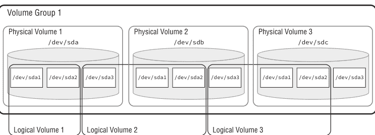
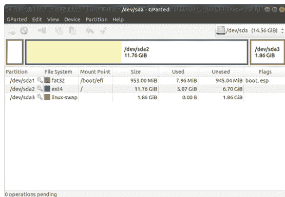
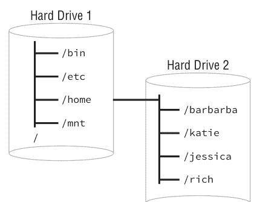

## 第 3 章

### 配置硬件

### 目标

- [x] 101.1 确定并配置硬件设置
- [x] 102.1 设计硬盘布局
- [x] 104.1 创建分区和文件系统
- [x] 104.2 维护文件系统的完整性
- [x] 104.3 控制文件系统的挂载和卸载


了解 Linux 系统如何与底层硬件交互是每个 Linux 系统管理员的重要工作。本章将探讨您的 Linux 系统如何与其运行的硬件交互，以及在必要时如何更改该设置。

### 配置固件和核心硬件

在查看各个可用硬件卡之前，让我们先了解核心硬件的工作原理。本节将讨论当您按下 Linux 工作站或服务器的电源按钮时会发生什么。

### 了解固件的作用

所有 IBM 兼容工作站和服务器都使用某种内置固件来控制已安装操作系统的启动方式。在较旧的工作站和服务器上，此固件称为基本输入/输出系统 (BIOS)。在较新的工作站和服务器上，一种称为统一可扩展固件接口 (UEFI) 的新方法负责维护系统硬件状态并启动已安装的操作系统。

两种方法最终都会启动主操作系统程序，但每种方法的实现方式不同。本节将介绍 BIOS 和 UEFI 方法的基础知识，展示它们如何参与 Linux 启动过程。

### BIOS 启动

旧式工作站和服务器中的 BIOS 固件有些受限。它有一个简单的菜单界面，允许您更改一些设置来控制系统如何查找硬件，并定义 BIOS 应该使用哪个设备来启动操作系统。

原始 BIOS 固件的一个局限性是，它只能从硬盘读取一个扇区的数据到内存中以运行。您可能已经猜到，这不足以加载整个操作系统。为了绕过这一限制，大多数操作系统（包括 Linux 和 Microsoft Windows）将启动过程分为两部分。

首先，BIOS 运行一个 _boot loader_ 程序，这是一个小型程序，用于初始化必要的硬件以查找并运行完整的操作系统程序。它通常位于同一硬盘的另一个位置，但有时位于单独的内部或外部存储设备上。

引导加载程序通常有一个配置文件，因此您可以告诉它在哪里查找要运行的实际操作系统文件，甚至生成一个小菜单，允许用户在多个操作系统之间启动。

要启动系统，BIOS 必须知道在已安装的存储设备上在哪里找到引导加载程序。大多数 BIOS 设置允许您从多个位置加载引导加载程序：

- 内部硬盘
- 外部硬盘
- CD 或 DVD 驱动器
- USB 闪存盘
- ISO 文件
- 使用 NFS、HTTP 或 FTP 的网络服务器

从硬盘启动时，您必须指定 BIOS 应该从哪个硬盘和硬盘上的哪个分区加载引导加载程序。这是通过定义 _主引导记录_ (MBR) 来完成的。

MBR 是系统上第一个硬盘分区的第一个扇区。计算机系统中只有一个 MBR。BIOS 查找 MBR 并将其中存储的程序读入内存。由于引导加载程序必须适合一个扇区，因此它必须非常小，所以无法做太多事情。引导加载程序主要指向实际操作系统内核文件的位置，该文件存储在系统上单独分区的引导扇区中。内核引导文件没有大小限制。

> 引导加载程序不需要直接指向操作系统内核文件；它可以指向任何类型的程序，包括另一个引导加载程序。您可以创建一个指向次要引导加载程序的主引导加载程序，后者提供加载多个操作系统的选项。此过程称为 _链式加载_。

### UEFI 启动

尽管 BIOS 有很多局限性，但计算机制造商学会了与之共存，BIOS 多年来一直是 IBM 兼容系统的默认标准。然而，随着操作系统变得更加复杂，最终很明显需要开发一种新的启动方法。

Intel 于 1998 年创建了 _可扩展固件接口_ (EFI) 以解决 BIOS 的某些局限性。这一进程有些缓慢，但到 2005 年，该理念被其他供应商接受，统一 EFI (UEFI) 规范被采用为标准。


如今，几乎所有IBM兼容的桌面和服务器系统都采用UEFI固件标准。

与依赖硬盘上单个引导扇区来存放引导程序不同，UEFI指定了一个特殊的磁盘分区，称为*EFI系统分区*（ESP），用于存储引导程序。这样可以支持任意大小的引导程序，并能够为多个操作系统存储多个引导程序。

ESP设置使用旧的Microsoft文件分配表（FAT）文件系统来存储引导程序。在Linux系统上，ESP通常挂载在/boot/efi目录中，引导程序文件通常使用.efi文件扩展名存储，例如linux.efi。

UEFI固件使用内置的微型引导程序（有时称为引导管理器），允许你配置要启动的引导程序文件。

并非所有Linux发行版都支持UEFI固件。如果你使用的是UEFI系统，请确保所选的Linux发行版支持它。

使用UEFI时，你需要在引导管理器界面菜单中注册每个希望在启动时出现的独立引导程序文件。然后，每次启动系统时都可以选择要运行的引导程序。

固件找到并运行引导程序后，其任务即告完成。启动过程中的引导程序步骤可能有些复杂；下一节将深入介绍此内容。

### 设备接口

你连接到Linux系统的每个设备都使用某种标准协议与系统硬件通信。Linux内核软件必须知道如何使用这些协议向硬件设备发送数据并从中接收数据。目前，连接设备有三种流行的标准。

### PCI板

外围组件互连（*PCI*）标准于1993年开发，用作连接硬件板与PC主板的方法。该标准已多次更新，以适应更快的接口速度以及主板上日益增大的数据总线尺寸。*PCI Express*（PCIe）标准目前用于大多数服务器和桌面工作站，为外部硬件设备提供通用接口。

各种不同的客户端设备使用PCI板连接到服务器或桌面工作站：

- **内部硬盘：** 使用*串行高级技术附件*（SATA）和*小型计算机系统接口*（SCSI）接口的硬盘通常使用PCI板与工作站或服务器连接。Linux内核会自动识别连接到PCI板的SATA和SCSI硬盘。

- **外部硬盘：** 使用光纤通道标准的网络硬盘为服务器环境提供高速共享驱动器环境。要在光纤通道网络上通信，服务器通常使用支持*主机总线适配器*（HBA）标准的PCI板。

- **网络接口卡：** 有线网卡允许你使用常见的RJ-45电缆标准将工作站或服务器连接到局域网（LAN）。这类连接主要见于需要向网络提供高吞吐量的高速网络环境中。

- **无线网卡：** 有支持IEEE 802.11标准的PCI板可用于无线连接到局域网。虽然它们在服务器环境中不常用，但在工作站环境中非常流行。

- **蓝牙设备：** 蓝牙技术允许在点对点网络设置中与其他蓝牙设备进行短距离无线通信。它们最常见于工作站环境中。

- **视频加速卡：** 需要高级图形的应用程序通常使用视频加速卡，这些卡将视频处理需求从CPU卸载，以提供更快的图形。虽然这些卡在游戏环境中很流行，但你也会发现视频加速卡用于视频处理应用程序中，用于编辑和处理电影。

- **音频卡：** 同样，需要高质量声音的应用程序通常使用专用音频卡来提供高级音频处理和播放，例如处理杜比环绕声以增强电影的音频质量。

大多数PCI板利用即插即用（PnP）标准，该标准自动确定板子的配置设置，因此两块板之间不会发生冲突。如果确实遇到冲突，你可以使用setpci实用程序查看并手动更改单个PCI板的设置。

### USB接口

*通用串行总线*（USB）接口因其易用性和对高速数据通信的支持不断增加而越来越流行。由于USB接口使用串行通信，它需要的主板连接器更少，从而允许更小的接口插头。

USB标准多年来不断发展。最初的版本1.0仅支持最高12 Mbps的数据传输速度。2.0标准将数据传输速度提高到480 Mbps。当前的USB标准3.2允许最高20 Gbps的数据传输速度，使其适用于与外部存储设备的高速连接。

许多不同的设备可以使用USB接口连接到系统。你可以找到硬盘、打印机、数码相机和摄像机、键盘、鼠标以及带有使用USB接口连接的版本的网卡。

让Linux与USB设备交互有两个步骤。首先，Linux内核必须安装适当的模块来识别安装在你的服务器、工作站或笔记本电脑上的USB控制器。控制器在Linux内核和系统上的USB总线之间提供通信。当Linux内核能够与USB总线通信时，你插入系统USB端口的任何设备都会被内核识别，但未必一定有用。其次，Linux系统还必须为插入USB总线的各个设备类型安装内核模块。

### GPIO接口

通用输入/输出（GPIO）接口在小型实用Linux系统中变得流行，这些系统旨在为自动化项目控制外部设备。这包括流行的爱好者Linux系统，如树莓派和BeagleBone套件。

GPIO接口提供多个数字输入和输出线，你可以单独控制，精度可达单个比特级。GPIO功能通常由特殊的集成电路（IC）芯片处理，该芯片映射到Linux系统的内存中。

GPIO接口非常适合支持与继电器、灯光、传感器和电机等外部设备的通信。应用程序可以读取单个GPIO线以确定开关状态、打开或关闭继电器，或读取来自任何类型模拟-数字传感器（例如温度或压力传感器）的数字值。

GPIO接口为使用Linux控制对象和环境提供了丰富的可能性。你可以编写程序来控制房间温度、感知门或窗户何时打开或关闭、感知房间内的运动，甚至控制机器人的运行。

### /dev目录

Linux内核通过接口与设备通信后，必须能够与设备传输数据。这是通过设备文件完成的。设备文件是Linux内核在特殊的/dev目录中创建的文件，用于与硬件设备接口。

要从特定设备检索数据，程序只需读取与该设备关联的Linux设备文件。Linux操作系统处理所有与实际硬件接口的棘手问题。同样，要向设备发送数据，程序只需写入Linux设备文件。

当你将USB驱动器、网卡或硬盘等硬件设备添加到系统时，Linux会在/dev目录中创建一个代表该硬件设备的文件。应用程序随后可以直接与该文件交互，以在设备上存储和检索数据。这比要求每个应用程序都知道如何直接与设备交互要容易得多。


Linux 中有两种设备文件，具体取决于 Linux 向设备传输数据的方式：

- 字符设备文件：每次传输一个字符。这种方法通常用于串行设备，例如终端和 USB 设备。

- 块设备文件：每次传输大块数据。这种方法通常用于高速数据传输设备，例如硬盘和网卡。

设备文件的类型由权限列表中的第一个字母表示，如清单 3.1 所示。

## 清单 3.1：/dev 目录的部分输出

```
$ ls -al sd* tty*
brw-rw---- 1 root disk 8, 0 Feb 16 17:49 sda
brw-rw---- 1 root disk 8, 1 Feb 16 17:49 sda1
crw-rw-rw- 1 root tty 5, 0 Feb 16 17:49 tty
crw--w---- 1 root tty 4, 0 Feb 16 17:49 tty0
crw--w---- 1 gdm tty 4, 1 Feb 16 17:49 tty1
```

硬盘设备 sda 和 sda1 显示字母 b，表明它们是块设备文件。tty 终端文件显示字母 c，表明它们是字符设备文件。

除了设备文件，Linux 还提供了一种称为设备映射器的系统。设备映射器功能由 Linux 内核执行。它将物理块设备映射到虚拟块设备。这些虚拟块设备允许系统拦截写入或从物理设备读取的数据，并对其执行某种操作。映射设备由逻辑卷管理器（Logical Volume Manager，LVM）用于创建逻辑驱动器，并由 Linux 统一密钥设置（Linux Unified Key Setup，LUKS）用于在安装这些功能时加密硬盘上的数据。

设备映射器在 /dev/mapper 目录中创建虚拟设备。这些文件是指向 /dev 目录中物理块设备文件的链接。

### /proc 目录

/proc 目录是在 Linux 系统上排查硬件问题时可用的最重要工具之一。它不是文件系统上的物理目录，而是内核动态填充的虚拟目录，用于提供对系统硬件设置和状态信息的访问。

Linux 内核在监控系统上硬件状态时，会更改 /proc 目录中的文件和数据。要查看硬件设备和设置的状态，只需使用标准 Linux 文本命令读取虚拟文件的内容即可。

不同的系统功能有各种 /proc 文件可用，包括硬件设备在系统中使用的中断请求（IRQ）、输入/输出（I/O）端口和直接内存访问（DMA）通道。本节讨论用于监控这些功能的文件以及如何访问它们。

### 中断请求

中断请求（IRQ）允许硬件设备指示它们有数据要发送到 CPU。PnP 系统必须为系统上安装的每个硬件设备分配一个唯一的 IRQ 地址。您可以通过使用 Linux cat 命令查看 /proc/interrupts 文件，来查看 Linux 系统上当前正在使用的 IRQ，如清单 3.2 所示。

## 清单 3.2：/proc 目录中的系统中断列表

```
$ cat /proc/interrupts
           CPU0
0:     36   IO-APIC   2-edge      timer
1:    297   IO-APIC   1-edge      i8042
8:     0   IO-APIC   8-edge      rtc0
9:     0   IO-APIC   9-fasteoi   acpi
12:   396   IO-APIC  12-edge      i8042
14:     0   IO-APIC  14-edge     ata_piix
15:   914   IO-APIC  15-edge     ata_piix
18:     2   IO-APIC  18-fasteoi  vboxvideo
19:  4337   IO-APIC  19-fasteoi  enp0s3
20:  1563   IO-APIC  20-fasteoi  vboxguest
21: 29724   IO-APIC  21-fasteoi  ahci[0000:00:0d.0], snd_intel8x0
22:    27   IO-APIC  22-fasteoi  ohci_hcd:usb1
NMI:     0   Non-maskable interrupts
LOC:  93356   Local timer interrupts
SPU:     0   Spurious interrupts
PMI:     0   Performance monitoring interrupts
IWI:     0   IRQ work interrupts
RTR:     0   APIC ICR read retries
RES:     0   Rescheduling interrupts
CAL:     0   Function call interrupts
TLB:     0   TLB shootdowns
TRM:     0   Thermal event interrupts
THR:     0   Threshold APIC interrupts
DFR:     0   Deferred Error APIC interrupts
MCE:     0   Machine check exceptions
MCP:     3   Machine check polls
HYP:     0   Hypervisor callback interrupts
ERR:              0
MIS:              0
PIN:              0       Posted-interrupt notification event
NPI:              0       Nested posted-interrupt event
PIW:              0       Posted-interrupt wakeup event
$
```

系统会为特定硬件设备保留某些 IRQ，例如 0 用于系统定时器，1 用于系统键盘。其他 IRQ 是由系统在引导时检测到设备时分配的。

### I/O 端口

系统 I/O 端口是内存中的位置，CPU 可向其发送数据并从中接收来自硬件设备的数据。与 IRQ 类似，系统必须为每个设备分配一个唯一的 I/O 端口。这是 PnP 系统处理的另一项功能。

您可以通过查看 /proc/ioports 文件，来监控分配给系统上硬件设备的 I/O 端口，如清单 3.3 所示。

## 清单 3.3：显示系统上的 I/O 端口

```
$ sudo cat /proc/ioports
0000-0cf7  : PCI Bus 0000:00
    0000-001f  : dma1
    0020-0021  : pic1
    0040-0043  : timer0
    0050-0053  : timer1
    0060-0060  : keyboard
    0064-0064  : keyboard
    0070-0071  : rtc_cmos
        0070-0071  : rtc0
    0080-008f  : dma page reg
    00a0-00a1  : pic2
    00c0-00df  : dma2
    00f0-00ff  : fpu
    0170-0177  : 0000:00:01.1
        0170-0177  : ata_piix
    01f0-01f7  : 0000:00:01.1
        01f0-01f7  : ata_piix
    0376-0376  : 0000:00:01.1
        0376-0376  : ata_piix
    03c0-03df  : vga+
    03f6-03f6  : 0000:00:01.1
        03f6-03f6  : ata_piix
0cf8-0cff : PCI conf1
0000-ffff : PCI Bus 0000:00
4000-403f : 0000:00:07.0
4000-4003 : ACPI PM1a_EVT_BLK
4004-4005 : ACPI PM1a_CNT_BLK
4008-400b : ACPI PM_TMR
4020-4021 : ACPI GPE0_BLK
4100-410f : 0000:00:07.0
4100-4108 : piix4_smbus
d000-d00f : 0000:00:01.1
d000-d00f : ata_piix
d010-d017 : 0000:00:03.0
d010-d017 : e1000
d020-d03f : 0000:00:04.0
d100-d1ff : 0000:00:05.0
d100-d1ff : Intel 82801AA-ICH
d200-d23f : 0000:00:05.0
d200-d23f : Intel 82801AA-ICH
d240-d247 : 0000:00:0d.0
d240-d247 : ahci
d248-d24b : 0000:00:0d.0
d248-d24b : ahci
d250-d257 : 0000:00:0d.0
d250-d257 : ahci
d258-d25b : 0000:00:0d.0
d258-d25b : ahci
d260-d26f : 0000:00:0d.0
d260-d26f : ahci
$
```

Linux 系统随时都在使用大量不同的 I/O 端口，因此您的输出很可能与此示例不同。在 PnP 下，I/O 端口冲突并不常见，但有可能两个设备被分配了相同的 I/O 端口。在这种情况下，您可以使用 setpci 命令手动覆盖自动分配的设置。

### 直接内存访问

使用 I/O 端口向 CPU 发送数据可能会有些慢。为加快速度，许多设备使用直接内存访问（DMA）通道。DMA 通道顾名思义——它们将数据从硬件设备直接发送到系统内存，而无需等待 CPU。然后，CPU 可以在准备就绪时读取这些内存位置以访问数据。

与 I/O 端口类似，每个使用 DMA 的硬件设备都必须分配一个唯一的通道号。要查看系统中当前正在使用的 DMA 通道，只需显示 /proc/dma 文件：

```
$ cat /proc/dma
4: cascade
$
```

此输出表明 Linux 系统上仅使用 DMA 通道 4。

### /sys 目录

可用于处理设备的另一种工具是 /sys 目录。/sys 目录是另一个虚拟目录，类似于 /proc 目录。它由内核以 sysfs 文件系统格式创建，并提供系统上任何用户都可访问的有关硬件设备的其他信息。

/sys 目录中提供了许多不同的信息文件。这些文件根据系统中的设备和功能被细分为子目录。您可以使用 ls 命令行命令查看系统上 /sys 目录中可用的子目录和文件，如清单 3.4 所示。

## 清单 3.4：/sys 目录的内容

```
$ sudo ls -al /sys
total 4
dr-xr-xr-x 13 root root 0 Feb 16 18:06 .
drwxr-xr-x 25 root root 4096 Feb 4 06:54 ..
drwxr-xr-x 2 root root 0 Feb 16 17:48 block
drwxr-xr-x 41 root root 0 Feb 16 17:48 bus
drwxr-xr-x 62 root root 0 Feb 16 17:48 class
drwxr-xr-x 4 root root 0 Feb 16 17:48 dev
drwxr-xr-x 14 root root 0 Feb 16 17:48 devices
drwxr-xr-x 5 root root 0 Feb 16 17:49 firmware
drwxr-xr-x 8 root root 0 Feb 16 17:48 fs
drwxr-xr-x 2 root root 0 Feb 16 18:06 hypervisor
drwxr-xr-x 13 root root 0 Feb 16 17:48 kernel
drwxr-xr-x 143 root root 0 Feb 16 17:48 module
drwxr-xr-x 2 root root 0 Feb 16 17:48 power
$
```

注意可用的不同类别的信息。您可以获取有关系统总线、设备、内核甚至已安装内核模块的信息。


### 使用设备

Linux 提供了大量命令行工具，可用于使用连接到系统的设备，也可在遇到问题时监控和排查设备故障。本节将介绍使用 Linux 设备时需要了解的一些常用工具。

### 查找设备

对于新的 Linux 管理员来说，首先要完成的任务之一就是查找 Linux 系统上安装的不同设备。幸运的是，有几个命令行工具可以提供帮助。

`lssdev` 命令行命令显示 Linux 系统上安装的硬件设备的信息。它从 `/proc/interrupts`、`/proc/ioports` 和 `/proc/dma` 虚拟文件中检索信息，并将它们合并在一个输出中，如清单 3.5 所示。

### **清单 3.5:** lssdev 命令的输出

```
$ sudo lssdev
Device            DMA   IRQ   I/O Ports
...
acpi                9
ACPI                4000-4003 4004-4005 4008-400b 4020-4021
ahci                d240-d247 d248-d24b d250-d257 d258-d25b
ata_piix    14 15   0170-0177 01f0-01f7 0376-0376 03f6-03f6
cascade     4
dma                 0080-008f
dma1                0000-001f
dma2                00c0-00df
e1000               d010-d017
enp0s3      19
fpu                 00f0-00ff
i8042       1 12
Intel               d100-d1ff   d200-d23f
keyboard            0060-0060   0064-0064
ohci_hcd:usb1   22
PCI                 0000-0cf7 0cf8-0cff 0d00-ffff
pic1                0020-0021
pic2                00a0-00a1
piix4_smbus         4100-4108
rtc0        8       0070-0071
rtc_cmos            0070-0071
snd_intel8x0        21
timer       0
timer0              0040-0043
timer1           0050-0053
vboxguest        20
vboxvideo        18
vga+             03c0-03df
$
```

这为您提供了一个查看系统上运行设备的所有重要信息的地方，从而轻松找出可能引起问题的任何冲突。

lsblk 命令显示 Linux 系统上安装的块设备的信息。默认情况下，lsblk 命令显示所有块设备，如清单 3.6 所示。

### 清单 3.6: lsblk 命令的输出

```
$ lsblk
NAME        MAJ:MIN RM  SIZE RO TYPE MOUNTPOINT
loop0       7:0    0  34.6M  1 loop /snap/gtk-common-themes/818
loop1       7:1    0  2.2M   1 loop /snap/gnome-calculator/222
loop2       7:2    0  34.8M   1 loop /snap/gtk-common-themes/1122
loop3       7:3    0 169.4M   1 loop /snap/gimp/113
loop4       7:4    0  2.3M   1 loop /snap/gnome-calculator/238
loop5       7:5    0   13M   1 loop /snap/gnome-characters/117
loop6       7:6    0  34.2M   1 loop /snap/gtk-common-themes/808
loop7       7:7    0  89.5M   1 loop /snap/core/6130
loop8       7:8    0  14.5M   1 loop /snap/gnome-logs/45
loop9       7:9    0  53.7M   1 loop /snap/core18/719
loop10      7:10   0   91M   1 loop /snap/core/6350
loop11      7:11   0 140.7M   1 loop /snap/gnome-3-26-1604/74
loop12      7:12   0  53.7M   1 loop /snap/core18/594
loop13       7:13   0 169.4M   1 loop /snap/gimp/105
loop14       7:14   0  14.5M   1 loop /snap/gnome-logs/43
loop15       7:15   0   13M   1 loop /snap/gnome-characters/124
loop16       7:16   0   13M   1 loop /snap/gnome-characters/139
loop17       7:17   0   14.5M   1 loop /snap/gnome-logs/40
loop18       7:18   0 140.7M   1 loop /snap/gnome-3-26-1604/78
loop19       7:19   0   3.7M   1 loop /snap/gnome-system-monitor/57
loop20      7:20   0   2.3M   1 loop /snap/gnome-calculator/260
loop21      7:21   0   3.7M   1 loop /snap/gnome-system-monitor/54
loop22      7:22   0 169.4M   1 loop /snap/gimp/110
loop23      7:23   0  53.7M   1 loop /snap/core18/677
loop24      7:24   0   91M   1 loop /snap/core/6405
loop25      7:25   0 140.9M   1 loop /snap/gnome-3-26-1604/70
loop26      7:26   0   3.7M   1 loop /snap/gnome-system-monitor/51
sda        8:0    0   10G  0 disk
├─sda1     8:1    0   10G  0 part
│ └─ubuntu--vg-root 253:0  0    9G  0 lvm  /
│ └─ubuntu--vg-swap_1 253:1  0  976M  0 lvm  [SWAP]
sr0       11:0    1 1024M  0 rom
$
```

请注意，在清单 3.6 的末尾，lsblk 命令还指示相关块，例如与设备映射的 LVM 卷和关联的物理硬盘。您可以通过添加命令行选项来修改 lsblk 输出，以查看其他信息或仅显示信息子集。-S 选项仅显示系统上 SCSI 块设备的信息：

```
$ lsblk -S
NAME   HCTL       TYPE VENDOR   MODEL             REV TRAN
sda    2:0:0:0    disk ATA      VBOX HARDDISK     1.0 sata
sr0    1:0:0:0    rom  VBOX     CD-ROM            1.0 ata
$
```

这是查看系统上安装的不同 SCSI 驱动器的快速方法。

### 使用 PCI 卡

lspci 命令允许您查看当前在 Linux 系统上安装和识别的 PCI 和 PCIe 卡。可以使用许多命令行选项与 lspci 命令一起使用，以显示系统上安装的 PCI 和 PCIe 卡的信息。表 3.1 显示了最常见的选项。

### 表 3.1 lspci 命令行选项

| 选项 | 说明 |
| :--- | :--- |
| -A | 定义访问 PCI 信息的方法 |
| -b | 从卡的角度显示连接信息 |
| -k | 显示每个已安装 PCI 卡的内核驱动程序模块 |
| -m | 以机器可读格式显示信息 |
| -n | 以数字而不是文本显示供应商和设备信息 |
| -q | 查询集中式 PCI 数据库，获取有关已安装 PCI 卡的信息 |
| -t | 显示树形图，显示卡与总线之间的连接 |
| -v | 显示关于卡的其他信息（详细信息） |
| -x | 显示卡信息的十六进制输出转储 |

不带任何选项的 lspci 命令输出显示连接到系统的所有设备，如清单 3.7 所示。

### 清单 3.7: 使用 lspci 命令

```
$ lspci
00:00.0 Host bridge: Intel Corporation 440FX - 82441FX PMC [Natoma] (rev 02)
00:01.0 ISA bridge: Intel Corporation 82371SB PIIX3 ISA [Natoma/Triton II]
00:01.1 IDE interface: Intel Corporation 82371AB/EB/MB PIIX4 IDE (rev 01)
00:02.0 VGA compatible controller: InnoTek Systemberatung GmbH VirtualBox Graphics Adapter
00:03.0 Ethernet controller: Intel Corporation 82540EM Gigabit Ethernet Controller (rev 02)
00:04.0 System peripheral: InnoTek Systemberatung GmbH VirtualBox Guest Service
00:05.0 Multimedia audio controller: Intel Corporation 82801AA AC'97 Audio Controller (rev 01)
00:06.0 USB controller: Apple Inc. KeyLargo/Intrepid USB
00:07.0 Bridge: Intel Corporation 82371AB/EB/MB PIIX4 ACPI (rev 08)
00:0d.0 SATA controller: Intel Corporation 82801HM/HEM (ICH8M/ICH8M-E) SATA Controller [AHCI mode] (rev 02)
$
```

您可以使用 lspci 命令的输出来排查 PCI 卡问题，例如当卡未被 Linux 系统识别时。

### 使用 USB 设备

您可以使用 lsusb 命令查看连接到 Linux 系统的 USB 设备的基本信息。表 3.2 显示了该命令可用的选项。

### 表 3.2 lsusb 命令选项

| 选项 | 说明 |
| :--- | :--- |
| -d | 仅显示指定供应商 ID 的设备 |
| -D | 仅显示具有指定设备文件的设备的信息 |
| -s | 仅显示使用指定总线的设备的信息 |
| -t | 以树形格式显示信息，显示相关设备 |
| -v | 显示有关设备的其他信息（详细模式） |
| -V | 显示 lsusb 程序的版本 |

### 清单 3.8: lsusb 输出

```
$ lsusb
Bus 001 Device 003: ID abcd:1234 Unknown
Bus 001 Device 002: ID 80ee:0021 VirtualBox USB Tablet
Bus 001 Device 001: ID 1d6b:0001 Linux Foundation 1.1 root hub
$
```

大多数系统都集成了标准 USB 集线器，用于将多个 USB 设备连接到 USB 控制器。幸运的是，市场上的 USB 集线器只有少数几种，因此所有 Linux 发行版都包含与这些 USB 集线器通信所需的设备驱动程序。这保证了您的 Linux 系统至少会在连接 USB 设备时检测到它。

### 硬件模块

Linux 内核需要设备驱动程序才能与安装在 Linux 系统上的硬件设备进行通信。但是，将所有已知硬件设备的设备驱动程序编译到内核中会生成一个非常大的内核二进制文件。

为了避免这种情况，Linux 内核使用内核模块，这些模块是单个硬件驱动程序文件，可以在运行时链接到内核。这样，系统可以仅链接系统中存在的硬件所需的模块。

如果内核配置为加载硬件设备模块，则单个模块文件也必须可用于系统。如果您正在编译新的 Linux 内核，还需要连同新内核一起编译任何硬件模块。

模块文件可以作为需要编译的源代码分发，也可以作为准备动态链接到主内核二进制程序的 Linux 系统上的二进制对象文件分发。如果模块文件作为源代码文件分发，则必须对其进行编译以创建二进制对象文件。.ko 文件扩展名用于标识模块对象文件。

存储模块对象文件的标准位置在 /lib/modules 目录中。这是 Linux 模块实用程序（例如 insmod 和 modprobe）默认查找模块对象库文件的位置。

> 某些硬件供应商仅为其硬件模块发布模块对象文件，而不发布源代码。这有助于他们保护其硬件的专有功能，同时仍然允许其硬件产品在开源环境中使用。尽管这种安排违反了开源代码的核心思想，但它已成为试图保护其产品秘密的公司与希望在其系统上使用最新硬件的 Linux 爱好者之间的共同点。


使用模块时，你应该熟悉几个不同的文件。你已经看到，支持内核所需的模块存储在 /lib/modules 目录中。每个内核都有自己的模块目录（例如 /lib/modules/4.3.3），这样如果需要，可以为系统上的每个内核版本创建单独的模块。

内核在启动时加载的模块列在 /etc/modules 文件中，每行一个。大多数硬件模块可以动态加载，因为系统会自动检测硬件设备，因此该文件可能不包含很多模块。

如果需要，你可以自定义内核模块以定义所需的唯一参数，例如设备运行所需的硬件设置。内核模块配置存储在 /etc/modules.conf 配置文件中。

最后，有些模块可能依赖于先加载其他模块才能正常运行。这些关系在 modules.dep 文件中定义，存储在 /lib/modules/version/ 目录中，其中 version 是内核版本。每个条目的格式为

```
modulefilename: dependencyfilename1 dependencyfilename2 ...
```

当你使用 modules_install 目标安装模块时，它会调用 depmod 实用程序，该实用程序会确定模块依赖关系并自动生成 modules.dep 文件。之后如果修改或添加任何模块，必须手动运行 depmod 命令来更新 modules.dep 文件。

### 列出已安装的模块

大量命令行命令可以帮助你排查和修复内核模块问题。本节将介绍可用的不同模块命令，帮助你解决可能遇到的任何模块问题。

第一个命令是 lsmod，它列出系统上安装的所有模块。清单 3.9 显示了在 Ubuntu 系统上使用 lsmod 命令的示例。

### 清单 3.9: lsmod 命令输出

```
$ lsmod
Module                  Size  Used by
vboxsf                 39706  1
snd_intel8x0           38153  2
snd_ac97_codec        130285  1 snd_intel8x0
ac97_bus               12730  1 snd_ac97_codec
snd_pcm               102099  2 snd_ac97_codec,snd_intel8x0
snd_page_alloc         18710  2 snd_intel8x0,snd_pcm
snd_seq_midi           13324  0
snd_seq_midi_event     14899  1 snd_seq_midi
snd_rawmidi            30144  1 snd_seq_midi
snd_seq                61560  2 snd_seq_midi_event,snd_seq_midi
snd_seq_device         14497  3 snd_seq,snd_rawmidi,snd_seq_midi
snd_timer              29482  2 snd_pcm,snd_seq
rfcomm           69160  0
 hid_multitouch   17407  0
 joydev           17381  0
 snd              69322  12
 snd_ac97_codec,snd_intel8x0,snd_timer,snd_pcm,snd_seq,snd_rawmidi,snd_seq_device,
 snd_seq_midi
 bnep             19624  2
 bluetooth        391136 10 bnep,rfcomm
 serio_raw        13462  0
 vboxvideo        12658  1
 drm              303102 2 vboxvideo
 vboxguest        276728 7 vboxsf
 i2c_piix4        22155  0
 soundcore        12680  1 snd
 video            19476  0
 mac_hid          13205  0
 parport_pc       32701  0
 ppdev            17671  0
 lp               17759  0
 parport          42348  3 lp,ppdev,parport_pc
 hid_generic      12548  0
 usbhid           52659  0
 hid              106148 3 hid_multitouch,hid_generic,usbhid
 psmouse         106692  0
 ahci             34091  3
 libahci          32716  1 ahci
 e1000            145227 0
 pata_acpi        13038  0
$
```

请注意，lsmod 命令还显示哪些模块被其他模块使用。在排查硬件问题时，这可能是关键信息。

### 获取模块信息

如果需要了解特定模块的更多信息，请使用 modinfo 命令，如清单 3.10 所示。

### 清单 3.10: modinfo 命令输出

```
$ modinfo bluetooth
filename:       /lib/modules/3.13.0-63-generic/kernel/net/bluetooth/bluetooth.ko
alias:          net-pf-31
license: GPL
version: 2.17
description: Bluetooth Core ver 2.17
author: Marcel Holtmann <marcel@holtmann.org>
srcversion: 071210642A004CFE1860F30
depends:
intree: Y
vermagic: 3.13.0-63-generic SMP mod_unload modversions
signer: Magrathea: Glacier signing key
sig_key: E2:53:28:1F:E2:65:EE:3C:EA:FC:AA:3F:29:2E:21:2B:95:F0:35:9A
sig_hashalgo: sha512
parm: disable_esco: Disable eSCO connection creation (bool)
parm: disable_ertm: Disable enhanced retransmission mode (bool)
$
```

modinfo 命令会显示支持该模块所使用的确切模块文件，以及关于模块来源的详细信息。

### 安装新模块

如果需要手动安装新模块，有两个命令可以帮助你：

- insmod
- modprobe

insmod 命令是最基本的，要求你指定要加载的确切模块文件。如前所述，内核模块文件存储在 /lib/modules 目录结构中，每个内核版本都有自己的目录。如果你在 Linux 系统中查看该目录，会看到针对不同类型硬件的目录树结构。

例如，Ubuntu Linux 桌面系统有以下用于蓝牙硬件驱动程序的目录：

```
/lib/modules/3.13.0-63-generic/kernel/drivers/bluetooth
```

该目录用于系统上当前安装的 Linux 内核：3.13.0-63。

该目录中包含用于各种蓝牙系统的不同设备驱动程序模块文件：

```
$ ls -l
total 420
-rw-r--r-- 1 root root 23220 Aug 14 19:07 ath3k.ko
-rw-r--r-- 1 root root 14028 Aug 14 19:07 bcm203x.ko
-rw-r--r-- 1 root root 26332 Aug 14 19:07 bfusb.ko
-rw-r--r-- 1 root root 18404 Aug 14 19:07 bluecard_cs.ko
-rw-r--r-- 1 root root 19124 Aug 14 19:07 bpal0x.ko
-rw-r--r-- 1 root root 16964 Aug 14 19:07 bt3c_es.ko
-rw-r--r-- 1 root root 38148 Aug 14 19:07 btmrvl.ko
-rw-r--r-- 1 root root 34204 Aug 14 19:07 btmrvl_sdio.ko
-rw-r--r-- 1 root root 17524 Aug 14 19:07 btsdio.ko
-rw-r--r-- 1 root root 14524 Aug 14 19:07 btuart_cs.ko
-rw-r--r-- 1 root root 53964 Aug 14 19:07 btusb.ko
-rw-r--r-- 1 root root 14188 Aug 14 19:07 btwilink.ko
-rw-r--r-- 1 root root 15572 Aug 14 19:07 dtl1_cs.ko
-rw-r--r-- 1 root root 74772 Aug 14 19:07 hci_uart.ko
-rw-r--r-- 1 root root 15156 Aug 14 19:07 hci_vhci.ko
$
```

每个带有 .ko 扩展名的文件都是每个设备驱动程序的独立模块文件，你可以将其安装到 3.13.0-63 内核中。要安装模块，请在 insmod 命令行上指定文件名。某些模块还需要参数，你也必须在命令行上指定这些参数：

```
$ sudo insmod /lib/modules/3.13.0-49-generic/kernel/drivers/bluetooth/
btusb.ko
password:
$
```

使用 insmod 程序的缺点是，你可能会遇到依赖其他模块的模块，如果那些其他模块尚未安装，insmod 程序将会失败。为了简化此过程，modprobe 命令会帮助你解决模块依赖关系。

modprobe 命令的另一个良好特性是，它理解模块名称，并会在模块库中搜索为该模块名称提供驱动程序的模块文件。

由于这种通用性，modprobe 命令有许多可用选项。表 3.3 显示了你可以使用的命令行选项。

### 表 3.3 modprobe 命令选项

| 选项 | 说明 |
| :--- | :--- |
| -a | 插入命令行上列出的所有模块 |
| -b | 应用配置文件中指定的任何黑名单命令 |
| -C | 指定不同于默认值的配置文件 |
| -c | 显示当前使用的配置。 |
| -d | 指定用于安装模块的根目录。默认值为 /。 |
| -f | 即使存在版本问题也强制安装模块。 |
| -i | 忽略模块配置文件中指定的安装和移除命令。 |
| -n | 执行模块安装的试运行，以查看是否可行，而不实际安装它。 |
| -q | 安静模式——如果模块安装或移除失败，不显示任何错误消息。 |
| -r | 移除列出的模块。 |
| -s | 将任何错误消息发送到系统上的 syslog 设施。 |
| -V | 显示程序版本并退出。 |
| -v | 在处理模块时提供额外信息（详细模式）。 |

如你所见，modprobe 命令本身就是一个功能齐全的工具。也许最方便的特性是，它允许你根据模块名称处理模块，而无需列出完整的模块文件名：

```
$ sudo modprobe -iv btusb
insmod /lib/modules/3.13.0-63-generic/kernel/drivers/bluetooth/btusb.ko
$
```

请注意，通过添加 -v 选项启用详细模式，输出会显示 modprobe 命令自动生成的 insmod 命令。insmod 命令显示用于安装模块的特定模块文件。

### 移除模块

通常，如果硬件设备不存在，在系统中安装模块也不会造成损害。内核只是忽略未使用的模块。然而，有些 Linux 管理员倾向于保持内核尽可能轻量，因此 Linux 开发人员创建了一种移除不必要模块的方法：rmmod 命令。rmmod 命令通过指定模块名称来移除模块。


然而，我们的朋友 modprobe 命令也可以为我们移除模块，因此你不需要记忆另一个命令。相反，只需在 modprobe 命令中使用 -r 选项：

```
$ sudo modprobe -rv btusb
rmmod btusb
$
```

modprobe -r 命令会自动调用 rmmod 命令，按名称移除模块。你可以使用 lsmod 命令验证模块是否已被移除。

### 存储基础

在计算机系统上持久存储数据最常见的方式是使用硬盘驱动器（HDD）。硬盘驱动器是物理设备，使用一组旋转的磁盘盘片来存储数据，通过可移动的读写头在盘片上磁性地写入和读取磁像。

如今另一种流行的持久存储类型称为固态驱动器（SSD）。这些驱动器使用集成电路以电子方式存储数据。SSD 中不包含活动部件，因此比 HDD 更快、更耐用。虽然目前 SSD 比 HDD 更昂贵，但技术正在迅速改变这一现状，HDD 可能很快就会成为过去式。

Linux 以相同的方式处理 HDD 和 SSD 存储设备。这主要取决于用于将驱动器连接到 Linux 系统的连接方式。本节描述了 Linux 用于连接和使用 HDD 和 SSD 设备的不同方法。

### 驱动器类型

虽然 HDD 和 SSD 在存储数据的方式上有所不同，但它们都使用相同的方法与 Linux 系统交互。在 Linux 系统中，你会遇到三种主要的驱动器连接类型：

- 并行高级技术附件（PATA）使用并行接口连接驱动器，需要一根宽电缆。PATA 每个适配器支持两个设备。
- 串行高级技术附件（SATA）使用串行接口连接驱动器，但速度比 PATA 快得多。SATA 每个适配器最多支持四个设备。
- 小型计算机系统接口（SCSI）使用并行接口连接驱动器，但速度与 SATA 相当。SCSI 每个适配器最多支持八个设备。

当你将驱动器连接到 Linux 系统时，Linux 内核会在 /dev 目录中为驱动器设备分配一个文件。该文件称为*原始设备*，因为它提供了从 Linux 系统直接到驱动器的路径。写入文件的任何数据都会写入驱动器，读取文件会直接从驱动器读取数据。

对于 PATA 设备，该文件名为 /dev/hdx，其中 x 是代表单个驱动器的字母，从 a 开始。对于 SATA 和 SCSI 设备，Linux 使用 /dev/sdx，其中 x 同样是代表单个驱动器的字母，从 a 开始。因此，要引用系统上的第一个 SATA 设备，你会使用 /dev/sda，然后对于第二个设备使用 /dev/sdb，以此类推。

### 驱动器分区

大多数操作系统（包括 Linux）允许你将驱动器*分区*为多个部分。分区是驱动器内的一个独立部分，操作系统将其视为单独的存储空间。

对驱动器进行分区可以帮助你更好地组织数据，例如将操作系统数据与用户数据分开。如果某个恶意用户用数据填满磁盘空间，操作系统仍将有空间在单独的分区上运行。

分区必须由驱动器上的某种索引系统进行跟踪。使用旧 BIOS 引导加载程序方法的系统使用*主引导记录（MBR）*方法来管理磁盘分区。此方法仅支持驱动器上最多四个*主分区*。但是，每个主分区本身可以分成多个*扩展分区*。

使用 UEFI 引导加载程序方法的系统使用更高级的*GUID 分区表（GPT）*方法来管理分区，该方法支持驱动器上最多 128 个分区。Linux 按分区在驱动器上出现的顺序分配分区编号，从编号 1 开始。

Linux 为每个单独的磁盘分区创建 /dev 文件。它将分区编号附加到设备名称末尾，并从 1 开始对主分区编号，因此第一个 SATA 驱动器上的第一个主分区将是 /dev/sda1。MBR 扩展分区从 5 开始编号，因此第一个扩展分区被分配文件 /dev/sda5。

### 自动驱动器检测

Linux 系统在引导时检测驱动器和分区，并为每个分配一个唯一的设备文件名。但是，随着可移动 USB 驱动器（例如内存棒）的发明，这些设备可以在系统运行时随意添加和移除，因此需要修改该方法。

大多数 Linux 系统现在使用 *udev* 应用程序。udev 程序始终在后台运行，并自动检测连接到运行中 Linux 系统的新硬件。当你连接新驱动器、USB 设备或光驱（例如 CD 和 DVD 设备）时，udev 会检测它们，并在 /dev 目录中为每个设备分配一个唯一的设备文件名。

udev 应用程序的另一个功能是，它还为存储设备创建*持久设备文件*。当你添加或移除可移动存储设备时，分配给它的 /dev 名称可能会更改，具体取决于任意时刻连接了哪些设备。这可能使应用程序难以每次找到同一个存储设备。

为了解决这个问题，udev 应用程序使用 /dev/disk 目录根据驱动器的唯一属性创建指向 /dev 存储设备文件的链接。udev 创建四个独立目录用于存储链接：

- /dev/disk/by-id：按制造商、型号和序列号链接存储设备
- /dev/disk/by-label：按分配给它们的标签链接存储设备
- /dev/disk/by-path：按它们连接的物理硬件端口链接存储设备
- /dev/disk/by-uuid：按分配给设备的 128 位通用唯一标识符（UUID）链接存储设备

使用 udev 设备链接，你可以通过永久标识符明确引用存储设备，而不是根据其插入 Linux 系统的位置或时间。

### 存储替代方案

存储设备上的标准分区布局确实有其局限性。创建并格式化分区后，要使其变大或变小并不容易。各个分区也容易发生磁盘故障，在这种情况下，存储在分区中的所有数据都将丢失。

为了适应更动态的存储选项以及容错功能，Linux 已采用一些高级存储管理技术。本节将介绍你会遇到的三种更流行的技术。

### 多路径

Linux 内核现在支持设备映射器（DM）多路径，它允许你在 Linux 系统和网络存储设备之间配置多个路径。多路径聚合这些路径，在所有路径都活动时提供更高的吞吐量，或在某个路径变为非活动时提供容错。

Linux DM 多路径工具包括

- *dm-multipath*：提供多路径支持的内核模块
- *multipath*：用于查看多路径设备的命令行命令
- *multipathd*：用于监控路径以及激活/停用路径的后台进程
- *kpartx*：用于为多路径存储设备创建设备条目的命令行工具

DM 多路径功能使用 Linux 中的动态 /dev/mapper 设备文件目录。Linux 为添加到系统的每个新多路径存储设备创建一个名为 mpathN 的 /dev/mapper 设备文件，其中 N 是多路径驱动器的编号。该文件对 Linux 系统来说就像一个普通设备文件，允许你在多路径设备上创建分区和文件系统，就像处理普通驱动器分区一样。

### 逻辑卷管理器

Linux 逻辑卷管理器（LVM）也利用 /dev/mapper 动态设备目录来允许你创建虚拟驱动器设备。你可以将多个物理驱动器分区聚合到虚拟卷中，然后将其视为系统上的单个分区。LVM 的好处是，你可以根据需要向逻辑卷添加和移除物理分区，按需扩展和缩小逻辑卷。使用 LVM 有些复杂。图 3.1 演示了 LVM 环境的布局。

**图 3.1** Linux LVM 布局



在图 3.1 所示的示例中，三个物理驱动器每个包含三个分区。第一个逻辑卷由第一个驱动器的前两个分区组成。第二个逻辑卷跨越驱动器，将第一个驱动器的第三个分区与第二个驱动器的第一个和第二个分区合并为一个卷。第三个逻辑卷由第二个驱动器的第三个分区和第三个驱动器的前两个分区组成。第三个驱动器的第三个分区未分配，以后在需要时可以添加到任何逻辑卷中。

对于每个物理分区，你必须在 fdisk 或 gdisk 中将分区类型标记为 Linux LVM 文件系统类型。然后，你必须使用多个 LVM 工具来创建和管理逻辑卷：

- pvcreate：创建物理卷
- vgcreate：将物理卷分组到卷组中
- lvcreate：从每个物理卷中的分区创建逻辑卷


逻辑卷在 /dev/mapper 目录中创建条目，这些条目代表你可以使用文件系统格式化并像普通分区一样使用的 LVM 设备。

虽然 LVM 的初始设置比较复杂，但它确实提供了巨大的好处。如果逻辑卷的空间不足，只需向卷中添加一个新的磁盘分区即可。

### 使用 RAID 技术

冗余独立磁盘阵列（RAID）技术已经改变了大多数数据中心的数据存储环境。RAID 技术允许你通过将多个驱动器合并为一个虚拟驱动器来提高数据访问性能和可靠性，以及实现数据冗余以实现容错。常用的 RAID 版本有几种：

- RAID 0: 磁盘条带化，将数据分布在多个磁盘上以实现更快的访问
- RAID 1: 磁盘镜像，将数据复制到两个驱动器上
- RAID 10: 磁盘镜像和条带化，提供用于性能的条带化和用于容错的镜像
- RAID 4: 带奇偶校验的磁盘条带化，将奇偶位存储在单独的磁盘上，以便可以恢复失败数据磁盘上的数据
- RAID 5: 带分布式奇偶校验的磁盘条带化，将奇偶位添加到数据条带中，使其出现在所有磁盘上，以便可以恢复任何失败的磁盘
- RAID 6: 带双重奇偶校验的磁盘条带化，同时对数据和奇偶位进行条带化，以便可以恢复两个失败的驱动器

缺点是硬件 RAID 存储设备可能有些昂贵（尽管 I 代表的含义并非如此），而且对于大多数家庭用途来说往往不切实际。正因为如此，Linux 实现了一个软件 RAID 系统，可以在任何磁盘系统上实现 RAID 功能。

mdadm 实用程序允许你指定多个分区用于任何类型的 RAID 环境。RAID 设备会在 /dev/mapper 目录中显示为单个设备，随后你可以对其进行分区并格式化为特定的文件系统。

### 分区工具

将驱动器连接到 Linux 系统后，你需要在其上创建分区（即使只有一个分区）。Linux 提供了几种用于处理原始存储设备以创建分区的工具。本节介绍了你在 Linux 中会遇到的最流行的分区工具。

### 使用 fdisk

最常见的命令行分区工具是 fdisk 实用程序。fdisk 程序允许你在使用 MBR 分区索引方法的任何驱动器上创建、查看、删除和修改分区。

要使用 fdisk 程序，必须指定要操作的设备的驱动器设备名称（而不是分区名称）：

```
$ sudo fdisk /dev/sda
[sudo] password for rich:
Welcome to fdisk (util-linux 2.23.2).
```

更改将仅保留在内存中，直到你决定将它们写入。

在使用写入命令之前请小心。

命令（输入 m 查看帮助）：

fdisk 程序使用其自己的命令行，允许你提交命令来处理驱动器分区。表 3.4 显示了可用于处理分区的常见命令。

### 表 3.4 常用 fdisk 命令

| 命令 | 描述 |
|---|---|
| a | 切换可引导标志 |
| b | 编辑 BSD 磁盘标签 |
| c | 切换 DOS 兼容性标志 |
| d | 删除分区 |
| g | 创建新的空 GPT 分区表 |
| G | 创建 IRIX (SGI) 分区表 |
| l | 列出已知的分区类型 |
| m | 打印此菜单 |
| n | 添加新分区 |
| o | 创建新的空 DOS 分区表 |
| p | 打印分区表 |
| q | 不保存更改即退出 |
| s | 创建新的空 Sun 磁盘标签 |
| t | 更改分区的系统 ID |
| u | 更改显示/输入单位 |
| v | 验证分区表 |
| w | 将表写入磁盘并退出 |
| x | 额外功能（仅限专家） |

p 命令显示驱动器上的当前分区方案：

```
Command (m for help): p

Disk /dev/sda: 10.7 GB, 10737418240 bytes, 20971520 sectors
Units = sectors of 1 * 512 = 512 bytes
Sector size (logical/physical): 512 bytes / 512 bytes
I/O size (minimum/optimal): 512 bytes / 512 bytes
Disk label type: dos
Disk identifier: 0x000528e6

   Device Boot      Start         End      Blocks   Id  System
/Dev/sda1   *        2048    2099199    1048576   83  Linux
/Dev/sda2        2099200    20971519     9436160   83  Linux
```

命令（输入 m 查看帮助）：

在此示例中，/dev/sda 驱动器被分为两个分区：sda1 和 sda2。Id 和 System 列指的是分区格式化为处理的文件系统类型。我们将在稍后的“了解文件系统”部分介绍这一点。两个分区都格式化为支持 Linux 文件系统。第一个分区分配了约 1 GB 的空间，而第二个分区分配了略多于 9 GB 的空间。

fdisk 命令有些原始，因为它不允许你更改现有分区的大小；你所能做的就是删除现有分区并从头重建它。

要能够从分区启动系统，必须为分区设置引导标志。使用 a 命令执行此操作。可引导分区在输出列表中以星号标记。

如果对驱动器分区进行了任何更改，必须使用 w 命令退出以将更改写入驱动器。

### 使用 gdisk

如果你正在使用采用 GPT 索引方法的驱动器，则需要使用 gdisk 程序：

```
$ sudo gdisk /dev/sda
[sudo] password for rich:
GPT fdisk (gdisk) version 1.0.3
```

分区表扫描：
MBR: 保护性
BSD: 不存在
APM: 不存在
GPT: 存在

找到带保护性 MBR 的有效 GPT；正在使用 GPT。

命令（输入 ? 查看帮助）：

gdisk 程序识别驱动器上使用的格式化类型。如果驱动当前不使用 GPT 方法，gdisk 会为你提供将其转换为 GPT 驱动器的选项。

> 转换驱动器的方法时请小心。你选择的方法必须与系统固件（BIOS 或 UEFI）兼容。否则，你的驱动器将无法启动。

gdisk 程序还使用其自己的命令提示符，允许你输入命令来操作驱动器布局，如表 3.5 所示。

### 表 3.5 常用 gdisk 命令

| 命令 | 描述 |
|---|---|
| b | 将 GPT 数据备份到文件 |
| c | 更改分区名称 |
| d | 删除分区 |
| i | 显示分区的详细信息 |
| l | 列出已知的分区类型 |
| n | 添加新分区 |
| o | 创建新的空 GUID 分区表 (GPT) |
| p | 打印分区表 |
| q | 不保存更改即退出 |
| r | 恢复和转换选项（仅限专家） |
| s | 对分区进行排序 |
| t | 更改分区的类型代码 |
| v | 验证磁盘 |
| w | 将表写入磁盘并退出 |
| x | 额外功能（仅限专家） |
| ? | 打印此菜单 |

你会发现，许多 gdisk 命令与 fdisk 程序中的命令相似，这使得在两个程序之间切换变得更加容易。

### GNU parted 命令

GNU parted 程序提供了另一个用于处理驱动器分区的命令行界面：

```
$ sudo parted
GNU Parted 3.2
Using /dev/sda
Welcome to GNU Parted! Type 'help' to view a list of commands.
(parted) print
Model: ATA VBOX HARDDISK (scsi)
Disk /dev/sda: 15.6GB
Sector size (logical/physical): 512B/512B
Partition Table: gpt
```

| 编号 | 开始 | 结束 | 大小 | 文件系统 | 名称 | 标志 |
|---|---|---|---|---|---|---|
| 1 | 1049kB | 1000MB | 999MB | fat32 | | boot, esp |
| 2 | 1000MB | 13.6GB | 12.6GB | ext4 | | |
| 3 | 13.6GB | 15.6GB | 2000MB | linux-swap(v1) | | |

(parted)

parted 程序的一大卖点是它允许你修改现有分区的大小，因此你可以轻松缩小或扩大驱动器上的分区。GNU parted 中的命令提示符界面有时可能有点晦涩，这使得初次使用的用户难以上手。但是，一旦你熟悉了命令结构，就可以做很多事情，这使得 GNU parted 成为一个多功能的工具。

### 图形工具

如果你正在使用图形桌面环境，也可以使用一些图形工具。其中最常见的是 GNOME 分区编辑器，即 gparted。图 3.2 展示了在 Ubuntu 桌面环境中运行 gparted 的示例。

### 图 3.2 GParted 界面



gparted 窗口一次显示系统上的每个驱动器，以图形布局显示驱动器中包含的所有分区。你可以右键单击分区以选择挂载或卸载、格式化、删除或调整分区大小的选项。


### 了解文件系统

就像把东西放在壁橱里一样，在 Linux 系统中存储数据也需要某种组织方法才能高效。Linux 使用文件系统来管理存储设备上存储的数据。文件系统维护一个映射来定位存储设备中放置的每个文件。本节描述了 Linux 文件系统，并展示了如何在其中查找文件和目录。

使用 Linux 时，Linux 文件系统可能是最令人困惑的方面之一。在驱动器、CD 和 USB 闪存驱动器上查找文件起初可能是一项挑战。

如果您熟悉 Windows 如何管理文件和目录，您就会知道 Windows 会为连接到系统的每个存储设备分配驱动器号。例如，Windows 使用 C: 表示系统上的主驱动器，或者使用 E: 表示插入系统的 USB 闪存驱动器。

在 Windows 中，您习惯于看到诸如下文所示的文件路径：

```
`C:\Users\rich\Documents\test.docx`
```

此路径表示该文件位于 rich 用户帐户的 Documents 目录中，而该目录存储在分配了字母 C 的磁盘分区上（通常是系统上的第一个驱动器）。

Windows 路径会告诉您文件存储在哪个物理设备上。然而，Linux 不使用这种方法来引用文件。它使用虚拟目录结构。虚拟目录包含系统上安装的所有存储设备的文件路径，合并为单个目录结构。

### 虚拟目录

Linux 虚拟目录结构包含一个单一的基目录，称为根目录。根目录根据用于访问它们的目录路径列出其下的文件和目录，类似于 Windows 的方式。

> 请注意此处的术语。虽然 Linux 中的主管理用户帐户称为 root，但它与根虚拟目录文件夹无关。两者是分开的，这可能令人困惑。

例如，Linux 文件路径可能如下所示：

```
/home/rich/Documents/test.doc
```

首先，请注意 Linux 路径使用正斜杠，而不是 Windows 使用的反斜杠。这是一个重要的差异，经常会让许多新手 Linux 管理员感到困惑。至于路径本身，还要注意没有驱动器号。该路径仅指示文件 test.doc 存储在用户 rich 的 Documents 目录中；它不会提供有关哪个物理设备包含该文件的任何线索。

Linux 使用挂载点将物理设备放置在虚拟目录中。挂载点是虚拟目录中的目录占位符，指向特定的物理设备。图 3.3 演示了此过程的工作原理。

## 图 3.3 Linux 虚拟目录结构在两个驱动器之间划分



在图 3.3 中，Linux 系统上使用了两个驱动器。一个驱动器与虚拟目录的根目录相关联（由单个正斜杠表示）。第二个驱动器挂载在 /home 位置，用户目录位于该位置。在将第二个驱动器挂载到虚拟目录后，存储在驱动器上的文件和目录在 /home 目录下可用。

由于 Linux 将所有内容都存储在虚拟目录中，因此可能会变得有些复杂。幸运的是，已为 Linux 虚拟目录定义了一种名为 Linux 文件系统层次标准（FHS）的标准格式。FHS 定义了每个 Linux 系统上应存在的核心目录名称和位置，以及它们应包含的数据类型。表 3.6 显示了 FHS 中定义的几个常用目录。

## 表 3.6 常见的 Linux FHS 目录

| 目录 | 描述 |
| :--- | :--- |
| /boot | 包含用于引导系统的引导加载程序文件 |
| /etc | 包含系统和应用程序配置文件 |
| /home | 包含用户数据文件 |
| /media | 用作可移动设备的挂载点 |
| /mnt | 也可用作可移动设备的挂载点 |
| /opt | 包含可选第三方程序的数据 |
| /tmp | 包含系统用户创建的临时文件 |
| /usr | 包含标准 Linux 程序的数据 |
| /usr/bin | 包含本地用户程序和数据 |
| /usr/local | 包含本地安装特有程序的数据 |
| /usr/sbin | 包含系统程序和数据 |
| /var | 包含变量数据文件，包括系统和应用程序日志 |

> 虽然 FHS 有助于标准化 Linux 虚拟文件系统，但并非所有 Linux 发行版都完全遵循它。最好查阅特定 Linux 发行版的文档，了解它如何在虚拟目录结构中管理文件。

### 在文件系统中导航

使用虚拟目录可以轻松地将文件从一个物理设备移动到另一个物理设备。您不需要担心驱动器号——只需关注虚拟目录中的位置：

```
$ cp /home/rich/Documents/myfile.txt /media/usb
```

文件的完整路径列出了虚拟目录结构中的每个目录，以便一路向下找到文件。这种格式称为_绝对路径_。文件的绝对路径始终从根目录 (/) 开始，并包括沿虚拟目录树到达文件的每个目录。

或者，您可以使用_相对路径_来指定文件位置。文件的相对路径表示文件相对于您在虚拟目录树结构中的当前位置的位置。如果您已经在 Documents 目录中，则只需键入

```
$ cp myfile.txt /media/usb
```

当 Linux 发现路径不是以正斜杠开头时，它会假设路径相对于当前目录。

### 格式化文件系统

在将驱动器分区分配给虚拟目录中的挂载点之前，必须使用文件系统对其进行格式化。Linux 支持许多文件系统类型，每种都有不同的功能和特性。本节讨论这些文件系统以及如何为它们格式化驱动器分区。

### 常见文件系统类型

每个操作系统都利用其自身的文件系统类型来存储驱动器上的数据。Linux 不仅支持多种自身的文件系统类型，还支持其他操作系统的文件系统。本节介绍可用于 Linux 分区的最常见的 Linux 和非 Linux 文件系统。

### Linux 文件系统

当您创建专门用于 Linux 系统的文件系统时，可以从四种主要文件系统中选择：

- _btrfs_：一种较新的高性能文件系统，支持最大 16 exbibytes (EiB) 的文件大小，总文件系统大小为 16 EiB。它还可以执行自己的冗余廉价磁盘阵列 (RAID) 形式，以及逻辑卷管理 (LVM) 和子卷。它包括额外的高级功能，例如用于备份的内置快照、改进的容错能力和即时数据压缩。

- _ecryptfs_：企业加密文件系统 (eCryptfs) 在将数据存储到设备之前，对数据应用符合可移植操作系统接口 (POSIX) 标准的加密协议。这为存储在设备上的数据提供了一层保护。只有创建该文件系统的操作系统才能从中读取数据。

- _ext3_：也称为 ext3fs，这是原始 Linux ext 文件系统的后代。它支持最大 2 tebibytes (TiB) 的文件，总文件系统大小为 16 TiB。它支持日志功能，以及更快的启动和恢复。

- ext4：也称为 ext4fs，是原始 Linux 文件系统的当前版本。它支持最大 16 TiB 的文件，总文件系统大小为 1 EiB。它还支持日志功能，并利用改进的性能特性。

- reiserFS：在 Linux ext3fs 文件系统之前创建，通常用于旧版 Linux 系统，它提供了现在 ext3fs 和 ext4fs 中具有的功能。Linux 已停止对最新版本 reiser4fs 的支持。

- swap：交换文件系统允许您使用物理驱动器上的空间为系统创建虚拟内存。系统随后可以将数据从常规内存交换到交换空间，从而提供一种为系统添加额外内存的方法。这不适用于存储持久数据。

当今大多数 Linux 发行版使用的默认文件系统是 ext4fs。ext4fs 文件系统提供日志功能，这是一种在日志文件（称为日志）中跟踪尚未写入驱动器的数据的方法。如果系统在数据写入驱动器之前发生故障，则在下次系统启动时可以恢复并存储日志数据。

许多 Linux 管理员已喜欢上较新的 btrfs 文件系统。btrfs 文件系统提供许多高级功能，例如能够跨多个设备创建文件系统、自动数据压缩以及创建子卷的能力。

### 非 Linux 文件系统

使 Linux 如此通用的绝佳功能之一是其能够读取存储在为其他操作系统（如 macOS 和 Windows）格式化的设备上的数据。此功能使在运行不同操作系统的不同系统之间共享数据变得轻而易举。

以下是 Linux 可以处理的常见非 Linux 文件系统列表：

- CIFS：常用 Internet 文件系统 (CIFS) 是微软创建的一种文件系统协议，用于通过网络存储设备在网络上读取和写入数据。它已发布给公众，用于所有操作系统。

- exFAT：扩展文件分配表是一种基于原始 Microsoft FAT 表架构构建的文件系统，通常用于格式化 USB 设备和 SD 卡。

- HFS：层次文件系统 (HFS) 由 Apple 开发，用于其 Mac 系统。Linux 还可以与更高级的 HFS+ 文件系统交互。

- ISO-9660：ISO-9660 标准用于在 CD-ROM 设备上创建文件系统。

- NFS：网络文件系统 (NFS) 是一种开源标准，用于通过网络存储设备在网络上读取和写入数据。

- NTFS：新技术文件系统 (NTFS) 是微软 NT 操作系统及后续 Windows 版本使用的文件系统。Linux 从内核 2.6.x 开始可以读取和写入 NTFS 分区上的数据。


- SMB：服务器消息块（SMB）文件系统由 Microsoft 创建，作为一种专有文件系统，用于网络存储和与其他网络设备（如打印机）进行交互。对 SMB 的支持允许 Linux 客户端和服务器与网络上的 Microsoft 客户端和服务器进行交互。

- UDF：通用磁盘格式（UDF）通常用于 DVD-ROM 设备来存储数据。Linux 可以使用此文件系统从 DVD 读取数据并向 DVD 写入数据。

- VFAT：虚拟文件分配表（VFAT）是原始 Microsoft 文件分配表（FAT）文件系统的扩展。它不常用于驱动器，但常用于可移动存储设备，例如 USB 存储棒。

- XFS：X 文件系统（XFS）由硅图形公司（Silicon Graphics）为其（现已停产）高级图形工作站创建。该文件系统提供了高级高性能功能，使其在 Linux 中仍然很受欢迎。

- ZFS：Zettabyte 文件系统（ZFS）由太阳微系统（Sun Microsystems，现为 Oracle 的一部分）为其 Unix 工作站和服务器创建。另一个高性能文件系统，它具有与 btrfs Linux 文件系统类似的功能。

通常不建议使用非 Linux 文件系统格式化分区，除非你打算仅在 Linux 系统上使用该驱动器。Linux 支持这些文件系统主要是作为与其他操作系统共享数据的方法。

### 创建文件系统

在 Linux 中创建文件系统的“瑞士军刀”是 `mkfs` 程序。`mkfs` 程序实际上是几个用于创建特定文件系统的独立工具的前端，例如用于创建 ext4 文件系统的 `mkfs.ext4` 程序。

`mkfs` 程序的妙处在于，你只需记住一个程序名即可在 Linux 系统上创建任何类型的文件系统。只需使用 `-t` 选项来指定文件系统类型：

```
$ sudo mkfs -t ext4 /dev/sdb1
mke2fs 1.44.1 (24-Mar-2018)
Creating filesystem with 2621440 4k blocks and 655360 inodes
Filesystem UUID: f9137b26-0caf-4a8a-afd0-392002424ee8
Superblock backups stored on blocks:
	32768, 98304, 163840, 229376, 294912, 819200, 884736, 1605632
Allocating group tables: done
Writing inode tables: done
Creating journal (16384 blocks): done
Writing superblocks and filesystem accounting information: done
$
```

在命令行上只需指定要格式化的分区的设备文件名即可。mkfs 程序会自动调用 mke2fs 程序来创建 ext4 分区。请注意，格式化文件系统时，mkfs 程序在后台还会执行许多其他操作。每个文件系统都有自己的文件和目录索引方法以及跟踪文件访问的方法。mkfs 程序会为特定文件系统创建所有必要的索引文件和表格。

指定分区设备文件名时请务必小心。格式化分区时，分区上的所有现有数据都将丢失。如果指定了错误的分区名，可能会丢失重要数据或导致 Linux 系统无法启动。

通常最好在硬盘上保留一些空间作为交换区。交换区充当虚拟内存，以帮助扩展可供 CPU 使用的可用内存。你使用 mkswap 命令创建交换区。

### 挂载文件系统

使用文件系统格式化驱动器分区后，可以将其添加到 Linux 系统的虚拟目录中。此过程称为 *挂载* 文件系统。

你可以从命令行在虚拟目录结构中手动挂载分区，也可以让 Linux 在启动时自动挂载分区。本节将介绍这两种方法。

### 手动挂载设备

要将文件系统临时挂载到 Linux 虚拟目录，请使用 *mount* 命令。
mount 命令的基本格式为

```
mount -t fstype device mountpoint
```

```
$ sudo mount -t ext4 /dev/sdb1 /media/usb1
$
```

如果不带任何参数指定 mount 命令，它将显示当前在 Linux 系统上挂载的所有设备。不过，请做好长输出的准备，因为大多数 Linux 发行版会在虚拟目录中挂载大量虚拟设备，以提供有关系统资源的信息。清单 3.11 显示了 mount 命令的部分输出。

### 清单 3.11：mount 命令的输出

```
$ mount
...
/dev/sda2 on / type ext4 (rw,relatime,errors=remount-ro,data=ordered)
/dev/sda1 on /boot/efi type vfat (rw,relatime,fmask=0077,dmask=0077,codepage=437,iocharset=iso8859-1,shortname=mixed,errors=remount-ro)
...
/dev/sdb1 on /media/usb1 type ext4 (rw,relatime,data=ordered)
/dev/sdb2 on /media/usb2 type ext4 (rw,relatime,data=ordered)
rich@rich-TestBox2:~$
```

为节省空间，我们精简了 mount 命令的输出，仅显示系统上的物理设备。请注意，主硬盘设备（/dev/sda）包含两个分区。你还可以看到，USB 存储棒设备（/dev/sdb）包含两个分区。

> mount 命令使用 -o 选项来指定文件系统的其他功能，例如以只读模式挂载它、分配给挂载点的用户权限以及数据在设备上的存储方式。这些选项会显示在 mount 命令的输出中。通常可以省略 -o 选项，为新的挂载点使用系统默认值。

mount 命令的缺点是它仅在虚拟目录中临时挂载设备。重新启动系统后，你需要手动再次挂载设备。这通常对可移动设备（如 USB 存储棒）没问题，但对于更永久的设备，如果 Linux 能自动为我们挂载它们就更好了。幸运的是，Linux 确实可以做到这一点。

要从虚拟目录中删除已挂载的驱动器，请使用 umount 命令（注意缺少“n”）。你可以通过指定设备文件名或挂载点目录来删除已挂载的驱动器。

> 若要挂载创建为交换区的分区，不使用 mount 命令，而是使用 swapon 命令。内核会自动将该分区标记为虚拟内存结构的一部分。

### 自动挂载设备

对于永久存储设备，Linux 维护 /etc/fstab 文件，以指示哪些驱动器设备应在启动时挂载到虚拟目录中。/etc/fstab 文件是一个表格，指示驱动器设备文件（原始文件或其永久 udev 文件名之一）、挂载点位置、文件系统类型以及挂载驱动器所需的任何其他选项。清单 3.12 显示了 Ubuntu 工作站上的 /etc/fstab 文件。

### 清单 3.12：/etc/fstab 文件

```
$ cat /etc/fstab
# /etc/fstab: static file system information.
#
# Use 'blkid' to print the universally unique identifier for a
# device; this may be used with UUID= as a more robust way to name devices
# that works even if disks are added and removed. See fstab(5).
#
# <file system> <mount point> <type> <options> <dump> <pass>
# / was on /dev/sda2 during installation
UUID=46a8473c-8437-4d5f-a6a1-6596c492c3ce /
    errors=remount-ro 0 1
# /boot/efi was on /dev/sda1 during installation
UUID=864B-62F5 /boot/efi vfat umask=0077 0 1
# swap was on /dev/sda3 during installation
UUID=8673447a-0227-47d7-a67a-e6b837bd7188 none swap sw
0 0
$
```

此 /etc/fstab 文件通过设备的通用唯一标识符（UUID）值来引用设备，确保无论设备在原始设备表中出现的顺序如何，都能访问正确的驱动器分区。第一个分区挂载到虚拟目录中的 /boot/efi 挂载点。第二个分区挂载到虚拟目录的根目录（/），第三个分区挂载为虚拟内存的交换区。

你可以手动将设备添加到 /etc/fstab 文件中，以便在 Linux 系统启动时自动挂载它们。但是，如果它们在启动时不存在，将会引导错误。


> 如果在任何分区上使用 eCryptfs 文件系统类型，它们将出现在 /etc/crypttab 文件中，并在启动时自动挂载。
> 在系统运行期间，你也可以通过查看 /etc/mtab 文件来查看当前挂载的所有设备，无论它们是由系统自动挂载还是由用户手动挂载。


### 管理文件系统

After you've created a filesystem and mounted it to the virtual directory, you may have to manage and maintain it to keep things running smoothly. This section walks through some of the Linux utilities available for managing the filesystems on your Linux system.

创建文件系统并将其挂载到虚拟目录后，您可能需要对其进行管理和维护，以保持系统平稳运行。本节将介绍一些可用于管理Linux系统上文件系统的Linux实用程序。

### 检索文件系统统计信息

As you use your Linux system, there's no doubt that at some point you'll need to monitor disk performance and usage. A few different tools are available to help you do that:

使用Linux系统时，您无疑会在某个时刻需要监控磁盘性能和使用情况。有几种不同的工具可帮助您完成此操作：

- **df**: Displays disk usage by partition
- **du**: Displays disk usage by directory; good for finding users or applications that are taking up the most disk space
- **iostat**: Displays a real-time chart of disk statistics by partition
- **lsblk**: Displays current partition sizes and mount points

- **df**: 按分区显示磁盘使用情况
- **du**: 按目录显示磁盘使用情况；适用于查找占用磁盘空间最大的用户或应用程序
- **iostat**: 按分区显示磁盘统计信息的实时图表
- **lsblk**: 显示当前分区大小和挂载点

In addition to these tools, the /proc and /sys directories are special filesystems that the kernel uses for recording system statistics. Two files that can be useful when working with filesystems are the /proc/partitions and /proc/mounts files, which provide information on system partitions and mount points, respectively. Additionally, the /sys/block directory contains separate directories for each mounted drive, showing partitions and kernel-level stats.

除这些工具外，/proc和/sys目录是内核用于记录系统统计信息的特殊文件系统。在使用文件系统时可能有用的两个文件是/proc/partitions和/proc/mounts文件，它们分别提供系统分区和挂载点的信息。此外，/sys/block目录为每个已挂载驱动器包含单独的目录，显示分区和内核级统计信息。

Some filesystems, such as ext3 and ext4, allocate a specific number of inodes when created. An inode is an entry in the index table that tracks files stored on the filesystem. If the filesystem runs out of inode entries in the table, you can't create any more files, even if space is available on the drive. Using the -i option with the df command will show you the percentage of inodes used on a filesystem and can be a lifesaver.

某些文件系统，例如ext3和ext4，在创建时会分配特定数量的inode。inode是索引表中的条目，用于跟踪存储在文件系统上的文件。如果文件系统中的inode条目用完，您将无法创建更多文件，即使驱动器上还有可用空间。将-i选项与df命令一起使用将显示文件系统上已用inode的百分比，这可能是救命稻草。

### 文件系统工具

Linux uses the e2fsprogs package of tools to provide utilities for working with ext filesystems (such as ext3 and ext4). The most popular tools in the e2fsprogs package are

Linux使用e2fsprogs工具包提供用于处理ext文件系统（如ext3和ext4）的实用程序。e2fsprogs工具包中最流行的工具包括

- **blkid**: Display information about block devices, such as storage drives
- **chattr**: Change file attributes on the filesystem
- **debugfs**: Manually view and modify the filesystem structure, such as undeleting a file or extracting a corrupted file
- **dumpe2fs**: Display block and superblock group information
- **e2label**: Change the label on the filesystem
- **resize2fs**: Expand or shrink a filesystem
- **tune2fs**: Modify filesystem parameters

- **blkid**: 显示块设备信息，例如存储驱动器
- **chattr**: 更改文件系统上的文件属性
- **debugfs**: 手动查看和修改文件系统结构，例如恢复已删除的文件或提取损坏的文件
- **dumpe2fs**: 显示块和超块组信息
- **e2label**: 更改文件系统上的标签
- **resize2fs**: 扩展或缩小文件系统
- **tune2fs**: 修改文件系统参数

These tools help you fine-tune parameters on an ext filesystem, but if corruption occurs on the filesystem, you'll need the fsck program.

这些工具可帮助您微调ext文件系统上的参数，但如果文件系统发生损坏，您将需要fsck程序。

The XFS filesystem also has a set of tools available for tuning the filesystem. You'll most likely use the following:

XFS文件系统也有一套可用于调整文件系统的工具。您最可能会使用以下工具：

- xfs_admin: Display or change filesystem parameters such as the label or UUID assigned
- xfs_db: Examine and debug an XFS filesystem
- xfs_fsr: Improve the organization of mounted filesystems
- xfs_info: Display information about a mounted filesystem, including the block sizes and sector sizes, as well as label and UUID information
- xfs_repair: Repair corrupted or damaged XFS filesystems

- xfs_admin: 显示或更改文件系统参数，例如分配的标签或UUID
- xfs_db: 检查和调试XFS文件系统
- xfs_fsr: 改善已挂载文件系统的组织
- xfs_info: 显示已挂载文件系统的信息，包括块大小和扇区大小以及标签和UUID信息
- xfs_repair: 修复损坏或受损的XFS文件系统

Although these ext and XFS tools are useful, they can't help fix things if the filesystem itself has errors. For that, the fsck program is the tool to use:

```
$ sudo fsck -f /dev/sdb1
fsck from util-linux 2.31.1
e2fsck 1.44.1 (24-Mar-2018)
Pass 1: Checking inodes, blocks, and sizes
Pass 2: Checking directory structure
Pass 3: Checking directory connectivity
Pass 4: Checking reference counts
Pass 5: Checking group summary information
/dev/sdb1: 11/655360 files (0.0% non-contiguous), 66753/2621440 blocks
$
```

The fsck program is a front end to several different programs that check the various filesystems to match the index against the actual files stored in the filesystem, such as the e2fsck program used in this example. If any discrepancies occur, run the fsck program in repair mode, and it will attempt to reconcile the discrepancies and fix the filesystem. If the fsck program is unable to repair the drive on the first run, try running it again a few times to fix any broken files and directory links. If running the fsck program multiple times doesn't repair the drive, you may have to resort to reformatting the drive and losing any data on it.

fsck程序是几种不同程序的前端，这些程序用于检查各种文件系统，以便将索引与文件系统中实际存储的文件进行匹配，例如本示例中使用的e2fsck程序。如果发生任何不一致，请以修复模式运行fsck程序，它将尝试调和不一致并修复文件系统。如果fsck程序第一次无法修复驱动器，请尝试多次运行它以修复任何损坏的文件和目录链接。如果多次运行fsck程序仍无法修复驱动器，您可能不得不重新格式化驱动器并丢失其中的所有数据。

## 总结

These days most Linux distributions do a great job of automatically detecting and installing hardware devices. However, it's a good idea to know how to find and change hardware device settings in case you ever need to modify things. The lsdev command displays the hardware settings for all devices connected to the Linux system. The lspci command displays hardware settings for PCI devices, and the lsusb command displays settings for USB devices. The kernel also populates the virtual /proc and /sys directories with real-time information about the system hardware status. The udev program monitors the system and automatically installs any kernel modules required to support hardware connected to a running system.

如今，大多数Linux发行版在自动检测和安装硬件设备方面做得很好。但是，了解如何查找和更改硬件设备设置是个好主意，以防您需要修改某些内容。lsdev命令显示连接到Linux系统的所有设备的硬件设置。lspci命令显示PCI设备的硬件设置，lsusb命令显示USB设备的设置。内核还会使用关于系统硬件状态的实时信息填充虚拟/proc和/sys目录。udev程序监控系统并自动安装支持连接到运行中系统的硬件所需的任何内核模块。

Most storage devices, such as hard disk drives and solid-state drives, allow you to partition them into subsections. Each partition works as a separate storage area that you can format with a Linux filesystem and mount in the Linux virtual directory at mount points. You can also utilize the Linux LVM technology to create virtual volumes consisting of one or more physical partitions and treat the virtual volume as a single partition. This allows you to dynamically add more disk space to an existing virtual volume to increase the storage area.

大多数存储设备，例如硬盘驱动器和固态驱动器，允许您将它们分区为子部分。每个分区都作为一个独立的存储区域，您可以使用Linux文件系统对其进行格式化，并在Linux虚拟目录的挂载点挂载它。您还可以利用Linux LVM技术创建由一个或多个物理分区组成的虚拟卷，并将虚拟卷视为单个分区。这允许您动态地向现有虚拟卷添加更多磁盘空间以增加存储区域。

Linux provides a wealth of command-line tools for partitioning, formatting, and mounting partitions. The fdisk, gdisk, and parted tools provide a menu-driven method for creating, deleting, and modifying partitions on storage devices. After you've created a partition, you must format it using the mkfs tool. When you've formatted the partition with a Linux filesystem, you can mount it into the virtual directory using the mount command.

Linux提供了丰富的命令行工具用于分区、格式化和挂载分区。fdisk、gdisk和parted工具提供了一种基于菜单的方法，用于在存储设备上创建、删除和修改分区。创建分区后，必须使用mkfs工具对其进行格式化。使用Linux文件系统格式化分区后，可以使用mount命令将其挂载到虚拟目录。

Linux also provides several tools for managing and repairing filesystems. The df and du commands are common tools for displaying available storage space on the system, and the fsck command is vital for repairing broken filesystems.

Linux还提供了多种用于管理和修复文件系统的工具。df和du命令是显示系统可用存储空间的常用工具，而fsck命令对于修复损坏的文件系统至关重要。

## 考试要点

**Describe how the BIOS and UEFI work on Linux systems.** The BIOS and UEFI are firmware embedded into computers to start the boot process. They check basic hardware components of the computer and launch the boot loader program to start the boot process.

**描述BIOS和UEFI在Linux系统上的工作原理。** BIOS和UEFI是嵌入式计算机固件，用于启动引导过程。它们检查计算机的基本硬件组件并启动引导加载程序以启动引导过程。

**Explain how to determine the hardware settings on a Linux system.** Linux provides several command-line tools for examining the hardware settings on the system, including lsdev, which displays information on all devices; lspci, which displays information on PCI devices; and lsusb, which displays information on USB devices. In addition to these tools, Linux provides the /proc and /sys virtual directories. The Linux kernel populates files in these directories in real time to display information and statistics on hardware devices.

**解释如何确定Linux系统上的硬件设置。** Linux提供了多种命令行工具来检查系统上的硬件设置，包括lsdev（显示所有设备的信息）、lspci（显示PCI设备的信息）和lsusb（显示USB设备的信息）。除了这些工具外，Linux还提供了/proc和/sys虚拟目录。Linux内核会实时填充这些目录中的文件，以显示硬件设备的信息和统计数据。

**Describe common disk types and their features.** Most legacy systems used hard disk drives (HDD) for data storage, but more modern computers use the solid-state drive (SSD) technology. Both types connect to the motherboard using three types of standard interfaces. The legacy PATA interface provides the basic slow-speed connection and is typically found in legacy systems. More modern computer systems now use the SATA interface, which is faster and more easily configured. The SCSI interface allows you to connect more disks together in a single interface and is often faster than SATA interfaces. However, it is more expensive and is usually only found on higher-end computers.

**描述常见磁盘类型及其特性。** 大多数旧系统使用硬盘驱动器（HDD）进行数据存储，但更现代的计算机使用固态驱动器（SSD）技术。两种类型都使用三种标准接口中的一种连接到主板。旧式PATA接口提供基本的低速连接，通常出现在旧系统中。更现代的计算机系统现在使用SATA接口，它更快且更易于配置。SCSI接口允许您在单个接口中连接更多磁盘，通常比SATA接口更快。但是，它更昂贵，通常只出现在高端计算机上。

**Explain the steps necessary to add a new hard drive to a Linux system.** First you must partition the hard drive to create one or more partitions. Each partition contains a single filesystem, which Linux uses to manage the files and directories stored on the storage device. The fdisk, gdisk, and parted utilities are available in Linux for partitioning a storage device. After you partition the storage device, you must format each partition using one type of filesystem. The most common filesystem currently used in Linux is ext4, but the btrfs filesystem is gaining in popularity due to some advanced features it implements. To create the filesystem, you must use the mkfs command. After creating the filesystem, you can mount the partition into the virtual directory using the mount command. If you want Linux to mount the partition automatically at boot time, add the partition to the /etc/fstab file.

**解释在Linux系统上添加新硬盘所需的步骤。** 首先必须对硬盘进行分区以创建一个或多个分区。每个分区包含一个单一文件系统，Linux使用它来管理存储设备上存储的文件和目录。Linux中提供了fdisk、gdisk和parted实用程序用于对存储设备进行分区。对存储设备分区后，必须使用一种文件系统格式化每个分区。目前Linux中最常用的文件系统是ext4，但由于btrfs文件系统实现了一些高级功能，其受欢迎程度正在提高。要创建文件系统，必须使用mkfs命令。创建文件系统后，可以使用mount命令将分区挂载到虚拟目录。如果希望Linux在引导时自动挂载分区，请将分区添加到/etc/fstab文件中。

**Explain the tools available in Linux for managing and maintaining filesystems.** Linux provides several command-line tools for displaying the status of a filesystem. The df command displays disk usage by partition, and the du command displays disk usage by directory. If an error occurs on the partition, use the fsck utility to fix the partition.

**解释Linux中用于管理和维护文件系统的可用工具。** Linux提供了多种命令行工具来显示文件系统的状态。df命令按分区显示磁盘使用情况，du命令按目录显示磁盘使用情况。如果分区发生错误，请使用fsck实用程序修复分区。


## 复习问题

您可以在附录中找到答案。

- 1. 工作站固件在启动时启动什么程序？
  - A. 引导加载程序
  - B. fsck 程序
  - C. Windows 操作系统
  - D. mount 命令
  - E. initrd 程序

- 2. 固件首先在哪里查找 Linux 引导加载程序？
  - A. /boot/grub 目录
  - B. 主引导记录 (MBR)
  - C. /var/log 目录
  - D. 引导分区
  - E. /etc 目录

- 3. 工作站 BIOS 尝试在哪里查找引导加载程序？（可多选。）
  - A. 内部硬盘
  - B. 外部硬盘
  - C. DVD 驱动器
  - D. USB 闪存盘
  - E. 网络服务器

- 4. 主引导记录位于哪里？（可多选。）
  - A. 系统上第一个硬盘的第一个扇区
  - B. 系统上任何硬盘的引导分区
  - C. 系统上第一个硬盘的最后一个扇区
  - D. 系统上任何硬盘的任何扇区
  - E. 系统上第二个硬盘的第一个扇区

- 5. EFI 系统分区 (ESP) 存储在 Linux 系统的 ______ 目录中。
  - A. /boot
  - B. /etc
  - C. /var
  - D. /boot/efi
  - E. /boot/grub

- 6. ___ 固件方法已取代大多数现代 IBM 兼容计算机上的 BIOS。
  - A. FTP
  - B. UEFI
  - C. PXE
  - D. NFS
  - E. HTTPS

- 7. 哪种存储设备使用集成电路存储数据且没有活动部件？
  - A. SSD
  - B. SATA
  - C. SCSI
  - D. HDD
  - E. PATA

- 8. Linux 为连接到系统的第二个 SCSI 驱动器创建哪个原始设备文件？
  - A. /dev/hdb
  - B. /dev/sdb
  - C. /dev/sdb1
  - D. /dev/hdb1
  - E. /dev/sda

- 9. 哪个工具从多个物理分区创建逻辑卷？
  - A. mkfs
  - B. pvcreate
  - C. lvcreate
  - D. fdisk
  - E. vgcreate

- 10. 哪些 RAID 级别可以轻松从单个故障硬盘中恢复？（可多选。）
  - A. RAID 0
  - B. RAID 4
  - C. RAID 10
  - D. RAID 5
  - E. RAID 1

- 11. 哪个分区工具提供图形界面？
  - A. gdisk
  - B. gparted
  - C. fdisk
  - D. parted
  - E. fsck

- **12.** 哪个 fdisk 命令显示硬盘上的当前分区表？
  - A. v
  - B. n
  - C. m
  - D. p
  - E. d

- **13.** Linux 使用 ______ 将新存储设备上的文件系统添加到虚拟目录。
  - A. 挂载点
  - B. 驱动器号
  - C. /dev 文件
  - D. /proc 目录
  - E. /sys 目录

- **14.** 什么文件系统是原始 Linux 文件系统的最新版本？
  - A. reiserFS
  - B. btrfs
  - C. ext3
  - D. ext4
  - E. nfs

- **15.** 你使用什么工具在分区上创建新文件系统？
  - A. fdisk
  - B. mkfs
  - C. fsck
  - D. gdisk
  - E. parted

- **16.** 你应该创建哪种文件系统类型来帮助扩展 Linux 工作站上安装的物理内存？
  - A. ext3
  - B. btrfs
  - C. swap
  - D. ext4
  - E. NTFS

- 17. 你使用什么工具手动将文件系统添加到虚拟目录？
  - A. fsck
  - B. mount
  - C. umount
  - D. fdisk
  - E. mkfs

- 18. 哪个命令允许你从运行中的 Linux 系统虚拟目录中删除分区？
  - A. mount
  - B. umount
  - C. fsck
  - D. dmesg
  - E. mkinitramfs

- 19. ______ 程序是修复损坏文件系统的实用工具。
  - A. fsck
  - B. mount
  - C. umount
  - D. fdisk
  - E. mkfs

- 20. 你应该使用什么工具来确定 Linux 系统上特定用户帐户使用的磁盘空间？
  - A. df
  - B. iostat
  - C. du
  - D. lsblk
  - E. blkid


