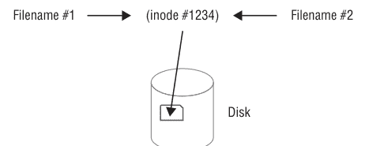
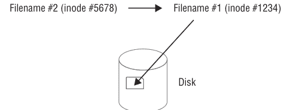
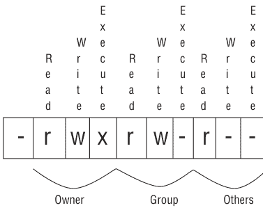

## 第 4 章

## 管理文件

### 目标

- [x] 103.3 执行基本文件管理
- [x] 104.5 管理文件权限和所有权
- [x] 104.6 创建和更改硬链接和符号链接
- [x] 104.7 查找系统文件并将文件放在正确位置


在 Linux 中，虚拟文件系统是内核提供的接口。学习如何处理目录结构中的文件，是理解如何正确维护系统的下一个重要步骤。

能够列出特定目录中位于的文件、查找文件，并使用通配符展开规则来协助完成此维护任务，是关键技能。你还需要理解文件归档和压缩、链接文件，以及 Linux 系统采用的基本文件安全原则等主题。本章涵盖了这些概念及更多内容，以协助你完成文件管理任务。

### 使用文件管理命令

Linux 系统上的文件存储在一个名为虚拟目录的单一目录结构中。虚拟目录包含计算机所有存储设备上的文件，并将它们合并到单一目录结构中。该结构有一个称为根目录 (/) 的单个基目录，通常简称为根目录。

在虚拟目录结构中查看、创建、复制和移动以及删除文件是重要能力。以下各节描述了如何使用命令行程序完成这些各项任务。

### 命名和列出文件

在你开始在虚拟目录结构中浏览之前，最好了解一些关于查看目录内容并使用文件名模式匹配等功能的基本概念。此外，你还想了解如何创建文件以及关于命名它们的一些技巧。

### 使用 ls 命令显示文件名

查看文件名及其各种元数据的最基本命令是列表命令。元数据是描述数据并提供有关数据的更多详细信息的信息。

要发出列表命令，你使用 `ls` 以及任何所需的选项或参数。列表命令的基本语法结构如下：

```
ls [OPTIONS]... [FILE]...
```

在列表命令的语法结构中，有各种 `[OPTIONS]`（也称为开关）可以添加以显示文件元数据。回想一下，括号表示开关是可选的。`[FILE]` 参数显示你可以在命令末尾添加目录或文件名，以查看特定文件或虚拟目录结构中其他位置的文件的元数据。

许多命令行命令的语法结构在 Linux 系统的手册页中有所描述，这些页面也称为 man 页。要查找特定命令的语法结构，请查看其 man 页（例如，`man ls`）并查看 Synopsis 部分。

当你发出不带任何其他参数或选项的 `ls` 命令时，它会显示当前工作目录中所有文件和子目录的名称，如清单 4.1 所示。

### 清单 4.1：使用 ls 和 pwd 命令

```
$ ls
Desktop  Downloads  Pictures  Public  Videos
Documents Music Project47.txt Templates
$
$ pwd
/home/Christine
$
```

你的当前工作目录是登录进程在虚拟目录结构中的当前位置。你可以通过发出 `pwd` 命令来确定此位置的目录名称，如清单 4.1 所示。

若要显示比文件和目录名更多的元数据，你需要向列表命令添加各种选项。表 4.1 显示了一些更常用的选项。

### 表 4.1 ls 命令的常用选项

| 短选项 | 长选项 | 描述 |
| :--- | :--- | :--- |
| -1 | N/A | 每行列出一个文件或子目录名 |
| -a | --all | 显示所有文件和子目录名，包括隐藏文件的名称 |
| -d | --directory | 显示目录自身的元数据而不是其内容 |
| -F | --classify | 使用指示符号 (*./=>,>@, 或 |) 对每个文件类型进行分类 |
| -i | --inode | 显示所有文件和子目录名以及它们关联的索引节点号 |
| -l | N/A | 显示文件和子目录元数据，包括文件类型、文件访问权限、硬链接计数、文件所有者、文件所属组、修改日期和时间以及文件名 |
| -R | N/A | 显示目录的内容，并对原始目录树中的任何子目录，连续显示其内容（递归） |

> 表 4.1 中的 `ls` 命令选项最值得记忆，因为你会经常使用它们。但是，尝试所有各种 `ls` 命令选项和选项组合是有价值的。花些时间浏览 `ls` 命令在其 man 页中的选项。

当你尝试各种命令选项时，你不仅会为 LPIC-1 认证考试做好更充分的准备，还会找到适合你特定需求的组合。清单 4.2 中显示的 `-lh` 选项组合使文件大小更具可读性。

### 清单 4.2：探索 ls -lh 命令

```
$ pwd
/home/Christine/Answers
$
$ ls -l
total 32
drwxrwxr-x. 2 Christine Christine 6 Aug 19 17:34 Everything
drwxrwxr-x. 2 Christine Christine 6 Aug 19 17:34 Life
-rw-r--r--. 1 Christine Christine 29900 Aug 19 17:37 Project42.txt
drwxrwxr-x. 2 Christine Christine 6 Aug 19 17:34 Universe
$
$ ls -lh
total 32K
drwxrwxr-x. 2 Christine Christine 6 Aug 19 17:34 Everything
drwxrwxr-x. 2 Christine Christine 6 Aug 19 17:34 Life
-rw-r--r--. 1 Christine Christine 30K Aug 19 17:37 Project42.txt
drwxrwxr-x. 2 Christine Christine 6 Aug 19 17:34 Universe
$
```


注意，某些发行版默认包含一个 *别名*（第 9 章介绍）用于 `ls -l` 命令。它是 `ll`（两个小写 *L* 字符），并在 CentOS 发行版的清单 4.3 中演示。Linux 命令行上的别名只是一个简短命令，用于代表另一个通常复杂的命令。你可以通过在命令行键入 `alias` 来查看进程当前拥有的所有别名。

### 清单 4.3: 探索 ll 命令

```
$ ls -l
total 32
drwxrwxr-x. 2 Christine Christine 6 Aug 19 17:34 Everything
drwxrwxr-x. 2 Christine Christine 6 Aug 19 17:34 Life
-rw-r--r--. 1 Christine Christine 29900 Aug 19 17:37 Project42.txt
drwxrwxr-x. 2 Christine Christine 6 Aug 19 17:34 Universe
$
$ ll
total 32
drwxrwxr-x. 2 Christine Christine 6 Aug 19 17:34 Everything
drwxrwxr-x. 2 Christine Christine 6 Aug 19 17:34 Life
-rw-r--r--. 1 Christine Christine 29900 Aug 19 17:37 Project42.txt
drwxrwxr-x. 2 Christine Christine 6 Aug 19 17:34 Universe
$
```

## 创建和命名文件

*touch* 命令允许你即时创建空文件。此命令的主要目的是更新文件的时间戳——访问时间和修改时间。然而，出于学习目的，*touch* 非常有用，因为你可以快速创建用于实验的文件，如清单 4.4 所示。

### 清单 4.4: 使用 touch 命令

```
$ touch Project43.txt
$
$ ls
Everything Life Project42.txt Project43.txt Universe
$
$ touch Project44.txt Project45.txt Project46.txt
$
$ ls
Everything Project42.txt Project44.txt Project46.txt
Life Project43.txt Project45.txt Universe
$
```

请注意，在清单 4.4 中，使用 touch 命令可以一次创建一个文件或多个文件。要创建多个文件，只需在命令后用空格分隔列出文件名即可。

> Linux 文件和目录名区分大小写。例如，myfile.txt、MyFile.txt 和 MYFILE.TXT 在 Linux 系统中是三个不同的文件。

Linux 在命名文件方面非常灵活。不过，最好遵循某些约定，以减少围绕非惯例文件名的混淆和困难。明智的做法是避免在文件或目录名中使用各种 Shell 元字符（在第 1 章中首次介绍）：
- ? [ ] ' " \ $ ; & ( ) | ^ < >

如果确实需要在文件名中使用元字符，那么在命令行中使用该名称时，很可能需要使用 Shell 引用技巧（在第 1 章中介绍）。文件或目录名中的空格也可能造成问题，并且需要 Shell 引用。

> 文件扩展名是另一个因不遵循惯例而容易出错的地方。虽然你可以将文件扩展名设为任何想要的内容，但这不是个好主意。例如，tar 实用程序（本章后面介绍）生成的任何归档文件都应以 .tar 文件扩展名结尾。如果将扩展名改为 .txt，就会引入不必要的混淆。

老话说得好，“在 Linux 中，一切皆是文件。”不过，如果你不确定文件的类型，这可能会很棘手。要快速确定文件类型，请使用 file 命令，如清单 4.5 所示。

### 清单 4.5: 使用 file 命令

```
$ file Project42.txt
Project42.txt: ASCII text
$
$ file Everything
Everything: directory
$
```

请注意，Project42.txt 文件确实是 ASCII 文本文件，而 Everything 文件是一个目录。

## 探索通配符展开规则

使用 ls 命令或许多其他命令行程序时，由于文件通配，指定文件和目录名称可能有点困难。当在命令中与文件名一起使用通配符（如星号 (*) 或问号 (?)）时，就会发生文件通配。以这种方式使用通配符时，文件通配会导致文件名展开为多个名称（也称为通配符展开）。例如，passw*d 可能会展开为文件名 password 或 passwrd。

作为通配符使用时，星号代表任意数量的字母数字字符。清单 4.6 展示了在 ls 命令中使用星号进行文件通配的示例。

### 清单 4.6: 在 ls 命令中使用星号通配符

```
$ ls
cake.txt   carmelCake.sh   carmelPie.txt   carrotCake.txt
$
$ ls c*.txt
cake.txt  carmelPie.txt  carrotCake.txt
$
```

问号在文件通配中仅代表单个字符，如清单 4.7 所示。

### 清单 4.7: 在 ls 命令中使用问号通配符

```
$ ls
bard bat beat bed bet bird bit bot bunt
$
$ ls b?t
bat bet bit bot
$
$ ls b??d
bard bird
$
```

请注意，如果需要在通配符操作中包含两个字符，可以使用两个问号。

问号和星号通配符都不区分大小写。如果需要区分大小写，则需要使用不同类型的通配符。

方括号通配符非常有用，因为你可以为文件或目录名中的指定位置选择整个字符范围。方括号代表名称中的单个字符位置，而方括号内的字符是可以出现在该位置的字符。示例见清单 4.8。

### 清单 4.8: 在 ls 命令中使用方括号通配符

```
$ ls
bard bat beat bed bet bEt bird bit bot bunt
$
$ ls b[eio]t
bet bit bot
$
```

请注意，方括号通配符针对的是文件名中的第二个字符位置。因此，任何以 b 开头并以 t 结尾的文件都会被选中，但前提是它的第二个字符位置是 e、i 或 o。以这种方式使用时，方括号通配符也遵循区分大小写的规则。因此，在清单 4.8 中，文件 bEt 未被选中显示。

与问号一样，你可以为需要通配的文件名中的每个字符位置使用多个方括号。这种方法的示例见清单 4.9。

### 清单 4.9: 在 ls 命令中使用多个方括号通配符

```
$ ls
bard bat beat bed bet bEt bird bit bot bunt
$
$ ls b[eu][an]t
beat
bunt
$
```

要为字符范围使用方括号通配符，无需全部输入，可以使用连字符。示例见清单 4.10。

### 清单 4.10: 在 ls 命令中使用方括号范围通配符

```
$ ls b[a-z]t
bat bet bEt bit bot
$
```

这里要小心。请注意，使用范围会取消区分大小写。因此，在这种情况下，文件 bEt 被选中显示。

可以通过在方括号字符前放置插入符号 (^) 来否定字符选择。这会导致命令行程序选择任何文件，除了方括号位置具有匹配字符的文件。示例见清单 4.11。

### 清单 4.11: 在 ls 命令中使用否定方括号通配符

```
$ ls
bard bat beat bed bet bEt bird bit bot bunt
$
$ ls b[^eio]t
bat bEt
$
```

这些通配符不仅可以与 ls 命令一起使用，还可以与其他命令一起使用。但是，如果你使用的实用程序具有破坏性，请务必小心。在执行删除多个文件等操作之前，请确保你的通配符是正确的。

## 了解文件命令

现在你已经掌握了查看目录内容以及使用文件通配等功能，接下来需要了解如何创建目录、复制和移动文件以及删除它们。本节还将提出建议，帮助你避免删除错误文件等严重错误。

## 创建目录

可以通过 `mkdir` 命令快速创建目录。`ls` 命令上的 `-F` 选项会在这方面提供帮助。它会显示任何目录（包括新创建的目录），并在每个目录名后跟一个 `/` 指示符代码。清单 4.12 提供了几个示例。

### 清单 4.12: 探索 `mkdir` 命令

```
$ ls -F
Everything/ Project42.txt Project44.txt Project46.txt
Life/ Project43.txt Project45.txt Universe/
$
$ mkdir Galaxy
$
$ ls -F
Everything/ Life/ Project43.txt Project45.txt Universe/Galaxy/
Project42.txt Project44.txt Project46.txt
$
$ pwd
/home/Christine/Answers
$
$ mkdir /home/Christine/Answers/Galaxy/Saturn
$
$ ls -F Galaxy
Saturn/
$
```

要在当前工作目录中创建子目录，只需输入 `mkdir` 命令，后跟子目录名，如清单 4.12 中针对 `Galaxy` 子目录所示。如果要在当前工作目录以外的位置创建目录，可以使用绝对目录引用（在第 1 章中介绍），就像清单 4.12 中为创建 `Saturn` 目录所做的那样。


> 如果你从当前工作目录创建目录并进入其中，很容易在目录结构中迷失。
> 使用 cd - 命令快速返回之前的当前工作目录，或仅使用 cd 命令返回主目录（不带任何选项）。

构建目录时请注意，尝试创建目录树时可能会出现问题，如清单 4.13 所示。

### 清单 4.13：使用 mkdir 命令避免问题

```
$ ls -F
Everything/ Life/ Project43.txt Project45.txt Universe/
Galaxy/ Project42.txt Project44.txt Project46.txt
$
$ mkdir Projects/42/
mkdir: cannot create directory 'Projects/42/': No such file or directory
$
$ mkdir -p Projects/42/
$
$ ls -F
Everything/ Life/ Project43.txt Project45.txt Projects/
Galaxy/ Project42.txt Project44.txt Project46.txt Universe/
$
$ ls -F Projects
42/
$
```

请注意，当您尝试使用 mkdir 命令构建目录 Projects 及其 42 子目录时会出现错误。如果没有先创建父目录 (Projects)，则无法创建子目录 (42)。mkdir 命令的 -p 选项（或 --parents）可让您按清单 4.13 所示覆盖此行为，并成功创建目录树。

> 每次发出 mkdir 命令后输入 ls -F 命令以确保目录已创建，这很繁琐。相反，
> 请在 mkdir 命令上使用 -v 选项以获取验证，确认目录已成功构建。

## 复制文件和目录

要在本地复制文件或目录，请使用 cp 实用程序。要发出此命令，请将 cp 与所需的任何选项或参数一起使用。该命令的基本语法结构如下：

```
cp [OPTION]... SOURCE DEST
```

如结构所示，程序的选项不是必需的。但是，源 (SOURCE) 和目标 (DEST) 是必需的，如清单 4.14 中基本 cp 命令示例所示。

### 清单 4.14：使用 cp 命令

```
$ pwd
/home/Christine/SpaceOpera/Emphasis
$ ls
melodrama.txt
$ cp melodrama.txt space-warfare.txt
$
$ ls
melodrama.txt space-warfare.txt
$
$ cp melodrama.txt
cp: missing destination file operand after 'melodrama.txt'
Try 'cp --help' for more information.
$
```

在清单 4.14 中，第一次使用 cp 命令时，同时指定了源文件和目标。因此，不会出现问题。但是，第二次使用 cp 命令时，缺少目标文件名。这会导致源文件未被复制，并生成一条错误消息。

cp 命令有几个有用的选项。其中许多选项可帮助您避免犯下严重错误，例如意外覆盖文件或其权限。表 4.2 列出了几个更常用的选项。

### 表 4.2 cp 命令的常用选项

| Short | Long | Description |
| :--- | :--- | :--- |
| -a | --archive | 执行递归复制并保留所有文件的原始属性，例如权限、所有权和时间戳。 |
| -f | --force | 用同名 DEST 覆盖任何预先存在的目标文件。 |
| -i | --interactive | 在用同名 DEST 覆盖任何预先存在的目标文件之前询问。 |
| -n | --no-clobber | 不要覆盖任何同名 DEST 的预先存在的目标文件。 |
| -R, -r | --recursive | 复制目录的内容，还复制原始目录树中任何子目录的内容（递归）。 |
| -u | --update | 仅在源文件更新时，才覆盖同名 DEST 的预先存在的目标文件。 |
| -v | --verbose | 在命令执行时提供详细的命令操作信息。 |


通过网络向远程主机复制文件时，文件传输过程通常需要通过加密方法进行保护。OpenSSH 可以使用 scp 命令为这种复制提供所需的数据隐私（参见第 10 章）。

要复制目录，需要向 cp 命令添加 -R（或 -r）选项。该选项执行递归复制。递归复制将创建一个新目录 (DEST)，并复制源目录包含的任何文件、源目录子目录及其文件。清单 4.15 展示了如何执行递归复制，以及如何 *不* 执行递归复制的示例。

### 清单 4.15：使用 cp 命令执行递归复制

```
$ pwd
/home/Christine/SpaceOpera
$
$ ls -F
Emphasis/
$
$ cp Emphasis Story-Line
cp: omitting directory 'Emphasis'
$
$ ls -F
Emphasis/
$
$ cp -R Emphasis Story-Line
$
$ ls -F
Emphasis/ Story-Line/
$
$ ls -R Emphasis
Emphasis:
chivalric-romance.txt    melodrama.txt
interplanetary-battles.txt  space-warfare.txt
$
$ ls -R Story-Line/
Story-Line/:
chivalric-romance.txt    melodrama.txt
interplanetary-battles.txt  space-warfare.txt
$
```

请注意，在清单 4.15 中第一次使用 cp 命令时未使用 -R 选项，因此未复制源目录。生成的错误消息 "cp: omitting directory" 可能有点令人困惑，但基本上它是在告诉您复制不会进行。当在清单 4.15 中使用 cp -R 命令复制源目录时，操作成功。递归复制选项是少数可以大写 (-R) 或小写 (-r) 的命令选项之一。

## 移动/重命名文件和目录

要在本地移动或重命名文件或目录，请使用单个命令：mv 命令。该命令的基本语法与 cp 命令几乎相同：

```
mv [OPTION]... SOURCE DEST
```

常用的 mv 命令选项也与 cp 命令选项类似。但是，您会在表 4.3 中注意到典型的 mv 命令选项较少。与往常一样，请务必使用 man mv 命令查看 mv 实用程序的手册页，以便复习所有选项以备认证学习之用，并探索可能对您有用的不常见选项。

### 表 4.3 mv 命令的常用选项

| Short | Long | Description |
| :--- | :--- | :--- |
| -f | --force | 用同名 DEST 覆盖任何预先存在的目标文件。 |
| -i | --interactive | 在用同名 DEST 覆盖任何预先存在的目标文件之前询问。 |
| -n | --no-clobber | 不要覆盖任何同名 DEST 的预先存在的目标文件。 |
| -u | --update | 仅在源文件更新时，才覆盖同名 DEST 的预先存在的目标文件。 |
| -v | --verbose | 在命令执行时提供详细的命令操作信息。 |

move 命令非常易于使用。清单 4.16 展示了重命名文件以及使用 -i 选项以避免将文件重命名为预先存在文件的几个示例。

### 清单 4.16：使用 mv 命令

```
$ ls
chivalric-romance.txt   melodrama.txt
interplanetary-battles.txt   space-warfare.txt
$
$ mv space-warfare.txt risk-taking.txt
$
$ ls
chivalric-romance.txt   melodrama.txt
interplanetary-battles.txt   risk-taking.txt
$
$ mv -i risk-taking.txt melodrama.txt
mv: overwrite 'melodrama.txt'? n
$
```

重命名整个目录时，不需要其他命令选项。就像重命名文件一样发出 mv 命令即可，如清单 4.17 所示。

### 清单 4.17：使用 mv 命令重命名目录

```
$ pwd
/home/Christine/SpaceOpera
$
$ ls -F
Emphasis/   Story-Line/
$
$ mv -i Story-Line Story-Topics
$
$ ls -F
Emphasis/   Story-Topics/
$
```

您可以使用一个简单的 mv 命令同时移动文件并重命名它，如清单 4.18 所示。SOURCE 使用文件的当前目录引用和当前名称。DEST 使用文件的新位置及其新名称。

### 清单 4.18：使用 mv 命令移动并重命名文件

```
$ pwd
/home/Christine/SpaceOpera
$ ls
Emphasis  Story-Topics
$ ls Emphasis/
chivalric-romance.txt   melodrama.txt
interplanetary-battles.txt  risk-taking.txt
$
$ ls Story-Topics/
chivalric-romance.txt   melodrama.txt
interplanetary-battles.txt   space-warfare.txt
$
$ mv Emphasis/risk-taking.txt Story-Topics/risks.txt
$
$ ls Emphasis/
chivalric-romance.txt   interplanetary-battles.txt   melodrama.txt
$
$ ls Story-Topics/
chivalric-romance.txt   melodrama.txt   space-warfare.txt
interplanetary-battles.txt   risks.txt
$
```

在清单 4.18 中，文件 risk-taking.txt 位于 Emphasis 目录中。使用单个 mv 命令，它会同时移动到 Story-Topics 目录并重命名为 risks.txt。

## 删除文件和目录

整理整个文件系统或仅整理自己的目录空间，通常始于删除不需要的文件和目录。理解命令及其开关对于避免在删除这些项目时出错至关重要。

最灵活且使用最广泛的删除实用程序是 remove 工具。它通过 rm 命令使用，基本语法如下：

```
rm [OPTION]... FILE
```

rm 实用程序有很多非常有用的选项，因此请务必查看其手册页以查看所有选项。最常用的选项列于表 4.4 中。


| Short | Long | Description |
|---|---|---|
| -d | --dir | 删除任何空目录。 |
| -f | --force | 即使命令指定删除的某些文件不存在，也继续执行删除过程，并且在删除任何现有文件之前不询问。 |
| -i | --interactive | 在删除任何现有文件之前询问。 |
| -I | N/A | 在删除超过三个文件或使用 -r 选项之前询问。 |
| -R, -r | --recursive | 删除目录的内容，也删除原始目录树中任何子目录中的内容（递归）。 |
| -v | --verbose | 在命令执行时提供详细的命令操作信息。 |

若要删除单个文件，可以使用 rm 命令，指定要删除的文件名且不使用任何开关。但是，始终建议使用 -i（或 --interactive）选项，以确保您没有删除错误的文件，如清单 4.19 所示。

## 清单 4.19: 使用 rm 命令删除文件

```
$ ls Parrot-full-3.7_amd64.iso
Parrot-full-3.7_amd64.iso
$
$ rm -i Parrot-full-3.7_amd64.iso
rm: remove write-protected regular file 'Parrot-full-3.7_amd64.iso'? y
$
$ ls Parrot-full-3.7_amd64.iso
ls: cannot access Parrot-full-3.7_amd64.iso: No such file or directory
$
$ rm -i Parrot-full-3.7_amd64.iso
rm: cannot remove 'Parrot-full-3.7_amd64.iso': No such file or directory
$
$ rm -f Parrot-full-3.7_amd64.iso
$
```

另请注意，在清单 4.19 中，文件删除后，如果您重新发出 rm -i 命令，将生成一条错误消息；但如果您发出 rm -f 命令，则对缺失的文件保持沉默。当您删除多个文件且不想显示任何错误消息时，-f（或 --force）开关非常有用。

删除目录树或文件众多的目录可能比较棘手。如果您只是发出 rm -i 命令，将收到如清单 4.20 所示的错误消息。相反，您需要添加 -R 或 -r 选项，以便删除目录及其管理的文件。

## 清单 4.20: 使用 rm 命令删除包含文件的目录

```
$ cd SpaceOpera/
$
$ ls -F
Emphasis/  Story-Topics/
$
$ rm -i Emphasis/
rm: cannot remove 'Emphasis/': Is a directory
$
$ rm -ir Emphasis
rm: descend into directory 'Emphasis'? y
rm: remove regular empty file 'Emphasis/melodrama.txt'? y
rm: remove regular empty file 'Emphasis/interplanetary-battles.txt'? y
rm: remove regular empty file 'Emphasis/chivalric-romance.txt'? y
rm: remove directory 'Emphasis'? y
$
$ ls -F
Story-Topics/
$
```

如果您有大量文件要删除，想要确保删除正确的文件，并且不想为每个要删除的文件都回答 y，请改用 -I 选项而不是 -i 开关。它会在删除超过三个文件之前以及当您删除文件众多的目录并使用递归开关之一时进行询问，如清单 4.21 所示。

## 清单 4.21: 使用 rm 命令的 -I 选项

```
$ ls -F
Story-Topics/
$
$ rm -Ir Story-Topics/
rm: remove 1 argument recursively? y
$
$ ls -F
$
```

删除空目录（不包含任何文件的目录）非常简单。只需使用删除空目录工具，即 `rmdir` 命令。您会发现添加 -v（或 --verbose）开关也很有帮助，如清单 4.22 所示。

## 清单 4.22: 使用 rmdir 命令

```
$ mkdir -v EmptyDir
mkdir: created directory 'EmptyDir'
$
$ rmdir -v EmptyDir/
rmdir: removing directory, 'EmptyDir/'
$
```

如果您想要删除不包含文件但包含空子目录的目录树，也可以使用 rmdir 实用程序。-p（或 --parents）开关是必需的，并且需要将整个目录树名称作为参数提供。示例请参见清单 4.23。

## 清单 4.23: 使用 rmdir 命令删除空目录树

```
$ mkdir -vp EmptyDir/EmptySubDir
mkdir: created directory 'EmptyDir'
mkdir: created directory 'EmptyDir/EmptySubDir'
$
$ rmdir -vp EmptyDir/EmptySubDir
rmdir: removing directory, 'EmptyDir/EmptySubDir'
rmdir: removing directory, 'EmptyDir'
$
```

您可能会遇到一种情况，即需要从目录树中仅删除空目录。在这种情况下，您需要使用 rm 命令并添加 -d（或 --dir）开关，如清单 4.24 所示。

## 清单 4.24: 使用 rm 命令删除目录树中的空目录

```
$ mkdir -v EmptyDir
mkdir: created directory 'EmptyDir'
$
$ mkdir -v NotEmptyDir
mkdir: created directory 'NotEmptyDir'
$
$ touch NotEmptyDir/File42.txt
$
$ rm -id EmptyDir NotEmptyDir
rm: remove directory 'EmptyDir'? y
rm: cannot remove 'NotEmptyDir': Directory not empty
$
```

了解用于创建和删除目录的命令，以及用于查看、创建、复制、移动、重命名和删除文件的各种命令非常重要。此外，牢牢掌握它们常用的命令选项是至关重要的知识。这种专业知识是您 Linux 命令行工具腰中的宝贵工具。

## 压缩文件命令

大型文件（例如备份文件）可能会耗尽大量磁盘或脱机介质空间。您可以通过数据压缩工具来减少这种消耗。Linux 上提供了以下常用实用程序：

- gzip
- bzip2
- xz
- zip

本节将探讨每种数据压缩方法的优缺点。

### gzip

gzip 实用程序开发于 1992 年，旨在取代旧的 compress 程序。gzip 使用 Lempel-Ziv (LZ77) 算法，可实现 60%–70% 的基于文本的文件压缩率，长期以来一直是一种流行的数据压缩实用程序。要压缩文件，请键入 **gzip**，后跟文件名。原始文件将被带有 .gz 文件扩展名的压缩版本替换。要逆转该操作，请键入 **gunzip**，后跟压缩文件的文件名。

### bzip2

bzip2 实用程序开发于 1996 年，其压缩率高于 gzip，但执行数据压缩所需的时间稍长。bzip2 实用程序采用多层压缩技术和算法。直至 2013 年，此数据压缩实用程序一直用于压缩用于分发的 Linux 内核。要压缩文件，请键入 **bzip2**，后跟文件名。原始文件将被带有 .bz2 文件扩展名的压缩版本替换。要逆转该操作，请键入 **bunzip2**，后跟压缩文件的文件名，这将解压缩（解压）数据。

> 最初有一个名为 bzip 的实用程序。但是，在其分层方法中，使用了一种受专利保护的数据压缩算法。因此，创建了 bzip2 来取代它，并改用未受专利保护的 Huffman 编码算法。

### xz

xz 数据压缩实用程序开发于 2009 年，在 Linux 管理员中迅速变得非常流行。它通过 LZMA2 压缩算法，拥有比 bzip2 和 gzip 更高的默认压缩率——不过，通过使用某些 xz 命令选项，如有需要或希望，您可以使用旧版 LZMA 压缩算法。xz 压缩实用程序于 2013 年取代 bzip2，用于压缩用于分发的 Linux 内核。要压缩文件，请键入 **xz**，后跟文件名。原始文件将被带有 .xz 文件扩展名的压缩版本替换。要逆转该操作，请键入 **unxz**，后跟压缩文件的文件名。

### zip

zip 实用程序与其他数据压缩实用程序不同，因为它可以对多个文件进行操作。如果您曾在 Windows 操作系统上创建过 zip 文件，那么您已使用过这种文件格式。多个文件被打包到一个单一文件中（通常称为文件夹或归档文件），然后进行压缩。与其他 Linux 压缩实用程序的另一个区别是，zip 不会替换原始文件（s）。相反，它将文件（s）的副本放入归档文件中。

要使用 zip 归档并压缩文件，请键入 **zip**，后跟最终归档文件的文件名（通常以 `.zip` 扩展名结尾）。在归档文件之后，键入您希望放入压缩归档中的一个或多个文件名，并用空格分隔。原始文件保持完好，但它们的副本会被放入压缩 zip 归档文件中。要逆转该操作，请键入 **unzip**，后跟压缩归档文件的文件名。

使用各种压缩实用程序的默认设置进行并排比较很有帮助。清单 4.25 中显示了 CentOS Linux 发行版的一个示例。

## 清单 4.25: 比较各种 Linux 压缩实用程序

```
# cp /var/log/wtmp wtmp
#
# cp wtmp wtmp1
# cp wtmp wtmp2
# cp wtmp wtmp3
# cp wtmp wtmp4
#
# ls -lh wtmp?
-rw-r--r--. 1 root root 210K Oct 9 19:54 wtmp1
-rw-r--r--. 1 root root 210K Oct 9 19:54 wtmp2
-rw-r--r--. 1 root root 210K Oct 9 19:54 wtmp3
-rw-r--r--. 1 root root 210K Oct 9 19:54 wtmp4
#
# gzip wtmp1
# bzip2 wtmp2
# xz wtmp3
# zip wtmp4.zip wtmp4
adding: wtmp4 (deflated 96%)
#
# ls -lh wtmp?.*
-rw-r--r--. 1 root root 7.7K Oct 9 19:54 wtmp1.gz
-rw-r--r--. 1 root root 6.2K Oct 9 19:54 wtmp2.bz2
-rw-r--r--. 1 root root 5.2K Oct 9 19:54 wtmp3.xz
-rw-r--r--. 1 root root 7.9K Oct 9 19:55 wtmp4.zip
#
# ls wtmp?
wtmp4
#
```


在清单 4.25 中，首先使用超级用户权限将 /var/log/wtmp 文件复制到本地目录。然后制作此文件的四个副本。使用 ls -lh 命令，您可以以人类可读的格式看到 wtmp 文件的大小为 210K。接下来，使用各种压缩实用程序。注意，使用 zip 命令时，必须指定存档文件的名称 wtmp4.zip，然后跟上任何文件名。在此例中，仅将 wtmp4 放入 zip 存档中。

在使用各种实用程序压缩文件后，清单 4.25 中又发出了一个 ls -lh 命令。注意各种文件扩展名以及文件的压缩后大小。您可以看到 xz 程序对此文件产生的压缩率最高，因为其文件大小最小。清单中的最后一个命令显示，除 zip 外，所有压缩程序都删除了原始文件。

> 对于前面的数据压缩实用程序，您可以通过 -# 选项指定压缩级别并控制速度。# 是 1 到 9 之间的数字，其中 1 最快但提供的压缩率最低。9 最慢但压缩率最高。zip 实用程序目前尚不支持这些压缩级别，但支持解压缩。通常，实用程序使用 -6 作为默认压缩级别。建议查看每个实用程序的 man 页面中这些级别规范——它们存在有用但细微的差别。

如果需要查看压缩文件的内容，可以在不将文件切换回未压缩格式的情况下完成此任务。cat 命令的三个变体可以帮助完成此任务：bzcat、xzcat 和 zcat。这些实用程序会临时解压缩文件，并将其内容显示到 STDOUT。清单 4.26 展示了创建 xz 压缩文件并使用 xzcat 显示其内容的示例。

### 清单 4.26: 使用 xzcat 命令查看 xz 压缩文件的内容

```
$ xz alphabet.txt
$
$ ls alphabet*
alphabet.txt.xz
$
$ xzcat alphabet.txt.xz
Alpha
Tango
Bravo
Echo
Foxtrot
$
$ ls alphabet*
alphabet.txt.xz
$
```

请记住，显示 xz 压缩文件需要 xzcat。您不能使用它来显示 bzip2 压缩文件。为了帮助理清思路，以及了解模仿这些各种压缩文件显示命令的其他命令，请参见表 4.5。

### 表 4.5 压缩文件显示命令

| 命令 | 等效命令 | 说明 |
| --- | --- | --- |
| bzcat | bzip2 -dc | 用于显示 bzip2 压缩文件。 |
| xzcat | xz --decompress --stdout | 显示 xz 压缩文件的内容。 |
| zcat | gunzip -c | 用于显示 gzip 压缩文件。某些类 Unix 系统改用 gzcat 命令。 |

请注意，zcat 实用程序显示 gzip 压缩文件，而不是 zip 文件。这可能会令人困惑。

> 如果您有一个没有正确文件扩展名的数据文件，请记住可以使用 file 命令来查明其类型。例如，您可以键入 file filename 来确定它是文本文件、存档文件还是其他类型。如果它是压缩数据文件，您甚至会了解用于创建它的压缩方法。这很有用！

## 存档文件命令

有多种程序可用于管理备份。一些更流行的产品包括 Amanda、Bacula、Bareos、Duplicity 和 BackupPC。然而，这些 GUI 和/或 Web 程序的核心通常是命令行实用程序。我们在此关注其中的一些命令行实用程序：

- cpio
- dd
- tar

### 使用 cpio 进行复制

cpio 实用程序的名称代表 "copy in and out"。它将文件副本收集在一起并将其存储在存档文件中。该程序有几个很好的选项。更常用的选项在表 4.6 中有描述。

### 表 4.6 cpio 命令的常用选项

| 短选项 | 长选项 | 说明 |
| --- | --- | --- |
| -I | N/A | 指定要使用的存档文件。 |
| -i | --extract | 从存档中复制文件或显示存档中的文件，具体取决于所使用的其他选项。称为复制-入模式。 |
| N/A | --no-absolute-filenames | 指定仅使用相对路径名。（默认值为使用绝对路径名。） |
| -o | --create | 通过将文件复制到其中来创建存档。称为复制-出模式。 |
| -t | --list | 显示存档中的文件列表。此列表称为目录。 |
| -v | --verbose | 在处理每个文件时显示该文件的名称。 |

要使用 cpio 实用程序创建存档，必须先生成文件列表，然后将其管道传输到命令中。清单 4.27 显示了执行此任务的示例。

### 清单 4.27: 使用 cpio 创建存档

```
$ ls Project4?.txt
Project42.txt Project43.txt Project44.txt
Project45.txt Project46.txt
$
$ ls Project4?.txt | cpio -ov > Project4x.cpio
Project42.txt
Project43.txt
Project44.txt
Project45.txt
Project46.txt
59 blocks
$
$ ls Project4?.*
Project42.txt Project44.txt Project46.txt
Project43.txt Project45.txt Project4x.cpio
$
```

在清单 4.27 中，首先使用 ? 通配符和 ls 命令显示当前工作目录中的各种文本文件。然后使用该命令，并将其 STDOUT 作为 STDIN 管道传输到 cpio 实用程序。（如果您需要回顾 STDOUT 和 STDIN，请参见第 1 章。）cpio 命令使用的选项是 -ov，它会创建包含所列文件副本的存档，并在复制文件时显示文件名。使用的存档文件名为 Project4x.cpio。虽然不是必须的，但在 cpio 存档文件上使用 .cpio 扩展名被视为良好做法。

您可以通过 cpio 实用程序基于元数据（而非文件位置）备份数据。例如，假设您想要为 JKirk 用户帐户拥有的虚拟目录系统中的任何文件创建 cpio 档案。您可以使用 find / -user JKirk 命令（本章后面将介绍）并将其管道传输到 cpio 实用程序以创建存档文件。这是一个有用的功能。

您可以轻松查看 cpio 存档中存储的文件。只需再次使用 cpio 命令，并使用其 -itv 选项和 -I 选项来指定存档文件，如清单 4.28 所示。

### 清单 4.28: 使用 cpio 列出存档内容

```
$ cpio -itvI Project4x.cpio
-rw-r--r-- 1 Christina Christina 29900 Aug 19 17:37 Project42.txt
-rw-rw-r-- 1 Christina Christina 0 Aug 19 18:07 Project43.txt
-rw-rw-r-- 1 Christina Christina 0 Aug 19 18:07 Project44.txt
-rw-rw-r-- 1 Christina Christina 0 Aug 19 18:07 Project45.txt
-rw-rw-r-- 1 Christina Christina 0 Aug 19 18:07 Project46.txt
59 blocks
$
```

虽然清单 4.28 中未显示，但 cpio 实用程序会保留每个文件的绝对目录引用。因此，它常用于创建系统映像和完整备份。

要从存档中恢复文件，只需使用 -iv 选项。但是，由于 cpio 保留文件的绝对路径，如果您需要将文件恢复到另一个目录位置，这可能会很困难。为此，您需要使用 --no-absolute-filenames 选项，如清单 4.29 所示。

### 清单 4.29: 使用 cpio 将文件恢复到不同目录位置

```
$ ls -dF Projects
Projects/
$
$ mv Project4x.cpio Projects/
$
$ cd Projects
$ pwd
/home/Christine/Answers/Projects
$
$ ls Project4?.*
Project4x.cpio
$
$ cpio -iv --no-absolute-filenames -I Project4x.cpio
Project42.txt
Project43.txt
Project44.txt
Project45.txt
Project46.txt
59 blocks
$
$ ls Project4?.*
Project42.txt Project44.txt Project46.txt
Project43.txt Project45.txt Project4x.cpio
$
```

在清单 4.29 中，Project4.cpio 存档文件被移动到预先存在的子目录 Projects 中。通过使用 --no-absolute-filenames 选项从存档文件中剥离绝对路径名，您可以将文件恢复到新目录位置。如果您想将文件恢复到其原始位置，请保留该选项不使用，而只需使用清单 4.29 中显示的其他 cpio 开关即可。

## 使用 tar 进行存档

tar 实用程序的名称代表 tape archiver（磁带归档器），并常用于创建数据备份。与 cpio 类似，使用 tar 命令时，所选文件会被复制并存储在单个文件中。此文件称为 tar 存档文件。如果使用数据压缩实用程序压缩此存档文件，则压缩后的存档文件称为 tarball。

### 表 4.7 tar 命令的常用 tarball 创建选项

| 短选项 | 长选项 | 说明 |
|---|---|---|
| -c | --create | 创建 tar 存档文件。备份可以是完整备份或增量备份，具体取决于其他选定的选项。 |
| -u | --update | 将文件追加到现有 tar 存档文件中，但仅复制自原始存档文件创建以来被修改的文件。 |


| 短选项 | 长选项 | 描述 |
| :--- | :--- | :--- |
| -g | --listed-incremental | 基于提供文件中存储的元数据，创建增量或完整归档。 |
| -z | --gzip | 使用 gzip 将 tar 归档文件压缩为 tarball。 |
| -j | --bzip2 | 使用 bzip2 将 tar 归档文件压缩为 tarball。 |
| -J | --xz | 使用 xz 将 tar 归档文件压缩为 tarball。 |
| -v | --verbose | 在处理每个文件时显示该文件的名称。 |

使用 tar 实用程序创建归档时，需要在选项和命令中添加一些参数。清单 4.30 展示了创建 tar 归档的示例。

## 清单 4.30: 使用 tar 创建归档文件

```
$ ls Project4?.txt
Project42.txt Project43.txt Project44.txt
Project45.txt Project46.txt
$
$ tar -cvf Project4x.tar Project4?.txt
Project42.txt
Project43.txt
Project44.txt
Project45.txt
Project46.txt
$
```

在清单 4.30 中，使用了三个选项。-c 选项创建 tar 归档。-v 选项在将文件放入归档文件时显示文件名。最后，-f 选项指定归档文件名，即 Project4x.tar。虽然不是必需的，但使用 .tar 扩展名作为 tar 归档文件被视为良好规范。命令的最后一个参数指定要复制到此归档中的文件。

> 你也可以使用旧式 tar 命令选项。对于这种样式，需要移除 tar 选项开头的单个短横线。例如，-c 变为 c。请记住，额外的旧式 tar 命令选项之间不能有空格。因此 tar cvf 是有效的，但 tar c v f 无效。

如果你要备份大量文件或大量数据，最好使用压缩实用程序。只需在 tar 命令选项中添加一个额外开关即可轻松实现。清单 4.31 给出了一个示例，该示例使用 gzip 压缩来创建 tarball。

## 清单 4.31: 使用 tar 创建 tarball

```
$ tar -zcvf Project4x.tar.gz Project4?.txt
Project42.txt
Project43.txt
Project44.txt
Project45.txt
Project46.txt
$
$ ls Project4x.tar.gz
Project4x.tar.gz
$
```

注意，在清单 4.31 中，tarball 文件名带有 .tar.gz 文件扩展名。使用 .tar 扩展名并附加指示所用压缩方法的标识符被视为良好规范。但是，如果需要，可以将其缩短为 .tgz。

> 有多种压缩方法。但是，当你将压缩实用程序与归档和恢复程序一起用于数据备份时，使用无损压缩方法至关重要。无损压缩正如其名；不会丢失任何数据。gzip、bzip2、xz 和 zip 实用程序提供无损压缩。显然，在进行备份时不丢失数据很重要。

这个命令有一个有用的变体，可用于创建完整备份和增量备份。一个简单的示例有助于解释这一概念。创建完整备份的过程在清单 4.32 中显示。

## 清单 4.32: 使用 tar 创建完整备份

```
$ tar -g FullArchive.snar -Jcvf Project42.txz Project4?.txt
Project42.txt
Project43.txt
Project44.txt
Project45.txt
Project46.txt
$
$ ls FullArchive.snar Project42.txz
FullArchive.snar  Project42.txz
$
```

注意清单 4.31 中的 -g 选项。-g 选项创建一个名为快照文件的文件 FullArchive.snar。.snar 文件扩展名指示该文件是 tarball 快照文件。快照文件包含与 tar 命令关联的用于创建完整和增量备份的元数据。快照文件包含文件时间戳，因此 tar 实用程序可以确定文件自上次备份以来是否被修改。快照文件还用于识别任何新文件，或确定自上次备份以来是否有文件被删除。

上一个示例创建了指定文件及其元数据快照文件 FullArchive.snar 的完整备份。现在，相同的快照文件将帮助确定是否有任何文件被修改、是新文件或已被删除，以创建增量备份，如清单 4.33 所示。

## 清单 4.33: 使用 tar 创建增量备份

```
$ echo "Answer to everything" >> Project42.txt
$
$ tar -g FullArchive.snar -Jcvf Project42_Inc.txz Project4?.txt
Project42.txt
$
$ ls Project42_Inc.txz
Project42_Inc.txz
$
```

在清单 4.33 中，文件 Project42.txt 被修改。再次，tar 命令使用 -g 选项并指向先前创建的 FullArchive.snar 快照文件。这一次，FullArchive.snar 内的元数据向 tar 命令显示 Project42.txt 文件自上次备份以来已被修改。因此，新的 tarball 仅包含 Project42.txt 文件，并且它实际上是一个增量备份。你可以根据需要继续使用相同的快照文件创建更多增量备份。

> tar 命令按级别查看完整备份和增量备份。完整备份是指包含所有指定文件的备份，并被视为 0 级备份。完整备份后的第一个 tar 增量备份被视为 1 级备份。第二个 tar 增量备份被视为 2 级备份，以此类推。

每当创建数据备份时，验证它们都是一种良好的做法。表 4.8 提供了一些用于查看和验证 tar 文件中数据的 tar 命令选项。

| 短选项 | 长选项 | 描述 |
| :--- | :--- | :--- |
| -d | --compare --diff | 将 tar 归档文件的成员与外部文件进行比较并列出差异。 |
| -t | --list | 显示 tar 归档文件的内容。 |
| -W | --verify | 在处理每个文件时验证该文件。此选项不能与压缩选项一起使用。 |

验证可以采用多种不同的形式。你可以通过在 tar 命令上使用 -v 选项来确保所需文件（有时称为成员）已包含在文件中，以便查看文件在归档到归档文件时被列出。
你也可以事后验证所需文件是否已包含在备份中。使用 -t 选项列出 tarball 或归档文件的内容。清单 4.34 给出了一个示例。

## 清单 4.34: 使用 tar 列出 tarball 的内容

```
$ tar -tf Project4x.tar.gz
Project42.txt
Project43.txt
Project44.txt
Project45.txt
Project46.txt
$
```

你可以通过将归档文件中的文件与当前文件进行比较来验证这些文件。完成此任务的选项是 -d 选项。清单 4.35 给出了一个示例。

## 清单 4.35: 使用 tar 将 tarball 成员与外部文件进行比较

```
$ tar -df Project4x.tar.gz
Project42.txt: Mod time differs
Project42.txt: Size differs
$
```

另一种良好做法是在 tar 归档创建后立即自动验证文件。只需添加 -W 选项即可轻松实现，如清单 4.36 所示。

## 清单 4.36: 使用 tar 自动验证已备份的文件

```
$ tar -Wcvf ProjectVerify.tar Project4?.txt
Project42.txt
Project43.txt
Project44.txt
Project45.txt
Project46.txt
Verify Project42.txt
Verify Project43.txt
Verify Project44.txt
Verify Project45.txt
Verify Project46.txt
$
```

如果你使用压缩来创建 tarball，则无法使用 -W 选项。但是，你可以先创建并验证归档，然后在单独的步骤中对其进行压缩。你也可以在从 tar 归档中提取文件时使用 -W 选项。这对于即时验证从归档中恢复的文件非常方便。

表 4.9 列出了你可以与 tar 实用程序一起用于从 tar 归档文件或 tarball 恢复数据的一些选项。请注意，用于创建 tar 文件的几个选项（例如 -g 和 -W）在恢复数据时也可以使用。

## 表 4.9 tar 命令常用的文件恢复选项

| 短选项 | 长选项 | 描述 |
| :--- | :--- | :--- |
| -x | --extract --get | 从 tarball 或归档文件中提取文件并将其放置在当前工作目录中 |
| -z | --gunzip | 使用 gunzip 解压缩 tarball 中的文件 |
| -j | --bunzip2 | 使用 bunzip2 解压缩 tarball 中的文件 |
| -J | --unxz | 使用 unxz 解压缩 tarball 中的文件 |

使用 tar 实用程序从归档或 tarball 中提取文件相当简单。清单 4.37 显示了从先前创建的 tarball 中提取文件的示例。

## 清单 4.37: 使用 tar 从 tarball 中提取文件

```
$ mkdir Extract
$
$ mv Project4x.tar.gz Extract/
$
```


```
$ cd Extract
$
$ tar -zxvf Project4x.tar.gz
Project42.txt
Project43.txt
Project44.txt
Project45.txt
Project46.txt
$
$ ls
Project42.txt Project44.txt Project46.txt
Project43.txt Project45.txt Project4x.tar.gz
$
```

在清单 4.37 中，创建了一个新的子目录 Extract。先前在清单 4.31 中创建的 tarball 被移动到新子目录，然后从 tarball 中恢复文件。如果将本清单中使用的 tar 命令与清单 4.32 中使用的命令进行比较，你会发现这里用 -x 选项替换了清单 4.32 中使用的 -c 选项。还要注意，在清单 4.37 中，文件提取后 tarball 不会被删除，因此你可以根据需要反复使用它。

tar 命令具有许多其他功能，例如使用 tar 备份参数和/或创建备份和恢复 shell 脚本的能力。查看 GNU tar 网站 www.gnu.org/software/tar/ 手册，以了解有关此流行命令行备份实用程序的更多信息。

由于 tar 实用程序是磁带归档程序，如果需要，你也可以将 tarball 或归档文件放在磁带上。挂载并正确定位磁带后，在 tar 命令中将 SCSI 磁带设备文件名（例如 /dev/st0 或 /dev/nst0）替换为归档文件或 tarball 文件名。

## 使用 dd 进行复制

dd 实用程序允许你备份磁盘上的几乎所有内容，包括一些旧版 Linux 发行版仍在使用的旧主引导记录 (MBR) 分区。它主要用于创建整个硬盘或分区的低级副本。它常用于数字取证，用于创建系统镜像、复制损坏的磁盘和擦除分区。

该命令本身相当简单直接。dd 实用程序的基本语法结构如下：

```
dd if=INPUT_DEVICE of=OUTPUT-DEVICE [OPERANDS]
```

OUTPUT-DEVICE 可以是整个驱动器或一个分区。INPUT-DEVICE 也是如此。只需确保为输出和输入选择正确的设备；否则，你可能会意外擦除数据。

除了 of 和 if 之外，还有几个其他参数（称为操作数）可以协助 dd 操作。更常用的参数在表 4.10 中有所描述。

**表 4.10** dd 命令的常用操作数

| 操作数 | 说明 |
|---|---|
| bs=BYTES | 设置一次读写的最大块大小（BYTE 数量）。默认值为 512 字节。 |
| count=N | 设置要复制的输入块数量（N）。 |
| status=LEVEL | 设置显示到 STDERR 的信息量（LEVEL）。 |

status=LEVEL 操作数需要进一步说明。LEVEL 可以设置为以下值之一：

- none 仅显示错误消息。
- noxfer 不显示最终传输统计信息。
- progress 显示定期传输统计信息。

通常通过示例更容易理解 dd 实用程序。清单 4.38 显示了将一整个磁盘逐位复制到另一磁盘的片段示例。

**清单 4.38:** 使用 dd 复制整个磁盘

```
# lsblk
NAME        MAJ:MIN RM  SIZE RO TYPE MOUNTPOINT
[...]
sdb         8:16   0    4M  0 disk
└─sdb1      8:17   0    4M  0 part
sdc         8:32   0    1G  0 disk
└─sdc1      8:33   0 1023M  0 part
[...]

# dd if=/dev/sdb of=/dev/sdc status=progress
8192+0 records in
8192+0 records out
4194304 bytes (4.2 MB) copied, 0.232975 s, 18.0 MB/s
#
```

在清单 4.38 中，首先使用 lsblk 命令。通过 dd 实用程序复制磁盘时，最好确保驱动器未在虚拟目录结构中的任何位置挂载。此操作涉及的两个驱动器 /dev/sdb 和 /dev/sdc 均未挂载。

使用 dd 命令时，`if` 操作数表示我们要复制的磁盘，即 `/dev/sdb` 驱动器。`of` 操作数表示 `/dev/sdc` 磁盘将保存复制的数据。另外，`status=progress` 将显示定期传输统计信息。你可以从清单 4.38 的传输统计信息中看到 `/dev/sdb` 上的数据不多，因此 `dd` 操作很快完成。

你也可以使用类似于清单 4.38 中所示的 `dd` 命令（稍作必要修改）来创建系统镜像备份。基本步骤如下：

1. 关闭 Linux 系统。
2. 连接必要的备用驱动器。每个系统驱动器都需要一个大小相同或更大的驱动器。
3. 使用实时 CD、DVD 或 USB 引导系统，以便你可以保持系统驱动器未挂载，或在备份操作前将其卸载。
4. 对于每个系统驱动器，发出 `dd` 命令，使用 `if` 操作数指定要备份的驱动器，使用 `of` 操作数指定备用驱动器。
5. 关闭系统，并移除包含系统镜像的备用驱动器。
6. 重新启动 Linux 系统。

如果你有一块要报废的磁盘，也可以使用 `dd` 命令将其清零。示例如清单 4.39 所示。

**清单 4.39:** 使用 dd 清零整个磁盘

```
# dd if=/dev/zero of=/dev/sdc status=progress
1061724672 bytes (1.1 GB) copied, 33.196299 s, 32.0 MB/s
dd: writing to '/dev/sdc': No space left on device
2097153+0 records in
2097152+0 records out
1073741824 bytes (1.1 GB) copied, 34.6304 s, 31.0 MB/s
#
```

`if=/dev/zero` 使用零设备文件向磁盘写入零。你需要执行此操作至少 10 次或更多次才能彻底擦除磁盘。你也可以使用 `/dev/random` 和/或 `/dev/urandom` 设备文件将随机数据写入磁盘。对于大磁盘，此特定任务可能需要很长时间才能运行完成。对于公司不再使用的任何磁盘，最好仍将其粉碎销毁。

## 管理链接

理解文件和目录链接是 Linux 学习旅程中的重要部分。虽然许多人很快就掌握了如何创建文件链接，但不一定理解底层链接结构。这可能会带来问题。在本节中，我们将探讨文件链接以及链接的影响。

链接有两种类型。一种是符号链接，也称为*软链接*。另一种是硬链接，我们将先来了解它。

### 建立硬链接

硬链接是具有一个索引（inode）编号但至少有两个不同文件名的文件或目录。拥有单个 inode 编号意味着它是文件系统上的单个数据文件。拥有两个或多个名称意味着该文件可以通过多种方式访问。图 4.1 显示了这种关系。在此图中，已创建一个硬链接。该硬链接有两个文件名、一个 inode 编号，因此在磁盘分区上具有一个文件系统位置。因此，该文件有两个名称，但在物理上是一个文件。

**图 4.1** 硬链接文件关系



硬链接允许你拥有一个文件的伪副本，而无需真正复制其数据。在文件系统空间不足以备份文件数据的文件备份中，这常被使用。如果有人删除了文件的某个名称，你仍然有另一个指向其数据的文件名。

要创建硬链接，请使用 ln 命令。对于硬链接，原始文件必须在发出 ln 命令之前存在。链接文件不得存在；它在发出命令时创建。清单 4.40 展示了该命令的实际操作。

```
$ touch OriginalFile.txt
$
$ ls
OriginalFile.txt
$
$ ln OriginalFile.txt HardLinkFile.txt
$
$ ls
HardLinkFile.txt   OriginalFile.txt
$
$ ls -i
2101459 HardLinkFile.txt   2101459 OriginalFile.txt
$
$ touch NewFile.txt
$
$ ls -og
total 0
-rw-rw-r--. 2 0 Aug 24 18:09 HardLinkFile.txt
-rw-rw-r--. 1 0 Aug 24 18:17 NewFile.txt
-rw-rw-r--. 2 0 Aug 24 18:09 OriginalFile.txt
$
```

在清单 4.40 中，通过 touch 命令创建了一个新的空白空文件 OriginalFile.txt。然后通过 ln 命令将其硬链接到 HardLinkFile.txt。请注意，OriginalFile.txt 是在发出 ln 命令之前创建的，而 HardLinkFile.txt 是通过发出 ln 命令创建的。使用 ls -i 命令检查这些文件的 inode 编号，你可以看到两个文件的编号相同。

在清单 4.40 中，创建硬链接并检查 inode 编号后，创建了一个名为 NewFile.txt 的新空文件。此举是为了比较链接计数。使用 ls -og 命令，将显示文件的元数据，其中包括文件类型、权限、链接计数、文件大小、创建日期和文件名。该命令类似于 ls -l，但省略了文件所有者和组。你可以在命令输出中快速找到链接计数。它们紧邻文件大小，由于文件为空，所有大小均为 0。请注意，OriginalFile.txt 和 HardLinkFile.txt 的链接计数均为 2。这是因为它们都与另一个文件硬链接。NewFile.txt 的链接计数为 1，因为它未与其他文件硬链接。

如果你想删除链接文件而保留原始文件，请使用 unlink 命令。只需在命令行中键入 unlink，并将链接文件名作为参数包含在内。

创建和使用硬链接时，有几点重要事项需要牢记：

- 在发出 ln 命令之前，原始文件必须存在。
- ln 命令中列出的第二个文件名在发出命令之前不得存在。
- 原始文件及其硬链接共享相同的 inode 编号。
- 原始文件及其硬链接共享相同的数据。
- 原始文件及其任何硬链接可以位于不同的目录中。
- 原始文件及其硬链接必须位于同一文件系统上。

### 构建软链接

通常，软链接文件提供指向可能位于另一文件系统上的文件的指针。这两个文件不共享 inode 编号，因为它们不指向相同的数据。图 4.2 说明了软链接关系。


### 图 4.2 软链接文件关系



要创建符号链接，请使用带有 `-s` 或 `--symbolic` 选项的 `ln` 命令。示例如清单 4.41 所示。

### 清单 4.41: 使用 ln 命令创建软链接

```
$ touch OriginalSLFile.txt
$
$ ls
OriginalSLFile.txt
$
$ ln -s OriginalSLFile.txt SoftLinkFile.txt
$
$ ls -i
2101456 OriginalSLFile.txt  2101468 SoftLinkFile.txt
$
$ ls -og
total 0
-rw-rw-r--. 1 0 Aug 24 19:04 OriginalSLFile.txt
lrwxrwxrwx. 1 17 Aug 24 19:04 SoftLinkFile.txt -> OriginalSLFile.txt
$
```

与硬链接类似，在发出 `ln -s` 命令之前，原始文件必须已存在。带软链接的文件不得存在；它会在发出命令时创建。在清单 4.41 中，您可以通过 `ls -i` 命令看到，带软链接的文件不共享相同的 inode 编号，这与硬链接文件不同。此外，带软链接的文件不会导致链接计数增加。`ls -og` 命令显示了这一点，并且它还显示带软链接的文件对原始文件的指针。

> 有时，您可能有一个指向另一个带软链接文件的带软链接文件。如果您想快速找到最终文件，请使用 `readlink -f` 命令，并将其中一个带软链接的文件名作为参数传递给它。`readlink` 实用程序将显示最终文件的名称和目录位置。

创建和使用软链接时，请牢记以下几点重要事项：

- 在发出 `ln -s` 命令之前，原始文件必须已存在。
- `ln -s` 命令中列出的第二个文件名在发出命令之前不得存在。
- 原始文件及其软链接不共享相同的 inode 编号。
- 原始文件及其软链接不共享相同的数据。
- 原始文件及其任何软链接可以位于不同的目录中。
- 原始文件及其软链接可以位于不同的文件系统中。

失效链接可能是一个严重的安全问题。失效链接（有时称为死链接）是指软链接指向已被删除或移动的文件。带软链接的文件本身未被删除或更新。如果创建了一个与原始文件名称和位置相同的文件，则软链接现在指向该新文件。如果将恶意文件放在原始文件的位置，您的服务器安全可能会受到威胁。请谨慎使用符号链接，如果需要删除链接文件，请使用 `unlink` 命令。

文件和目录链接易于创建。但是，了解这些链接的底层结构以便正确使用它们非常重要。

## 查看链接的实际用途

当您第一次接触 Linux 上的硬链接和软链接时，很难看出它们的实际用途。实际上，它们在支持系统方面有许多用途。以下是其中几个：

### 版本链接

当您使用程序启动器（例如 `python` 或 `java`）时，如果不必知道当前安装的版本，这很方便。软链接可以帮助实现这一点，如下所示：

```
$ which java
/usr/bin/java
$
```

```
$ readlink -f /usr/bin/java
/usr/lib/jvm/java-1.8.0-openjdk-1.8.0.201.b09-2.el7_6.x86_64/jre/bin/java
```

库也是如此（库已在第 2 章中介绍）。可以更新底层库文件而不会造成应用程序中断：

```
$ readlink -f /usr/lib64/mysql/libmysqlclient.so.18
/usr/lib64/mysql/libmysqlclient.so.18.0.0
```

### 备份

硬链接作为伪备份很有用。当您的主目录中有一个可用的 Shell 脚本（已在第 9 章中介绍）、程序或数据文件时，这很方便。您可以简单地将其硬链接到子目录中的另一个文件名，以保护自己免受自身操作的影响：

```
$ ln ImportantFile.txt SpaceOpera/ImportantFile.txt
$
$ ls -i ImportantFile.txt SpaceOpera/ImportantFile.txt
17671201 ImportantFile.txt 17671201 SpaceOpera/ImportantFile.txt
```

现在，如果您不小心删除了 `ImportantFile.txt`，您就有了一个连接到磁盘上原始数据的备份副本文件名。这很方便！

### 命令替换

随着时间的推移，程序名称会更改。为了保持与之前命令名称的向后兼容性，通常会使用链接。此外，一个程序可能会被多个命令调用；因此，链接在此也派上用场。一个示例是用于格式化 ext2、3 和 4 文件系统（已在第 3 章中介绍）的 make filesystem（`mkfs`）命令。这些命令都共享相同的 inode 编号。因此，它们是硬链接的，尽管它们有三个名称，但是一个程序，如下所示：

```
$ ls -i /sbin/mkfs.ext[234]
228513 /sbin/mkfs.ext2 228513 /sbin/mkfs.ext3 228513 /sbin/mkfs.ext4
```

在这种情况下，程序根据被调用的文件名确定要创建的文件系统类型。不需要浪费磁盘空间来安装三个程序；一个就足够了。为了用户的简便性，提供了三个文件名。

有时，对于命令替换，您会发现使用了软链接。这就是 `/sbin/mkfs.msdos` 和 `mkfs.vfat` 文件系统格式化命令的情况：

```
$ ls -l /sbin/mkfs.* | grep ^l
lrwrxrwxrwx. 1 root root 8 Mar 19 17:10 /sbin/mkfs.msdos -> mkfs.fat
lrwrxrwxrwx. 1 root root 8 Mar 19 17:10 /sbin/mkfs.vfat -> mkfs.fat
```

这很好，因为现在系统管理员不必记住命令实际上是 `mkfs.fat`，而是可以使用 `mkfs.msdos` 或 `mkfs.vfat`。

既然您知道如何创建、复制、移动和删除文件，以及如何归档和链接文件，就可以高效管理您负责的文件和目录。但是，了解如何在最基本级别管理文件安全也至关重要。

## 管理文件所有权

Linux 的核心安全功能是文件和目录权限。Linux 通过为每个文件和目录分配所有者，并允许所有者设置基本安全设置来控制对文件或目录的访问，从而实现这一点。本节介绍 Linux 如何处理文件和目录的所有权。

### 评估文件所有权

Linux 采用三层方法来保护文件和目录：

- Owner：在 Linux 系统中，每个文件和目录都分配给单个所有者。
- Group：Linux 系统还将每个文件和目录分配给单个用户组。管理员可以为该组分配特定于文件或目录的权限，这些权限不同于所有者权限。
- Others：此权限类别分配给既不是文件所有者也不在分配的用户组中的帐户。

可以通过向 `ls` 命令添加 `-l` 选项来查看文件或目录的分配所有者和组，如清单 4.4.1 所示。

### 清单 4.4.2: 查看文件所有者和组设置

```
$ ls -l
total 12
-rw-rw-r-- 1 Rich sales 1521 Jan 19 15:38 customers.txt
-rw-r--r-- 1 Christine sales 479 Jan 19 15:37 research.txt
-rw-r--r-- 1 Christine sales 696 Jan 19 15:37 salesdata.txt
$
```

在清单 4.4.2 中，第一列定义了分配给所有者、组和其他人的访问权限。这将在本章稍后的“控制对文件的访问”部分中讨论。第三列显示分配为文件所有者的用户帐户（Rich 或 Christine）。第四列显示分配给文件的组（sales）。

许多 Linux 发行版（例如 Ubuntu 和 CentOS）将每个用户帐户分配给与用户帐户名称完全相同的单独组。这有助于防止意外共享文件。但是，在处理所有者和组权限并且看到同一名称同时出现在两列时，这也可能会使事情有点令人困惑。在这种环境下工作时要小心。

当用户创建文件或目录时，默认情况下 Linux 系统会自动将该用户分配为所有者。它还将用户的主组用作文件或目录的组指定。

### 更改文件所有者

只有 root 用户帐户或具有超级用户权限的人才能通过使用 `chown` 命令更改分配给文件或目录的所有者。`chown` 命令格式如下：

```
chown [OPTIONS] NEWOWNER FILENAMES
```


NEWOWNER 参数是要分配给文件或目录的新所有者的用户名，FILENAMES 是要更改的文件或目录的名称。您可以通过在每个文件或目录名称之间放置空格来指定多个文件或目录。更改单个文件所有者的示例如清单 4.43 所示。

### 清单 4.43: 使用 chown 命令更改文件所有者

```
$ sudo chown Christine customers.txt
$ ls -l
total 12
-rw-rw-r-- 1 Christine sales   1521 Jan 19 15:38 customers.txt
-rw-rw-r-- 1 Christine sales    479 Jan 19 15:37 research.txt
-rw-rw-r-- 1 Christine sales    696 Jan 19 15:37 salesdata.txt
$
```

chown 命令有几个命令行选项可用，但它们大多比较晦涩且不常用。对您可能有帮助的是 -R 选项，它会递归更改指定目录下所有文件的所有者。

## 更改文件的组

文件或目录的所有者、root 用户帐户或具有超级用户权限的帐户可以使用 chgrp 命令更改分配给文件或目录的组。chgrp 命令使用以下格式：

```
chgrp [OPTIONS] NEWGROUP FILENAMES
```

NEWGROUP 参数是分配给文件或目录的新用户组的名称，FILENAMES 参数是要更改的文件或目录的名称。如果您是文件的所有者，只能将文件的组更改为您是成员的组。root 用户帐户和具有超级用户权限的人可以将组更改为系统上的任何组。示例如清单 4.44 所示。

### 清单 4.44: 使用 chgrp 命令更改文件的组

```
$ sudo chgrp marketing customers.txt
$ ls -l
total 12
-rw-rw-r-- 1 Christine marketing 1521 Jan 19 15:38 customers.txt
-rw-rw-r-- 1 Christine sales        479 Jan 19 15:37 research.txt
-rw-rw-r-- 1 Christine sales        696 Jan 19 15:37 salesdata.txt
$
```

chgrp 命令也使用 -R 选项递归更改指定目录下所有文件和目录的组。

如果您具有超级用户权限，chown 命令允许您使用以下格式同时更改分配给文件或目录的所有者和组：

```
chown NEWOWNER:NEWGROUP FILENAMES
```

这通常优于使用单独的 chgrp 命令。您还可以通过使用以下命令完全避免使用 chgrp 命令：

```
chown :NEWGROUP FILENAMES
```

以这种方式使用 chown 不需要任何超级用户权限，但您必须拥有该文件且是指定新组的成员。

## 控制对文件的访问

设置文件或目录的所有权和组成员资格后，Linux 会根据这些设置允许某些访问。本节将介绍 Linux 如何处理可以分配给系统上任何文件或目录的基本权限设置。

## 了解权限

如清单 4.44 所示，使用 -l 选项时，您将找到有关文件的大量信息，包括其权限设置。

### 清单 4.44: 查看文件的长列表

```
$ ls -l cake.txt
-rw-rw-r--. 1 Christine Bakers 42 Apr 24 10:45 cake.txt
$
```

文件或目录长列表中显示的数据可能有点令人困惑。以下是清单 4.44 中各个项目及其值的简要描述：

- 文件类型代码 (-)
- 权限字符串 (rw-rw-r--)
- 硬链接计数 (1)
- 文件所有者 (Christine)
- 文件组 (Bakers)
- 文件大小 (42 字节)
- 最后修改日期 (4 月 24 日 10:45)
- 文件名 (cake.txt)

在介绍权限之前，您需要了解更多关于文件类型代码的信息。不同的代码在表 4.11 中有所描述。

### 表 4.11 文件类型代码

| 代码 | 描述 |
| --- | --- |
| - | 该文件是二进制文件、可读文件（如文本文件）、图像文件或压缩文件。 |
| d | 该文件是目录。 |
| l | 该文件是指向另一个文件或目录的符号链接（软链接）。 |
| p | 该文件是用于两个或多个进程之间通信的命名管道或常规管道。 |
| s | 该文件是套接字文件，其操作类似于管道，但允许更多样的通信方式，例如双向或通过网络。 |
| b | 该文件是块设备，例如磁盘驱动器。 |
| c | 该文件是字符设备，例如销售点设备。 |

Linux 使用三种权限控制。请注意，权限的含义取决于它们是针对文件还是目录设置的，如表 4.12 所示。

### 表 4.12 文件与目录权限

| 权限 | 文件 | 目录 |
| --- | --- | --- |
| read | 提供读取/查看文件中存储的数据的能力 | 允许用户列出目录中包含的文件 |
| write | 允许用户修改文件中存储的数据 | 允许用户在目录中创建、移动（重命名）、修改文件属性和删除文件 |
| execute | 提供将文件作为脚本或二进制文件在系统上运行的能力 | 允许用户将当前工作目录更改为此位置，前提是该权限也设置在其所有父目录上 |

您可以为每个保护级别（所有者、组和其他）分配不同的读取、写入和执行权限。这在 Linux 系统上的每个文件和目录中创建一组九种不同的权限。图 4.3 显示了 ls -l 输出中显示权限的顺序。

### 图 4.3 由 ls -l 命令显示的文件权限



前三个字符按读取、写入、执行顺序表示所有者（有时称为用户）权限。短线表示未设置权限，而 r、w 或 x 表示已设置读取、写入或执行权限。在图 4.3 中，文件的所有者权限为 rw-，这意味着所有者有权读取和写入文件，但不能执行或运行文件。这在纯数据文件中很常见。

第二组三个字符表示文件的组权限。同样，这使用读取、写入和执行顺序，短线表示未设置权限。不是文件所有者但当前组等于文件组的用户将被授予对文件的这些权限。

最后，第三组三个字符表示分配给不是所有者或不是文件或目录分配组当前成员的用户帐户的权限，称为其他（有时称为世界）权限。使用相同的读取、写入和执行顺序。

## 更改文件的模式

具有超级用户权限的帐户或文件/目录的所有者可以使用 chmod 命令更改分配的权限。

chmod 命令的格式可能有点令人困惑。它使用两种不同的模式来表示所有者、组和其他的读取、写入和执行权限设置：符号模式和八进制模式。

## 使用符号模式的 chmod

在符号模式中，您使用表 4.13 中显示的级别的字母代码以及另一个表示读取 (r)、写入 (w) 或执行 (x) 权限的字母代码来表示权限。

| 级别 | 描述 |
|---|---|
| u | 所有者 |
| g | 组 |
| o | 其他 |
| a | 所有级别 |

如果要添加权限，则用加号 (+) 分隔两个代码；要删除权限，则用减号 (-)；要将权限设置为唯一权限，则用等号 (=)。清单 4.45 显示了一个示例。

### 清单 4.45: 更改文件所有者

```
$ chmod g-w customers.txt
$
$ ls -l
total 12
-rw-r--r-- 1 Christine marketing 1521 Jan 19 15:38 customers.txt
-rw-r--r-- 1 Christine sales 479 Jan 19 15:37 research.txt
-rw-r--r-- 1 Christine sales 696 Jan 19 15:37 salesdata.txt
$
```

在清单 4.45 中，chmod 命令中的 g-w 代码表示从 customers.txt 文件中删除组的写入权限。

您可以组合两者的字母代码，在单个 chmod 命令中进行多个更改，如清单 4.46 所示。

### 清单 4.46: 组合权限更改

```
$ chmod ug=rwx research.txt
$
$ ls -l
total 12
-rw-r--r-- 1 Christine marketing 1521 Jan 19 15:38 customers.txt
-rwxrwxr-- 1 Christine sales 479 Jan 19 15:37 research.txt
-rw-r--r-- 1 Christine sales 696 Jan 19 15:37 salesdata.txt
$
```

ug 代码将更改分配给所有者和组，rwx 代码分配读取、写入和执行权限。等号表示设置这些权限。


如果你选择为 chmod 命令使用符号模式，请注意很容易混淆代码。例如，不要使用 o 代码以为它设置文件所有者权限。相反，它设置其他（世界）权限。将预期的文件所有者权限提供给世界将是一件糟糕的事。

## 将 chmod 与八进制模式一起使用

chmod 中可用的第二种模式称为八进制模式。使用八进制模式时，九个权限位表示为三个八进制数，分别对应所有者、组和其他权限。表 4.14 显示八进制数如何与三个符号模式权限相匹配。

表 4.14 八进制模式权限

| 八进制值 | 权限 | 含义 |
|---|---|---|
| 0 | --- | 无权限 |
| 1 | --x | 仅执行 |
| 2 | -w- | 仅写入 |
| 3 | -wx | 写入和执行 |
| 4 | r-- | 仅读取 |
| 5 | r-x | 读取和执行 |
| 6 | rw- | 读取和写入 |
| 7 | rwx | 读取、写入和执行 |

必须按所有者、组和其他的正确顺序指定三个八进制值，如清单 4.47 所示。

### 清单 4.47：使用八进制模式分配权限

```
$ chmod 664 research.txt
$
$ ls -l
total 12
-rw-r--r--  1 Christine marketing  1521 Jan 19 15:38 customers.txt
-rw-rw-r--  1 Christine sales      479 Jan 19 15:37 research.txt
-rw-r--r--  1 Christine sales      696 Jan 19 15:37 salesdata.txt
$
```

664 八进制模式将所有者和组权限设置为读取和写入（6），但将其他权限设置为仅读取（4）。你可以从 ls 输出中看到结果。这是一种在单个命令中为文件或目录设置所有权限的便捷方式。

## 设置默认模式

当用户创建新文件或目录时，Linux 系统会为其分配默认所有者、组和权限。默认所有者，如预期，是创建文件的用户。默认组是所有者的主组。

用户掩码功能定义了 Linux 分配给文件或目录的默认权限。用户掩码是一个八进制值，表示从文件的默认八进制模式 666 权限或目录的 777 权限中移除的位。

用户掩码值通过 umask 命令设置。你可以通过在命令行上单独输入命令来查看当前的 umask 设置，如清单 4.48 所示。

### 清单 4.48：通过 umask 命令查看当前用户掩码设置

```
$ umask
0022
$
```

umask 命令的输出显示四个八进制值。第一个八进制值表示分配给你创建的文件和目录的 SUID（4）、SGID（2）和粘性（1）位的掩码（本章后面将介绍）。但是，你会注意到，在清单 4.48 中，该值设置为 0，这意味着这些位被忽略。接下来的三个八进制值屏蔽所有者、组和其他权限设置。

掩码是一种按位（对各个位进行操作）操作，应用于文件或目录的权限位。掩码中设置的任何位都会从文件或目录的权限中移除。如果某位未设置，则掩码不会更改该设置。表 4.15 演示了在 Linux 系统上创建文件和目录时 umask 值的实际工作方式。请注意，我们暂时忽略第一个八进制值（适用于 SUID、SGID 和粘性位），并专注于最后三个。

表 4.15 常见 umask 值对文件和目录的结果

| umask | Created files | Created directories |
|---|---|---|
| 000 | 666 (rw-rw-rw-) | 777 (rwxrwxrwx) |
| 002 | 664 (rw-rw-r--) | 775 (rwxrwxr-x) |
| 022 | 644 (rw-r--r--) | 755 (rwxr-xr-x) |
| 027 | 640 (rw-r-----) | 750 (rwxr-x---) |
| 077 | 600 (rw-------) | 700 (rwx------) |
| 277 | 400 (r-------) | 500 (r-x------) |

你可以通过确定当前的用户掩码值，在 Linux 系统上创建新文件和目录，然后查看结果权限来测试这一点。示例如清单 4.49 所示。

### 清单 4.49：查看当前用户掩码设置对权限的影响

```
$ umask
0022
$
$ mkdir test1
$ touch test2
$ ls -l
[...]
drwxr-xr-x 2 rich rich 4096 Jan 19 17:08 test1
-rw-r--r-- 1 rich rich 0 Jan 19 17:08 test2
$
```

0022 的 umask 值在 test2 文件上创建了默认文件权限 rw-r--r--（即八进制 644），在 test1 目录上创建了 rwxr-xr-x（即八进制 755），如预期。

将 umask 设置视为“撤销”值很有帮助，因为它从新创建的文件或目录的默认权限中减去权限。

你可以通过从命令行使用 umask 命令更改用户帐户的默认 umask 设置。执行此操作的示例如清单 4.50 所示。

### 清单 4.50：更改用户掩码设置并查看更改效果

```
$ umask 027
$
$ touch test3
$ ls -l test3
-rw-r----- 1 rich rich 0 Jan 19 17:12 test3
$
```

新文件 test3 的默认权限已更改以反映新的 umask 设置。

umask 值通常在 Linux 系统登录时运行的脚本中设置，例如在 /etc/profile 文件中。如果你从命令行覆盖该设置，则仅适用于会话持续时间。你可以通过将其添加到 $HOME 目录中的相应环境文件（第 9 章将介绍）来覆盖系统默认的 umask 设置。

## 更改特殊访问模式

Linux 使用三个特殊权限位来控制文件和目录的高级行为：SUID、SGID 和粘性位。

### 查看 SUID

设置用户 ID（SUID）位用于可执行文件。它告诉 Linux 内核使用文件所有者的权限而不是实际运行文件的用户帐户来运行程序。此功能最常用于服务器应用程序，这些应用程序必须以 root 用户帐户运行才能访问系统上的所有文件，但 Linux 系统以标准用户帐户启动它们。

SUID 位由替换文件所有者执行权限字母的 s 表示：rwsr-xr-x。假设系统运行文件的执行权限。如果 SUID 位设置在所有者没有执行权限的文件上，则由大写 S 表示。

SUID 在 Linux 上的一个实际示例是 passwd 实用程序。passwd 实用程序允许你更改密码，密码存储在 /etc/shadow 文件中（第 7 章将介绍）。因为 shadow 文件只允许 root 用户（文件所有者）写入，所以你必须暂时获得 root 用户的权限状态。这是通过 passwd 程序文件上设置的 SUID 权限完成的，如清单 4.51 所示。

### 清单 4.51：查看 passwd 实用程序和 /etc/shadow 文件的权限

```
$ ls -l /etc/shadow
-rw-r----- 1 root shadow 1425 Mar 21 17:51 /etc/shadow
$
$ which passwd
/usr/bin/passwd
$
$ ls -l /usr/bin/passwd
-rwsr-xr-x 1 root root 59640 Jan 25 2018 /usr/bin/passwd
$
```

要为文件设置 SUID 位，在符号模式下将 s 添加到所有者权限中，或在八进制模式下在八进制模式设置的开头包含 4。

```
# chmod u+s myapp
# chmod 4750 myapp
```

### 查看 SGID

设置组 ID（SGID）位在文件和目录中的工作方式不同。对于文件，它告诉 Linux 使用文件的组权限运行程序文件。它由组执行位置中的 s 表示：rwxrwsr--。与 SUID 类似，如果未授予执行权限，则该设置无害，并在组执行位置显示为大写 S。

对于目录，SGID 位可帮助我们创建多个用户可以共享文件的环境。当目录设置了 SGID 位时，用户在目录中创建的任何文件都分配给目录的组而不是用户的组。这样，该组中的所有用户都可以对共享目录中的所有文件拥有相同的权限。

要设置 SGID 位，在符号模式下将 s 添加到组权限中，或在八进制模式下在八进制模式设置的开头包含 2：

```
# chmod g+s /sales
# chmod 2660 /sales
```

### 查看粘性位

最后，*粘性位*用于目录，以保护其中的文件不被不拥有该文件的人删除，即使他们属于拥有文件写入权限的组。粘性位由其他用户执行位置中的 t 表示：rwxrwxr-t。

粘性位通常用于组共享的目录。组成员对目录中包含的数据文件具有读取和写入权限，但只有文件所有者可以从共享目录中删除文件。通常 /tmp 目录设置了粘性位，如清单 4.52 所示。

### 清单 4.52：查看 /tmp 目录的粘性位权限

```
$ ls -ld /tmp
drwxrwxrwt 12 root root 4096 Apr 25 13:50 /tmp
$
```

要设置粘性位，在符号模式下将 t 添加到所有者权限中，或在八进制模式下在八进制模式设置的开头包含 1：

```
# chmod o+t /sales
# chmod 1777 /sales
```

## 查找文件

在 Linux 系统上查找各种文件有很多方法。了解这些方法很重要，以便你可以做出良好的管理决策和/或快速解决问题。执行管理任务时，它们可以节省你的时间，还可以帮助你通过认证考试。

### 了解 FHS

在 Linux 系统上查找文件有时很棘手。幸运的是，有一个名为 Linux *文件系统层次标准*（FHS）的标准文件位置指南可以提供帮助。


虽然 FHS 有助于标准化 Linux 上文件的位置，但并非所有 Linux 发行版都完全遵循它。最好查阅特定 Linux 发行版的文档，了解其如何管理虚拟目录结构中的文件。

FHS 定义了每个 Linux 系统都应具备的核心文件夹名称和位置，以及它们应包含的数据类型。表 4.16 列出了 FHS 定义的几个更常见的文件夹。

**表 4.16 常见的 Linux FHS 文件夹**

| 文件夹 | 描述 |
|---|---|
| / | 根文件系统 |
| /boot | 包含用于引导系统的引导加载程序文件 |
| /dev | 存放设备文件 |
| /home | 包含用户数据文件 |
| /lib | 存放共享库和内核模块 |
| /media | 传统上用作可移动设备的挂载点 |
| /mnt | 用作可移动设备的当前挂载点 |
| /opt | 包含可选第三方程序的数据 |
| /tmp | 包含系统用户创建的临时文件 |
| /usr | 包含标准 Linux 程序的数据 |
| /usr/bin | 包含本地用户程序和数据 |
| /usr/lib | 存放用于编程和软件包的库 |
| /usr/local | 包含本地安装特有程序的数据 |
| /usr/sbin | 包含系统程序和数据 |

您可以在 Linux 基金会的参考规范中阅读完整的 FHS 标准：refspecs.linuxfoundation.org。

## 使用工具定位文件

除了将 FHS 作为指南之外，在 Linux 系统中查找文件还有很多方法。本节将探讨几种用于定位文件的工具。

### 使用 which 命令

which 命令会显示作为参数传递的 shell 命令的完整路径名。清单 4.53 展示了使用此实用程序的示例。

### 清单 4.53：使用 which 命令

```
$ which passwd
/usr/bin/passwd
$
$ which shutdown
/usr/sbin/shutdown
$
$ which line
/usr/bin/which: no line in (/usr/local/bin:/usr/bin:/usr/local/sbin:
/usr/sbin:/home/Christine/.local/bin:/home/Christine/bin)
$
$ echo $PATH
/usr/local/bin:/usr/bin:/usr/local/sbin:/usr/sbin:
/home/Christine/.local/bin:/home/Christine/bin
$
```

在清单 4.53 的第一个示例中，which 命令用于查找 passwd 命令的程序位置。它显示 /usr/bin/passwd 的完整路径名。shutdown 实用程序位于 sbin 目录中。但是，line 程序未在此系统上安装，which 实用程序会显示它为查找程序而搜索的所有目录。它使用 PATH 环境变量（其内容也在清单 4.53 中显示）来确定要搜索的目录。

> 环境变量是修改进程环境的配置设置。当您键入命令（程序）名称时，PATH 变量会设置 Linux 将搜索程序二进制文件的目录。其他命令（例如 which 实用程序）也会使用它。请注意，PATH 列表中的目录名称由冒号 (:) 分隔。

which 命令还可用于快速确定命令是否使用了别名。清单 4.54 展示了一个示例。

### 清单 4.54：使用 which 命令查看命令别名

```
$ which ls
alias ls='ls --color=auto'
    /usr/bin/ls

$

$ unalias ls

$

$ which ls
/usr/bin/ls

$
```

在清单 4.54 中，对 ls 命令使用 which 实用程序时，它会显示 ls 命令当前有一个别名。因此，当您键入 ls 时，就相当于键入了 ls --color=auto 命令。在 ls 上使用 unalias 命令后，which 实用程序仅显示 ls 程序的位置。

### 使用 whereis 命令

查找文件的另一个命令是 whereis 实用程序。此实用程序允许您定位任何命令的程序二进制文件，以及源代码文件和手册页。清单 4.55 展示了使用 whereis 实用程序的示例。

### 清单 4.55：使用 whereis 命令

```
$ whereis diff
diff: /usr/bin/diff /usr/share/man/man1/diff.1.gz
/usr/share/man/man1p/diff.1p.gz

$

$ whereis line
line:

$
```

在清单 4.55 中发出的第一个命令会搜索 diff 实用程序的程序二进制文件、源代码文件和手册页。在这种情况下，whereis 命令找到了一个二进制文件以及两个手册页文件。但是，当使用 whereis 定位 line 实用程序的文件时，系统中未找到任何内容。

### 使用 locate 命令

locate 程序是一个非常方便且简单的查找文件的实用程序。该实用程序搜索位于 /var/lib/mlocate/ 目录中的 mlocate.db 数据库，以确定特定文件是否存在于本地系统上。locate 命令的基本语法如下：

```
locate [OPTION]... PATTERN...
```

请注意，在语法中，locate 实用程序使用模式列表来查找文件。因此，您可以使用部分文件名和正则表达式，并结合命令选项来忽略大小写。表 4.17 列出了几个更常用的 locate 命令选项。

| 短选项 | 长选项 | 描述 |
| :--- | :--- | :--- |
| -A | --all | 显示与所有模式匹配的文件名，而不仅显示与模式列表中仅一个模式匹配的文件。 |
| -b | --basename | 仅显示与模式匹配且不包含与模式匹配的任何目录名称的文件名。 |
| -c | --count | 仅显示名称与模式匹配的文件数量，而不显示文件名。 |
| -i | --ignore-case | 在匹配文件名的模式中忽略大小写。 |
| -q | --quiet | 处理时不显示任何错误消息，例如权限被拒绝。 |
| -r | --regexp R | 使用正则表达式 R，而不是模式列表，来匹配文件名。 |
| -w | --wholename | 显示与模式匹配且包含与模式匹配的任何目录名称的文件名。这是默认行为。 |

要使用 locate 命令查找文件，请输入 locate 后跟文件名。如果文件在您的系统上且您有权查看它，locate 实用程序将显示文件的目录路径和名称。清单 4.56 展示了一个示例。

### 清单 4.56：使用 locate 命令查找文件

```
$ locate Project42.txt
/home/Christine/Answers/Project42.txt
$
```

使用 locate 命令的 PATTERN 可能有点棘手，因为默认的文件名通配符展开。如果您在模式中未输入任何通配符，locate 命令默认会向模式添加通配符。因此，如果您输入模式 passwd，它会自动变为 *passwd*。

如果要搜索基准名 passwd 且不进行文件名通配符展开，则必须在模式周围添加引号（单引号或双引号），并在模式前加上 \ 字符。清单 4.57 展示了几个示例。

### 清单 4.57：在不进行文件名通配符展开的情况下使用 locate 命令

```
$ locate -b passwd
/etc/passwd
/etc/passwd-
/etc/pam.d/passwd
/etc/security/opasswd
/usr/bin/gpasswd
[...]
/usr/share/vim/vim74/syntax/passwd.vim
$
$ locate -b '\passwd'
/etc/passwd
/etc/pam.d/passwd
/usr/bin/passwd
/usr/share/bash-completion/completions/passwd
$
```

清单 4.57 的第一个示例显示了如果允许默认文件名通配符展开会发生什么。显示的文件比名为 passwd 的文件多得多。显示的文件太多，以至于清单不得不被精简以适应空间。但是，在第二个示例中，通过使用引号和 \ 字符关闭了文件名通配符展开。将此模式与 locate 实用程序一起使用，可提供显示名为 passwd 的文件的所需结果。

如果您没有权限查看目录的内容，locate 命令无法显示该目录中与您的 PATTERN 匹配的文件。因此，您的显示中可能缺少一些文件。

请记住，locate 命令的 PATTERN 实际上是一个模式列表，因此您可以添加更多模式。只要确保用空格将它们分隔开，如清单 4.58 所示。

### 清单 4.58：将 locate 命令与模式列表一起使用

```
$ locate -b '\passwd' '\group'
/etc/group
/etc/passwd
/etc/iproute2/group
/etc/pam.d/passwd
/usr/bin/passwd
/usr/share/X11/xkb/symbols/group
/usr/share/bash-completion/completions/passwd
$
```


另一个你可能遇到的问题涉及新创建或下载的文件。locate 实用程序实际上是在搜索 mlocate.db 数据库，而不是搜索虚拟目录结构。该数据库通常仅通过 cron 作业每天更新一次。因此，如果文件是新创建的，locate 将找不到它。

mlocate.db 数据库通过 updatedb 实用程序更新。如果你需要查找新创建或下载的文件，可以使用超级用户权限手动运行它。请注意，运行可能需要一段时间。

如果你需要阻止某些文件被 locate 命令找到，或加快 mlocate.db 数据库的夜间更新运行，你可以通过 updatedb 实用程序阻止扫描某些目录位置。只需修改 /etc/updatedb.conf 配置文件，并修改 PRUNEFS、PRUNENAMES 或 PRUNEPATHS 指令中的一个，以指定在 updatedb 扫描期间要跳过的目录。在命令行上键入 man updatedb.conf 以获取更多详细信息。

## 使用 find 命令

find 命令非常灵活。它允许你根据数据（如文件的所有者、文件最后修改时间、文件上设置的权限等）来定位文件。基本命令语法如下：

```
find [PATH...] [OPTION] [EXPRESSION]
```

PATH 参数是一个起始目录，因为你在目录树中指定一个起始点，find 将搜索该目录及其所有子目录（递归地）来查找你要找的文件或文件。你可以使用一个单句点 (.) 将你的当前工作目录指定为起始目录。

find 命令本身还有处理诸如是否跟随链接和调试等项目的选项。此外，如果找到特定文件，你可以删除文件或执行命令。有关这些功能的更多信息，请参阅 file 实用程序的 man 页面。

EXPRESSION 命令参数及其前面的 OPTION 控制应用于搜索的元数据过滤器类型以及可能限制搜索的任何设置。表 4.18 显示了更常用的 OPTION 和 EXPRESSION 组合。

## 表 4.18 find 命令常用的选项和表达式

| 选项 | 表达式 | 描述 |
| :--- | :--- | :--- |
| -cmin | n | 显示 n 分钟前状态发生更改的文件的名称。 |
| -empty | N/A | 显示为空且为普通文本文件或目录的文件的名称。 |
| -gid | n | 显示组 ID 等于 n 的文件的名称。 |
| -group | name | 显示组为 name 的文件的名称。 |
| -inum | n | 显示 inode 编号等于 n 的文件的名称。 |
| -maxdepth | n | 搜索文件时，仅向下遍历起始目录的树 n 级。 |
| -mmin | n | 显示 n 分钟前数据发生更改的文件的名称。 |
| -name | pattern | 显示名称与 pattern 匹配的文件的名称。模式中可以使用许多正则表达式参数，并需要用引号括起来以避免不可预测的结果。将 -name 替换为 -iname 以忽略大小写。 |
| -nogroup | N/A | 显示文件的组 ID 不存在组名的文件的名称。 |
| -nouser | N/A | 显示文件的用户 ID 不存在用户名的文件的名称。 |
| -perm | mode | 显示权限与 mode 匹配的文件的名称。可以使用八进制或符号模式。 |
| -size | n | 显示大小与 n 匹配的文件的名称。可以使用后缀使大小更易于人类阅读，例如 G 表示千兆字节。 |
| -user | name | 显示所有者为 name 的文件的名称。 |

find 实用程序具有许多功能。示例有助于澄清此命令的用法。清单 4.59 提供了一些示例。

### 清单 4.59：使用 find 命令

```
Listing 4.59: Employing the find command

$ find . -name "*.txt"
./Project47.txt
./Answers/Project42.txt
./Answers/Everything/numbers.txt
./Answers/Everything/random.txt
./Answers/Project43.txt
./Answers/Project44.txt
./Answers/Project45.txt
./Answers/Project46.txt
./SpaceOpera/OriginalSLFile.txt
./SpaceOpera/SoftLinkFile.txt
$
```

```
$ find . -maxdepth 2 -name "*.txt"
```

```
./Project47.txt
./Answers/Project42.txt
./Answers/Project43.txt
./Answers/Project44.txt
./Answers/Project45.txt
./Answers/Project46.txt
./SpaceOpera/OriginalSLFile.txt
./SpaceOpera/SoftLinkFile.txt
$
```

清单 4.59 中的第一个示例正在当前工作目录的树中查找具有 .txt 文件扩展名的文件。请注意，-name 选项的模式使用引号以避免不可预测的结果。在第二个示例中，添加了 -maxdepth 选项，以便 find 实用程序仅搜索两个目录：当前目录和向下一级子目录。

find 命令对于定期审计系统以及当你担心服务器被攻击时非常有用。-perm 选项对于这类审计之一很有用，示例显示在清单 4.60 中。

### 清单 4.60：使用 find 命令审计服务器

```
$ find /usr/bin -perm /4000
/usr/bin/newgrp
/usr/bin/chsh
/usr/bin/arp
/usr/bin/gpasswd
/usr/bin/chfn
/usr/bin/traceroute6.iputils
/usr/bin/pkexec
/usr/bin/passwd
/usr/bin/sudo
$
```

在清单 4.60 中，正在使用 find 实用程序及其 -perm 选项对 /usr/bin 目录进行潜在危险的 SUID 权限审计。使用的表达式是 /4000，它将要求 find 实用程序搜索 SUID 设置（八进制代码 4），并且由于数字前面有正斜杠 (/)，将忽略其他文件权限（八进制代码 000）。生成的文件名都合法地使用 SUID，因此，这里没有任何可疑情况。

> 在较旧的 Linux 系统上，要执行如清单 4.60 所示的搜索，你将输入 `+4000` 来指定权限。加号 (+) 现在对此用途已弃用，并已被 find 命令的正斜杠 (/) 符号所取代。

在 Linux 服务器上快速查找文件以及各种类型的信息可以帮助你成为一名更高效、更有效的系统管理员。尝试任何对你来说是新的命令或其选项都是一项值得的投资。

## 使用 type 命令

所以你找到了文件，但不知道它是什么类型的文件。你可以对某些文件使用 file 命令，但另一个有用的实用程序是 type 程序。

type 实用程序将显示如果在命令行上输入文件，Bash shell 将如何解释该文件。它返回的三个类别是 alias、shell built-in 和 external command（显示其绝对目录引用）。清单 4.61 中显示了几个示例。

### 清单 4.61：使用 type 命令确定命令的解释

```
$ type ls
ls is aliased to 'ls --color=auto'
$
$ type cd
cd is a shell builtin
$
$ type find
find is /usr/bin/find
$
```

请注意，此系统上的 ls 命令是一个 alias。cd 程序内置于 Bash shell 中（在第 1 章中介绍）。find 命令是一个 external command，因为 type 实用程序在 Linux 虚拟目录结构中提供了其绝对目录位置。

> 你可以通过使用 -t 选项来减少 type 实用程序显示的信息量，该选项仅显示简短名称，例如命令 type 的 builtin。你可以通过使用 -a 开关从 type 实用程序获取更多信息，例如 alias 信息及其二进制文件的绝对目录位置。

## 摘要

能够在 shell 命令行上有效且快速地使用合适的文件管理实用程序对你的日常工作很重要。它允许你查找文件、生成备份、修复文件权限问题等等。这些技能不仅能帮助你完成日常工作，还能帮助你顺利通过 LPIC-1 认证考试。

## 考试要点

**解释处理文件和目录的基本命令。** 典型的基本文件和目录管理活动包括查看和创建文件、复制和移动文件以及删除文件。对于查看文件和目录，请使用 ls、touch 和 mkdir 命令。当你需要复制、重命名或移动文件时，请使用 mv 和 cp 命令之一。你可以使用 rmdir 实用程序快速删除空目录，但对于包含文件的目录，你将需要使用 rm -r 命令。此外，如果你需要确保正在删除正确的文件，请在 rm 实用程序上使用 -i 选项。

**总结压缩方法。** 不同的实用程序，gzip、bzip2、xz 和 zip，提供不同级别的无损数据压缩。每种压缩级别都与其运行速度相关。减小存档数据文件的大小不仅用于备份存储，还用于提高网络上的传输速度。

**比较各种存档/还原实用程序。** 各种命令行实用程序在创建数据备份和还原文件方面各有优势。虽然 cpio 是最古老的实用程序之一，但它允许通过系统收集各种文件并将其放入存档。tar 实用程序长期以来一直用于磁带介质，但提供严格且灵活的存档和还原功能，这使其在当今环境中仍然非常有用。dd 实用程序在制作整个磁盘的系统镜像方面表现出色。

**描述涉及链接文件的结构和命令。** 使用 ln 命令链接文件相当容易。然而，描述底层链接结构对你很重要。硬链接文件共享相同的 inode 编号，而软链接文件则不共享。如果它们链接的文件被删除，软链接或符号链接可能会断开。了解 readlink 实用程序也很有用，它可以帮助你探索具有多个链接的文件。

**总结 Linux 中可用的基本文件和目录安全级别。** Linux 通过利用读取、写入和执行权限三个类别来提供基本的文件和目录安全性。文件或目录所有者被分配一组权限，文件的主组被分配另一组权限，Linux 系统上的其他所有人被分配第三组权限。你可以单独设置三个类别中的权限，以控制组成员和 Linux 系统上的其他人所拥有的访问量。


**解释如何修改分配给文件或目录的权限。** Linux 使用 chmod 命令为文件和目录分配权限。chmod 命令使用两种独立的模式来分配权限：符号模式和八进制模式。符号模式使用单个字母来标识所有者 (u)、组 (g)、其他所有人 (o) 和所有用户 (a) 的类别。之后，使用加号、减号或等号来指示添加、删除或设置权限。权限也由单个字母表示，用于读取 (r)、写入 (w) 或执行 (x) 权限。在八进制模式中，八进制值表示每个类别的三种权限。这三个八进制值定义了分配给文件或目录的完整权限集。

**描述如何在 Linux 系统中查找文件。** 要确定两个文本文件的差异，diff 实用程序很有帮助。使用此实用程序，还可以使用重定向并修改文件以使它们相同。当您需要在系统上快速查找文件并希望使用简单工具时，which、whereis 和 locate 命令将派上用场。请记住，locate 实用程序使用通常每天只更新一次的数据库，因此您可能需要通过 updatedb 命令手动更新它。当简单的文件定位工具不够用时，有一个更复杂的搜索实用程序：find。type 命令也很有用，因为它提供有关程序文件在 shell 中如何被解释的信息。

## 复习问题

您可以在附录中找到答案。

- 1. 在 Linux 系统上选择要创建的文件名时，应避免哪些字符？（多选）
- A. 星号 (*)
- B. 空格
- C. 连字符 (-)
- D. 和符号 (&)
- E. 下划线 (_)

- 2. 您需要列出当前工作目录中所有包含单词 data 且具有 .txt 文件扩展名的文件名。应使用哪个命令？
- A. ls data*.txt
- B. ls data?.txt
- C. ls *data.txt
- D. ls ?data?.txt
- E. ls *data*.txt

- 3. 您需要列出所有以单词 File 开头、以单个数字结尾且没有文件扩展名的文件名。应使用哪个命令？
- A. ls File?
- B. ls File*
- C. ls File[0-9]
- D. ls File[^0-9]
- E. ls File[a-z]

- 4. 你正在查看一个很久未看过的目录，需要确定哪些文件实际上是目录。最好使用哪个命令？
- A. mkdir -v
- B. ls
- C. ls -F
- D. ls -i
- E. ll

- 5. 你正在使用 ls 命令查看目录文件的元数据，但却不断看到其中文件的元数据。哪个命令选项可以纠正这种情况？
- A. -a
- B. -d
- C. -F
- D. -l
- E. -R

- 6. 你刚刚创建了一个名为 MyDir 的空目录。你最可能使用了哪个命令？
- A. mkdir -v MyDir
- B. touch MyDir
- C. cp -R TheDir MyDir
- D. mv -r TheDir MyDir
- E. rmdir MyDir

- 7. 一位长期服务器管理员已离职，现在由你负责她的系统。她的旧用户帐户目录树 /home/Zoe/ 已备份。应使用哪个命令来快速删除她的文件？
- A. cp -R /home/Zoe/ /dev/null/
- B. mv -R /home/zoe/ /dev/null/
- C. rm -Rf /home/Zoe/
- D. rm -ri /home/Zoe/
- E. rm -rI /home/Zoe

- 8. 管理员需要使用 tar 实用程序创建完整备份，尽可能压缩，并在文件被复制到存档时查看它们。管理员应使用哪些 tar 选项？
- A. -xzvf
- B. -xJvf
- C. -czvf
- D. -cJf
- E. -cJvf

- 9. 您需要对 /dev/sdc 驱动器上的所有数据进行低级备份，并将其存储在 /dev/sde 驱动器上。应使用哪个 dd 命令？
- A. dd of=/dev/sde if=/dev/sdc
- B. dd of=/dev/sdc if=/dev/sde
- C. dd of=/dev/sde if=/dev/sdc count=5
- D. dd if=/dev/sde of=/dev/sdc count=5
- E. dd if=/dev/zero of=/dev/sdc

- 10. 以下哪些可用作备份实用程序？（多选）
- A. gzip 实用程序
- B. zip 实用程序
- C. tar 实用程序
- D. bzcat 实用程序
- E. dd 实用程序

- 11. 你正在决定为数据文件使用硬链接还是符号链接。该文件大小为 5 GB，包含关键任务数据，并由另外三人通过命令行访问。你应该怎么做？
- A. 创建硬链接，以便文件可以位于不同文件系统上以实现数据保护。
- B. 创建三个硬链接并将链接提供给另外三人以实现数据保护。
- C. 创建三个符号链接并保护链接免受另外三人的访问以实现数据保护。
- D. 创建符号链接，以便文件可以位于不同文件系统上。
- E. 创建符号链接，以便链接可以共享 inode 编号。

- 12. 可以使用哪个命令来更改文件的所有者？
- A. chmod
- B. chown
- C. ln
- D. owner
- E. chgrp

- 13. 以下哪些命令可以将名为 endgame.txt 的文件的当前权限字符串 rwxrwxr-- 更改为 rw-rw-r--？（多选）
- A. umask 0100
- B. chmod o-x endgame.txt
- C. chmod u-x endgame.txt
- D. chmod 554 endgame.txt
- E. chmod o=rw endgame.txt

- 14. 哪个 umask 设置会导致创建的目录具有 rwxrwxrw- 权限？
- A. 0777
- B. 0001
- C. 0776
- D. 7770
- E. 1000

- 15. 哪个特殊权限位允许普通用户以 root 权限运行应用程序？
- A. 粘滞位
- B. SUID 位
- C. SGID 位
- D. 执行
- E. 写入

- 16. 应设置哪个特殊位以防止用户删除由他人创建的共享文件？
- A. SUID
- B. SGID
- C. 粘滞位
- D. 读取
- E. 写入

- 17. 你正在尝试在 Linux 服务器上查找名为 conf 的文件。使用 locate conf 命令搜索会显示许多包含 conf 字母的目录。最能描述这种情况发生原因的是以下哪项？
- A. locate 实用程序仅搜索目录名。
- B. 未使用 -d 跳过开关。
- C. 最可能是因为 locate 数据库已损坏。
- D. 未使用适当的正则表达式。
- E. 这是由于模式名上的文件 globbing 导致的。

- 18. 想要使用 find 实用程序搜索特定文件 main.conf。该文件很可能位于 /etc/ 目录树的某个位置。在这种情况下，应使用以下哪个命令最合适？
- A. find -r /etc -name main.conf
- B. find / -name main.conf
- C. find /etc -maxdepth -name main.conf
- D. find /etc -name main.conf
- E. find main.conf /etc

- 19. 昨天，一位同事 Michael 因恶劣行为被解雇。他的帐户和主目录被立即删除。您需要审核服务器，查看他是否在虚拟目录系统中留下了自己拥有的任何文件。在这种情况下，应使用以下哪个命令最合适？
- A. find / -name Michael
- B. find / -user Michael
- C. find / -mmin 1440
- D. find ~ -user Michael
- E. find / -nouser

- 20. 由于发生不寻常的紧急情况，Carol 需要快速定位 storetracker 命令的源代码文件。在这种情况下，应使用以下哪个命令最合适？
- A. which
- B. whereis
- C. locate
- D. find
- E. type
