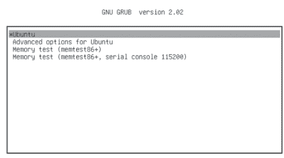
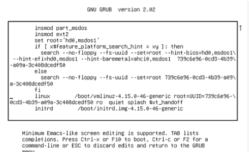
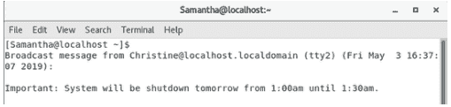
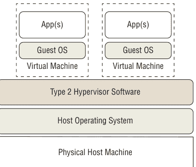
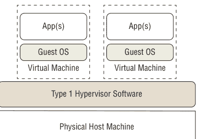
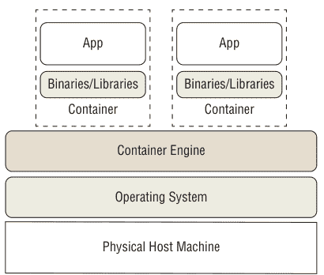

## 第 5 章

## 引导、初始化和虚拟化 Linux

## 目标

- 101.3 更改运行级别/引导目标并关闭或重新启动系统
- 102.2 安装引导管理器
- 102.6 作为虚拟化来宾的 Linux
- 101.2 引导系统


像优美的芭蕾舞一样，Linux 系统开始引导过程，看似轻松地完成到登录屏幕以及所需服务和应用程序的步骤。但是，作为系统管理员，你不能只欣赏表演。你必须理解整个底层过程来排查问题。此外，这个芭蕾舞的成员因你的系统的年龄和发行版而异。每个成员都有其独特的配置和操作，就像舞团中的舞者一样。

除了让系统启动并运行，你还需要掌握关闭系统或将其移至不同操作状态的各种方法，同时始终让用户了解将要发生的事情。这里的方法也各不相同。

最后，将你的 Linux 团队转移到新平台（例如虚拟机）对你来说至关重要。许多组织正在采用这些新舞台来节省资金和时间。

在本章中，我们将探讨旧系统和新系统的所有这些概念。有了这些知识，你可以成为 Linux 系统乐团的首席编舞家。

## 了解引导过程

当你打开 Linux 系统电源时，会触发一系列最终导致登录提示符的事件。通常，你不必担心这些事件背后发生了什么；你只需登录并开始使用应用程序。但是，你的 Linux 系统有时可能无法正确引导。在这种情况下，了解 Linux 引导操作系统的基本原理会有所帮助。

### 引导过程

Linux 引导过程可以分为以下主要步骤：

- 1. 服务器固件启动，对硬件进行快速检查（称为上电自检 POST），然后寻找可从可引导设备运行的引导加载程序。
- 2. 引导加载程序运行并确定要加载哪个 Linux 内核程序。
- 3. 内核程序加载到内存中；准备系统，例如挂载根分区；然后运行初始化程序。
- 4. 初始化进程启动系统运行所需的必要后台程序（例如桌面的图形桌面管理器，或服务器的 Web 和数据库应用程序）。


虽然这些步骤表面上看起来很简单，但为了保持引导过程正常工作，在幕后发生着一套有些复杂的操作编排。每个步骤在为运行 Linux 做好系统准备时都要执行多个操作。

## 关于引导过程的信息提取

当系统启动时，可以通过观察系统控制台屏幕来监控 Linux 引导过程。系统检测硬件并加载软件时，你会看到大量信息性消息滚动而过。


一些图形桌面 Linux 发行版在启动时会将引导消息隐藏在单独的控制台窗口中。通常，你可以按 ESC 键或 Ctrl+Alt+F1 键组合来查看这些消息。

通常引导消息滚动得相当快，很难看清发生了什么。如果需要排查引导问题，可以使用 dmesg 命令查看启动时的消息。大多数 Linux 发行版会将引导内核消息复制到内存中的一个称为内核环形缓冲区的特殊环形缓冲区中。缓冲区是循环的，并设置为预定义的大小。当新消息被记录到缓冲区时，旧消息会被轮换出去。

dmesg 命令显示当前存储在内核环形缓冲区中的最新引导消息，如清单 5.1 所示。

### 清单 5.1：使用 dmesg 命令显示内核环形缓冲区的内容

```
$ dmesg
[ 0.000000] Initializing cgroup subsys cpuset
[ 0.000000] Initializing cgroup subsys cpu
[ 0.000000] Initializing cgroup subsys cpuacct
[ 0.000000] Linux version 3.10.0-957.10.1.el7.x86_64
(mockbuild@kbuilder.bsys.centos.org) (gcc version 4.8.5 20150623
(Red Hat 4.8.5-36) (GCC) ) #1 SMP Mon Mar 18 15:06:45 UTC 2019
[ 0.000000] Command line: BOOT_IMAGE=/vmlinuz-3.10.0-957.10.1.el7.x86_64
root=/dev/mapper/centos-root ro crashkernel=auto rd.lvm.lv=centos/root
rd.lvm.lv=centos/swap rhgb quiet LANG=en_US.UTF-8
[ 0.000000] e820: BIOS-provided physical RAM map:
[...]
[ 0.000000] NX (Execute Disable) protection: active
[ 0.000000] SMBIOS 2.5 present.
[...]
[ 0.000000] Hypervisor detected: KVM
[ 0.000000] e820: update [mem 0x00000000-0x00000fff] usable ==> reserved
[ 0.000000] e820: remove [mem 0x000a0000-0x000fffff] usable
[ 0.000000] e820: last_pfn = 0x120000 max_arch_pfn = 0x400000000
[...]
$
```

你也可以使用 journalctl 实用程序（如果可用）查看内核环形缓冲区，如清单 5.2 所示。请记住，你需要使用超级用户权限，并且该实用程序使用 less 分页程序。

### 清单 5.2：使用 journalctl 实用程序显示内核环形缓冲区的内容

```
-- Logs begin at Tue 2019-04-30 11:21:34 EDT, end at Tue 2019-04-30 12:53:41 EDT
Apr 30 11:21:34 localhost.localdomain kernel: Initializing cgroup subsys cpuset
Apr 30 11:21:34 localhost.localdomain kernel: Initializing cgroup subsys cpu
Apr 30 11:21:34 localhost.localdomain kernel: Initializing cgroup subsys cpuacct
Apr 30 11:21:34 localhost.localdomain kernel: Linux version 3.10.0-957.10.1.el7.x86_64
Apr 30 11:21:34 localhost.localdomain kernel: Command line: BOOT_IMAGE=/vmlinuz-3.10.0-957.10.1.el7.x86_64
Apr 30 11:21:34 localhost.localdomain kernel: e820: BIOS-provided physical RAM map:
[...]
Apr 30 11:21:34 localhost.localdomain kernel: NX (Execute Disable) protection: active
Apr 30 11:21:34 localhost.localdomain kernel: SMBIOS 2.5 present.
[...]
Apr 30 11:21:34 localhost.localdomain kernel: Hypervisor detected: KVM
Apr 30 11:21:34 localhost.localdomain kernel: e820: update [mem 0x00000000-0x00000fff] usable ==> reserved
Apr 30 11:21:34 localhost.localdomain kernel: e820: remove [mem 0x000a0000-0x000fffff] usable
Apr 30 11:21:34 localhost.localdomain kernel: e820: last_pfn = 0x120000 max_arch_pfn = 0x400000000
[...]
```

一些 Linux 发行版还会将引导消息存储在日志文件中，通常位于 /var/log 目录。对于基于 Debian 的系统，文件通常是 /var/log/boot，而对于基于 Red Hat 的系统，文件是 /var/log/boot.log。但是，对于使用 systemd-journald（在第 7 章中介绍）的系统，引导消息存储在日志文件中。

> 排查引导问题时，与其费力地翻阅 dmesg 实用程序的输出或引导消息日志文件的输出，不如将它们的输出通过管道传输到 grep 命令或 less 实用程序中（这两者均在第 1 章中介绍）。这样，你可以轻松搜索特定设备（例如 /dev/sda）、关键短语（例如 disabled）和/或特定项目（例如加载的 BOOT_IMAGE）。

虽然能够查看引导期间生成的不同消息很有帮助，但了解是什么生成了这些消息也同样有用。接下来的几个部分将讨论每个引导步骤，并通过一些示例说明它们的工作原理。

## 查看固件

所有与 IBM 兼容的工作站和服务器都使用某种内置固件来控制已安装操作系统的启动方式。在较旧的工作站和服务器上，此固件称为基本输入输出系统（BIOS）。在较新的工作站和服务器上，一种称为可扩展统一固件接口（UEFI）的新方法维护系统硬件状态并启动已安装的操作系统。

## BIOS 启动

较旧工作站和服务器上的 BIOS 固件在功能上有些局限。BIOS 固件有一个简单的菜单界面，允许你更改一些设置来控制系统如何查找硬件，并定义 BIOS 应使用哪个设备来启动操作系统。

原始 BIOS 固件的一个局限是，它只能从硬盘读取一个扇区的数据到内存中以便运行。你可能已经猜到，这不足以加载整个操作系统。为了绕过这一限制，大多数操作系统（包括 Linux 和 Microsoft Windows）将引导过程分为两部分。

首先，BIOS 运行引导加载程序（有时写作 bootloader）程序。引导加载程序是一个小型程序，用于初始化必要的硬件来查找和运行完整的操作系统，通常位于同一硬盘的其他位置，但有时也位于单独的内部或外部存储设备上。

引导加载程序通常有一个配置文件，因此你可以告诉它在哪里查找实际的操作系统文件以运行，甚至可以生成一个小菜单，让用户在多个操作系统之间进行选择。

要启动，BIOS 必须知道在已安装的存储设备上从哪里查找引导加载程序。大多数 BIOS 设置允许你从多个位置加载引导加载程序：

- 内部硬盘
- 外部硬盘
- CD/DVD 驱动器
- USB 闪存驱动器
- 网络服务器

从硬盘启动时，必须指定哪个硬盘，以及 BIOS 应从硬盘的哪个分区加载引导加载程序。这是通过定义主引导记录（MBR）来完成的。

MBR 是系统上第一个硬盘分区的第一个扇区。计算机系统只有一个 MBR。BIOS 查找 MBR 并将其中存储的程序读入内存。由于引导加载程序必须适应一个扇区，因此它必须非常小，所以无法做太多事情。引导加载程序主要指向实际操作系统内核文件的位置，该文件存储在系统上单独分区的引导扇区中。内核引导文件没有大小限制。

> 引导加载程序不需要直接指向操作系统内核文件——它可以指向任何类型的程序，包括另一个引导加载程序。你可以创建一个指向次要引导加载程序的主要引导加载程序，该次要引导加载程序提供加载多个操作系统的选项。此过程称为 *链式加载*。

## UEFI 启动

虽然 BIOS 有很多局限性，但计算机制造商学会了与之共存，BIOS 多年来一直是 IBM 兼容系统的默认标准。然而，随着操作系统变得更加复杂，最终清楚地表明需要开发一种新的引导方法。

Intel 于 1998 年创建了可扩展固件接口（EFI）以解决 BIOS 的一些局限性。EFI 的采用过程有些缓慢，但到 2005 年，该理念被其他厂商接受，通用 EFI（UEFI）规范被采纳为标准。如今，几乎所有 IBM 兼容的桌面和服务器系统都使用 UEFI 固件标准。

UEFI 不依赖于硬盘上的单个引导扇区来存放引导加载程序，而是指定一个称为 *EFI 系统分区（ESP）* 的特殊磁盘分区来存储引导加载程序。这允许引导加载程序的任何大小，并能够为多个操作系统存储多个引导加载程序。

ESP 设置使用旧的 Microsoft 文件分配表（FAT）文件系统来存储引导加载程序。在 Linux 系统中，ESP 通常挂载在 /boot/efi/ 目录中，引导加载程序文件通常使用 .efi 文件扩展名存储。

UEFI 固件使用一个内置的微型引导加载程序（有时称为 *启动管理器*），允许你配置要启动的特定引导加载程序文件。

> 并非所有 Linux 发行版都支持 UEFI 固件。如果你使用的是 UEFI 系统，请确保所选的 Linux 发行版支持它。

使用 UEFI 时，需要在启动管理器界面菜单中注册每个你希望在启动时出现的单独引导加载程序文件。然后，每次启动系统时都可以选择要运行的引导加载程序。

一旦固件找到并运行引导加载程序，它的任务就完成了。引导过程中的引导加载程序步骤可能有些复杂。下一部分将深入介绍此步骤。


如果您不确定系统是否使用 UEFI，可以轻松检查。Linux 系统启动后，执行命令 `ls /sys/firmware/efi`。如果收到 no such file or directory 消息，则表示正在使用 BIOS。另一方面，如果看到文件，则系统是使用 UEFI 启动的。

## 查看引导加载程序

引导加载程序可帮助弥合系统固件与完整 Linux 操作系统内核之间的差距。在 Linux 中，有多种引导加载程序可供选择，本节将介绍这些选择。

### 引导加载程序原理

GRand Unified Bootloader (GRUB) 引导加载程序的第一个版本（现在称为 _GRUB 旧版_）创建于 1999 年，旨在提供一个强大且可配置的引导加载程序。GRUB 迅速成为所有 Linux 发行版的默认引导加载程序，无论其运行在 BIOS 还是 UEFI 系统上。

_GRUB2_ 于 2005 年创建，作为 GRUB 旧版系统的完全重写版本。它支持高级功能，例如加载硬件驱动程序模块的能力，以及使用逻辑语句根据系统检测到的条件（例如是否连接了外部硬盘）动态更改引导菜单选项。

### 使用 GRUB 旧版作为引导加载程序

GRUB 旧版引导加载程序旨在简化创建引导菜单和向内核传递选项的过程。GRUB 旧版允许您同时使用菜单界面和交互式 shell 来选择多个内核和/或操作系统。使用菜单界面，您可以为要启动的每个内核或操作系统配置选项。使用交互式 shell，您可以即时自定义启动命令。

菜单和交互式 shell 都使用一组控制引导加载程序功能的命令。本节将指导您如何配置 GRUB 旧版引导加载程序、如何安装它，以及如何在启动时与其交互。

### 配置 GRUB 旧版

当您使用 GRUB 旧版交互式菜单时，需要告诉它显示哪些选项。为此，请使用特殊的 GRUB _菜单命令_。

GRUB 旧版系统将菜单命令存储在名为 _menu.lst_ 的标准文本配置文件中；该文件位于 `/boot/grub/` 目录中。（虽然这不是强制要求，但某些 Linux 发行版会在硬盘上创建单独的 `/boot` 分区。）基于 Red Hat 的 Linux 发行版（如 CentOS 和 Fedora）使用 _grub.conf_ 而不是 _menu.lst_ 作为配置文件。此外，您可能会发现 menu.lst 文件是指向 grub.conf 文件的符号链接。

GRUB 旧版配置文件由两个部分组成：

- 全局定义
- 操作系统启动定义

全局定义部分定义控制 GRUB 旧版引导菜单整体操作的命令。全局定义必须出现在配置文件的第一位。您可进行的全局设置只有少数几个。表 5.1 显示了这些设置。

### 表 5.1 GRUB 旧版全局命令

| 设置 | 说明 |
| :--- | :--- |
| color | 指定引导菜单中使用的前景色和背景色 |
| default | 定义要选择的默认菜单选项 |
| fallback | 如果默认菜单选项失败，则使用的次要菜单选择 |
| hiddenmenu | 不显示菜单选择选项 |
| splashimage | 指向要用作引导菜单背景的图像文件 |
| timeout | 指定在使用默认选项之前等待菜单选择的时间 |

对于 GRUB 旧版，要为命令定义一个值，只需将该值作为命令行参数列出：

```
default 0
timeout 10
color white/blue yellow/blue
```

color 命令定义菜单的颜色方案。第一对颜色定义普通菜单项的前景色/背景色，第二对颜色定义选定菜单项的前景色/背景色。

在全局定义之后，放置系统中安装的各个操作系统的定义。每个操作系统应有其自己的定义部分。有许多启动定义设置可用于自定义引导加载程序查找操作系统内核文件的方式。幸运的是，定义操作系统只需要少数几个命令。需要记住的命令如下：

- Title：每个启动定义部分的第一行，即引导菜单中显示的内容。
- Root：定义 GRUB /boot 文件夹分区所在的磁盘和分区。
- Kernel：定义要加载的存储在 /boot 文件夹中的内核映像文件。
- Initrd：定义初始 RAM 磁盘文件或文件系统，其中包含内核与系统硬件交互所需的驱动程序。
- Rootnoverify：定义非 Linux 启动分区，例如 Windows。

root 命令定义包含 GRUB 旧版 /boot 文件夹的硬盘和分区。不幸的是，GRUB 旧版以一种有些奇特的方式引用这些值：

```
(hddrive, partition)
```

同样不幸的是，GRUB 旧版不像 Linux 那样引用硬盘；它使用从 0 而不是 1 开始的编号系统来引用磁盘和分区。例如，要引用系统第一个硬盘上的第一个分区，请使用 (hd0,0)。要引用第一个硬盘上的第二个分区，请使用 (hd0,1)。

initrd 命令是 GRUB 旧版中的另一项重要功能。它有助于解决在将专用硬件或文件系统用作根驱动器时出现的问题。initrd 命令定义一个文件，该文件在启动时由内核作为 RAM 磁盘或文件系统挂载。然后内核可以从 RAM 磁盘或文件系统加载模块，从而使其能够访问未编译到内核本身中的硬件或文件系统。

> 在 Linux 内核 v2.6 之前，初始 RAM 磁盘用于保存启动时所需的内核模块。从那时起，它已被初始 RAM 文件系统（initramfs）取代。这可能有点令人困惑，因为 GRUB 配置文件中的 initrd 命令可以表示初始 RAM 磁盘或初始 RAM 文件系统。使用哪一个取决于您的发行版及其版本。

### 清单 5.3: GRUB 旧版配置文件示例

```
default 0
timeout 10
color white/blue yellow/blue

title CentOS Linux
root (hd1,0)
kernel (hd1,0)/boot/vmlinuz
initrd /boot/initrd

title Windows
rootnoverify (hd0,0)
```

此示例显示两个启动选项：一个用于 CentOS Linux 系统，另一个用于 Windows 系统。CentOS 系统安装在第二个硬盘的第一个分区上，而 Windows 系统安装在第一个硬盘的第一个分区上。Linux 启动选择同时指定要加载的内核文件以及要加载到内存中的 initrd 映像文件。

## 安装 GRUB 旧版

构建 GRUB 旧版配置文件后，必须将 GRUB 旧版程序安装到 MBR 中。执行此操作的命令是 `grub-install`。

`grub-install` 命令使用单个参数，指示要安装 GRUB 的分区。您可以使用 Linux 格式或 GRUB 旧版格式来指定分区。例如，要使用 Linux 格式，请键入

```
# grub-install /dev/sda
```

要将 GRUB 安装到第一个硬盘的 MBR 并使用 GRUB 旧版格式，必须将硬盘格式用引号括起来：

```
# grub-install '(hd0)'
```

如果使用链式加载方法，并希望将 GRUB 旧版的副本安装到分区的引导扇区而不是硬盘的 MBR 上，则必须指定分区，同样使用 Linux 格式或 GRUB 格式：

```
# grub-install /dev/sda1
# grub-install '(hd0,0)'
```

对 GRUB 旧版配置文件进行更改后，无需在 MBR 中重新安装 GRUB 旧版。GRUB 旧版在每次运行时都会读取配置文件。

## 与 GRUB 旧版交互

当启动使用 GRUB 旧版引导加载程序的系统时，您将看到一个显示在配置文件中定义的启动选项的菜单。如果等待超时到期，默认启动选项将被处理。或者，您可以使用方向键选择一个启动选项，然后按 Enter 键确认。

您还可以直接从 GRUB 菜单编辑启动选项：

- 1. 使用方向键移动到要修改的启动选项，然后按 E 键。
- 2. 使用方向键将光标移动到需要修改的行，然后按 E 键进行编辑。
- 3. 按 B 键使用新值启动系统。

您还可以随时按 C 键进入交互式 shell 模式（也称为 GRUB 命令行），从而可以即时提交 GRUB 命令。可以按 ESC 键离开 GRUB 命令行并返回菜单。


## 将 GRUB 2 用作引导加载程序

由于 GRUB2 系统旨在改进 GRUB Legacy，许多功能是相同的，只是有一些小变化。例如，GRUB2 系统将配置文件名更改为 grub.cfg。文件的存储位置取决于您系统的固件：

- BIOS：grub.cfg 文件存储在 /boot/grub/ 或 /boot/grub2/ 目录中。（这样可以同时安装 GRUB Legacy 和 GRUB2。）

- UEFI：grub.cfg 文件存储在 /boot/efi/EFI/distro-name/ 目录中。

UEFI 系统（CentOS 发行版）上 grub.cfg 文件位置的示例如清单 5.4 所示。

### 清单 5.4：UEFI CentOS 发行版上的 GRUB2 配置文件位置

```
# ls /boot/efi/EFI/centos/
BOOT.CSV fonts grubenv mmx64.efi shimx64-centos.efi
BOOTX64.CSV grub.cfg grubx64.efi shim.efi shimx64.efi
#
```

## 配置 GRUB2

GRUB2 中使用的命令也有一些变化。GRUB2 配置文件的简化片段示例如清单 5.5 所示。

### 清单 5.5：简化的 GRUB2 配置文件示例

```
[...]
menuentry "CentOS Linux" {
[...]
set root=(hd1,1)
linux16 /vmlinuz[...]
initrd /initramfs[...]
}
menuentry "Windows" {
set root=(hd0,1)
[...]
```

请注意，GRUB2 使用 set 命令为 root 关键字赋值，并使用等号分配设备。GRUB2 使用环境变量来配置设置，而不是使用命令。

为了更加令人困惑，GRUB2 更改了分区的编号系统。虽然它仍然对第一个硬盘使用 0，但第一个分区设置为 1。因此，要定义第一个硬盘第一个分区上的 /boot 目录，现在需要使用 set root=(hd0,1)

有时格式略有不同，其中 msdos 表示 DOS 分区的编号，gpt 表示 GPT（第 3 章中介绍）分区的编号：

```
set root='hd0,msdos1'
```

对于 GRUB2，需要记住的命令如下：

- Menuentry：每个引导定义部分的第一行；即出现在引导菜单中的内容。
- set root：定义系统上 GRUB2 /boot 目录分区所在的磁盘和分区。
- Linux, linux16：对于 BIOS 系统，定义存储在 /boot 目录中以加载的内核映像文件。
- Linuxefi：对于 UEFI 系统，定义存储在 /boot 目录中以加载的内核映像文件。
- Initrd：对于 BIOS 系统，定义初始 RAM 文件系统，其中包含内核与系统硬件交互所需的驱动程序。
- Initrdefi：对于 UEFI 系统，定义初始 RAM 文件系统，其中包含内核与系统硬件交互所需的驱动程序。

请注意在清单 5.5 中，必须在 menuentry 命令后立即使用大括号括起每个引导部分。此外，GRUB2 中不使用 rootnoverify 命令。非 Linux 引导选项现在使用根环境变量与 Linux 引导选项相同的方式定义。

> 如果需要详细的 GRUB 指导，GNU 组织提供了一个不错的手册，网址为 www.gnu.org/software/grub/manual/grub/grub.html。请务必也浏览您发行版的 GRUB 文档。

GRUB2 的配置过程也有所不同。虽然 GRUB2 使用 /boot/grub/grub.cfg 文件作为配置文件，但您绝不要修改该文件。相反，/etc/grub.d 文件夹中存储了单独的配置文件。这样可以让您（或系统）为系统上安装的每个引导选项创建单独的配置文件（例如，一个用于引导 Linux 的配置文件，另一个用于引导 Windows 的配置文件）。

对于全局命令，使用 /etc/default/grub 配置文件。通常，您也不应修改此文件，而应再次使用 /etc/grub.d/ 目录中的配置文件。一些全局命令的格式已从 GRUB Legacy 命令更改，例如使用 GRUB_TIMEOUT 而不是仅使用 timeout。

大多数 Linux 发行版在特定事件（例如升级内核）后会自动生成新的 grub.cfg 配置文件。通常，发行版会保留一个指向旧内核文件的引导菜单选项，以防新内核失败时仍可用。

## 安装 GRUB2

与 GRUB Legacy 不同，您不需要安装 GRUB2。您只需重建主安装文件即可。这是通过运行 grub-mkconfig 或 grub2-mkconfig 程序来完成的。这两个程序基本等价，但您的系统上可能不一定同时安装了它们。

grub2-mkconfig 程序读取存储在 /etc/grub.d 文件夹中的配置文件，并将命令组装成单个 grub.cfg 配置文件。

您可以使用超级用户权限并运行 grub2-mkconfig 命令来手动更新配置文件：

```
# grub2-mkconfig > /boot/grub2/grub.cfg
```

请注意，您必须将 grub2-mkconfig 程序的输出重定向到 grub.cfg 配置文件，或使用 -o（或 --output=）选项指定输出文件。默认情况下，grub2-mkconfig 程序仅将新配置文件命令输出到标准输出。

为了进一步扩展 GRUB 安装选项，Ubuntu 提供了 update-grub 实用程序。该程序会为您执行 grub-mkconfig -o /boot/grub/grub.cfg 命令。省去几次按键总是件好事。

## 与 GRUB2 交互

GRUB2 引导加载程序生成的引导菜单与 GRUB Legacy 方法类似。图 5.1 显示了 Ubuntu GRUB2 菜单界面。您可以使用箭头键在各个引导菜单项之间切换。

### 图 5.1 Ubuntu GRUB2 菜单



使用 ↑ 和 ↓ 键选择要突出显示的条目。按 Enter 引导选定的操作系统，按 'e' 在引导前编辑命令，或按 'c' 进入命令行。

某些图形桌面（例如 Ubuntu）会将 GRUB 引导菜单隐藏在图形界面后面。通常，如果在系统首次引导时按住 Shift 键，将显示 GRUB 引导菜单。

如果要编辑特定的引导菜单项，当光标位于相应的引导选项行上时，按 E 键编辑该条目。图 5.2 说明了在 Ubuntu 系统上编辑 GRUB2 引导菜单中的条目。

### 图 5.2 编辑 Ubuntu GRUB2 菜单条目



为便于理解（以及备考认证考试），我们为您提供了两个表格。一个用于 GRUB2 菜单界面的操作（表 5.2），另一个显示了各种基本 GRUB2 条目编辑器按键（表 5.3）。

### 表 5.2 GRUB2 菜单界面按键

| 按键 | 描述 |
| :--- | :--- |
| 箭头键 | 选择引导菜单选项 |
| C | 启动 GRUB 命令行界面 |
| E | 进入当前选定菜单项的编辑模式 |
| Enter | 引导当前选定的菜单项 |
| P | 如有需要，用于输入密码 |

GRUB2 条目编辑器支持基本的 Emacs 编辑按键（第 1 章中介绍），这很方便。但是，您还应该熟悉表 5.3 中列出的几个其他项目。

| 按键 | 描述 |
| :--- | :--- |
| 箭头键 | 突出显示要修改的条目行 |
| Enter | 添加新行（最好在行尾使用） |
| ESC | 放弃任何更改并返回菜单界面 |
| Ctrl+C | 启动 GRUB 命令行界面 |
| Ctrl+X | 使用编辑后的条目引导系统 |

## 添加内核引导参数

除了从引导菜单实时编辑 GRUB 配置外，您还可以向 Linux 内核提供选项。这种方法在排查引导问题时尤其有用。

要使用前几节概述的技术完成此操作，请编辑相应的引导菜单项，找到以 kernel（GRUB Legacy）或 linux*（GRUB2）开头的行，移至行尾，添加一个空格，然后附加内核选项。完成后，使用相应的按键引导系统。

表 5.4 列出了几个更有用的内核参数。

| 参数 | 描述 |
| :--- | :--- |
| console= | 设置控制台设备 |
| debug | 启用内核调试 |
| init= | 执行指定的程序，例如 Bash shell（/bin/bash）而非 /sbin/init |
| initrd= | 更改初始 RAM 文件系统的位置 |
| mem | 设置可用系统内存的总量 |
| ro | 将根文件系统挂载为只读 |
| root= | 更改根文件系统 |


| 参数 | 描述 |
|---|---|
| rootflags= | 设置根文件系统的挂载选项 |
| rw | 以读写方式挂载根文件系统 |
| selinux | 引导时禁用 SELinux |
| single, Single, 1, or S | 将 SysVinit 系统引导至单用户模式 |
| systemd.unit= | 将 systemd 系统引导至指定目标 |

如果您想查看内核参数的完整列表，可访问 www.kernel.org/doc/Documentation/admin-guide/kernel-parameters.txt。

## 使用替代引导程序

虽然 GRUB Legacy 和 GRUB2 是最流行的 Linux 引导程序，但您可能会遇到其他一些引导程序，具体取决于您使用的 Linux 发行版。

LILO 是一种早于 GRUB Legacy 的旧式引导程序。由于其无法处理 UEFI 系统以及其他困难，其开发于 2015 年 12 月结束。

systemd-boot 引导程序在使用 systemd 初始化方法（本章后面将介绍）的 Linux 发行版中开始变得流行。此引导程序生成引导映像选项菜单，并可以加载任何 UEFI 引导映像。

U-Boot 引导程序（也称为 Das U-Boot）可以从任何类型的磁盘引导。它可以加载任何类型的引导映像。

SYSLINUX 项目包含五个独立的引导程序，它们在 Linux 中有特殊用途：

- SYSLINUX：适用于使用 Microsoft FAT 文件系统的系统的引导程序（常用于从 USB 闪存盘引导）
- EXTLINUX：用于从 ext2、ext3、ext4 或 btrfs 文件系统引导的微型引导程序
- ISOLINUX：用于从 LiveCD 或 LiveDVD 引导的引导程序
- PXELINUX：用于从网络服务器引导的引导程序
- MEMDISK：一种实用程序，用于从其他 SYSLINUX 项目引导程序引导较旧的 DOS 操作系统

由于 UEFI 可以加载任何大小的引导程序，现在可以直接加载 Linux 操作系统内核，而无需特殊引导程序。此功能从 Linux 内核 3.3.0 版本开始加入。然而，此方法并不常见，因为引导程序在引导方面可以提供更多灵活性，尤其是在使用多个操作系统时。

## 初始化过程

在 Linux 系统经历引导过程后，它将进入最终的系统初始化阶段，在此阶段需要启动各种服务。服务（或守护进程）是执行特定职责的程序。

初始化守护进程（init）确定启动哪些服务以及启动顺序。此守护进程还允许您停止和管理各种系统服务。您应该熟悉两个初始化守护进程：

**SysVinit** SysVinit（SysV）基于 Unix System V 初始化守护进程。尽管许多主要的 Linux 发行版不再使用它，但您可能仍在公司的旧 Linux 服务器上发现它。

**systemd** systemd 初始化方法是新来者。它始于 2010 年左右，现在是最流行的系统服务初始化和管理机制。此守护进程通过并行启动服务来减少初始化时间。

在开始检查这些系统初始化守护进程之前，先查看 init 程序本身是个好主意。传统上，服务启动由 init 程序处理。该程序可能位于 /etc/、/bin/ 或 /sbin/ 目录中。此外，它通常具有进程 ID（PID）1。

此信息将帮助您确定当前 Linux 发行版使用的是哪种系统初始化方法——systemd 或 SysVinit。首先使用 which 命令查找 init 程序的位置。示例见清单 5.6。

### 清单 5.6：查找 init 程序文件位置

```
# which init
/sbin/init
#
```

了解 init 程序的位置后，您可以使用超级用户权限利用 readlink -f 命令查看该程序是否链接到另一个程序，如清单 5.7 所示。

### 清单 5.7：检查 init 程序的链接

```
# readlink -f /sbin/init
/usr/lib/systemd/systemd
#
```

从清单 5.7 可以看出，此系统实际上正在使用 systemd。您可以通过查看 PID 1 来验证这一点，如清单 5.8 所示。

### 清单 5.8：检查 PID 1

```
# ps -p 1
PID TTY          TIME CMD
1 ?        00:00:06 systemd
#
```

在清单 5.8 中，使用了 ps 实用程序。此实用程序允许您查看进程。进程是一个正在运行的程序。ps 命令在 CMD 列中显示特定进程正在运行的程序。在此例中，systemd 程序正在运行。因此，此 Linux 系统正在使用 systemd。

init 程序或 systemd 是 Linux 系统上每个服务的父进程。如果您的系统已安装 pstree 程序，可以在命令行中输入 pstree -p 1 来查看描述此关系的图表。

请记住，这些发现方法并非万无一失。此外，还有其他系统初始化方法，例如现已废弃的 Upstart，它使用 initctl 实用程序作为其守护进程接口。以下简短列表显示了一些曾使用 Upstart 的 Linux 发行版版本：

- Fedora v9–v14
- openSUSE v11.3–v12.2
- RHEL v6
- Ubuntu v6.10–v15.04

如果您使用第 1 章中推荐的发行版版本，请知道这些发行版都是 systemd 系统。

## 使用 systemd 初始化过程

systemd 方法在 Linux 系统管理服务的方式上引入了重大范式转变。服务现在可以在系统引导时、特定硬件组件连接到系统时、某些其他服务启动时等启动。有些服务可以基于计时器启动。

### 探索单元文件

开始探索 systemd 最简单的方法是通过 _systemd 单元_。单元定义服务、一组服务或一个动作。每个单元由名称、类型和配置文件组成。目前共有 12 种不同的 systemd 单元类型：

- automount
- device
- mount
- path
- scope
- service
- slice
- snapshot
- socket
- swap
- target
- timer

_systemctl_ 实用程序是管理 systemd 和系统服务的主要入口。其基本语法如下：

```
systemctl [OPTIONS...] COMMAND [NAME...]
```

您可以使用 systemctl 实用程序列出当前在 Linux 系统中加载的各种单元。示例片段见清单 5.9。

### 清单 5.9：查看 systemd 单元

```
$ systemctl list-units
UNIT                                         LOAD   ACTIVE SUB     DESCRIPTION
[...]
smartd.service                               loaded active running   Self Monitor[...]
sshd.service                                 loaded active running   OpenSSH serv[...]
sysstat.service                              loaded active exited    Resets Syste[...]
[...]
graphical.target                             loaded active active    Graphical I[...]
[...]
$
```

在清单 5.9 中，您可以看到各种单元以及其他信息。单元通过 _name.type_ 格式按名称和类型标识。系统服务（守护进程）具有 _.service_ 扩展名的单元文件。因此，安全外壳（SSH）守护进程 sshd 的单元文件名为 sshd.service。

> systemctl 实用程序的许多显示默认使用 less 分页器。因此，要退出显示，必须按 Q 键。如果要为 systemctl 实用程序关闭 less 分页器，请在命令中添加 --no-pager 选项。

服务组通过 *target 单元文件* 启动。在系统启动时，default.target 单元确保在系统初始化时启动所有所需和所需的服务。systemctl get-default 命令显示目标文件，如在 CentOS 发行版上的清单 5.10 所示。

### 清单 5.10：查看 default.target 链接

```
$ systemctl get-default
graphical.target
$
```

表 5.5 显示了常用的系统引导目标单元文件。

| 名称 | 描述 |
|---|---|
| graphical.target | 通过本地终端和/或网络为多个用户提供对系统的访问。提供图形用户界面（GUI）访问。 |
| multi-user.target | 通过本地终端和/或网络为多个用户提供对系统的访问。不提供 GUI 访问。 |
| runleveln.target | 为 SysVinit 系统提供向后兼容性，其中 n 设置为 1–5 以对应所需的 SysV 运行级别。 |

在表 5.5 中，您会注意到 systemd 为经典 SysVinit 系统提供了向后兼容性。SysV 运行级别将在本章后面介绍。

> 主 systemd 配置文件是 /etc/systemd/system.conf。在此文件中，您会发现所有默认配置设置均通过井号（#）注释掉。查看此文件是查看当前 systemd 配置的快速方法。如果需要修改配置，只需编辑该文件。但是，最好先通过在命令行中输入 man systemd-system.conf 来浏览该文件的 man 页面。


## 专注于服务单元文件

服务单元文件包含要使用哪个环境文件、服务何时必须启动、哪些目标希望启动此服务等信息。这些配置文件存放在不同的目录中。

请记住，单元配置文件的目录位置至关重要，因为如果同一文件在两个不同的目录位置中被找到，其中一个将优先于另一个。以下列表按升序优先级显示目录位置：

- 1. /etc/systemd/system/
- 2. /run/systemd/system/
- 3. /usr/lib/systemd/system/

要查看可用的各种服务单元文件，您可以再次使用 systemctl 实用程序。但是，与查看单元时相比，需要使用略有不同的命令，如清单 5.11 所示。

### 清单 5.11：查看 systemd 单元文件

```
$ systemctl list-unit-files
UNIT FILE                                  STATE
[...]
dev-hugepages.mount                        static
dev-mqueue.mount                           static
proc-fs-nfsd.mount                         static
[...]
nfs.service                                disabled
nfslock.service                            static
ntpd.service                               disabled
ntpdate.service                            disabled
[...]
ctrl-alt-del.target                        disabled
default.target                             static
emergency.target                           static
[...]
$
```

除了单元文件的基本名称外，您还可以在清单 5.11 中看到单元文件的状态。它们的状态称为启用状态，指的是服务何时启动。至少有 12 种不同的启用状态，但您通常会看到以下 3 种：

- * enabled：服务在系统引导时启动。
- * disabled：服务在系统引导时不启动。
- * static：如果另一个单元依赖于它，则服务启动。也可以手动启动。

要查看存储特定 systemd 单元文件的目录或目录，请使用 systemctl 实用程序。CentOS 发行版上的示例如清单 5.12 所示。

### 清单 5.12：查找并显示 systemd 单元文件

```
$ systemctl cat ntp.service
# /usr/lib/systemd/system/ntpd.service
[Unit]
Description=Network Time Service
After=syslog.target ntpd.service sntp.service

[Service]
Type=forking
EnvironmentFile=-/etc/sysconfig/ntpd
ExecStart=/usr/sbin/ntpd -u ntp:ntp $OPTIONS
PrivateTmp=true

[Install]
WantedBy=multi-user.target
$
```

请注意，在清单 5.12 中，第一行显示的内容显示了 ntpd.service 的基本名称和单元文件的目录位置。接下来的几行是文件的内容。对于服务单元文件，有三个主要配置部分：

- [Unit]
- [Service]
- [Install]

在服务单元配置文件的 [Unit] 部分中，有基本指令。指令是修改配置的设置，例如清单 5.12 中显示的 After 设置。[Unit] 部分中更常用的指令在表 5.6 中有描述。

### 表 5.6 常用的服务单元文件 [Unit] 部分指令

| 指令 | 描述 |
| :--- | :--- |
| After | 将此单元设置为在指定单元之后启动。 |
| Before | 将此单元设置为在指定单元之前启动。 |
| Description | 描述该单元。 |
| Documentation | 设置指向文档源的统一资源标识符（URL）列表。URL 可以是 Web 位置、系统文件、info 页面和 man 页面。 |
| Conflicts | 将此单元设置为*不*与指定单元一起启动。如果指定的任何单元启动，则此单元不会启动。（与 Requires 相反。） |
| Requires | 将此单元设置为与指定单元一起启动。如果指定的任何单元未启动，则此单元*不*启动。（与 Conflicts 相反。） |
| Wants | 将此单元设置为与指定单元一起启动。如果指定的任何单元未启动，此单元*仍*会启动。 |

systemd 和单元配置文件的 man 页面中有大量有用信息。只需键入 man -k systemd 即可找到几个可探索的项目。例如，通过 man systemd.service 命令探索服务类型单元文件指令等内容。您可以在命令行输入 man systemd.directives 来查找所有各种指令的信息。

单元文件中的 [Service] 指令设置特定于该服务的配置项。[Service] 部分中常用的指令在表 5.7 中有描述。

### 表 5.7 常用的服务单元文件 [Service] 部分指令

| 指令 | 描述 |
| --- | --- |
| ExecReload | 指示在重新加载单元时要运行的脚本或命令（及选项）。 |
| ExecStart | 指示在启动单元时要运行的脚本或命令（及选项）。 |
| ExecStop | 指示在停止单元时要运行的脚本或命令（及选项）。 |
| Environment | 设置以空格分隔的环境变量替代项。 |
| Environment File | 指示包含环境变量替代项的文件。 |
| RemainAfterExit | 设置为 no（默认）或 yes。如果设置为 yes，则即使由 ExecStart 启动的进程终止，服务仍保持活动状态。如果设置为 no，则当由 ExecStart 启动的进程终止时，会调用 ExecStop。 |
| Restart | 当由 ExecStart 启动的进程终止时，将重新启动服务。如果发出 systemctl restart 或 systemctl stop 命令，则忽略此设置。设置为 no（默认）、on-success、on-failure、on-abnormal、on-watchdog、on-abort 或 always。 |
| Type | 设置启动类型。 |

您只会在服务单元文件中找到单元文件的 [Service] 部分。此中间部分对每种单元类型都不同。例如，在自动挂载单元文件中，您会发现 [Automount] 部分作为单元文件的中间部分。

单元文件中的 [Install] 指令确定服务启用或禁用时会发生什么。启用的服务在系统引导时启动。禁用的服务在系统引导时不启动。[Install] 部分中常用的指令在表 5.8 中有描述。

| 指令 | 描述 |
|---|---|
| Alias | 设置 systemctl 命令中可表示该服务的其他名称。 |
| Also | 设置为此服务必须启用或禁用的其他单元。通常，其他单元是套接字类型单元。 |
| RequiredBy | 指定需要此服务的其他单元。 |
| WantedBy | 指定管理此服务的目标单元。 |

## 专注于目标单元文件

对于 systemd，您需要了解服务单元文件和目标单元文件。目标单元文件的主要目的是将各种服务分组，以便在系统引导时启动。默认目标单元文件 default.target 符号链接到系统引导时使用的目标单元文件。在清单 5.13 中，默认目标单元文件使用 systemctl 命令定位并显示。

### 清单 5.13：查找并显示 systemd 目标单元文件

```
$ systemctl get-default
graphical.target
$
$ systemctl cat graphical.target
# /usr/lib/systemd/system/graphical.target
[...]
[Unit]
Description=Graphical Interface
Documentation=man:systemd.special(7)
Requires=multi-user.target
Wants=display-manager.service
Conflicts=rescue.service rescue.target
After=multi-user.target rescue.service rescue.target display-manager.service
AllowIsolate=yes
$
```

请注意，在清单 5.13 中，graphical.target 单元文件具有与服务单元文件相同的许多指令。这些指令在表 5.6 中有描述。当然，这些指令适用于目标类型单元文件，而不是服务类型单元文件。例如，graphical.target 单元文件中的 After 指令将此目标单元设置为在指定单元（如 multi-user.target）之后启动。目标单元与服务单元类似，具有各种目标依赖链以及冲突。

在清单 5.13 中，有一个指令我们尚未介绍。AllowIsolate 指令如果设置为 yes，则允许将此目标文件与 systemctl isolate 命令一起使用。本章后面将介绍此命令。

## 真实场景

### 修改 systemd 配置文件

偶尔您可能需要更改 Linux 系统的单元配置文件，或添加其他组件。但是，执行此任务时请小心。您不应修改 /lib/systemd/system/ 或 /usr/lib/systemd/system/ 目录中的任何单元文件。

要修改单元配置文件，请将文件复制到 /etc/systemd/system/ 目录，并在此处进行修改。此修改的文件将优先于原始目录中留下的原始单元文件。此外，它还能保护修改后的单元文件免受软件更新的影响。

如果您只有几个额外组件，可以扩展配置。使用超级用户权限，在 /etc/systemd/system/ 目录中创建名为 service.service-name.d 的新子目录，其中 service-name 是服务的名称。例如，对于 openSSH 守护进程，您将创建 /etc/systemd/system/service.sshd.d 目录。此新创建的目录称为 drop-in 文件目录，因为您可以在此放置额外配置文件。创建任何命名为 description.conf 的配置文件，其中 description 描述配置文件的用途，例如 local 或 script。将修改后的指令添加到此配置文件中。

进行这些修改后，您必须完成几个步骤。通过发出 systemd-delta 命令来查找和比较任何覆盖另一个单元文件的单元文件。它将显示任何重复、扩展、重定向等单元文件。查看此列表。它将帮助您避免修改或扩展服务单元文件可能产生的任何意外后果。

要使您的更改生效，请为您修改或扩展其单元文件的服务发出 systemctl daemon-reload 命令。完成该任务后，发出 systemctl restart 命令以启动或重新启动服务。下一节将解释这些命令。


## 查看 systemctl

尽管有各种命令可用于管理 systemd 和系统服务，但使用 systemctl 实用程序更简单、更快。

有几个基本的 systemctl 命令可用于管理系统服务。其中常用的是 status 命令。它提供了大量信息。在 CentOS 发行版上，Listing 5.14 显示了几个片段示例。

### 列表 5.14：通过 systemctl 查看服务单元的状态

```
$ systemctl status ntpd
• ntpd.service - Network Time Service
Loaded: loaded (/usr/lib/systemd/system/ntpd.service;
disabled; vendor preset: disabled)
Active: inactive (dead)
$ systemctl status sshd
• sshd.service - OpenSSH server daemon
Loaded: loaded (/usr/lib/systemd/system/sshd.service;
enabled; vendor preset: enabled)
Active: active (running) since Sat 2019-09-07 15:5...[]
Docs: man:sshd(8)
man:sshd_config(5)
Main PID: 1130 (sshd)
Tasks: 1
CGroup: /system.slice/sshd.service
└─1130 /usr/sbin/sshd -D
$
```

在 Listing 5.14 中，第一个 systemctl 命令显示 ntpd 服务的状态。注意实用程序输出中的第三行。它指出该服务已禁用。第四行指出该服务处于非活动状态。本质上，这意味着 ntpd 服务未运行（非活动）且未配置为在系统启动时启动（禁用）。ntpd 服务状态中另一个需要查看的项目是 Loaded 行。请注意，显示了单元文件的完整文件名和目录位置。

也显示了 sshd 服务的状态，表明 sshd 正在运行（活动）且已配置为在系统启动时启动（启用）。

有几个简单命令可与 systemctl 实用程序一起使用，以管理 systemd 服务并查看有关它们的信息。更常用的命令列在表 5.9 中。这些 systemctl 命令通常使用以下语法：

```
systemctl COMMAND UNIT-NAME...
```

| 命令 | 描述 |
|---|---|
| daemon-reload | 加载正在运行的指定单元的单元配置文件，以便在不停止服务的情况下对单元文件配置进行更改。请注意，这与 reload 命令不同。 |
| disable | 将指定单元标记为在系统启动时_不_自动启动。 |
| enable | 将指定单元标记为在系统启动时自动启动。 |
| mask | 阻止指定单元启动。该服务无法使用 start 命令或在系统启动时启动。使用 `--now` 选项可立即停止任何正在运行的实例。使用 `--running` 选项仅在下次重启或使用 unmask 之前掩码该服务。 |
| restart | 停止并立即重新启动指定单元。如果指定单元未启动，这将简单地启动它。 |
| start | 启动指定单元。 |
| status | 显示指定单元的当前状态。 |
| stop | 停止指定单元。 |
| reload | 加载正在运行的指定单元的服务配置文件，以便在不停止服务的情况下对服务配置进行更改。请注意，这与 `daemon-reload` 命令不同。 |
| unmask | 撤销 `mask` 命令对指定单元的影响。 |

请注意表 5.9 中 `daemon-reload` 与 `reload` 命令之间的区别。这是一个重要区别。如果需要为正在运行的服务加载 systemd 单元文件配置更改，请使用 `daemon-reload` 命令。使用 `reload` 命令加载服务的修改后配置文件。例如，如果您修改了 `ntpd` 服务的配置文件 `/etc/ntp.conf`，并希望新配置立即生效，则会在命令行中发出命令 `systemctl reload ntpd`。

除了表 5.9 中的命令之外，还有其他一些方便的 `systemctl` 命令可用于管理系统服务。在 CentOS 发行版上，Listing 5.15 显示了一个示例。

### 列表 5.15：通过 systemctl 确定服务是否正在运行

```
# systemctl stop sshd
#
# systemctl is-active sshd
inactive
#
# systemctl start sshd
#
# systemctl is-active sshd
active
#
```

在 Listing 5.15 中，openSSH 守护进程 (sshd) 使用 systemctl 及其 stop 命令停止。不使用 status 命令，而是使用 is-active 命令快速显示服务已停止（非活动）。openSSH 服务重新启动，并再次使用 is-active 命令，显示服务现在正在运行（活动）。表 5.10 显示了这些有用的服务状态检查命令。

### 表 5.10 方便的 systemctl 服务状态命令

| 命令 | 描述 |
|---|---|
| is-active | 对于正在运行的服务显示 active，对于已进入失败状态的任何服务显示 failed。 |
| is-enabled | 对于配置为在系统启动时启动的任何服务显示 enabled，对于*不*配置为在系统启动时启动的任何服务显示 disabled。 |
| is-failed | 对于已进入失败状态的任何服务显示 failed，对于正在运行的服务显示 active。 |

服务可能因多种原因失败：硬件问题、单元配置文件中缺少的依赖项、权限设置不正确，等等。您可以使用 systemctl 实用程序的 is-failed 命令查看特定服务是否失败。Listing 5.16 显示了一个示例。

### 列表 5.16：通过 systemctl 确定服务是否失败

```
$ systemctl is-failed NetworkManager-wait-online.service
failed
$
$ systemctl is-active NetworkManager-wait-online.service
failed
$
```

在 Listing 5.16 中，您可以看到此特定服务已失败。实际上，这是在启动前断开网线强制导致的失败，因此您可以看到服务的失败状态。如果服务不在失败状态，is-failed 命令将显示 active 状态。

## 检查特殊 systemd 命令

systemctl 实用程序有几个超出服务管理范围的命令。您可以管理系统启动时启动的目标（服务组）、在各种系统状态之间跳转，甚至分析系统的启动时间性能。本节将介绍这些各种命令。

值得探索的一个特殊命令是 systemctl is-system-running 命令。Listing 5.17 显示了此命令的示例。

### 列表 5.17：确定系统的运行状态

```
$ systemctl is-system-running
running
$
```

您可能认为上面返回的状态显而易见，但它表示您的 Linux 系统目前运行正常。表 5.11 显示了其他有用状态。

### 表 5.11 由 systemctl is-system-running 提供的运行状态

| 状态 | 描述 |
| :--- | :--- |
| running | 系统完全正常运行。 |
| degraded | 系统有一个或多个失败的单元。 |
| maintenance | 系统处于紧急或恢复模式。 |
| initializing | 系统正在开始启动。 |
| starting | 系统仍在启动。 |
| stopping | 系统正在开始关闭。 |

本章稍后将介绍 maintenance 运行状态。但是，如果您收到 degraded 状态，应检查您的单元以查看哪些单元失败并采取适当措施。使用 systemctl --failed 命令查找失败的单元，如 Listing 5.18 的片段所示。

### 列表 5.18：查找失败的单元

```
$ systemctl is-system-running
degraded
$
$ systemctl --failed
UNIT           LOAD   ACTIVE SUB       DESCRIPTION
• rngd.service loaded failed failed Hardware RNG Entropy Gatherer Daemon
[...]
$
```

其他有用的 systemctl 实用程序命令涉及获取、设置以及在系统目标之间跳转。它们如下：

- get-default
- set-default
- isolate

您已经在 Listing 5.13 中见过 systemctl get-default 命令的实际应用。此命令显示系统的默认目标。您可能已经猜到，您可以通过 systemctl set-default 命令以超级用户权限设置系统的默认目标。

isolate 命令非常适合在系统目标之间跳转。当此命令与目标名称作为参数一起使用时，列出的目标中未启用的所有服务和进程都会停止。列出的目标中已启用但未运行的任何服务和进程都会启动。Listing 5.19 显示了一个片段示例。

### 列表 5.19：跳转到不同的目标单元

```
# systemctl get-default
graphical.target
#
# systemctl isolate multi-user.target
#
# systemctl status graphical.target
[...]
Active: inactive (dead) since Thu 2018-09-13 16:57:00 EDT; 4min 24s ago
  Docs: man:systemd.special(7)

Sep 13 16:54:41 localhost.localdomain systemd[1]: Reached target Graphical In...
Sep 13 16:54:41 localhost.localdomain systemd[1]: Starting Graphical Interface.
Sep 13 16:57:00 localhost.localdomain systemd[1]: Stopped target Graphical In...
Sep 13 16:57:00 localhost.localdomain systemd[1]: Stopping Graphical Interface.
[...]
#
```


在清单 5.19 中，使用超级用户权限，systemctl isolate 命令导致系统从默认系统目标跳转到多用户目标。不幸的是，在这种情况下，没有简单的命令来显示系统的当前目标。不过，systemctl status 命令很有用。如果您使用该命令并为其提供先前目标的名称（在此示例中为 graphical.target），您应该看到它不再活跃，因此不是当前系统目标。请注意，图形目标的启动和停止的简短历史也会在状态显示中显示。

systemctl isolate 命令只能与某些目标一起使用。目标的单元文件必须设置 AllowIsolate=yes 指令。

另外两个特殊目标是 rescue 和 emergency。这些目标有时被称为模式，如下所述：

### 救援目标
当您将系统跳转到救援目标时，系统将挂载所有本地文件系统，仅允许 root 用户登录系统，网络服务已关闭，并且仅启动少数其他服务。systemctl is-system-running 命令将返回维护状态。在此特定目标中，运行磁盘实用程序来修复损坏的磁盘是一项有用任务。此目标类似于本章后面将介绍的 SysVinit 单用户模式。

### 紧急目标
当系统进入紧急模式时，系统仅挂载根文件系统，并以只读方式挂载。与救援模式类似，它仅允许 root 用户登录系统，网络服务已关闭，并且仅启动少数其他服务。systemctl is-system-running 命令将返回维护状态。如果系统自行进入紧急模式，则存在严重问题。此目标用于即使无法进入救援模式的情况。

请注意，如果您跳转到救援或紧急模式，您只能登录到 root 账户。因此，您需要知道 root 账户密码。另外，您的屏幕可能会空白一分钟，所以请不要惊慌。跳转到紧急模式的示例显示在清单 5.20 中。

### 清单 5.20: 跳转到紧急目标单元

```
# systemctl isolate emergency
Welcome to emergency mode! After logging in, type "journalctl -xb" to view
system logs, "systemctl reboot" to reboot, "systemctl default" or ^D to
try again to boot into default mode.
Give root password for maintenance
(or type Control-D to continue):
#
# systemctl is-system-running
maintenance
#
```

### 清单 5.20: 跳转到紧急目标单元（续）

```
# systemctl list-units --type=target
UNIT               LOAD   ACTIVE SUB     DESCRIPTION
emergency.target   loaded active active Emergency Mode
[...]
#
# systemctl default
#
```

在清单 5.20 中，使用 systemctl 命令跳转到紧急模式。请注意，您不必在紧急目标单元的文件名上添加 .target 扩展名。这对于所有 systemd 目标都适用。当您进入紧急模式时，必须在提示符处输入 root 密码。当您到达命令行时，可以输入欢迎显示中列出的命令，或尝试一些额外的 systemctl 命令。

> 您可以跳转到的其他目标包括 reboot、poweroff 和 halt。例如，只需键入 systemctl isolate reboot 即可重新启动系统。

请注意在清单 5.20 中，当发出 systemctl --is-system-running 命令时，响应是 maintenance 而不是 running。另外，当使用 list-units 命令时，它显示 emergency.target 是活动的。systemctl default 命令将导致系统尝试跳转到默认目标。

## 使用 SysV 初始化进程

许多服务器管理员都经历过从 SysVinit 系统迁移到 systemd 系统的过程。请记住，systemd 与 SysVinit 向后兼容，因此了解 SysVinit 很重要。

首先，如果您想在不受 systemd 或现已停止维护的 Upstart 干扰的情况下尝试原始 SysVinit 命令，请找到使用 SysVinit 初始化方法的 Linux 发行版。查找此类发行版的一种方法是访问 DistroWatch 网站，并使用其位于 distrowatch.com/search.php 的搜索工具。向下滚动到“按发行版条件搜索”部分，对于“初始化软件”，选择 SysV。任何仍在使用 SysVinit 的 Linux 发行版都将显示在搜索结果中。

为了为本书获取整洁的 SysVinit 清单，我们使用了 Linux 发行版的旧版本 Fedora 7。要获取此旧版本的 ISO 副本，请访问 archives.fedoraproject.org/pub/archive/fedora/linux/releases/。

使用任何较旧且不再受支持的 Linux 发行版都可能使您的系统面临各种问题。如果您确实选择冒此风险，请将 Linux 发行版放在虚拟化环境中以将风险降到最低；不要为虚拟机安装任何网络接口卡 (NIC)，并关闭对主机计算机文件系统的访问。

下一节应为您提供足够的 SysVinit 理解，以便使用它管理系统，或帮助将 Linux 服务器迁移到 systemd 的过程。

### 理解运行级别

在系统引导时，SysVinit 不使用目标来确定要启动哪些服务组，而是使用运行级别。这些 *运行级别* 在表 5.12 和表 5.13 中定义。请注意，不同的发行版使用不同的运行级别定义。

表 5.12 基于 Red Hat 的发行版的 SysVinit 运行级别

| 运行级别 | 说明 |
|---|---|
| 0 | 关闭系统。 |
| 1、s 或 S | 用于系统维护的单用户模式。（类似于 systemd 救援目标。） |
| 2 | 未启用网络服务的多用户模式。 |
| 3 | 已启用网络服务的多用户模式。 |
| 4 | 自定义。 |
| 5 | 提供 GUI 的多用户模式。 |
| 6 | 重新启动系统。 |

请注意，按定义，运行级别 0 和 6 不是真正的运行级别。例如，处于关机状态的系统（即运行级别 0）并未运行。

表 5.13 基于 Debian 的发行版的 SysVinit 运行级别

| 运行级别 | 说明 |
|---|---|
| 0 | 关闭系统。 |
| 1 | 用于系统维护的单用户模式。（类似于 systemd 救援目标。） |
| 2 | 提供 GUI 的多用户模式。 |
| 6 | 重新启动系统。 |

要确定系统的当前和先前运行级别，请使用 _运行级别_ 命令。显示的第一个数字或字母指示先前的运行级别（N 表示系统已新启动），第二个数字指示当前运行级别。清单 5.21 显示了一个新启动的基于 Red Hat 的 SysVinit 系统的示例，该系统正在运行级别 5。

### 清单 5.21: 使用 runlevel 命令

```
# runlevel
N 5
#
```

SysVinit 系统不使用类似 systemd 的默认目标，而是使用配置文件 /etc/inittab。在过去，此文件启动许多不同的服务，但在后来的岁月中，它仅启动终端服务并定义系统的默认运行级别。定义默认运行级别的文件行显示在清单 5.22 中。

### 清单 5.22: 设置默认运行级别的 /etc/inittab 文件行

```
# grep :initdefault: /etc/inittab
id:5:initdefault:
#
```

在清单 5.22 中，请注意 /etc/inittab 文件记录中 id: 和 :initdefault: 之间的数字 5。这表示系统的默认运行级别是 5。initdefault 指定系统启动后要进入的运行级别。


设置默认运行级别是配置某些服务在系统初始化时启动的第一步。接下来，每个服务都必须有一个位于 /etc/init.d/ 目录中的初始化脚本。清单 5.23 显示了此目录中各种脚本的片段示例。请注意，ls 命令使用了 -lF 选项来显示脚本


在单列中并附加一个文件指示符代码。*文件指示符代码* 表示这些文件是可执行程序（在此情况下为 Bash shell 脚本）。

### 清单 5.23: 列出 /etc/init.d/ 目录中的脚本文件

```
# ls -1F /etc/init.d/
anacron*
atd*
[...]
crond*
cups*
[...]
ntpd*
[...]
ypbind*
yum-updatesd*
#
```

这些初始化脚本负责启动、停止、重新启动、重新加载以及显示各种系统服务的状态。调用这些初始化脚本的程序是 rc 脚本，它可以位于 /etc/init.d/ 或 /etc/rc.d/ 目录中。rc 脚本在特定目录中运行脚本。所选目录取决于所需的运行级别。每个运行级别在 /etc/rc.d/ 目录中都有自己的子目录，如清单 5.24 所示。

### 清单 5.24: /etc/rc.d/ 目录中的运行级别子目录

```
# ls /etc/rc.d/
init.d rc0.d rc2.d rc4.d rc6.d rc.sysinit
rc rc1.d rc3.d rc5.d rc.local
#
```

请注意在清单 5.24 中，有七个名为 rcn.d 的子目录，其中 n 是 0 到 6 之间的数字。rc 脚本为所需运行级别运行 rcn.d 子目录中的脚本。例如，如果所需的运行级别是 3，则将运行 /etc/rc.d/rc3.d/ 目录中的所有脚本。清单 5.25 显示了此目录中脚本的片段。

### 清单 5.25: /etc/rc.d/rc3.d 目录中的文件

```
# ls -lF /etc/rc.d/rc3.d/
K01smolt@
K02avahi-dnsconfd@
K02NetworkManager@
[...]
K99readahead_later@
S00microcode_ctl@
S04readahead_early@
[...]
S55cups@
S99local@
S99smartd@
#
```

请注意在清单 5.25 中，脚本名称以 K 或 S 开头，后跟一个数字，然后是服务名称。K 代表 kill（停止），S 代表 start。数字表示该服务在该运行级别中应停止或启动的顺序。这与 systemd 服务类型单元文件中的 After 和 Before 指令有些相似。

/etc/rc.d/rcn.d/ 目录中的文件都是指向 /etc/init.d/ 目录中脚本的符号链接。清单 5.26 显示了一个示例。

### 清单 5.26: 显示 /etc/rc.d/rc3.d/S55cups 链接

```
# readlink -f /etc/rc.d/rc3.d/S55cups
/etc/rc.d/init.d/cups
#
```

rc 脚本会先运行所有 K 脚本，并向每个脚本传递 stop 参数。然后它运行所有 S 脚本，并向每个脚本传递 start 参数。这不仅确保了为特定运行级别启动适当的服务，还允许在系统初始化后在运行级别之间跳转，从而为该新运行级别停止和启动某些服务。


如果您需要在系统初始化完成后立即执行某些命令或运行任何脚本，则有一个文件可用于此目的。/etc/rc.local 脚本允许您添加其他脚本和/或命令。请记住，在所有其他 SysVinit 脚本执行完毕之前，不会运行此脚本。

脚本是 SysVinit 过程的核心。要理解 SysVinit 脚本，请务必先阅读第 9 章。该章将帮助您理解 Bash shell 脚本基础知识，这反过来又将帮助您理解 SysVinit 脚本内容。

## 调查 SysVinit 命令

各种 SysVinit 命令有助于启动和停止服务、管理在各种运行级别部署哪些服务，以及在已运行的 Linux 系统中在运行级别之间跳转。本节将介绍各种 SysVinit 命令。

在运行级别之间跳转与在 systemd 目标之间跳转略有不同。它使用 init 或 telinit 实用程序来完成。这两个实用程序基本上是孪生兄弟，可以互换使用。要在 SysVinit 系统中在运行级别之间跳转，基本语法如下：

```
init Destination-Runlevel
telinit Destination-Runlevel
```

清单 5.27 显示了在 SysVinit 系统中从当前运行级别 5 跳转到目标运行级别 3 的示例。请注意，runlevel 命令用于显示前一个和当前的运行级别。

### 清单 5.27: 从运行级别 5 跳转到运行级别 3

```
# runlevel
N 5
#
# init 3
#
# runlevel
5 3
#
```

请记住，只要您拥有适当权限，就可以在命令行中输入 **init 0** 或 **telinit 0** 来关闭 SysVinit 系统。您还可以在命令行中输入 **init 6** 或 **telinit 6** 来重新启动 SysVinit 系统。

要查看由 SysVinit 管理的服务的状态并控制它是否当前正在运行，请使用 _service_ 实用程序。该实用程序具有以下基本语法：

```
service SCRIPT COMMAND [OPTIONS]
```

service 实用程序中的 SCRIPT 指的是 /etc/init.d/ 目录中的特定服务脚本。service 实用程序执行该脚本，并向其传递指定的 COMMAND。服务脚本通常与服务名称相同。此外，您只需提供脚本的基本名称，而不需要提供目录位置。例如，对于 NTP 服务脚本 /etc/init.d/ntpd，您只需使用 ntpd 基本名称。

### 表 5.14 常用的 service 实用程序命令

| 命令 | 描述 |
|---|---|
| restart | 停止并立即重新启动指定的服务。请注意，如果指定的服务尚未启动，则在停止尝试时会生成 FAILED 状态，然后将启动该服务。 |
| start | 启动指定的服务。 |
| status | 显示指定服务的当前状态。 |
| stop | 停止指定的服务。请注意，如果指定的服务已停止，则在停止尝试时会生成 FAILED 状态。 |
| reload | 加载正在运行的指定服务的服务配置文件。这允许您在不停止服务的情况下更改服务配置。请注意，如果在已停止的服务上尝试 reload 命令，将生成 FAILED 状态。 |

查看 service 实用程序的实际示例很有帮助。清单 5.28 提供了一些示例供您参考。

### 清单 5.28: 使用 service 实用程序

```
# service httpd status
httpd is stopped
#
# service httpd start
Starting httpd:                                 [  OK  ]
#
# service httpd status
httpd (pid 14124 14123 [...]) is running...
#
# service httpd stop
Stopping httpd:                                 [  OK  ]
#
# service httpd status
httpd is stopped
#
# service --status-all
anacron is stopped
atd (pid 2024) is running...
[...]
ypbind is stopped
yum-updatesd (pid 2057) is running...
#
```

值得指出的是清单 5.28 中的最后一个 service 实用程序示例。该命令允许您查看系统上的所有服务及其当前状态。请记住，此列表将快速滚动，因此最好将其 STDOUT 重定向到 less 分页实用程序，以便您可以更舒适地查看显示。

> 虽然某些 SysVinit 命令已修改为可与 systemd 实用程序配合使用，但其他命令（例如 service --status-all）可能会产生不可预测或令人困惑的结果。尽管不愿放弃过去的命令，但那些习惯可能会在未来给您带来问题。最好是学习原生 systemd 命令并使用它们。

由此可见，管理 SysVinit 脚本及其关联的运行级别可能很棘手。但是，如果您必须照顾其中一个系统，您现在了解了可以提供帮助的工具。

## 停止系统

除了可以使用的各种 SysVinit 和 systemd 命令来关闭或重新启动系统外，还有几个其他实用程序可供您使用，无论系统使用哪种系统初始化，都可以执行这些任务：

- **halt**: 停止所有进程并关闭 CPU。
- **poweroff**: 停止所有进程，关闭 CPU，并向硬件发送信号以断电。
- **reboot**: 停止所有进程，关闭 CPU，然后重新启动系统。
- **shutdown**: 停止所有进程，关闭 CPU，并向硬件发送信号以断电。

> 在大多数现代 systemd 初始化系统中，halt、poweroff 和 reboot 命令符号链接到 systemctl 实用程序。

关于 halt、poweroff 和 reboot 命令的有趣之处在于，它们各自都可以执行其他命令的工作。它们都有以下可用选项来实现此目的：

- **--halt**: 使命令表现得像 halt。
- **-p, --poweroff**: 使命令表现得像 poweroff。
- **--reboot**: 使命令表现得像 reboot。


> 当关闭系统时，在进程停止和 CPU 关闭后，会向硬件发送信号，指示各组件关闭电源。对于使用符合高级配置与电源接口（ACPI）标准芯片组的操作系统，这些信号为 ACPI 信号。这些特殊通信由 ACPI 守护进程 acpid 处理。该守护进程通过针对特定事件（例如按下系统电源按钮或关闭笔记本电脑盖子）的预定义设置，管理发送到各种硬件设备的信号。

重启或关闭系统最灵活的实用程序是 shutdown 命令。其基本语法如下：

```
shutdown [OPTIONS...] TIME [WALL-MESSAGE]
```

[OPTIONS] 包含用于停止系统（-H）、关闭系统（-P）和重启系统（-r）的开关，以及几个其他有用的选项。启动关闭进程后，通常可以使用 shutdown -c 命令将其取消。有关您可能希望使用的其他 shutdown 选项，请参见 man 手册页。

> 如果未使用 [OPTIONS]，shutdown 命令的行为将取决于您使用的发行版。

TIME 参数允许您指定执行 shutdown 选项的时间。它支持多种格式，例如以 hh:mm 指定的 24 小时制时间。您可以使用 +n 或 n 格式指示从当前系统时间开始的分钟数。shutdown 命令允许 now 时间参数表示从现在起 0 分钟（立即）。在某些发行版中，如果未指定 TIME，则假设为 +1。有关您的发行版可用的所有 TIME 规范，请参见 man 手册页。

[WALL-MESSAGE] 参数允许您修改发送给任何已登录用户的 shutdown 命令消息。Wall 消息将在下一节中介绍。

> 对于任何用于关闭系统的实用程序，进程都会收到 SIGTERM 信号（在第 2 章中介绍）。这样可以使各个运行中的程序正确关闭文件并优雅地终止。但是，在不寻常的情况下，您可能会遇到进程拒绝关闭的情况。您可以使用 lsof -p PID 命令查看运行中的程序是否打开了任何文件。如果没有，则可以尝试使用 kill -9 PID 命令。但是，在这些情况下，请始终谨慎行事。

## 通知用户

当您执行任何会更改已登录用户系统状态的功能时，最好事先告知他们，以便他们在被踢出之前可以完成任何工作。除了电子邮件、自动短信和公司内联网页面等老牌方法之外，Linux 系统还提供了以下其他实用程序和文件，以帮助通信：

- **/etc/issue**：包含要在 tty 终端登录屏幕（登录系统之前）上显示的文本。
- **/etc/issue.net**：包含远程登录的登录屏幕消息。
- **/etc/motd**：称为“每日消息”文件，包含用户登录 tty 终端后显示的文本。
- **/bin/notify-send**（或 **/usr/bin/notify-send**）：向使用 GUI 但未登录 tty 终端或未打开 GUI 终端模拟器的用户发送消息。
- **/bin/wall**（或 **/usr/bin/wall**）：向登录 tty 终端的用户或打开 GUI 终端模拟器且消息状态设置为“yes”的用户发送消息（称为 *wall 消息*）。

您选择的方法取决于哪种方法最能满足贵公司的通信政策和需求。

默认情况下，systemctl 实用程序（在本章前面介绍过）在发出以下任何命令时都会发送 wall 消息：emergency、halt、power-off、reboot 或 rescue。要在使用 systemctl 时防止发送 wall 消息，请在其命令行中包含 --no-wall 选项。

wall 命令向特定系统用户发送简单消息——即当前已登录终端（tty#）或终端模拟器（pts/#）且消息状态设置为“yes”的用户。要检查自己的消息状态，可以使用 mesg 命令，如清单 5.29 所示。

## 清单 5.29：使用 mesg 命令查看您的消息状态

```
$ mesg
is y
$
```

从前面的示例可以看出，mesg 命令显示当前消息状态。您可以发出 mesg y 命令来打开消息，并使用 mesg n 命令来关闭消息。

要查看当前谁已登录系统以及他们的消息状态是否设置为“yes”，请使用 who -T 命令。所有可以接收 wall 消息的用户在其用户名后都会有一个加号（+）。

图 5.3 和图 5.4 展示了 wall 命令的实际操作。请注意，在图 5.3 中，消息是在发出 wall 命令后输入的。您输入消息，然后按 Ctrl+d 组合键来发送通信。

## 图 5.3 发出 wall 命令

```
$ who -T
$ Christine + tty2 2019-05-03 16:34
Christine - tty3 2019-05-03 16:27
Rich - tty1 2019-05-03 16:17
Samantha ? tty7 2019-05-03 16:28 (+8)
Samantha + pts/0 2019-05-03 16:29 :0
$
$ wall
Important: System will be shutdown tomorrow from 1:00am until 1:30am.
$
Broadcast message from Christine@localhost.localdomain (tty2) (Fri May 3 16:37:07 2019):
Important: System will be shutdown tomorrow from 1:00am until 1:30am.
```

wall 消息会造成干扰，如图 5.4 所示。但是，接收消息的用户只需按 Enter 键即可恢复提示符。

## 图 5.4 接收 wall 命令输出



> shutdown 命令的 [wall message] 参数与 wall 命令的操作类似，但有一个主要区别：它会忽略终端上的 mesg 设置。因此，无论用户的消息状态是否设置为 "yes"，消息都可以写入任何终端。某些发行版提供 --no-wall 选项。它允许关闭过程继续进行，而不向用户发送 wall 消息，但发出 shutdown 命令的超级用户除外。

引导和初始化 Linux 系统是一场相当复杂的舞蹈。关闭系统、更改系统当前状态并在过程中让用户保持知情，为这场系统管理芭蕾舞增添了苛刻的步骤。在下一节中，我们将通过研究系统虚拟化将这场舞蹈提升到一个新水平。

## 虚拟化 Linux

当某事物是虚拟时，它并不物理存在，而是被模拟。在信息技术领域，这种模拟可以应用于计算机系统，这是通过特殊软件实现的。在本节中，我们将了解可用的各种模拟类型、与其相关的术语以及所涉及的一些工具。

### 查看虚拟机

虚拟机（VM）是模拟的计算机系统，对用户来说表现得像物理机器。创建这些虚拟机的过程称为 _虚拟化_。

### 管理 VM

用于创建和管理 VM 的主要软件工具是 _虚拟机监控程序_，历史上它被称为 _虚拟机监视器_ 或 _虚拟机管理器_（VMM）。虚拟机监控程序有两种基本类型：Type 1 和 Type 2。（但是，您会发现某些虚拟机监控程序软件并不完全符合这两类中的任何一类。）

Type 2 虚拟机监控程序更易于理解，因此我们将从这里开始。Type 2 虚拟机监控程序是一种软件应用程序，它运行在其创建的虚拟机（_来宾_）和运行虚拟机监控程序的物理系统（_主机_）之间。图 5.5 显示了 Type 2 虚拟机监控程序的图示示例。

## 图 5.5 Type 2 虚拟机监控程序示例



Type 2 虚拟机监控程序像典型的软件应用程序一样与主机操作系统交互。然而，它的区别在于它提供一个或多个虚拟化环境或虚拟机。这些 VM 各自拥有自己的操作系统（来宾 OS），并可以运行各种应用程序。物理系统上的主机 OS 可以与 VM 的来宾 OS 完全不同。

可供选择的 Type 2 虚拟机监控程序有多种。可在 Linux 上运行的几个选项包括 Oracle VirtualBox 和 VMware Workstation Player。

> > **注意**
> > 使用 Type 2 虚拟机监控程序创建 VM 时，很重要的一点是确定物理主机上是否有足够的资源（例如 RAM）。请记住，您需要容纳主机 OS、Type 2 虚拟机监控程序软件，以及每个 VM 上的来宾 OS 和应用程序。


Type 1 虚拟机监控程序消除了对物理主机操作系统的需求。该软件直接在物理系统上运行，因此有时也被称为裸机虚拟机监控程序。图 5.6 展示了 Type 1 虚拟机监控程序的图示示例。

图 5.6 Type 1 虚拟机监控程序示例



还有多种 Type 1 虚拟机监控程序可供选择。几个选项包括 KVM、Xen 和 Hyper-V。KVM 和 Hyper-V 一个有趣的特性是，它们都可以在宿主操作系统运行时启动。这些虚拟机监控程序随后接管宿主操作系统并作为 Type 1 虚拟机监控程序运行。这是一种 VMM 不容易归入 Type 1 类别的情况。

> 对于 Linux，KVM 是内置的。KVM 的内核组件自 Linux 内核 v2.6.20 起已包含在内。

## 创建虚拟机

创建虚拟机有多种方法。刚开始时，大多数人会从零开始创建一个 Linux 虚拟机；他们在所选的虚拟机监控程序软件中设置 VM 规格，并使用 ISO 文件（实时或其他）来安装客户机操作系统。

> 虚拟机由一个文件或一系列位于宿主机上的文件组成。是单个文件还是多个文件取决于所使用的虚拟机监控程序。该文件（或文件）包含配置信息，例如所需的内存大小，以及 VM 的数据，例如客户机操作系统和任何已安装的应用程序二进制文件。

创建 VM 有很多选择。您使用的方法取决于您组织的需求以及必须部署的 VM 数量。以下描述了一些常见选项：

- **克隆** 克隆本质上是另一个客户机 VM 的副本。就像在科幻小说中一样，VM 克隆与其原始 VM 完全相同。构成原始 VM 的文件被复制到新的文件系统位置，VM 被赋予新名称。

  虚拟机监控程序通常具有创建克隆的简便方法。然而，在启动克隆的 VM 之前，检查 VM 的设置很重要。例如，某些虚拟机监控程序在创建 VM 克隆时不会颁发新的 NIC MAC 地址（第 8 章将介绍）。如果您有两个运行的 VM 具有相同的 NIC MAC 地址，这可能会导致网络问题。以下是 Linux 克隆可能需要修改的项目简短列表：

  - 主机名
  - NIC MAC 地址
  - NIC IP 地址（如果使用静态 IP）
  - 机器 ID
  - 任何采用通用唯一标识符（UUID）的项目
  - 克隆上采用本列表中任何项目的配置设置

  

  您系统的机器 ID 是一个唯一的 32 字符十六进制标识符。该 ID 存储在 /etc/machine-id 文件中。D-Bus（第 3 章将介绍）将使用此 ID，如果它自己的机器 ID 文件 /var/lib/dbus/machine-id 不存在。通常在现代发行版中，D-Bus 机器 ID 文件不会存在或将被符号链接到 /etc/machine-id 文件。如果您克隆一台机器并启动它，导致两台机器共享相同的 ID，则可能会出现问题。这些问题可能包括：如果您的网络管理器配置为使用机器 ID 而不是 NIC 的 MAC 地址来提供 DHCP 服务，则可能无法获取 IP 地址。为了防止此问题，克隆 VM 后，您需要解决重复的机器 ID。通常，您可以通过在克隆上执行以下步骤来完成此操作：

  1. 删除机器 ID 文件：`rm /etc/machine-id`
  2. 删除 D-Bus ID 文件：`rm /var/lib/dbus/machine-id`
  3. 重新生成 ID：`dbus-uuidgen --ensure`

  请记住，您的发行版可能需要额外的步骤，例如将 /var/lib/dbus/machine-id 文件链接到 /etc/machine-id（第 4 章介绍了软链接）。在更改机器身份之前，请务必查阅您的发行版文档。

- **开放虚拟化格式** 另一种实用方法采用开放虚拟化格式（OVF）。OVF 是由分布式管理任务组（DMTF）组织管理的标准。该标准允许虚拟机监控程序将 VM 的文件导出为 OVF 文件格式，以供其他虚拟机监控程序使用。导出文件后，您可以将它们导入任何遵循该标准的其他虚拟机监控程序。这就像在两个不同的 VMM 软件应用程序之间克隆一台机器。如果 VM 将在同一局域网上运行，请务必更改新 VM 上的适当设置，例如主机名。

  虽然 OVF 文件标准创建多个文件，但某些虚拟机监控程序识别 OVF 文件的单个压缩归档文件，称为开放虚拟化归档（OVA）。如果您需要将 VM 的文件跨网络传输到不同的主机系统，这很有用。

- **模板** 在计算机领域之外，模板是一种用于指导创建项目过程的图案或模具。在文字处理中，模板通常用于提供格式模型，例如创建商业信函时。

  在虚拟化中，VM *模板* 是主副本。它类似于 VM 克隆，只是您无法启动它。虚拟机是使用这些模板作为基础创建的。

  要创建模板，您需要一个 *系统映像*（有时也称为 *VM 映像*）。此映像包含客户机操作系统、任何已安装的应用程序以及配置和数据文件。系统映像是从您已配置为基础系统的 VM 创建的。您指示虚拟机监控程序软件生成模板，这通常是一个文件或一组文件。现在，您可以使用此系统映像基于该模板创建多个虚拟机。

  请记住，对于基于模板创建的 VM，您可能需要在启动前修改项目。此处适用“克隆”部分中涵盖的同一列表。

除此处列出的选项之外，还有其他创建虚拟机的选择。例如，一些公司提供软件，可以扫描您当前的系统并为其创建 VM。这些软件产品的术语是 *物理到虚拟*（P2V）。

如果您已安装虚拟机监控程序软件，那么很可能可以使用 virsh shell 实用程序（通常不默认安装）通过 shell 脚本管理 VM，这很方便。您还需要安装 libvirt 库来支持此实用程序。

## 通过 Linux 扩展进行集成

在开始创建虚拟机之前，检查您的 Linux 主机系统是否支持虚拟化以及您选择的虚拟机监控程序产品很重要。此支持通过各种 *扩展* 和模块实现。

硬件扩展基于系统的 CPU。它授予虚拟机监控程序直接访问 CPU 的能力，而不是通过宿主操作系统，从而提高性能。

虽然您的服务器可能具备运行 VM 所需的一切，但如果 BIOS 中禁用了虚拟化，则无法工作。请检查系统的 BIOS 文档并确保已启用虚拟化。还请注意，许多虚拟机监控程序需要 64 位 CPU 才能运行，您可以通过 `lscpu` 实用程序进行检查。

首先，您应确定系统的 CPU 是否有这些硬件扩展可用。您可以通过 /proc/cpuinfo 文件的标志信息来研究这一点。键入 **grep ^flags /proc/cpuinfo** 以查看服务器 CPU 的各种已启用功能。如果已启用，您应该会看到以下之一：

- 对于 Intel CPU：vmx
- 对于 AMD CPU：svm

> 如果您看到 hypervisor 标志（而不是 vmx 或 svm），这意味着您的 Linux 操作系统不是运行在物理机上，而是运行在虚拟机上。您可以通过 virt-what 实用程序检查正在使用哪个虚拟机监控程序，该实用程序可能已或未默认安装在您的 Linux 发行版中。

要使用这些 CPU 扩展并支持所选的虚拟机监控程序软件，必须加载相应的 Linux 模块（第 3 章将介绍）。您需要查阅虚拟机监控程序的文档以确定需要哪些模块。

要检查所需模块是否已加载，请使用 lsmod 命令。以下示例正在检查对 KVM 虚拟机监控程序的支持：

```
lsmod | grep -i kvm
```

如果您发现所需的虚拟机监控程序模块未加载，请使用 modprobe 命令将其插入。以下示例显示加载所需的 KVM 虚拟机监控程序模块：

```
sudo modprobe kvm-amd
```

> 当您的 Linux VM 运行起来后，您可能希望安装虚拟机监控程序提供的客户机实用程序和驱动程序（如果可用）。这些工具通常从客户机操作系统内部安装在 VM 中，并提供诸如客户机与主机之间共享文件夹等功能。某些虚拟机监控程序提供诊断数据实用程序来管理客户机的应用程序。对于带有 GUI 的 VM 客户机，虚拟机监控程序提供的驱动程序可以改善图形并提供额外的鼠标处理功能。

## 理解容器

容器是虚拟实体，但它们与虚拟机不同，用途各异。与 VM 提供完整的客户机操作系统不同，容器的关注点通常是单个应用程序、应用程序堆栈或环境。容器不是由虚拟机监控程序管理，而是由容器引擎管理。图 5.7 展示了容器的图示示例。


## 图 5.7 容器示例



请注意，在图 5.7 中，物理机的操作系统在容器之间共享。但是，每个容器都有自己的二进制文件和所需库，以支持其应用程序、应用程序堆栈或环境。

容器的重点取决于其生命目的。两个容器焦点是：

### 应用程序容器
这些容器专注于单个应用程序或应用程序堆栈，例如 Web 服务器。应用程序容器在开发和运维（DevOps）中大量使用。软件开发人员可以在新创建的容器中修改其公司的应用程序。带有修改后应用程序的同一容器随后经过测试，并最终移至主机机器上的生产环境。旧的生产容器被销毁。以这种方式使用容器消除了生产环境和开发环境之间的差异，并为应用程序用户提供了几乎或完全没有停机时间。因此，容器在持续软件部署环境中非常受欢迎。图 5.7 中的示例显示了两个应用程序容器。

### 操作系统容器
虽说容器对开发人员很有用，但系统管理员也可以喜欢它们。您可以使用提供完全功能的 Linux 操作系统空间且与主机隔离的容器。一些 TechOps 人员使用容器在各种 Linux 发行版上测试其应用程序和所需库。其他系统管理员在升级其主机系统发行版之前，会在升级后的 Linux 发行版上试用其环境。您还可以使用虚拟机进行这些不同的评估，但容器提供了更快速部署且更轻量的测试区域。

Docker 是应用程序非常流行的容器引擎。在这种特定软件以及其他容器引擎程序（例如 LXC，它对测试工作负载很有用）中，您可以使用系统镜像基于该镜像部署多个容器。

> 虚拟化应用程序通常不会使其运行速度更快，也不应是将其移至虚拟化环境的主要动机。虽然容器允许您快速部署应用程序，但它们不会导致应用程序运行速度更快。某些虚拟机监控程序被称为高效虚拟机监控程序，但这仅在物理环境及其虚拟化版本之间存在微小性能差异时才成立。

## 查看基础设施即服务

由于维护硬件以及为服务器供电和冷却的费用高昂，许多公司正在转向基于云的数据中心。对于虚拟化，公司会转向基础设施即服务（IaaS）提供商。

在 IaaS 中，提供商不仅提供虚拟机监控程序，还提供数据中心——服务器、磁盘和网络基础设施。您的虚拟化环境可通过 Internet 访问。

许多这些 IaaS 提供商还提供世界各地的各种数据中心位置，允许您选择离客户最近的位置。通常，如果出于性能考虑需要，或者所选主数据中心发生灾难时作为备份位置，您可以选择其他数据中心来运行虚拟机或容器。

更流行的 IaaS 提供商包括 Amazon Web Services（AWS）、Google Cloud Platform 的 Google Compute Engine、Digital Ocean、Rackspace 和 Microsoft Azure。每个提供商不仅提供 IaaS，还提供额外的实用程序，允许您监控、管理和保护虚拟化环境。

> IaaS 提供商通常提供的不仅仅是虚拟化基础设施服务；他们还可能提供平台即服务（PaaS）和/或软件即服务（SaaS）。提供一项或多项这些服务的提供商通常被称为云服务提供商（CSP）。

使用基于云的虚拟化环境时，您应该了解一些有助于选择 CSP 的其他术语。它们如下：

### 计算实例
一个 *计算实例*，有时也称为 *云实例*，是在云平台上运行的单个虚拟机或容器。启动实例时，这称为 *配置* 实例。

### 云类型
CSP 会提供公共云、私有云和混合云。公共云正如其名称所示——通过 Internet 或应用程序编程接口（API）对公众开放。对其实例的访问通过虚拟防火墙、网关和网络路由器进行控制。这些云仅位于 CSP 的基础设施上。

私有云实例仅对拥有和管理云实例的人可访问。对这些私有云实例的访问通常通过与公共云相同的方法进行控制。它们也仅位于 CSP 的基础设施上。

混合云之所以有趣，在于它们通常是 CSP 基础设施上的实例以及公司本地数据中心上的实例或物理计算机的组合。混合云深受那些不需要 CSP 云基础设施的所有功能（或价格）的组织的欢迎。

### 弹性
弹性允许实例根据当前需求自动扩展或缩减。这可能意味着创建额外的实例以满足流量高峰（*水平扩展*），当流量减少时，则释放实例。也可以意味着为实例提供（或从中移除）额外资源以满足需求（*垂直扩展*）。

### 负载均衡
负载均衡发生在虚拟化环境中有多个实例时。当前需求分布在多个实例之间，以向每个实例提供平衡负载，而不是让大部分流量击中单个实例。

### 管理控制台或门户
要设置实例并选择各种 CSP 功能，许多提供商提供一种名为管理控制台或门户的基于 Web 浏览器的图形实用程序。通过这些控制台，您可以修改对私有云和公共云的访问，选择存储类型，启动或停止实例，并对运行中的虚拟机或容器进行监控。

### 块存储和对象存储
*块存储*对大多数系统管理员来说都很熟悉。通常，底层硬件配置为 RAID 配置的磁盘驱动器。固定大小的存储卷可以永久或临时作为物理设备附加到实例。然后，可以根据需要挂载和使用它们。但是，如果块存储未挂载，则无法访问。

*对象存储*则不同，它可以通过管理控制台或通过 Web 访问。通常，CSP 为对象存储提供数据保护服务，您可以存储任何想要的数据。

### 远程实例访问
虽然控制台或门户可让您全面了解各种云实例，但有时您需要直接登录到实例。一种首选方法是使用 OpenSSH 访问实例的 IP 地址。但是，许多 CSP 不使用用户名和密码，而是提供 SSH *主机密钥*（第 10 章中介绍）。此方法提供安全的加密连接和访问方法，以直接登录到远程云实例。

请记住，并非所有 CSP 都提供所有这些功能。您需要审查各种 CSP 并确定您的组织需要什么以及能够购买什么。

Cloud-init 是 Canonical 的产品（即生产 Ubuntu 发行版的同一家公司）。在其网站 cloud-init.io 上，Canonical 最好地描述了 cloud-init：“云镜像是操作系统模板，每个实例最初都是其他所有实例的相同克隆。是用户数据赋予每个克隆实例个性，而 cloud-init 是自动将用户数据应用到实例的工具。”

cloud-init 服务可用于 Amazon Web Services（AWS）、Microsoft Azure 和 Digital Ocean 等 CSP。您的虚拟机不一定非要在云中才能使用 cloud-init。它还可以使用 VMware 和 KVM 等虚拟机监控程序软件引导本地虚拟机。此外，它还得到大多数主要 Linux 发行版的支持。（之所以被称为行业标准，是有原因的。）如果您想了解 cloud-init 实用程序，可以通过 cloud-init 包进行安装。

## 摘要

从 POST 到能够登录并访问所需应用程序，您的 Linux 系统执行了一个看似简单的过程。然而，表面下的技术更为复杂。从固件或固件接口开始，通过引导加载程序，再经过系统初始化机制，Linux 系统最终变得可用并准备就绪。

您可以采用各种技术关闭系统。您使用的方法取决于 Linux 机器的初始化方法和业务要求。但是，在将系统移至不同状态（例如关机或单用户模式）之前，最好通知您的用户。

将系统从直接在物理系统上运行迁移到虚拟化环境（如虚拟机或容器）在企业中变得非常流行。您需要了解在公司数据中心内提供虚拟化环境的基本概念，以及/或使用 IaaS 对于现代 TechOps 至关重要。

在本章中，我们研究了旧系统和新系统的所有这些概念。这不仅有助于您通过认证考试，还能帮助 Linux 系统迁移项目，使其环境保持最新。

## 考试要点

总结引导过程和关键组件。固件启动后，执行 POST，然后查找要加载的引导加载程序程序。该固件可以是旧的 BIOS（它在 MBR 中查找引导加载程序）或较新的 UEFI（它查找 boot


加载程序文件，通常在挂载到 /boot/efi/ 目录的 ESP 中带有 .efi 文件扩展名。引导加载程序找到 Linux 内核并将其放入 RAM。内核执行各种任务，包括启动系统的初始化进程，进而启动适当的应用程序和服务。启动内核消息存储在内核环形缓冲区中，如果需要，可以在启动后不久通过 dmesg 或（如果可用）journalctl 实用程序查看这些消息。取决于您的 Linux 系统发行版，您通常可以随时在日志文件（如 /var/log/boot 或 /var/log/boot.log）中查看启动消息。

### 描述不同引导加载程序及其用途。
认证关注两个引导加载程序：GRand Unified Bootloader (GRUB) 引导加载程序（现称为 GRUB Legacy）及其重写版本 GRUB2。GRUB Legacy 的配置文件是 /boot/grub/menu.lst 和/或 /boot/grub/grub.conf。GRUB2 的配置文件存储在 /boot/grub/ 或 /boot/grub2/ 目录中，BIOS 系统下名为 grub.cfg。对于 UEFI 系统，GRUB2 的配置文件是 /boot/efi/EFI/distro-name/grub.cfg。您不直接修改 GRUB2 配置文件，而是在 /etc/grub.d/ 目录中添加带有全局指令的配置文件，以及在 /boot/grub.d/ 文件夹中添加带有引导选项的单个配置文件。对于 GRUB Legacy，您最初使用 grub-install 命令将程序安装在 MBR 中，配置文件更新无需进一步操作。对于 GRUB2，进行更改后，运行 grub-mkconfig、grub2-mkconfig 或 update-grub 实用程序来重建配置文件。每个引导加载程序都有各种菜单命令，可用于在引导期间编辑选项，例如传递各种内核参数。

### 比较各种系统初始化方法。
较旧的 SysVinit 和新的 systemd 初始化方法可以启用或禁用各种服务以在系统引导时启动，以及额外的服务管理项目。systemd 使用单元文件来管理服务，并使用目标文件来管理服务组。systemctl 实用程序是控制 systemd 托管服务的主要接口。它可以在系统引导时启用或禁用服务，在正常操作期间启动或停止服务，并设置或显示当前系统目标。

SysVinit 初始化方法使用 service 实用程序通过存储在 /etc/init.d/ 目录中的脚本启动和停止各种服务。这些脚本在系统初始化时也会使用，/etc/inittab 文件中设置的运行级别决定使用哪些脚本。rc 脚本在运行级别等于 n 时运行相应的 /etc/rc.d/rcn.d/ 目录中的脚本。这些脚本是 /etc/init.d/ 目录中脚本的符号链接，并按指示启动或停止服务。init 和 telinit 命令也接受运行级别编号，允许您随时在运行级别之间切换。

### 概述停止系统的各种方法。
除了使用 systemctl 和 init（或 telinit）命令关闭系统外，还可以使用 halt、poweroff、reboot 和/或 shutdown 实用程序。是否使用 systemctl 或 init（或 telinit）取决于服务器采用的系统初始化方法。其他命令在所有系统上均可用，并可通过各种开关相互替代。shutdown 命令最灵活，并提供附加选项。

### 总结通知用户事件的各种方式。
用户可以通过放置在 /etc/issue、/etc/issue.net 和/或 /etc/motd 文件中的信息收到各种事件的通知。此外，还可以通过 notify-send 或 wall 实用程序即时发送消息。wall 命令仅向当前登录到终端（tty#）或终端模拟器（pts/#）且消息状态设置为“是”的用户发送消息。您可以使用 who -T 命令查看所有这些用户的消息状态，单个用户可以通过 mesg 实用程序查看/设置其状态。shutdown 命令和 systemctl 实用程序的某些选项也会发送 wall 消息，但终端上的 mesg 设置会被忽略。

### 描述来宾虚拟化概念。
虚拟机是模拟的计算机系统，对用户而言表现得像物理机。VM 通过 hypervisor 管理，hypervisor 有两种类型：类型 1 运行作为物理系统（主机）操作系统（也称为裸金属 hypervisor），类型 2 运行在主机操作系统之上。VM 可以通过克隆、使用模板或使用 OVF 文件或 OVA 文件来构建。使用这些方法时，重要的是要确保审查并（如有必要）修改 VM 的主机名、网卡 MAC 地址、网卡 IP 地址（如果是静态的）、机器 ID、UUID 以及使用这些项目的配置文件。

容器与 VM 不同，它们不一定拥有完整的来宾操作系统，而是仅使用支持应用程序或应用程序堆栈所需的二进制文件和库。它们由容器引擎而非 hypervisor 管理，分为两种类型：应用程序容器或操作系统容器。

许多公司现在正在将其虚拟化基础架构迁移到提供 IaaS 的云服务提供商（CSP）。单个虚拟机（称为计算或云实例）通过管理控制台（或门户）管理。可以通过 cloud-init 等产品和弹性等服务来配置多个 VM。如果需要，系统管理员可以使用 SSH 主机密钥登录到实例。

## 复习问题

答案可在附录中找到。

- 1. Linux 使用哪个内存区域来存储引导消息？
  - A. BIOS
  - B. GRUB 引导加载程序
  - C. MBR
  - D. Initrd RAM 磁盘
  - E. 内核环形缓冲区

- 2. 以下哪些命令可用于查看最近的引导消息？（选择所有适用项。）
  - A. less /var/log/kernel.log
  - B. less /var/log/boot
  - C. less /var/log/boot.log
  - D. dmesg
  - E. journalctl

- 3. 系统固件在引导时启动什么程序？
  - A. 引导加载程序
  - B. BIOS 程序
  - C. UEFI 程序
  - D. POST 命令
  - E. init 程序

- 4. BIOS 固件首先在哪里查找 Linux 引导加载程序程序？
  - A. /boot/grub/ 目录
  - B. 主引导记录 (MBR)
  - C. /var/log/ 目录
  - D. 引导分区
  - E. /etc/ 目录

- 5. EFI 系统分区 (ESP) 存储在 Linux 系统的哪个目录中？
  - A. /boot/
  - B. /boot/grub/
  - C. /boot/grub2/
  - D. /boot/efi/
  - E. /boot/esp/

- 6. UEFI 引导加载程序文件使用什么文件扩展名？
  - A. .cfg
  - B. .uefi
  - C. .lst
  - D. .conf
  - E. .efi

- 7. 系统管理员需要查看她的 GRUB Legacy 配置文件。她应该在哪里查找？
  - A. /boot/grub
  - B. /boot/grub2
  - C. /boot/efi
  - D. /etc/grub
  - E. /etc/grub2

- 8. 管理员想要将其 GRUB Legacy 引导菜单选项从 Windows 10 更改为 That Other OS。在 GRUB Legacy 配置文件中，他应更改的行应以什么单词开头？
  - A. hiddenmenu
  - B. kernel
  - C. title
  - D. menuentry
  - E. rootnoverify

- 9. 必须运行什么命令将 GRUB Legacy 安装到 MBR？
  - A. grub-mkconfig
  - B. grub2-mkconfig
  - C. update-grub
  - D. grub-install
  - E. 无需安装

- 10. 您需要在 GRUB2 配置文件中指定根分区。/boot 目录位于 /dev/sdb2 上。您会包含哪一行？
  - A. root(hd1,2)
  - B. set root=(hd1,2)
  - C. set root= \
  - D. root(hd1,1)
  - E. set root=(hd1,1)

- 11. Rey 正在排查使用 GRUB2 的 Linux 系统上的启动问题。她想要启用内核调试。当她到达 GRUB2 引导菜单时，应该怎么做？
  - A. 编辑相应的引导菜单条目，找到以 linux* 开头的行，移至行尾，添加空格，然后键入 debug 并按 Ctrl+C。
  - B. 选择相应的 GRUB 2 菜单选项，然后在 GRUB2 加载正确的 Linux 内核时使用强制。
  - C. 编辑相应的引导菜单条目，找到以 linux* 开头的行，移至行尾，添加空格，然后键入 debug 并按 Ctrl+X。
  - D. 编辑相应的引导菜单条目，找到以 kernel 开头的行，移至行尾，添加空格，然后键入 debug 并按 Ctrl+C。
  - E. 编辑相应的引导菜单条目，找到以 kernel 开头的行，移至行尾，添加空格，然后键入 debug 并按 Ctrl+X。

- 12. 关于 systemd 服务单元，以下哪些说法正确？（选择所有适用项。）
  - A. 服务可以在系统引导时启动。
  - B. 服务可以并行启动。
  - C. 提供对 SysVinit 运行级别的向后兼容性。
  - D. 服务可以在所有其他服务启动后启动。
  - E. 可以防止服务在系统引导时启动。

- 13. 以下哪项不是 systemd 目标单元？
  - A. runlevel7.target
  - B. emergency.target
  - C. graphical.target
  - D. multi-user.target
  - E. rescue.target

- 14. 您需要修改 systemd 服务单元配置。修改后的文件应位于哪里？
  - A. /etc/system/systemd/
  - B. /usr/lib/system/systemd/
  - C. /etc/systemd/system/
  - D. /usr/lib/systemd/system/
  - E. /run/system/systemd/

- 15. 您已修改 openSSH 服务的配置文件 /etc/ssh/sshd_config。该服务已在运行。要使用 systemctl 使修改后的文件立即生效，最佳命令是什么？
  - A. reload
  - B. daemon-reload
  - C. restart


- D. 屏蔽
- E. 取消屏蔽

- 16. 你需要更改系统的默认目标。应该使用什么 systemctl 命令来完成此任务？
- A. get-default
- B. set-default
- C. isolate
- D. is-enabled
- E. is-active

- 17. 你的旧式基于 Debian 的 Linux 发行版系统使用 SysVinit。它即将升级到使用 systemd 的基于 Debian 的发行版。为开始一些分析，你输入 runlevel 命令。以下哪些结果你可能会看到？（多选）
- A. N 5
- B. 3 5
- C. N 2
- D. 2 3
- E. 1 2

- 18. 你最近成为一台旧 Linux 服务器的系统管理员，该服务器仍然使用 SysVinit。你确定其默认运行级别是 3。你在哪个文件中找到了该信息？
- A. /etc/inittab
- B. /etc/rc.d
- C. /etc/init.d/rc
- D. /etc/rc.d/rc
- E. /etc/rc.local

- 19. 系统管理员 Luke 正在培训实习生 Rey。Luke 管理一个 systemd 系统，其用户主要是软件开发人员和项目负责人。他已计划系统重启，并提前几天通过多种方式通知了各系统用户。然而，在系统重启之前，Luke 想向 Rey 演示 wall 命令将如何通知一些用户，但不通知其他用户。他应该使用什么命令来向她展示哪些用户将接收 wall 消息？
- A. systemctl reboot
- B. shutdown -r now "System rebooting..."
- C. reboot
- D. who -T
- E. mesg

- 20. Kilo 刚刚从克隆系统镜像克隆了 10 个 VM。他需要确保克隆体可以在同一本地网络段上一起运行。他应该检查并按需要修改哪些项目？（多选）
- A. NIC MAC 地址
- B. VM 模板
- C. 主机名
- D. CPU 扩展
- E. 机器 ID

## Exam 102-500
