## 第 6 章

## 配置 GUI、本地化和打印

## 目标

- ✓ 106.1 安装和配置 X11
- ✓ 106.2 图形桌面
- ✓ 106.3 辅助功能
- ✓ 107.3 本地化和国际化
- ✓ 108.4 管理打印机和打印


图形用户界面（GUI）是一组程序，允许用户通过图标、窗口和各种其他可视元素与计算机系统交互。虽然有些人认为应该仅通过基于文本的命令行来管理系统，但了解 Linux GUI（发音为“gooey”）仍然很重要。您可能需要使用某些 GUI 实用程序来管理系统及其安全性。

许多最终用户更喜欢基于图形的用户界面（UI）。因此，确保您的 Linux 系统满足他们的需求和期望很重要。不同的 Linux 发行版附带各种默认桌面环境，您可能需要为这些用户安装和管理这些环境。管理支持这些界面的底层软件也是必要的。此外，由于当今用户很少直接连接到物理服务器，您需要了解远程桌面及其客户端/服务器模型。通过网络传输的远程桌面交互容易出现隐私问题，因此保护这些 GUI 传输至关重要。本章涵盖了各种桌面环境、它们的支持框架以及如何安全地提供远程桌面 GUI 等主题。

Linux 的另一个重要功能是根据您在世界上的位置定制事物。Linux 必须根据您所在的世界位置显示日期和时间、货币值以及语言字符。本章还涵盖了如何设置和定制 Linux 系统，以根据您的位置处理和显示值。

最后，从 Linux 系统检索数据的另一种方法是打印。本章涵盖了如何在 Linux 系统中设置打印，以与您环境中可用的任何打印机进行交互。

### 了解 GUI

许多参与者参与提供 Linux 系统用户界面。您在显示器上看到的桌面环境只是这个拼图的一部分。图 6.1 是向用户提供 GUI 的简单描绘。

如图 6.1 所示，窗口管理器是此场景中的中介。窗口管理器是一个程序，它代表 UI 与显示服务器（有时称为窗口服务器）通信。每个特定的桌面环境都有自己的默认窗口管理器，例如 Mutter、Kwin、Muffin、Marco 和 Metacity。

### 图 6.1 提供 GUI 组件

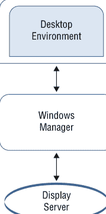

在本节中，我们将重点介绍 *显示服务器*。显示服务器是一个程序，它使用通信协议将 UI 的意图传输到操作系统，反之亦然。这种通信协议（称为显示服务器协议）可以通过网络运行。

显示服务器团队的另一成员是 *合成器*。合成器程序在窗口内排列各种显示元素，以创建要传回客户端的屏幕图像。

> 要了解合成器程序，有助于了解历史。在计算机打印文档之前，合成器是人。物理框架（称为托架）用于持有木块。这些木块上刻有字母或图像。合成器会将木块排列到框架中，以形成单词和/或图像。合成器会将框架交给印刷工（也是人）。印刷工会在木块上涂上油墨，然后将框架压在纸上。从而得到一份打印文档。合成器程序的工作方式类似，只是它使用多个元素，将其合成为单个屏幕图像并移交给客户端。

### 了解 X11 架构

*X 窗口系统*（简称 X）是 Linux 系统使用的显示服务器。它开发于 20 世纪 80 年代，因此已经存在很长时间。这个显示服务经受住了时间的考验。

最初，Linux 中只有一种支持 X 的软件包，称为 XFree86。然而，在 2004 年，XFree86 项目更改了其许可要求，导致许多 Linux 发行版转向 X.Org 基金会的 X 实现，简称为 X.Org。

X.Org 的显示服务器完全实现了 X 窗口系统第 11 版标准，包括使用与原始 XFree86 包相同的配置文件格式。然而，许多发行版对 X.Org 服务器进行了自己的定制；因此，您将看到关于 Linux X 显示服务器的各种名称，例如 X.org-X11、X、X11 和 X.Org Server。本章中我们将使用 X 或 X11。

在过去几年中，名为 Wayland 的新 X 显示服务器包在 Linux 世界中取得了进展。Wayland 包提供更高级的功能，支持更新的显示硬件和安全性，并支持更多类型的输入设备。Wayland 在 Linux 世界中迅速获得追随者，很快可能成为大多数 Linux 发行版使用的默认显示服务器。

本节将介绍 X.Org 和 Wayland 显示服务器的基础知识。

### 检查 X.Org

X.Org 包在配置文件中跟踪显卡、显示器和输入设备信息，使用原始 XFree86 格式。主配置文件是 /etc/X11/xorg.conf，尽管该文件有时存储在 /etc/ 目录中。但是，通常不再使用此文件。相反，单个应用程序或设备将其自身的 X11 设置存储在 /etc/X11/xorg.conf.d 目录中的单独文件中。当 X11 服务器启动时，它会读取这些文件中存储的配置设置，以定制其与不同显卡、显示器、键盘、鼠标以及其他输入或输出设备的交互方式。

不过，如果您在 Linux 系统中查找 xorg.conf 文件或 xorg.conf.d 目录却都找不到，也不要惊讶。X.Org 软件可以通过运行时自动检测每个 GUI 会话涉及的硬件，即时创建会话配置。如今，X.Org 软件可以检测大多数常见硬件设备，因此不需要手动配置。

然而，在某些情况下，自动检测可能无法正常工作，您需要进行 X11 配置更改。在这种情况下，您可以手动创建配置文件。为此，通过转到命令提示符关闭 X 服务器，使用命令 `sudo telinit 3`（这通常在 SysVinit 和 systemd 系统上都有效），并使用超级用户权限通过 `Xorg -configure` 命令生成文件。名为 xorg.conf.new 的文件将位于您的本地目录中。进行必要的调整，重命名文件，将文件移动到其正确位置，并重新启动 X 服务器。

xorg.conf 文件有多个节。每个节包含重要的配置信息：

- 输入设备：配置会话的键盘和鼠标
- 显示器：设置会话的显示器配置
- 模式：定义视频模式


- 设备：配置会话的显卡
- 屏幕：设置会话的屏幕分辨率和颜色深度
- 模块：指示需要加载的任何模块
- 文件：根据需要设置字体、模块和键盘布局文件的文件路径名称
- 服务器标志：配置全局X服务器选项
- 服务器布局：链接会话的所有输入和输出设备

请记住，许多桌面环境在其UI中也提供对话框，允许你配置GUI X会话。大多数情况下，你无需创建或调整X11配置文件。但是，如果你确实想深入了解X11配置文件的详细信息，可以通过 man 5 xorg.conf 命令查看其man页面。

如果需要排查X问题，X.Org软件包提供了一些帮助。如果显示进程出现问题，X.Org服务器会在你的主目录中生成 .xsession-errors 文件（通常称为 ~/.xsession-errors）。这是一个标准文本日志文件，指示X.Org服务器出了什么问题。

此外，有两个实用程序可提供帮助：xdpyinfo 和 xwininfo。xdpyinfo命令提供有关X.Org服务器的信息，包括可用的不同屏幕类型、默认通信参数值、协议扩展信息等等。

xwininfo实用程序提供窗口信息。如果未给出任何选项，交互式实用程序会要求你单击想要查看统计信息的窗口。显示的统计信息包括位置信息、窗口尺寸（宽度和高度）、颜色映射ID等等。

> **警告** 请注意，如果你运行的是Wayland会话而不是X.Org会话，xwininfo命令会挂起。按Ctrl+C退出挂起的命令。

> **注意** 如果X.Org会话因任何原因挂起，可以按Ctrl+Alt+Backspace组合键将其重置。这将重新启动X服务器，X服务器将尝试再次自动检测硬件并生成配置文件。

## 了解Wayland

Wayland是X.Org显示服务器的替代品。其设计旨在比X.Org软件更简单、更安全、更易于开发和维护。Wayland专门定义了显示服务器及其各种客户端之间的通信协议。但是，Wayland也是一个涵盖合成器、窗口服务器和显示服务器的统称。

Wayland协议最初于2009年发布，现在被许多当前的Linux桌面环境使用，例如GNOME Shell和KDE Plasma。如果你确实想深入了解Wayland，请访问其网站 https://wayland.freedesktop.org/。

## 检查显示服务器

如果不确定桌面环境当前使用的是哪个显示服务器（X11还是Wayland），可以快速确定答案。以下步骤将指导你完成发现过程。

- 1. 登录系统的GUI。这将为你启动一个GUI会话。
- 2. 打开终端模拟器应用程序。
- 3. 在命令行中键入 echo $WAYLAND_DISPLAY 并按Enter键。如果没有任何响应且仅返回命令行提示符，那么你的系统很可能使用的是X11。如果收到响应，那么你的桌面环境可能正在使用Wayland。额外的测试将帮助你确认正在使用的是什么。
- 4. 需要获取GUI会话编号，因此请键入 loginctl 并按Enter。记下会话编号。
- 5. 在命令行中键入命令 loginctl show-session session-number -p Type，其中 session-number 是你在上一步中获得的编号。如果收到 Type=Wayland，则你的桌面环境正在使用Wayland。如果收到 Type=X11，则你的系统使用的是X11显示服务器。

Wayland的合成器是Weston。但是，Weston提供的桌面体验相当基础。它是作为Wayland合成器参考实现而创建的。对于不熟悉“参考实现”这一术语的人来说，这意味着Weston被创建为那些想要创建自己Wayland合成器的开发人员的合成器要求示例。因此，Weston的核心关注点是正确性和可靠性。

Wayland的合成器是可互换的。换句话说，如果你需要更全功能的桌面体验，可以使用不同的合成器。有几个合成器可与Wayland一起使用，包括Arcun、Sway、Lipstick和Clayland（仅举几例）。但是，你可能不需要外部获取Wayland合成器。许多桌面环境会创建自己的Wayland合成器，通常嵌入在它们的窗口管理器中。例如，Kwin和Mutter都完全处理Wayland合成器任务。

> 如果你有一些不支持Wayland的旧版X11应用程序，不要绝望。Weston软件包中提供了XWayland软件。XWayland允许X依赖型应用程序在X服务器上运行，并通过Wayland会话进行显示。

如果UI正在使用Wayland但遇到GUI问题，可以尝试几种故障排除技术。以下步骤介绍了一些基本方法。

**尝试在没有Wayland的情况下使用GUI。** 如果你的Linux发行版有多种桌面环境版本（带Wayland或带X11），请注销GUI会话并选择不带Wayland的桌面环境。如果UI问题得到解决，那么你就知道这很可能与Wayland有关。

如果你没有多种桌面环境版本并且使用的是GNOME Shell用户界面，请按以下步骤关闭Wayland：

- 1. 使用超级用户权限，编辑 /etc/gdm3/custom.conf 文件。
- 2. 从 #WaylandEnable=false 行中删除 # 并保存文件。
- 3. 重启系统并登录到GUI会话，看看问题是否消失。

**检查系统的显卡。** 如果系统在X11下运行正常但在Wayland下出现问题，请检查显卡。最简单的方法是访问显卡供应商的网站，查看其驱动程序是否支持Wayland。许多都支持，但这里有一些著名的不支持者，此处不点名。

**使用不同的合成器。** 如果你使用的是桌面环境的内置合成器或其他合成器之一，请尝试改为安装和使用Weston合成器软件包。请记住，Weston是为可靠性而构建的。如果Weston不在你的发行版软件仓库中，可以从 https://github.com/wayland-project/Weston 获取。该网站还包含有用的文档。如果使用Weston解决了GUI问题，那么你已经缩小了故障范围。

> 请注意，在Wayland会话下，某些桌面环境命令可能无法工作。例如，如果你使用GNOME Shell，gnome-shell --replace 命令除了生成消息“Window manager warning: Unsupported session type”外不会做任何事情。

## 管理GUI

使用某些操作系统时，GUI比较固定。你可能可以移动或添加几个图标，更改背景图片，或调整一些设置。但是，使用Linux时，GUI选择几乎令人应接不暇，灵活性极大。

这种灵活性来自大量不同组件的协同工作，每个组件都有自己的定制方式。本节将介绍标准GUI环境中的不同组件。

### 标准GUI功能

在Linux中，GUI是一系列协同工作以提供UI图形设置的组件。其中一个组件是桌面环境。桌面环境为GUI提供预设的外观和感觉。它通常分为以下图形部分和功能：

**桌面设置** 桌面设置由允许你对桌面环境进行配置更改的程序组成。例如，你可能希望桌面窗口在鼠标悬停在其上方时激活，而不是在单击它们时激活。

**显示管理器** 桌面环境的登录屏幕是你选择用户名并输入密码以获得系统访问权限的地方。如果系统上安装了多个桌面环境，显示管理器允许你在登录前在它们之间进行选择。这些登录屏幕通常由公司修改，以包含有关适当使用系统的法律声明和/或公司徽标。

**文件管理器** 此程序允许你以图形方式执行文件维护活动。管理程序中通常会为目录显示文件夹图标。你可以执行移动文件、查看目录内容、复制文件等任务。

**图标** 图标是文件或程序的图片表示。它通过鼠标单击、手指触摸（如果屏幕是触摸屏）、语音命令等方式激活。

**收藏夹栏** 此窗口区域包含热门图标，这些图标通常使用频率更高。这些图标可以根据需要添加或删除。某些桌面环境会在你使用系统时自动更新栏，以反映你经常使用的图标。

**启动** 此程序允许你搜索应用程序和文件。它还可以允许在搜索结果上执行某些操作，例如启动或打开。

**菜单** 这些窗口区域通常通过图标访问。它们包含文件和/或程序的列表，以及附加文件和/或程序选择的子列表。

**面板** 面板是位于桌面环境主窗口顶部或底部的纤长且通常为矩形的区域。它们也可以位于桌面的最左侧或最右侧。它们通常包含通知、系统日期和/或时间、程序图标等等。

**系统托盘** 系统托盘是一种特殊菜单，通常附加到面板上。它提供对程序的访问，允许用户注销、锁定屏幕、管理音频设置、查看通知、关闭或重启系统等等。

**小部件** 小部件分为小应用程序、屏幕小部件、桌面小部件等。它们是提供桌面上用户信息或功能的程序。例如，当前体育新闻可能会持续显示在屏幕小部件上。另一个示例是便利贴小应用程序，允许用户在桌面上放置看起来像便利贴的图形窗口并向其中添加内容。

**窗口管理器** 这些客户端程序决定桌面上窗口（也称为框架）的呈现方式。这些程序控制窗口的大小和外观等项目。它们还管理额外窗口的放置方式，例如并排或重叠。

许多Linux用户对自己使用的桌面环境非常热情——这有充分的理由。你可以从多个优秀的桌面环境中进行选择。我们将


本章将介绍其中几种桌面环境，并探讨对其的通用可访问性。

## X GUI 登录系统

默认情况下，当 Linux 系统启动时，它会显示一个文本登录控制台。这对于服务器环境来说完全没问题，但在当今的桌面世界中却有所欠缺。大多数桌面用户希望出现某种图形登录屏幕，以便选择图形桌面环境（如果系统上可用不止一种），并使用用户 ID 和密码登录。

显示管理器组件负责控制图形登录功能。几乎每个桌面 Linux 发行版都会安装一个在启动时启动以显示图形登录环境的显示管理器软件包。每个 Linux 显示管理器软件包都使用 X 显示管理器控制协议（XDMCP）来处理图形登录过程。图 6.2 显示了 Ubuntu 使用的显示管理器。

## 图 6.2 Ubuntu 显示管理器登录屏幕

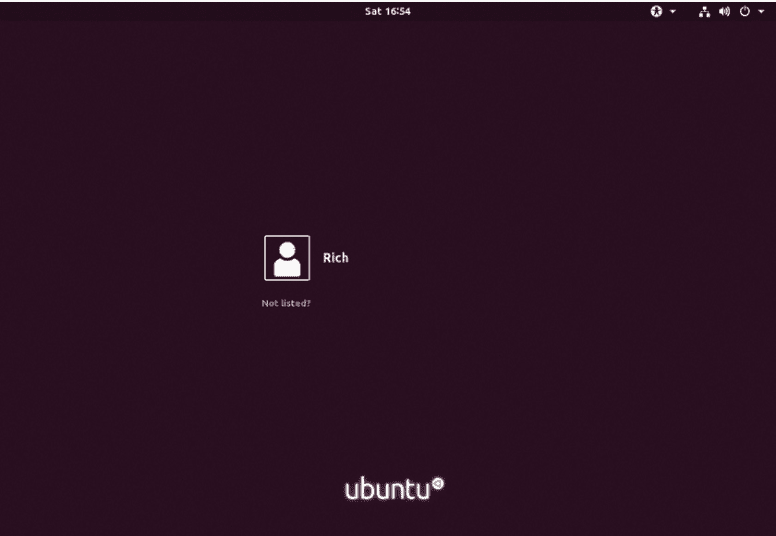

X 显示管理器 (XDM) 软件包是 Linux 上可用的基本显示管理器软件。它显示一个通用的用户 ID 和密码登录屏幕，将登录尝试转交给 Linux 系统进行验证。如果系统对登录尝试进行身份验证，XDM 将启动适当的 X 服务器环境和 Windows 桌面环境。

虽然 XDM 显示管理器比较通用，但有一些可供修改的配置功能，可以稍微改变一些设置。主配置文件是 /etc/X11/xdm/xdm-config。在大多数情况下，您永远不需要修改这些设置中的任何一项。

大多数窗口管理器会创建自己的显示管理器，并扩展 XDM 显示管理器的功能。以下是您将看到的一些更流行的显示管理器：

- KDM: KDE 桌面环境使用的默认显示管理器
- GDM: GNOME 桌面环境使用的默认显示管理器
- LightDM: 用于 Xfce 等轻量级桌面环境的精简版显示管理器

## 常见的 Linux 桌面环境

与其他操作系统不同，Linux 提供了多种不同的桌面环境供您选择。虽然大多数 Linux 发行版专注于单一桌面环境，但您仍然可以自由安装不同的桌面环境。

本节将介绍您在各种 Linux 发行版中会遇到的最常见的桌面环境。

## 了解 GNOME

GNOME 桌面环境创建于 20 世纪 90 年代末。它非常受欢迎，默认出现在 CentOS 和 Ubuntu 等 Linux 发行版上。目前，它由属于 GNOME 基金会的一大群志愿者维护。您可以在 www.gnome.org 上了解有关 GNOME 项目的更多信息。

2011 年是 GNOME 历史上的一个关键时刻。GNOME 2 是一个更传统的桌面用户界面，而当 GNOME 3（现在正式称为 GNOME Shell）于 2011 年发布时，其非传统界面引起了许多用户的强烈反应。这催生了几个 GNOME 项目的分支。然而，随着时间的推移和经过一些更改，GNOME Shell 获得了认可。对于那些仍然偏爱 GNOME 2 提供的传统桌面用户界面的用户，GNOME Classic 桌面环境可用。

## 图 6.3 GNOME Shell 桌面环境

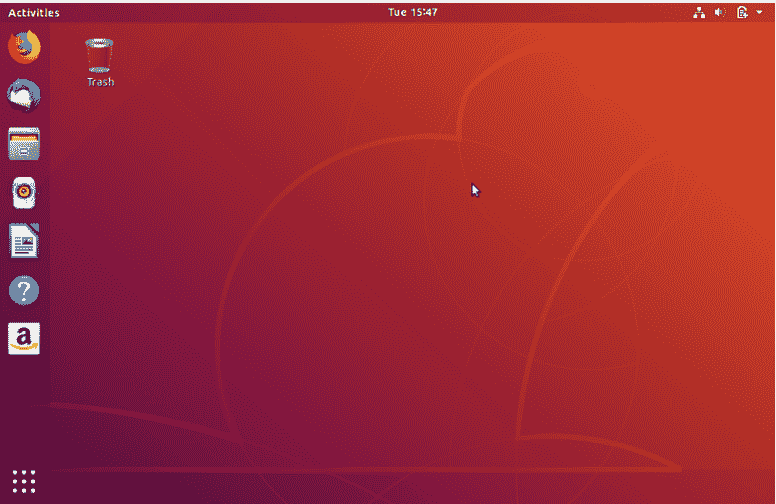

请记住，默认桌面环境可能会针对每个 Linux 发行版进行略微修改。例如，CentOS 上的 GNOME Shell 除非您在面板中单击“活动”，否则不会显示“收藏栏”，而 Ubuntu 上的 GNOME Shell 会自动显示“收藏栏”。

为了更好地了解特定的图形界面，请亲自尝试一下桌面环境。但是，为了帮助您记忆组成这些不同桌面的各种组件，我们提供了表格，以便您比较和对比不同的图形环境。表 6.1 简要描述了 GNOME Shell 的各种组件。

| 名称 | 程序名称和/或描述 |
| :--- | :--- |
| 显示管理器 | GNOME 显示管理器 (GDM)。 |
| 文件管理器 | GNOME Files（有时简称为 Files）。以前称为 Nautilus。 |
| 收藏栏 | GNOME Shell Dash（有时称为 Dock）。 |
| 面板 | 位于 GNOME Shell 框架顶部的单个面板。 |
| 系统托盘 | 位于单个面板的右侧。 |
| 窗口管理器 | Mutter。 |

GNOME Shell 的一个有趣功能是，包含系统托盘的面板既可用于显示管理器，也可在 GNOME Shell 内使用。

## 探索 KDE Plasma

Kool 桌面环境 (KDE) 起始于 1996 年，其首个版本于 1998 年发布。随着时间的推移，KDE 这个名称不再仅指代桌面环境，而是指代该项目的组织及其支持的强大社区。除了著名的桌面环境之外，KDE 还有许多其他软件项目。因此，在 2009 年，KDE 的桌面环境重新命名为 KDE Plasma。您可以在 www.kde.org 上了解 KDE 团队及其各种产品。

## 图 6.4 KDE Plasma 桌面环境


在图 6.4 中，请注意面板位于主 UI 框架的底部。这是旧系统中使用的更传统的面板位置，也是 KDE Plasma 被认为是 Linux 新手良好桌面环境的原因之一。在这个面板上，包含通知、时间以及各种其他 Plasmoids（小部件）的系统托盘位于面板的右侧。应用程序菜单（一个各种程序的启动器，同时也包含收藏栏）位于面板的最左侧。表 6.2 简要介绍了 KDE Plasma 的一些组件。

| 名称 | 程序名称和/或描述 |
| --- | --- |
| 显示管理器 | SDDM (Simple Desktop Display Manager) |
| 文件管理器 | Dolphin |
| 收藏栏 | 在应用程序菜单中显示 |
| 面板 | 位于 Plasma 框架底部的单个面板 |
| 系统托盘 | 位于单个面板的右侧 |
| 小部件 | 称为 Plasmoids |
| 窗口管理器 | Kwin |

为了帮助那些习惯通过文件夹图标访问文件的用户，KDE Plasma 提供了文件夹视图。您可以在图 6.4 中看到 openSUSE Leap 发行版默认 UI 中描绘的文件夹。主桌面窗口上的这些图标允许您启动 Dolphin 文件管理器并直接跳转到文件夹图标上命名的目录。

> 许多桌面环境为每个用户提供称为工作区的多个 UI。工作区是独立的桌面。例如，您可以在一个工作区上打开两个 GUI 应用程序，而在另一个工作区上仅打开一个终端模拟器。在工作区之间切换可以通过鼠标单击或按键组合完成，例如在 Fedora 28 的 Wayland 桌面环境中使用 Ctrl+Alt+向上箭头或向下箭头。使用多个工作区非常方便，特别是当老板走过时，您需要快速看起来工作很忙。

## 探讨 Cinnamon

Cinnamon 桌面环境起始于 2011 年，当时许多用户对 GNOME 3（现为 GNOME Shell）的发布做出了强烈反应。Mint Linux 发行版的开发人员开始将 Cinnamon 作为 GNOME 3 的分支进行开发。截至 2013 年末，它正式成为“不依赖 GNOME”的系统。Cinnamon 仍由 Mint 开发团队管理，您可以访问其网站 www.linuxmint.com 了解更多信息。


Cinnamon 与 KDE Plasma 一样，以其对 Linux 新手友好的用户界面而闻名。图 6.5 显示了在 Fedora Workstation 发行版上的 Cinnamon 桌面环境。

### 图 6.5 Cinnamon 桌面环境


请注意图 6.5 中主界面框架底部的面板。在这个面板上，系统托盘（包含音频控件、时间以及各种其他小部件）位于面板的右侧。菜单（各种程序的启动器，同时也包含收藏夹栏）位于面板的最左侧。请注意，Cinnamon 面板还包含用于快速启动的图标。

如果你想在已安装的某个发行版上安装 Cinnamon 桌面环境，我们建议你在 Fedora 28 Workstation 上尝试。只需按照以下步骤操作：

- 1. 使用具有超级用户权限的帐户。这通常是你在系统安装期间设置的帐户。
- 2. 访问终端并在命令行中输入命令 `sudo dnf groupinstall -y "Cinnamon Desktop"`。请务必包含命令的引号。
- 3. 安装完成后，重启系统。
- 4. 通过系统显示管理器齿轮图标提供的菜单访问 Cinnamon 桌面环境。

Cinnamon 桌面环境的布局应该有些熟悉，因为它与 KDE Plasma 的默认布局非常相似。两者在主界面窗口上都有文件夹图标。表 6.3 简要描述了一些 Cinnamon 组件。

### 表 6.3 Cinnamon 桌面环境默认组件

| 名称 | 程序名称和/或描述 |
| --- | --- |
| 显示管理器 | LightDM |
| 文件管理器 | Nemo（Nautilus 的一个分支） |
| 收藏夹栏 | 在应用程序菜单中显示 |
| 面板 | 位于 Cinnamon 框架底部的单个面板（称为 Cinnamon 面板） |
| 系统托盘 | 位于单个面板的右侧 |
| 小部件 | Cinnamon Spices |
| 窗口管理器 | Muffin（GNOME Shell 的 Mutter 的一个分支） |

Cinnamon Spices 不仅仅是用于修改桌面环境的小应用程序和桌面组件。它们还包括主题和扩展，你可以下载并安装这些内容，使你的 Cinnamon UI 体验真正独特。官方 Cinnamon Spices 仓库位于 https://cinnamon-spices.linuxmint.com/。

## 了解 MATE

MATE 桌面环境始于 2011 年，当时发布了 GNOME 3（现为 GNOME Shell）。它由一位居住在阿根廷的 Arch Linux 发行版用户发起。MATE 读作“Ma-Tay”，该桌面环境在宣布后仅两个月即正式发布，并源自 GNOME 2。该桌面环境适用于多种 Linux 发行版，例如 Arch Linux、Debian、Fedora、Ubuntu、Linux Mint 等等。

> MATE 以一种由植物干叶制成的茶命名。该植物（Ilex paraguariensis）原产于南美洲。马黛茶是阿根廷的国饮。据称它具有茶的健康益处，并能提供类似于喝咖啡的精神警觉性。

如果你曾经使用过旧版 GNOME 2 桌面环境，MATE 会让你感到非常熟悉。图 6.6 显示了在 Ubuntu Desktop 发行版上的 MATE 桌面环境。

### 图 6.6 MATE 桌面环境


在图 6.6 中，MATE 桌面环境有两个面板。一个位于主界面框架的顶部，另一个位于底部。系统托盘（包含音频控件、时间以及各种其他小部件）位于顶部面板的右侧。应用程序（各种程序的菜单驱动启动器）位于顶部面板的最左侧。请注意，这个顶部面板还包含用于快速启动的图标。

如果你想在第一章中安装的某个发行版上安装 MATE 桌面环境，我们建议你在 Ubuntu Desktop 18.04 上尝试。使用具有超级用户权限的帐户。这通常是你在系统安装期间设置的帐户。访问终端并在命令行中输入命令 `sudo apt-get update` 以更新系统的软件源。当返回提示符后，安装 tasksel 程序。tasksel 程序是一个图形实用程序，它以协调的过程安装多个相关软件包。换句话说，它使安装具有大量依赖项的某些软件包变得容易。要安装它，请按照以下步骤操作：

- 1. 在命令行中输入 `sudo apt-get install tasksel`。
- 2. 输入 `sudo tasksel install ubuntu-mate-desktop` 以安装 MATE 桌面环境。
- 3. 安装完成后，重启系统。
- 4. 你可以通过系统显示管理器齿轮图标提供的菜单访问 MATE 桌面环境。

在 MATE 桌面环境的底部面板上，在左下角你会看到“显示桌面”按钮图标。如果在主界面框架中打开了多个窗口，这非常方便。只需单击“显示桌面”按钮图标，当前打开的所有窗口将隐藏到底部面板。你可以再次单击“显示桌面”按钮图标来恢复底部面板上的所有窗口。表 6.4 简要描述了一些 MATE 组件。

| 名称 | 程序名称和/或描述 |
| --- | --- |
| 显示管理器 | LightDM。 |
| 文件管理器 | Caja（Nautilus 的一个分支）。 |
| 收藏夹栏 | 改用收藏夹菜单，可通过由应用程序菜单驱动的启动器访问。 |
| 面板 | MATE 框架底部有一个面板，MATE UI 顶部有另一个面板。 |
| 系统托盘 | 位于顶部面板的右侧。 |
| 窗口管理器 | Marco（Metacity 的一个分支）。 |

你可以将额外的小部件添加到 MATE UI 的顶部面板上。只需右键单击面板，然后从下拉菜单中选择“添加到面板”。这将打开一个你可以安装的小程序窗口。

## 采用 Xfce 精简方案

功能更丰富的 Linux 图形桌面的一个缺点是，它们运行时需要大量的 CPU 和内存资源。过去，Linux 以赋予旧硬件新生而闻名，通常可以在 Windows 或 macOS 无法运行的系统上运行。然而，随着 Linux 上功能更丰富的图形桌面的出现，情况不再如此。

然而，与所有 Linux 事物一样，你有更多选择。有几个低端图形桌面可以在最少资源下完美运行。其中，最受欢迎的是 Xfce 图形桌面。

Xfce 桌面开发于 1996 年，作为 UNIX 通用桌面环境（CDE）的扩展，使用 XForms 图形工具包开发（名称中的“Xf”部分即来源于此）。多年来，Xfce 已被重写，不再使用 XForms 或 CDE 的代码，但它仍然是 Linux 世界中一个可靠的轻量级图形桌面。图 6.7 显示了在 XUbuntu Linux 发行版中使用的标准 Xfce 桌面。

### 图 6.7 XUbuntu Linux 发行版中使用的 Xfce 桌面


对于 XUbuntu 发行版，Xfce 桌面已被设计为模仿标准 Ubuntu GNOME 桌面的基本功能，但功能有些受限。表 6.5 列出了 XUbuntu Xfce 桌面中可用的功能。

### 表 6.5 Xfce 桌面环境默认组件

| 名称 | 程序名称和/或描述 |
| --- | --- |
| 显示管理器 | LightDM |
| 文件管理器 | Thunar |
| 收藏夹栏 | 面板左侧的单个图标；显示收藏夹、最近应用程序和应用程序菜单 |
| 面板 | 位于窗口顶部的单个面板 |
| 系统托盘 | 面板右侧的一组图标 |
| 窗口管理器 | 专用的 Xfwm，它使用自己的合成器管理器 |

虽然你在 Xfce 中不会找到许多花哨的功能，但如果你需要在旧硬件上运行 Linux 发行版，Xfce 桌面环境很可能运行良好，并赋予你的旧硬件新生。


## 提供无障碍访问

在 GUI 环境中，无障碍访问涉及用户使用桌面环境的能力。虽然 Linux 发行版提供的默认桌面环境适用于许多人，但无障碍设置可以满足所有潜在用户的需求。这包括可能有视力障碍、使用鼠标有顾虑、手指运动有问题以及其他情况的用户。了解这些适配的桌面环境配置非常重要，以便您能帮助所有人获得访问权限。

每个桌面环境会提供略有不同的无障碍配置方法。但大多数设置都可以通过桌面环境控制面板完成，例如 GNOME Shell 设置中的通用访问面板。

**TIP** 虽然大多数桌面环境提供不同名称的无障碍控制面板，但您通常可以使用环境的搜索功能快速找到这些面板。良好的搜索关键词包括 **通用访问**、**无障碍** 和 **辅助技术**。

图 6.8 显示了从 UI 顶部面板打开的通用访问菜单。您可以通过在 GNOME Shell 的搜索功能中搜索 **通用访问**，在访问控制面板中找到更多无障碍设置。

**图 6.8** GNOME Shell 中的通用访问顶部面板菜单


对于严重视力受损或视力不佳的用户，有几种可用的无障碍设置可能会提供帮助。表 6.6 描述了常见的视觉障碍设置。

**表 6.6** 常见视觉障碍无障碍设置

| 名称 | 描述 |
| --- | --- |
| 光标闪烁 | 修改光标闪烁速率，以便更容易在屏幕上定位光标。 |
| 光标大小 | 修改光标大小。 |
| 高对比度 | 增加窗口和按钮的亮度，并使窗口边缘以及文本和光标变暗。 |
| 大号文本 | 修改字体大小，通常称为屏幕放大镜。 |
| 屏幕阅读器 | 使用屏幕阅读器大声朗读 UI。流行的选择包括 Orca 屏幕阅读器和 Emacspeak。 |
| 声音按键 | 当 Caps Lock 或 Num Lock 打开（关闭）时发出蜂鸣声。也称为切换键。 |
| 缩放 | 将屏幕或屏幕的一部分放大到不同的放大级别。 |

如果盲人用户可以使用盲文显示器，您可以安装 brltty 软件包，该软件包在大多数 Linux 发行版的仓库中都有提供。brltty 软件包作为 Linux 守护程序运行，并通过盲文显示器提供控制台（文本模式）访问。您可以在其官方网站 http://mielke.cc/brltty/ 上了解更多关于此软件的信息。请注意，您也可以将 Orca 屏幕阅读器与可刷新盲文显示器一起使用。

如果您无法在 Linux 系统上听到声音提醒，可以启用可视提醒。然后，如果发生通常会产生声音的情况，将改为执行可视闪烁。您可以将可视提醒设置为闪烁单个窗口或闪烁整个显示器。

对于有手和/或手指障碍的用户，有几种无障碍设置可用于允许系统的完全功能使用。常见设置列于表 6.7 中。

**表 6.7** 常见手部和手指障碍无障碍设置

| 名称 | 描述 |
| --- | --- |
| 弹跳按键 | 键盘选项，有助于补偿单个键被意外多次按下的情况。 |
| 双击延迟 | 鼠标选项，修改双击鼠标之间允许的时间量。 |
| 手势 | 鼠标选项，通过结合鼠标点击和键盘按压来激活程序和/或选项。 |
| 悬停点击 | 鼠标选项，当指针悬停在项目上时触发鼠标点击。 |
| 鼠标键 | 鼠标选项，允许您使用键盘按键来模拟鼠标功能。 |
| 重复按键 | 键盘选项，修改按键必须按下的时间长短以及确认按键重复的延迟。也称为键盘重复速率。 |
| 屏幕键盘 | 键盘选项，在 UI 上显示可视键盘，可以通过鼠标或其他指针设备进行操作以模拟按键。 |
| 模拟次要点击 | 鼠标选项，设置一个主键与鼠标点击一起按下，以模拟次要鼠标点击。 |
| 慢速按键 | 键盘选项，修改按键必须按下的时间长短以确认按键。 |
| 粘滞按键 | 键盘选项，设置键盘修饰键（例如 Ctrl 和 Shift），使其在按下后续键之前保持按下状态。 |

AccessX 是一个提供表 6.7 中许多选项的程序。因此，您经常会在无障碍控制面板中看到它被引用，例如在键入辅助 (AccessX) 选项中。一个有趣的 AccessX 设置是 Enable By Keyboard，它允许您通过键盘上的按键来打开或关闭无障碍设置。

## 使用 X11 进行远程访问

X11 系统利用经典的客户端/服务器模型来提供图形桌面。在大多数情况下，客户端和服务器都在同一台物理设备上运行，但情况不一定如此。您可以让远程 X11 客户端连接到 X11 服务器，以便在远程系统上显示图形桌面。

有几种不同的技术用于实现 X11 桌面环境的远程连接。本节将介绍最流行的几种。

### 远程 X11 连接

远程运行 X11 桌面的最简单方法是将标准 X11 桌面协议流通过网络转发到远程客户端。例如，假设主机 workstation1 位于远程区域，但您需要使用本地主机（名为 workstation2）从其运行图形程序。执行以下步骤即可完成：

- 1. 使用标准图形桌面环境登录到 workstation2 主机。
- 2. 打开终端会话以获取命令提示符。
- 3. 键入 `xhost +workstation1`，其中 *workstation1* 是远程 workstation1 主机的主机名或 IP 地址。xhost 命令允许客户端工作站接收来自发送远程工作站的数据。
- 4. 使用安全外壳 (SSH) 连接登录到远程主机 workstation2。这将提供标准文本命令提示符界面。
- 5. 在命令提示符处，键入 `export DISPLAY=workstation2:0.0`，其中 *workstation2* 是本地工作站的主机名或 IP 地址。此命令将在远程 workstation1 上生成的任何图形输出重定向到本地 workstation2 X 服务器。
- 6. 从 workstation1 上的命令提示符启动图形应用程序。图形桌面将作为本地 workstation2 桌面上的一个新窗口出现。
- 7. 完成后，关闭已启动的程序，并在本地 workstation2 主机上键入 `xhost -workstation1` 以删除接收来自远程主机数据的权限。

> 除了 *xhost* 命令之外，您可能还需要允许 Linux 系统上运行的任何防火墙软件通过连接。X11 桌面使用 6000 到 6063 范围内的 TCP 端口。此外，*xhost* 命令仅允许远程主机在当前会话中向本地工作站建立 X 连接。如果您经常将特定远程主机上的图形窗口发送到本地工作站，可以将条目添加到 X11 服务器配置文件中。*xauth* 命令允许您在 X11 配置文件中添加、删除和列出远程主机。

### 隧道化 X11 连接

另一种在安全隧道内提供远程 GUI 交互的方法是 *X11 转发*。X11 转发允许您通过加密网络连接与远程系统上的各种基于 X11 的图形实用程序进行交互。此方法使用 openSSH 服务实现。

首先，您需要检查是否允许 X11 转发。此设置位于 openSSH 配置文件 `/etc/ssh/sshd_config` 中。指令 X11Forwarding 应该在远程系统的配置文件中设置为 yes。如果指令设置为 no，那么你


您必须对其进行修改以启用 X11 转发。在清单 6.1 中，针对 CentOS 发行版的配置文件中的该指令执行了检查。

## 清单 6.1：检查 AllowTCPForwarding 指令

```
# grep "X11Forwarding yes" /etc/ssh/sshd_config
X11Forwarding yes
#
```

在对配置文件进行任何必要修改后，要使用的命令是 ssh -X user@remote-host。与之前的 ssh 命令用法类似，user 是 remote-host 系统上存在的用户帐户。remote-host 拥有您希望使用的 GUI 实用程序，并可以通过 IP 地址或主机名指定。图 6.9 显示了从远程 Fedora 客户端连接到 CentOS 服务器并在该服务器上使用图形实用程序的情况。

## 图 6.9 转发 X11

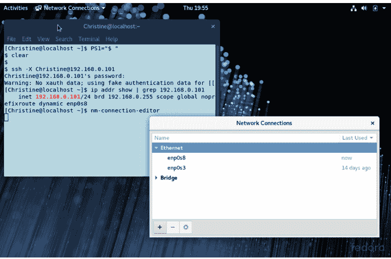

检查 IP 地址始终是个好主意，以确保您已成功连接到远程系统。在图 6.9 中，为此目的使用了 ip addr show 命令。完成工作后，只需键入 exit 即可退出 X11 转发会话。

您可以阅读有关通过 ssh -Y 命令使用 X11 转发的内容，这被称为受信任的 X11。这并不意味着连接更安全。事实上，恰恰相反。使用此命令时，您将远程服务器视为受信任系统。这种方法可能导致许多安全问题，应予以避免。

## 使用远程桌面软件

虽然使用 X11 的内置客户端/服务器功能不错，但可能有点麻烦。幸运的是，Linux 中有一大批远程桌面应用程序可供我们使用，它们替我们完成了艰苦的工作。

远程桌面软件使用客户端/服务器模型，在远程主机上提供服务器应用程序，在本地主机上提供客户端应用程序。您只需将客户端应用程序指向远程应用程序即可开始工作。无需处理复杂的转发或隧道方案。

在本节中，我们将了解一些常见的 Linux 远程桌面实现。它们包括 VNC、Xrdp、NX 和 SPICE。

### 查看 VNC

虚拟网络计算（VNC）由 Olivetti & Oracle Research Lab 开发，该实验室现已关闭。许多原始开发者现在继续从一家名为 RealVNC 的公司开发 VNC 软件。VNC 软件是多平台的，并采用远程帧缓冲（RFB）协议。该协议允许客户端用户向服务器发送 GUI 命令，例如鼠标单击。服务器将桌面帧发送回客户端的显示器。RealVNC Ltd.（由原始 VNC 项目团队开发人员组成）现拥有 VNC 商标。

VNC 服务器在 TCP 端口 5900 + n 处提供 GUI 服务，其中 n 等于显示编号，通常为 1（端口 5901）。在命令行上，您将 VNC 客户端（称为查看器）指向 VNC 服务器的主机名和 TCP 端口。或者，您可以使用显示编号而不是完整的 TCP 端口号。客户端用户需要输入预设的密码，该密码用于 VNC 服务器，而非 Linux 系统身份验证。客户端用户通过 VNC 进行身份验证后，将获得桌面环境的显示管理器输出，以便进行系统身份验证。

VNC 服务器很灵活，您还可以使用启用 Java 的 Web 浏览器访问它。它在 TCP 端口 5800 + n 处提供该服务。HTML5 客户端 Web 浏览器也受支持。

VNC 客户端有两种可用的桌面 UI：持久型和静态型。持久型桌面是显示时不会更改的 UI。这类似于本地桌面体验：用户打开某些窗口，用户锁定屏幕并脱离本地系统进行其他活动，用户返回并解锁屏幕，用户发现 GUI 处于离开时的完全相同状态。持久型桌面仅可通过 Web 浏览器访问。静态型桌面不提供保存状态的 GUI。当您返回桌面时，您不会看到任何打开的窗口，而是看到默认桌面环境。

- 使用 VNC 的积极好处包括：
  - 在提供远程桌面方面具有很大的灵活性。
  - 多个用户可以使用桌面。
  - 持久型和静态型桌面均可用。
  - 可以按需提供桌面。
  - 可以通过 ssh 或客户端查看器命令行选项使用 SSH 隧道来加密流量。

- 使用 VNC 时的潜在困难或顾虑包括：
  - VNC 服务器仅处理鼠标移动和击键。它不处理客户端的文件和音频传输或打印服务。
  - VNC 默认不提供流量加密，因此您必须采用其他保护手段，例如通过 OpenSSH 隧道传输。
  - VNC 服务器密码以明文形式存储在服务器文件中。

除了 VNC，还有实现 VNC 技术的替代方案。TigerVNC 是 Linux 上一种流行的 VNC 实现。TigerVNC 网站位于 https://tigervnc.org/。它也适用于 Windows，因此您可以连接到远程 Linux 或 Windows 系统。要在 Linux 系统上安装服务器，请使用 tigervnc-server 软件包名称。您需要执行一些设置以准备客户端并配置服务器以提供适当的客户端要求。您可以在网上找到多个优秀的教程。如果您想安装 VNC 客户端，只需使用 tigervnc 软件包名称。

在命令行中通过命令访问远程桌面时，请务必在 GUI 环境中使用终端仿真器。如果您尝试在 GUI 外部使用文本模式终端发出这些命令，将无法成功。

安装 TigerVNC 服务器后，您可以使用 vncserver 和 vncconfig 命令对其进行控制。在对服务器防火墙进行适当修改后，客户端可以使用 vncviewer 命令连接到服务器系统并获得远程桌面。例如，某服务器（example.com）已正确配置为在显示编号 1 处向您提供远程桌面。您可以从另一台系统通过 vncviewer example.com:1 命令访问该桌面。图 6.10 显示了从 Fedora 系统到 CentOS 服务器的 TigerVNC 连接，该服务器正在向用户提供 GNOME Shell 桌面环境。

## 图 6.10 使用 TigerVNC

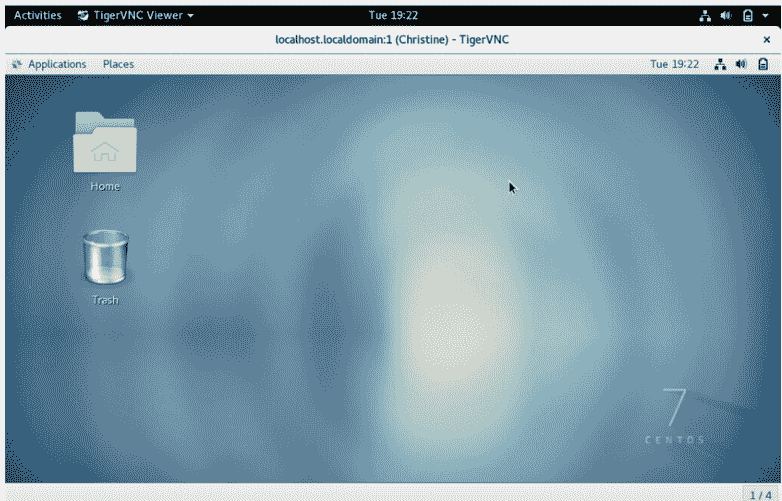

配置 VNC 服务器时，请务必为 VNC 服务器端口使用 OpenSSH 端口转发（本章稍后将介绍）。还要配置防火墙，允许通过端口 22（或您用于 SSH 流量的任何端口号）传输流量。

## 掌握 Xrdp

Xrdp 是 VNC 的替代方案。它支持远程桌面协议（RDP），并使用 X11rdp 或 Xvnc 管理 GUI 会话。

Xrdp 仅提供 RDP 连接的服务器端。它允许来自多个 RDP 客户端实现的访问，例如 rdesktop、FreeRDP 和 Microsoft 远程桌面连接。

Xrdp 已准备好与 systemd 一起使用，因此您可以简单地使用 systemctl 命令安装、启用和启动服务器。Linux 上的软件包名称是 xrdp。请注意，它可能不在您 Linux 发行版的标准存储库中。

安装并启动 Xrdp 服务器后，调整防火墙，以便流量可以访问标准 RDP 端口（TCP 3389）。现在，通过主机名或 IP 地址将 RDP 客户端指向服务器，并在必要时向客户端提供 RDP 端口号。

根据您的 RDP 客户端，您可能会看到显示服务器不受信任的屏幕。如果这是您刚刚设置的服务器，则可以放心继续。您需要输入 Linux 系统的用户身份验证信息，但登录屏幕取决于您使用的 Xrdp 客户端软件。图 6.11 显示了 Xrdp 的运行示例。

## 图 6.11 使用 Xrdp

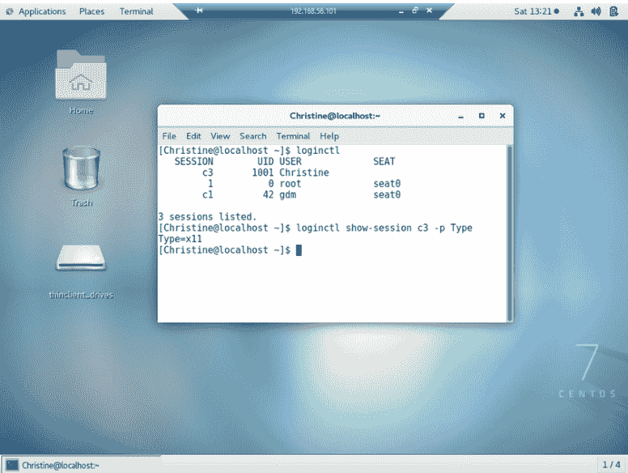

图 6.11 显示了从 Windows 10 系统到运行 Xrdp 服务器的 CentOS 7 Linux 服务器的连接。注意终端仿真器中运行命令的输出。您可以看到正在部署一个 X11 会话。

使用 Xrdp 的积极好处包括：

- Xrdp 使用 RDP，后者使用传输层安全性（TLS）加密其流量。
- 提供了多种多样的开源 RDP 客户端软件。
- 您可以连接到已存在的连接以提供持久桌面。
- Xrdp 服务器处理鼠标移动和击键，以及音频传输和在远程系统上挂载本地客户端驱动器。

您可以在 /etc/xrdp/xrdp.ini 文件中确定各种 Xrdp 配置设置。此文件中的一个重要设置是 security_layer 指令。如果设置为 negotiate（默认值），Xrdp 服务器将与客户端协商要使用的安全方法。有三种方法可用：

- tls: 为服务器身份验证和数据传输提供 SSL（TLS 1.0）加密。请注意，这未达到支付卡行业（PCI）标准所需的加密级别。


- negotiate: 将安全方法设置为客户端可使用的最高级别。如果连接通过公共网络，且客户端必须使用标准 RDP 安全方法，这会有问题。

- RDP: 将安全方法设置为标准 RDP 安全。该方法无法防范中间人攻击。

Xrdp 使用起来相当简单。此外，由于许多面向 Windows 的用户已经熟悉远程桌面连接，因此在办公环境中部署它通常不会花费太长时间。

## 探索 NX

NX 协议（有时也称为 NX 技术）由 NoMachine（www.nomachine.com）于 2001 年左右创建。NX 是另一种远程桌面共享协议。其 v3.5 的核心技术是开源的，并在 GNU GPL2 许可证下提供。然而，当版本 4 发布时，NX 变成了专有且闭源的软件。

但是，有几种基于 NX3 技术的开源变体可用。它们包括 FreeNX 和 X2Go。两者都可在多种 Linux 发行版上使用，但不一定位于其默认软件仓库中。

使用 NX 产品的积极好处如下：

- 它们在低带宽且高延迟的连接上也能提供出色的响应时间。

- 它们比基于 VNC 的产品更快。

- 它们默认使用 openSSH 隧道，因此流量是加密的。

- 它们通过单个网络端口支持多个同时用户。

NX 技术压缩 X11 数据，因此通过网络发送的数据更少，从而改善响应时间。它还大量使用缓存数据，以提供更好的远程桌面体验。

## 研究 SPICE

另一种有趣的远程连接协议是独立计算环境简单协议（Simple Protocol for Independent Computing Environments，SPICE）。它最初是 Qumranet 于 2007 年开发的闭源产品。然而，Red Hat 于 2008 年收购了 Qumranet，并使 SPICE 成为开源软件。其网站是：www.spice-space.org。

SPICE（有时写作 Spice，从本节起我们将统一使用此写法）的开发目的是提供一个良好的远程桌面产品，允许连接到您的各种虚拟机。如今，Spice 通常用于提供与 KVM 虚拟机的连接，逐渐进入 VNC 的领域。

> VNC 和 Spice 都提供连接到 KVM 虚拟机的远程桌面连接，常用于云环境中。

Spice 是平台无关的，还有一些非常好的额外功能。它们包括：

- Spice 的客户端使用多个数据套接字连接，您可以拥有多个客户端。
- Spice 提供的桌面体验速度类似于本地连接。
- Spice 占用的 CPU 量很低，因此您可以将其用于拥有多个虚拟机的各种服务器，而不会对其性能产生不利影响。
- Spice 允许高质量视频流传输。
- Spice 提供实时迁移功能，这意味着如果虚拟机正在迁移到新主机，则不会出现连接中断。

虽然 Spice 只有一个服务器实现，但它有多个客户端实现。这些包括 remote-viewer 和 GNOME Boxes。

使用 Spice 的另一个好处是其强大的安全功能。传输的数据可以以明文发送，也可以使用 TLS 加密流量。Spice 客户端与远程 Spice 服务器之间的身份验证使用简单身份验证和安全层（Simple Authentication and Security Layer，SASL）实现。该框架允许各种身份验证方法，只要 SASL 支持它们即可。Kerberos 是一种受支持的方法。

如果您仍在处理 X11，可以使用 X.Org 创建的 Xspice 充当独立的 Spice 服务器，也可以充当 X 服务器。

## 理解本地化

世界充满了不同的语言。不仅每个国家都有自己的语言（有时是一组语言），而且每个国家在编写数值、货币值以及时间和日期方面也有自己的方式。为了使 Linux 系统在任何特定位置都有用，它必须适应当地处理所有这些事物的方式。

本地化是指将 Linux 系统适应特定区域设置的能力。为此，Linux 系统必须有一种方法来识别如何处理本地语言中包含的字符。本节将讨论 Linux 究竟如何做到这一点。

## 字符集

从本质上讲，计算机使用 0 和 1 来工作，Linux 也不例外。但是，为了与人类交互，计算机需要知道如何说我们的语言。这就是字符集派上用场的地方。

字符集定义了一种标准代码，用于解释和显示语言中的字符。世界上使用了许多不同的字符集来表示字符。您最常遇到的（并且在 LPIC-1 考试中会看到的）字符集如下：

- ASCII: 美国信息交换标准代码（ASCII）使用 7 位来存储英语中发现的字符。

- ISO-8859: 国际标准化组织（ISO）与国际电工委员会（IEC）合作，制定了一系列用于处理国际字符的标准代码。共有 15 个独立标准（ISO-8859-1 到 ISO-8859-15）用于定义不同的字符集。

- Unicode: 由许多计算机行业公司组成的 Unicode 联盟创建了一个国际标准，该标准使用 3 字节代码，可以表示世界各国所有已知正在使用的字符。

- UTF: Unicode 转换格式（UTF）将长 Unicode 值转换为 1 字节（UTF-8）或 2 字节（UTF-16）的简化代码。对于在英语国家的工作，UTF-8 字符集正在取代 ASCII 成为标准。

当您为 Linux 系统决定使用哪个字符集后，您需要知道如何配置 Linux 系统以使用它，这将在下一节中展示。

## 环境变量

Linux 在一组特殊的环境变量中存储区域设置信息（参见第 9 章）。需要确定 Linux 系统区域设置的程序只需检索相应的环境变量，即可查看应使用哪个字符集。

Linux 提供了 locale 命令，帮助您轻松显示这些环境变量。清单 6.2 显示了在美国安装的 CentOS 系统上设置的 locale 环境变量。

## 清单 6.2: Linux 区域设置环境变量

```
$ locale
LANG=en_US.UTF-8
LC_CTYPE="en_US.UTF-8"
LC_NUMERIC="en_US.UTF-8"
LC_TIME="en_US.UTF-8"
LC_COLLATE="en_US.UTF-8"
LC_MONETARY="en_US.UTF-8"
LC_MESSAGES="en_US.UTF-8"
LC_PAPER="en_US.UTF-8"
LC_NAME="en_US.UTF-8"
LC_ADDRESS="en_US.UTF-8"
LC_TELEPHONE="en_US.UTF-8"
LC_MEASUREMENT="en_US.UTF-8"
LC_IDENTIFICATION="en_US.UTF-8"
LC_ALL=
$
```

locale 命令的输出使用以下格式定义本地化信息

```
language_country.character_set
```

在清单 6.2 所示的示例中，Linux 系统已配置为使用美国英语，并使用 UTF-8 字符集存储字符。

LC_ 环境变量本身各自代表一类与区域设置相关的更多环境变量。您可以使用 -ck 选项连同类别名称来探索类别中包含的环境变量，如清单 6.3 所示。

```
Listing 6.3: The detailed settings for the LC_MONETARY localization category
$ locale -ck LC_MONETARY
LC_MONETARY
int_curr_symbol="USD "
currency_symbol="$"
mon_decimal_point="."
mon_thousands_sep=","
mon_grouping=3;3
positive_sign=""
negative_sign="-"
...
monetary-decimal-point-wc=46
monetary-thousands-sep-wc=44
monetary-codeset="UTF-8"
$
```

清单 6.3 中显示的环境变量控制用于表示货币值的字符和格式。程序员可以微调每个单独的环境变量，以自定义程序在区域设置中的确切行为。

## 设置区域设置

Linux 处理本地化有三个组成部分。区域设置定义了系统使用的语言、国家和字符集。Linux 提供了几种不同的方式来更改这些本地化设置中的每一个。本节将展示如何操作。

## 安装区域设置决策

首次安装 Linux 操作系统时，安装过程中可用的提示之一是用于默认系统语言。图 6.12 显示了 CentOS 7 安装过程中的提示。


**图 6.12** CentOS 安装中的语言选项

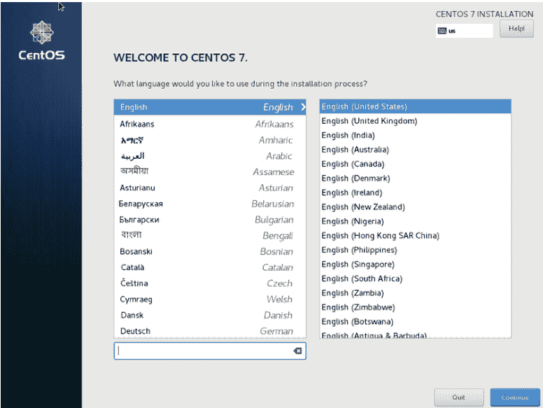

从菜单中选择语言后，Linux 安装脚本会自动为该国家和语言适当设置本地化环境变量，以包含表示所需字符所需的字符集。通常，这就是您需要做的全部操作，以使 Linux 系统能在您的语言环境中正确运行。

## 更改您的语言环境

在已安装 Linux 操作系统后，您仍可更改系统使用的本地化值。有两种方法可供您这样做。您可以手动设置 LC_ 环境变量，也可以使用 localectl 命令。

### 手动更改环境变量

对于手动方法，请使用 export 命令更改各个 LC_ 本地化环境变量，就像更改任何其他环境变量一样：

```
$ export LC_MONETARY=en_GB.UTF-8
```

这种方法更改单个设置效果不错，但如果要更改整个系统的本地化，这样做会很繁琐。

与逐个更改所有 LC_ 环境变量不同，LANG 环境变量在一个位置控制它们全部：

```
$ export LANG=en_GB.UTF-8
$ locale
LANG=en_GB.UTF-8
LC_CTYPE="en_GB.UTF-8"
LC_NUMERIC="en_GB.UTF-8"
LC_TIME="en_GB.UTF-8"
LC_COLLATE="en_GB.UTF-8"
LC_MONETARY="en_GB.UTF-8"
LC_MESSAGES="en_GB.UTF-8"
LC_PAPER="en_GB.UTF-8"
LC_NAME="en_GB.UTF-8"
LC_ADDRESS="en_GB.UTF-8"
LC_TELEPHONE="en_GB.UTF-8"
LC_MEASUREMENT="en_GB.UTF-8"
LC_IDENTIFICATION="en_GB.UTF-8"
LC_ALL=
$
```

某些 Linux 系统还要求您设置 LC_ALL 环境变量，因此通常最好连同 LANG 环境变量一起设置它。

此方法更改当前登录会话的本地化。如果需要永久更改本地化，则需要将 export 命令添加到 $HOME 文件夹中的 .bashrc 文件，以便每次登录时都运行。

## localectl 命令

如果您使用的是利用 systemd 实用程序集的 Linux 发行版，则可以使用 localectl 命令。默认情况下，localectl 命令仅显示当前本地化设置：

```
$ localectl
  System Locale: LANG=en_US.UTF-8
      VC Keymap: us
      X11 Layout: us
$
```

它不仅显示 LANG 环境变量设置，还显示键盘布局映射以及 X11 图形环境布局。

localectl 命令支持许多选项，但最常用的是使用 list-locales 选项列出系统上安装的所有语言环境，并使用 set-locale 选项更改本地化：

```
$ localectl set-locale LANG=en_GB.utf8
```

这为更改整个 Linux 系统的本地化设置提供了一种简单方法。

如果您只需要将使用一种字符集存储的文件转换为另一种字符集，请使用方便的 iconv 命令行工具。

## 查看时间

与 Linux 系统关联的日期和时间对系统的正常运行至关重要。Linux 使用日期和时间来跟踪运行中的进程、知道何时启动或停止作业，以及记录发生的重要事件。将您的 Linux 系统与您所在位置的正确时间和日期同步是必不可少的。

Linux 将时间分为两部分：与系统位置关联的时区以及该时区内的实际时间和日期。本节将介绍如何更改这两个值。

## 使用时区

时间的最重要方面之一是时区。每个国家选择一个或多个时区，或相对于标准协调世界时（UTC）的偏移量，以确定该国的时间。如果您的 Linux 环境包括位于不同时区的服务器，则了解如何设置正确的时区至关重要。

大多数基于 Debian 的 Linux 系统在 /etc/timezone 文件中定义本地时区，而大多数基于 Red Hat 的 Linux 系统使用 /etc/localtime。这些文件不是文本格式，因此您无法直接编辑 /etc/timezone 或 /etc/localtime 文件来查看或更改时区。相反，您必须复制存储在 /usr/share/zoneinfo 文件夹中的模板文件。

要确定 Linux 系统的当前时区设置，请使用不带任何选项的 date 命令：

```
$ date
Fri Aug  2 05:52:29 EDT 2019
$
```

时区以标准的三字母代码形式出现在日期和时间显示的末尾，年份之前。

要更改 Linux 系统的时区，请从 `/usr/share/zoneinfo` 文件夹复制或链接适当的时区模板文件到 `/etc/timezone` 或 `/etc/localtime` 位置。`/usr/share/zoneinfo` 文件夹按位置划分为子文件夹。每个位置文件夹还可细分为更详细的位置文件夹。最终，您会看到与特定时区关联的时区模板文件，例如 `/usr/share/zoneinfo/US/Eastern`。

> 如果您不知道时区的正式名称，请从命令提示符运行 `tzselect` 命令。它会根据对几个位置问题的回答来确定您的时区值。

在复制新时区文件之前，您需要删除原始时区或 `localtime` 文件：

```
$ sudo mv /etc/localtime /etc/localtime.bak
$ sudo ln -s /usr/share/zoneinfo/US/Pacific /etc/localtime

$ date
Fri Aug  2 02:55:28 PDT 2019
$
```

新时区会出现在 date 命令的输出中。

> 如果您只需为单个会话或程序更改时区，而非更改系统时区，可以使用 TZ 环境变量设置时区。这会替换当前会话的系统时区。

## 设置时间和日期

为 Linux 系统配置正确的时区后，您可以着手设置正确的时间和日期值。有几个不同的命令可用于此目的。

### 旧版命令

所有 Linux 发行版中都应该可以找到两个用于处理时间和日期值的旧版命令：

- `hwclock`: 显示或设置工作站或服务器上内部 BIOS 或 UEFI 时钟保持的时间
- `date`: 显示或设置 Linux 系统保持的日期

`hwclock` 命令可访问运行 Linux 系统的物理工作站或服务器上内置的硬件时钟。您可以使用 `hwclock` 命令将系统时间和日期设置为物理工作站或服务器上的硬件时钟。它还允许您更改硬件时钟以匹配 Linux 系统上的时间和日期。

date 命令是时间和日期命令的瑞士军刀。它允许您以多种格式显示时间和日期，并让您设置时间和/或日期。+ 选项允许您通过定义命令序列来指定用于显示时间或日期值的格式：

```
$ date +"%A, %B %d %Y"
Friday, August 02 2019
$
```

**表 6.8** 日期格式命令序列

| 序列 | 说明 |
| --- | --- |
| %a | 缩写的星期几名称 |
| %A | 星期几的全称 |
| %b | 缩写的月份名称 |
| %B | 月份的全称 |
| %c | 日期和时间 |
| %C | 世纪（例如，20） |
| %d | 月份的数字日期 |
| %D | 完整的数字日期 |
| %e | 月份的日期，空格填充 |
| %F | SQL 格式的完整日期（YYYY-MM-dd） |
| %g | ISO 周编号年份的最后两位数字 |
| %G | ISO 周编号的年份 |
| %h | %b 的别名 |
| %H | 24 小时格式的小时 |
| %l | 12 小时格式的小时 |
| %j | 年份的数字日期 |
| %k | 24 小时格式的小时，空格填充 |
| %l | 12 小时格式的小时，空格填充 |
| %m | 数字月份 |
| %M | 分钟 |
| %n | 换行符 |
| %N | 纳秒 |
| %p | AM 或 PM |
| %P | 小写 am 或 pm |
| %r | 完整的 12 小时钟时间 |
| %R | 完整的 24 小时小时和分钟 |
| %s | 自 1970-01-01 00:00:00 UTC 以来的秒数 |
| %S | 秒 |
| %t | 制表符 |
| %T | 小时:分钟:秒格式的完整时间 |
| %u | 数字星期几；1 是星期一 |
| %U | 年份的数字周编号，从星期日开始 |
| %V | ISO 周编号 |
| %w | 数字星期几；0 是星期日 |
| %W | 年份的周编号，从星期一开始 |
| %x | 语言环境的日期表示形式，为月/日/年或日/月/年 |
| %X | 语言环境的完整时间表示形式 |
| %y | 年份的最后两位数字 |


表 6.8 日期格式命令序列（续）

| 序列 | 描述 |
|---|---|
| %Y | 完整年份 |
| %z | +hhmm 格式的时区 |
| %:z | +hh:mm 格式的时区 |
| %::z | +hh:mm:ss 格式的时区 |
| %:::z | 必要精度下带冒号的数字时区 |
| %Z | 字母时区缩写 |

如表 6.8 所示，date 命令为你在程序和 shell 脚本中显示时间和日期提供了多种方式。
你也可以通过指定格式中的值来使用 date 命令设置时间和日期：

```
date MMDDhhmm[[CC]YY][.ss]
```

月份、日期、小时和分钟的值是必需的，年份和秒数默认，或者如果你愿意，也可以包含年份和秒数。

### timedatectl 命令

如果你的 Linux 发行版使用 systemd 工具集（参见第 6 章），你可以使用 timedatectl 命令来管理系统上的时间和日期设置：

```
$ timedatectl
      Local time: Fri 2019-08-02 06:00:20 EDT
      Universal time: Fri 2019-08-02 10:00:20 UTC
            RTC time: Fri 2019-08-02 10:00:19
        Time zone: US/Eastern (EDT, -0400)
System clock synchronized: no
              systemd-timesyncd.service active: yes
                    RTC in local TZ: no
$
```

timedatectl 命令为所有时间信息提供一站式服务，包括硬件时钟（称为 RTC）、日期信息和时区信息。

你也可以使用 timedatectl 命令的 set-time 选项修改这些设置中的任何一项：

```
$ sudo timedatectl set-time "2019-08-02 06:15:00"
```

你也可以使用 timedatectl 命令同步工作站或服务器的硬件时钟和 Linux 系统时间。


大多数连接到互联网的 Linux 系统使用网络时间协议（NTP）来使时间和日期与集中式时间服务器保持同步。如果你的 Linux 系统这样做，你将无法使用 date 或 timedatectl 命令更改时间或日期。

### 配置打印

就像 Linux 中的视频环境一样，Linux 中的打印可能有些复杂。由于有各种各样的打印机可用，尝试安装正确的打印机驱动程序并使用正确的打印机协议与它们通信可能是一场噩梦。

幸运的是，*通用 Unix 打印系统* _(CUPS)_ 为我们解决了其中许多问题。CUPS 为在 Linux 系统上使用任何类型的打印机提供了一个通用接口。它使用 PostScript 文档格式接受打印作业，并使用*打印队列*系统将其发送到打印机。

打印队列是用于存放待打印文件的暂存区域。打印队列通常配置为不仅支持特定的打印机，还支持特定的打印格式，例如横向或纵向模式、单面或双面打印，甚至彩色或黑白打印。可以将多个打印队列分配给单个打印机，或者有多个打印机可以接受分配给单个打印队列的作业。

CUPS 软件使用 Ghostscript 程序将 PostScript 文档转换为不同打印机可理解的格式。Ghostscript 程序需要为不同的打印机类型提供不同的驱动程序，以了解如何转换文档以便在该类型打印机上打印。这是通过配置文件和驱动程序完成的。幸运的是，CUPS 为市场上常见的打印机安装了许多不同的驱动程序，并自动设置使用它们所需的配置要求。配置文件存储在 /etc/cups 目录中。

要在 Linux 系统上定义新打印机，可以使用 CUPS Web 界面。打开浏览器并导航到 http://localhost:631/。图 6.13 显示了 CUPS 使用的 Web 界面。

CUPS Web 界面允许你定义新打印机、修改现有打印机，并查看发送到每个打印机的打印作业状态。CUPS 不仅能识别直接连接的打印机，你还可以使用多种标准网络打印协议配置网络打印机，例如 Internet 打印协议（IPP）或 Microsoft 服务器消息块（SMB）协议。

图 6.13 CUPS 主 Web 页面

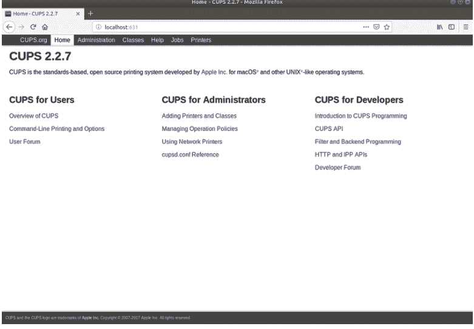

除了 CUPS Web 界面外，还有几个命令行工具可用于与打印机和打印队列交互：

- cancel：取消打印请求
- cupsaccept：启用打印请求排队
- cupsdisable：禁用指定的打印机
- cupsenable：启用指定的打印机
- cupsreject：拒绝打印请求排队

除了标准 CUPS 命令行命令外，CUPS 还接受来自旧版 BSD 命令行打印实用程序的命令：

- lpc：启动、停止或暂停打印队列
- lpq：显示打印队列状态，以及队列中等待的任何打印作业
- lpr：向打印队列提交新打印作业
- lprm：从打印队列中删除特定打印作业

如果你正在使用命令行，可以检查任何打印队列的状态并提交打印作业，如清单 6.4 所示。

清单 6.4：在 Linux 命令行中打印

```
$ lpq -P EPSON_ET_3750_Series
EPSON_ET_3750_Series is ready
no entries
$ lpr -P EPSON_ET_3750_Series test.txt
$ lpq -P EPSON_ET_3750_Series
EPSON_ET_3750_Series is ready and printing
Rank   Owner   Job   File(s)              Total Size
active rich   1     test.txt               1024 bytes
$
```

清单 6.4 的第一行使用 lpq 命令检查打印队列的状态，显示打印机已准备好接受新作业，且打印队列中当前没有任何作业。lpr 命令提交一个新打印作业以打印文件。提交新打印作业后，lpq 命令显示打印机当前正在打印，并显示正在打印的打印作业。

## 摘要

为你自己和系统用户创建、管理和故障排除 GUI 环境涉及一组重要的技能。你需要了解不同的桌面环境、它们的支持框架，以及如何安全可靠地通过网络传输它们。

各种桌面环境，例如 GNOME Shell、KDE Plasma、MATE、Cinnamon 和 Xfce，提供了多种环境以满足不同的需求和品味。当前正在发展的显示服务器世界（主要包括 Wayland 和较老的 X.Org）支持这些 GUI 桌面。

Linux 提供带有多种辅助功能的 GUI 桌面环境，可满足大多数 UI 需求。各种键盘和鼠标设置可帮助有手或手指困难的人。还有许多面向视障人士的实用程序，包括屏幕阅读器和缩放功能。

通过网络访问 GUI 是通过使用远程桌面软件来实现的。VNC、Xrdp 和 NX 是几个示例。Spice 的独特之处在于其主要重点是为虚拟机提供远程桌面访问。

Linux 系统通过整合不同的字符集来支持多种不同的语言。字符集定义了 Linux 系统如何显示和使用语言中包含的字符。虽然 Linux 支持许多不同的字符集，但最常见的有 ASCII、ISO-8859、Unicode、UTF-8 和 UTF-16。ASCII 字符集仅对英语字符有用，而 UTF-8 和 UTF-16 字符集通常用于支持其他语言。

Linux 系统将字符集配置维护为一组以 `LC_` 开头的环境变量。locale 命令显示所有本地化环境变量。每个单独的 `LC_` 环境变量代表一类其他环境变量，这些变量进一步精细化本地化设置。你可以通过在 locale 命令中包含 -ck 选项来显示这些环境变量设置。

你必须为 Linux 系统定义时区。基于 Debian 的 Linux 发行版使用 /etc/timezone 文件来确定系统时区，而基于 Red Hat 的 Linux 发行版使用 /etc/localtime 文件。这两个文件都使用二进制格式，因此你无法直接编辑它们。Linux 在 /usr/share/zoneinfo 文件夹中维护一个时区文件库。只需从 /usr/share/zoneinfo 文件夹将适当的时区文件复制或链接到你的 Linux 系统的时区文件即可。

CUPS 软件为应用程序向本地和网络打印机发送文档提供了标准方法。CUPS 提供了一个基于 Web 的界面，以便轻松添加、删除和修改打印机，包括本地和网络打印机。它还提供了一些命令行实用程序，并支持一些用于使用打印机的旧版命令行实用程序。

## 考试要点

**概述各个 GUI 部分和功能。** 桌面环境为 GUI 提供了预定义的外观和手感。它具有图形部分，例如收藏夹栏、启动区域、菜单、面板和系统托盘。GUI 还具有典型功能，如桌面设置、显示管理器、文件管理器、用于访问程序的图标、小部件和窗口管理器。

**描述各个 GUI 桌面环境。** 当前 Linux 发行版使用的主要桌面环境包括 GNOME Shell、KDE Plasma、MATE 和 Xfce。

**总结可用的通用访问实用程序。** 各种辅助工具位于菜单或面板中。这些面板位于桌面环境的各个位置，名称如通用访问、辅助功能和辅助技术。最好使用桌面环境的搜索功能来定位它们。面向视障用户的各种访问工具包括光标闪烁、光标大小、对比度修改、文本大小放大、声音键、缩放功能和屏幕阅读器。对于需要使用盲文技术的个人，可使用 brltty 软件。对于听障人士，可以将显示的窗口设置为闪烁，而不是提供声音提醒。当有人在使用键盘方面有困难时，有许多可用设置，例如弹跳键、重复键、屏幕键盘、慢速键和粘滞键。对于鼠标使用困难，可探索的工具包括双击延迟、手势、悬停单击、鼠标键和模拟次要单击。


### 解释显示服务器的作用。
显示服务器是一种程序或程序组，使用通信协议在图形用户界面和操作系统之间传递信息。该通信协议称为显示服务器协议，并可通过网络运行。与显示服务器一起使用的关键程序之一是合成器。合成器在窗口内排列显示元素以创建屏幕图像。两个重要的显示服务器是Wayland和X.Org。X.Org是一种存在已久的旧显示服务器。Wayland是一种较新的显示服务器，增加了许多所需的安全功能，并且更易于维护。

### 描述可用的远程桌面软件。
远程桌面软件通过网络从远程服务器提供功能齐全的桌面环境。它采用客户端/服务器模型，可供选择的软件包有几种。它们包括VNC、Xrdp、NX和Spice。

### 描述Linux如何处理不同语言。
Linux使用字符集来存储和显示语言字符。ASCII、Unicode和UTF-8是Linux中最常用的字符集。

### 解释如何更改Linux系统上的当前字符集。
可以使用export命令更改LANG或LC_ALL环境变量，以定义新的字符集。如果Linux发行版使用systemd实用程序，也可以使用localectl命令显示或更改系统字符集。

### 描述如何在Linux系统上设置时区。
Linux中时区由/usr/share/zoneinfo文件夹中的单独文件定义。基于Debian的Linux发行版将相应的时区文件复制到/etc/timezone文件，而基于Red Hat的Linux发行版使用/etc/localtime文件。要更改单个脚本或程序的时区，请使用TZ环境变量。

### 总结在Linux系统上处理时间和日期的可用工具。
hwclock命令允许将Linux系统时间与系统上的硬件时钟同步，或者反之。date命令允许以多种格式显示时间和日期，或设置当前时间和日期。timedatectl命令来自systemd实用程序，它允许您显示关于系统和硬件时间与日期的大量不同信息，并允许您设置它们。

### 解释Linux如何处理打印机以及如何配置Linux系统以访问网络打印机。
Linux使用CUPS软件包来处理所有打印任务。CUPS提供基于Web的界面，允许管理员添加、删除和修改Linux系统上的本地和网络打印机。如果需要，CUPS还提供几个用于从命令行处理打印机的实用程序。

## 复习问题

您可以在附录中找到答案。

1. 下列哪项最能描述桌面环境？
- A. 一组允许用户通过图标、窗口和各种其他可视元素与系统交互的程序
- B. 选择用户名并输入密码以获得系统访问权限的屏幕
- C. 一系列协同工作以为用户界面提供图形环境的组件
- D. 允许您图形化地执行文件维护活动的程序
- E. 一组决定桌面上窗口显示方式的程序

2. 下列哪些是GUI组件？（多选）
- A. 收藏夹栏
- B. 文件管理器
- C. 图标
- D. 命令行
- E. 系统托盘

3. 下列哪项在GNOME Shell中默认不使用？
- A. KDM
- B. Files
- C. Mutter
- D. GDM
- E. Doc

4. 下列哪项是KDE Plasma文件管理器？
- A. Nautilus
- B. Plasmoid
- C. Dolphin
- D. Kwin
- E. Nemo

5. 下列哪项描述了声音键辅助功能设置？
- A. 当大写锁定或数字锁定键打开或关闭时会发出声音。
- B. 大声读取GUI的程序，例如Orca。
- C. 修改光标闪烁速率，以便更容易在屏幕上找到光标。
- D. 输出到由Orca屏幕阅读器提供的可刷新盲文显示器。
- E. 屏幕或屏幕部分被放大到不同的放大级别。

6. 一位在Linux服务器上编程的盲人同事突然发现他的盲文显示设备出现奇怪的问题。您确定需要重新启动盲文服务。假设相应的systemd单元文件可用，您将使用哪个命令？
- A. systemctl restart braille
- B. systemctl reload braille
- C. systemctl restart brailled
- D. systemctl restart brltty
- E. systemctl reload brltty

7. 下列哪项最能描述慢键辅助功能设置？
- A. 修改按键必须按下多长时间才能确认按键的键盘选项
- B. 将键盘修饰键（如Ctrl和Shift）设置为在按下后续键之前保持按下状态的键盘选项
- C. 修改按键必须按下的时间长度以及确认按键重复的延迟的键盘选项
- D. 设置主要键与鼠标单击一起按下以模拟次要鼠标单击的键盘选项
- E. 在UI上显示可视键盘的键盘选项，该键盘可以由鼠标或其他指针设备操作以模拟按键

8. 下列哪项与Linux操作系统通信以传输UI的需求？
- A. 窗口管理器
- B. 显示管理器
- C. 桌面环境
- D. Windows server
- E. 显示服务器

9. 关于Wayland，下列哪项是正确的？（多选）
- A. 目前，X11比Wayland更安全。
- B. Wayland使用$WAYLAND_DISPLAY环境变量。
- C. Wayland的唯一合成器是Weston。
- D. XWayland支持传统X11程序。
- E. 将WaylandDisable设置为true以在GNOME Shell中禁用Wayland。

10. 下列哪个命令可帮助您确定显示服务器是Wayland还是X11？
- A. $WAYLAND_DISPLAY
- B. echo $AccessX
- C. loginctl
- D. echo $X11
- E. runlevel

11. 关于X11，下列哪项是正确的？（多选）
- A. XFree86是主导的X服务器。
- B. X.Org基金会开发X服务器。
- C. X服务器正被Wayland取代。
- D. X11意味着用户可以有11个会话。
- E. X是X Window System的缩写。

12. 您的系统正在运行X显示服务器，用户的图形用户界面运行不正常。您可以首先使用以下哪些命令来诊断潜在问题？（多选）
- A. xwininfo
- B. Xorg -configure
- C. xcpyinfo
- D. xdpyinfo
- E. loginctl

13. 下列哪些是远程桌面？（多选）
- A. Spice
- B. NX
- C. Xrdp
- D. VNC
- E. Caja

14. 下列哪些是通常与虚拟机一起使用的远程桌面？（多选）
- A. Spice
- B. NX
- C. Xrdp
- D. VNC
- E. 以上全部

15. Xrdp采用以下哪种协议？
- A. 远程帧缓冲区协议
- B. Wayland协议
- C. NX技术协议
- D. Simple Protocol for ICes
- E. 远程桌面协议

16. 您（用户名Samantha）已登录到一台运行Linux GNOME Classic桌面环境的笔记本电脑（IP地址192.168.0.42），位于A楼公司办公桌。C楼的一台机架式Linux系统（IP地址192.168.0.7）上发生了问题。您需要安全地访问远程系统上使用X11的GUI应用程序。应该使用什么命令？
- A. ssh -Y Samantha@192.168.0.7
- B. ssh -X Samantha@192.168.0.7
- C. ssh -Y Samantha@192.168.0.42
- D. ssh -X Samantha@192.168.0.42
- E. ssh -L Samantha@192.168.0.42

17. 哪种字符集使用3字节代码并可以表示世界上大多数语言使用的字符？
- A. ASCII
- B. LC_ALL
- C. UTF-8
- D. UTF-16
- E. Unicode

18. 哪个Linux命令显示所有本地化环境变量及其值？
- A. date
- B. time
- C. hwclock
- D. LANG
- E. locale

19. 哪两个环境变量控制所有本地化设置？
- A. LC_MONETARY
- B. LC_NUMERIC
- C. LANG
- D. LC_CTYPE
- E. LC_ALL

20. 哪个CUPS命令行命令允许您停止向队列发送打印作业？
- A. cancel
- B. cupsaccept
- C. cupsenable
- D. cupsreject
- E. lpq


## 第 7 章

## 管理系统

## 目标

- 107.1 管理用户和组账户以及相关系统文件
- 108.1 维护系统时间
- 108.2 系统日志
- 108.3 邮件传输代理（MTA）基础


系统管理的目标之一是确保你所负责的所有服务器都运行高效。管理用户账户、电子邮件、日志文件和系统时间都是该过程涉及的任务。

在本章中，我们将深入探讨创建、修改和删除用户账户及组的细节。我们还将探讨在故障排除以及使用系统电子邮件时有帮助的电子邮件实用程序和概念。用于排除问题和保持对安全性的密切关注的日志文件也将介绍。最后，我们将查看如何正确维护系统的时间以及可以用于此目的的各种服务。

### 管理用户和组

如果你想购买一件著名且昂贵的艺术品，你应该确保它不是赝品。换句话说，你希望确保它是真品。允许用户访问计算机系统也是如此。你希望确保他们是已获得事先授权访问系统的真实用户。这个过程称为 _身份验证_，传统上定义为确定一个人或程序是否是他们声称的那样。

除了用户身份验证，你还需要知道如何检查用户对文件的访问权限、管理组成员身份和更改密码。这些功能是相互关联的。本节介绍了管理 Linux 用于检查用户凭据，并允许或拒绝访问系统及其文件的访问控制。

### 了解用户和组

用户账户及其底层框架是凭据管理和访问控制的核心。这些账户是 Linux 自主访问控制（DAC）的一部分。DAC 是传统的 Linux 安全控制，其中对文件或任何对象的访问基于用户的身份和当前组成员身份。

组是 DAC 的一部分的组织结构。创建用户账户时，它会被赋予特定组的成员身份，称为账户的默认组。尽管用户账户可以有许多组成员身份，但其进程在任何给定时间只能有一个指定的当前组。默认组是用户首次登录系统时的账户当前组。

### 配置用户账户

添加和修改用户账户凭据（包括用户名、账户信息和密码）是系统管理的重要（但繁琐）部分。此外，你还需要知道在必要时如何删除这些凭据。

在系统上添加新用户账户时，通常使用 `useradd` 实用程序。但是，该过程涉及 `useradd` 命令以外的参与者。该过程的图示如图 7.1 所示。

**图 7.1** 添加用户账户的过程

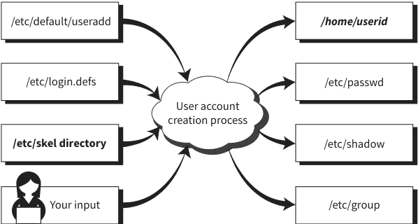

你可以在图 7.1 中看到，多个参与者参与了账户创建过程。请注意，`/etc/skel` 目录已加粗。这是因为，取决于其他配置文件，它在过程中可能不被使用。`/home/userid` 目录也是如此。它可能不会被创建，或者可能有替代名称，这取决于系统的账户创建配置。你将很快了解更多关于这些目录的信息。

在深入了解 `useradd` 实用程序的详细信息之前，让我们先看看创建过程涉及的两个文件和目录。

### /etc/login.defs 文件

大多数 Linux 发行版默认安装了 `/etc/login.defs` 配置文件。它包含用于各种影子密码套件命令的指令。影子密码套件是处理账户凭据的命令的统称，例如 `useradd`、`userdel` 和 `passwd` 命令。

此配置文件中的指令控制密码长度、用户需要更改账户密码的时间、是否默认创建主目录等等。该文件通常包含注释和已注释的指令（这使指令无效）。列表 7.1 显示了 CentOS 发行版中 `/etc/login.defs` 文件内仅包含的活动指令，已去除空行和注释行。

### 列表 7.1：/etc/login.defs 配置文件中的活动指令

```
$ grep -v ^\$ /etc/login.defs | grep -v ^\#
MAIL_DIR		/var/spool/mail
PASS_MAX_DAYS	99999
PASS_MIN_DAYS	0
PASS_MIN_LEN	5
PASS_WARN_AGE	7
UID_MIN			1000
UID_MAX			60000
SYS_UID_MIN		201
SYS_UID_MAX		999
GID_MIN			1000
GID_MAX			60000
SYS_GID_MIN		201
SYS_GID_MAX		999
CREATE_HOME	yes
UMASK		077
USERGROUPS_ENAB	yes
ENCRYPT_METHOD	SHA512
$
```

请注意列表 7.1 中的 UID_MIN 指令。用户 ID（UID）是 Linux 用于标识用户账户的数字。用户账户（有时称为普通账户）是授权人类持有适当凭据以访问系统并执行日常任务的任何账户。虽然人类使用账户名，但 Linux 使用 UID。UID_MIN 指示用户账户允许的最低 UID。在列表 7.1 的系统中，UID_MIN 设置为 1000。这是典型的，尽管有些系统将其设置为 500。

系统账户是提供服务（守护进程）或执行特殊任务的账户，例如 root 用户账户。系统账户的最小 UID 由 SYS_UID_MIN 设置，其最大值由 SYS_UID_MAX 指令设置。此文件中的设置是典型的，但请记住，这些设置适用于初始 Linux 发行版安装后创建的账户。

表 7.1 介绍了常见用户账户创建中一些其他关键指令。

### 表 7.1 /etc/login.defs 中的一些重要指令

| Name | Description |
| --- | --- |
| PASS_MAX_DAYS | 要求更改密码之前的天数。这是密码的过期日期。 |
| PASS_MIN_DAYS | 更改密码后，在可以再次更改密码之前的天数。 |
| PASS_MIN_LENGTH | 密码中所需的最少字符数。 |
| PASS_WARN_AGE | 在密码过期之前向用户发出警告的天数。 |
| CREATE_HOME | 默认值为 no。如果设置为 yes，则会创建用户账户主目录。 |
| ENCRYPT_METHOD | 用于哈希账户密码的方法。 |

/etc/login.defs 文件仅用于用户账户创建过程的配置文件之一。下一节将介绍另一个文件。

### /etc/default/useradd 文件

/etc/default/useradd 文件是另一个指导账户创建过程的配置文件。它通常比 /etc/login.defs 文件短得多。CentOS 发行版的示例如列表 7.2 所示。

### 列表 7.2：/etc/default/useradd 配置文件

```
$ cat /etc/default/useradd
# useradd defaults file
GROUP=100
HOME=/home
INACTIVE=-1
EXPIRE=
SHELL=/bin/bash
SKEL=/etc/skel
CREATE_MAIL_SPOOL=yes
$
$ sudo useradd -D
GROUP=100
HOME=/home
INACTIVE=-1
EXPIRE=
SHELL=/bin/bash
SKEL=/etc/skel
CREATE_MAIL_SPOOL=yes
$
```

请注意列表 7.2 中有两种不同的方法可以显示此文件中的活动指令。你可以使用 `cat` 命令，或以超级用户权限调用 `useradd -D` 命令。两者都同样易于使用。关于 `useradd -D` 命令的一个酷事实是，你可以使用它来修改 /etc/default/useradd 文件中的指令。

请注意列表 7.2 中的 HOME 指令。它当前设置为 /home，这意味着任何新创建的用户账户都会将其账户目录位于 /home 目录内。请记住，如果在 /etc/login.defs 文件中未设置 CREATE_HOME 或将其设置为 no，则默认不会创建主目录。

表 7.2 介绍了常见用户账户创建中一些其他关键指令。

### 表 7.2 /etc/default/useradd 中的一些重要指令

| Name | Description |
|---|---|
| HOME | 用户账户目录的基目录。 |
| INACTIVE | 密码过期且未更改后，直到账户被停用的天数。请参见表 7.1 中的 PASS_MAX_DAYS。 |
| SKEL | 骨架目录。 |
| SHELL | 用户账户默认 shell 程序。 |

SHELL 指令需要更多说明。通常它设置为 /bin/bash，这意味着当你访问命令行时，你的用户进程正在运行 /bin/bash shell 程序。此程序在命令行为你提供提示符，并处理你在其中输入的任何命令。

请注意，某些发行版（例如 Ubuntu）默认将 SHELL 指令设置为 /bin/sh，这是指向另一个 shell 的符号链接。在 Ubuntu 中，它链接到 Dash shell 而不是 Bash shell。

### /etc/skel/ 目录

/etc/skel 目录（通常称为骨架目录，参见表 7.2）存放文件。如果为用户创建主目录，则在创建账户时，这些文件将被复制到用户账户的主目录中。列表 7.3 显示了 CentOS 发行版中 /etc/skel 目录内的文件。

### 列表 7.3：/etc/skel 目录中的文件

```
$ ls -a /etc/skel
.  ..  .bash_logout  .bash_profile  .bashrc  .mozilla
$
```


在清单 7.3 中，ls 命令使用了 -a 选项，以便显示隐藏文件（即以点号开头的文件）。请回顾，如果不在 ls 命令中使用 -a 选项，隐藏文件通常不会显示。这些文件既是账户环境文件，也是 Mozilla Firefox 网络浏览器的配置文件目录。我们将在后面第 9 章中介绍环境文件。如果需要，你可以修改这些文件中的任何一个，或添加新的文件和目录。

/etc/skel 文件仅在创建账户时才会被复制到用户账户主目录中。因此，如果你稍后对这些文件进行更改，就需要手动或通过 shell 脚本将这些更改后的文件迁移到当前用户账户中。

既然我们已经介绍了用户账户创建过程中的创建方面的文件，现在让我们来看看作为该过程一部分构建或修改的文件和目录。如有必要，请返回查看图 7.1，以便重新回忆各种文件和目录名称。

## /etc/passwd 文件

账户信息存储在 /etc/passwd 文件中。每个账户的数据在文件中占据一行。创建账户时，会将该账户的新记录添加到 /etc/passwd 文件中。清单 7.4 显示了一个摘录示例。

```
Listing 7.4: Account records in the /etc/passwd file

$ cat /etc/passwd
root:x:0:0:root:/root:/bin/bash
bin:x:1:1:bin:/bin:/sbin/nologin
daemon:x:2:2:daemon:/sbin:/sbin/nologin
[...]
tcpdump:x:72:72::/:/sbin/nologin
user1:x:1000:1000:User One:/home/user1:/bin/bash
Christine:x:1001:1001:Christine B:/home/Christine:/bin/bash
[...]
$
```

/etc/passwd 文件记录包含多个字段。记录中的每个字段均由冒号 (:) 分隔。总共有七个字段，如表 7.3 所述。

## 表 7.3 /etc/passwd 文件的记录字段

| 字段号 | 描述 |
|---|---|
| 1 | 用户账户的用户名。 |
| 2 | 密码字段。通常此文件不再用于存储密码。此字段中的 x 表示密码存储在 /etc/shadow 文件中。 |
| 3 | 用户账户的用户识别号 (UID)。 |
| 4 | 用户账户的组识别号 (GID)。 |
| 5 | 注释字段。此字段为可选。传统上，它包含用户的全名。 |
| 6 | 用户账户的主目录。 |
| 7 | 用户账户的默认 shell。如果设置为 /sbin/nologin 或 /bin/false，则用户无法交互式登录到系统。 |

你可能会认为密码文件会保存密码，但由于其文件权限问题，密码文件可能会被攻破。因此，密码存储在更严格限制访问的 /etc/shadow 文件中。

你可能会发现自己在为一个组织工作，该组织的密码存储在 /etc/passwd 文件中。如果是这种情况，请礼貌地建议通过 pwconv 命令将密码迁移到 /etc/shadow 文件。如果组织拒绝，那就走人，或者更好的做法是，跑着出门，去另一家公司找工作。

你可能已经注意到，在 /etc/passwd 记录中，字段 #7 可能包含 /sbin/nologin 或 /bin/false 默认 shell。这是为了防止账户交互式登录到系统。/sbin/nologin 通常设置为系统服务账户记录。系统服务（守护进程）确实需要拥有系统账户，但它们 *不* 主动登录。相反，它们在后台以自己的账户名称运行。如果恶意人员试图使用该账户交互式登录（并且他们绕过了其他障碍，你很快就会了解到这些障碍），他们会被礼貌地踢出系统。基本上，/sbin/nologin 会显示一条简短消息，并在你到达命令提示符前将你登出。如果需要，你可以通过创建文件 /etc/nologin.txt 并添加所需文本来修改显示的消息。

/bin/false shell 更加粗暴一些。如果将其设置为用户账户的默认 shell，则不会显示任何消息，用户会直接被登出系统。

## /etc/shadow 文件

创建账户时还会更新的另一个文件是 /etc/shadow 文件。它包含关于账户密码的信息，即使你尚未为账户提供密码也是如此。与 /etc/passwd 文件类似，每个账户的数据在文件中占据一行。清单 7.5 显示了一个摘录示例。

## 清单 7.5：/etc/shadow 文件中的账户记录

```
$ sudo cat /etc/shadow
root:!:0:99999:7:::
bin:*:17589:0:99999:7:::
daemon:*:17589:0:99999:7:::
[...]
user1: $6$bvqdqU[...]:17738:0:99999:7:::
Christine: Wb8I8Iw$6[...]:17751:0:99999:7:::
[...]
$
```

/etc/shadow 记录包含多个字段。记录中的每个字段均由冒号 (:) 分隔。总共有九个字段，如表 7.4 所述。

## 表 7.4 /etc/shadow 文件的记录字段

| 字段号 | 描述 |
|---|---|
| 1 | 用户账户的用户名。 |
| 2 | 密码字段。密码是经过加盐和哈希处理的密码。!! 或 ! 表示未为账户设置密码。! 或 * 表示账户无法使用密码登录。密码前面的 ! 表示账户已被锁定。 |
| 3 | 上次密码更改的日期，采用 Unix 纪元时间（天）格式。 |
| 4 | 密码更改后多少天才能再次更改密码。 |
| 5 | 多少天后需要更改密码。这是密码的过期日期。 |
| 6 | 在密码过期（参见字段 #5）之前，向用户发出警告的天数。 |
| 7 | 密码过期（参见字段 #5）后，在未更改密码的情况下，账户将被停用前的天数。 |
| 8 | 账户过期的日期，采用 Unix 纪元时间（天）格式。 |
| 9 | 称为特殊标志。它是一个用于未来特殊用途的字段，当前未使用，且为空白。 |

请注意，字段 #1 是账户的用户名。这是与 /etc/passwd 文件共享的唯一字段。

> Unix 纪元时间，也称为 POSIX 时间，是自 1970 年 1 月 1 日以来的秒数，尽管 /etc/shadow 文件将其表示为天数。它与 Unix 和 Linux 系统有着悠久的历史，并可能在 2038 年引起问题。你不必掏出计算器来确定使用纪元的字段日期。相反，本章后面将介绍的 chage 实用工具会为你完成此操作。

理解各种可能的过期情况至关重要。当密码过期发生时，会有一个宽限期。用户将有若干天（在字段 #7 中指定）可以使用旧密码登录账户，但必须立即更改密码。但是，如果密码已过期且用户未能及时登录系统，则用户将被实际锁定在系统之外。对于账户过期，没有宽限期。账户过期后，用户无法使用其密码登录账户。

> 如果你有临时工人员，例如实习生或外部承包商，使用你的 Linux 系统，请务必设置他们的账户过期时间。这样，如果你忘记在他们不再为你的公司工作后删除账户，他们在过期日期后也无法访问该账户。

你可能已经注意到，我们尚未介绍 /etc/group 文件。它确实会作为账户创建过程的一部分被修改。但是，该讨论留到本章后面的“配置组”部分再介绍。

## 账户创建过程

发行版在用户账户配置方面往往差异很大。因此，在使用 useradd 实用工具创建账户之前，明智的做法是先查看每个发行版用户账户配置文件中的一些指令（参见表 7.1 和 7.2）。在清单 7.6 中，在 CentOS 发行版上检查了 CREATE_HOME 和 SHELL 指令。

## 清单 7.6：在 CentOS 上检查用户账户指令

```
$ grep CREATE_HOME /etc/login.defs
CREATE_HOME        yes
$
$ sudo useradd -D | grep SHELL
SHELL=/bin/bash
$
```


在这个发行版上，您可以看到主目录将默认创建，
因为 CREATE_HOME 设置为 yes。SHELL 指令指向 Bash shell，
/bin/bash，这是大多数交互式用户账户的典型 shell。

用户add命令（如前所述）是大多数发行版上创建用户账户的主要工具。在 CentOS 发行版上使用 useradd 实用程序创建账户的示例如清单 7.7 所示。

### 清单 7.7: 在 CentOS 上创建用户账户

```
$ sudo useradd DAdams
[sudo] password for Christine:
$
$ grep ^DAdams /etc/passwd
DAdams:x:1002:1002::/home/DAdams:/bin/bash
$
$ sudo grep ^DAdams /etc/shadow
DAdams:!!:17806:0:99999:7:::
$
$ sudo ls -a /home/DAdams/
. .. .bash_logout .bash_profile .bashrc .mozilla
$
```

因为我们在清单 7.7 中使用的 CentOS 发行版已将 CREATE_HOME 指令设置为 yes 且 SHELL 设置为 /bin/bash，因此无需使用任何 useradd 命令选项。所需的唯一参数是用户账户名，即 DAdams。在清单 7.7 中使用实用程序创建账户后，请注意，/etc/passwd 和 /etc/shadow 文件中现在都存在新用户账户的记录。此外，已创建新目录 /home/DAdams，其中包含来自 /etc/skel/ 目录的文件。请记住，此时尚未向 DAdams 账户添加密码，因此其在 /etc/shadow 文件中的记录在密码字段显示 !!。

现在让我们来看看在另一个 Linux 发行版上创建账户。Ubuntu Desktop 发行版的做法略有不同。在清单 7.8 中，您可以看到未设置 CREATE_HOME，因此其默认值为 no。

### 清单 7.8: 检查 Ubuntu Desktop 上的用户账户指令

```
$ grep CREATE_HOME /etc/login.defs
$
$ useradd -D | grep SHELL
SHELL=/bin/sh
$
```

同样在清单 7.8 中，请注意 SHELL 指令设置为 /bin/sh 而不是 Bash shell。这意味着创建交互式用户账户时，如果需要，需要指定 Bash shell。

因此，在创建此 Ubuntu 发行版上的用户账户时，如果希望账户具有主目录并使用 Bash shell，则需要使用额外的 useradd 命令开关。useradd 实用程序具有许多适用于各种需求的有用选项；最典型的选项列于表 7.5 中。

### 表 7.5 useradd 命令的常用选项

| 短选项 | 长选项 | 描述 |
| :--- | :--- | :--- |
| -c | --comment | 注释字段内容。传统上包含用户的全名。可选。 |
| -d | --home 或 --home-dir | 用户主目录规范。默认操作由 HOME 和 CREATE_HOME 指令设置。 |
| -D | --defaults | 显示 /etc/default/useradd 指令。 |
| -e | --expiredate | 账户到期日期，格式为 YYYY-MM-DD。默认操作由 EXPIRE 指令设置。 |
| -f | --inactive | 密码过期且未更改后，账户将被停用的天数。-1 表示账户永远不会被停用。默认操作由 INACTIVE 指令设置。 |
| -g | --gid | 账户的组成员身份，在用户登录系统时生效（默认组）。 |
| -G | --groups | 账户的其他组成员身份。 |
| -m | --create-home | 如果不存在，则创建用户账户的主目录。默认操作由 CREATE_HOME 指令设置。 |
| -M | N/A 或 --no-create-home | 不创建用户账户的主目录。默认操作由 CREATE_HOME 指令设置。 |
| -s | --shell | 账户的 shell。默认操作由 SHELL 指令设置。 |
| -u | --uid | 账户的用户标识（UID）编号。 |
| -r | --system | 创建系统账户而非用户账户。 |

我们需要使用表 7.5 中的几个开关来在 Ubuntu Desktop 发行版上创建用户账户。示例如清单 7.9 所示。

### 清单 7.9: 在 Ubuntu Desktop 上创建用户账户

```
$ sudo useradd -md /home/JKirk -s /bin/bash JKirk
[sudo] password for Christine:
$
$ grep ^JKirk /etc/passwd
JKirk:x:1002:1002::/home/JKirk:/bin/bash
$
$ sudo grep ^JKirk /etc/shadow
JKirk:!:17806:0:99999:7:::
$
$ sudo ls -a /home/JKirk/
.  ..  .bash_logout  .bashrc  examples.desktop  .profile
$
$ sudo ls -a /etc/skel
.  ..  .bash_logout  .bashrc  examples.desktop  .profile
$
```

请注意，在清单 7.9 中，与 useradd 命令一起使用了三个选项。因为此系统未设置 CREATE_HOME 指令，所以需要 -m 选项来强制 useradd 为账户创建主目录。-d 开关指定目录名应为 /home/JKirk。由于此系统上的 SHELL 指令设置为 /bin/sh，因此需要 -s 选项将账户的默认 shell 设置为 /bin/bash。

在清单 7.9 中使用实用程序创建账户后，请注意，/etc/passwd 和 /etc/shadow 文件中现在存在新用户账户的记录。此外，已创建新目录 /home/JKirk，其中包含来自此发行版 /etc/skel/ 目录的文件。请记住，此时尚未向 JKirk 账户添加密码，因此其在 /etc/shadow 文件中的记录在密码字段显示 !。


Ubuntu 和 Debian 发行版推荐使用 adduser 程序而非 useradd 实用程序。它们的手册页将 useradd 命令称为“低级实用程序”。其他一些发行版包含指向 useradd 的名为 adduser 的符号链接，这可能有帮助（也可能没有帮助）。adduser 配置信息通常存储在 /etc/adduser.conf 文件中。

查看 /etc/passwd 和 /etc/shadow 文件中账户记录的另一种方法是使用 getent 实用程序。对于此程序，您只需传递文件名，后跟希望查看其记录的账户名。该命令在清单 7.10 中用于查看在清单 7.9 中创建的账户。

### 清单 7.10: 在 Ubuntu Desktop 上使用 getent 查看用户账户

```
$ getent passwd JKirk
JKirk:x:1002:1002::/home/JKirk:/bin/bash
$
$ getent shadow JKirk
$
$ sudo getent shadow JKirk
JKirk:!:17806:0:99999:7:::
$
```

请注意，在清单 7.10 中，当对 shadow 文件使用 getent 时未使用超级用户权限，则不返回任何内容。这是因为 getent 遵守 /etc/shadow 文件上的安全设置。

如果需要修改 /etc/default/useradd 文件的指令设置，可以使用 useradd -D 命令，而无需使用文本编辑器。只需追加所需参数即可。例如，要将 SHELL 指令修改为指向 Bash shell，请使用超级用户权限并发出 useradd -D -s /bin/bash 命令。

创建账户时，可以通过 crypt 实用程序创建密码，然后在通过 useradd 实用程序上的 -p 选项创建账户时添加它。但是，这不仅麻烦，而且被认为是不良做法。在下一节中，我们将介绍如何正确创建和管理账户密码。

## 维护密码

首次创建交互式账户时，应随即使用 passwd 实用程序为该账户创建密码。在清单 7.11 中，CentOS 系统上的新 DAdams 账户创建了密码。

### 清单 7.11: 在 CentOS 上为新账户使用 passwd

```
$ sudo passwd DAdams
Changing password for user DAdams.
New password:
Retype new password:
passwd: all authentication tokens updated successfully.
$
```

您也可以使用 passwd 实用程序并将用户账户名作为参数传递来更新特定用户的密码，类似于清单 7.11 中所示。如果需要更新自己的账户密码，只需输入 passwd，无需其他命令参数。

使用 passwd 实用程序，您不仅可以设置和修改密码，还可以锁定或解锁账户、将账户密码设置为过期、删除账户密码等等。表 7.6 显示了常用的 passwd 开关；所有这些选项都需要超级用户权限。

### 表 7.6 passwd 命令的常用选项

| 短选项 | 长选项 | 描述 |
| :--- | :--- | :--- |
| -d | --delete | 删除账户的密码。 |
| -e | --expire | 将账户密码设置为过期。用户在下次登录时必须更改账户密码。 |
| -i | --inactive | 设置密码过期且未更改后，账户将被停用的天数。 |
| -l | --lock | 在 /etc/shadow 文件中的账户密码前加上感叹号 (!)，从而有效防止用户使用账户密码登录系统。 |
| -n | --minimum | 设置更改密码后，在可以再次更改密码之前的天数。 |
| -S | --status | 显示账户密码状态。 |
| -u | --unlock | 从 /etc/shadow 文件中的账户密码中删除放置的感叹号 (!)。 |
| -w | --warning 或 --warndays | 设置在密码过期前向用户发出警告的天数。 |
| -x | --maximum 或 --maxdays | 设置要求更改密码的天数。这是密码的过期日期。 |

表 7.6 中有一个选项需要更多说明，即 -S 选项。示例如清单 7.12 所示。

### 清单 7.12: 使用 passwd -S 查看账户密码状态

```
$ sudo passwd -S DAdams
DAdams PS 2018-10-01 0 99999 7 -1 (Password set, SHA512 crypt.)
$
```


在清单 7.12 中，显示了 DAdams 账户的密码状态。状态包含账户密码的状态，可能是可用密码 (P)、无密码 (NP) 或锁定密码 (L)。在密码状态之后，显示上次密码更改日期，接着是密码的最小、最大、警告和非活动设置。括号内显示其他状态，其中包括密码是否已设置以及用于保护它的哈希算法。

你也可以使用 chage 实用程序显示类似的密码信息，但采用更易于人类阅读的格式，如清单 7.13 所示。

### 清单 7.13: 使用 chage -l 查看账户的密码状态

```
$ sudo chage -l DAdams
Last password change                                    : Oct 02, 2018
Password expires                                        : never
Password inactive                                       : never
Account expires                                         : never
Minimum number of days between password change          : 0
Maximum number of days between password change          : 99999
Number of days of warning before password expires       : 7
$
```

chage 程序也可以修改密码设置。你可以使用各种命令选项（有关详细信息，请参阅其 man 页面），或以交互方式使用 chage 实用程序，如清单 7.14 所示。

### 清单 7.14: 使用 chage 更改账户密码的设置

```
$ sudo chage DAdams
Changing the aging information for DAdams
Enter the new value, or press ENTER for the default

            Minimum Password Age [0]: 5
            Maximum Password Age [99999]: 30
            Last Password Change (YYYY-MM-DD) [2018-10-02]:
            Password Expiration Warning [7]: 15
            Password Inactive [-1]: 3
            Account Expiration Date (YYYY-MM-DD) [-1]:

$
```

请注意，在清单 7.14 中，密码过期警告设置为 15 天。如果你的公司允许两周的假期，这是一个良好的设置。

## 修改账户

用于修改账户的实用程序是 usermod 程序。类似于 passwd 命令，你可以锁定和解锁账户，如清单 7.15 所示。

### 清单 7.15: 使用 usermod 锁定账户

```
$ sudo usermod -L DAdams
$
$ sudo passwd -S DAdams
DAdams LK 2018-10-01 5 30 15 3 (Password locked.)
$
$ sudo getent shadow DAdams
DAdams:!$6$6B/zCaNx[...]:17806:5:30:15:3:::
$
$ sudo usermod -U DAdams
$
$ sudo passwd -S DAdams
DAdams PS 2018-10-01 5 30 15 3 (Password set, SHA512 crypt.)
$
```

请注意，在清单 7.15 中，usermod -L 命令用于锁定 DAdams 账户。passwd -S 命令显示密码状态为 LK，表示已锁定。在清单 7.15 中，截取的 getent 实用程序输出显示，感叹号 (!) 被放置在 DAdams 账户密码前面，这就是导致账户被锁定的原因。随后通过 usermod -U 命令删除锁定，并重新检查状态。你可以通过 usermod 实用程序的开关对用户账户进行许多修改。常用的开关如表 7.7 所示。

### 表 7.7 usermod 命令的常用选项

| 短选项 | 长选项 | 描述 |
|---|---|---|
| -c | --comment | 修改注释字段的内容。 |
| -d | --home | 设置新用户主目录规范。与 -m 选项一起使用，将当前目录的文件移动到新位置。 |
| -e | --expiredate | 修改账户的过期日期。使用 YYYY-MM-DD 格式。 |
| -f | --inactive | 修改密码过期且未更改后，账户将被停用的天数。-1 表示账户永远不会被停用。 |
| -g | --gid | 更改账户的默认组成员身份。 |
| -G | --groups | 更新账户的其他组成员身份。如果仅指定新组成员身份，请使用 -a 选项以避免删除其他组成员身份。 |
| -l | --login | 将账户的用户名修改为指定的用户名。不修改主目录。 |
| -L | --lock | 通过在账户 /etc/shadow 文件记录的密码前面放置感叹号来锁定账户。 |
| -s | --shell | 更改账户的 shell。 |
| -u | --uid | 修改账户的用户识别号 (UID) 号码。 |
| -U | --unlock | 通过从账户 /etc/shadow 文件记录的密码前面删除感叹号来解锁账户。 |

请注意，你可以更改账户的默认组，并提供额外组的成员身份。账户组将在本章后面详细介绍。

usermod 派上用场的情况是，当你创建了一个账户但忘记检查发行版的账户创建配置设置时。清单 7.16 显示了 Ubuntu Desktop 发行版上的一个示例。

### 清单 7.16: 使用 usermod 修改账户

```
$ sudo useradd -md /home/DBowman DBowman
$
$ sudo getent passwd DBowman
DBowman:x:1003:1003::/home/DBowman:/bin/sh
$
$ sudo usermod -s /bin/bash DBowman
$
$ sudo getent passwd DBowman
DBowman:x:1003:1003::/home/DBowman:/bin/bash
$
```

在清单 7.16 中，创建了用户账户 DBowman，但在使用 getent 实用程序检查账户记录时，显示使用的是 /bin/sh shell 而不是 Bash shell。要修复此问题，使用带有 -s 选项的 usermod 命令，将账户的 shell 修改为 /bin/bash shell。

## 删除账户

在 Linux 中删除账户相当简单。userdel 实用程序是此任务的关键工具。最常用的选项是 -r 开关。此选项将删除账户的主目录树及其中的任何文件。清单 7.17 显示了删除账户的示例。

### 清单 7.17: 使用 userdel 删除账户

```
$ sudo ls -a /home/DBowman
.  .. .bash_logout .bashrc examples.desktop .profile
$
$ sudo getent passwd DBowman
DBowman:x:1003:1003::/home/DBowman:/bin/bash
$
$ sudo userdel -r DBowman
userdel: DBowman mail spool (/var/mail/DBowman) not found
$
$ sudo ls -a /home/DBowman
ls: cannot access '/home/DBowman': No such file or directory
$
$ sudo getent passwd DBowman
$
```

清单 7.17 中的前两个命令显示 /home/DBowman 目录存在且其中有文件，并且账户在 /etc/passwd 文件中确实有记录。第三个命令包含 userdel -r 命令，用于删除账户及其主目录。请注意，会生成一条错误消息，指出找不到 /var/mail/DBowman 文件。这不是问题。它只意味着创建账户时未创建此文件。最后，最后两个命令显示 /home/DBowman 目录及其文件已被删除，并且 /etc/passwd 文件不再包含 DBowman 账户的记录。

### 真实世界场景

### 账户删除策略

在系统中删除任何账户之前，请先与雇主的人力资源部门和/或法律部门或法律顾问联系。可能有针对已解雇或退休员工以及离职换工作的个人的文件保留政策。在从系统中删除文件之前，你可能需要先备份文件和/或进行其他类型的文档记录。如果你的雇主没有此类政策，建议制定一项政策。

## 配置组

组通过其名称和组 ID (GID) 来识别。这与用户通过 UID 识别类似，GID 用于 Linux 识别特定组，而人类使用组名称。

如果在创建用户账户时未指定默认组，则会创建一个新组。该新组与用户账户名同名，并分配一个新 GID。要查看账户的默认组，可以使用 getent 命令查看该账户的 /etc/passwd 记录。回想一下，记录中的第四个字段是账户的 GID，即默认组。如果需要回顾各个 /etc/passwd 记录字段，请查看本章前面的表 7.3。清单 7.18 显示了查看 DAdams 账户默认组信息的示例，该账户是在 CentOS 发行版上创建的。

### 清单 7.18: 查看账户的组成员身份

```
$ getent passwd DAdams
DAdams:x:1002:1002::/home/DAdams:/bin/bash
$
$ sudo groups DAdams
DAdams : DAdams
$
$ getent group DAdams
DAdams:x:1002:
$
$ grep 1002 /etc/group
DAdams:x:1002:
$
```

清单 7.18 中的第一个命令显示 DAdams 账户的默认组 GID 为 1002，但未提供组名。groups 命令确实显示了组名，与用户账户名相同，即 DAdams。在创建账户时未指定默认组时，这是典型情况。第三个命令（另一个 getent 命令）显示组 DAdams 确实映射到 GID 1002。第四个命令确认了此信息。

要将用户添加到新组或更改账户的默认组，该组必须已预先存在。此任务通过 groupadd 实用程序完成。组的 GID 将由系统自动设置，但你可以使用 -g 命令选项覆盖此默认行为。创建新组的示例如清单 7.19 所示。

### 清单 7.19: 使用 groupadd 实用程序创建新组

```
$ sudo groupadd -g 1042 Project42
$
$ getent group Project42
Project42:x:1042:
$
$ grep Project42 /etc/group
Project42:x:1042:
$
```


注意，在清单 7.19 中，创建新组需要超级用户权限。
getent 实用程序和 grep 命令用于显示 /etc/group 文件中的新组记录。/etc/group 文件中的字段由冒号 (:) 分隔，如下所示：

- 组名
- 组密码：x 表示如果存在组密码，则存储在 /etc/gshadow 文件中。
- GID
- 组成员：属于该组的用户帐户，用逗号分隔。

Ubuntu 和 Debian 发行版提倡使用 addgroup 程序而非 groupadd 程序。它们认为 groupadd 命令是一个低级实用程序。

新创建的组没有为其创建组密码。然而，/etc/group 文件中 Project42 组记录中的 x 并不能证明这一点。为了确保没有组密码，清单 7.20 中检查了存储组密码的 /etc/gshadow 文件。

## 清单 7.20：检查组密码

```
$ sudo getent gshadow Project42
Project42::!:
$
```

清单 7.20 中的命令显示了 /etc/gshadow 文件中 Project42 组的记录。第二个字段包含一个感叹号 (!)，表示未为该组设置密码。

如果设置了组密码，则允许用户帐户访问其不属于的组。如果使用组密码，则该密码通常在需要访问该组的各个用户之间共享。这是一种不良的安全实践。密码绝不应共享。每个帐户都需要有自己的密码，并且仅应通过组成员身份（而不是组密码）来允许访问组。

创建新组后，可以通过将用户帐户添加到组来设置组成员身份。清单 7.21 展示了使用 usermod 命令执行此操作的示例。

## 清单 7.21：使用 usermod 将帐户添加到组

```
$ sudo groups DAdams
DAdams : DAdams
$
$ sudo usermod -aG Project42 DAdams
$
$ sudo groups DAdams
DAdams : DAdams Project42
$
$ getent group Project42
Project42:x:1042:DAdams
$
```

请注意，清单 7.21 中的 usermod 命令使用了两个选项，-aG。-G 将 DAdams 帐户添加为 Project42 组的成员，但 -a 开关很重要，因为它会保留 DAdams 帐户的任何先前组成员身份。在将 DAdams 帐户添加为 Project42 组成员后，可以在最后两个命令结果中看到，/etc/group 文件中 Project42 的记录已更新。

如果需要修改特定组，groupmod 命令很有帮助。组的 GID 使用 -g 选项修改，而组名使用 -n 开关修改。在清单 7.22 中，修改了 Project42 组的 GID。

## 清单 7.22：使用 groupmod 修改组

```
$ getent group Project42
Project42:x:1042:DAdams
$
$ sudo groupmod -g 1138 Project42
$
$ getent group Project42
Project42:x:1138:DAdams
$
```

请注意，在清单 7.22 中，Project42 组的 GID 已修改为 1138。getent 命令确认 /etc/group 文件已更新。如果 1138 GID 已由另一个组使用，则 groupmod 命令将显示错误消息且不会更改组的 GID。

要删除组，请使用 groupdel 实用程序。清单 7.23 中显示了示例。

## 清单 7.23：使用 groupdel 删除组

```
$ sudo groupdel Project42
$
$ getent group Project42
$
$ sudo groups DAdams
DAdams : DAdams
$
$ sudo find / -gid 1138 2>/dev/null
$
```

请注意，在清单 7.23 中，一旦删除 Project42 组，getent 命令就会显示 Project42 组记录已从 /etc/group 文件中移除。真正不错的是，该已删除组的任何成员的组信息也已更新，如第三个命令所示。

删除组后，有必要在目录系统中搜索可能具有该组访问设置的任何文件。可以使用 find 命令和已删除组的 GID 执行此审计。此任务的示例显示为第四个命令。如果您需要帮助回忆如何使用 find 实用程序，请返回第 4 章，其中最初介绍了该命令。

添加、修改和删除用户帐户和组是基本但重要的技能。保持这些任务顺利运行可以改善用户的 Linux 系统体验，并使您的系统更加安全。

## 管理电子邮件

电子邮件是互联网上最常用的功能之一。无论是创建小型办公室内电子邮件系统，还是创建支持数千用户的 Linux 电子邮件服务器，了解 Linux 系统上的电子邮件服务已成为必需。

## 了解电子邮件

在研究 Linux 中的电子邮件服务器之前，让我们先了解 Linux 如何处理电子邮件。Linux 遵循 Unix 处理电子邮件的方法。Unix 操作系统的主要创新之一是使电子邮件处理软件模块化。

与使用单个庞大程序来处理发送和接收邮件所需的所有部分不同，Linux 使用多个小程序协同工作来处理消息。电子邮件功能被分解为独立的部分，然后分配给系统上运行的独立程序。图 7.2 显示了大多数开源电子邮件软件如何在 Linux 环境中将电子邮件功能模块化。

## 图 7.2 Linux 模块化电子邮件环境

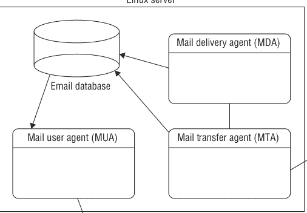

如您所见，Linux 电子邮件服务器通常分为三个独立功能：

- 邮件传输代理 (MTA) 将传入电子邮件（以及正在本地投递的传出电子邮件）发送到邮件投递代理 (MDA) 或本地用户的收件箱。对于正在传输到远程系统的外出消息，该代理会与远程主机上的另一个 MTA 程序建立通信链接以传输电子邮件。

- 邮件投递代理 (MDA) 是一个将消息投递到本地用户收件箱的程序。

- 邮件用户代理 (MUA) 是用户用于读取存储在其邮箱中的消息的界面。MUA 不接收消息；它们仅显示用户邮箱中已有的消息。

这三个功能之间的界线通常比较模糊。某些 Linux 电子邮件软件包将 MTA 和 MDA 功能合并，而其他软件包则合并 MDA 和 MUA 功能。

## 选择电子邮件软件

Linux 世界中广泛使用的三个流行 MTA 软件包是：

**Sendmail** Sendmail MTA 程序最初是 Linux 中最流行的 MTA 程序之一，主要归功于其极高的多功能性。Sendmail 中的几个标准功能已成为电子邮件系统的代名词——消息转发、用户别名和邮件列表。

然而，多功能性带来了复杂性。Sendmail 程序的大型配置文件对于初级邮件管理员来说往往难以应对。大约在 2005 年，几个安全漏洞困扰着 Sendmail，这也导致其受欢迎程度下降。

**Postfix** Wietse Venema（IBM 的安全专家和程序员）编写了 *Postfix* 程序，旨在作为 MTA 软件包的完整替代品。Postfix 是作为模块化程序编写的；它使用几个不同的程序来实现 MTA 功能。

Postfix 的最佳功能之一是其简单性。此外，它比 Sendmail 等 MTA 产品更安全。虽然不如 Exim 灵活，但 Postfix 仍然非常受欢迎。您可以在 www.postfix.org 上了解更多信息。

**Exim** Philip Hazel 于 1995 年为剑桥大学开发了 *Exim* MTA 程序。虽然本质上它是 Sendmail 的即插即用替代品，但配置有很大不同。

Exim 的最佳功能之一是其灵活性。它在大多数 Linux 发行版存储库中可用，并带有合理的默认配置。有关 Exim 的详细信息，请访问 www.exim.org。

## 使用电子邮件

除了了解几个流行的 MTA 程序的名称之外，了解如何使用 MDA 应用程序也很重要。对于管理 Linux 系统的人来说，其他电子邮件管理任务（如查看电子邮件队列和转发电子邮件消息）也是必需的。

## 发送和接收电子邮件

历史上，binmail 程序一直是 Linux 系统上最流行的 MDA 程序。您可能不认识其正式名称，但您可能使用过其系统名称：*mail*。binmail 这个名字来源于它在系统上的典型位置，/bin/mail（或 /usr/bin/mail）。

binmail 程序因其简单性而变得流行。默认情况下，它可以读取存储在 /var/spool/mail/ 目录中的电子邮件消息，或者您可以提供命令行选项来指向用户的 $HOME/mail 文件。binmail 执行其工作不需要配置。

然而，其简单性意味着 binmail 的功能有限。正因为如此，一些邮件管理员一直在寻找替代 MDA 程序，并且它不再在所有 Linux 发行版中默认安装。


如果您想跟随使用 binmail 程序，可能需要在您的 Linux 发行版上安装它。对于 Ubuntu，包名为 bsd-mailx，而对于 CentOS，虽然通常默认安装，但包名为 mailx。软件包安装在第 2 章中介绍。


发送电子邮件时，binmail 程序的基本语法如下：
mail [OPTIONS] recipient...

收件人可以是同一系统上的用户名，也可以是完整的电子邮件地址，例如 jdoe@example.com。您也可以指定多个地址作为收件人。更常用的 OPTIONS 包括：

- -s subject: 为电子邮件添加主题行。如果主题包含空格，则需要将其用引号括起来。
- -cc recipient: 指定接收邮件副本的电子邮件地址或地址。所有电子邮件收件人都可以看到这些地址。
- -bcc recipient: 指定接收邮件副本的电子邮件地址或地址。只有发件人可以看到这些地址。
- -v: 显示电子邮件的投递详细信息

在同一 Linux 系统上向本地用户发送电子邮件的示例在清单 7.24 中所示。

```
Listing 7.24: Using mail to send an email message
$ mail -s "LPIC-1 Book Progress" rich
Hi Rich,
I'm working on Chapter 7 right now.
How's Chapter 8 coming along?
Best regards,
Christine
EOT
$
```

请注意，在清单 7.24 中，主题内容被用引号括起来。如果电子邮件主题行中包含空格，这一点非常重要。由于电子邮件是发送到同一系统上的用户 rich，因此只需要用户名。

输入 mail 命令语法并按 Enter 键后，程序会等待您输入消息，而不会显示任何提示。输入完消息后，您需要向 mail 实用程序发送信号以发送消息。为此，请按 Enter 键，然后按 Ctrl+D 键组合。您将看到 EOT，它代表 "end of transmission"，并返回到 shell 命令行提示符。

> 如果您的系统使用 Postfix 作为其 MTA，并且用户名不是小写，请注意电子邮件可能无法投递。您必须要么将所有用户名设为小写，要么研究与 Postfix 配合使用的各种修复方法，以允许使用大小写混合的用户名。您可以查看 /var/log/maillog 或 /var/log/mail.log 文件，查找有关无法投递电子邮件的消息。

要读取电子邮件，只需输入 mail 命令并按 Enter 键。您将看到电子邮件列表（如果有）及其关联的索引号，并会收到 & 提示符。在提示符处，输入要阅读的电子邮件编号。示例如清单 7.25 所示。

### 清单 7.25: 使用 mail 读取电子邮件

```
$ whoami
rich
$
$ mail
Heirloom Mail version 12.5 7/5/10. Type ? for help.
"/var/spool/mail/rich": 1 message 1 new
>N 1 christine@localhost. Wed May 22 13:04 23/721 "LPIC-1 Book Progress"
& 1
Message 1:
[...]
From: christine@localhost.localdomain
Status: R

Hi Rich,
I'm working on Chapter 7 right now.
How's Chapter 8 coming along?
Best regards,
Christine

& q
Held 1 message in /var/spool/mail/rich
You have mail in /var/spool/mail/rich
$
```

如果要删除电子邮件，请键入 d #，其中 # 是要删除的电子邮件编号。读取和/或删除电子邮件后，在 mail 提示符处键入 q 以退出实用程序。

> 如果您没有任何电子邮件，却尝试使用 mail 程序读取消息，您将收到 "No email for username" 响应。

如果您的电子邮件文件存储在非默认位置，可以告诉 mail 实用程序在哪里查找。只需将 -f DirectoryName/FileName 选项添加到 mail 命令中。

如果您拥有正确的权限并需要读取另一用户的电子邮件，也可以使用 -f 选项及相应参数来指定用户的电子邮件文件位置。如果其他用户的电子邮件文件位于默认位置，则可以改用 -u username 选项及参数。

## 检查电子邮件队列

偶尔会出现问题，导致无法发送外发邮件。您可以通过查看本地邮件队列快速发现此问题。完成此任务有两个命令：mailq 和 sendmail -bp。

为了查看这些命令的实际效果，我们创建了一封因收件人电子邮件地址无效而无法发送的邮件。此错误电子邮件地址会导致消息在本地邮件队列中停留足够长的时间，以便我们查看。该事件如清单 7.26 所示。

### 清单 7.26: 使用 mailq 和 sendmail -bp 查看本地电子邮件队列

```
$ mail -s "Test of Mail Queue" bogususer@example.com
Testing mail queue
EOT
$
$ mailq
-Queue ID- --Size-- ----Arrival Time---- -Sender/Recipient--------
62D301CE55* 474 Wed May 22 14:03:20 christine@localhost.localdomain
bogususer@example.com
-- 0 Kbytes in 1 Request.
$
$ sendmail -bp
-Queue ID- --Size-- ----Arrival Time---- -Sender/Recipient--------
62D301CE55* 474 Wed May 22 14:03:20 christine@localhost.localdomain
bogususer@example.com
-- 0 Kbytes in 1 Request.
$
```

如果邮件队列为空，输入 mailq 或 sendmail -bp 命令后，您将收到以下响应：

邮件队列为空

邮件队列位置因您使用的 MTA 而异。它通常位于 /var/spool/ 目录树中的某个位置。查找带有卡住邮件文件的队列目录的快速方法是使用超级用户权限和 find 命令。在命令行中输入 find /var/spool -name QueueID，其中 QueueID 是 mailq 或 sendmail -bp 命令输出中 Queue ID 列下列出的识别号。获取目录位置后，可以使用 rm 实用程序将其删除。

## 重定向电子邮件

电子邮件别名允许您将电子邮件重定向到不同的收件人。例如，在企业 Web 服务器上，您可以使用别名（例如 hostmaster），而不是列出您的电子邮件地址（同时也会让全世界的黑客都知道您的用户名）。通过别名，您可以配置发送到 hostmaster 的电子邮件转发到您的帐户。

别名不仅用于安全目的，还可用于常见的拼写错误。如果您的用户名比较难拼，例如 bresnahan，您可以为常见的错误拼写（例如 bresan 或 brenanan）设置别名。这样，您就永远不会错过任何电子邮件。

虽然需要使用超级用户权限，但设置电子邮件别名只有两个步骤：

- 1. 将别名添加到 /etc/aliases 文件中。
- 2. 运行 newaliases 命令以更新别名数据库 /etc/aliases.db。

> /etc/aliases.db 是二进制文件。因此，您希望使用新别名编辑文本形式的 /etc/aliases 文件，并运行 newaliases 命令来更新二进制文件。

/etc/aliases 文件中别名记录的格式是

```
ALIAS-NAME: RECIPIENT1[,RECIPIENT2[,...]]
```

为 hostmaster 设置别名的示例如清单 7.27 所示。修改前，发送到 hostmaster 的电子邮件会发送到 root 帐户。修改 /etc/aliases 文件并运行 newaliases 命令后，发送到 hostmaster 的电子邮件现在会发送到两个不同的帐户，christine 和 rich。

### 清单 7.27: 使用 /etc/aliases 和 newaliases 设置电子邮件别名

```
# grep ^hostmaster /etc/aliases
hostmaster:         root
#
# nano /etc/aliases
#
# grep ^hostmaster /etc/aliases
hostmaster:         christine,rich
#
# newaliases
#
```

```
# mail -s "Test of Aliases" hostmaster
Testing the new hostmaster alias
EOT
#
# exit
[...]
$ whoami
christine
$
$ mail
[...]
>N 1 root               Wed May 22 15:10   18/656   "Test of Aliases"
& 1
Message 1:
[...]
To: hostmaster@localhost.localdomain
Subject: Test of Aliases
[...]
From: root@localhost.localdomain (root)
Status: R
Testing the new hostmaster alias
&
```

如清单 7.27 所示，测试别名修改始终是个好主意。这是因为许多管理员在修改 /etc/aliases 文件后忘记运行 newaliases 命令。

虽然别名对安全和常见拼写错误很有用，但当团队成员要休假几周时，转发电子邮件非常方便。

在用户级别设置电子邮件转发。这也只涉及两个步骤：

- 1. 用户在其 $HOME 目录中创建 .forward 文件，并在其中输入应接收转发电子邮件的用户名。
- 2. 对 .forward 文件使用 chmod 命令将权限设置为 644（八进制）。文件权限在第 4 章中介绍过。

为了转发电子邮件，查看设置 .forward 文件的示例很有帮助。清单 7.28 提供了一个示例。


## 列表 7.28：使用 .forward 转发电子邮件

```
$ whoami
christine
$
$ pwd
/home/christine
$
$ echo rich > .forward
$
$ chmod 644 .forward
$
$ mail -s "Testing of Forward" christine
Testing my .forward file
EOT
$
$ mail
[...]
> 1 root       Wed May 22 15:10 19/667   "Test of Aliases"
& q
Held 1 message in /var/spool/mail/christine
$
$ su - rich
Password:
[...]
$ mail
Heirloom Mail version 12.5 7/5/10.  Type ? for help.
"/var/spool/mail/rich": 3 messages 1 new 2 unread
   1 christine@localhost.  Wed May 22 13:04 24/732   "LPIC-1 Book Progress"
 U  2 root            Wed May 22 15:10 19/666   "Test of Aliases"
>N 3 christine@localhost.  Wed May 22 15:39 21/799   "Testing of Forward"
& 3
Message  3:
[...]
Subject: Testing of Forward
[...]
Status: R

Testing my .forward file

& q
Held 3 messages in /var/spool/mail/rich
$
```

创建 `.forward` 文件并设置适当权限后，当发送给 christine 的电子邮件时，它会被转发给 rich 而不是 christine。要停止转发，christine 只需在她的 `$HOME` 目录中删除 `.forward` 文件：

```
$ pwd
/home/christine
$ rm -i .forward
rm: remove regular file '.forward'? y
$
```

> 在引用用户主目录中的文件（如 `.forward` 文件）时，可以用多种方式书写。你可能会看到 `$HOME/.forward`、`~/.forward` 或 `/home/username/.forward`。

## 模拟命令

由于 Sendmail 长期以来一直是流行的 MTA，Postfix MTA 程序希望与其保持兼容。为此，Postfix 实现了一个 `sendmail` 仿真层。这允许某些 Sendmail 命令与 Postfix 程序一起使用。这些命令包括

- mailq
- sendmail -bp
- newaliases
- sendmail -I

我们已介绍前面列表中的所有命令，除了 `sendmail -I`。它的操作方式与 `newaliases` 命令完全相同。

你可以在 www.postfix.org/sendmail.1.html 上了解有关 Sendmail 仿真层的更多信息。

虽然我们只是初步了解了电子邮件管理，但此处涵盖的概念是向正确方向迈出的一大步。你可以使用这些各种工具来协助排查 Linux 电子邮件问题。

## 使用日志和日记文件

在 Linux 系统运行期间会发生许多事情。作为 Linux 管理员，你的一部分工作就是了解正在发生的一切，并留意出错的情况。完成这项任务的主要工具是日志服务。

所有 Linux 发行版都实现了某种 `logging` 方法。日志记录将指示发生了哪些事件以及发生时间等简短消息，发送给用户、文件，甚至远程主机以供存储。如果出现问题，Linux 管理员可以查看日志条目，以帮助确定问题原因。

### 检查 syslog 协议

在 Unix 的早期，一系列不同的日志记录方法跟踪系统和应用程序事件。应用程序使用不同的日志记录方法，这使得系统管理员难以排查问题。

在 20 世纪 80 年代中期，Eric Allman 为其 Sendmail 邮件应用程序定义了一种记录事件的协议，称为 syslog。syslog 协议迅速成为 Unix 中记录系统和应用程序事件的事实标准，并进入了 Linux 世界。

syslog 协议之所以如此流行，是因为它定义了一个标准消息格式，用于指定事件的时间戳、类型、严重性和详细信息。操作系统、应用程序，甚至生成错误的设备都可以使用该标准。

事件类型定义为 facility 值。facility 定义生成事件消息的内容，例如系统资源或应用程序。表 7.8 列出了 syslog 协议中定义的 facility 值。

### 表 7.8 syslog 协议 facility 值

| 代码 | 关键字 | 描述 |
| :--- | :--- | :--- |
| 0 | kern | 由系统内核生成的消息 |
| 1 | user | 由用户事件生成的消息 |
| 2 | mail | 来自邮件应用程序的消息 |
| 3 | daemon | 来自在后台运行的系统应用程序的消息 |
| 4 | auth | 安全或身份验证消息 |
| 5 | syslog | 由日志记录应用程序本身生成的消息 |
| 6 | lpr | 打印机消息 |
| 7 | news | 来自新闻应用程序的消息 |
| 8 | uucp | 来自 Unix 到 Unix 复制程序的消息 |
| 9 | cron | 由 cron 作业调度器生成的消息 |
| 10 | authpriv | 安全或身份验证消息 |

### 表 7.8 syslog 协议 facility 值（续）

| 代码 | 关键字 | 描述 |
| :--- | :--- | :--- |
| 11 | ftp | 文件传输协议应用程序消息 |
| 12 | ntp | 网络时间协议应用程序消息 |
| 13 | security | 日志审核消息 |
| 14 | console | 日志警报消息 |
| 15 | solaris-cron | 另一种调度守护进程消息类型 |
| 16-23 | local0-local7 | 本地定义的消息 |

正如你从表 7.8 中可以看到的那样，syslog 协议涵盖了 Linux 系统中可能出现的许多不同类型的事件。每个事件也标记有一个 *严重性*。*严重性* 值定义消息对系统健康状况的重要性。表 7.9 显示了 syslog 协议中定义的 *严重性* 值。

### 表 7.9 syslog 协议 *严重性* 值

| 代码 | 关键字 | 描述 |
| :--- | :--- | :--- |
| 0 | emerg | 该事件导致系统无法使用 |
| 1 | alert | 需要立即处理的事件 |
| 2 | crit | 关键事件但不需要立即处理 |
| 3 | err | 允许系统或应用程序继续运行的错误条件 |
| 4 | warning | 系统或应用程序中的非正常警告条件 |
| 5 | notice | 正常但重要的条件消息 |
| 6 | info | 来自系统的信息性消息 |
| 7 | debug | 供开发人员使用的调试消息 |

将 facility 和 *严重性* 代码与简短信息性消息相结合，提供了足够的日志记录信息，可用于排查 Linux 中的大多数问题。

## 查看 Linux 日志记录的历史

多年来，Linux 系统出现了许多开源日志记录项目。最突出的项目如下：

- sysklogd：原始 syslog 应用程序，它包含两个程序：syslogd 程序用于监控系统和应用程序事件，klogd 程序用于监控 Linux 内核事件。

- syslog-ng：添加了高级功能，例如消息过滤和将消息发送到远程主机的功能。

- rsyslog：该项目声称“r”代表“rocket fast”（极速）。速度是 rsyslog 项目的关注点，rsyslog 应用程序已迅速成为许多 Linux 发行版的标准日志记录软件包。

- systemd-journal：systemd 应用程序的一部分，用于系统启动和初始化（参见第 5 章），许多 Linux 发行版现在使用它进行日志记录。它不遵循 syslog 协议，而是使用完全不同的方式来报告和存储系统和应用程序事件。

以下各部分将深入介绍两种最流行的日志记录应用程序：rsyslogd 和 systemd-journald。

## 使用 rsyslogd 进行日志记录基础

rsyslogd 应用程序利用原始 syslog 协议的所有功能，包括配置格式和日志记录操作。本节将介绍如何配置 rsyslogd 日志记录应用程序以及查找它生成的常见日志文件的位置。

### 配置 rsyslogd

rsyslogd 程序使用 /etc/rsyslog.conf 配置文件，在某些发行版中，还使用 /etc/rsyslog.d/ 目录中的 *.conf 文件来定义要监听哪些事件以及如何处理它们。配置文件包含定义程序如何处理来自系统、内核或应用程序的 syslog 事件的规则。rsyslog 规则的格式为

```
facility.priority action
```

facility 条目使用标准 syslog 协议 facility 关键字之一。priority 条目使用 syslog 协议中定义的 *严重性* 关键字，但有一点不同。当你定义 *严重性* 时，syslogd 会记录具有该 *严重性* 或更高（较低 *严重性* 代码）的所有事件。因此，条目

```
kern.crit
```


记录所有严重性为 critical、alert 或 emergency 的内核事件消息。要仅记录具有特定严重性的消息，请在优先级关键字之前使用等号：

```
kern.=crit
```

您还可以对功能或优先级使用通配符。以下条目记录所有具有 emergency 严重性级别的事件：

```
*.emerg
```

操作条目定义 rsyslogd 应如何处理接收到的 syslog 消息。共有六种操作选项：

- 转发到常规文件
- 将消息通过管道传输给应用程序
- 在终端或系统控制台上显示消息
- 将消息发送到远程主机
- 将消息发送到用户列表
- 将消息发送给所有登录用户

### 列表 7.29：Ubuntu 18.04 的 rsyslogd.conf 配置条目

```
auth,authpriv.*         /var/log/auth.log
*.*;auth,authpriv.none  -/var/log/syslog
kern.*                  -/var/log/kern.log
mail.*                  -/var/log/mail.log
mail.err                /var/log/mail.err
*.emerg                 :omusrmsg:*
```

列表 7.29 中显示的第一个条目定义了一条规则，用于处理所有 auth 和 authpriv 设施类型的消息。这表明您可以通过逗号分隔来指定多个设施类型。该规则还为优先级使用了通配符，因此会记录所有严重性级别。该规则指示所有安全事件消息将被记录到 /var/log/auth.log 文件。

第二个条目定义了一条规则，用于处理所有事件 (*.*)，但安全事件（.none 优先级）除外。事件消息会发送到 /var/log/syslog 文件。文件名前的减号告诉 rsyslogd 每次写入后不要同步文件，从而提高性能。这种做法的缺点是，如果在下一次正常系统同步之前系统崩溃，您可能会丢失事件消息。

最后一个条目定义了一条规则，用于处理所有 emergency 事件。omusrmsg 命令表示您希望将事件消息发送到系统上的某个用户帐户。当您指定通配符时，该规则会将所有 emergency 事件消息发送到系统上的所有用户。

为了进行比较，列表 7.30 显示了 CentOS 7 系统 rsyslogd 配置文件中的条目。

### 列表 7.30：CentOS 7 的 rsyslog.conf 配置文件

```
*.info;mail.none;authpriv.none;cron.none /var/log/messages
authpriv.* /var/log/secure
mail.* -/var/log/maillog
cron.* /var/log/cron
*.emerg :omusrmsg:*
uucp,news.crit /var/log/spooler
local7.* /var/log/boot.log
```

请注意，基于 Red Hat 的系统使用 /var/log/messages 文件记录信息性消息，使用 /var/log/secure 文件记录安全消息。

## 将日志消息发送到日志服务器

当今许多数据中心中常见的一种服务器是中央日志主机，它接收并存储所有日志客户端系统的日志。使用 rsyslog 应用程序的配置文件，将系统配置为充当日志客户端相当容易。

要将所有日志消息发送到中央日志主机服务器，请编辑 /etc/rsyslogd.conf 配置文件并转到文件末尾。您需要向文件中添加一行，其语法遵循 syslog 协议的标准 facility.priority action。通常，大多数管理员将所有内容发送到远程日志服务器，因此使用 *.*. 来指定 facility.priority。但是，将日志消息发送到远程服务器的操作具有以下特殊语法：

```
TCP/UDP[(z#)]HOST:[PORT#]
```

这种操作语法相当令人困惑，因此让我们逐步讲解：

- TCP/UDP：您可以选择 TCP 或 UDP 协议（在第 8 章中介绍）将日志消息传输到中央日志服务器。UDP 可能会丢失数据，因此如果您的日志消息很重要，应选择 TCP。使用单个 at 符号 (@) 选择 UDP，使用双 at 符号 (@@) 选择 TCP。
- [(z#)]：方括号表示此语法是可选的。z 选择 zlib 在数据遍历网络之前对其进行压缩，# 选择压缩级别，可以是 1（最低压缩）到 9（最高压缩）之间的任意数字。请注意，必须将 z 和数字括在括号内，例如 (z5)。
- HOST：此语法通过完全限定域名（FQDN，例如 example.com）或 IP 地址指定中央日志服务器。如果使用 IPv6 地址，必须将其包含在括号中。
- [PORT#]：方括号表示此语法是可选的。这指定远程中央日志主机上日志服务正在监听传入流量的端口。

举个例子会有所帮助。假设您想将所有日志消息发送到位于 loghost.ivytech.edu 的远程日志主机，并在端口 6514 上监听传入的日志消息 TCP 流量。为了最大限度地减少网络使用，您希望使用最高压缩级别压缩日志消息。在每个客户端系统上，您需要将以下行添加到 /etc/rsyslog.conf 文件的底部：

```
*.* @@(z9)loghost.ivytech.edu:6514
```

做出此修改后，您需要重新加载配置文件或重新启动 rsyslogd 服务，才能开始向活动中央日志服务器传输日志消息。

## 轮转日志文件

不难猜到，对于繁忙的 Linux 系统，生成大型日志文件并不需要太长时间。为了帮助应对这一问题，许多 Linux 发行版安装了 logrotate 实用程序。它会根据时间或文件大小自动将 rsyslogd 日志文件拆分为归档文件。您通常可以通过日志文件名添加的数字扩展名来识别归档日志文件。列表 7.31 给出了 /var/log/btmp 文件的示例（该文件包含登录系统的失败尝试，并使用 lastb 命令显示）。

### 列表 7.31：/var/log/btmp 文件及其轮转版本

```
$ ls /var/log/btmp*
/var/log/btmp   /var/log/btmp-20190501
$
```

logrotate 实用程序不仅仅用于轮转日志文件。它还可以压缩、删除日志文件，并在需要时将日志文件邮件发送到指定帐户。

为确保文件能够及时处理，logrotate 实用程序通常作为 cron 作业每天运行一次（cron 将在第 9 章中介绍）。它使用 /etc/logrotate.conf 配置文件来确定如何管理每个日志文件。列表 7.32 显示了 CentOS 系统上的 logrotate 配置文件。

### 列表 7.32：查看 CentOS 发行版上的 /etc/logrotate.conf 文件

```
$ cat /etc/logrotate.conf
# see "man logrotate" for details
# rotate log files weekly
weekly

# keep 4 weeks worth of backlogs
rotate 4

# create new (empty) log files after rotating old ones
create

# use date as a suffix of the rotated file
dateext

# uncomment this if you want your log files compressed
#compress

# RPM packages drop log rotation information into this directory
include /etc/logrotate.d

# no packages own wtmp and btmp -- we'll rotate them here
/var/log/wtmp {
    monthly
    create 0664 root utmp
        minsize 1M
    rotate 1
}

/var/log/btmp {
    missingok
    monthly
    create 0600 root utmp
    rotate 1
}

# system-specific logs may be also be configured here.
$
```

/etc/logrotate.conf 文件的一个优点是它注释完善（几乎每个 # 后面的项目都是注释），并且相当容易理解。文件的前半部分包含全局指令（设置）。例如，请注意 dateext 选项。该选项指示 logrotate 在归档（轮转）日志文件的名称中使用当前日期，如列表 7.31 所示。如果 *不* 使用 dateext 选项，轮转日志文件将以数字作为文件扩展名，其中最大的数字表示最旧的日志文件：

```
mail.log
mail.log.1
mail.log.2
```

在列表 7.32 的 /etc/logrotate.conf 文件的后半部分中，有针对 /var/log/wtmp 和 /var/log/btmp 日志文件的特定轮转设置。这些选项仅适用于这些特定的日志文件，并会覆盖任何全局设置。

请注意，在列表 7.32 中，非全局设置之前有一行

```
include /etc/logrotate.d
```

此行告诉 logrotate 使用存储在 /etc/logrotate.d/ 目录中的任何配置文件来获取 *额外* 特定日志文件轮转选项。此处的配置文件与它们所管理的日志文件同名，如列表 7.33 所示。


## 清单 7.33: 查看 CentOS 发行版中的 /etc/logrotate.d/ 文件

```
$ ls /etc/logrotate.d/
bootlog glusters libvirtd.qemu psacct syslog
chrony iscsiuiolog numad samba wpa_supplicant
cups libvirtd ppp sshd yum
$
$ cat /etc/logrotate.d/bootlog
/var/log/boot.log
{
missingok
daily
copytruncate
rotate 7
notifempty
}
$
```

请注意，/etc/logrotate.d/boot.log 的内容与 /etc/logrotate.conf 文件中 /var/log/wtmp 和 /var/log/btmp 日志文件的设置类似。各种日志文件的几个更常见的特定 logrotate 指令在表 7.10 中显示。

## 表 7.10 针对特定日志文件的更常见 logrotate 指令

| Directive | Description |
| :--- | :--- |
| hourly | 日志文件按小时轮转。如果启用此设置，logrotate cron 作业的计划通常需要修改。 |
| daily | 日志文件按天轮转。 |
| weekly n | 日志文件按周轮转，在每周的第 n 天轮转，其中 0 等于星期日，1 等于星期一，2 等于星期二，以此类推，6 等于星期六。7 是一个特殊数字，表示日志文件每 7 天轮转一次，无论当前是星期几。 |
| monthly | 日志文件在当前月内首次运行 logrotate 时轮转。 |
| size n | 基于大小而非时间轮转日志文件，其中 n 表示触发轮转的文件大小（n 后面不加任何内容或 k 假设为千字节，M 表示兆字节，G 表示千兆字节）。 |
| rotate n | 被轮转超过 n 次的日志文件将根据其他指令被删除或发送邮件。如果 n 等于 0，轮转的文件将被删除，而不是被轮转。 |
| dateformat format-string | 使用 _格式字符串_ 规范修改 dateext 设置的日期字符串。 |
| missingok | 如果日志文件丢失，不发出错误消息，继续处理下一个日志文件。 |
| notifyempty | 如果日志文件为空，不轮转此日志文件，继续处理下一个日志文件。 |

您可以设置更多指令来精细调整日志文件的轮转。要查看所有各种设置，请在命令行键入 **man logrotate**。

许多发行版在 /var/lib/logrotate/ 目录中维护一个 logrotate 状态文件，这对于故障排除或查看最新的日志轮转很有帮助。在 CentOS 上，文件名为 logrotate.status，在 Ubuntu 上，它是状态文件。

## 制作日志条目

如果您在 Linux 系统上创建并运行脚本（参见第 9 章），您可能希望记录自己的应用程序事件。您可以使用 _logger_ 命令行工具完成此操作：

```
logger [-isd] [-f _file_] [-p _priority_] [-t _tag_] [-u _socket_] [_message_]
```

-i 选项指定创建日志条目的程序的进程 ID（PID），作为事件消息的一部分。-p 选项允许您指定事件优先级。-t 选项允许您指定一个标签，添加到事件消息中，以帮助更轻松地在日志文件中找到该消息。您可以将消息作为命令行中的文本指定，或使用 -f 选项将其指定为文件。-d 和 -u 切换开关是用于将错误消息发送到网络的高级选项。-s 选项将事件消息发送到标准错误输出。

在脚本中使用 _logger_ 的示例如下：

```
$ logger This is a test message from rich
```

在 Ubuntu 系统上，您可以查看 /var/log/syslog 文件的末尾以查看日志条目：

```
$ tail /var/log/syslog
```

```
...
Feb 8 20:21:02 myhost rich: This is a test message from rich
```

请注意，rsyslogd 为该消息添加了时间戳、主机和用户帐户。这是一个非常好的故障排除工具！

## 查找事件消息

通常，大多数 Linux 发行版在 /var/log 目录中创建日志文件。取决于 Linux 系统的安全性，许多日志文件所有人都可读，但有些可能不可读。

如前面在清单 7.29 和清单 7.30 中所示，大多数 Linux 发行版为不同的事件消息类型创建独立的日志文件，尽管它们不总是对日志文件名达成一致。

单个应用程序在 /var/log 目录下拥有用于其自身应用程序事件消息的单独目录也是常见的，例如 Apache web 服务器的 /var/log/apache2。

由于 rsyslogd 日志文件是文本文件，您可以使用 Linux 中可用的任何标准文本工具（例如 cat、head、tail）以及过滤工具（例如 grep）来查看和搜索这些文件。

管理员的一个常用技巧是将 -f 选项与 tail 命令一起使用来监视日志文件。这将显示日志文件中的最后几行，然后监视文件中的任何新条目并显示它们。

## 使用 systemd-journal 进行日志记录

systemd 系统服务软件包包含用于日志记录的 systemd-journal 日志实用程序。请注意，我们将其称为日志实用程序而不是日志记录实用程序。systemd-journal 程序使用与 syslog 协议完全不同的方法来存储事件消息。但是，它确实存储 syslog 消息以及来自内核、引导事件、服务消息等的注释。

本节讨论如何使用 systemd-journal 程序跟踪 Linux 系统上的事件消息。

## 配置 systemd-journal

systemd-journal 服务从 /etc/systemd/journal.conf 配置文件读取其配置。当您检查此文件时，您会注意到控制应用程序工作方式的设置以及控制诸如日志文件大小等项目的设置。表 7.11 描述了常用修改的指令。

## 表 7.11 journal.conf 文件常用修改的指令

| Directive | Description |
| :--- | :--- |
| Storage= | 设置为 auto、persistent、volatile 或 none。确定 systemd-journal 如何存储事件消息。（默认值为 auto。） |
| Compress= | 设置为 yes 或 no。如果是 yes，日志文件将被压缩。（默认值为 yes。） |
| ForwardToSyslog= | 设置为 yes 或 no。如果是 yes，任何接收到的消息都将转发到系统上运行的单独的 syslog 程序（如 rsyslogd）。（默认值为 yes。） |
| ForwardToWall= | 设置为 yes 或 no。如果是 yes，任何接收到的消息都将作为 wall 消息转发到当前登录到系统的所有用户。（默认值为 yes。） |
| MaxFileSec= | 设置为一个数字，后跟一个时间单位（例如 month、week 或 day），用于设置日志文件轮转（归档）前的时间量。通常，如果使用了大小限制，则不需要此功能。要关闭此功能，请将数字设置为 0 且不带时间单位。（默认值为 1month。） |
| RuntimeKeepFree= | 设置为一个数字，后跟一个单位（例如 K、M 或 G），用于设置 systemd-journald 在使用易失性存储时必须为其他磁盘用途保持空闲的磁盘空间大小。（默认值为当前空间的 15%。） |
| RuntimeMaxFileSize= | 设置为一个数字，后跟一个单位（例如 K、M 或 G），用于设置 systemd-journald 日志文件在易失性存储时可以消耗的磁盘空间大小。 |
| RuntimeMaxUse= | 设置为一个数字，后跟一个单位（例如 K、M 或 G），用于设置 systemd-journald 在使用易失性存储时可以消耗的磁盘空间大小。（默认值为当前空间的 10%。） |
| SystemKeepFree= | 设置为一个数字，后跟一个单位（例如 K、M 或 G），用于设置 systemd-journald 在使用持久性存储时必须为其他磁盘用途保持空闲的磁盘空间大小。（默认值为当前空间的 15%。） |
| SystemMaxFileSize= | 设置为一个数字，后跟一个单位（例如 K、M 或 G），用于设置 systemd-journald 日志文件在持久性存储时可以消耗的磁盘空间大小。 |
| SystemMaxUse= | 设置为一个数字，后跟一个单位（例如 K、M 或 G），用于设置 systemd-journald 在使用持久性存储时可以消耗的磁盘空间大小。（默认值为当前空间的 10%。） |

将日志文件从易失性更改为持久性将在本章后面介绍。因此，表 7.11 中的 Storage 指令设置需要更多解释，因为它们与此活动相关：

- auto: 导致 systemd-journald 查找 /var/log/journal 目录并将事件消息存储在那里。如果该目录不存在，它将事件消息存储在临时 /run/log/journal 目录中，该目录在系统关闭时被删除。

- persistent: 导致 systemd-journald 在 /var/log/journal 目录当前不存在时自动创建它，并将事件消息存储在那里。


- volatile: 强制 systemd-journald 仅将事件消息存储在临时 /run/log/journal 目录中。

- none: 事件消息将被丢弃。

> 大量设置允许你自定义 systemd-journald 在系统中的确切工作方式。要查看所有设置的完整列表和说明，请在命令提示符下键入 man journald.conf。

## 查看日志文件

你的系统上可能有一个或多个活动日志文件，具体取决于 systemd-journald 的配置方式。例如，如果将 Storage 设置为 persistent，则可以使用 SplitMode 指令将日志文件分成多个活动文件——每个用户一个，以及一个系统日志文件。

日志文件的目录位置取决于日志是否持久化。无论哪种情况，系统的活动日志文件都命名为 system.journal，用户活动日志文件（如果使用）命名为 user-UID.journal。

这些日志文件会在达到特定大小或时间时自动滚动，具体取决于 journal.conf 文件中设置的指令。文件滚动后，它们会被重命名并视为已归档。归档的日志文件名以 system 或 user-UID 开头，包含一个 @ 以及若干字母和数字，并以 .journal 文件扩展名结尾。

清单 7.34 为节选内容，显示了 Ubuntu 发行版上的活动和已归档日志文件。

## 清单 7.34：查看 Ubuntu 发行版上的活动和已归档日志文件

```
$ ls /var/log/journal/e9af6ca5a8fba4a70b2ddec4b1894014d/
system@220262350f2a468c87bb85484e9ad813-0000000000000001-0005897bfdead50c.journal
system@220262350f2a468c87bb85484e9ad813-000000000000197b-000589f47e451cdc.journal
system@80103f1d22df49c7beee5c818e58f96f-0000000000000001-000587c56d17a0fd.journal
[...]
system.journal
user-1000@be988ab4869e43239d9cfdebd38c7e72-0000000000000451-000571ee64814f08.journal
user-1000@be988ab4869e43239d9cfdebd38c7e72-00000000000004e25-000584a03f80097a.journal
[...]
user-1000.journal
user-1001@e19748f488ce450b94e17fed79ee9669-000000000000028c7-000572dfa721935c.journal
[...]
user-1001.journal
[...]
$
```

请注意，此系统同时使用系统日志文件和用户日志文件，并且多个文件已被归档。systemd-journald 配置决定了基于大小指令（如 SystemMaxFileSize）或时间指令（如 MaxFileSec）何时从系统中删除归档的日志文件。

在某些系统上，你可以手动滚动（归档）活动日志文件。如果你的系统提供此功能，可以通过 journalctl --rotate 命令执行此操作。

## 分层记录日志

如果需要（或必需），可以让 systemd-journald 和 syslog 协议应用程序（例如 rsyslog）同时运行并协同工作。实现此目的主要有两种方式：

### 日志客户端方法

此方法允许 syslog 协议程序充当 *日志客户端*，读取存储在日志文件中的条目。这通常是首选方式，因为它避免了在系统启动期间（syslog 服务启动之前）可能丢失任何重要消息。此外，对于 rsyslog，这通常已经配置好了，非常方便。

对于 rsyslog，如果未配置此方法或你想检查系统，请查看 /etc/rsyslog.conf 文件。该文件需要通过 ModLoad 加载 imuxsock 和/或 imjournal 模块，且前面不得带有井号（#），如所示：

```
$ grep ModLoad /etc/rsyslog.conf | grep -E "imjournal | imuxsock"
$ModLoad imuxsock # provides support for local system logging [...]
$ModLoad imjournal # provides access to the systemd journal
$
```

### 转发至 Syslog 方法

此方法使用文件 /run/systemd/journal/syslog。消息会被转发到该文件（称为套接字），syslog 协议程序可以从中读取。

要使用此方法，你需要修改日志配置文件 /etc/systemd/journald.conf，并将 ForwardToSyslog 指令设置为 yes。请记住，需要将修改后的 journal.conf 文件加载到 systemd-journald 中才能生效。不幸的是，无法使用 systemctl reload 选项为 systemd-journald 加载新配置。相反，使用超级用户权限，必须重启该服务：

```
systemctl restart systemd-journald
```

## 使日志持久化

在某些发行版中，日志条目存储在 /run/log/journal 目录中，该目录是 *易失性* 的，这意味着系统关闭时目录会被删除，日志条目也会丢失。因此，通常系统管理员会在 journald.conf 文件中设置 Storage 指令，将其更改为 persistent。

加载此配置后（通过之前介绍过的 systemctl restart），systemd-journald 会自动创建 /var/log/journal 目录，将日志文件移至新位置，并开始在其中存储日志条目。此外，由于该文件是持久化的，它会在系统关闭和重启后保留，其条目不会被删除。

虽然你可以将 Storage 目录设置为 auto 并自行创建 /var/log/journal 目录，但要正确设置目录权限稍微有点棘手。因此，最好让 systemd-journald 来为你完成这项工作。

## 查看日志条目

systemd-journald 程序不会将日志条目存储在文本文件中。相反，它使用自己的二进制文件格式，其工作方式类似于数据库。虽然这使得查看日志条目稍微困难一些，但它确实能快速搜索特定事件条目。

journalctl 程序是我们访问日志文件的界面。journalctl 命令的基本格式为

```
journalctl [OPTIONS...] [MATCHES...]
```

OPTIONS 控制 MATCHES 返回的数据的显示方式及/或附加过滤方式。表 7.12 列出了常用开关。要查看所有可用选项，请在命令行中键入 man journalctl。

## 表 7.12 journalctl 实用程序的常用选项

| 短选项 | 长选项 | 说明 |
| :--- | :--- | :--- |
| -a | --all | 显示所有数据字段，包括不可打印字符。 |
| -e | --pager-end | 跳转到日志末尾并显示条目。 |
| -k | --dmesg | 仅显示内核条目。 |
| -n number | --lines=number | 显示最近的 number 条日志条目。 |
| -r | --reverse | 反转输出中日志条目的顺序。 |
| -S date | --since=date | 显示从 date 开始的日志条目，其中 date 的格式为 YYYY-MM-DD:HH:MM:SS。如果日期中省略了时间规范，则假定为 00:00:00。yesterday、today、tomorrow 和 now 等关键字均可替换 date。 |
| -U date | --until=date | 显示日志条目直到达到 date。date 的格式与 -S 选项相同。 |
| -u unit or pattern | --unit=unit or pattern | 仅显示与指定 systemd 单元或与 pattern 匹配的 systemd 单元的日志条目。 |

默认情况下，journalctl 实用程序使用 less 分页器显示其条目。如果要关闭此功能，请使用 --no-pager 选项。

清单 7.35 中展示了在 Ubuntu 系统上不使用 MATCHES 并显示最后 10 条消息的 journalctl 简单示例。

## 清单 7.35：仅使用选项查看 journalctl 命令输出

```
$ sudo journalctl -n 10 --no-pager
-- Logs begin at Wed 2018-07-25 12:02:39 EDT, end at Wed 2019-[...]
May 29 16:22:59 Ubuntu1804 systemd[2114]: Listening on GnuPG c[...]
May 29 16:22:59 Ubuntu1804 systemd[2114]: Reached target Paths[...]
May 29 16:22:59 Ubuntu1804 systemd[2114]: Listening on D-Bus U[...]
May 29 16:22:59 Ubuntu1804 systemd[2114]: Reached target Socke[...]
May 29 16:22:59 Ubuntu1804 systemd[2114]: Reached target Basic[...]
May 29 16:22:59 Ubuntu1804 systemd[1]: Started User Manager fo[...]
May 29 16:22:59 Ubuntu1804 systemd[2114]: Reached target Defau[...]
May 29 16:22:59 Ubuntu1804 systemd[2114]: Startup finished in [...]
May 29 16:24:01 Ubuntu1804 sudo[2225]: Christine : TTY=pts/0 ; [...]
May 29 16:24:01 Ubuntu1804 sudo[2225]: pam_unix(sudo:session): [...]
$
```

journalctl 实用程序的 MATCHES 用于过滤要显示的日志条目类型。表 7.13 列出了各种常用过滤器。

## 表 7.13 用于过滤的常用 journalctl MATCHES 参数

| 匹配项 | 说明 |
| :--- | :--- |
| field | 匹配日志中的特定 `field`。同一行可输入多个 `field` 实例，但必须用空格分隔。你可以用加号（+）分隔多个 `field` 规范，以在它们之间使用 `logical or`。 |
| OBJECT_PID=pid | 仅匹配由指定应用程序 `pid` 生成的条目。 |
| PRIORITY=value | 仅匹配具有指定优先级值的条目。该值可设置为以下数字或关键字之一：emerg (0)、alert (1)、crit (2)、err (3)、warning (4)、notice (5)、info (6)、debug (7)。 |
| _HOSTNAME=host | 仅匹配来自指定 `host` 的条目。 |
| _SYSTEMD_UNIT=unit.type | 仅匹配由指定 systemd `unit.type` 生成的条目。 |


### TABLE 7.13 用于过滤的常用 journalctl MATCHES 参数（续）

| 匹配项 | 说明 |
| --- | --- |
| `_TRANSPORT=transport` | 仅匹配通过指定 `transport` 方式接收的条目。 |
| `_UDEV_SYSNAME=dev` | 仅匹配来自指定设备的条目。 |
| `_UID=userid` | 仅匹配由指定用户 ID 生成的条目。 |

请记住，表 7.13 仅列出了几个常用的 `MATCHES`。要查看所有可用的各种 `MATCHES`，请在命令行中输入 `man systemd-journal-fields`。

> 要使用 journalctl 查看所有各种日志条目，您需要以 root 用户身份登录、使用超级用户权限，或者通常属于 systemd-journal 组。请注意，您的发行版可能为此任务使用不同的组。

当您在日志中查找特定事件条目时，请使用所需的筛选器和选项来定位特定项目。在截取的清单 7.36 中，仅显示 ssh.service systemd 服务单元的当日条目。

### 清单 7.36：在 journalctl 命令中使用筛选器

```
$ sudo journalctl --since=today _SYSTEMD_UNIT=ssh.service
-- Logs begin at Wed 2018-07-25 12:02:39 EDT, end at Wed 2019-05-29 [...]
May 29 14:10:50 Ubuntu1804 sshd[772]: Server listening on 0.0.0.0 port 22.
May 29 14:10:50 Ubuntu1804 sshd[772]: Server listening on :: port 22.
May 29 14:10:55 Ubuntu1804 sshd[772]: Received SIGHUP; restarting.
[...]
May 29 16:09:38 Ubuntu1804 sshd[2047]: Connection closed by 127.0.0.1 [...]
May 29 16:22:58 Ubuntu1804 sshd[2112]: Accepted password for Christine [...]
May 29 16:22:58 Ubuntu1804 sshd[2112]: pam_unix(sshd:session): session [...]
$
```

使用各种 journalctl 筛选器使浏览日志文件变得容易得多。

> journalctl 实用程序具有类似于在日志文件上使用 `tail -f` 的功能。只需使用 journalctl `-f` 或 `--follow` 开关，您就会看到最后几条条目以及添加到日志中的其他条目。观看完毕后，按 Ctrl+C 组合键退出。

## 维护日志

除了配置持久性日志并控制日志磁盘使用情况外，您还可以采用一些手动管理活动来维护您的日志文件。

您可以使用 journalctl --disk-usage 命令检查日志文件的当前磁盘使用情况。在 Ubuntu 发行版上的示例显示在清单 7.37 中。

### 清单 7.37：检查日志文件磁盘使用情况

```
$ journalctl --disk-usage
Archived and active journals take up 344.0M in the file system.
$
```

清单 7.37 中命令的输出显示了所有日志文件（包括活动和归档文件）在分区上占用了多少当前磁盘空间。

虽然 systemd-journald 可以通过 journald.conf 文件中的设置自动清理磁盘空间，但您也可以手动执行此操作。在这种情况下，您可以使用 journalctl 命令中提供的 vacuum... 好吧，实际上是 vacuum 选项：

- --vacuum-size
- --vacuum-time

如您所料，--vacuum-size 会删除日志文件，直到日志文件占用的磁盘空间达到指定大小。您在选项后跟一个数字并附加一个单位（K、M、G 或 T）来设置大小。请注意，这只会删除归档的日志文件，对任何活动的日志文件都没有影响。

对于 --vacuum-time 选项，您可以指定允许的最旧日志条目，其余条目将被删除。时间用数字和时间单位（s、min、h、days、months、weeks 或 years）表示，例如 10months。与大小选项一样，时间选项仅影响归档的日志文件。活动文件保持不变。

如果需要，您可以组合这两个不同的开关，但清单 7.38 中的截取示例仅使用大小选项来减少磁盘使用量。

### 清单 7.38：清理日志文件磁盘使用情况

```
$ journalctl --disk-usage
Archived and active journals take up 344.0M in the file system.
$
$ sudo journalctl --vacuum-size=300M
Deleted archived journal
[...]
Vacuuming done, freed 24.0M of archived journals from /var/log/journal/
e9af6ca5a8fb4a70b2ddec4b1894014d.
$
$ journalctl --disk-usage
Archived and active journals take up 320.0M in the file system.
$
```

请注意，在完成清理后，又发出了一次 journalctl --disk-usage 命令，但它显示 320.0M 而不是 vacuum 选项上设置的 300M 大小。这是因为，虽然 disk-usage 开关显示活动和归档日志文件，但 vacuum 选项仅适用于归档日志文件。

> 如果您想备份活动的日志文件，直接先复制它们应该即可。但是，在复制之前，请运行 journalctl --sync 命令，以确保所有条目都已从队列移动到文件中。

## 查看不同的日志文件

如果您需要从已救援的系统中检索日志文件但先查看它，或查看归档或复制的日志文件中的条目，可以使用一些 journalctl 开关来提供帮助。

由于 journalctl 在 /run/log/journal 或 /var/log/journal 目录中查找活动日志文件，您可以使用 -D directory-name 或 --directory=directory-name 选项将其指向包含已复制或其他系统日志文件的不同目录位置。

如果您尝试查看的文件名与 system.journal 或 user-UID.journal 不同，请在 journalctl 命令上使用 --file=pattern 选项。将 pattern 设置为您希望查看的文件的确切名称。但是，如果有多个文件，您可以在模式中使用文件通配符（文件通配符在第 4 章中介绍过）来匹配多个文件。

如果您最近救援了系统，现在有两个或多个带有条目的日志文件需要查看，您可以合并它们。为此，请在 journalctl 实用程序上使用 -m 或 --merge 开关。请记住，这不会物理合并日志文件，而是在输出中合并它们的条目供您查阅。

> systemd-journald 日志实用程序允许您通过 systemd-journal-remote 将系统的日志发送到集中式日志主机系统。要查看中央主机上所有各种日志文件的条目，使用 journalctl 命令时需要使用 -m 或 --merge 选项。

## 创建日志条目

类似于为 syslog 协议程序使用 logger，您可以使用 systemd-cat 工具从命令行或脚本中添加日志条目。为此，必须将命令的 STDOUT 通过管道传输到实用程序中：

```
command | systemd-cat
```

使用 systemd-cat 命令的示例显示在清单 7.39 中。请注意，测试消息已成功添加到活动日志文件。

### 清单 7.39：使用 systemd-cat 实用程序添加日志条目

```
$ echo "Test of systemd-cat" | systemd-cat
$
$ journalctl --no-pager | grep systemd-cat
May 30 17:43:46 Ubuntu1804 cat[2599]: Test of systemd-cat
$
```

如果您的系统允许通过加载 `imuxsock` 模块使已安装的 syslog 协议程序充当日志客户端，您也可以使用 `logger` 实用程序来创建日志条目。此示例在清单 7.40 中有截取。

### 清单 7.40：使用 logger 实用程序添加日志条目

```
$ logger "Test of logger"
$
$ journalctl -r
-- Logs begin at Thu 2018-07-26 18:19:45 EDT, end at Thu 2019-05-30 [...]
[...]
May 30 17:45:29 Ubuntu1804 Christine[2606]: Test of logger
[...]
May 30 17:43:46 Ubuntu1804 cat[2599]: Test of systemd-cat
[...]
$
```

通过在 `journalctl` 命令上使用 `-r` 选项（反向），您可以查看最近的条目，在本例中，这包括 `systemd-cat` 和 `logger` 实用程序的条目。请注意，`logger` 会将用户名添加到条目中。

正确控制您的日志和日志条目有助于排查问题以及追踪潜在的安全问题。接下来，我们将探讨一种与管理日志和日志条目密切相关的概念。

## 维护系统时间

在所有服务器上保持正确的时间至关重要。许多元素依赖于准确的时间，例如设计为在特定时刻运行的程序、期望准确客户端时间的远程服务（如果时间不准确，它们会拒绝客户端），以及保持准确的日志消息时间戳，以便正确调查客户端/服务器问题。

## 了解 Linux 时间概念

本地时间也称为 _墙钟时间_。历史上，人们会看一眼墙上的时钟（或他们的模拟手表）来确定何时参加预定会议、吃午餐以及下班回家。这的官方标准名称是 _本地时间_。


如果您正在与世界各地的人打交道，使用名为协调世界时（Coordinated Universal Time，UTC）的不同标准通常更容易，是的，该缩写是正确的。UTC是一种不随个人时区而变化的时间（时区在第6章中已介绍）。因此，印第安纳州印第安纳波里斯的UTC时间等于芬兰赫尔辛基的UTC时间。您可以对纽约市的业务伙伴说，“我明天从阿尔及尔、新奥尔良9:44 UTC与您联系”，他们就会知道确切时间，而无需任何特殊计算。（您可以在包括time.is/UTC在内的几个网站上查看当前UTC时间。）

Linux系统通常维护两种类型的时钟。一种基于软件，另一种基于硬件。在这种情况下，硬件时钟也称为实时时钟。即使系统关机，该时钟也会尝试使用系统电池（传统上称为CMOS电池）的电力来保持正确时间。

当系统启动时，Linux操作系统从硬件时钟获取时间并更新其软件时钟。该时钟仅在系统运行期间运行，并被Linux上的许多实用程序使用，这就是为什么它有时被称为系统时间。不幸的是，Linux软件时钟有变得不准确的倾向，尤其是在繁忙的系统上。

## 查看和设置时间

您可以查看（并更改）硬件和软件时钟上的时间，以及在UTC和本地时间之间切换它们。执行此操作的各种实用程序有各自的特殊语法和优点。

### 使用hwclock实用程序

主要用于硬件时钟的命令是hwclock，其语法如下：

```
hwclock [OPTIONS...]
```

hwclock实用程序中常用的OPTIONS在表7.14中描述。

| 短选项 | 长选项 | 描述 |
|---|---|---|
| N/A | --localtime | 将硬件时钟设置为使用本地时间标准 |
| -r | --show | 显示当前硬件时钟时间 |
| -s | --hctosys | 读取当前硬件时钟时间，并将软件时钟设置为该时间 |
| -u | --utc | 将硬件时钟设置为使用UTC标准 |
| -w | --systohc | 读取当前软件时钟时间，并将硬件时钟设置为该时间 |

### 列表7.41: 使用hwclock -r命令读取硬件时钟时间

```
$ hwclock -r
hwclock: Cannot access the Hardware Clock via any known method.
hwclock: Use the --debug option to see the details of our search
for an access method.
$
$ sudo hwclock -r
2019-05-31 14:01:17.622439-0400
$
```

请注意，hwclock实用程序即使只读取时间也需要超级用户权限。还要注意，会显示日期，并且时间以军事格式显示。在某些发行版中，您会看到使用a.m./p.m.格式显示的时间。

> 最好让硬件时钟使用UTC标准。如果将其切换到本地时间标准，可能会出现问题。这些问题可能包括夏令时变更和时区偏移的问题。

### 使用date实用程序

软件时钟主要使用date命令和/或timedatectl实用程序（在下一节中介绍）来查看/设置系统时间。date命令的语法是

```
date [-u|--utc|--universal] [MMDDhhmm[[CC]YY][.ss]]
```

要查看当前系统时间，请在命令行上输入date。无需特殊权限或选项：

```
$ date
Fri May 31 14:11:23 EDT 2019
```

使用date实用程序设置系统时间需要多花一点功夫。如果您指定的是本地时间，则无需开关，但如果您设置的是UTC，请使用以下选项之一：-u、--utc或--universal。

> 如果您的系统已经在使用网络时间协议（NTP）或简单网络时间协议（SNTP）（本章后面将介绍），则可能无法使用date命令设置软件时钟的时间。您可以通过执行systemctl status ntpd、systemctl status chronyd和systemctl status systemd-timesyncd来检查这些活动服务。如果这些命令中的任何一个显示活动服务，您可能无法使用date命令设置系统时间。

### 列表7.42: 使用date命令更改软件时钟时间

```
# date
Fri May 31 14:26:48 EDT 2019
# date 05301430
Thu May 30 14:30:00 EDT 2019
#
# date
Thu May 30 14:30:02 EDT 2019
#
```

要使用date设置系统时间，必须先指定当前月份，本例中为5月（05）、当前日期，即31日（31），然后使用军事格式指定时间。我们将时间从14:26更改为14:30（1430）。如果需要，您还可以选择指定世纪（CC）、年份（YY）和所需秒数（.ss），如date命令语法中之前所示。

如果您需要修改服务器的时区，本章任务的相关概念在第6章中介绍。

### 使用timedatectl实用程序

timedatectl实用程序是手动管理Linux软件时钟的首选方法。该命令本身不带任何选项即可提供大量信息。（您可以通过添加status选项获取相同信息，但无需这样做。）CentOS发行版上的示例在列表7.43中所示。

### 列表7.43: 在CentOS发行版上使用timedatectl命令

```
$ timedatectl
      Local time: Fri 2019-05-31 15:41:27 EDT
      Universal time: Fri 2019-05-31 19:41:27 UTC
            RTC time: Fri 2019-05-31 19:21:20
        Time zone: America/New_York (EDT, -0400)
    NTP enabled: yes
NTP synchronized: yes
     RTC in local TZ: no
         DST active: yes
   Last DST change: DST began at
                   Sun 2019-03-10 01:59:59 EST
                   Sun 2019-03-10 03:00:00 EDT
Next DST change: DST ends (the clock jumps one hour backwards) at
Sun 2019-11-03 01:59:59 EDT
Sun 2019-11-03 01:00:00 EST
```

该命令的输出可能因发行版而异。列表7.44提供了在Ubuntu发行版上使用timedatectl实用程序显示当前时间信息的示例。

### 列表7.44: 在Ubuntu发行版上使用timedatectl命令

```
$ timedatectl
      Local time: Fri 2019-05-31 15:25:13 EDT
      Universal time: Fri 2019-05-31 19:25:13 UTC
      RTC time: Fri 2019-05-31 19:25:14
      Time zone: America/Indiana/Indianapolis (EDT, -0400)
System clock synchronized: yes
systemd-timesyncd.service active: yes
      RTC in local TZ: no
```

从前两个列表可以看出，系统时钟管理大量信息，包括本地时间和UTC标准下的系统时间、时区以及夏令时。

要更改系统时间，您需要使用timedatectl命令并具备超级用户权限。此外，请按以下语法添加set-time选项和日期/时间：

```
timedatectl set-time "YYYY-MM-DD HH:MM:SS"
```

### 列表7.45: 使用timedatectl命令设置系统时间

```
# date
Fri May 31 15:59:13 EDT 2019
#
# timedatectl set-time "2019-05-31 16:15:00"
Failed to set time: Automatic time synchronization is enabled
#
# timedatectl set-ntp 0
#
# timedatectl set-time "2019-05-31 16:15:00"
#
# date
Fri May 31 16:15:04 EDT 2019
#
```

在列表7.45中，第一次更改系统时间的尝试失败了，因为启用了自动时间同步。要关闭它，请使用timedatectl set-ntp 0命令。您可以稍后通过执行相同的命令重新启用它，但将0更改为1。

如果您正在跟随书中的命令操作，并且通过更改系统上的软件时钟给自己造成了问题，通常可以通过重新启动来修复。只需在命令行输入reboot，然后按Enter键。

您还可以使用timedatectl实用程序管理硬件时钟上的几个项目。例如，您可以在本地时间和UTC标准之间切换时钟。要实现此操作的语法是

```
timedatectl set-local-rtc Boolean-value
```

要强制硬件时钟使用本地时间标准，请将Boolean-value设置为1。要将其更改为UTC标准，请将Boolean-value切换为0。

## 了解网络时间协议

网络时间协议（NTP）是一种网络协议，用于通过网络同步时钟以提供准确的时间。时钟可以位于个人计算机系统、网络路由器、服务器等。实现NTP的程序通常可以同时充当客户端和服务器，并且可以执行对等连接。

为了提供准确的时间，NTP使用一种称为时钟层级方案的机制，该机制提供了一种分层的方法来访问正确的时间源。层级编号从0到15。层级0的设备是高度精确的计时硬件设备，例如原子钟。下一级是层级1，由直接连接到层级0设备的计算机组成。继续沿着层级配置向下，层级2服务器使用网络时间协议客户端软件，允许它们请求由层级1计算机提供的时间数据。

每个层级可能有数千个NTP客户端，每个客户端都从更高层级的NTP服务器或彼此（称为NTP对等体）接收时间更新。图7.3提供了该概念的示意图。

层级0设备具有最准确的时间，直接连接的层级1计算机是下一个最精确的。在这两个层级之后，请求的时间更新作为数据包在网络中传输。由于数据包的网络传输时间可能需要几毫秒（或更久），因此层级配置中较低的服务器的时间准确性会降低。


## 图 7.3 NTP 协议时钟层级

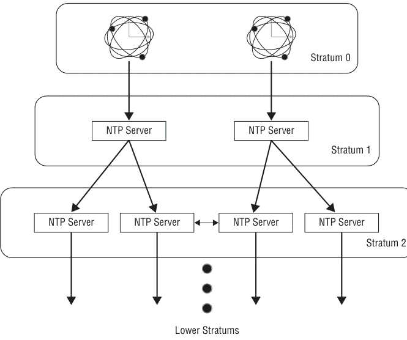

但是，NTP 协议尝试使用特殊规则来尽量减少传输时间，这些规则允许携带时间数据的数据包在 NTP 服务器和客户端之间更快地传输。实现 NTP 客户端/服务器协议的程序也通常具有一种机制，用于适当调整时间，以抵消 NTP 数据包的传输时间。

> 本章前面提到的简单网络时间协议（SNTP）是 NTP 的简化版本。虽然 NTP 可以实现高精度的时间，但 SNTP 更多用于不依赖精确时钟的应用程序或系统。

如果您从未选择过 NTP 时间源，查看时钟层级可能会让它看起来相当困难。但请别担心，实际上并非如此。您确实有几个很好的免费且对公众开放的选择。

pool.ntp.org 最流行的 NTP 服务器之一实际上是一组协同工作的服务器集群，称为池。参与池的每个时间服务器都是志愿者。要使用 NTP 服务器池，在配置 NTP 客户端应用程序时，请将 pool.ntp.org 作为 NTP 服务器输入（请注意，语法与此处所示的配置略有不同，将在本章后面介绍）。每次时钟更新请求发送到 pool.ntp.org 时，不同的池成员会提供响应。官方网站是 ntppool.org，该网站提供了一些关于如何在 Linux 系统上使用这些池服务器的良好说明。

NTP 服务器池的一个可爱之处在于，您可以深入到池中，找到满足特定要求的服务器集群。例如，大多数发行版在池中都有自己的子分组，例如 centos.pool.ntp.org 和 ubuntu.pool.ntp.org。这些发行版分组允许您设置 NTP 客户端应用程序，并在选择另一个时间服务器之前对其进行测试。

池中的其他子分组允许您使用地理位置更近的 NTP 服务器，这可能有助于提供更准确的时间。例如，如果您的 NTP 客户端应用程序位于加拿大，您可以使用来自 north-america.pool.ntp.org 或 ca.pool.ntp.org 的汇总服务器。请记住，如果您使用 pool.ntp.org，NTP 池软件会尽最大努力提供来自靠近您系统的服务器的时间。

> **注意** 如果您需要更准确的时间和更低的网络资源使用量，请勿使用 pool.ntp.org 或其任何子分组。例如，如果您的互联网服务提供商（ISP）提供时间服务器，请改用它。

**Google 时间服务器和闰秒平滑** 一个有趣的时间问题围绕闰秒展开。由于地球自转一直在减慢，我们的实际一天比 24 小时少约 0.001 秒。为了在计算机上补偿这一点，引入了闰秒。大约每 19 个月，NTP 就会传递闰秒公告。这通常在没有任何问题的情况下处理，时钟会向后调整一秒钟。但是，某些应用程序会出现问题，尤其是那些未处理闰秒的其他系统上的应用程序。

为解决这个问题，Google 推出了免费的公共时间服务器，这些服务器使用 NTP 并将闰秒平滑分摊到一段时间内，因此无需发布闰秒公告。这被称为 _闰秒平滑_。Google 的闰秒平滑 NTP 服务器是 time n.google.com，其中 n 设置为 1 到 4。如果您选择在系统上使用闰秒平滑时间服务器，则不应在 NTP 客户端程序中混合使用不采用此技术的时间服务器。

**服务器列表** 如果闰秒平滑和 NTP 服务器池无法满足您系统的需求，您还有其他选择。例如，您可以在 support.ntp.org/bin/view/Servers/WebHome 上浏览时间服务器列表。在选择和使用此列表上的 NTP 服务器之前，请务必阅读网站的参与规则。

> **警告** 如果您的应用程序需要高度精确的时间，请勿将基于互联网的时间源与 NTP 客户端程序一起使用。相反，请调查可以与您的服务器集成或充当本地时间服务器的时钟硬件。

如果您需要实现 NTP 客户端程序，您有多种选择。您可以使用 NTP 守护进程（ntpd），也可以使用较新的 chrony 守护进程（chronyd）。

## 使用 NTP 守护进程

长期以来，NTP 程序一直与网络时间协议同义，在 Linux 上它们经常被混用。但它确实存在一些局限性，例如在网络流量较大时难以保持时间准确，因此开发了 chrony 等替代方案。

NTP 程序在某些发行版中默认安装，而在其他发行版中则未安装。软件包名称为 ntp，您可以使用相应的包管理工具（在第 2 章中介绍）来检查它是否已安装（或是否需要安装）。

## 配置 NTP 守护进程

NTP 守护进程是 ntpd，其主要配置文件是 /etc/ntp.conf。它包含（在其他指令中）您希望使用的 NTP 时间服务器。用于设置这些服务器的指令名称为 server。CentOS 发行版上 /etc/ntp.conf 文件中的 server 行如清单 7.46 所示。

### 清单 7.46：查看 /etc/ntp.conf 文件中的 server 指令

```
$ grep ^server /etc/ntp.conf
server 0.centos.pool.ntp.org iburst
server 1.centos.pool.ntp.org iburst
server 2.centos.pool.ntp.org iburst
server 3.centos.pool.ntp.org iburst
$
```

请注意，默认选择的 NTP 服务器来自 CentOS 池。在指定来自 pool.ntp.org 或子分组的服务器时，为了使语法正确，您需要在第一个前面放置 0（例如 0.centos.pool.ntp.org），在第二个前面放置 1，依此类推。请注意每行末尾的 iburst。该指令有助于加快初始时间同步。

当 ntpd 启动时，它会向 /etc/ntp.conf 文件中配置的每个时间服务器发送数据包。从服务器的响应中，它会选择响应最快的服务器作为其 NTP 服务器。

> ntpd 使用端口 123，因此在启动 NTP 守护进程之前，请确保该端口可通过防火墙访问。

在旧版 Linux 系统上，您需要处理一种称为“疯狂时间”的现象，即当系统时间与实际时间相差超过 17 分钟时，NTP 服务器会因拒绝与您的系统通信。因此，在启动 ntpd 之前手动更新软件时钟是一种常见做法。

虽然在现代发行版中不再存在“疯狂时间”问题，但了解如何通过 NTP 实用程序手动更新系统时间仍然很有用。要使用的命令是 ntpdate。您需要超级用户权限，并从 /etc/ntp.conf 文件中选择一个时间服务器作为参数传递给它：

```
ntpdate 0.pool.ntp.org
```

当您准备好启动 ntpd 时，请使用超级用户权限和 systemctl 命令：

```
systemctl start ntpd
```

（如果您的系统不使用 systemd，请参阅第 2 章以了解启动服务的替代方法。）请确保还启用它，以便 ntpd 服务通过 systemctl enable ntpd 命令在系统启动时启动。

启动后立即，ntpd 将开始同步软件时钟的过程。请务必在检查其状态之前至少等待 10 到 15 分钟。您可以通过 ntpstat 命令完成此操作，如清单 7.47 所示。

### 清单 7.47：通过 ntpstat 命令查看软件时间同步

```
$ ntpstat
synchronised to NTP server (74.6.168.73) at stratum 3
    time correct to within 70 ms
    polling server every 128 s
$
```

请注意，ntpstat 命令不仅显示您的软件时钟当前的准确性以及轮询正确时间的频率，还让您看到 NTP 服务器的 IP 地址及其运行的层级。

## 管理 NTP 服务

除了使用 ntpstat 命令定期检查软件时钟的准确性之外，您还可以查看一个表格，显示 ntpd 正在轮询哪些时间服务器以及上次同步发生的时间。提供此信息的命令是 ntpq -p。示例如清单 7.48 所示。

### 清单 7.48：通过 ntpq 命令查看时间服务器和轮询信息

| remote | refid | st | t | when | poll | reach | delay | offset | jitter |
|--------|-------|----|---|------|------|-------|-------|--------|--------|
| +vps5.ctyme.com | 216.218.254.202 | 2 | u | 260 | 128 | 377 | 70.606 | 17.175 | 14.527 |
| *t2.time.gq1.yah | 208.71.46.33 | 2 | u | 40 | 128 | 377 | 74.892 | 17.062 | 7.880 |
| dfw1.ntp5.mattn | .STEP. | 16 | u | - | 1024 | 0 | 0.000 | 0.000 | 0.000 |
| +helium.constant | 128.59.0.245 | 2 | u | 10 | 128 | 377 | 42.163 | 18.043 | 9.173 |


如果需要，一旦您的软件时钟通过 NTP 相当准确，就可以手动将硬件时钟设置为其时间。只需使用本章前面介绍的 `hwclock --systohc` 命令即可。

## 使用 chrony 守护进程

chrony 守护进程（chronyd）相比 ntpd 有许多改进。即使在网络繁忙或系统有一段时间关闭的系统上，甚至在虚拟化系统上，它也能保持准确时间。此外，它同步系统时钟的速度比 ntpd 更快，并且可以轻松配置为本身充当本地时间服务器。除少数情况外，大多数发行版都建议使用 chrony 服务进行软件时钟同步。

在 CentOS 和其他基于 Red Hat 的发行版上，您会发现 chrony 程序默认已安装，但未在启动时启用（默认情况下）。软件包名称为 chrony，可在大多数发行版存储库中找到。因此，如果您需要安装它，可以使用相应的包管理工具（第 2 章将介绍）来完成。

在 Ubuntu 上，您会发现安装 chrony 后，它会自动启动并在启用开机自启。要在 CentOS 上启动它，请使用超级用户权限并在命令行中键入 `systemctl start chronyd`。再次使用相同的命令，但将 start 替换为 enable，以便 chrony 在系统启动时启动。

## 配置 chrony 守护进程

chrony 的主配置文件是 chrony.conf 文件，它可能存储在 /etc/ 或 /etc/chrony/ 目录中。通常，无需修改此配置文件中的任何内容，但您可能想查看几个项目。

配置文件中包含（在其他指令中）要使用的 NTP 时间服务器。用于设置这些的指令名称为 server 或 pool。对于 chrony，server 指令通常用于指定单个时间服务器，而 pool 表示服务器池。Ubuntu 发行版的 /etc/chrony/chrony.conf 文件中的 pool 行如清单 7.49 所示。

### 清单 7.49: 查看 /etc/chrony/chrony.conf 文件中的 pool 指令

```
$ grep ^pool /etc/chrony/chrony.conf
pool ntp.ubuntu.com iburst maxsources 4
pool 0.ubuntu.pool.ntp.org iburst maxsources 1
pool 1.ubuntu.pool.ntp.org iburst maxsources 1
pool 2.ubuntu.pool.ntp.org iburst maxsources 2
$
```

请注意，pool 设置与 /etc/ntp.conf 文件中 ntpd 的 server 设置类似。maxsources 参数是这种相似性的一个例外。它指定来自指定源的时间服务器的最大数量。如果其中一个服务器宕机，chrony 会找到另一个服务器来替代。

> chronyd 使用端口 123，因此在启动 chrony 守护进程之前，请确保该端口可通过防火墙访问。

chrony.conf 文件中另一个应检查的指令是 rtcsync 指令。这个方便的设置指示 chrony 定期更新硬件时间（实时时钟）。如果您在配置文件的单独一行上找到它且没有其他内容，则表示它已为 chrony 设置：

```
rtcsync
```

设置该指令并运行 chrony 后，您将不再需要使用难以记住的 hwclock 命令（hwclock --systohc）来用软件时钟的时间更新实时时钟。这真是一项改进。

如果您修改了配置且 chronyd 尚未启动，请使用超级用户权限和 systemctl 命令来启动它：

```
systemctl start chronyd
```

如果 chronyd 已经启动并且您需要修改配置文件，则需要重新启动它：

```
systemctl restart chronyd
```

（如果您的系统不使用 systemd，请参阅第 2 章了解启动服务的替代方法。）如有必要，请务必启用它，以便 chronyd 服务通过 systemctl enable chronyd 命令在系统启动时启动。

## 管理 chrony 服务

chrony 服务提供 chronyc 命令行实用程序来管理它。有几个可用的命令与 ntpd 命令类似，甚至超越了 ntpd 命令。

如果您熟悉使用 ntpq -p 来查看系统的时间源，则可以改用 chronyc sources -v。此命令的示例在使用 chrony 的 Ubuntu 发行版上的清单 7.50 中显示。

### 清单 7.50: 通过 chronyc sources -v 命令查看源时间服务器

```
$ chronyc sources -v
210 Number of sources = 8

.-- Source mode '^' = server, '=' = peer, '#' = local clock.
/ .- Source state '*' = current synced, '+' = combined , '-' = not combined,
| /   '?' = unreachable, 'x' = time may be in error, '~' = time too variable.
||                                                .- xxxxxx [ yyyy ] +/- zzzz
||      Reachability register (octal) -.           |  xxxx = adjusted offset,
||      Log2(Polling interval) --.               |     yyyy = measured offset,
||                                \              |     zzzz = estimated error.
||                                 |           |
```

| MS | 名称/IP 地址 | 层级 | 轮询 | 可达性 | 上次接收 | 最后样本 |
|----|-----------------|---------|------|-------|--------|-------------|
| ^+ | alphyn.canonical.com | 2 | 10 | 377 | 413 | -461us[ -418us] +/-  101ms |
| ^+ | golem.canonical.com | 2 | 10 | 337 | 142 | +30us[  +30us] +/-   95ms |
| ^+ | chilipepper.canonical.com | 2 | 10 | 377 | 918 | -797us[ -760us] +/-   81ms |
| ^+ | pugot.canonical.com | 2 | 10 | 377 | 21 | -2184us[-2184us] +/-   87ms |
| ^* | 4.53.160.75 | 2 | 10 | 377 | 229 | -327us[ -281us] +/-   50ms |
| ^+ | vps3.cobryce.com | 2 | 10 | 377 | 416 | +4806us[+4850us] +/-   70ms |
| ^+ | B1-66ER.matrix.gs | 2 | 10 | 377 | 21m | -315us[ -363us] +/-   60ms |
| ^+ | 2.time.dbsinet.com | 2 | 9 | 175 | 601 | -3138us[-3097us] +/-   93ms |

$

该显示中包含大量有用信息。请注意，顶部显示 chronyd 当前使用的时间服务器源数量（8）。

与此类似但提供更多时间服务器源统计信息的是 chronyc sourcestats。示例在清单 7.51 中显示。

### 清单 7.51: 通过 chronyc sourcestats 命令查看时间服务器统计信息

```
$ chronyc sourcestats
210 Number of sources = 8
```

| 名称/IP 地址 | NP | NR | 跨度 | 频率 | 频率偏移 | 偏移 | 标准偏差 |
|-----------------|----|----|------|-----------|-----------|--------|---------|
| alphyn.canonical.com | 31 | 15 | 87m | +0.322 | 0.287 | -180us | 677us |
| golem.canonical.com | 31 | 18 | 91m | -0.006 | 0.137 | -470us | 275us |
| chilipepper.canonical.com | 31 | 14 | 96m | -0.044 | 0.163 | -661us | 383us |
| pugot.canonical.com | 28 | 16 | 87m | -0.029 | 0.350 | -637us | 575us |
| 4.53.160.75 | 31 | 20 | 90m | +0.003 | 0.166 | -553us | 370us |
| vps3.cobryce.com | 30 | 14 | 87m | -0.195 | 0.531 | +4453us | 936us |
| B1-66ER.matrix.gs | 30 | 13 | 72m | -0.095 | 0.351 | +523us | 635us |
| 2.time.dbsinet.com | 27 | 16 | 71m | +0.073 | 0.327 | -2801us | 431us |

$

如果您想查看软件时钟是否正在同步（类似于 netstat 命令显示的内容），并了解有关软件时钟性能的更多信息，请尝试 chronyc tracking 命令。示例在清单 7.52 中显示。

### 清单 7.52: 通过 chronyc tracking 命令查看软件时钟信息

```
$ chronyc tracking
Reference ID    : 0435A04B (4.53.160.75)
Stratum         : 3
Ref time (UTC)  : Sat Jun 01 19:22:01 2019
System time : 0.000197749 seconds slow of NTP time
Last offset : -0.000001978 seconds
RMS offset : 0.001266906 seconds
Frequency : 31.578 ppm fast
Residual freq : +0.000 ppm
Skew : 0.077 ppm
Root delay : 0.034032539 seconds
Root dispersion : 0.02259230 seconds
Update interval : 1027.0 seconds
Leap status : Normal
$
```

还有几个其他有用的 chronyc 命令可用于管理和监控 chrony。要查看所有命令，请在命令行中输入 man chronyc。

## 摘要

在本章中，我们深入探讨了创建、修改和删除用户帐户和组。我们探讨了在故障排除和使用系统电子邮件方面有帮助的电子邮件实用程序和概念。此外，我们研究了对故障排除和安全监控至关重要的日志文件。最后，我们了解了如何正确维护系统时间。

这些技能将帮助您确保所管理的所有服务器都能高效运行。此外，您的系统问题将更少，遇到的故障可以更快解决，而有了这些技能，您可以花更多时间远离工作。

## 考试要点

描述管理用户帐户的相关角色。/etc/login.defs 和 /etc/default/useradd 文件配置 useradd 命令默认行为的各种设置。由于这些文件中的指令设置因发行版而异，在使用 useradd 实用程序创建帐户之前，最好先浏览它们。创建帐户时，/etc/passwd、/etc/shadow 和 /etc/group 文件都会被修改。具体取决于用户帐户创建配置，可能会创建用户主目录，并从 /etc/skel/ 目录复制文件到其中。要修改用户帐户，请使用 usermod 命令；要删除帐户，请使用 userdel 实用程序。可以使用 getent 实用程序查看帐户信息。使用 chage 命令查看帐户的 /etc/shadow 记录信息并对其进行修改。


### 总结管理组。

参与创建、修改和删除组的命令是 groupadd、groupmod 和 groupdel 命令。这些命令会对 /etc/group 文件进行修改。如果您需要将用户添加到某个组，需要使用 usermod 实用程序。用户可以轻松使用 newgrp 程序从帐户的默认组切换到帐户是其成员的另一个组。可以通过 groups 和 getent 命令以及查看 /etc/group 文件来审核帐户组成员资格。

### 说明如何使用各种电子邮件实用程序。

管理和排查三种 MTA（Sendmail、Postfix、Exim）的故障可以使用各种可用的电子邮件实用程序来完成。要查看系统上帐户的邮件，请使用 mail 实用程序。对于系统上可能卡住的消息，可以使用 mailq 或 sendmail -bp 命令查看邮件队列。您可以通过编辑 /etc/aliases 文件并运行 newaliases 命令来设置电子邮件别名，该命令将更新别名数据库 /etc/aliases.db。要临时转发电子邮件，用户可以在其主目录中创建 .forward 文件，填写应接收电子邮件的用户名，然后为该文件设置适当的权限。由于 Sendmail MTA 非常流行，Postfix 提供了一个 Sendmail 仿真层，允许在其系统上使用 Sendmail 命令。

### 阐明 rsyslogd 日志记录的运行方式。

rsyslogd 服务实现了 syslog 协议。它使用 /etc/rsyslog.conf 配置文件，在某些发行版中还包括 /etc/rsyslog.d/*.conf 文件。在配置文件中，规则通过 facility.priority action 格式确定记录什么以及将日志记录到何处。日志消息可以使用 TCP|UDP([z])HOST[:PORT] 格式发送到远程日志服务器（可带压缩，也可不带压缩）。日志文件通过 logrotate cron 作业进行轮转，该作业在 /etc/logrotate.conf 文件中配置。可以使用 logger 命令手动生成日志消息。

### 总结如何查看和管理日志条目。

systemd-journald 服务负责日志消息数据。该守护进程通过 /etc/systemd/journal.conf 配置文件进行控制。默认情况下，日志文件存储在 /run/systemd/journal/ 目录树中，这使它们具有易失性。要使文件持久化并将其存储在 /var/log/journal/ 目录树中，需将配置文件中的 Storage 指令更改为 persistent 并重启 systemd-journald 服务。只要满足某些条件，rsyslog 实用程序就可以充当日志客户端。例如，imuxsock 和/或 imjournal 模块已加载到 /etc/rsyslog.conf 文件中。

日志条目只能使用 journalctl 实用程序查看。要查看系统日志数据，必须使用超级用户权限或成为 systemd-journal 组的成员。要查看完整的当前日志数据文件，只需使用不带参数的 journalctl 命令。要筛选日志数据，请使用 journalctl 实用程序提供的各种过滤器。日志文件会根据 journal.conf 文件中的大小或时间设置自动轮转。活动日志文件被移动到归档日志文件，其名称被修改，在某些情况下，较旧的归档日志文件会被删除。管理员还可以使用带有 vacuum 选项的 journalctl 命令手动清理归档日志文件。手动日志条目使用 systemd-cat 实用程序创建，如果 rsyslog 的配置满足某些条件，也可以使用 logger 命令。

### 描述各种 NTP 守护进程。

较旧的 ntpd 提供 NTP 客户端/服务器服务，并使用 /etc/ntp.conf 作为其配置文件。文件中的 server 行指定时间服务器或时间服务器集群（例如 0.pool.ntp.org），以便从中轮询正确时间。您可以通过 ntpdate 命令使用配置文件中的服务器指定来手动设置系统时间（软件时钟）。您可以使用 ntptime 实用程序查看时间同步状态，并可以通过 ntpq -p 命令查看轮询活动和统计信息。

较新的 chronyd 提供 NTP 客户端/服务器服务，并使用 /etc/chrony.conf 或 /etc/chrony/chrony.conf 配置文件。文件中的 server 行通常指定单个时间服务器，而 pool 行指定时间服务器集群（例如 0.ubuntu.pool.ntp.org），以便从中轮询正确时间。rtcsync 指令告诉 chrony 定期更新硬件时间（实时时钟）。有助于查看 chrony 时间源的实用程序包括 chronyc sources 和 chronyc sourcestats 命令。还可以从 chronyc tracking 实用程序中获取更多信息。

## 复习问题

您可以在附录中找到答案。

- 1. 以下哪些是 /etc/passwd 文件记录中的字段？（多选）
  - A. 用户帐户的用户名
  - B. 密码
  - C. 密码更改日期
  - D. 特殊标志
  - E. UID

- 2. 以下哪些是 /etc/shadow 文件记录中的字段？（多选）
  - A. 最大密码有效期
  - B. 帐户过期日期
  - C. 密码
  - D. 注释
  - E. 默认 shell

- 3. 以下哪些命令可用于查看 /etc/passwd 文件中 NUhura 帐户的记录数据？（多选）
  - A. getent NUhura passwd
  - B. cat /etc/passwd
  - C. passwd NUhura
  - D. grep NUhura /etc/passwd
  - E. getent passwd NUhura

- 4. 您使用 useradd 实用程序创建了一个帐户，但出于某些原因未创建该帐户的主目录。以下哪项最可能导致这种情况发生？
  - A. HOME 指令设置为 no。
  - B. 您未使用超级用户权限。
  - C. CREATE_HOME 指令未设置。
  - D. INACTIVE 指令设置为 -1。
  - E. 设置了 EXPIRE 日期，且该日期早于当天。

- 5. 以下哪个命令允许您临时从帐户的默认组切换到您有成员资格的另一个组？
  - A. usermod 命令
  - B. newgrp 命令
  - C. groups 命令
  - D. groupadd 命令
  - E. groupmod 命令

- 6. 以下哪个命令最适合将 JKirk 添加为名为 NCC-1701 的新组的成员，且不删除该帐户的先前组成员资格？
  - A. usermod -g NCC-1701 JKirk
  - B. usermod -G NCC-1701 JKirk
  - C. usermod -aG NCC-1701 JKirk
  - D. groupadd NCC-1701
  - E. groupmod NCC-1701 JKirk

- 7. 以下哪些可用于查看 NCC-1701 组的成员？（多选）
  - A. groups NCC-1701
  - B. getent group NCC-1701
  - C. getent groups NCC-1701
  - D. grep NCC-1701 /etc/group
  - E. grep NCC-1701 /etc/groups

- 8. 您可以使用什么命令检查电子邮件队列中是否有长消息列表？（多选）
  - A. systemctl sendmail status
  - B. sendmail -bp
  - C. sendmail -bq
  - D. mailq
  - E. ls /var/spool

- 9. 您的电子邮件服务器收到一封发给 support 的邮件。此计算机上 support 地址有一个别名为 wesley。假设系统已正确配置，哪个帐户将收到该电子邮件？
  - A. support
  - B. None
  - C. ~/.forward 中的帐户
  - D. root
  - E. wesley

- 10. 哪个 syslog 设备关键字表示来自系统作业调度程序的事件消息？
  - A. cron
  - B. user
  - C. kern
  - D. console
  - E. auth

- 11. rsyslogd 中哪个 syslog 严重性级别的优先级排名最高？
  - A. crit
  - B. alert
  - C. emerg
  - D. notice
  - E. err

- 12. rsyslogd 默认使用哪个配置文件？
  - A. rsyslog.conf
  - B. journal.conf
  - C. syslogd.conf
  - D. syslog.d
  - E. syslog.d

- 13. journalctl 哪个选项首先显示最近的日志条目？
  - A. -a
  - B. -l
  - C. -r
  - D. -e
  - E. -n

- 14. 您想手动向系统活动日志添加条目。可以使用什么命令来执行此操作？
  - A. journalctl
  - B. journalctl-cat
  - C. systemd-cat
  - D. systemdd-journal
  - E. journalctl -logger

- 15. 以下哪些是通常可以在 Linux 系统上查看或修改的时钟或时间？（多选）
  - A. 硬件时钟
  - B. 系统时间
  - C. 软件时钟
  - D. 原子钟
  - E. 实时时钟


16. 以下哪个实用程序允许你更改 Linux 系统硬件时钟上的时间？
A. hwclock
B. date
C. timedatectl
D. ntpd
E. rtcsync

17. 哪个命令允许你同时查看系统当前时区和 UTC 下的系统时间？
A. hwclock -r
B. date
C. timedatectl
D. ntpd -p
E. chronyc sources

18. 假设你将使用 pool.ntp.org 时间服务器，以下哪些是 ntpd 服务 /etc/ntp.conf 文件中的正确配置行？（全部选出。）
A. server pool.ntp.org iburst
B. pool pool.ntp.org iburst maxsources 2
C. service pool.ntp.org iburst
D. server 0.pool.ntp.org iburst
E. service 0.pool.ntp.org iburst

19. 系统管理员 Geordi 最近配置并启动了 ntpd 服务，以便为系统软件时钟获取准确时间。他想要更新硬件时钟，但希望快速检查软件时钟是否已同步。他最好使用什么命令？
A. ntpdate
B. ntpstat
C. ntpd -p
D. date
E. hwclock -w

20. Miles 想要配置他新安装的 chrony。以下哪些可能是他需要查看/修改的配置文件？（全部选出。）
A. /etc/ntp.conf
B. /etc/ntp/chrony.conf
C. /etc/chrony.d/chrony.conf
D. /etc/chrony.conf
E. /etc/chrony/chrony.conf
