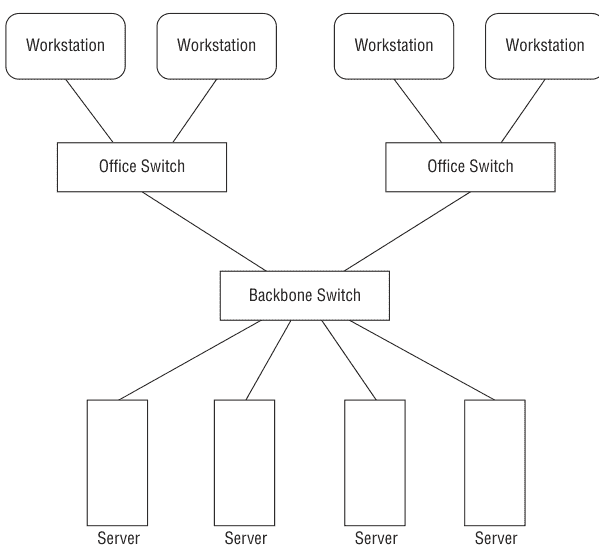
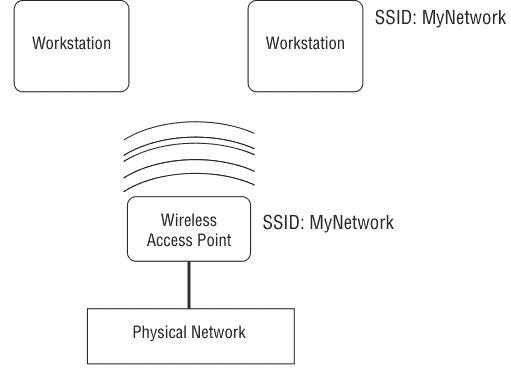
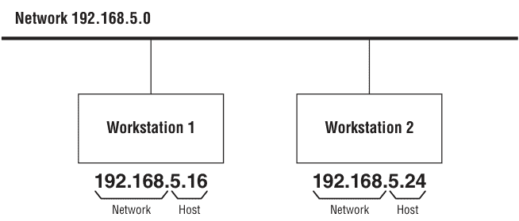
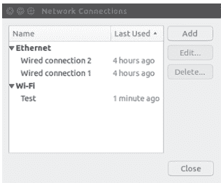
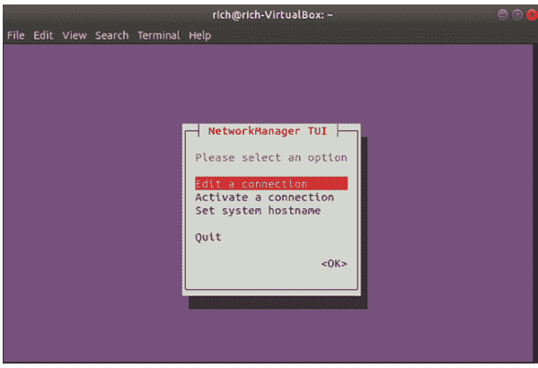

## 第 8 章
## 配置基本网络

### 目标
- [x] 109.1 互联网协议基础
- [x] 109.2 持久网络配置
- [x] 109.3 基本网络故障排除
- [x] 109.4 配置客户端 DNS


如今，让 Linux 系统连接到某种网络几乎已成为必需。无论是需要在本地网络上共享文件和打印机，还是需要连接互联网以下载更新和安全补丁，大多数 Linux 系统都有某种网络连接。

本章将介绍如何配置 Linux 系统以连接到网络，以及在出现问题时如何排除网络连接故障。不幸的是，Linux 中配置网络设置有几种不同的方法，你需要全部掌握才能通过 LPIC-1 考试。首先，我们将介绍 Linux 发行版中配置文件的常见位置。接下来，我们将探讨可帮助你更轻松地配置网络设置的各种工具。之后，你将学习一些简单的网络故障排除技术。

### 网络基础

在了解 Linux 如何处理网络连接之前，让我们先回顾一下计算机网络的基础知识。计算机网络是将数据从一个计算机系统传输到另一个系统的方式。为了简化问题，计算机网络通常被描述为分层系统。不同层级在将数据从一个网络设备传输到另一个网络设备的过程中发挥不同的作用。

不过，关于如何最佳地划分网络层级，存在很多争论。虽然标准开放系统互连（OSI）网络模型使用七层，但我们将采用简化的四层方法来描述网络功能：

- 物理层
- 网络层
- 传输层
- 应用层

以下各节将详细介绍这四个层级中包含的部分。

### 物理层

物理层由连接 Linux 系统到网络所需的硬件组成。如果你曾将计算机连接到家庭或办公室网络，你肯定已经熟悉连接网络设备的两种主要方法：有线网络连接和无线网络连接。

有线网络连接使用一系列网络交换机通过特殊以太网电缆连接网络设备。网络交换机接收来自网络设备的数据包，然后将数据包发送到网络上的正确目标设备。在大型办公室网络安装中，交换机通常以级联设计连接，以帮助减少网络流量负载。交换机可以互相互连，以帮助将网络流量分割成较小的区域。图 8.1 演示了有线网络的常见布局。

图 8.1 有线办公室网络基础架构



虽然“有线”一词可能让你想到铜缆，但它也适用于使用光纤电缆的网络连接。光纤电缆使用光通过细玻璃丝传输数据，实现比传统铜缆连接更快的速度和更长的传输距离。虽然有线网络布线可能比较繁琐，但它确实提供了最快的网络速度（目前可达每秒 100 千兆比特）。因此，在必须实现高吞吐量的 Linux 服务器环境中，有线网络仍然很受欢迎。

不过，如今大多数小型办公室和家庭网络都使用无线网络。无线网络不使用物理电线或光缆连接设备，而是使用无线电信号在网络设备和网络接入点之间传输数据。接入点的工作方式类似于交换机，它控制数据如何发送到与它通信的每个网络设备。

每个接入点都使用唯一的 *服务集标识符*（SSID）来与其他接入点区分开来，它可以是文本名称或数字。你只需指定正确的 SSID 值，告诉 Linux 系统连接到哪个接入点。图 8.2 演示了常见的无线网络布局。

图 8.2 无线网络基础架构



无线网络的缺点是你无法控制无线电信号传播的范围。家里外面的人可能会看到你的接入点信号并尝试连接。因此，在接入点上实施某种加密安全性很重要。只有使用正确加密密钥的设备才能连接到无线接入点。常见的无线加密技术包括有线等效隐私（WEP）、Wi-Fi 保护访问（WPA）和 Wi-Fi 保护访问 2 版（WPA2）。

### 网络层

*网络层* 控制连接网络设备之间数据的发送方式，包括本地网络和互联网。为了让数据到达正确的目标设备，必须使用某种网络寻址方案来唯一标识每个网络设备。最常用的方法是 *互联网协议*（IP）。

> 虽然 IP 网络协议是目前最流行的协议，但并非唯一可用的网络协议。Apple 使用名为 AppleTalk 的专有协议，允许 Apple 计算机在局域网中相互通信，而 Novell 使用 IPX/SPX 协议在 Novell 网络服务器和客户端之间进行通信。然而，这些网络协议已逐渐淡出标准使用，且不在 LPIC-1 考试范围内。

要将 Linux 系统连接到 IP 网络，你需要以下四项信息：

- IP 地址
- 主机名
- 默认路由器
- 子网掩码值

以下各节将介绍这些值各自代表的含义。

### IP 地址

在 IP 网络中，每个网络设备都会被分配一个唯一的 32 位地址。网络层软件将源 IP 地址和目标 IP 地址嵌入数据包中，以便网络设备知道如何处理数据包，Linux 系统知道读取哪些数据包以及忽略哪些数据包。

为了方便人类识别地址，IP 地址被分成四个 8 位值，以十进制数字表示，每个值之间用句点分隔。这种格式称为点分十进制表示法。例如，点分十进制表示法中的标准 IP 地址看起来像 192.168.1.10。

IP 地址分为两个部分。IP 地址的一部分表示网络地址。同一物理网络上的所有设备在其 IP 地址中都具有相同的网络地址部分。例如，如果你的家庭网络被分配的网络地址为 192.168.1.0，则所有网络设备必须以 IP 地址 192.168.1 开头。

第二部分表示主机地址。同一网络上的每个设备都必须具有唯一的主机地址。图 8.3 演示了在本地网络中为设备分配唯一 IP 地址。

图 8.3 本地网络上的网络寻址



为了使事情更加复杂，引入了一种更新的 IP 网络协议，称为 IP 版本 6（IPv6）。IPv6 网络方案使用 128 位地址，而不是 IP 使用的 32 位地址，这允许在互联网上唯一标识更多网络设备。


IPv6 方法使用十六进制数字来标识地址。128 位地址被分成八组，每组四个十六进制数字，由冒号分隔，例如 fed1:0000:0000:08d3:1319:8a2e:0370:7334

如果一组或多组四位数字是 0000，可以省略该组或那些组，留下两个冒号：fed1::08d3:1319:8a2e:0370:7334

但是，只能以这种方式压缩一组零。

IPv6 协议还提供两种不同类型的主机地址：

- 链路本地地址
- 全局地址

主机设备上的 IPv6 软件会自动分配链路本地地址。链路本地地址使用默认网络地址 fe80::，然后从网卡内置的媒体访问控制（MAC）地址推导地址的主机部分。这样可以确保任何 IPv6 设备都能自动与本地网络上的任何其他 IPv6 设备通信，无需任何配置。

IPv6 全局地址的工作方式与原始 IP 版本类似：每个网络都分配一个唯一的网络地址，网络上的每个主机必须有一个唯一的主机地址。

## 子网掩码地址

子网掩码地址通过使用 1 位来显示 32 位 IP 地址的哪些位由网络使用，使用 0 位来显示哪些位代表主机地址，从而区分 IP 地址中的网络和主机地址部分。由于大多数人不喜欢使用二进制数字，子网掩码地址通常以点分十进制格式显示。例如，子网掩码地址 255.255.255.0 表示 IP 地址中的前三个十进制数字代表网络地址，最后一个十进制数字代表主机地址。

表示子网掩码地址的另一种方法称为无类别域间路由（CIDR）表示法。CIDR 表示法将子网掩码表示为 IP 地址中掩码位的数量。CIDR 表示法通常在网络地址和 CIDR 值之间用斜杠显示。因此，网络 192.168.1.0 和子网掩码 255.255.255.0 的 CIDR 表示法将为 192.168.1.0/24。尽管 CIDR 表示法在网络领域越来越流行，但 Linux 配置文件仍使用子网掩码值来定义网络。

在 Internet 上工作时，至关重要的是不能让两个物理 Internet 连接拥有相同的 IP 地址。为了实现这一点，互联网号码分配机构（IANA）对 IP 网络地址的分配保持严格控制。但是，并非所有网络都需要连接到 Internet，因此为了区分这些网络，IANA 区分了公共和私有 IP 网络。

特定子网范围保留给私有 IP 网络：

- 10.0.0.0 到 10.255.255.255
- 172.16.0.0 到 172.31.255.255
- 192.168.0.0 到 192.168.255.255

这些私有 IP 地址不能用于 Internet 流量；它们仅在本地网络上工作。

不难想象，随着 Internet 的普及，IANA 很快就用尽了可用的公共 IP 地址网络。然而，在一个绝妙的举措中，网络地址转换（NAT）的想法挽救了局面。NAT 服务器可以获取整个私有 IP 网络，并为其在 Internet 上分配一个单一的公共 IP 地址。这就是您可以将整个家庭网络连接到单个 ISP Internet 连接并使一切正常工作的方式。

## 默认路由器

使用 IP 和 IPv6 时，设备只能直接与同一物理网络上的其他设备通信。要连接不同的物理网络，您使用 *路由器*。路由器将数据从一个网络传递到另一个网络。需要将数据包发送到远程网络主机的设备必须使用路由器作为中介。通常，一个网络包含一个单一的路由器来将数据包转发到上级网络。这称为 *默认路由器*（或有时称为 *默认网关*）。网络设备必须知道本地默认网关，才能将数据包转发到远程主机。

因此，设备要在 IP 网络中通信，必须知道三个单独的信息：

- 其在网络上的主机地址
- 本地物理网络的子网掩码地址
- 用于向远程网络发送数据包的本地路由器地址

您需要的内容示例如下：

- 主机地址：192.168.20.5
- 子网掩码地址：255.255.255.0
- 默认网关：192.168.20.1

掌握这三个值后，您几乎就可以配置 Linux 系统以在 Internet 上工作了。您只需要再考虑一个拼图部分，我们将在下一部分中探讨。

## 主机名

面对所有这些 IP 地址，要记住哪些服务器有哪些地址可能几乎是不可能的。幸运的是，还有另一个网络标准可供我们使用，可以提供帮助。*域名系统*（DNS）为网络上的主机分配名称。

使用 DNS 时，每个网络地址都分配有一个 *域名*（例如 linux.org）来唯一标识网络，该网络中的每个主机都分配有一个唯一的 *主机名*，主机名添加到域名中以唯一标识网络上的主机。

因此，要查找域 example.org 上的主机 shadrach，您将使用 DNS 名称 shadrach.example.org。DNS 系统使用服务器将主机名和域名映射到与该服务器通信所需的特定网络地址。负责定义本地网络网络名和主机名的服务器与上级 DNS 服务器互操作，以解析远程主机名。

要在网络应用程序中使用 DNS，您只需配置为本地网络提供服务的 DNS 服务器的地址。从那里，您的本地 DNS 服务器可以找到 Internet 上任何位置任何主机名的地址。

## 动态主机配置协议

在继续配置 Linux 系统之前，我们还需要讨论另一个网络层功能。试图跟踪大型网络上所有设备的主机地址可能变得麻烦。保持各个 IP 地址分配清晰可能是一项挑战，并且您经常会遇到两个或多个设备意外被分配相同 IP 地址的情况。

*动态主机配置协议*（DHCP）的创建是为了更轻松地配置客户端工作站，这些工作站不一定需要始终使用相同的 IP 地址。使用 DHCP 时，客户端使用临时地址与网络上的 DHCP 服务器通信。然后，DHCP 服务器会告诉客户端确切要使用哪个 IP 地址、子网掩码地址、默认网关，甚至 DNS 服务器。每次客户端重新启动时，它可能会收到不同的 IP 地址，但只要它在网络上是唯一的，这就无关紧要。

如今，大多数家庭网络路由器都包含 DHCP 服务器功能，因此您只需将 Linux 客户端设置为使用 DHCP 即可完成。您不需要知道网络地址的任何“幕后”详细信息。


虽然 DHCP 对客户端很有用，但不建议用于服务器。服务器需要具有固定 IP 地址，以便客户端始终可以找到它们。虽然可以在 DHCP 中配置静态 IP 地址，但通常手动配置服务器的网络信息是最安全的。这称为 *静态主机地址*。

## 传输层

*传输层*通常是网络中最令人困惑的部分。与网络层帮助将数据传送到网络上的特定主机不同，传输层帮助将数据传送到主机上正确的应用程序。它通过使用 *端口* 来实现这一点。

端口有点像公寓号码。网络服务器上运行的每个应用程序都分配有自己的端口号，就像同一栋公寓楼中的不同公寓分配有单独的公寓号码一样。要向服务器上的特定应用程序发送数据，客户端软件需要知道服务器 IP 地址（就像公寓楼地址一样）和传输层端口号（就像公寓号码一样）。

IP 网络世界中使用两种常见的传输协议：

- 传输控制协议（TCP）
- 用户数据报协议（UDP）

传输控制协议（TCP）传输协议使用保证交付方法发送数据。它确保服务器接收客户端计算机发送的每一部分数据，反之亦然。缺点是需要大量开销来跟踪和验证所有发送的数据，这可能会减慢数据传输速度。

对于对传输速度敏感的数据（例如实时数据，如语音和视频），这可能会造成不想要的延迟。此方法的替代方案是用户数据报协议（UDP）传输协议。UDP 不费心确保每部分数据的交付——它只是将数据发送到网络上，并希望它能到达服务器！

虽然丢失数据听起来可能是件坏事，但对于某些应用程序（例如语音和视频）来说，这是完全可以接受的。缺失的音频或视频数据包在最终音频或视频结果中仅表现为断续和中断。只要大部分数据包到达，音频和视频就可以理解。


虽然不用于发送应用程序数据，但您还需要知道另一个传输层协议。网络设备需要彼此“幕后”通信，在网络中传递网络管理信息。互联网控制消息协议（ICMP）为网络设备提供了一种简单的方法，用于传递错误消息和网络路由信息等信息，从而让每个客户端轻松找到网络上所需的资源。

## 应用层

应用层是所有活动发生的地方。网络程序在这里处理跨网络发送的数据，然后返回结果。大多数网络应用程序使用客户端/服务器范式进行操作。使用客户端/服务器范式时，一个网络设备充当服务器，向多个网络客户端提供某种服务（例如通过网页提供内容的 Web 服务器）。服务器在分配给应用程序的特定传输层端口上监听传入连接。客户端必须知道使用哪个传输层端口向服务器应用程序发送请求。

为了简化该过程，TCP 和 UDP 都使用熟知端口来表示常见应用程序。这些端口号被保留，以便网络客户端知道使用


在网络中查找特定应用程序主机时使用。表 8.1 显示了一些更常见的知名应用程序端口。

### 表 8.1 TCP 和 UDP 知名端口

| 端口 | 协议 | 应用程序 |
|---|---|---|
| 20 | TCP | 文件传输协议 (FTP) 数据 |
| 21 | TCP | 文件传输协议 (FTP) 控制消息 |
| 22 | TCP | 安全外壳协议 (SSH) |
| 23 | TCP | Telnet 交互协议 |
| 25 | TCP | 简单邮件传输协议 (SMTP) |
| 53 | TCP&UDP | 域名系统 (DNS) |
| 80 | TCP | 超文本传输协议 (HTTP) |
| 110 | TCP | 邮局协议第 3 版 (POP3) |
| 123 | UDP | 网络时间协议 (NTP) |
| 139 | TCP | NetBIOS 会话服务 |
| 143 | TCP | 互联网消息访问协议 (IMAP) |
| 161 | UDP | 简单网络管理协议 (SNMP) |
| 162 | UDP | 简单网络管理协议陷阱 |
| 389 | TCP | 轻量级目录访问协议 (LDAP) |
| 443 | TCP | 基于 TLS/SSL 的超文本传输协议 (HTTPS) |
| 465 | TCP | 经过身份验证的 SMTP (SMTPS) |
| 514 | TCP&UDP | 远程 Shell (TCP) 或 Syslog (UDP) |
| 636 | TCP | 基于 TLS/SSL 的轻量级目录访问协议 (LDAPS) |
| 993 | TCP | 基于 TLS/SSL 的互联网消息访问协议 (IMAPS) |
| 995 | TCP | 基于 TLS/SSL 的邮局协议 3 (POP3S) |

如果你觉得试图记住所有这些端口号很麻烦，那么你并不孤单。
为了简化端口，存在一种临时标准，用于为每个知名端口号分配名称。每个 Linux 系统都在 /etc/services 文件中维护其网络端口名称列表。网络应用程序在处理网络端口时可以读取此文件，并使用名称而不是端口号。这种显示端口名称而不是数字的方法通常用于网络故障排除工具。

现在你已经了解了 Linux 如何使用网络在系统之间传输数据的基础知识，我们下一节将深入探讨如何在 Linux 系统中配置这些功能。

## 配置网络功能

要在网络上进行交互，你需要在 Linux 系统中配置以下五项主要信息：

- 主机地址
- 网络子网地址
- 默认路由器（有时称为网关）
- 系统主机名
- 用于解析主机名的 DNS 服务器地址

在 Linux 系统中配置这些信息有三种方法：

- 手动编辑网络配置文件
- 使用 Linux 发行版包含的图形工具
- 使用命令行工具

以下各节将逐一介绍这些方法。

## 网络配置文件

使用 systemd 初始化方法的 Linux 系统通常使用 systemd-networkd 守护进程来检测网络接口，并自动在网络配置文件中为它们创建条目。如有必要，你可以手动修改这些文件以调整或更改网络设置。

然而，不幸的是，并不存在所有发行版都使用的单个标准配置文件。相反，不同的发行版使用不同的配置文件来定义网络设置。表 8.2 显示了你最常会遇到的网络配置文件。

### 表 8.2 Linux 网络配置文件

| 发行版 | 网络配置位置 |
|---|---|
| 基于 Debian | /etc/network/interfaces 文件 |
| 基于 Red Hat | /etc/sysconfig/network-scripts 目录 |
| OpenSUSE | /etc/sysconfig/network 文件 |

虽然每个 Linux 发行版定义网络设置的方法不同，但它们都具有相似的特性。大多数配置文件将每个必需的网络设置定义为配置文件中的单独值。清单 8.1 显示了一个基于 Debian 的 Linux 系统示例。

### 清单 8.1: 基于 Debian 的网络静态配置设置示例

```
auto eth0
iface eth0 inet static
  address 192.168.1.77
  netmask 255.255.255.0
  gateway 192.168.1.254
iface eth0 inet6 static
  address 2003:aef0::23d1::0a10:00a1
  netmask 64
  gateway 2003:aef0::23d1::0a10:0001
```

清单 8.1 中所示的示例为指定为 eth0 的有线网络接口分配了 IPv4 和 IPv6 地址。

清单 8.2 显示了如何使用网络上的 DHCP 服务器自动定义 IP 网络设置。

### 清单 8.2: 基于 Debian 的网络 DHCP 配置设置示例

```
auto eth0
iface eth0 inet dhcp
iface eth0 inet6 dhcp
```

如果你只想分配一个 IPv6 链路本地地址（该地址在本地网络上唯一标识设备），但不想从 DHCP 服务器检索 IPv6 地址，请用以下内容替换 inet6 行：

```
iface eth0 inet6 auto
```

auto 属性告诉 Linux 分配链路本地地址，这使得 Linux 系统可以与本地网络上的任何其他 IPv6 设备通信，但不能使用全局地址。

从 17.04 版本开始，Ubuntu 发行版已偏离标准 Debian 方法，并使用 Netplan 工具来管理网络设置。Netplan 使用 /etc/netplan 文件夹中的简单 YAML 文本文件来定义系统上每个网络接口的网络设置。默认情况下，Netplan 将网络设置交给 Network Manager 工具处理，因此你不需要担心 Netplan 配置文件的设置方式。

对于基于 Red Hat 的系统，你需要在两个独立的文件中定义网络设置。第一个文件在一个以网络接口名称命名的文件中定义网络和子网掩码地址（例如 ifcfg–enp0s3）。清单 8.3 显示了一个 CentOS Linux 系统示例。

### 清单 8.3: CentOS 网络接口配置设置示例

```
TYPE=Ethernet
PROXY_METHOD=none
BROWSER_ONLY=no
BOOTPROTO=dhcp
DEFROUTE=yes
IPV4_FAILURE_FATAL=no
IPV6INIT=yes
IPV6_AUTOCONF=yes
IPV6_DEFROUTE=yes
IPV6_FAILURE_FATAL=no
IPV6_ADDR_GEN_MODE=stable-privacy
NAME=enp0s3
UUID=c8752366-3e1e-47e3-8162-c0435ec6d451
DEVICE=enp0s3
ONBOOT=yes
IPV6_PRIVACY=no
```

基于 Red Hat 的系统所需的第二个文件是 network 文件，它定义主机名和默认网关，如清单 8.4 所示。

### 清单 8.4: CentOS network 文件配置设置示例

```
NETWORKING=yes
HOSTNAME=mysystem
GATEWAY=192.168.1.254
IPV6FORWARDING=yes
IPV6_AUTOCONF=no
IPV6_AUTOTUNNEL=no
IPV6_DEFAULTGW=2003:aef0::23d1::0a10:0001
IPV6_DEFAULTDEV=eth0
```

请注意，Red Hat 网络配置文件还定义了分配给 Linux 系统的主机名。对于其他类型的 Linux 系统，将主机名存储在 /etc/hostname 文件中已成为一种事实标准。但是，某些 Linux 发行版改用 /etc/HOSTNAME。

如果你使用的是采用 systemd 初始化方法的 Linux 系统，请使用 hostnamectl 程序来设置主机名值。hostnamectl 程序还允许你为系统设置所谓的“漂亮”名称，某些本地实用程序使用该名称来提供设备的更详细描述，例如 "Rich's laptop"。

你还需要定义 DNS 服务器，以便系统可以使用 DNS 主机名。对于 systemd 系统，DNS 服务器由 systemd-resolved 程序生成。对于旧版 SysVinit 系统，这是在 /etc/resolv.conf 配置文件中处理的：

```
domain mydomain.com
search mytest.com
nameserver 192.168.1.1
```

domain 条目定义分配给网络的域名。默认情况下，系统会将此域名追加到你指定的任何主机名。search 条目定义用于查找主机名的任何其他域。nameserver 条目是你指定分配给网络的 DNS 服务器的位置。某些网络可以有多个 DNS 服务器；只需在文件中添加多个 nameserver 条目即可。

为了帮助加速到常用主机的连接，你可以将它们的主机名和 IP 地址手动输入到 Linux 系统的 /etc/hosts 文件中。/etc/nsswitch.conf 文件定义 Linux 系统是在使用 DNS 查找主机名之前还是之后检查此文件。

## 图形工具

Network Manager 工具是许多 Linux 发行版使用的流行程序，用于为定义网络连接提供图形界面。Network Manager 工具在启动时自动启动，并作为图标出现在桌面的系统托盘区域。


如果系统检测到有线网络连接，图标显示为由连接在一起的方块组成的迷你网络。如果系统检测到无线网络连接，图标显示为空的无线电信号。当你点击图标时，你会看到网卡检测到的可用无线网络列表（如图 8.4 所示）。

### 图 8.4 显示无线网络连接的 Network Manager


点击你的接入点从列表中选择它。如果你的接入点是加密的，系统会提示你输入密码以访问网络。

当你的系统连接到无线接入点时，图标显示为无线电信号。点击图标，然后选择“编辑连接”来编辑系统的网络连接设置，如图 8.5 所示。

### 图 8.5 Network Manager 编辑配置窗口



你可以选择要配置的网络连接（无线或有线），然后单击“编辑”按钮来更改当前配置。

Network Manager 工具允许你使用手动配置选项指定所有四个网络配置值，或将配置设置为使用 DHCP 来确定设置。Network Manager 会使用更新后的设置自动更新相应的网络配置文件。

## 命令行工具

如果你不是在使用图形桌面客户端环境，则需要使用 Linux 命令行工具来设置网络配置信息。你可以使用多种不同的命令行工具。本节介绍你最可能遇到（以及 LPIC-1 考试中最可能看到）的工具。

## Network Manager 命令行工具

Network Manager 工具还提供两种不同类型的命令行工具：

- nmtui：提供一个基于文本的简单菜单工具
- nmcli：提供一个纯文本命令行工具

这两种工具都可帮助你完成为 Linux 系统设置所需网络信息的过程。nmtui 工具显示图形工具的精简版，你可以在其中选择网络接口并为其分配网络属性，如图 8.6 所示。

### 图 8.6 Network Manager nmtui 命令行工具



nmcli 工具不尝试使用任何图形功能——它只是提供一个命令行界面，你可以在其中查看和更改网络设置。默认情况下，该命令显示当前网络设备及其设置，如清单 8.5 所示。

### 清单 8.5：nmcli 命令的默认输出

```
$ nmcli
enp0s3: connected to Wired connection 1
"Intel 82540EM Gigabit Ethernet Controller (PRO/1000 MT Desktop Adapter)
ethernet (e1000), 08:00:27:2C:35:D2, hw, mtu 1500
ip4 default, ip6 default
inet4 192.168.1.77/24
route4 0.0.0.0/0
inet6 2600:1702:1ce0:eeb0::6d0/128
inet6 fe80::16d2:b8f:7f78:f3ed/64
route6 2600:1702:1ce0:eeb0::/60
route6 2600:1702:1ce0:eeb0::/64
route6 ::/0
route6 ff00::/8
route6 fe80::/64
route6 fe80::/64
...
```

nmcli 命令使用命令行选项来允许你设置网络设置：

```
# nmcli con add type ethernet con-name eth1 ifname enp0s3 ip4
10.0.2.10/24 gw4 192.168.1.254
```

## 旧版工具

如果你的 Linux 发行版不支持任何 Network Manager 工具，大多数 Linux 发行版通常都提供旧版工具，包括 net-tools 软件包中的实用程序。以下是你可以使用的一些基本命令行工具：

- ethtool：显示网络接口的以太网设置
- ifconfig：显示或设置网络接口的 IP 地址和子网掩码值
- iwconfig：为无线接口设置 SSID 和加密密钥
- route：设置默认路由器地址

ethtool 命令允许你查看网络接口卡的以太网设置，并更改与网络设备（例如交换机）通信所需的任何属性。

默认情况下，ethtool 命令显示网络接口的当前配置设置，如清单 8.6 所示。

### 清单 8.6：ethtool 命令的输出

```
$ ethtool enp0s3
Settings for enp0s3:
    Supported ports: [ TP ]
    Supported link modes:   10baseT/Half 10baseT/Full
                            100baseT/Half 100baseT/Full
                            1000baseT/Full
    Supported pause frame use: No
    Supports auto-negotiation: Yes
    Supported FEC modes: Not reported
    Advertised link modes: 10baseT/Half 10baseT/Full
                             100baseT/Half 100baseT/Full
                             1000baseT/Full
    Advertised pause frame use: No
    Advertised auto-negotiation: Yes
    Advertised FEC modes: Not reported
    Speed: 1000Mb/s
    Duplex: Full
    Port: Twisted Pair
    PHYAD: 0
    Transceiver: internal
    Auto-negotiation: on
    MDI-X: off (auto)
Cannot get wake-on-lan settings: Operation not permitted
    Current message level: 0x00000007 (7)
                           drv probe link
    Link detected: yes
$
```

你可以更改速度、双工模式以及网络接口是否尝试与交换机自动协商功能等特性。

ifconfig 命令是一个用于配置网络设备设置的旧版命令。它允许你为网络接口设置网络地址和子网掩码：

```
$ sudo ifconfig enp0s3 down 10.0.2.10 netmask 255.255.255.0
```

你可以使用不带命令行选项的 ifconfig 命令列出系统上所有网络接口设置，如清单 8.7 所示。

### 清单 8.7：显示网络接口信息

```
$ ifconfig
enp0s3: flags=4163<UP,BROADCAST,RUNNING,MULTICAST> mtu 1500
    inet 192.168.1.77 netmask 255.255.255.0 broadcast 192.168.1.255
    inet6 2600:1702:1ce0:eeb0:66dc:cedc:10ff:9ee6 prefixlen 64 scopeid 0x0<global>
    inet6 fe80::16d2:b8f:7f78:f3ed prefixlen 64 scopeid 0x20<link>
    inet6 2600:1702:1ce0:eeb0:48e3:1865:5544:8200 prefixlen 64 scopeid 0x0<global>
    ether 08:00:27:2c:35:d2 txqueuelen 1000 (Ethernet)
    RX packets 293593 bytes 431675620 (431.6 MB)
    RX errors 0 dropped 0 overruns 0 frame 0
    TX packets 119754 bytes 9135701 (9.1 MB)
    TX errors 0 dropped 0 overruns 0 carrier 0 collisions 0

lo: flags=73<UP,LOOPBACK,RUNNING> mtu 65536
    inet 127.0.0.1 netmask 255.0.0.0
    inet6 ::1 prefixlen 128 scopeid 0x10<host>
    loop txqueuelen 1000 (Local Loopback)
    RX packets 1206 bytes 125586 (125.5 KB)
    RX errors 0 dropped 0 overruns 0 frame 0
    TX packets 1206 bytes 125586 (125.5 KB)
    TX errors 0 dropped 0 overruns 0 carrier 0 collisions 0

$
```

与使用冗长的 ifconfig 命令格式来激活或停用网络接口相比，你可以使用更简单的 ifup 或 ifdown 命令。只需在命令后添加接口名称，即可轻松激活或停用接口。

在使用 ifconfig 命令为无线接口分配地址之前，必须使用 iwconfig 命令分配无线 SSID 和加密密钥值：

```
# iwconfig wlan0 essid "MyNetwork" key s:mypassword
```

essid 参数指定接入点 SSID 名称，key 参数指定连接到它所需的加密密钥。请注意，加密密钥前面带有 s:。这允许你使用 ASCII 文本字符指定加密密钥；否则，你需要使用十六进制值指定密钥。

如果你不知道本地无线连接的名称，可以使用 iwlist 命令显示无线网卡检测到的所有无线信号。只需指定无线设备名称，并使用 scan 选项：

```
$ iwlist wlan0 scan
```

要设置默认网关，请使用 route 命令：

```
# route add default gw 192.168.1.254
```

你也可以单独使用 route 命令查看系统配置的当前默认路由器：

```
$ route
Kernel IP routing table
Destination     Gateway         Genmask         Flags Metric Ref    Use Iface
default         192.168.1.254   0.0.0.0         UG    0      0        0 enp0s3
192.168.1.0     *               255.255.255.0   U     1      0        0 enp0s3
$
```

在此示例中，为 Linux 系统定义的默认路由器是 192.168.1.254，可通过 enp0s3 网络接口访问。输出还显示，要访问 192.168.1.0 网络，不需要网关，因为那是 Linux 系统连接的本地网络。

如果你的网络通过多个路由器连接到多个网络，可以使用 route 命令的 add 或 del 命令行选项手动在系统中创建路由表。其格式为

```
route [add] [del] target gw gateway
```

其中 _目标_ 是目标主机或网络，_网关_ 是路由器地址。

## iproute2 软件包

大多数旧版命令行网络工具已被较新的 _iproute2_ 软件包取代。iproute2 软件包中的主要实用程序是 ip 命令。

ip 命令比旧的 ifconfig 命令更强大，并且正在成为从命令行定义网络设置的更流行方法。ip 实用程序使用多个命令选项来显示当前网络设置或定义新网络设置。表 8.3 显示了这些命令选项。

| 参数 | 描述 |
|---|---|
| address | 显示或设置设备上的 IPv4 或 IPv6 地址 |
| addrlabel | 定义配置标签 |
| l2tp | 通过 IP 隧道传输以太网 |
| link | 定义网络设备 |
| maddress | 定义系统监听的组播地址 |


| Parameter | Description |
|---|---|
| monitor | 监视 netlink 消息 |
| mroute | 在组播路由缓存中定义一个条目 |
| mrule | 在组播路由策略数据库中定义一条规则 |
| neighbor | 管理 ARP 或 NDISC 缓存条目 |
| netns | 管理网络命名空间 |
| ntable | 管理邻居缓存操作 |
| route | 管理路由表 |
| rule | 管理路由策略数据库中的条目 |
| tcmetrics | 管理接口上的 TCP 指标 |
| token | 管理标记化接口标识符 |
| tunnel | IP 隧道 |
| tuntap | 管理 TUN/TAP 设备 |
| xfrm | 管理用于安全连接的 IPSec 策略 |

每个命令选项都有定义要执行操作的参数，例如显示网络设置，或者修改现有网络设置。清单 8.8 演示了如何使用 show 参数显示当前网络设置。

## 清单 8.8：ip address 输出

```
$ ip address show

rich@rich-VirtualBox:~$ ip address show
1: lo: <LOOPBACK,UP,LOWER_UP> mtu 65536 qdisc noqueue state UNKNOWN group default qlen 1000
    link/loopback 00:00:00:00:00:00 brd 00:00:00:00:00:00
    inet 127.0.0.1/8 scope host lo
       valid_lft forever preferred_lft forever
    inet6 ::1/128 scope host 
       valid_lft forever preferred_lft forever
2: enp0s3: <BROADCAST,MULTICAST,UP,LOWER_UP> mtu 1500 qdisc fq_codel state UP group default qlen 1000
    link/ether 08:00:27:2c:35:d2 brd ff:ff:ff:ff:ff:ff
inet 192.168.1.77/24 brd 192.168.1.255 scope global dynamic noprefixroute enp0s3
    valid_lft 84487sec preferred_lft 84487sec
inet6 2600:1702:1ce0:eeb0::660/128 scope global dynamic noprefixroute
    valid_lft 5606sec preferred_lft 5306sec
inet6 2600:1702:1ce0:eeb0:483e:1865:5544:8200/64 scope global temporary dynamic
    valid_lft 3305sec preferred_lft 3305sec
inet6 2600:1702:1ce0:eeb0:66dc:cedc:10ff:9ee6/64 scope global dynamic mngtmpaddr noprefixroute
    valid_lft 3305sec preferred_lft 3305sec
inet6 fe80::16d2:b8f:7f78:f3ed/64 scope link noprefixroute
    valid_lft forever preferred_lft forever
$
```

此示例显示 Linux 系统上的两个网络接口：

- lo：本地环回接口
- enp0s3：有线网络接口

本地环回接口是一种特殊的虚拟网络接口。任何本地程序都可以使用它与其他程序通信，就好像它们在网络上一样。这可以简化程序之间的数据传输。

enp0s3 网络接口是 Linux 系统的有线网络连接。ip 命令显示分配给接口的 IP 地址（同时分配了 IP 和 IPv6 链路本地地址）、子网掩码值以及接口上数据包的一些基本统计信息。

如果输出未显示分配给接口的网络地址，可以使用 ip 命令为接口指定主机地址和子网掩码值：

```
# ip address add 192.168.1.77/24 dev enp0s3
```

然后使用 ip 命令为网络接口设置默认路由器：

```
# ip route add default via 192.168.1.254 dev enp0s3
```

最后，通过使用 link 选项激活网络接口：

```
# ip link set enp0s3 up
```

能够从单个命令中设置 IP 地址、子网掩码和默认路由器值，这正是 iproute2 包如此受欢迎的原因。

> 可以使用 /etc/sysctl.conf 配置文件为网络接口微调网络参数。该文件定义了 Linux 系统与网络接口交互时使用的内核参数。这已成为设置高级安全功能的流行方法，例如通过将 icmp_echo_ignore_broadcasts 值设置为 1 来禁用对 ICMP 消息的响应，或者如果系统有多个网络接口卡，通过将 ip_forward 值设置为 0 来禁用数据包转发。

## 自动获取网络设置

如果网络使用 DHCP，则需要确保 Linux 系统上运行着合适的 DHCP 客户端程序。DHCP 客户端程序在后台与网络 DHCP 服务器通信，并按 DHCP 服务器的指示分配必要的 IP 地址设置。Linux 系统有三种常见的 DHCP 程序：

- dhcpcd
- dhclient
- pump

dhcpcd 程序正在成为这三种中最流行的一种，但你仍然会在某些 Linux 发行版中看到另外两种被使用。

当使用 Linux 系统的软件包管理器实用程序安装 DHCP 客户端程序时，它会将程序设置为在启动时自动启动，并处理在网络上交互所需的 IP 地址配置。

> 如果使用充当 DHCP 服务器的 Linux 服务器，/etc/dhcpd.conf 文件包含服务器提供给 DHCP 客户端的 IP 地址设置。该文件为 DHCP 服务器服务的每个子网包含一个部分：

```
subnet 10.0.2.0 netmask 255.255.255.0 {
    option routers     192.168.1.254;
    option subnet-mask 255.255.255.0;
    option domain-name      "mynetwork.com";
    option domain-name-servers 192.168.1.254;
    option time-offset      -18000;    # Eastern Standard Time
    range 10.0.2.1 10.0.2.100;
}
```

## 绑定网卡

在 Linux 发行版中可能遇到的最后一种网络配置设置涉及网络接口绑定。绑定允许将多个接口聚合为一个虚拟网络设备。

然后可以使用三种基本类型告诉 Linux 系统如何处理虚拟网络设备：

- 负载平衡：网络流量在两个或多个网络接口之间共享。
- 聚合：将两个或多个网络接口组合以创建一个更大的网络通道。
- 主动/被动：一个网络接口处于活动状态，另一个用作故障容错的备份。

可以从七种不同的绑定模式中选择，如表 8.4 所示。

## 表 8.4 网络接口绑定模式

| Mode | Name | Description |
| :--- | :--- | :--- |
| 0 | balance-rr | 使用轮询方式提供负载平衡和容错 |
| 1 | active-backup | 使用一个接口作为主接口、另一个作为备份来提供容错 |
| 2 | balance-xor | 通过在一个接口上发送、在第二个接口上接收来提供负载平衡和容错 |
| 3 | broadcast | 在所有接口上传输所有数据包 |
| 4 | 802.3ad | 聚合接口以创建一个结合接口带宽的连接 |
| 5 | balance-tlb | 基于每个接口当前的发送负载提供负载平衡和容错 |
| 6 | balance-alb | 基于每个接口当前的接收负载提供负载平衡和容错 |

要初始化网络接口绑定，必须先在 Linux 内核中加载 bonding 模块：

```
$ sudo modprobe bonding
```

这将创建一个 bond0 网络接口，然后可以使用 ip 实用程序对其进行定义：

```
$ sudo ip link add bond0 type bond mode 4
```

定义绑定类型后，可以使用 ip 实用程序将相应的网络接口添加到绑定中：

```
$ sudo ip link set eth0 master bond0
```

```
$ sudo ip link set eth1 master bond0
```

Linux 系统随后会将 bond0 设备视为单个网络接口，使用你定义的负载平衡或聚合方法。

> 如果 Linux 系统上有多个网络接口卡，并选择将它们连接到不同的网络，可以将 Linux 系统配置为在两个网络之间充当桥梁。brctl 命令允许控制桥接的行为。不过，要这样做，必须在 /etc/sysctl.conf 文件中将 ip_forward 内核参数设置为 1 以启用桥接。

## 基本网络故障排除

当 Linux 系统运行后，可以执行一些操作来检查系统是否正常运行。本节将介绍用于监控网络活动的命令，包括查看网络上哪些进程正在监听以及系统上哪些连接处于活动状态。

## 发送测试数据包

测试网络连通性的一种方法是向已知主机发送测试数据包。Linux 提供了 ping 和 ping6 命令来执行此操作。ping 和 ping6 命令使用 IP（ping）或 IPv6（ping6）协议向远程主机发送 Internet 控制消息协议（ICMP）数据包。ICMP 数据包在后台工作以跟踪连通性并在系统之间提供控制消息。如果远程主机支持 ICMP，则在接收到 ping 数据包时会发送回复数据包。ping 命令的基本格式是只需指定远程主机的 IP 地址：

```
$ ping 10.0.2.2
PING 10.0.2.2 (10.0.2.2) 56(84) bytes of data.
64 bytes from 10.0.2.2: icmp_seq=1 ttl=63 time=14.6 ms
64 bytes from 10.0.2.2: icmp_seq=2 ttl=63 time=3.82 ms
64 bytes from 10.0.2.2: icmp_seq=3 ttl=63 time=2.05 ms
64 bytes from 10.0.2.2: icmp_seq=4 ttl=63 time=0.088 ms
64 bytes from 10.0.2.2: icmp_seq=5 ttl=63 time=3.54 ms
64 bytes from 10.0.2.2: icmp_seq=6 ttl=63 time=3.97 ms
64 bytes from 10.0.2.2: icmp_seq=7 ttl=63 time=0.040 ms
^C
--- 10.0.2.2 ping statistics ---
7 packets transmitted, 7 received, 0% packet loss, time 6020ms
rtt min/avg/max/mdev = 0.040/4.030/14.696/4.620 ms
$
```

ping 命令会一直发送数据包，直到按 Ctrl+C。也可以使用 -c 命令行选项指定要发送的数据包数量，然后停止。

对于 ping6 命令，情况稍微复杂一些。如果使用 IPv6 链路本地地址，还需要告诉命令通过哪个接口发送数据包：

```
$ ping6 -c 4 fe80::c418:2ed0:aead:cbce%enp0s3
PING fe80::c418:2ed0:aead:cbce%enp0s3(fe80::c418:2ed0:aead:cbce) 56 data
bytes
64 bytes from fe80::c418:2ed0:aead:cbce: icmp_seq=1 ttl=128 time=1.47 ms
64 bytes from fe80::c418:2ed0:aead:cbce: icmp_seq=2 ttl=128 time=0.478 ms
64 bytes from fe80::c418:2ed0:aead:cbce: icmp_seq=3 ttl=63 time=0.777 ms
```


64 bytes from fe80::c418:2ed0:aead:cbbe: icmp_seq=4 ttl=128 time=0.659 ms
--- fe80::c418:2ed0:aead:cbbe%enp0s3 ping statistics ---
4 packets transmitted, 4 received, 0% packet loss, time 3003ms
rtt min/avg/max/mdev = 0.478/0.847/1.475/0.378 ms
$

%enp0s3 部分告诉系统为链路本地地址通过 enp0s3 网络接口发送 ping 数据包。


不幸的是，如今许多主机不支持 ICMP 数据包，因为它们可能被用于针对主机发起拒绝服务（DoS）攻击。如果你尝试 ping 远程主机却得不到任何响应，请不要感到惊讶。

## 路由追踪

发送 ping 数据包是一个有用的工具，但如果 ping 测试数据包没有返回，你学到的东西就不多了。你无法得知在你的客户端和远程服务器之间的路径上，网络在哪个位置出现了故障。这时就需要 traceroute 和 tracepath 命令了。

traceroute 命令及其 IPv6 版本 traceroute6，显示了从本地网络到远程主机所采取的步骤（在网络术语中称为跳数）。它通过发送带有短生存时间（TTL）值的 ICMP 数据包，来找到路径上的每个路由器跳数，使得每个测试数据包只能比前一个数据包多存活一个跳数。这样可以映射测试数据包到达最终目的地所遍历的所有路由器。

tracepath 命令及其 IPv6 版本 tracepath6，也显示了到达远程主机所采取的步骤，但使用 UDP 数据包而不是 ICMP 数据包。这些数据包更有可能被允许通过 Internet 中的路由器，因此当 traceroute 命令失败时，tracepath 命令通常仍然成功：

```
$ tracepath 192.168.1.254
1?: [LOCALHOST] pmtu 1500
1: _gateway 6.218ms reached
1: homeportal 4.366ms reached
Resume: pmtu 1500 hops 1 back 1
$
```

使用 UDP 数据包的另一个好处是，你不需要是 root 超级用户就能发送 UDP 数据包，因此 Linux 系统上的任何用户帐户都可以使用 tracepath 命令。


网络专业人员使用 tracepath 命令的常见用途之一，是查找路径中网络跳数之间的 MTU 不匹配问题。最大传输单元（MTU）是网络设备允许的最大数据包大小。如果路径中的某个设备只能接受较小的数据包，那么网络路径上的其他设备需要将较长的数据包分割成较短的数据包，这会减慢传输速度。

## 查找主机信息

有时问题不在于网络连接，而在于 DNS 主机名系统。你可以使用 _host_ 命令来测试主机名：

```
$ host www.linux.org
www.linux.org is an alias for linux.org.
linux.org has address 107.170.40.56
linux.org mail is handled by 20 mx.iqemail.net.
$
```

host 命令查询 DNS 服务器，以确定指定主机名分配的 IP 地址。默认情况下，它返回与主机名关联的所有 IP 地址。某些主机在负载平衡配置中由多个服务器支持。host 命令将显示与这些服务器关联的所有 IP 地址：

```
$ host www.google.com
www.google.com has address 74.125.138.104
www.google.com has address 74.125.138.105
www.google.com has address 74.125.138.147
www.google.com has address 74.125.138.99
www.google.com has address 74.125.138.103
www.google.com has address 74.125.138.106
www.google.com has IPv6 address 2607:f8b0:4002:c0c::67
$
```

你也可以为 host 命令指定一个 IP 地址，它将尝试查找与其关联的主机名：

```
$ host 107.170.40.56
56.40.170.107.in-addr.arpa domain name pointer iqdigl1.iqnection.com.
$
```

不过请注意，通常 IP 地址会解析为托管网站的通用服务器主机名，而不是网站别名，就像这里 www.linux.org IP 地址的情况一样。

另一个很棒的工具是 _dig_ 命令。_dig_ 命令显示与特定主机或网络关联的所有 DNS 数据记录。例如，你可以查询特定主机名的信息：

```
$ dig www.linux.org
; <<>> DiG 9.9.4-RedHat-9.9.4-18.el7_1.5 <<>> www.linux.org
;; global options: +cmd
;; Got answer:
;; ->>HEADER<<- opcode: QUERY, status: NOERROR
```

或者你可以查询与特定网络服务关联的 DNS 数据记录，例如邮件服务器：

```
$ dig linux.org MX
; <<>> DiG 9.9.5-3ubuntu0.5-Ubuntu <<>> linux.org MX
;; global options: +cmd
;; Got answer:
;; ->>HEADER<<- opcode: QUERY, status: NOERROR
;; ANSWER SECTION:
linux.org.        3600   IN      MX      20 mx.iqemail.net.

;; Query time: 75 msec
;; SERVER: 127.0.1.1#53(127.0.1.1)
;; WHEN: Tue Feb 09 12:35:43 EST 2016
;; MSG SIZE  rcvd: 68

$
```

如果你需要查询多个服务器或域的 DNS 信息，`nslookup` 命令提供了一个交互式界面，你可以在其中输入命令：

```
$ nslookup
> www.google.com
Server:         192.168.1.254
Address:        192.168.1.254#53

Non-authoritative answer:
Name:   www.google.com
Address: 172.217.2.228
> www.wikipedia.org
Server:         192.168.1.254
Address:        192.168.1.254#53

Non-authoritative answer:
Name:   www.wikipedia.org
Address: 208.80.153.224
> exit

$
```

你还可以动态指定用于名称查找的另一台 DNS 服务器的地址，这是一种很实用的方法，用于判断名称解析失败时是否是你的默认 DNS 服务器出了问题。

最后一个可用的 DNS 工具是 `getent` 命令。getent 命令是一个通用工具，用于在 Linux 系统上的任何类型文本数据库中查找条目。它通常用于在 /etc/passwd 文件中查找用户条目：

```
$ getent passwd rich
rich:x:1000:1000:Rich,,,:/home/rich:/bin/bash
$
```

但在查找主机时也非常有用。

使用 getent 查找主机名时，它将解析 /etc/nsswitch.conf 配置文件中定义的主机数据库，以包含本地 /etc/hosts 文件。因此，如果你在 /etc/hosts 文件中定义了大量本地网络主机，它将比使用标准 host 或 dig 命令更快地返回这些主机名。如果不带主机名使用该命令，它将返回本地 /etc/hosts 文件中存储的所有主机：

```
$ getent hosts
127.0.0.1       localhost
127.0.1.1       rich-VirtualBox
192.168.1.200   mydatabase
192.168.1.201   myserver
127.0.0.1       ip6-localhost ip6-loopback
$
```

或者你可以查询特定主机：

```
$ getent hosts mydatabase
192.168.1.200   mydatabase
$
```

在尝试排查主机连接问题时，这非常有用。

## 高级网络故障排除

除了前一节所示的简单网络测试外，Linux 还有一些更高级的程序，可以提供关于网络环境的更高级信息。有时，能够查看 Linux 系统上哪些网络连接处于活动状态会很有帮助。排查此问题有两种方法：netstat 命令和 ss 命令。

## netstat 命令

netstat 命令可以为你提供大量网络信息。默认情况下，它列出系统上所有打开的网络连接：

```
# netstat
Active Internet connections (w/o servers)
Proto Recv-Q Send-Q Local Address         Foreign Address       State
Active UNIX domain sockets (w/o servers)
Proto RefCnt Flags       Type       State         I-Node   Path
unix  2     [ ]     DGRAM                    10825 @/org/freedesktop/systemd1/notify
unix  2     [ ]     DGRAM                    10933   /run/systemd/shutdownd
unix  6  [  ]  DGRAM        6609 /run/systemd/journal/socket
unix  25 [  ]  DGRAM        6611 /dev/log
unix  3  [  ]  STREAM CONNECTED 25693
unix  3  [  ]  STREAM CONNECTED 20770 /var/run/dbus/system_bus_socket
unix  3  [  ]  STREAM CONNECTED 19556
unix  3  [  ]  STREAM CONNECTED 19511
unix  2  [  ]  DGRAM        24125
unix  3  [  ]  STREAM CONNECTED 19535
unix  3  [  ]  STREAM CONNECTED 18067 /var/run/dbus/system_bus_socket
unix  3  [  ]  STREAM CONNECTED 32358
unix  3  [  ]  STREAM CONNECTED 24818 /var/run/dbus/system_bus_socket
...
```

netstat 命令会产生大量输出，因为通常许多程序在 Linux 系统上使用网络服务。你可以使用 -t 命令行选项限制输出仅为 TCP 连接，或使用 -u 选项仅为 UDP 连接：

```
$ netstat -t
Active Internet connections (w/o servers)
Proto Recv-Q Send-Q Local Address           Foreign Address       State
tcp        1      0 10.0.2.15:58630         productsearch.ubuntu:https CLOSE_WAIT
tcp6       1      0 ip6-localhost:57782     ip6-localhost:ipp       CLOSE_WAIT
$
```

你也可以使用 -l 选项获取哪些应用程序正在监听哪些网络端口的列表：

```
$ netstat -l
Active Internet connections (only servers)
Proto Recv-Q Send-Q Local Address           Foreign Address       State
tcp        0      0 ubuntu02:domain         *:*                   LISTEN
tcp        0      0 localhost:ipp           *:*                   LISTEN
tcp6       0      0 ip6-localhost:ipp       [::]:*                LISTEN
udp        0      0 *:ipp                   *:*
udp        0      0 *:mdns                  *:*
udp        0      0 *:36355                 *:*
udp        0      0 ubuntu02:domain         *:*
udp        0      0 *:bootpc                *:*
udp        0      0 *:12461                 *:*
udp6       0      0 [::]:64294              [::]:*
udp6       0      0 [::]:60259              [::]:*
udp6       0      0 [::]:mdns               [::]:*
...
```


可以看到，即使是普通的 Linux 工作站，后台仍有大量事情在发生，正等待连接。

netstat 命令的另一大绝妙功能在于，-s 选项可显示系统在网络上使用的不同类型数据包的统计信息：

```
# netstat -s
Ip:
240762 total packets received
0 forwarded
0 incoming packets discarded
240747 incoming packets delivered
206940 requests sent out
32 dropped because of missing route
Icmp:
57 ICMP messages received
0 input ICMP message failed.
ICMP input histogram:
destination unreachable: 12
timeout in transit: 38
echo replies: 7
7 ICMP messages sent
0 ICMP messages failed
ICMP output histogram:
echo request: 7
IcmpMsg:
InType0: 7
InType3: 12
InType11: 38
OutType8: 7
Tcp:
286 active connections openings
0 passive connection openings
0 failed connection attempts
0 connection resets received
0 connections established
239933 segments received
206091 segments sent out
0 segments retransmitted
0 bad segments received
0 resets sent
Udp:
757 packets received
0 packets to unknown port received
0 packet receive errors
840 packets sent
0 receive buffer errors
0 send buffer errors
UdpLite:
TcpExt:
219 TCP sockets finished time wait in fast timer
15 delayed acks sent
26 delayed acks further delayed because of locked socket
Quick ack mode was activated 1 times
229343 packet headers predicted
289 acknowledgments not containing data payload received
301 predicted acknowledgments
TCPRcvCoalesce: 72755
IpExt:
InNoRoutes: 2
InMcastPkts: 13
OutMcastPkts: 15
InOctets: 410722578
OutOctets: 8363083
InMcastOctets: 2746
OutMcastOctets: 2826
#
```

netstat 统计输出可让你大致了解 Linux 系统在网络上的繁忙程度，或者是否有已安装协议出现特定问题。

## 检查套接字

netstat 工具提供了大量网络信息，但通常很难确定哪个程序正在监听哪个开放端口。ss 命令可以在此处派上用场。

程序与端口的连接称为套接字。ss 命令可以关联哪些系统进程正在使用哪些活跃的网络套接字：

```
$ ss -anpt
State       Recv-Q Send-Q Local Address:Port          Peer Address:Port
LISTEN      0      100    127.0.0.1:25                *:*
LISTEN      0      128    *:111                       *:*
LISTEN     0      5       192.168.122.1:53          *:*
LISTEN     0      128     *:22                      *:*
LISTEN     0      128     127.0.0.1:1631            *:*
LISTEN     0      100     :::1:25                   :::*
LISTEN     0      128     :::111                    :::*
LISTEN     0      128     :::22                     :::*
LISTEN     0      128     :::1:631                  :::*
ESTAB      0      0       :::1:22                   ::1:40490
ESTAB      0      0       ::1:40490                 ::1:22
users:(("ssh",pid=15176,fd=3))
$
```

-anpt 选项可同时显示监听和已建立的 TCP 连接，以及与之关联的进程。此输出显示 SSH 端口（端口 22）有一个已建立的连接，并由进程 ID 15176（即 ssh 程序）控制。

## netcat 实用程序

解决网络问题时最后一个非常实用的工具是 netcat (nc) 实用程序。netcat 实用程序可以读取和写入任何网络端口，使其成为网络世界中的一把虚拟瑞士军刀。你可以使用 netcat 测试几乎任何类型的网络情况，包括构建你自己的客户端/服务器测试工具。

例如，要让 netcat 在 TCP 端口 2000 上监听传入的客户端连接，请使用 -l 命令选项：

```
$ nc -l 2000
```

然后，从另一个 Linux 系统，你可以使用 netcat 连接到监听的服务器：

```
$ nc 192.168.1.77 2000
```

连接建立后，客户端或服务器端输入的任何内容都会发送到连接的另一端并显示。例如，当你在客户端输入文本时，如下所示：

```
$ nc 192.168.1.77 2000
This is a test
```

它会出现在服务器端的输出中：

```
$ nc -l 2000
This is a test
```

让 netcat 更加多功能的是，它接受来自重定向和管道的输入，因此你可以轻松在脚本中使用它，为几乎任何需要进行的网络测试创建简单的临时服务器和客户端。

## 练习 8.1

### 确定网络环境

本练习将演示如何快速评估 Linux 系统的网络配置和程序，而无需翻阅大量配置文件。如需记录系统网络信息，请执行以下步骤：

- 1. 以 root 身份登录，或在随后的每个命令中使用 su 或 sudo 获取 root 权限。
- 2. 输入 `ip address show` 以显示系统上的当前网络接口。你很可能会看到一个回环接口（名为 lo）和一个或多个网络接口。记下分配给每个网络接口的 IP（称为 inet）和 IPv6（称为 inet6）地址，以及硬件地址和网络掩码地址。
- 3. 如果系统有无线网卡，请输入 `iwlist wlan0 scan` 以查看所在区域的无线接入点。
- 4. 如果系统有无线网卡，请输入 `iwconfig` 以显示网络接口的当前无线设置。
- 5. 输入 `route` 以显示系统上定义的路由。记下分配给系统的默认网关地址。它应与分配给系统的 IP 地址在同一网络上。
- 6. 输入 `cat /etc/resolv.conf` 以显示系统的 DNS 设置。
- 7. 输入 `netstat -l` 以显示正在监听传入网络连接的程序。标记为 unix 的条目正在使用回环地址与系统上内部的其他程序通信。
- 8. 输入 `ss -anpt` 以显示系统上有活动网络端口打开的进程。

## 总结

如果你拥有正确的工具，将 Linux 系统连接到网络可以轻而易举。要连接 Linux 系统，你需要一个 IP 地址、一个网络掩码地址、一个默认路由器、一个主机名和一个 DNS 服务器。如果你不在意分配给 Linux 系统的 IP 地址是什么，可以使用 DHCP 自动获取这些值。但是，如果你运行的 Linux 服务器需要静态 IP 地址，则可能需要手动配置这些值。

Linux 将网络连接信息存储在配置文件中。你可以手动修改文件以存储适当的网络信息，也可以使用图形或命令行工具来完成。Network Manager 工具是 Linux 发行版中使用最广泛的图形工具。它允许你从图形窗口配置有线和无线网络设置。桌面面板区域的 Network Manager 图标显示网络连接状态，以及无线网卡的基本无线信息。

如果必须从命令行配置网络设置，则需要使用几种不同的工具。对于无线连接，需要使用 `iwconfig` 命令来设置无线接入点和 SSID 密钥。对于无线和有线连接，都需要使用 `ifconfig` 或 `ip` 命令来设置接口的 IP 地址和网络掩码值。你还可能需要使用 `route` 命令来定义本地网络的默认路由器。

要使用主机名而非 IP 地址，必须为网络定义 DNS 服务器。这在 `/etc/resolv.conf` 配置文件中完成。你还需要在 `/etc/hostname` 或 `/etc/HOSTNAME` 文件中定义 Linux 系统的主机名。

网络配置完成后，你可能需要对网络问题进行一些额外的故障排除。`ping` 和 `ping6` 命令允许你向远程主机发送 ICMP 数据包以测试基本连接性。如果怀疑主机名有问题，可以使用 `host` 和 `dig` 命令查询 DNS 服务器中的主机名。如需进行更高级的网络故障排除，可以使用 `netstat` 和 `ss` 命令来显示系统上哪些应用程序正在使用哪些网络端口。

## 考试要点

**描述配置和操作以太网网络接口所需的命令行实用程序。** 要在以太网接口上设置 IP 和网络掩码地址，请使用 `ifconfig` 或 `ip` 命令。要为网络设置默认路由器（或网关），请使用 `route` 命令或 `ip route` 命令。某些安装了 Network Manager 的 Linux 发行版可以使用 `nmtui` 或 `nmcli` 命令配置所有三个值。

**解释如何配置对无线网络的基本访问。** Linux 使用 `iwlist` 命令列出无线网卡检测到的所有无线接入点。你可以使用 `iwconfig` 命令配置连接到特定无线网络所需的设置。至少，你需要配置接入点 SSID 值，并且很可能需要指定加密密钥值才能连接到接入点。

**描述如何在 Linux 系统上操作路由表。** `route` 命令显示 Linux 系统使用的现有路由表。你可以使用 `add` 选项添加新路由器，或使用 `del` 选项删除现有路由器。你可以通过在命令中添加 `default` 关键字来指定网络使用的默认路由器（网关）。


### 总结分析网络设备状态所需的工具。
`ifconfig` 和 `ip` 命令显示系统上所有网络接口的当前状态。你也可以使用 `netstat` 或 `ss` 命令显示所有监听网络端口的统计信息。

### 描述 Linux 如何初始化网络接口。
基于 Debian 的 Linux 系统使用 `/etc/network/interfaces` 文件来配置 IP 地址、子网掩码和默认路由器。基于 Red Hat 的 Linux 系统使用 `/etc/sysconfig/network-scripts` 文件夹中的文件。`ifcfg-enp0s3` 文件包含 IP 地址和子网掩码设置，`network` 文件包含默认路由器设置。启动时会检查这些文件以确定网络接口配置。较新版本的 Ubuntu 使用 Netplan 工具，该工具将网络配置存储在 `/etc/netplan` 文件夹中。

### 说明如何测试网络连接。
`ping` 和 `ping6` 命令允许你向远程主机发送 ICMP 消息并显示收到的响应。

### 描述 Linux 中用于配置网络设置的一种图形工具。
Network Manager 工具提供了一个图形界面，用于更改网络接口上的设置。Network Manager 在桌面面板区域显示为一个图标。如果你的 Linux 系统使用无线网卡，该图标显示为无线电信号，而对于有线网络连接，它显示为一个微型网络。当你单击图标时，它显示当前网络状态，对于无线接口，还显示检测到的接入点列表。当你打开 Network Manager 界面时，它允许你设置静态 IP 地址信息，或配置网络以使用 DHCP 服务器动态设置网络配置。

## 复习问题
你可以在附录中找到答案。

- 1. 什么网络层特性定义了系统连接的网络？
  - A. IP 地址
  - B. 默认路由器
  - C. 主机名
  - D. 子网掩码
  - E. DNS 服务器

- 2. 较新版本的 Ubuntu 使用哪个工具来设置网络地址信息？
  - A. netstat
  - B. Netplan
  - C. ifconfig
  - D. route
  - E. ifconfig

- 3. 哪个命令显示以太网卡的双工设置？
  - A. ethtool
  - B. netstat
  - C. ifconfig
  - D. iwlist
  - E. route

- 4. 哪个命令显示 Linux 系统中哪些进程正在使用哪些端口？
  - A. ifconfig
  - B. ip
  - C. ping
  - D. nmtui
  - E. ss

- 5. 如果你的 Linux 服务器没有安装图形桌面，可以使用哪两个命令行工具来配置网络设置？
  - A. nmcli
  - B. ifconfig
  - C. ip
  - D. netstat
  - E. ping

- 6. 哪个网络设置定义了用于路由发往远程网络主机数据包的网络设备？
  - A. 默认路由器
  - B. 子网掩码
  - C. 主机名
  - D. IP 地址
  - E. DNS 服务器

- 7. 哪个设备设置定义了将主机名映射到 IP 地址的主机？
  - A. 默认路由器
  - B. 子网掩码
  - C. 主机名
  - D. IP 地址
  - E. DNS 服务器

- 8. 什么用于自动为客户端分配 IP 地址？
  - A. 默认路由器
  - B. DHCP
  - C. ARP 表
  - D. 子网掩码
  - E. ifconfig

- 9. 使用哪种网络地址，使局域网上的所有设备都不需要互联网 IP 地址，但可以相互通信？
  - A. 动态地址
  - B. 私有地址
  - C. 静态地址
  - D. 主机名
  - E. MAC 地址

- 10. 你会使用哪个命令来查找域的邮件服务器？
  - A. dig
  - B. netstat
  - C. ping6
  - D. host
  - E. ss

- 11. 你会使用哪个命令来查明系统上哪个应用程序正在使用特定 TCP 端口？
  - A. ip
  - B. ss
  - C. host
  - D. dig
  - E. ifconfig

- 12. 基于 Red Hat 的系统使用哪个文件夹来存储网络配置文件？
  - A. /etc/sysconfig/network-scripts
  - B. /etc/network
  - C. /etc/ifcfg-eth0
  - D. /etc/ifconfig
  - E. /etc/iwconfig

- 13. 哪个配置行为 Debian 系统设置动态 IP 地址？
  - A. iface eth0 inet static
  - B. iface eth0 inet dhcp
  - C. auto eth0
  - D. iface eth0 inet6 auto
  - E. BOOTPROTO=dynamic

- 14. 哪个文件包含 Linux 系统可用于解析主机名的 DNS 服务器列表？
  - A. /etc/dhcpd.conf
  - B. /etc/resolv.conf
  - C. /etc/nsswitch.conf
  - D. /etc/network/interfaces
  - E. /etc/sysctl.conf

- 15. 哪个 ifconfig 格式正确地将 IP 地址和子网掩码分配给 eth0 接口？
  - A. ifconfig eth0 up 192.168.1.50 netmask 255.255.255.0
  - B. ifconfig eth0 255.255.255.0 192.168.1.50
  - C. ifconfig up 192.168.1.50 netmask 255.255.255.0
  - D. ifconfig up
  - E. ifconfig down

- 16. 什么命令显示你所在区域的所有可用无线网络？
  - A. iwlist
  - B. iwconfig
  - C. ifconfig
  - D. ip
  - E. arp

- 17. 哪个选项在 iwconfig 命令中设置无线接入点名称？
  - A. key
  - B. netmask
  - C. address
  - D. essid
  - E. channel

- 18. 你可以使用什么命令来显示和设置 IP 地址、子网掩码和默认路由器值？
  - A. ifconfig
  - B. iwconfig
  - C. router
  - D. ifup
  - E. ip

- 19. 以下哪个是正确的子网掩码值？
  - A. 255.255.255.0
  - B. 255.255.0.255
  - C. 192.168.1.0
  - D. 192.168.0.1
  - E. 0.255.255.255

- 20. 你会使用哪个绑定模式将两个网络接口合并为一个具有双倍带宽的网络接口，用于你的 Linux 服务器？
  - A. balance-rr: 模式 0
  - B. aggregation: 模式 4
  - C. active/backup: 模式 1
  - D. balance-tlb: 模式 5
  - E. balance-alb: 模式 6


