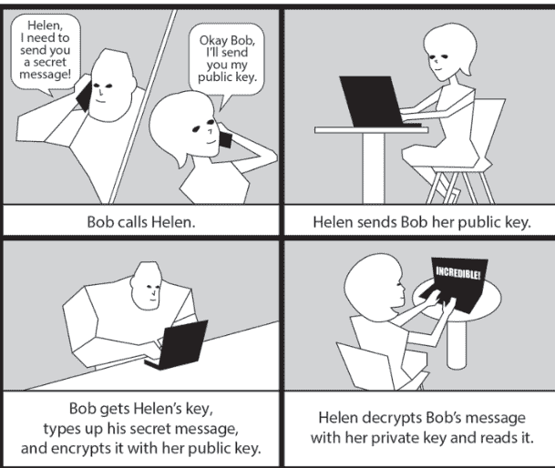
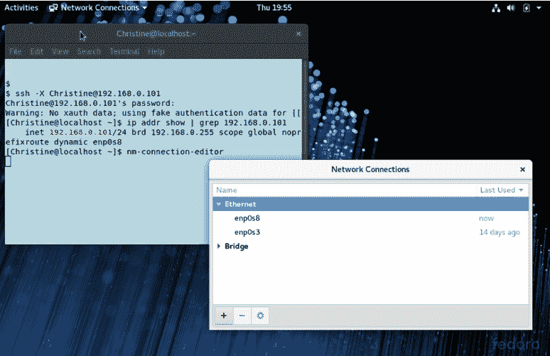

## 第 10 章

## 保障系统安全

### 目标

- - [x] 110.1 执行安全管理任务
- - [x] 110.2 设置主机安全
- - [x] 110.3 使用加密保护数据


保障系统安全是一项至关重要的任务。计算机攻击和安全漏洞的种类与日俱增。因此，提升服务器安全性的需求也在与日俱增。

系统管理员必须知道如何至少设置基本的主机安全级别。这包括审计其系统提供的网络服务、审查系统配置以确保正确执行本地安全策略，以及采用适当的技术来保护数据和通信。我们将在本章系统安全中介绍这些主题及其他内容。

### 管理网络安全

想象一栋房子的每个房间都有通往外面的门。出门或睡觉前要检查的锁就很多了。在网络安全领域，系统中存在未使用的服务，就好比有多扇通往外面的不必要的门。网络安全中适用于此场景的术语是攻击面。攻击面是指恶意人员出于不法目的可能试图进入以获取某些东西的所有各种点。

延续这个比喻，设想这栋多门房子有几扇门的旧锁不再正常工作，需要更换或修理。这种情况类似于系统中需要更新、重新配置甚至替换的旧版安全软件，以便更现代、更安全的应用程序能够取代它。

在本节中，我们将探讨如何审计系统中未使用的服务，以最大限度地减小其攻击面。我们还将了解一些旧版网络安全技术及其处理方式。

#### 禁用未使用的服务

最大限度地减小系统攻击面的一种方法是在系统中禁用未使用的服务（守护进程）。运行的软件越少，恶意行为者（攻击者的另一个称呼）可以利用的目标就越少。

虽然你可能觉得自己知道 Linux 系统上运行的每个服务，但为确保万无一失，运行彻底审计始终是个好主意。在本节中，我们将介绍可以进行的各种检查，以查看系统提供了哪些服务。

#### 使用 nmap 发现开放端口

网络映射器（nmap）实用程序常用于渗透测试（测试系统、其网络及其应用程序以查找恶意攻击者可能利用的计算机安全弱点的做法）。然而，它对于网络服务审计也非常有用。


虽然默认情况下通常不安装，但除了诸如 Kali Linux 之类的渗透测试发行版外，大多数发行版在其标准软件仓库中都有 nmap 软件包。有关如何安装软件包，请参见第 2 章“管理软件和进程”。

nmap 命令专门作为网络端口扫描应用程序开发。它可以扫描多个远程网络服务器，记录它们支持的所有端口和协议。通常，当网络服务启动时，它会打开一个网络端口并监听传入连接。nmap 实用程序执行标准的 TCP 和 UDP 连接检查，满足我们在此处的需求。

清单 10.1 中的代码片段示例展示了如何在系统防火墙内使用 nmap，方法是将 127.0.0.1（本地回环地址）指定为要扫描的服务器。为了查看 IPv4 端口提供哪些 TCP 协议服务，使用了 -sT 选项（扫描 TCP）。如果需要，也可以添加 -p 选项来指定端口范围。

### 清单 10.1: 使用 nmap 实用程序查看防火墙内的 TCP 端口和服务

```
$ nmap -sT 127.0.0.1
[...]
Nmap scan report for localhost (127.0.0.1)
Host is up (0.00017s latency).
Not shown: 996 closed ports
PORT     STATE SERVICE
22/tcp   open  ssh
25/tcp   open  smtp
111/tcp  open  rpcbind
631/tcp  open  ipp
Nmap done: 1 IP address (1 host up) scanned in 0.23 seconds
$
```

注意，在 nmap 实用程序输出的前几行之后，会显示三列数据：PORT、STATE、SERVICE。清单 10.1 中此信息的第一行是：

```
22/tcp open ssh
```

此信息让我们知道，端口 22 已打开，并且正在为 OpenSSH (ssh) 服务监听 TCP 连接。如果您不认识某个服务的名称，可以使用 /etc/services 文件来获取帮助（此文件在第 8 章“配置基本网络”中已介绍）。

如果您正在跟随本书中的命令操作，请注意，您的系统提供的服务可能与我们系统提供的服务不同。因此，某些命令输出（例如 nmap 实用程序的输出）可能会显示与您在系统上看到的不同的结果。

查看系统防火墙实用程序之外的哪些端口正在提供服务是个好主意。为此，请将服务器的 IP 地址（作为要扫描的指定服务器）与 nmap 实用程序和相同的选项一起使用。清单 10.2 中显示了一个代码片段示例。这很方便，因为您不仅可以找出正在提供哪些端口和 TCP 协议服务，还可以知道防火墙实用程序正在阻止哪些端口/服务。

### 清单 10.2: 使用 nmap 实用程序查看防火墙外的 TCP 端口和服务

```
$ nmap -sT 192.168.0.103
[...]
Nmap scan report for 192.168.0.103
Host is up (0.0015s latency).
Not shown: 998 closed ports
PORT STATE SERVICE
22/tcp open ssh
111/tcp open rpcbind

Nmap done: 1 IP address (1 host up) scanned in 0.21 seconds
$
```

为了进行适当的审计，还应扫描系统防火墙内外提供 UDP 协议服务的端口。为此，您需要使用超级用户权限，并重复之前的两个 nmap 命令，但将 -sT 选项更改为 -sU：

```
nmap -sU 127.0.0.1
nmap -sU 192.168.0.103
```

如果您的网络运行的是 IPv6，则执行 nmap 扫描时需要添加 -6 选项并提供相应的 IPv6 系统地址。清单 10.3 显示了在连接到 IPv6 网络的系统上扫描防火墙内 UDP 协议服务的代码片段示例。

### 清单 10.3: 使用 nmap 实用程序查看防火墙内的 UDP 端口和服务

```
# nmap -sU -6 ::1
[...]
Nmap scan report for localhost (::1)
Host is up (0.000049s latency).
Not shown: 999 closed ports
PORT STATE SERVICE
111/udp open rpcbind

Nmap done: 1 IP address (1 host up) scanned in 0.21 seconds
#
```

未经许可，请勿在家庭网络之外运行网络映射实用程序。有关更多信息，请阅读 nmap.org/book/legal-issues.html 上的 nmap 实用程序法律问题指南。

## 使用 netstat 识别开放端口

另一个有助于网络服务审计的工具是 netstat 实用程序。请注意，该程序现已弃用。弃用一词意味着，未来某个时候，此实用程序将不再默认安装，也不会在各个发行版的软件仓库中提供。因此，虽然您需要为旧系统了解它，但不要指望它会一直存在。

netstat 实用程序的主要替代品是 ss 命令。

netstat 命令非常通用，但通用性带来了复杂性。netstat 中有大量命令行选项可用，允许您自定义它返回的信息。为了审计目的，请使用 -t（或 --tcp）选项连同 -l（或 --listening）开关，仅显示正在监听传入 TCP 数据包的端口，如清单 10.4 所示。

### 清单 10.4: 使用 netstat 实用程序查看 TCP 端口和服务

```
$ netstat --tcp --listening
Active Internet connections (only servers)
Proto Recv-Q Send-Q Local Address Foreign Address State
tcp 0 0 0.0.0.0:sunrpc 0.0.0.0:* LISTEN
tcp 0 0 localhost.local:domain 0.0.0.0:* LISTEN
tcp 0 0 0.0.0.0:ssh 0.0.0.0:* LISTEN
tcp 0 0 localhost:ipp 0.0.0.0:* LISTEN
tcp 0 0 localhost:smtp 0.0.0.0:* LISTEN
tcp6 0 0 [::]:sunrpc [::]:* LISTEN
tcp6 0 0 [::]:ssh [::]:* LISTEN
tcp6 0 0 localhost:ipp [::]:* LISTEN
tcp6 0 0 localhost:smtp [::]:* LISTEN
$
```

请注意，它默认会显示 IPv4 和 IPv6 的信息。为了审计 UDP 端口和服务，请使用 -u（或 --udp）开关替换 -t（或 --tcp）选项。在清单 10.4 中，本地地址和冒号 (:) 之后的名称是根据 /etc/services 文件定义的端口名称。如果端口号未在 /etc/services 文件中定义，则会显示为数字。

端口和套接字是 Linux 网络中的重要结构。了解它们之间的区别将有助于审计过程。

端口是 TCP 和 UDP 等协议使用的数字，用于标识正在传输数据的服务或应用程序。例如，端口 22 是专门为 OpenSSH 指定的知名端口，而 DNS 监听端口 53。TCP 和 UDP 数据包在其标头中包含数据包的源端口和目标端口。

网络套接字是网络连接两个端点中的单个端点。该单个端点位于本地系统上并绑定到特定端口。因此，网络套接字使用 IP 地址（本地系统）和端口号的组合。

## 通过 ss 和 systemd.socket 调查网络套接字

ss 命令可以帮助您替换过时的 netstat 工具的网络服务审计功能。-l tu 选项仅显示监听 (-l) 的 TCP (-t) 和 UDP (-u) 网络套接字，适用于 IPv4 和 IPv6。清单 10.5 中显示了一个代码片段示例。

### 清单 10.5: 使用 ss 实用程序查看监听的 TCP/UDP 网络套接字

```
$ ss -ltu
Netid State Recv-Q Send-Q Local Address:Port Peer Address:Port
[...]
udp UNCONN 0 0 :::sunrpc :::*
udp UNCONN 0 0 :::822 :::*
[...]
tcp LISTEN 0 128 *:ssh *:*
tcp LISTEN 0 128 127.0.0.1:ipp *:*
tcp LISTEN 0 100 127.0.0.1:smtp *:*
[...]
tcp LISTEN 0 128 :::ssh :::*
tcp LISTEN 0 128 ::1:ipp :::*
tcp LISTEN 0 100 ::1:smtp :::*
$
```

创建网络套接字（以及其他套接字类型）的一种相对较新的方法是通过 systemd。它使用一种激活方法，可以在附加服务之外并行启动监听套接字，从而加快整个过程（在认证考试目标中称为 systemd.sockets）。因此，这为网络服务审计提供了额外的领域。

审计 systemd 管理的网络套接字时，您可以使用几种方法，最好的起点是通过 systemctl 实用程序（首先在第 5 章“引导、初始化和虚拟化 Linux”中介绍）。在清单 10.6 中，该命令连同 list-sockets 参数和多个选项一起使用，以使显示更易于阅读。

### 清单 10.6: 使用 systemctl 实用程序查看 systemd 管理的套接字

```
$ systemctl list-sockets --all --no-pager --full
LISTEN UNIT ACTIVATES
[...]
/var/run/cups/cups.sock cups.socket cups.service
[...]
0.0.0.0:111 rpcbind.socket rpcbind.service
0.0.0.0:111 rpcbind.socket rpcbind.service
[...]
[:::]:111 rpcbind.socket rpcbind.service
[:::]:111 rpcbind.socket rpcbind.service
[:::]:22 sshd.socket
[...]
28 sockets listed.
$
```

您可能已经注意到，此命令的输出中除了网络套接字之外，您还会看到更多类型的套接字。诀窍是在输出中查找熟悉的网络服务名称（示例：sshd）和/或端口号（示例：22）。

要查找潜在的网络套接字 systemd 配置（单元）文件，请使用不同的 systemctl 命令，如清单 10.7 所示。

### 清单 10.7: 使用 systemctl 实用程序查看 systemd 管理的套接字单元文件

```
$ systemctl list-unit-files --type=socket --no-pager
UNIT FILE STATE
[...]
cups.socket enabled
[...]
rpcbind.socket enabled
[...]
sshd.socket disabled
[...]

32 unit files listed.
$
```


关于此 systemctl 命令输出的一个有用事实是，您可以快速确定网络套接字对 systemd 是启用还是禁用。禁用值仅表示 systemd 不管理该特定网络套接字；它并不 *表示* 服务已禁用。在清单 10.7 中，rpcbind 套接字是启用的，而 sshd 套接字显示为禁用。

对于已启用的套接字，您需要做一些额外的研究，才能将审计的这部分视为完成。查看每个已启用网络套接字的单元文件内容。查看 rpcbind 套接字单元文件的示例在清单 10.8 中所示。

### 清单 10.8：使用 systemctl 实用程序查看 systemd 套接字单元文件的内容

```
$ systemctl cat rpcbind.socket
# /usr/lib/systemd/system/rpcbind.socket
[Unit]
Description=RPCbind Server Activation Socket

[Socket]
ListenStream=/var/run/rpcbind.sock

# RPC netconfig can't handle ipv6/ipv4 dual sockets
BindIPv6Only=ipv6-only
ListenStream=0.0.0.0:111
ListenDatagram=0.0.0.0:111
ListenStream=[::]:111
ListenDatagram=[::]:111

[Install]
WantedBy=sockets.target
$
```

单元文件的内容将为您提供更多关于此套接字使用的端口的线索（本例中为 111），以及其他网络套接字配置信息。如果需要，您可以在命令行键入 **man systemd.socket** 来查看这些套接字单元文件的各种可能设置。

## 使用 lsof 和 fuser 审计打开的文件

除了查看端口和网络套接字外，您还可以使用打开的文件来追踪系统上提供的网络服务。*lsof* 命令列出当前打开的文件。由于 Linux 将网络连接和套接字视为文件，它们将出现在 *lsof* 输出列表中。

*lsof* 命令产生大量输出，因此最好对其进行过滤。例如，如果您只对审计 UDP 协议套接字和连接感兴趣，请使用 `-iUDP` 选项，如清单 10.9 所示。请注意，您可以同时看到 IPv4 和 IPv6 以及其他有用的审计信息。

### 清单 10.9：通过 lsof 实用程序显示 UDP 打开的文件

```
# lsof -iUDP
COMMAND   PID   USER   FD   TYPE   DEVICE   SIZE/OFF   NODE   NAME
systemd   1     root   50u  IPv4   22181    0t0        UDP    *:sunrpc
systemd   1     root   52u  IPv6   22183    0t0        UDP    *:sunrpc
rpcbind   2773  rpc    5u   IPv4   22181    0t0        UDP    *:sunrpc
rpcbind   2773  rpc    7u   IPv6   22183    0t0        UDP    *:sunrpc
rpcbind   2773  rpc    10u  IPv4   22798    0t0        UDP    *:822
rpcbind   2773  rpc    11u  IPv6   22799    0t0        UDP    *:822
[...]
#
```

> 您需要使用超级用户权限才能使 lsof 实用程序正确工作。如果从 lsof 程序中没有收到任何输出，您很可能是以标准用户身份发出的命令。

在清单 10.10 中，lsof 实用程序的输出已过滤，以显示处于侦听状态 (-sTCP:LISTEN) 的仅限 TCP 数据包 (-iTCP) 的网络套接字。

### 清单 10.10：通过 lsof 实用程序显示 TCP 侦听打开的文件

```
# lsof -iTCP -sTCP:LISTEN
COMMAND   PID   USER   FD   TYPE   DEVICE   SIZE/OFF   NODE   NAME
systemd   1     root   49u  IPv4   22180    0t0        TCP    *:sunrpc (LISTEN)
systemd   1     root   51u  IPv6   22182    0t0        TCP    *:sunrpc (LISTEN)
rpcbind   2773  rpc    4u   IPv4   22180    0t0        TCP    *:sunrpc (LISTEN)
rpcbind   2773  rpc    6u   IPv6   22182    0t0        TCP    *:sunrpc (LISTEN)
sshd      3404  root   3u   IPv4   29484    0t0        TCP    *:ssh (LISTEN)
sshd      3404  root   4u   IPv6   29486    0t0        TCP    *:ssh (LISTEN)
cupsd     3406  root   11u  IPv6   30292    0t0        TCP    localhost:ipp (LISTEN)
cupsd     3406  root   12u  IPv4   30293    0t0        TCP    localhost:ipp (LISTEN)
master    3653  root   13u  IPv4   30584    0t0        TCP    localhost:smtp (LISTEN)
master    3653  root   14u  IPv6   30585    0t0        TCP    localhost:smtp (LISTEN)
[...]
#
```

您可以深入挖掘，不仅可以查看有关特定端口的 TCP 协议流量的更多信息，还可以查看到该端口的已建立连接。只需使用 -i 选项的变体，该变体使用 PROTOCOL:PORT 参数，如清单 10.11 所示。

### 清单 10.11：通过 lsof 实用程序显示特定协议和端口的打开文件

```
# lsof -i tcp:22
COMMAND PID USER FD TYPE DEVICE SIZE/OFF NODE NAME
sshd 3404 root 3u IPv4 29484 0t0 TCP *:ssh (LISTEN)
sshd 3404 root 4u IPv6 29486 0t0 TCP *:ssh (LISTEN)
sshd 4501 root 3u IPv4 39036 0t0 TCP localhost.localdomain:ssh->192.168.0.101:61500 (ESTABLISHED)
sshd 4507 Christine 3u IPv4 39036 0t0 TCP localhost.localdomain:ssh->192.168.0.101:61500 (ESTABLISHED)
#
```

另一种允许进一步审计的实用程序是 *fuser* 命令。它将显示使用该协议和端口的程序或用户的进程 ID (PID)。清单 10.12 中显示了此示例，其中使用 -v 选项提供更多详细信息，并使用 -n 开关指定协议，后跟端口号。

### 清单 10.12：通过 fuser 实用程序显示使用 TCP 和特定端口的 PID

```
# fuser -vn tcp 22
                  USER        PID ACCESS COMMAND
22/tcp:   root       3404 F.... sshd
                  root       4501 F.... sshd
                  Christine  4507 F.... sshd
#
```

清单 10.13 显示了同样的内容，只是它指定了 UDP 协议。请注意，使用 fuser 命令时必须同时指定协议和端口。

### 清单 10.13：通过 fuser 实用程序显示使用 UDP 和特定端口的 PID

```
# fuser -vn udp 822
                  USER        PID ACCESS COMMAND
822/udp:  rpc        2773 F.... rpcbind
#
```

请注意，与 lsof 命令一样，您必须在 fuser 实用程序中使用超级用户权限。

不要忘记使用系统初始化实用程序作为服务审计的一部分。对于 systemd 系统，请键入 `systemctl list-unit-files -t service | grep enabled` 以查看系统启动时启动（启用）的所有服务。

在所有 SysVinit 系统上，您可以通过查看存储在 /etc/init.d/ 目录中的初始化脚本来开始审计过程。每个脚本的名称都是 SysVinit 管理的服务的名称。

要继续在 SysVinit 系统上进行审计过程，对于基于 Red Hat 的发行版，请使用超级用户权限并在命令行键入 chkconfig --list 以审计在不同运行级别启动的各种服务。对于基于 Debian 的 SysVinit 发行版，请使用 service --status-all 命令。

对于较旧的 SysVinit 发行版版本，您可能还希望查看 /etc/inittab 文件。此文件中可能包含启动的服务。

## 禁用服务

当您通过审计过程确定系统上正在运行/启用的网络守护进程时，请使用（或创建一个）所需网络服务列表。然后有条不紊地逐一禁用不需要的守护进程。您采用的方法取决于系统的初始化方法。

对于 systemd 系统，只需几个步骤。首先，如果服务正在运行，请停止它，并使用超级用户权限通过以下命令检查它是否已停止：

```
systemctl stop SERVICE-NAME
systemctl status SERVICE-NAME
```

当然，您将希望将要停止的服务名称替换为命令中的 SERVICE-NAME 部分。

服务停止后，请务必使用超级用户权限将其禁用，以便系统重新启动时它不会启动。

```
systemctl disable SERVICE-NAME
```

发出前面的命令后，请检查以确保它已真正禁用。您应该从此命令收到禁用消息：

```
systemctl is-enabled SERVICE-NAME
```

> 如果您使用的是采用现已废弃的 Upstart 系统初始化守护进程的发行版，则需要使用与这里描述的不同方法来禁用不需要的服务。查看发行版的 Upstart 文档。首先在命令行输入 man initctl。

对于 SysVinit 系统，您需要先停止服务（如果正在运行），并使用超级用户权限通过以下命令检查它是否已停止：

```
service SERVICE-NAME stop
service SERVICE-NAME status
```

要在基于 Red Hat 的发行版上禁用服务，请使用超级用户权限和以下命令（将服务名称替换为 SERVICE-NAME）：

```
chkconfig SERVICE-NAME off
```


然后检查该服务在此命令显示的每个运行级别中是否已禁用（关闭）：

```
chkconfig --list SERVICE-NAME
```

> 如果不需要网络服务，可以考虑不仅将其禁用，还将其卸载。第 2 章介绍了如何删除软件包。

在基于 Debian 的发行版上禁用网络服务，需使用超级用户权限并执行以下命令：

```
update-rc.d -f SERVICE-NAME remove
```

前一命令中的 -f 选项仅在服务（SERVICE-NAME）的脚本存在于 /etc/init.d/ 目录中时才需要。

不需要的网络服务只是系统攻击面上的一个攻击向量。但是，禁用（或卸载）这些不必要的服务后，您就少了一件需要担心的事情。

## 使用超级服务器限制

通常，当网络服务（守护进程）启动时，例如 chronyd（在第 7 章中介绍），它会打开一个端口。您可以将端口号视为分配给网络服务的识别号。包含网络服务端口号的传入网络数据包会触发该服务启动。当网络服务等待包含其端口号的数据包时，它处于等待状态，这称为监听。当守护进程处于此状态时，通常被称为“直接在端口上监听”。

与其直接在端口上监听，不如某些网络服务可以使用超级服务器（也称为超级守护进程）作为它们的守卫。而不是由网络服务，超级服务器直接监听包含指定端口号的数据包。当这样的数据包进入系统后，在初始处理之后，超级服务器会启动网络服务并将数据包移交给它。当并发请求到来时，超级服务器可以根据需要启动更多的网络服务进程。

使用此方法，系统启动更快，因为网络服务在需要之前不会启动。此外，您可以实施额外的控制。例如，您可以对网络服务的使用设置限制，并可以精细调整连接日志。

## 配置 xinetd

Linux 系统上的原始超级服务器是 inetd。它被 xinetd 取代，xinetd 因其额外的安全特性而被称为扩展超级守护进程。

xinetd 的主配置文件是 /etc/xinetd.conf。此文件通常仅包含全局默认选项。CentOS 发行版上此文件的片段示例显示在清单 10.14 中。

## 清单 10.14: 查看 /etc/xinetd.conf 文件

```
$ cat /etc/xinetd.conf
# [...]
defaults
{
    # The next two items are intended to be a quick access place to
    # temporarily enable or disable services.
    #
    #             enabled     =
    #             disabled    =

    # Define general logging characteristics.
            log_type        = SYSLOG daemon info
            log_on_failure  = HOST
            log_on_success  = PID HOST DURATION EXIT

    # Define access restriction defaults
    #
    #             no_access     =
    #             only_from     =
    #             max_load      = 0
            cps             = 50 10
            instances       = 50
            per_source      = 10

    # Address and networking defaults
    #
    #             bind          =
    #             mdns          = yes
            v6only          = no

    # setup environmental attributes
    #
    #             passenv       =
            groups          = yes
            umask           = 002
[...]
}
includedir /etc/xinetd.d
$
```

在 /etc/xinetd.conf 文件中，任何以井号（#）开头的行都是注释行，因此处于非活动状态。请注意文件底部的 includedir 指令：

```
includedir /etc/xinetd.d
```

此设置会导致存储在 /etc/xinetd.d/ 目录中的单个服务配置文件被包含在超级服务器的结构中。


> 如果在系统中找不到 /etc/xinetd.conf 文件，很可能未安装 xinetd 软件包。如需安装此软件包，请参见第 2 章。

常用的 xinetd 指令在表 10.1 中有描述。如果要浏览所有指令，请在命令行中输入 **man xinetd.conf**。

## 表 10.1 常用的 /etc/xinetd.conf 指令

| 名称 | 描述 |
|---|---|
| cps | 指定到达网络服务的传入连接的最大速率。第一个数字设置服务暂停前的最大速率，第二个数字建立暂停的秒数。 |
| instances | 设置可以同时处于活动状态的服务进程的最大数量。设置为 UNLIMITED 以允许无限制。 |
| logtype | 确定日志消息的发送目标。如果设置为 SYSLOG，日志消息将发送到 syslog 协议应用程序，并且还必须设置 syslog 功能和严重级别（参见第 7 章）。如果设置为 FILE，日志消息将追加到列出的文件名。 |
| log_on_failure | 确定当服务器进程无法启动时，除服务 ID 之外记录的其他信息。可以包含的数据为 HOST、USERID 和 ATTEMPT。 |
| log_on_success | 设置服务器进程启动和退出时记录的信息。可以包含的数据为 PID、HOST、USERID、EXIT、DURATION 和 TRAFFIC。 |
| max_load | 确定一分钟负载平均值，达到该值时网络服务将停止接受连接，直到负载级别下降。 |
| no_access | 建立从此网络服务禁止访问的远程主机。 |
| only_from | 设置可以使用此网络服务的远程主机或子网。 |
| per_source | 指定每个 IP 地址可以启动的网络服务器进程的最大数量。 |

## 配置 xinetd 服务

/etc/xinetd.conf 文件中的默认选项可以由存储在 /etc/xinetd.d/ 目录中的网络服务配置文件中的设置覆盖。清单 10.15 显示了此类配置文件的示例。echo-stream 服务会发回发送到它的任何数据，并用于测量两个系统之间的数据包往返时间。

请注意，文件中每个服务都有必填设置，例如 id。此外，还有指令可用于覆盖 /etc/xinetd.conf 文件中的全局设置。非活动指令通过 # 标记设置为非活动。

## 清单 10.15: 查看 echo 流的 /etc/xinetd.d/ 配置文件

```
$ cat /etc/xinetd.d/echo-stream
# This is the configuration for the tcp/stream echo service.

service echo
{
    # This is for quick on or off of the service
            disable           = yes

    # The next attributes are mandatory for all services
            id                = echo-stream
            type              = INTERNAL
            wait              = no
            socket_type       = stream
    #    protocol            = socket type is usually enough
    [...]
    # Logging options
    #     log_type            =
    #     log_on_success      =
    #     log_on_failure      =

    [...]
    # Access restrictions
    #     only_from           =
    #     no_access           =
    #     access_times        =
    #     cps                 = 50 10
    #     instances           = UNLIMITED
    #     per_source          = UNLIMITED
    #     max_load            = 0
    [...]
}
$
```

单个网络服务配置文件中的一条重要指令是 disable 设置。如果设置为 yes，则服务被禁用。但是，如果 disable 设置为 no，则服务处于活动状态。最好浏览各种配置文件，以确保系统需要运行的网络服务设置为 disable = no，而不应该运行的服务则反之。

当 xinetd 配置文件设置正确后，您需要启动或重新启动 xinetd。使用适当的方法，该方法取决于系统的初始化方法（在第 5 章中介绍）。

如果您曾调查过 systemd.sockets，可能会认为它使 xinetd 等超级服务器过时。但目前情况并非如此。xinetd 超级服务器提供的功能比 systemd.sockets 目前所能提供的更多。如果您感兴趣，网站 0pointer.de/blog/projects/inetd.html 提供了关于此主题的更多见解。

## 通过 TCP Wrappers 限制

TCP Wrappers 是一种用于控制对网络服务访问的较旧方法。如果服务可以使用 TCP Wrappers，则它会与 libwrap 库一起编译。您可以使用 ldd 命令检查支持情况，如清单 10.16 所示。请注意，Ubuntu 系统上的 openSSH 服务可以使用 TCP Wrappers。

## 清单 10.16: 使用 ldd 命令检查 TCP Wrappers 支持

```
$ which sshd
/usr/sbin/sshd
$
$ ldd /usr/sbin/sshd | grep libwrap
    libwrap.so.0 [...]
$
```

TCP Wrappers 使用两个文件来确定谁可以访问特定服务。这些文件是 /etc/hosts.allow 和 /etc/hosts.deny。顾名思义，hosts.allow 文件通常以白名单形式允许访问指定服务，而 hosts.deny 文件通常阻止访问黑名单中包含的所有地址。这些文件具有简单的记录语法：

SERVICE: IPADDRESS...

这些文件的搜索顺序至关重要。对于传入的服务请求，会发生以下情况：

- 检查 hosts.allow 文件中的远程 IP 地址或主机名。
  - 如果找到，则允许访问，且不再进行进一步检查。


- 会检查 hosts.deny 文件以验证远程地址。
  - 如果找到，拒绝访问。
  - 如果未找到，允许访问。

因为如果在任一文件中都未找到远程系统的地址，则允许访问，因此最好在 /etc/hosts.deny 文件中使用 ALL 通配符：

```
ALL: ALL
```

这将禁用未在 /etc/hosts.allow 文件中列出的任何 IP 地址对所有服务的所有访问。请注意，某些发行版对地址通配符使用 PARANOID 而不是 ALL。

记录的 IPADDRESS 可以是 IPv4 或 IPv6。要在 hosts.allow 文件中列出单个 IP 地址，请用逗号分隔它们：

```
sshd: 172.243.24.15, 172.243.24.16, 172.243.24.17
```

无需键入允许访问 OpenSSH 服务的每个 IP 地址。您可以指定整个子网。例如，如果需要允许服务器上 Class C 网络中的所有 IPv4 地址访问，则只需指定前三个地址八位组，后跟一个尾随点：

```
sshd: 172.243.24.24.
```

> TCP Wrappers 在管理员使用防火墙之前就已创建。虽然仍有人在使用，但其有用性有限，许多发行版认为其已弃用。最好将此防护转移到防火墙中。

## 管理本地安全

保护系统的一部分是处理本地安全。这包括了解密码保护并确保其得到正确实施。一项相当重要的安全措施（有时未得到管理）是正确强制实施对 root 账户的安全访问。本节将介绍这些主题，以及设置限制和在系统上查找潜在危险文件。

### 保护密码

虽然密码及其文件在第 7 章中已介绍，但为了正确管理账户并保持服务器安全，您还需了解一些其他内容。理解保护密码的基本原理将有所帮助。

## 查看密码存储

早期 Linux 系统将密码存储在 /etc/passwd 文件中。密码经过哈希处理。哈希密码是使用单向加密数学算法创建的，该算法采用纯文本（人类可读和可理解的文本）并将其转换为安全的密文，人类和机器都无法理解。哈希是单向的，因为您不能获取密文并使用算法将其转换回纯文本。Linux 在密码哈希过程中添加盐值，这会添加额外数据，使哈希密码更加安全。

然而，一些聪明的恶意行为者创建了所谓的彩虹表。彩虹表是已被哈希为密文的潜在纯文本密码字典。使用这些彩虹表的程序允许您输入密码的哈希值，并将其显示为纯文本：

```
Password Hash: $6$6XL3hyx7$NxhjJ0LGW5x0KLS/xcbxjADlgIJqXAJoggtCNzFM.1LuWLH
pf0YBInGQYW3P717wtyQjsXhMpcbxJOpmTDw.I
Password: 1234
```

借助彩虹表等攻击者工具，/etc/passwd 文件权限使其中存储的任何密码都易受攻击：

```
$ ls -l /etc/passwd
-rw-r--r--. 1 root root 2631 Jun 12 18:04 /etc/passwd
```

使用这些权限设置，所有有权访问系统的人都可以读取此文件（文件权限在第 4 章“管理文件”中介绍过）。因此，每个人都可以访问哈希密码，并可能使用彩虹表或其他攻击者工具来发现账户的纯文本密码。

为了保护账户密码，将其从 /etc/passwd 文件移动到更严格限制的 /etc/shadow 文件中：

```
$ ls -l /etc/shadow
----------. 1 root root 2143 Jun 12 18:04 /etc/shadow
```

这些文件权限设置防止其他用户查看密码哈希。（某些发行版对 /etc/shadow 文件的文件权限略有不同，但本质上效果相同。）

虽然在第 7 章中提到过，但有必要再次提及。如果您的 Linux 系统仍将密码存储在 /etc/passwd 文件中，则需要将其移动到 /etc/shadow 文件中。pwconv 实用程序可以为您执行此操作。

登录账户时，密码提示符会接受您在字段中键入的纯文本密码。为了检查密码的正确性，系统会将输入的纯文本通过哈希算法运行，并在过程中添加盐值，从而生成密文。如果生成的密文与 /etc/shadow 文件中存储的密码哈希匹配，系统会确认输入的密码正确。

由于 /etc/shadow 文件仅允许 root 用户（文件所有者）写入，普通用户要更改其账户密码，必须临时获得 root 用户的权限状态。这是通过 passwd 程序文件上设置的 SUID 权限完成的，如清单 10.17 所示。

### 清单 10.17：查看 passwd 实用程序和 /etc/shadow 文件的权限

```
$ ls -l /etc/shadow
-rw-r----- 1 root shadow 1425 Mar 21 17:51 /etc/shadow
$
$ which passwd
/usr/bin/passwd
$
$ ls -l /usr/bin/passwd
-rwsr-xr-x 1 root root 59640 Jan 25  2018 /usr/bin/passwd
$
```

因此，在运行 passwd 程序时，您暂时成为 root 用户。程序运行完毕后，您将恢复正常身份。但是，如果不使用超级用户权限，您无法启动更改其他账户密码的过程，如清单 10.18 所示。

### 清单 10.18：使用 passwd 实用程序和超级用户权限更改其他账户的密码

```
$ passwd BCrusher
passwd: You may not view or modify password information for BCrusher.
$
$ sudo passwd BCrusher
[sudo] password for Christine:
Enter new UNIX password:
Retype new UNIX password:
passwd: password updated successfully
$
```

在为账户键入新密码时，它不会显示在屏幕上。如果您习惯于至少看到星号或其他代表字符，那么键入时什么也不显示可能会感觉奇怪。

### 处理密码问题

在配备适当安全措施时，会出现访问问题。能够快速解决密码问题将使用户满意，并更愿意配合适当的安全措施。如果用户可以访问系统，但在输入用户名和密码后无法访问其账户，您可以探索一些故障排除项目。

如果账户是新创建的账户，请确认其已正确构建。新系统管理员通常使用 useradd 命令（参见第 7 章）创建用户账户，但忘记使用 passwd 实用程序添加其密码。使用 grep 或 getent 命令检查 /etc/passwd 和 /etc/shadow 文件记录。清单 10.19 显示了 Ubuntu Desktop 发行版上新用户账户 JKirk 的示例。

### 清单 10.19：使用 getent 命令查看用户账户记录

```
$ sudo getent passwd JKirk
JKirk:x:1002:1002::/home/JKirk:/bin/bash
$
$ sudo getent shadow JKirk
JKirk:!:17806:0:99999:7:::
$
```

请注意，JKirk shadow 记录的密码字段中有一个感叹号 (!)。这表示未为该账户创建密码。

确保您的系统用户知道 Linux 上的用户名区分大小写。其他操作系统（例如 Windows）的用户名不区分大小写，这可能会引起混淆。

确定账户是否被锁定。您可以使用 passwd -S 或 getent 命令检查此项，如清单 10.20 中的代码片段所示。

### 清单 10.20：使用 passwd 和 getent 命令检查账户是否被锁定

```
$ sudo passwd -S KJaneway
KJaneway L 01/02/2019 0 99999 7 -1
$
$ sudo getent shadow KJaneway
KJaneway:!$6$[...]0:17898:0:99999:7:::
$
```

用户 KJaneway 账户名后面的 L 表示该账户已锁定。但是，该代码也显示在未设置密码的账户上。因此，也会使用 getent 命令。账户密码字段前面的感叹号 (!) 验证该账户确实已锁定。如需解锁账户，请使用超级用户权限和 usermod -U 或 passwd -u 命令。

检查用户的键盘。有时错误的键盘映射或损坏的硬件会导致向身份验证程序发送错误的字符。


该账户可能已过期。账户过期日期通常为临时账户用户（如承包商或实习生）设置。您可以使用 chage 命令查看此信息，如清单 10.21 所示。

### 清单 10.21: 使用 chage 命令检查账户是否过期

```
$ date
Wed Jan  2 16:17:48 EST 2019
$
$ sudo chage -l JArcher
[...]
Account expires		: Jan 01, 2019
[...]
```

请注意，此账户的过期日期已过。因此，JArcher 账户现已过期，用户无法登录。如果这是个错误或您需要修改它，请使用超级用户权限和 chage -E 命令为账户设置新的过期日期。

确认用户使用的是正确密码，并检查账户密码是否已过期。也可使用 chage -l 命令查看此信息。

及时了解关于密码长度和复杂性的当前指南非常重要。美国国家标准与技术研究院（NIST）在 pages.nist.gov/800-63-3/sp800-63b.html 上提供了一份有用的指南，可为您提供帮助。要实施这些建议，您可能需要使用可插拔认证模块（PAM），例如 pam_unix.so、pam_pwhistory.so 和 pam_pwquality.so。有关 PAM 的更多信息，请访问 linux-pam.org。

## 限制 root 访问

适当的账户管理可增强系统安全性。以下是妥善管理账户应做的基本事项列表：

- 不允许登录到 root 用户账户。
- 每个用户账户仅允许一个用户。
- 为临时用户账户设置过期日期。
- 删除未使用的用户账户。

本节重点介绍 root 用户账户。总的来说，即使您是唯一使用该系统的人，登录到 root 用户账户也不是个好主意。有替代方案可以满足各种系统管理员的需求。

## 使用 su 切换用户

使用 su 实用程序，您可以快速登录到其他账户，或仅发出几条命令。要登录到 root 用户账户，请输入 su 后跟一个短划线（-）。您需要输入 root 用户的密码才能获得访问权限：

```
$ su -
Password:
# whoami
root
```

> 在默认情况下阻止 root 登录的任何发行版（例如 Ubuntu）上，您将无法使用 su - 方法登录到 root 账户。虽然您可以只输入 su 然后输入正确密码来登录到 root 用户账户，但这不明智，因为并非所有内容都可能已正确设置，以执行需要超级用户权限的任务。su 命令后的短划线（-）会启动一个新的 shell 环境并执行 root 的配置文件。

要进入另一个用户的账户，您再次使用 su -，但后面跟上账户的用户名：

```
$ su - rich
Password:
$ whoami
rich
```

切换到所需账户后，您可以使用该用户账户的权限发出多条命令。完成任务后，键入 exit 或 logout 以退出账户。

如果您只需使用超级用户权限发出单条命令，可以使用 su -c 命令。例如，更改另一个账户的密码需要超级用户权限。只要您知道 root 账户的密码，就可以完成此操作，如清单 10.22 所示。

### 清单 10.22: 通过 su -c 命令以另一用户身份发出单条命令

```
$ whoami
Christine
$
$ su -c "passwd rich"
[...]
passwd: all authentication tokens updated successfully.
$
$ whoami
Christine
$
```

上一个清单中的第一个密码提示正在询问 root 用户账户密码。之后，passwd rich 命令正在使用 root 用户账户的权限执行。请注意，passwd rich 被引号括起来。每当您向另一个账户传递的命令中包含空格时，就需要对其加引号。

## 以超级用户身份使用 sudo 完成工作

虽然 su 命令很有帮助，但它仍不能完全满足不允许登录到 root 用户账户的安全要求。幸运的是，sudo 实用程序可以对此提供帮助。

以 root 用户身份登录会创建所谓的否认环境。否认环境意味着一个人可以否认自己的行为。因此，如果系统管理员使用 root 账户执行某些非法或捣乱活动，管理员可以合法否认对该活动负责。每个用户都有账户和密码且没有人可以登录到 root 用户账户的系统会建立非否认环境。这意味着行为会被记录，且对这些行为的责任不容易被否认。可以使用 sudo 创建非否认环境。

sudo 实用程序允许用户以超级用户权限发出单条命令。所有 sudo 命令的使用都会记录在日志文件或日志中，其中包含跟踪数据，例如谁在何时做了什么。

sudo 实用程序的主要配置文件是 /etc/sudoers 文件。Ubuntu 发行版系统上的 /etc/sudoers 文件片段示例如清单 10.23 所示。

### 清单 10.23: 查看 /etc/sudoers 配置文件

```
$ sudo cat /etc/sudoers
[sudo] password for Christine:
#
# This file MUST be edited with the 'visudo' command as root.
#
[...]
# User privilege specification
root    ALL=(ALL:ALL) ALL

# Members of the admin group may gain root privileges
%admin ALL=(ALL) ALL

# Allow members of group sudo to execute any command
%sudo   ALL=(ALL:ALL) ALL

# See sudoers(5) for more information on "#include" directives:

#includedir /etc/sudoers.d
$
```

在清单 10.23 中，以 root 开头的行是典型配置，用于向用户提供完全访问权限。/etc/sudoers 中特定用户的访问权限使用以下格式指定：

```
USERNAME HOSTNAME-OF-SYSTEM=(USER: GROUP) COMMANDS
```

因此，对于 /etc/sudoers 文件中的 root 用户记录，root 账户可以在系统上使用超级用户权限，无论其主机名是什么（ALL=），可以以任何用户身份（ALL:）或以任何组成员身份（:ALL）运行命令，并执行任何命令（ALL）。

切勿使用标准编辑器打开 sudoers 文件。如果多个用户同时打开 sudoers 文件，可能会发生奇怪的事情并损坏文件。visudo 命令会在编辑器中安全地打开该文件，以便您进行更改。它的操作方式与 vi 编辑器相同（第 1 章中介绍过）。

为了简化操作，许多发行版在 /etc/sudoers 文件中添加了提供完全超级用户权限的组，例如 sudo 或 wheel。sudoers 文件中的组记录前面带有百分号（%）。当您需要向新账户提供 sudo 访问权限时，应将用户账户添加到该组（usermod -aG 在第 7 章中介绍过），而不是修改 /etc/sudoers 文件。某些发行版（例如 Ubuntu）在安装过程中会自动将主用户账户添加为 sudo 组成员，如清单 10.24 所示。

### 清单 10.24: 查看 Ubuntu 发行版中 sudo 用户的组

```
$ whoami
Christine
$ groups
Christine [...]sudo [...]
$
```

最好在 /etc/sudoers.d/ 目录中的配置文件里包含其他用户或组，而不是修改 /etc/sudoers 文件。主 sudoers 文件中的 #includedir /etc/sudoers.d 行会导致系统将 /etc/sudoers.d/ 目录中的所有文件作为 sudo 配置的一部分进行读取。

配置完成后，拥有 sudo 权限的用户会在每条需要超级用户权限的命令前加上 sudo 命令，并在系统询问时提供账户密码。几个示例如清单 10.25 所示。

### 清单 10.25: 使用 sudo 获取超级用户权限

```
$ sudo getent shadow BCrusher
[sudo] password for Christine:
BCrusher:$6$[...]Uy.:18060:0:99999:7:::
$
```

```
$ sudo chage -l BCrusher
Last password change	: Jun 13, 2019
[...]
Maximum number of days between password change	: 99999
Number of days of warning before password expires	: 7
$
```

```
$ journalctl -r -n 10 | grep sudo
[...]
Jun 13 15:56:40 Ubuntu1804 sudo[3609]: Christine : TTY=pts/0 ;
PWD=/home/Christine ; USER=root ; COMMAND=/usr/bin/chage -l BCrusher
[...]
Jun 13 15:56:27 Ubuntu1804 sudo[3607]: Christine : TTY=pts/0 ;
PWD=/home/Christine ; USER=root ; COMMAND=/usr/bin/getent shadow BCrusher
$
```

请注意，sudo 命令的使用已通过发送到日志文件的事件得到正确跟踪。因此，所需的非否认环境已存在，增强了系统的安全性。

## 审计用户访问

多个实用程序允许您审计当前正在访问系统的用户以及过去曾访问过该系统的用户。您还可以查看有关用户账户的各种信息。

## 了解 who 和 w 实用程序

使用 who 命令，您可以查看有关您自己的账户的信息，或查看系统上的每个当前用户。示例如清单 10.26 所示。

### 清单 10.26: 使用 who 命令

```
$ who
rich	 tty2		 2019-10-03 13:12
Christine pts/0	 2019-10-03 14:10 (192.168.0.102)
$
$ who am i
Christine pts/0	 2019-10-03 14:10 (192.168.0.102)
$
$ who mom likes
Christine pts/0	 2019-10-03 14:10 (192.168.0.102)
$
```


请注意在清单 10.26 中，当单独使用 who 命令时，它会显示所有当前系统用户、它们正在使用的终端、它们进入系统的日期和时间，以及在远程用户的情况下，它们的远程 IP 地址。如果向 who 实用程序添加参数 am i，它将仅显示有关当前进程账户的信息。如果你需要向兄弟姐妹证明某些事情，last 命令非常有用。

尽管这是一个非常简短的命令，w 实用程序提供了大量有用的信息。示例显示在清单 10.27 中。

清单 10.27: 使用 w 命令

```
$ w

09:58:31 up 49 min, 5 users, load average: 0.81, 0.37, 0.27

USER TTY LOGIN@ IDLE JCPU PCPU WHAT
Christin pts/1 09:14 2.00s 0.04s 0.01s w
Rich tty3 09:56 1:35 0.85s 0.81s top
Kevin tty4 09:57 1:03 16.17s 16.14s ls --color=[...]
Tim tty5 09:57 38.00s 0.08s 0.03s nano data42[...]
$
```

请注意清单 10.27 中 w 命令的详细输出。第一行显示的信息如下：

- 当前时间
- 系统已运行时间
- 当前正在访问系统的用户数
- 过去 1、5 和 15 分钟的 CPU 平均负载

接下来的几行涉及当前系统用户信息。各列如下：

- USER：账户名
- TTY：账户当前使用的终端
- LOGIN@：用户登录账户的时间
- IDLE：用户上次与系统交互以来的时间
- JCPU：账户已使用的总 CPU 时间
- PCPU：账户当前命令（进程）已使用的 CPU 时间
- WHAT：账户当前正在运行的命令

w 实用程序从 /var/run/utmp 文件中获取用户信息。它还从 /proc/ 目录文件中收集用于显示的其他数据。

如果你已识别出系统中当前存在的恶意用户，可以锁定其账户（在第 7 章中介绍），然后终止其进程 ID（PID）以将其踢出系统。如果你希望在问题解决前阻止其他用户登录系统，请创建 nologin 文件。具体做法是使用超级用户权限，在命令行执行 touch /etc/nologin。当该文件存在时，用户将无法登录系统。如有需要，你可以在文件中添加一条消息，以告知尝试访问系统的用户发生了什么。

## 使用 last 实用程序显示访问历史

last 命令从 /var/log/wtmp 文件中提取信息，并显示账户列表，显示它们上次登录或退出系统的时间，或是否仍然登录。清单 10.28 中显示了精简示例。

清单 10.28: 使用 last 命令

```
$ last
Tim tty5 Thu Oct 4 09:57 still logged in
Kevin tty4 Thu Oct 4 09:57 still logged in
Rich tty3 Thu Oct 4 09:56 still logged in
Christin pts/1 192.168.0.102 Thu Oct 4 09:14 still logged in
Christin pts/0 192.168.0.102 Wed Oct 3 14:10 - 15:32 (01:22)
[...]
wtmp begins Thu Jul 26 16:30:32 2019
$
```

请注意，/var/log/wtmp 文件通常通过 cron 实用程序自动轮换（在第 9 章中介绍）。如果需要从旧的 wtmp 文件中收集信息，可以使用 -f 开关。例如，可以输入 last -f /var/log/wtmp.1 以查看 /var/log/wtmp.1 文件中的数据。

last 命令以及本节介绍的各种其他实用程序对于审计当前用户和发现他们上次登录系统的时间非常有帮助。此外，即使在排查非安全相关问题时，它们也是有用的命令。

## 设置登录、进程和内存限制

ulimit 命令允许你限制每个用户账户对系统资源的访问。这对于防止失控程序意外导致系统中断非常有帮助。

清单 10.29 显示了运行带 -a 选项的 ulimit 命令的输出，该选项显示当前用户账户的设置。

清单 10.29: 通过 ulimit 命令查看账户限制

```
$ ulimit -a
core file size          (blocks, -c) 0
data seg size           (kbytes, -d) unlimited
scheduling priority     (-e) 0
file size               (blocks, -f) unlimited
pending signals         (-i) 19567
max locked memory       (kbytes, -l) 16384
max memory size         (kbytes, -m) unlimited
open files              (-n) 1024
pipe size               (512 bytes, -p) 8
POSIX message queues    (bytes, -q) 819200
real-time priority      (-r) 0
stack size              (kbytes, -s) 8192
cpu time                (seconds, -t) unlimited
max user processes      (-u) 19567
virtual memory          (kbytes, -v) unlimited
file locks              (-x) unlimited
$
```

随着用户账户消耗系统资源，它会对系统造成负载，特别是在 CPU 时间和内存方面。如果你在多用户 Linux 环境中工作，可能需要限制每个用户账户可消耗的资源数量。这包括每个用户账户的登录数、进程数和内存使用量。

ulimit 命令正是为此而设。表 10.2 显示了可用于限制用户账户特定资源的命令行选项。

| 选项 | 说明 |
|---|---|
| -a | 列出当前用户账户的限制 |
| -c | 设置最大核心文件大小 |
| -d | 设置进程的最大数据段大小 |
| -e | 设置允许的最大调度优先级 |
| -f | 设置允许写入的最大文件大小 |
| -i | 设置最大挂起信号数 |
| -k | 设置可分配的最大 kqueue 数 |
| -l | 设置可锁定的最大内存大小 |
| -m | 设置最大常驻集大小 |
| -n | 设置最大打开文件描述符数 |
| -p | 设置最大管道大小（512k 块） |
| -r | 设置最大实时调度优先级值 |
| -s | 设置最大堆栈大小 |
| -t | 设置用户账户允许的最大 CPU 时间 |
| -u | 设置用户可同时运行的最大进程数 |
| -v | 设置可用于用户的最大虚拟内存量 |
| -x | 设置最大文件锁数 |

如表 10.2 所示，使用 ulimit 命令，Linux 管理员可以对单个用户账户在系统中能做什么施加相当严格的限制。

ulimit 命令通常放置在系统环境文件中（在第 9 章中介绍），以便在用户登录系统时设置限制。

## 查找 SUID/SGID 文件

虽然许多 Linux 系统实用程序需要特殊权限 SUID 和 SGID（在第 4 章中介绍），但它们也可能成为恶意行为者造成问题的途径。请记住，SUID 权限会导致执行脚本的用户获得文件所有者的权限。因此，如果文件由 root 账户所有，用户在运行脚本时实际上就变成了 root。

定期审计系统以确保拥有这两种特殊权限的文件理应拥有它们，这是个好主意。此处有所帮助的实用程序是 find 命令（在第 4 章中介绍）。

使用超级用户权限应使用的确切命令是

```
find / -perm /6000 -type f
```

该命令可分解如下：

- find 命令后的 / 表示我们要从根目录 (/) 开始搜索整个虚拟目录系统。
- -perm 选项告诉 find 实用程序，我们只想根据文件权限来定位文件。
- 使用的 -perm 选项参数是 /6000，这将要求 find 实用程序同时搜索 SUID（八进制代码 4）和 SGID（八进制代码 2），这构成了 6000 中的 6。
- 八进制代码 (6000) 前面的正斜杠 (/) 告诉 find 实用程序忽略其他文件权限（八进制代码 000）。
- -type f 选项要求 find 仅查看文件权限并忽略任何目录。

在较旧的 Linux 系统上，要执行此搜索，你会输入 +6000 来指定权限。加号 (+) 如今已不推荐用于此用途，并已被 find 命令的正斜杠 (/) 符号取代。

因此，在命令行中发出此命令将查找系统中所有具有 SUID 或 SGID 权限的文件。由于有相当数量的文件合法拥有这些设置，通过重定向标准输出 (STDOUT) 将输出保存到文本文件将是明智之举：

```
find / -perm /6000 -type f > SUID-SGID_Audit.txt
```

获得此报告后，请审查它以确保列出的所有文件都应该拥有这些权限。然后，你可以锁定审计文件的权限，并将该文件用作后续审计的基准报告。这将是一个很棒的 shell 脚本（在第 9 章中介绍），你可以定期作为 cron 作业运行它，以便在发生任何更改时提醒你。命令示例在清单 10.30 中以精简形式显示。

清单 10.30: 使用 find 审计系统的 SUID 和 SGID 文件权限

```
$ sudo find / -perm /6000 -type f > SUID-SGID_Audit_June-13.txt
[...]
$
$ diff SUID-SGID_Audit.txt SUID-SGID_Audit_June-13.txt
164a165
> /usr/bin/threat-actor
$
$ ls -l /usr/bin/threat-actor
-rwsrwxrwx 1 root root 0 Jun 13 17:25 /usr/bin/threat-actor
$
```


## 探索密码学概念

请注意，在清单 10.30 中创建了一个新的审计文件。当使用 diff 实用程序将其与基准文件（SUID-SGID_Audit.txt）进行比较时，发现了差异。换句话说，系统上有一个新文件具有 SUID、SGID 或两者都有的权限。因此，在新文件名上使用了 ls -l 命令，果然，该新文件上设置了 SUID 和 SGID 权限。

通过 sudo 实用程序实施不可否认环境、审计文件权限以及限制进程资源使用，都是您可以用来加强系统本地安全性的几件事。虽然了解 Linux 系统上如何保护密码也有助于此过程，但了解我们即将介绍的一些其他密码学概念也很有帮助。

密码学的主要目的是对数据进行编码，以便隐藏它或使其保持私密。在密码学中，*明文*（人类或机器可以读取的文本）通过密码学算法转换为*密文*（人类或机器无法读取的文本）。将明文转换为密文称为*加密*。将文本从密文转换回明文称为*解密*。

密码学算法使用称为*密钥*的特殊数据进行加密和解密；它们也称为*密码密钥*。当将加密数据与他人共享时，其中一些密钥也必须共享。

## 发现密钥概念

了解密码密钥及其在加密/解密过程中的作用至关重要。密码密钥有两种类型——私有密钥和公钥/私钥。

**私有密钥** 对称密钥，也称为*私有*或*秘密*密钥，使用密码学算法和一个*单一密钥*来加密数据。明文使用相同的密钥同时进行加密和解密，通常由称为密码短语的密码保护。对称密钥密码学非常快速。不幸的是，如果您需要其他人解密数据，您必须共享私有密钥，这是其主要缺点。

**公钥/私钥对** *非对称密钥*，也称为公钥/私钥对，使用密码学算法和*两个密钥*来加密数据。通常使用公钥加密数据，使用私钥解密数据。私钥可以用密码短语保护并保密。该对中的公钥旨在共享。

非对称密钥由系统用户以及许多应用程序使用，例如 SSH。图 10.1 提供了两个人之间使用公钥/私钥对的场景。

### 图 10.1 非对称加密示例



请注意，在图 10.1 中，为了给海伦加密数据（在此情况下为一条消息），鲍勃必须使用她的公钥。海伦随后使用她的私钥来解密数据。但是，如果海伦不确定她确实收到了鲍勃未修改的加密文件，就会出现问题。她可能会从名为伊芙琳的恶意用户那里收到一个加密文件，并意外解密她的加密消息。这是一种中间人攻击。稍后将介绍的数字签名可以帮助解决此情况。

## 保护数据

密码学中前面简要介绍过的一个重要概念是哈希。哈希使用一种单向数学算法，将明文转换为固定长度的密文。因为它是单向的，您无法“反向哈希”已哈希的密文。哈希创建的密文称为消息摘要、哈希、哈希值、指纹或签名。

密码学消息摘要的妙处在于它可用于数据比较。例如，如果哈希为明文 FileA 和明文 FileB 生成相同的消息摘要，那么两个文件包含相同的数据。这种类型的哈希通常用于电子取证。

> 哈希对于确保大型下载文件在传输过程中未损坏等事情很有用。但是，密码学哈希必须使用无冲突的算法。换句话说，哈希算法不能为两个不同的输入创建相同的消息摘要。一些较旧的哈希算法，例如 MD5，不是无冲突的。

使用明文文件连同私钥创建带键的消息摘要。这种密码学哈希类型对多种恶意攻击具有强大的抵抗力，并且常用于 Linux 应用程序，例如 OpenSSH。

## 签名传输

哈希的另一种实用实现是数字签名。数字签名是一种提供身份验证和数据验证的密码学令牌。它只是原始明文数据的消息摘要，然后使用用户的私钥对其进行加密，并与密文一起发送。

密文接收者使用发送者的公钥解密数字签名，以便提供原始消息摘要。接收者还解密密文，然后对其明文数据进行哈希处理。创建新的消息摘要后，数据接收者可以将新消息摘要与发送的消息摘要进行比较。如果它们匹配，则数字签名经过身份验证，这意味着加密数据确实来自发送者。此外，它还表明数据在传输过程中未被修改。

## 查看 SSH

当您通过网络连接到远程服务器时，如果不通过加密方法，网络嗅探器可以查看正在发送和接收的数据。安全外壳协议（SSH）通过提供加密的通信方式解决了这个问题。它是那些希望安全地向/从远程系统发送数据的人使用的事实标准软件。

SSH 使用公钥/私钥对（非对称）进行加密。当两个系统之间建立 SSH 连接时，每个系统都会将其公钥发送给对方。

## 探索基本 SSH 概念

通常，OpenSSH (www.openSSH.com) 预装在大多数发行版上。但是，如果出于某些原因您无法使用基本 SSH 服务，可能需要检查所需的 OpenSSH 软件包是否已安装（软件包管理在第 2 章中已介绍）。以下显示本书使用的发行版及其基本 OpenSSH 服务软件包名称：

- CentOS: openssh, openssh-clients, openssh-server
- Ubuntu: openssh-server, openssh-client

要在两个系统之间创建安全的 OpenSSH 连接，请使用 ssh 命令。基本语法如下：

```
ssh [OPTIONS] USERNAME@HOSTNAME
```

如果您尝试使用 ssh 命令并收到 "no route to host" 消息，请先检查 sshd 守护进程是否在运行。在 systemd 系统上，使用超级用户权限的命令是 systemctl status sshd。如果守护进程在运行，请检查防火墙设置。

要成功建立加密连接，两个系统（客户端和远程系统）都必须安装 OpenSSH 软件并运行 sshd 守护进程。清单 10.31 显示了从 CentOS 系统连接到远程 openSUSE Linux 服务器的片段示例。

### 清单 10.31: 使用 ssh 连接到远程系统

```
$ ssh Christine@192.168.0.105
The authenticity of host '192.168.0.105 (192.168.0.105)' can't be established.
ECDSA key fingerprint is SHA256:BnaCbm+ensyrkflKkl1rRSVwxHi4NrBW00SOdu+14m7w.
ECDSA key fingerprint is MD5:25:36:60:b7:99:44:d7:74:1c:95:d5:84:55:6a:62:3c.
Are you sure you want to continue connecting (yes/no)? yes
Warning: Permanently added '192.168.0.105' (ECDSA) to the list of known hosts.
Password:
[...]
Have a lot of fun...
Christine@linux-1yd3:~> ip addr show | grep 192.168.0.105
    inet 192.168.0.105/24 [...] dynamic eth1
Christine@linux-1yd3:~>
Christine@linux-1yd3:~> exit
logout
Connection to 192.168.0.105 closed.
$
$ ls .ssh
known_hosts
$
```

在清单 10.31 中，ssh 命令未使用任何选项，包含远程系统账户用户名，并使用远程系统的 IPv4 地址而不是其主机名。请注意，如果本地账户名称相同，则不必使用远程系统账户用户名。但是，在此情况下，您确实必须输入远程账户的密码才能访问远程系统。

OpenSSH 应用程序在 ~/.ssh/known_hosts 文件中跟踪任何先前连接过的主机。此数据包含远程服务器的公钥。

~/ 符号组合表示用户的主目录。在文档中，您也可能看到 $HOME 作为表示。因此，为了通用地表示任何包含隐藏子目录 .ssh/ 和 known_hosts 文件的用户主目录，它写作 ~/.ssh/known_hosts 或 $HOME/.ssh/known_hosts。


如果您过去没有使用 ssh 登录过某个特定的远程主机，您会收到一条看起来令人不安的消息，如清单 10.31 所示。该消息只是告知您，该特定远程主机不在 known_hosts 文件中。当您在消息提示符处输入 yes 时，该主机会被添加到集合中。

如果您以前连接过远程服务器，并收到一条警告消息，内容为 WARNING: REMOTE HOST IDENTIFICATION HAS CHANGED，请引起注意。远程服务器的公钥可能已更改。不过，这也可能表明远程系统正在被冒充，或已被恶意用户攻破。

cp 实用程序（在第 4 章中介绍过）允许您在同一系统上复制文件。与 cp 实用程序类似，scp 可让您复制文件，但它通过加密隧道使用 SSH 将文件复制到远程系统。要使用 scp 命令，请在目标文件位置之前添加 username@hostname。示例如清单 10.32 所示。

## 清单 10.32: 使用 scp 通过 SSH 安全传输文件

```
$ ls Project42.txt
Project42.txt
$
$ scp Project42.txt Christine@192.168.0.104:~
Christine@192.168.0.104's password:
Project42.txt           100%    0     0.0KB/s   00:00
$
```

在清单 10.32 中，Project42.txt 文件通过 scp 命令被发送到远程系统。请注意，远程系统的用户名和 IP 地址后添加了冒号 (:)。这是为了指定文件正在传输到远程系统。如果您未添加冒号，scp 命令将不会传输文件。它只会将文件重命名为带有 Christine@ 的文件名，并附加 IP 地址。

冒号之后，指定文件的目录目标。~ 符号表示您希望将文件放置在用户的主目录中。如果需要，也可以为文件指定一个新名称。

除了复制文件，您还可以使用 OpenSSH 向远程系统发送命令。只需将命令（用引号括起来）添加到 ssh 命令的末尾即可。示例如清单 10.33 所示。

## 清单 10.33: 使用 ssh 向远程系统发送命令

```
$ ssh Christine@192.168.0.104 "ls Project42.txt"
Christine@192.168.0.104's password:
Project42.txt
$
```

在清单 10.33 中，该命令检查我们的文件是否已正确复制到远程系统。Project42.txt 文件已成功传输。


随着时间的推移，用户往往会忽略 WARNING: REMOTE HOST IDENTIFICATION HAS CHANGED 消息。因此，在用户首次连接到系统时，帮助其避免遇到此警告是个好主意。为此，您需要为系统上的所有用户配置 known_hosts 文件。但是，您不必为每个用户单独操作。相反，ssh_known_hosts 文件由系统上的所有用户使用，并可以包含他们将要连接的所有系统的远程服务器公钥。您需要手动创建该文件，它通常位于 /etc/ssh/ 目录中。有了 /etc/ssh/ssh_known_hosts 文件，用户只有在出现变更且应予以调查时才会收到警告消息。这有助于保持系统更安全。

## 配置 SSH

建议查看各种 OpenSSH 配置文件及其指令。确保加密连接配置正确对于保障远程系统通信安全至关重要。表 10.3 列出了主要的 OpenSSH 配置文件。

### 表 10.3 主要 OpenSSH 配置文件

| 配置文件 | 描述 |
| :--- | :--- |
| ~/.ssh/config | 包含 OpenSSH 客户端配置。可能被 ssh 命令选项覆盖。 |
| /etc/ssh/ssh_config | 包含 OpenSSH 客户端配置。可能被 ssh 命令选项或 ~/.ssh/config 文件中的设置覆盖。 |
| /etc/ssh/sshd_config | 包含 OpenSSH 守护进程 (sshd) 配置。 |

如果需要更改 SSH 配置，了解应修改哪个配置文件至关重要。以下指南可提供帮助：

- 对于单个用户到远程系统的连接，请创建和/或修改客户端上的 ~/.ssh/config 文件。
- 对于每个用户到远程系统的连接，请创建和修改客户端上的 /etc/ssh/ssh_config 文件。
- 对于传入的 SSH 连接请求，请修改服务器端上的 /etc/ssh/sshd_config 文件。

请记住，要使 SSH 客户端连接成功，除了正确的身份验证外，客户端和远程服务器的 SSH 配置必须兼容。

有几个 OpenSSH 配置指令。您可以通过 ssh_config 和 sshd_config 文件的 man 页面浏览它们全部。但是，sshd_config 文件中有几个至关重要的指令：

- AllowTcpForwarding: 允许 SSH 端口转发。
- ForwardX11: 允许 X11 转发。
- PermitRootLogin: 允许 root 用户通过 SSH 连接登录。(默认值为 yes。) 通常应将其设置为 no。
- Port: 设置 OpenSSH 守护进程 (sshd) 用于监听传入连接请求的端口号。(默认值为 22。)

您可能需要更改客户端 ssh_config 或 ~/.ssh/config 文件的一个示例是：当远程系统的 SSH 端口在 sshd_config 文件中被修改时。在这种情况下，如果客户端配置文件未更改以匹配此新端口，远程用户将不得不修改其 ssh 命令的选项。清单 10.34 显示了一个示例。在此清单中，远程 Ubuntu 服务器的 OpenSSH 正在监听端口 1138，而非默认端口 22，用户必须在 ssh 命令中使用 -p 选项才能连接到远程服务器。

## 清单 10.34: 使用 ssh 连接到远程系统上的非默认端口

```
$ ssh -p 1138 192.168.0.104
[...]
Christine@192.168.0.104's password:
Welcome to Ubuntu 18.04.1 LTS (GNU/Linux 4.15.0-36-generic x86_64)
[...]
Christine@Ubuntu1804:~$
Christine@Ubuntu1804:~$ ip addr show | grep 192.168.0.104
     inet 192.168.0.104/24 [...]
Christine@Ubuntu1804:~$
Christine@Ubuntu1804:~$ exit
logout
Connection to 192.168.0.104 closed.
$
```

为了减轻 OpenSSH 客户端用户的这一困扰，请为单个用户创建或修改 ~/.ssh/config 文件，或者为所有客户端用户修改 /etc/ssh/ssh_config 文件。在配置文件中将 Port 设置为 1138。这使远程用户和系统管理员都更加方便。

## 生成 SSH 密钥

通常，OpenSSH 会查找其系统的公钥/私钥对。如果未找到，OpenSSH 会自动生成它们。这些密钥对（也称为*主机密钥*）存储在 /etc/ssh/ 目录中的文件内。清单 10.35 显示了密钥文件的名称。

## 清单 10.35: 查看 OpenSSH 密钥文件

```
$ ls -1 /etc/ssh/*key*
/etc/ssh/ssh_host_ecdsa_key
/etc/ssh/ssh_host_ecdsa_key.pub
/etc/ssh/ssh_host_ed25519_key
/etc/ssh/ssh_host_ed25519_key.pub
/etc/ssh/ssh_host_rsa_key
/etc/ssh/ssh_host_rsa_key.pub
$
```

在清单 10.35 中，同时显示了私钥和公钥文件。公钥文件以 .pub 文件扩展名结尾，而私钥没有文件扩展名。文件名遵循以下标准：

```
`ssh_host_KeyType_key`
```

密钥文件名中的 *KeyType* 对应于创建密钥时使用的数字签名算法。您在系统上可能会看到的不同算法类型如下：

- rsa (Rivest–Shamir–Adleman) 是最古老的类型，广泛使用且支持度很高。
- dsa (Digital Signature Algorithm) 是用于数字签名的联邦信息处理标准。已弃用。
- ecdsa (Elliptic Curve Digital Signature Algorithm) 是 DSA 的椭圆曲线实现。
- ed25519 是 Edwards-curve Digital Signature Algorithm (EdDSA) 的一种变体，其安全性优于 dsa 和 ecdsa。

> **注意**
>
> 正确保护私钥文件至关重要。私钥文件应具有 0640 或 0600（八进制）权限设置，并由 root 拥有。但是，公钥文件需要全局可读。文件权限在第 4 章中介绍过。

有时您可能需要手动生成这些密钥或创建新密钥。为此，请使用 `ssh-keygen` 实用程序。清单 10.36 显示了使用 ssh-keygen 的示例。


## 清单 10.36: 使用 ssh-keygen 创建新的公钥/私钥对

```
$ sudo ssh-keygen -t rsa -f /etc/ssh/ssh_host_rsa_key
Generating public/private rsa key pair.
/etc/ssh/ssh_host_rsa_key already exists.
Overwrite (y/n)? y
Enter passphrase (empty for no passphrase):
Enter same passphrase again:
Your identification has been saved in /etc/ssh/ssh_host_rsa_key.
Your public key has been saved in /etc/ssh/ssh_host_rsa_key.pub.
The key fingerprint is:
[..]
$
```

ssh-keygen 命令有多个选项。对于清单 10.36 中的命令，只使用了两个。-t 选项设置密钥类型，在本示例中为 rsa。-f 开关指定用于存储密钥的私钥文件。公钥存储在同名文件中，但添加了 .pub 文件扩展名。请注意，此命令要求输入密码短语，该密码短语与私钥关联。

## 使用 SSH 密钥进行身份验证

为每个使用 SSH 的命令输入密码可能很繁琐。但是，您可以使用密钥而不是密码进行身份验证。设置此身份验证方法需要几个步骤：

- 1. 登录 SSH 客户端系统。
- 2. 生成 SSH ID 密钥对。
- 3. 安全地将公共 SSH ID 密钥传输到 SSH 服务器计算机。
- 4. 登录 SSH 服务器系统。
- 5. 将公共 SSH ID 密钥添加到服务器系统上的 ~/.ssh/authorized_keys 文件中。

让我们更详细地看看这些步骤。首先，您应该使用将作为 SSH 客户端的帐户登录到客户端系统。在该系统上，通过 ssh-keygen 实用程序生成 SSH ID 密钥对。您必须指定正确的密钥对文件名，即 id_TYPE，其中 TYPE 为 dsa、rsa 或 ecdsa。在客户端系统上创建 SSH ID 密钥对的示例在清单 10.37 中显示。

## 清单 10.37: 使用 ssh-keygen 创建 SSH ID 密钥对

```
$ ssh-keygen -t rsa -f ~/.ssh/id_rsa
Generating public/private rsa key pair.
Enter passphrase (empty for no passphrase):
Enter same passphrase again:
Your identification has been saved in /home/Christine/.ssh/id_rsa.
Your public key has been saved in /home/Christine/.ssh/id_rsa.pub.
[...]
$
$ ls .ssh/
id_rsa id_rsa.pub known_hosts
$
```

请注意清单 10.37 中密钥文件的名称。在此示例中，ssh-keygen 命令生成一个私钥，存储在 ~/.ssh/id_rsa 文件中，以及一个公钥，存储在 ~/.ssh/id_rsa.pub 文件中。如果需要，可以输入密码短语。在此示例中，未输入密码短语。

公钥和私钥文件名取决于您选择的类型 (-t)。如果选择 rsa，生成的文件为 id_rsa 和 id_rsa.pub。如果选择 dsa，文件名为 id_dsa 和 id_dsa.pub。如果选择 ecdsa，生成的文件为 id_ecdsa 和 id_ecdsa.pub。但是，无论选择哪种，文件都存储在 ~/.ssh/ 目录中。

这些密钥在客户端系统上生成后，必须将公钥复制到服务器系统。使用安全方法最好，ssh-copy-id 实用程序允许您执行此操作。它不仅会复制您的公钥，还会将其存储在服务器系统的 ~/.ssh/authorized_keys 文件中。本质上，它在单个命令中完成步骤 3 到 5。使用此实用程序的摘录示例在清单 10.38 中显示。

## 清单 10.38: 使用 ssh-copy-id 复制 SSH 公共 ID 密钥

```
$ ssh-copy-id -n Christine@192.168.0.104
[...]
Would have added the following key(s):
ssh-rsa AAAAB3NzaC1yc2EAAAADAQABAAABAQCsP[...]
8JWJE5RWAXN[...]
=======
$ ssh-copy-id Christine@192.168.0.104
[...]Source of key(s) to be installed: "/home/Christine/.ssh/id_rsa.pub"
[...]
Christine@192.168.0.104's password:
Number of key(s) added: 1
[...]
$
```

请注意清单 10.38 中先使用了 ssh-copy-id -n 命令。-n 选项允许您查看将复制并安装到远程系统上的密钥，而无需实际执行操作（即试运行）。

下次在清单 10.38 中发出命令时，已移除 -n 开关。因此，id_rsa.pub 密钥文件被安全复制到服务器系统，密钥已安装在 ~/.ssh/authorized_keys 文件中。请注意，使用 ssh-copy-id 命令时，用户必须输入密码，以允许将公共 ID 密钥复制到服务器。

既然公共 ID 密钥已复制到 SSH 服务器系统，ssh 命令可用于从客户端系统连接到服务器系统，无需输入密码。清单 10.39 中还展示了 scp 命令的用法。请注意，在使用 scp 命令复制文件时，必须在 IP 地址末尾添加冒号 (:)。

## 清单 10.39: 测试无密码 SSH 连接

```
$ ssh Christine@192.168.0.104
Welcome to Ubuntu 18.04.1 LTS (GNU/Linux 4.15.0-36-generic x86_64)
[...]
Christine@Ubuntu1804:~$ ls .ssh
authorized_keys known_hosts
Christine@Ubuntu1804:~$
Christine@Ubuntu1804:~$ exit
logout
Connection to 192.168.0.104 closed.
$
$ scp Project4x.tar Christine@192.168.0.104:~
Project4x.tar      100%  40KB   6.3MB/s   00:00
$
$ ssh Christine@192.168.0.104
Welcome to Ubuntu 18.04.1 LTS (GNU/Linux 4.15.0-36-generic x86_64)
[...]
Christine@Ubuntu1804:~$ ls
Desktop  Downloads   Music       Project4x.tar  Templates
Documents  examples.desktop  Pictures  Public       Videos
Christine@Ubuntu1804:~$ exit
logout
Connection to 192.168.0.104 closed.
$
```


> 如果您的 Linux 发行版没有 ssh-copy-id 命令，可以使用 scp 命令复制公共 ID 密钥。在这种情况下，您需要手动将密钥添加到 ~/.ssh/authorized_keys 文件的底部。为此，可以使用 cat 命令和 >> 符号进行重定向。

## 使用身份验证代理进行身份验证

使用 SSH 连接到远程系统的另一种方法是通过身份验证代理。使用代理时，您只需输入密码即可发起连接。之后，代理会在代理会话期间记住密码。设置此身份验证方法需要几个步骤：

- 1. 登录 SSH 客户端系统。
- 2. 生成 SSH ID 密钥对并设置密码短语。
- 3. 安全地将公共 SSH ID 密钥传输到 SSH 服务器计算机。
- 4. 登录 SSH 服务器系统。
- 5. 将公共 SSH ID 密钥添加到服务器系统上的 ~/.ssh/authorized_keys 文件中。
- 6. 启动代理会话。
- 7. 将 SSH ID 密钥添加到代理会话中。

步骤 1 到 5 与使用 SSH ID 密钥而非密码进行身份验证设置时执行的步骤几乎相同。需要注意的是，为与代理一起使用而生成 SSH ID 密钥对时，*必须*创建密码短语。设置用于与 SSH 代理一起使用的 ECDSA 密钥的示例在清单 10.40 中有显示。

## 清单 10.40: 生成并设置用于 SSH 代理的 ID 密钥

```
$ ssh-keygen -t ecdsa -f ~/.ssh/id_ecdsa
Generating public/private ecdsa key pair.
Enter passphrase (empty for no passphrase):
Enter same passphrase again:
Your identification has been saved in /home/Christine/.ssh/id_ecdsa.
[...]
$ ssh-copy-id -i ~/.ssh/id_ecdsa Christine@192.168.0.104
[...]
Number of key(s) added: 1
[...]
$
```

当您在远程系统上正确创建带有密码短语的密钥对，安全传输并安装在服务器的授权密钥文件中后，可以使用 ssh-agent 实用程序启动 SSH 代理会话。会话启动后，通过 ssh-add 命令将私有 ID 密钥添加到会话中。此示例的摘录在清单 10.41 中显示。

## 清单 10.41: 启动 SSH 代理会话并添加 ID 密钥

```
$ ssh-agent /bin/bash
[Christine@localhost ~]$
[Christine@localhost ~]$ ssh-add ~/.ssh/id_ecdsa
Enter passphrase for /home/Christine/.ssh/id_ecdsa:
```


```
Identity added: /home/Christine/.ssh/id_ecdsa (/home/Christine/.ssh/id_ecdsa)
[Christine@localhost ~]$
[Christine@localhost ~]$ ssh Christine@192.168.0.104
Welcome to Ubuntu 18.04.1 LTS (GNU/Linux 4.15.0-36-generic x86_64)
[...]
Christine@Ubuntu1804:~$ exit
logout
Connection to 192.168.0.104 closed.
[Christine@localhost ~]$
[Christine@localhost ~]$ exit
exit
$
```

请注意，在清单 10.41 中，ssh-agent 命令后跟随 /bin/bash，即 Bash shell。该命令会启动一个新会话（代理会话），并在其中运行 Bash shell。使用 ssh-add 命令添加私有 SSH ID 密钥并输入私有密码短语后，您可以无需再次输入密码或密码短语即可连接到远程系统。但是，如果您退出代理会话并重新启动它，则必须重新添加密钥并重新输入密码短语。

ssh-add 命令可让您在代理会话中删除 ID（如果需要）。为此，请包含 -d 选项。

SSH 代理会话允许您只需进入会话一次并添加密钥，然后即可通过加密的 SSH 方法根据需要多次连接到远程系统，而无需一遍又一遍地输入密码或密码短语。这不仅提供了安全性，还提供了便利性，这是一种难得的组合。

## 隧道

通过 OpenSSH 提供安全性的另一种方式是通过 SSH 端口转发（有时也称为 SSH 隧道）。SSH 端口转发允许您将来自特定网络端口的连接重定向到端口 22，SSH 服务正在该端口等待接收。这样，数据流量就可以通过安全加密隧道双向传输，类似于虚拟专用网络。

如果需要提供远程 X11 GUI 交互，可以使用 OpenSSH 来建立安全隧道。这称为 X11 转发。X11 转发允许您通过加密的网络连接与远程系统上的各种基于 X11 的图形实用程序进行交互（X11 转发在第 6 章中介绍）。

首先检查 OpenSSH 配置文件 /etc/ssh/sshd_config 中是否允许 X11 转发。远程系统的配置文件中应将指令 X11Forwarding 设置为 yes。如果该指令设置为 no，则必须将其修改为 yes 才能使用 X11 转发。在清单 10.42 中，对 CentOS 发行版的配置文件中该指令进行了检查。

### 清单 10.42: 检查 AllowTCPForwarding 指令

```
# grep "X11Forwarding yes" /etc/ssh/sshd_config
X11Forwarding yes
#
```

在对配置文件进行必要修改后，要使用的命令是 ssh -X user@remote-host。与之前的 ssh 命令用法类似，user 是 remote-host 系统上的用户帐户。remote-host 上拥有您希望使用的基于 X11 的图形实用程序，可以通过 IP 地址或主机名来指定。图 10.2 显示了从远程客户端连接到 CentOS 服务器并使用该服务器上的图形实用程序。

### 图 10.2 X11 转发



检查自己的 IP 地址始终是个好主意，以确保已成功连接到远程系统。在图 10.2 中，为此目的使用了 ip addr show 命令。完成工作后，只需键入 exit 即可退出 X11 转发会话。

> 您可能会读到关于通过 ssh -Y 命令使用 X11 转发的内容，这称为受信任 X11。这并不意味着连接更安全。事实上，情况恰恰相反。使用此命令时，您将远程服务器视为受信任系统。这可能会导致许多安全问题，应予以避免。

## 安全使用 SSH

您可以采取一些措施来增强系统上 SSH 的安全性：

- 为 SSH 使用不同于默认端口 22 的端口。
- 通过 SSH 禁用 root 登录。
- 确保正在使用协议 2。

本章前面提到的一点是，任何面向公众的系统都不应将端口 22 用作 SSH 端口。您可以通过将 /etc/ssh/sshd_config 文件中的 Port 指令修改为另一个端口号来更改此设置。请记住，这样做有利有弊。与更改默认 SSH 端口相比，加强防火墙可能是更好的替代方案。

另一项关键措施是禁用通过 SSH 进行 root 登录。默认情况下，任何允许 root 帐户登录并启用了 OpenSSH 的系统都允许通过 SSH 进行 root 登录。由于 root 是一个标准用户名，恶意攻击者可以在暴力破解攻击中使用它。由于 root 是超级用户帐户，因此需要额外保护。

要禁用通过 SSH 进行 root 登录，请编辑 /etc/ssh/sshd_config 文件。将 PermitRootLogin 指令设置为 no，然后重启 OpenSSH 服务或重新加载其配置文件。

OpenSSH 的早期版本（协议 1）被认为不安全。您的系统很可能正在使用协议 2（有时也称为 OpenSSH 2）。不过，最好还是确认这一点。在 /etc/ssh/sshd_config 文件中查找 Protocol 指令。如果其设置为 1，则将其更改为 2，并重启 OpenSSH 服务或重新加载其配置文件。

OpenSSH 允许在系统之间安全加密双向传输的数据。但是，如果您需要加密单个文件，则另一种实用程序是合适的工具，将在下一部分介绍。

## 使用 GPG

在需要使用文件加密并传输超出 scp 所能处理范围的文件的情况下，GNU Privacy Guard（GPG 或 GnuPG）可以提供帮助。除了加密文件外，您还可以对其应用数字签名，从而提供更高级别的安全性。

由于 GPG 基于非开源的 Pretty Good Privacy 产品，因此您经常会看到它被称为 OpenPGP。它是一种非常流行的加密工具，通常默认安装。但是，如果在系统中找不到它，可以通过发行版的包管理工具安装 gpg 或 gnupg2 软件包（软件安装在第 2 章中介绍）。


### 生成密钥

要开始使用 GPG，您需要生成一对公钥/私钥。GPG 使用典型的非对称密钥，其中公钥是公开的，而私钥是保密的。（GPG 将私钥称为 _秘密密钥_。）使用以下命令开始生成密钥对的过程：

```
gpg --gen-key
```

GPG 会提出一系列问题，包括您的全名和电子邮件地址以及密码短语。您需要记住电子邮件地址和密码短语，因为地址用于标识您的公钥，而密码短语允许您使用私钥。


密钥生成命令需要大量随机数据才能生成强密钥。在此过程中，系统会要求您在键盘上输入、移动鼠标、按下功能键等。完成此过程需要很长时间。更简单的方法是使用随机数据工具 (rngd)。从 rng-utils 或 rng-tools 包中安装它。在发出 gpg --gen-key 命令之前，请使用超级用户权限并键入 rngd -r /dev/urandom。收到 shell 提示符后，发出 gpg --gen-key 命令。尽管程序在要求您在键盘上输入的部分会暂停一两秒，但它会相当快地完成。而且，这比您手动添加随机数据要快。

密钥生成后，它们会存储在一个文件中，即位于 ~/.gnupg/ 目录下的密钥环。

为了让他人为您加密文件以供您解密，您需要为其提供一份公钥副本。这称为导出密钥，它会将密钥副本放入文件中。执行此操作的命令是

```
gpg --export EMAIL-ADDRESS > FILENAME.pub
```

EMAIL-ADDRESS 用于标识密钥环上的公钥，并在生成密钥时输入。FILENAME 可以是任意名称。示例如清单 10.43 所示。

### 清单 10.43: 使用 gpg --export 命令导出公钥

```
$ gpg --export cb1234@ivytech.edu > CB_gpg.pub
$
```

将公钥导出（复制）到文件后，您可以将其提供给希望向您发送加密文件的人。无需保密公钥，因此您可以通过电子邮件发送它，或者，如果您有公共网页，可以将其放置在那里。


导出的公钥采用二进制格式。如果你在通过电子邮件将其发送给他人时遇到困难，或者对方无法从网站下载它，请在重新生成导出的公钥文件时添加 `--armor` 选项。这将使密钥文件采用 ASCII 格式，可能更易于传输。

## 导入密钥

当你收到用于给他人加密文件的公钥文件时，在使用它之前需要将其添加到你的密钥环中。这个过程称为 *导入*，它使用以下命令：

```
gpg --import FILENAME.pub
```

当然，你需要用文件的实际名称替换 *文件名*。在将他们的公钥添加到你的密钥环后，你可以开始为他们加密文件。

在将新密钥加载到你的密钥环后，最好检查一下驻留在其中的各种密钥。查看你的密钥环的命令是

```
gpg --list-keys
```

将公钥加载到密钥环并显示密钥环内容的示例在清单 10.44 中有简略展示。

### 清单 10.44：使用 gpg 实用程序导入公钥并显示密钥环

```
$ gpg --import RB_gpg.pub
gpg: key 0238[...]: public key "Richard Blum <rb4242@gmail.com>" imported
gpg: Total number processed: 1
gpg:
	imported: 1
$
$ gpg --list-keys
[...]
------------------------------------------------
pub rsa3072 2019-06-14 [SC] [expires: 2021-06-13]
E4EDDC1C51638290DFDA6B90D0C94AD1415A64DB
uid [ultimate] Christine Bresnahan <cbl1234@ivytech.edu>
sub rsa3072 2019-06-14 [E] [expires: 2021-06-13]

pub rsa3072 2019-06-14 [SC] [expires: 2021-06-13]
167C14E4C66FB0EBFBA5C760238B9C4F61CBDF7
uid [ unknown] Richard Blum <rb4242@gmail.com>
sub rsa3072 2019-06-14 [E] [expires: 2021-06-13]
$
```

现在你的密钥环上有了他人的公钥，你可以为他们加密文件以供解密。

GNU 隐私卫士 有一个秘密代理。它的名字是 gpg-agent。它的使命是独立于任何协议来管理密钥（私钥）。

gpg-agent 是一个由 gpg 实用程序按需自动启动的守护进程，因此无需使用 systemd 或 SysVinit 来管理它。当 GPG 需要私钥时，它会向代理请求。代理会将之前使用过的密钥保存在 RAM 中。如果请求的密钥不在内存中，代理会从你的密钥环加载它，但会要求你输入访问它的密码短语。整个过程几乎听起来像间谍小说。

## 加密和解密数据

在将公钥加载到你的密钥环后，你可以开始加密过程。首先通过正常方法创建文件，例如使用字处理器或文本编辑器。然后使用他们的公钥通过以下命令加密文件：

```
gpg --out ENCRYPTED-FILE --recipient EMAIL-ADDRESS --encrypt ORIGINAL-FILE
```

请注意，ORIGINAL-FILE 是你最初创建的未加密文件，而 ENCRYPTED-FILE 是密文文件。EMAIL-ADDRESS 是将接收此加密文件的人的电子邮件地址，它应该是用于在你的密钥环上识别该人公钥的地址。此过程的示例在清单 10.45 中有简略展示。

### 清单 10.45：使用收件人的公钥加密文件

```
$ whoami
Christine
$
$ ls secretfile.txt
secretfile.txt
$
$ gpg --out encryptfile --recipient rb4242@gmail.com --encrypt secretfile.txt
[...]
sub rsa3072/E3E4D21F82775FA1 2019-06-14 Richard Blum <rb4242@gmail.com>
[...]
$
$ ls encryptfile
encryptfile
$
```

接收你加密文件的人随后可以使用他们的私钥（密钥）来解密它。完成此操作的命令是

```
gpg --out DECRYPTED-FILE --decrypt ENCRYPTED-FILE
```

当你发出上述命令时，它会要求输入标识你私钥的密码短语。此过程的简略示例在清单 10.46 中展示。

### 清单 10.46：使用收件人的私钥（密钥）解密文件

```
$ ls
encryptfile  examples.desktop
$
$ whoami
rich
$
$ gpg --out CBmessage.txt --decrypt encryptfile
[...]
gpg: encrypted with 3072-bit RSA key, ID E3E4D21F82775FA1, created 2019-06-14
      "Richard Blum <rb4242@gmail.com>"
$
$ ls CBmessage.txt
CBmessage.txt
$
$ cat CBmessage.txt
Rich,
I am almost done with Chapter 10.
What shall we write about next?
The number 1138?
$
```

> 我们发现，初次接触公钥/私钥（非对称）加密的人往往会困惑于何时使用自己的公钥、何时使用自己的私钥。如果有人想向你发送加密文件，请想：“这全都关乎我。”他们会使用你的公钥来加密文件，而你会使用你的私钥来解密它。（当然，当你想向某人发送加密文件时，这全都关乎对方。）

## 签署消息和验证签名

虽然加密有助于保护文档的隐私，但它无法防止文档在传输过程中被修改。沿用图 10.1 中的示例，如果恶意行为者（Evelyn）获得了 Helen 的公钥，威胁行为者可以为 Helen 加密一条消息并声称它来自 Bob。或者更糟的是，如果 Bob 正在向 Helen 发送源代码，威胁行为者可以在代码到达 Helen 之前以某种方式修改它。

幸运的是，你可以对 gpg 加密的文件进行数字签名。此过程会创建时间戳并认证文件。因此，如果文件以任何方式被修改，gpg 实用程序在检查时会向文件的接收者发出警报。

要对文件签名，你使用 --sign 选项；或者如果你需要以 ASCII 形式发送，请使用 --clearsign 开关。文件的数字签名加密过程略有不同。要加密数字签名，gpg 实用程序会使用你的私钥，并要求输入保护该密钥的密码短语。先加密再对加密文件签名的示例在清单 10.47 中有简略展示。

### 清单 10.47：加密文件并对加密文件进行数字签名

```
$ cat newsecret.txt
Hi Rich,
This file came from me.
Signed,
Christine B
$
$ gpg --out tosign --recipient rb4242@gmail.com --encrypt newsecret.txt
[...]
$
$ gpg --output signed --sign tosign
$
$ ls signed
signed
$
```

当接收者收到加密并签名的文件时，他们可以通过 --verify 选项验证文件是否来自发送者，以及传输过程中是否未被修改：

```
gpg --verify RECEIVED-SIGNED-FILE
```

> 由于数字签名是使用发送者的私钥加密的，接收者的密钥环上必须有发送者的公钥。如果不是这样，当接收者尝试验证签名时，他们将收到类似于 Can't check signature: No public key 的消息。

检查签名并解密原始文件需要两个步骤。首先，你必须解密并验证签名。此过程的示例在清单 10.48 中有简略展示。

### 清单 10.48：使用 gpg 实用程序解密并验证数字签名

```
$ ls signed
signed
$
$ gpg --out MessageFromCB.gpg --verify signed
gpg: Signature made Mon 17 Jun 2019 09:36:58 AM EDT
[...]
gpg: Good signature from "Christine Bresnahan <cb1234@ivytech.edu>" [...]
[...]
$
```

在签名被解密并验证后，原始文件将使用本节前面描述的方法进行解密。示例在清单 10.49 中有简略展示。

### 清单 10.49：使用 gpg 实用程序解密原始文件

```
$ gpg --out MessageFromCB.txt --decrypt MessageFromCB.gpg
[...]
$
$ cat MessageFromCB.txt
Hi Rich,
This file came from me.
Signed,
Christine B
$
```


如果你想对消息或文件进行数字签名但不加密，可以使用 gpg 实用程序的 --detach-sig 选项。在创建签名文件后，将其与你的消息或文件一起发送。

## 撤销密钥

如果你的私钥已被泄露或盗窃，你需要撤销你的公钥。撤销过程包括以下步骤：

- 1. 生成撤销证书。
- 2. 将撤销证书导入你的密钥环。
- 3. 向持有你的公钥的人提供撤销证书。

要生成撤销文档，你使用带有 --gen-revoke 或 --generate-revocation 开关的 gpg 实用程序。系统会询问你一系列问题，询问你为何要撤销此特定密钥，并给你机会就该问题包含其他信息。简略示例在清单 10.50 中展示。

### 清单 10.50：使用 gpg 实用程序生成密钥撤销文档

```
$ whoami
Christine
$
```


## 清单 10.50：使用 gpg 实用程序生成密钥吊销文档（续）

```
$ gpg --out key-revocation.asc --gen-revoke cb1234@ivytech.edu
[...]
Create a revocation certificate for this key? (y/N) y
Please select the reason for the revocation:
0 = No reason specified
1 = Key has been compromised
2 = Key is superseded
3 = Key is no longer used
Q = Cancel
(Probably you want to select 1 here)
Your decision? 1
[...]
$
$ ls key-revocation.asc
key-revocation.asc
$
```

获得吊销证书后，你可以将其导入密钥环，以正式作废你的公钥/私钥对：

```
gpg --import FILENAME.asc
```

接下来，你需要让其他可能在其密钥环中保存有你的公钥的人能够获得该吊销证书。你在此处选择的方法取决于你最初分发公钥的方式。如果你使用了 GnuPG 密钥服务器，则将吊销证书发送到该服务器。如果使用了网站，则将文档发布到该网站上。你的公钥持有者随后使用相同的 `gpg --import` 命令导入证书，从而使该密钥失效。

## 摘要

在本章中，我们探讨了如何设置基本的主机安全级别。这包括如何审计网络服务并禁用不需要的服务。我们还探讨了本地安全主题，例如保护账户密码、限制根账户访问以及查找潜在的危险程序。

为了打下一些基础，我们深入学习了基本密码学概念。随后，这些概念被扩展为使用 OpenSSH 保护传输安全以及使用 GnuPG 加密文件的实用知识。

这些技能将帮助你保护系统。随着计算机攻击的增加，你所负责的系统将得到保护。

## 考试要点

### 描述用于审计网络服务的工具。
nmap 和 netstat 实用程序可让你审计开放端口及这些端口提供的服务，但请记住 netstat 命令已弃用。你可以使用 ss 实用程序以及通过 systemctl 命令查看 systemd 管理的套接字来查找网络套接字。由于 Linux 将网络连接和套接字视为文件，你也可以使用 lsof 和 fuser 实用程序审计这些项目。

### 总结超级服务器和 TCP Wrappers。
超级服务器直接监听包含指定端口号的数据包，当此类数据包到达时，服务器会启动匹配的网络服务。扩展超级守护进程 xinetd 使用 /etc/xinetd.conf 配置文件作为其全局指令，并使用存储在 /etc/xinetd.d/ 目录中的特定服务配置文件来配置其托管的网络服务。TCP Wrappers 使用 /etc/hosts.allow 和 /etc/hosts.deny 文件来确定谁可以访问特定的系统服务。首先检查 hosts.allow 文件，如果某个系统在该文件中列出，则允许访问，并且不再进行进一步检查。但是，如果在该文件中未找到，则检查 hosts.deny 文件。由于如果远程系统的地址在两个文件中都未找到，则允许访问，因此最好在 /etc/hosts.deny 文件中使用 ALL 通配符，即 ALL: ALL。

### 阐明 Linux 如何保护密码。
Linux 过去曾将账户密码以带盐哈希形式存储在 /etc/passwd 中，但由于每个人都可以查看该文件中的数据，因此将其移动到了更安全的 /etc/shadow。要更改密码，你必须使用 passwd 实用程序，由于该实用程序的 SUID 设置，它能够修改 /etc/shadow 文件的内容。

### 解释如何限制根账户访问。
虽然可以使用 su 实用程序快速登录到另一个账户或仅发布几条命令，但它不提供不可否认性环境。因此，最好使用 sudo 命令，它允许用户以超级用户权限发布单条命令。该命令的主配置文件是 /etc/sudoers 文件，但对于现代发行版，最好对存储在 /etc/sudoers.d/ 目录中的配置文件进行修改。

### 概述在 Linux 系统上设置限制。
为保护系统免受失控程序或威胁行为者耗尽其资源，最好限制资源，例如每个用户账户的登录次数、进程数或内存使用量。ulimit 实用程序提供这些限制，通常在环境文件中为用户账户配置这些限制。

### 定义查找 SUID/SGID 文件。
由于在程序或脚本上设置的 SUID 和 SGID 权限可能成为恶意行为者在系统上造成问题的方式，因此审计设置了这些权限的文件是明智之举。最佳实用程序是 find 命令。从根目录 (/) 开始搜索整个虚拟目录结构，并使用 -perm /6000 开关和参数来查找这些文件。

### 总结使用 OpenSSH。
OpenSSH 实用程序允许你通过加密网络连接登录到远程系统；其主要界面是 ssh 命令，并采用以下语法：ssh [OPTIONS] USERNAME@HOSTNAME。它会在 ~/.ssh/known_hosts 文件中跟踪先前连接过的任何主机，该文件包含远程服务器的公钥。其配置文件包括 ~/.ssh/config（客户端配置）、/etc/ssh/ssh_config（全局客户端配置）和 /etc/ssh/sshd_config（OpenSSH 守护进程配置）。

要手动生成所需的公钥/私钥对，请使用 ssh-keygen 实用程序。要使用 OpenSSH 通过加密隧道将文件复制到远程系统，请使用 scp 命令。要使用无密码访问，可以使用 ssh-copy-id 实用程序将你的公钥复制到远程系统的 ~/.ssh/authorized_keys 文件，或通过 ssh-agent 和 ssh-add 命令使用身份验证代理进行身份验证。你也可以通过 ssh -X user@remote-host 命令隧道传输 X11 GUI 交互，只要允许隧道传输即可。

### 描述 GPG 概念。
GPG 实用程序允许你使用公钥/私钥对加密和解密文件。要生成密钥，你需要使用 gpg --gen-key 命令，该命令随后将密钥存储在 ~/.gnupg/ 目录中的一个文件（也称为密钥环）中。要共享你的公钥，你必须首先通过 --export 选项从密钥环将其导出到文件中。公钥接收者随后通过 --import 开关将密钥放入其密钥环中。你可以使用 gpg --list-keys 命令查看你密钥环上的密钥。要加密文件，请使用接收者的公钥和 --encrypt 选项。接收加密文件后，接收者使用私钥和 --decrypt 开关解密文件。无需启动守护进程来管理私钥，因为 GPG 通过 gpg-agent 守护进程处理其私钥，该守护进程由 GPG 在需要时启动。为了防止中间人攻击，你可以使用 --sign 或 --clearsign 选项对加密文件进行签名。加密文件的接收者随后可以使用 --verify 开关验证签名。要撤销公钥，请通过 --gen-revoke 创建吊销证书，将证书导入你的密钥环，并将证书与其他需要在其密钥环上撤销你公钥的人共享。

## 复习题

答案可在附录中找到。

- **1.** 以下哪个实用程序允许你扫描系统的网络端口并查看每个端口提供的服务，且无需登录到正在扫描的系统？
  - **A.** fuser
  - **B.** lsof
  - **C.** nmap
  - **D.** netstat
  - **E.** ss

- **2.** Nickie 需要扫描他的系统以查看哪些端口正在监听传入的 TCP 连接。他决定使用 netstat 实用程序。他应该使用哪些选项？（全部适用者。）
  - **A.** -l
  - **B.** -u
  - **C.** -s
  - **D.** -T
  - **E.** -t

- **3.** Nickie 知道 netstat 实用程序已弃用，因此他决定切换到 ss 实用程序。他需要扫描系统以查看哪些端口正在监听传入的 TCP 连接。他应该使用哪些选项？（全部适用者。）
  - **A.** -l
  - **B.** -u
  - **C.** -s
  - **D.** -T
  - **E.** -t

- **4.** Case 正在尝试加固一个旧的 Linux 系统。他惊讶地发现该系统可能正在提供 FTP 服务。他在 /etc/services 文件中发现，这些旧的 FTP 服务通常运行在端口 20 和 21 上。他应该运行什么 lsof 命令来查看是否存在与 FTP 服务的活动连接？
  - **A.** lsof -i UDP
  - **B.** lsof -i 20:TCP
  - **C.** lsof -i ftp:TCP
  - **D.** lsof -i :ftp
  - **E.** lsof -i 20:ftp


5. 在审计系统上的网络服务时，使用 lsof 实用程序和 fuser 实用程序的主要区别是什么？

A. lsof 命令实用程序显示系统上的打开文件。
B. fuser 命令实用程序显示正在使用的端口和协议。
C. lsof 命令实用程序已弃用。
D. fuser 命令实用程序显示使用端口的进程 PID。
E. lsof 命令实用程序显示正在使用的端口和协议。

6. Hiro 已完成对其 systemd 系统的网络服务审计。他现在需要禁用所有不必要的网络服务。他应该使用什么命令？

A. service
B. systemctl
C. chkconfig
D. update-rc.d
E. init

7. Hiro 发现他正在审计的当前 systemd 系统上有一个超级服务器。他确定 xinetd 管理着一些不需要的网络服务。他应该如何禁用这些服务？（可多选。）

A. 使用 systemctl 命令将 xinetd 服务设置为 disabled，以便其不会在启动时启动。
B. 将服务的 disable 指令设置为 yes 在 /etc/xinetd.conf 文件中。
C. 使用 chkconfig 命令在所有运行级别上禁用 xinetd，以便其不会在启动时启动。
D. 将服务的 disable 指令设置为 yes 在其 /etc/xinetd.d/ 目录文件中。
E. 卸载 xinetd 服务。

8. Marcus 正在管理一台采用 TCP Wrappers 的系统。他确定 TCP Wrapper 访问文件的限制不够严格。他可以采取什么措施来改进其安全性？

A. 在 /etc/hosts.allow 文件中放入 ALL: ALL。
B. 在 /etc/host.allow 文件中放入 ALL: ALL。
C. 在 /etc/hosts.deny 文件中放入 ALL: ALL。
D. 在 /etc/host.deny 文件中放入 ALL: ALL。
E. 在 /etc/host.deny 文件和 /etc/host.allow 文件中放入 ALL: ALL。

9. 关于 Linux 中的密码，以下哪些说法是正确的？（可多选。）

A. 密码应存储在 /etc/shadow 文件中。
B. 密码应存储在 /etc/passwd 文件中。
C. 密码存储为带盐的哈希值。
D. 使用 pwconv 实用程序将密码移动到 /etc/shadow 文件中。
E. 使用 passwd 命令更改您的密码。

10. Yoyo 是维珍银河的新系统管理员。她需要使用超级用户权限来执行几项职责。应该怎么做？

A. 将由系统管理团队共享的 root 账户密码给 Yoyo，并让她通过 GUI 登录到 root 账户。
B. 将由系统管理团队共享的 root 账户密码给 Yoyo，并让她通过 su - 命令登录到 root 账户。
C. 将由系统管理团队共享的 root 账户密码给 Yoyo，并让她通过 su -c 命令执行需要超级用户权限的命令。
D. 在 /etc/sudoers 文件中设置 Yoyo，并让她通过 sudo 命令执行需要超级用户权限的命令。
E. 在 /etc/sudoers 文件中设置 Yoyo，并让她通过 su -c 命令执行需要超级用户权限的命令。

11. 哪个命令提供关于当前登录系统的用户的最多信息？

A. who
B. w
C. last
D. who am i
E. whoami

12. Wade 需要设置他的游戏服务器上每个虚拟现实游戏玩家可以启动的进程数量。他应该在他们的环境文件中使用哪个 ulimit 选项？

A. -a
B. -l
C. -t
D. -u
E. -v

13. OpenSSH 应用程序在哪个文件中跟踪之前连接过的主机及其公钥？

A. ~/.ssh/known_hosts
B. ~/.ssh/authorized_keys
C. /etc/ssh/known_hosts
D. /etc/ssh/authorized_keys
E. /etc/ssh/ssh_host_rsa_key.pub

14. 以下哪些是 OpenSSH 配置文件？（可多选。）

A. ~/.ssh/config
B. /etc/ssh/ssh_config
C. /etc/ssh/sshd_config
D. /etc/sshd/ssh_config
E. /etc/sshd/sshd_config

15. 以下哪些文件可能涉及使用 SSH 密钥进行身份验证？

A. /etc/ssh/ssh_host_rsa_key
B. /etc/ssh/ssh_host_rsa_key.pub
C. ~/.ssh/id_rsa_key
D. ~/.ssh/id_rsa_key.pub
E. ~/.ssh/id_rsa

16. Wade 的 OpenSSH 私钥已被泄露，所以他需要为自己创建一个新的公钥/私钥对。使用超级用户权限，他应该使用什么命令？

A. ssh-keygen -t rsa -f /etc/ssh/ssh_host_rsa_key
B. ssh-keygen -t rsa -f /etc/ssh/ssh_host_ecdsa_key
C. ssh-keygen -t rsa -f ~/.ssh/id_rsa_key
D. ssh-keygen -t rsa -f ~/.ssh/id_ecdsa_key
E. ssh-keygen -t rsa -f /etc/ssh/ssh_host_rsa_key.pub

17. DeAndre 希望在使用 OpenSSH 连接到远程系统时使用无密码身份验证。他已生成所需的公钥/私钥对，并准备将公钥复制到 ~/.ssh/authorized_keys 文件中存储。他应该使用哪个实用程序来安全地执行此操作？

A. scp
B. ssh-keygen
C. scp-id-copy
D. scp-copy-id
E. ssh-copy-id

18. Aleena 已生成她的公钥/私钥对，并将公钥放在了相应的位置。她现在想使用 OpenSSH 代理会话，以便不必多次输入密码。她应该输入的下一个命令是什么？

A. gpg-agent
B. ssh-copy-id
C. ssh-add
D. ssh-agent /bin/bash
E. ssh

19. 系统管理员 Reagan 最近使用 gpg --import zer0es.pub 命令导入了她朋友 Aleena 的公钥。该密钥现在在哪里？（可多选。）

A. 在 Reagan 的密钥环上
B. 在 zer0es.pub 文件中
C. 在 gpg-agent 中
D. 在 reagan.pub 文件中
E. 在 ~/.gnupg/ 文件中

20. Wade 想要创建数字签名。他可以使用哪个 gpg 选项来执行此操作？（可多选。）

A. --sign
B. --clearsign
C. --verify
D. --detach-sig
E. --out

## 复习问题答案


## 第 1 章：探索 Linux 命令行工具

1. D. Linux 上的 /bin/sh 文件现在通常指向 shell 程序，例如 /bin/bash。因此，选项 D 是正确答案。其他选项都是 shell 程序。因此，选项 A、B、C 和 E 是错误的选择。

2. C. uname -r 命令将仅显示当前 Linux 内核版本（修订版）。因此，选项 C 是正确答案。uname 命令将仅显示当前操作系统名称 Linux，因此选项 A 是错误答案。echo $BASH_VERSION 命令将显示 Bash shell 的当前版本。因此，选项 B 也是错误答案。uname -a 命令将显示当前 Linux 内核版本以及其他附加信息，因此选项 D 是错误选择。echo $SHELL 命令显示当前使用的 shell 程序。因此，选项 E 也是错误选择。

3. D. echo \^New \^Style 命令将显示 ^New ^Style，因为反斜杠是一种 shell 引用形式，可保护其后的单个字符。因此插入符号 (^) 受到保护并在输出中每个单词之前显示。因此，选项 D 正确。选项 A、B、C 和 E 是错误答案，因为这些命令不会显示这些输出。

4. A、C、D。which fortytwo.sh 命令将搜索 $PATH 环境变量中列出的目录以查找 fortytwo.sh 程序。如果找到，它将显示程序的绝对目录引用。因此，选项 A 是正确答案（也是最佳答案）。如果您已经知道 fortytwo.sh 程序的目录位置，则通过 echo $PATH 命令显示 $PATH 变量中存储的目录名称也同样有效。因此，选项 C 也是正确答案。通过发出 fortytwo.sh 命令尝试运行程序也可以确定程序是否存储在 $PATH 目录中，因为如果是，程序将运行。另一方面，如果它不存储在 $PATH 目录中，您将收到 not found 错误消息。因此，选项 D 也是正确答案。通过 cat fortytwo.sh 命令显示文件无法帮助确定程序是否存储在 $PATH 目录中，因此选项 B 是错误答案。从名为 /usr/bin/ 的目录尝试运行程序也无法帮助您做出此判断，因为未声明它位于那里。因此，选项 E 也是错误选择。

5. A、C、D、E。vim 编辑器的三种模式是命令模式（也称为普通模式）、插入模式（也称为编辑或输入模式）和 ex 模式（有时称为冒号命令模式）。因此，选项 A、C、D 和 E 是正确答案。本题唯一错误的选项是选项 B。

6. C。head 命令可以使用 -n 15 开关或 -15 开关来显示文件的前 15 行。因此，选项 C 是正确答案。要显示除最后 15 行之外的所有行，需要使用 -n -15 开关，因此选项 A 不正确。要显示除前 15 行之外的所有行，需要使用 tail 命令，而不是 head


命令，因此选项 B 是错误答案。此外，你需要使用 `tail` 来显示文件的最后 15 行，因此选项 D 也是错误答案。选项 D 是错误选择，因为在这种情况下该命令不会生成错误消息。

7. B. 分页器实用程序允许你一次查看一个文本页面，并按自己的节奏浏览文本。因此，选项 B 是正确答案。仅允许查看文件前几行的实用程序在这种情况下不会有用，这些实用程序不称为分页器。因此，选项 A 是错误答案。虽然 `less` 实用程序是分页器且允许搜索文本文件，但同事提到的分页器包括 `more` 实用程序。使用 `more` 实用程序无法搜索文本，因此选项 C 是错误选择。你不需要过滤文件中的文本，过滤实用程序不称为分页器，因此选项 D 是错误答案。仅允许查看文件最后几行的实用程序在这种情况下不会有用，这些实用程序不称为分页器。因此，选项 E 是错误选择。

8. E. 你需要使用 `q` 键退出 `less` 分页器实用程序；因此，只有选项 E 不描述 `less` 并且是正确答案。选项 A 是错误答案，但 `less` 在显示文件的第一页之前不会读取整个文件。你也可以使用上下箭头键遍历文件，以及使用空格键向前翻页和 Esc+V 键组合向后翻页，因此选项 B、C 和 D 是错误答案。

9. C. 文本文件记录被视为以换行符（ASCII 字符 LF）结尾的单个文件行。你可以通过 `cat -E` 命令查看文本文件是否使用此行结束字符。因此，选项 C 是正确答案。文本文件可能已损坏，但该命令无法指示这一点，因此选项 A 是错误选择。文本文件记录以 ASCII 字符 LF 结尾，而不是 NULL 或 $。因此，选项 B 和 D 不正确。文本文件记录末尾可能包含 `$`，但你无法通过情况描述得知，因此选项 E 是错误答案。

10. E. 要正确使用 `cut` 命令的某些选项，每个文本文件记录中必须存在字段。这些字段是由分隔符分隔的数据，分隔符是一个或多个字符，用于在记录中创建不同数据项之间的边界。因此，选项 E 最能描述分隔符并且是正确答案。选项 A 是编造的，是错误答案。选项 B 描述的是行结束字符，例如 ASCII LF。选项 C 是编造的，是错误答案。虽然单个空格和冒号可以用作分隔符，但选项 D 不是最佳答案，因此是错误选择。

11. C, D. 请记住，许多处理文本的实用程序不会更改文件中的文本，除非使用重定向。列表中允许你修改文本的唯一实用程序是文本编辑器 `vi` 和 `nano`。因此，选项 C 和 D 是正确答案。`cut`、`sort` 和 `sed` 实用程序会从指定的文本文件收集数据，根据使用的选项修改数据，并将修改后的文本显示到标准输出。文件中的文本不会被修改。因此，选项 A、B 和 E 是错误选择。

12. A, C. `wc` 实用程序输出的第一项是指定文本文件中的行数。因此，选项 A 正确。选项 C 也正确，因为 `wc` 实用程序输出的第二项是指定文本文件中的单词数。选项 B 是错误答案，因为文件包含 2,020 行而不是字符。选项 D 是错误选择，因为你不知道文本文件的编码是否使用 ASCII 的 Unicode 子集。你应始终假设最后一个数字是文件中的字节数。在 wc 命令上使用 -m 或 --chars 开关可获取字符计数。因此，文件可能包含 11,328 字节而不是字符。选项 E 也是错误选择，因为文件中有 2,020 行。

13. D. 选项 D 是最佳答案，因为正则表达式是你为实用程序（例如 grep）定义的模板，该实用程序使用该模式来过滤文本。虽然你可以在 grep PATTERN 中使用一系列字符，但它们不称为正则表达式，因此选项 A 是错误答案。选项 B 描述的是行结束字符而不是正则表达式字符，因此也是错误答案。虽然 ? 在基本正则表达式中使用，* 不用（但是 .* 会用）。因此，选项 C 是错误选择。引号可以用于 PATTERN 周围，但它们不被视为正则表达式字符，因此选项 E 是错误答案。

14. A, B, C, E. BRE 是基本正则表达式，描述了可与 grep 命令一起使用的某些模式。ERE 是扩展正则表达式，需要使用 grep -e 或 egrep 命令。选项 A、B、C 和 E 均为可与 grep 命令一起使用的 BRE 模式，因此是正确选择。唯一的 ERE 在选项 D 中，因此它是错误选择。

15. E. 要满足搜索要求，选项 E 是应与 egrep 命令一起使用的 ERE。因此，选项 E 是正确答案。选项 A 将返回以 Luke 结尾的记录或以 Laura 结尾的记录。因此，选项 A 是错误答案。选项 B 是错误选择，因为它将返回以 Luke 开头的记录，或以 Laura 开头且在 Laura 与 "Father is" 短语之间有一个字符的记录。选项 C 中 ERE 的 Luke 和 Laura 部分正确，但它仅允许名称与 "Father is" 短语之间有一个字符，这无法满足搜索要求。因此，选项 C 是错误选择。选项 D 试图返回以 Luke 结尾的记录，或以 Laura 结尾并以 "Father is" 短语结尾的记录，因此 egrep 命令不会显示任何内容。因此，选项 D 是错误选择。

16. B. 文件描述符是表示进程打开文件的数字。因此，选项 B 是正确答案。环境变量是影响用户环境的变量，例如 shell 提示符 ($PS1)。因此，选项 A 是错误答案。选项 C 也是错误的，因为它是编造的答案。选项 D 不正确，因为它仅描述 STDOUT（其文件描述符编号为 1），而 STDOUT 只是多个文件描述符中的一个。文件指示符代码是指示文件分类的符号，由 ls -F 命令生成。因此，选项 E 也是错误选择。

17. A, B. 若要以数字顺序对 data.txt 文件进行排序并将输出保存到新文件 newdata.txt，可以使用 -o 开关保存文件，或通过 > 符号使用标准输出重定向。在两种情况下，你都需要使用 -n 开关来正确执行数字排序。因此，选项 A 和 B 都正确。选项 C 是错误答案，因为命令在语法中将 newdata.txt 和 data.txt 颠倒了。选项 D 和 E 未使用 -n 开关，因此也是错误答案。

18. D. 默认情况下，STDOUT 输出到当前终端，当前终端由 /dev/tty 文件表示。因此，选项 D 是正确答案。/dev/ttyn 文件（例如 /dev/tty2）在特定时间可能是你的当前终端，但 /dev/tty 始终表示你的当前终端，因此选项 A 是错误答案。选项 C 不正确，因为它是命令行中用于将 STDOUT 重定向至其默认行为之外的符号。pwd 命令显示你的当前工作目录，因此选项 E 是错误选择。

19. A. 选项 A 中的命令既会将 SpaceOpera.txt 文件显示到输出，又会将其副本保存到 SciFi.txt 文件。因此，选项 A 是正确答案。选项 B 是错误答案，因为它只会将 SpaceOpera.txt 的副本放入 SciFi.txt 文件。选项 C 是错误选择，因为这会将 SpaceOpera.txt 文件显示到输出，并将任何错误消息放入 SciFi.txt 文件。选项 D 中的 cat 命令仅会逐个显示文本文件。它不会保存原始文件的副本，因此选项 D 是错误答案。选项 E 是错误选择，因为它会将 SpaceOpera.txt 的副本放入 SciFi.txt 文件，并包含生成的任何错误消息。

20. D. /dev/null 文件也称为黑洞，因为放入其中的任何内容都无法检索。如果在发出命令时不希望看到任何错误消息，可以将 STDERR 重定向到其中。因此，选项 D 是正确答案。选项 A 到 C 是错误答案，因为它们将重定向到名为 BlackHole 的文件，而不是 /dev/null。选项 E 也不正确，因为它将 STDOUT 重定向到 /dev/null 文件，任何错误消息都将被显示。

## 第 2 章：管理软件和进程

1. A, B, D, and E. 系统包管理器数据库通常包含应用程序文件以及其目录位置、软件版本和任何库依赖项的信息。因此，选项 A、B、D 和 E 都是正确答案。数据库不跟踪安装软件的用户名。因此，选项 C 是错误选择。

2. E. CentOS Linux 发行版使用 Red Hat 包管理系统，该系统使用 .rpm 文件，因此选项 E 正确。.deb 文件扩展名用于识别基于 Debian 的包管理文件，因此选项 A 是错误答案。ZYpp 是包管理器但不是文件扩展名。因此，选项 B 也是错误答案。dpkg 是用于安装和管理 .deb 包文件的命令行实用程序，因此选项 C 是错误选择。yum 是用于从 Red Hat 存储库安装 RPM 包的实用程序。因此，选项 D 也是错误选择。

3. C, E. yum 和 dnf 程序用于从基于 Red Hat 的存储库安装 .rpm 包，因此选项 C 和 E 是正确答案。dpkg 和 apt-get 程序用于在基于 Debian 的包管理系统上安装 .deb 文件，因此选项 A 和 D 不正确。zypper 程序用于从 openSUSE 存储库安装 .rpm 包。因此，选项 B 是错误选择。


- 4. A. 基于 Red Hat 的软件包管理系统使用 yum 程序从仓库中检索软件包，因此斯科特需要将第三方 URL 配置添加到 /etc/yum.repos.d/ 目录，使选项 A 正确。/etc/apt/sources.list 文件由基于 Debian 的软件包管理系统用于定义仓库位置，而非基于 Red Hat 的系统，因此选项 B 不正确。/usr/lib/ 文件夹用于在 Linux 系统中存储共享库文件，因此选项 C 不正确，而 /bin/ 目录用于存储二进制应用程序文件，因此选项 D 也不正确。虽然 /etc/ 文件夹通常用于存储配置文件，但不用于配置仓库位置，因此选项 E 不正确。

- 5. C, D. rpm2cpio 和 cpio 实用程序都需要用于从 .rpm 包文件中提取文件。因此，选项 C 和 D 是正确答案。cpio2rpm 命令是编造的，因此选项 A 是错误答案。rpm 和 yum 命令不参与此过程。因此，选项 B 和 E 是错误选择。

- 6. D. dpkg 程序用于在基于 Debian 的系统上安装 .deb 软件包文件，因此选项 D 正确。rpm、yum、dnf 和 zypper 程序都是用于基于 Red Hat 的软件包管理系统的工具，而非基于 Debian 的系统，因此选项 A、B、C 和 E 均不正确。

- 7. A. 要列出当前已安装且存在缺失依赖项的软件包，托尼应该执行 apt-cache unmet 命令。因此，选项 A 是正确答案。apt-cache stats 命令将显示软件包统计信息，因此选项 B 是错误答案。apt-cache showpkg 命令列出作为参数传递给它的软件包的信息，因此选项 C 也是错误答案。apt-cache search 命令显示与指定参数匹配的软件包。因此，选项 D 是错误选择。apt-cache depends 将显示软件包所需的依赖项，但不会显示它们是否未满足。因此，选项 E 是错误选择。

- 8. C. 可以通过 dpkg-reconfigure 实用程序再次执行配置过程并修复错误。因此，选项 C 是正确答案。虽然你可以卸载或删除软件包然后重新安装，但这些都不是最佳选择。因此，选项 A 和 B 是错误答案。debconf-show 实用程序允许你查看软件包的配置，但不能更改它。因此，选项 D 是错误答案。你不能通过 dpkg 或 apt-get 实用程序重新配置软件包，因此选项 E 也是错误答案。

- 9. B. 史蒂夫应该使用 ldconfig 命令来更新系统的库缓存。因此，选项 B 是正确答案。ldd 实用程序将显示作为参数传递给它的程序名称所使用的任何库，但它不更新缓存。因此，选项 A 是错误答案。ldcache 实用程序是编造的。因此，选项 C 也是错误答案。ld.so 和 ld-linux-x86-64.so.2 都是动态链接器/加载器，但它们不更新库缓存。因此，选项 D 和 E 都是错误选择。

- 10. C, D, E. /etc/ld.so.conf.d/ 目录、LD_LIBRARY_PATH 环境变量以及 /lib* 和 /usr/lib*/ 文件夹都是可能存储库文件位置的位置。因此，选项 C、D 和 E 是正确答案。/usr/bin*/ 目录不保存库文件位置。因此，选项 A 是错误答案。/ld.so.conf 文件不存在，尽管 /etc/ld.so.conf 文件存在并且也保存库文件位置。因为为文件使用了错误的目录名称，因此选项 B 是错误选择。

- 11. A, C, D. Linux 中的 GNU ps 命令支持旧版 BSD 和 Unix ps 命令所支持的参数，以及由 GNU 创建的新选项，因此选项 A、C 和 D 正确。ps 命令不使用 Linux 风格选项，因此选项 B 不正确。ps 命令不支持数字选项，因此选项 E 也不正确。

- 12. D. 在没有命令行选项的情况下，GNU ps 命令仅显示当前 shell 运行的进程，因此选项 D 正确。要显示特定终端上运行的所有进程，需要添加 -t 选项，因此选项 A 不正确。要显示所有活动进程，必须添加 -A 选项，因此选项 B 不正确。要显示睡眠进程，需要使用 -ef 选项，因此选项 C 不正确。要显示当前用户帐户运行的所有进程，需要添加 -x 选项，因此选项 E 不正确。

- 13. A. top 命令显示系统上当前正在运行的进程，并且每 3 秒更新一次，因此选项 A 正确。ps 命令显示当前正在运行的进程，但不实时更新，因此选项 B 不正确。lsof 命令显示进程当前打开的文件，但不显示进程本身，因此选项 C 不正确。free 实用程序仅显示内存统计信息。因此，选项 D 是错误答案。uptime 命令显示系统负载，但不显示 CPU 利用率。因此，选项 E 也是错误答案。

- 14. E. S 命令根据每个进程的累积 CPU 时间显示进程，因此选项 E 正确。l 命令根据负载平均值显示进程，因此选项 A 不正确。F 命令允许你选择用于排序显示的字段，因此选项 B 不正确。r 命令反转显示的排序顺序，因此选项 C 是错误选择。y 命令突出显示运行中的任务，因此选项 D 也是错误答案。

- 15. D. GNU Screen 实用程序使用 screen 命令，screen -ls 命令将显示属于娜塔莎的任何脱离窗口及其窗口 ID。因此，选项 D 是正确答案。screen 命令本身创建一个新的 screen 窗口，因此选项 A 是错误答案。tmux -ls 命令与 tmux 窗口相关联，而与 GNU Screen 窗口无关，因此选项 C 也是错误答案。Ctrl+A 键组合后跟 D 键将使你从当前使用的 screen 窗口中脱离。因此，选项 E 也是错误选择。

- 16. B. 和号字符 (&) 告诉 shell 从控制台会话以后台模式启动命令，因此选项 B 正确。大于号 (>) 将命令的输出重定向到文件，因此选项 A 不正确。管道符号 (|) 将命令的输出重定向到另一个命令，因此选项 C 不正确。双大于号 (>>) 将命令的输出追加到文件，因此选项 D 不正确。百分号 (%) 用于通过编号识别后台作业。因此，选项 E 不正确。

- 17. A. Ctrl+Z 键组合将暂停控制台会话中当前在前台模式下运行的作业，因此选项 A 正确。Ctrl+C 键组合将停止控制台会话中当前在前台运行的作业，而不是暂停它，因此选项 B 不正确。nohup 命令将作业与控制台会话断开连接，但不暂停作业，因此选项 D 不正确。和号 (&) 在控制台会话中以后台模式运行作业，因此选项 D 不正确。fg 命令以前台模式恢复已停止的作业，因此选项 E 不正确。

- 18. B. 斯科特应该首先使用 jobs -l 命令来查看他所有当前的后台作业。因此，选项 B 是正确答案。ps -ef 命令将显示他的后台进程，但它也会显示系统上的所有其他进程，并使查找他停止后台作业所需的信息比必要的更加困难。因此，选项 A 是错误答案。kill %1 命令不应在斯科特确认程序确实正在使用作业 ID 1 运行之前发出。因此，选项 C 也是错误答案。选项 D 和 E 中的 kill 命令不会终止斯科特的作业，因为它们没有使用百分号，百分号告诉系统尝试停止 PID 为 1 的进程（如果成功，这将是一件坏事）。因此，选项 D 和 E 是错误选择。

- 19. C. nice 命令允许你为应用程序指定 nice 级别，这会修改其优先级，因此选项 B 正确。renice 命令允许你更改已经在运行的应用程序的 nice 级别，但不能更改尚未启动的应用程序，因此选项 A 是错误答案。bash 实用程序不用于更改 nice 级别，因此选项 B 也是错误选择。nohup 命令防止作业处理挂起信号，但与 nice 级别无关，因此选项 D 是错误答案。lower 命令是编造的，因此选项 E 也是错误选择。

- 20. D. kill 命令允许你通过指定进程 ID 来停止已经在运行的应用程序，因此选项 D 正确。killall 命令允许你向运行特定实用程序的你拥有的所有进程发送信号，因此选项 A 是错误答案。pkill 命令允许你停止应用程序，但不是通过指定其进程 ID，因此选项 B 是错误选择。TERM 是这些实用程序默认发送的信号，而不是命令。因此，选项 C 是错误答案。pgrep 命令允许你根据应用程序名称的搜索词显示正在运行的应用程序，但不能停止它们，因此选项 E 是错误选择。

## 第 3 章：配置硬件

- 1. A. 工作站固件查找引导加载程序以加载操作系统。fsck 程序（选项 B）用于检查和修复硬盘损坏，因此在 Linux 系统启动之前都没有用。Windows 操作系统只有在 Windows 引导加载程序能够运行后才会启动，因此选项 C 不正确。mount 程序是 Linux 工具，用于将分区附加到虚拟目录，但在 Linux 系统启动之前不可用，因此选项 D 也不正确。mkinitrd 程序用于创建用于引导的 initrd RAM 磁盘，但它在工作站启动时不会运行，因此选项 E 不正确。


- 2. B. 工作站固件查看第一个硬盘的第一个扇区以加载引导加载程序。这称为 MBR，因此选项 B 正确。引导加载程序本身可以使用 chainloader 功能在引导分区中查找另一个引导加载程序，但固件无法执行此操作，因此选项 D 错误。选项 A 指定用于存储 GRUB 配置文件和内核映像文件的配置目录，但实际的 GRUB 引导加载程序无法存储在此处。选项 C 指定常见的日志文件目录，但该目录不包含 GRUB 引导加载程序。选项 E 也指定一个常见的 Linux 配置文件目录，但它不用于存储固件可以访问的 GRUB 引导加载程序。

- 3. A、B、C、D 和 E。BIOS 固件可以在多个位置查找引导加载程序。最常见的是它查看系统上安装的内部硬盘；但是，如果未找到任何硬盘，它可以搜索其他位置。大多数工作站允许您从外部硬盘或 DVD 驱动器启动。现代工作站现在还提供从插入工作站 USB 端口的 USB 闪存驱动器启动的选项。最后，许多工作站提供 PXE 启动选项，允许工作站从网络服务器远程启动。

- 4. A. 主引导记录 (MBR) 只有一个位置：位于工作站第一个硬盘的第一个扇区；因此选项 A 是唯一正确答案。任何硬盘上的引导分区可能包含引导加载程序，但它不是由固件首先运行的 MBR；因此选项 B 错误。其他位置都不是 MBR 的有效位置，因此选项 C、D 和 E 均错误。

- 5. D. ESP 存储在 Linux 系统的 /boot/efi 目录中。UEFI 固件始终在 /boot/efi 目录中查找引导加载程序，因此选项 D 正确。/etc 目录用于存储应用程序和系统配置文件，而非引导加载程序，因此选项 B 错误。/var 目录用于存储变量文件，如日志文件、非可引导文件，因此选项 C 错误。选项 E（/boot/grub 文件）在 GRUB Legacy 和 GRUB2 中用于存储引导加载程序配置文件以及内核映像文件。但是，它不用于存储引导加载程序文件本身，因此选项 E 错误。

- 6. B. UEFI 固件方法已在大多数 IBM 兼容计算机中取代 BIOS，因此选项 B 正确。FTP、PXE、NFS 和 HTTPS 不是固件方法，而是加载 Linux 引导加载程序的方法，因此选项 A、C、D 和 E 均错误。

- 7. A. 固态驱动器 (SSD) 存储设备使用集成电路存储数据，因此选项 A 正确。SATA、SCSI 和 PATA 是驱动器连接类型，而不是存储设备类型，因此选项 B、C 和 E 均错误。硬盘驱动器 (HDD) 存储设备使用磁盘盘片和读写头存储数据，而不是集成电路，因此选项 D 错误。

- 8. B. Linux 在 /dev 目录中为 SCSI 设备创建名为 sdx 的文件。对于第二个 SCSI 设备，Linux 会创建文件 /dev/sdb，因此选项 B 正确。/dev/hdb 文件表示连接到系统的第二个 HDD 驱动器，因此选项 A 错误，/dev/sda 表示连接到系统的第一个 SCSI 设备，因此选项 E 错误。选项 C 和 D 均表示分区而非整个驱动器，因此两者均错误。

- 9. C. lvcreate 程序从多个分区创建逻辑卷，您可以将其作为单个逻辑设备用于构建文件系统并挂载到虚拟目录，因此选项 C 正确。mkfs 程序在分区上创建文件系统但不创建逻辑卷，因此选项 A 错误。pvcreate 程序从分区标识物理卷但不创建逻辑卷，因此选项 B 错误。fdisk 程序创建和修改物理分区，而不是逻辑卷，因此选项 D 错误。vgcreate 程序创建卷组以分组物理分区但不创建逻辑卷，因此选项 E 错误。

- 10. B、C、D 和 E。RAID 4、RAID 5 和 RAID 10 都使用带奇偶校验的磁盘条带化，允许它们从单个磁盘故障中恢复，而 RAID 1 使用磁盘镜像来从单个磁盘故障中恢复，因此选项 B、C、D 和 E 均正确。RAID 0 使用跨多个磁盘的磁盘条带化来提高性能，但如果其中一个驱动器失败，则无法恢复，因此选项 A 是唯一错误的答案。

- 11. B. GNU parted 程序提供了一个图形窗口用于管理设备分区，因此选项 B 正确。gdisk、fdisk 和 parted 程序都是命令行分区工具，因此选项 A、C 和 D 均错误。fsck 程序是用于修复文件系统的工具，而不是创建或修改分区，因此选项 E 错误。

- 12. D. p 命令显示硬盘的当前分区表，因此选项 D 正确。v 命令验证分区表但不显示它，因此选项 A 错误。n 命令创建新分区；它不显示当前分区表，因此选项 B 错误。m 命令显示帮助菜单；它不显示当前分区表，因此选项 C 错误。d 命令删除现有分区；它不显示当前分区表，因此选项 E 错误。

- 13. A. Linux 使用挂载点将存储设备上的文件系统插入虚拟目录，因此选项 A 正确。与 Windows 不同，Linux 不为存储设备分配驱动器号，因此选项 B 错误。/dev 文件用作存储设备的原始设备；它们不访问文件系统，因此选项 C 错误。/proc 和 /sys 目录由内核用于显示和更改存储设备信息，而不是用于将文件系统添加到虚拟目录，因此选项 E 错误。

- 14. D. ext 文件系统是 Linux 中使用的原始文件系统，ext4 是它的最新版本，因此选项 D 正确。这使得选项 C 错误。reiserFS 和 btrfs 文件系统是独立于 ext 文件系统创建的专用文件系统，因此选项 A 和 B 也错误。nfs 文件系统是为了允许跨网络共享文件和目录而创建的，它不是原始 Linux 文件系统，因此选项 E 错误。

- 15. B. mkfs 程序允许您在分区上创建新文件系统，因此选项 B 正确。fdisk、gdisk 和 parted 程序用于创建或修改分区，而不是用于处理安装在其上的文件系统，因此选项 A、D 和 E 均错误。fsck 程序修复文件系统但无法创建它们，因此选项 C 错误。

- 16. C. swap 文件系统类型为 Linux 内核创建虚拟内存交换区，用于创建虚拟内存，从而增加系统上的物理内存，因此选项 C 正确。ext3、btrfs 和 ext4 文件系统都是 Linux 存储文件系统，而不是内存文件系统，因此选项 A、B 和 D 均错误。NTFS 文件系统用于 Windows 兼容性，而不是内存存储，因此选项 E 错误。

- 17. B. mount 程序允许您将分区上的文件系统插入虚拟目录，因此选项 B 正确。fsck 程序修复文件系统但不将其插入虚拟目录，因此选项 A 错误。umount 程序从虚拟目录中删除文件系统而不插入它们，因此选项 C 错误。fdisk 程序对设备进行分区但不创建文件系统或将其插入虚拟目录，因此选项 D 错误。mkfs 程序创建文件系统但不将其插入虚拟目录，因此选项 E 也错误。

- 18. B. umount 命令允许您指定要从虚拟目录中删除的分区或虚拟目录中的位置，因此选项 B 正确。mount 命令用于添加新的已挂载分区，而不是删除现有分区，因此选项 A 错误。选项 C（fsck 命令）用于修复损坏且无法挂载的硬盘；它实际上不挂载驱动器本身。选项 D 中的 dmesg 命令用于查看系统引导消息，这些消息可能会告诉您硬盘被追加到虚拟目录的位置，但它实际上不执行追加操作。选项 E（mkinitramfs 命令）创建 initrd RAM 磁盘，不直接处理将硬盘挂载到虚拟目录。

- 19. A. fsck 程序修复损坏的文件系统，因此选项 A 正确。mount 程序将文件系统插入虚拟目录，但无法修复它们，因此选项 B 错误。umount 程序从虚拟目录中删除文件系统但无法修复它们，因此选项 C 也错误。fdisk 程序创建和修改分区，但不处理文件系统，因此选项 D 错误。mkfs 程序创建文件系统但不修复它们，因此选项 E 错误。

- 20. C. du 命令按目录显示磁盘使用情况，允许您轻松检查所有用户帐户的 HOME 目录并确定哪个用户拥有最多磁盘空间，因此选项 C 正确。df 命令按分区而不是目录显示总磁盘使用情况，因此它无法用于识别特定用户，使选项 A 错误。iostat、lsblk 和 blkid 命令按分区和块显示磁盘信息，而不是用户，因此选项 B、D 和 E 均错误。

## 第 4 章：管理文件

- 1. A、B 和 D。在 Linux 系统上选择要创建的文件名时，应避免使用星号 (*) 和与号 (&) 等 shell 元字符，以及空格。因此，选项 A、B 和 D 是正确选择。您可以放心使用短横线 (-) 或下划线 (_)，因此选项 C 和 E 是错误选择。

- 2. E. 由于通配符扩展，ls *data*.txt 命令将列出当前工作目录中所有包含单词 data 且具有 .txt 文件扩展名的文件名。因此，选项 E 是正确答案。ls data*.txt 和 ls data?.txt 命令


将仅列出当前工作目录中以单词 data *开头* 并带有 `.txt` 文件扩展名的文件名。因此，选项 A 和 B 是错误答案。`ls *data.txt` 命令将仅列出当前工作目录中以单词 data *结尾* 并带有 `.txt` 文件扩展名的文件名。因此，选项 C 是错误选择。`ls ?data.txt` 命令将仅列出在单词 data 之前有一个字母数字字符、之后有一个字母数字字符（并且在当前工作目录中带有 `.txt` 文件扩展名）的文件名。因此，选项 D 也是错误选择。

### 3. C.
使用带括号的通配符，`ls File[0-9]` 命令将列出所有以单词 File 开头、以单个数字结尾且没有文件扩展名的文件名。因此，选项 C 是正确答案。`ls File?` 命令将列出所有以单词 File 开头、以单个数字或字母结尾且没有文件扩展名的文件名。因此，选项 A 是错误答案。`ls File*` 命令将列出所有以单词 File 开头且以任何内容结尾的文件名。因此，选项 B 也是错误答案。`ls File[^0-9]` 命令使用插入符号 (^)，它对括号通配符进行否定，因此将查找以单词 File 开头但以单个数字以外的任何内容结尾的文件。因此，选项 C 是错误选择。`ls File[a-z]` 命令将查找以单词 File 开头但以字母结尾的文件。因此，选项 E 也是错误选择。

### 4. C.
选项 C 会在每个目录名后附加指示符代码 /，因此是最佳选择。`mkdir -v` 命令创建目录并告知是否成功，但不指示目录，因此选项 A 是错误答案。`ls` 命令仅显示文件和目录名，因此选项 B 也是错误答案。`ls -i` 命令将显示文件名及其 inode 编号，但不指示目录，因此选项 D 不正确。虽然选项 E 在某些发行版上可以生成长列表以指示目录，但该命令在每个发行版上都不被别名为 `ls -l`，因此它不是最佳命令。

### 5. B.
`ls` 命令上的 `-d` 开关允许查看目录文件的元数据，而不是查看该目录中存在的文件的元数据。因此，选项 B 是正确选择。选项 A 是错误答案，因为 `-a` 开关强制 `ls` 命令显示隐藏文件，即以点 (.) 开头的文件。`-F` 开关会在每个文件后附加指示符代码，但不允许查看目录的元数据，因此选项 C 是错误选择。由于您正在查看元数据，`-l` 选项已经在使用，因此不需要添加。因此，选项 D 是错误答案。`-R` 开关允许通过目录树递归查看文件信息，因此选项 E 也是错误选择。

### 6. A.
`mkdir -v` 命令创建目录并告知是否成功，因此选项 A 是正确答案。`touch` 命令创建空白和空文件，因此选项 B 不正确。`cp -R` 命令会将装满文件的整个目录递归复制到另一个目录。由于您不知道目录 TheDir 是否为空，您很可能没有使用此命令。选项 C 是错误答案。`mv -r` 命令会将目录重命名为新目录名。同样，您不知道目录 TheDir 是否为空，因此您很可能没有使用此命令，所以选项 D 也是错误答案。选项 E 是错误答案，因为 `rmdir` 命令删除空目录。

### 7. E.
`rm -rI` 命令将递归删除 /home/Zoe 目录树中的文件，并在开始前询问，因此您知道自己正在删除正确的树。因此，选项 E 是最佳答案。选项 A 不正确，因为 `cp` 命令仅复制文件，不删除它们。选项 B 不正确，因为不仅目录名的一部分使用了错误的大小写，也没有验证正确的目录是否正在被移动到黑洞设备 /dev/null。`rm -Rf` 命令可用，但不是最佳命令，因为它在开始前不询问，因此您不知道自己是否正在删除正确的树。事实上，`-f` 选项会抑制错误消息，因此选项 C 是错误的。选项 D 也可用，但不是最佳答案，因为它使用了 `-i` 选项。如果 Zoe 在主目录中有多年的文件，由于必须在删除每个文件前进行确认，您可能需要花很长时间来删除文件。因此，选项 D 是错误答案。

### 8. E.
`tar` 选项 `-cJvf` 将使用最高压缩实用程序 xz 创建 tarball，并允许管理员在文件被复制到压缩存档时通过详细选项查看文件。因此，选项 E 是正确答案。选项 A 和 B 中的开关执行提取 (-x) 而不创建，因此是错误答案。选项 C 唯一的问题在于它通过 `-z` 开关使用 gzip 压缩，因此是错误选择。选项 D 省略了详细开关，因此也是错误选择。

### 9. A.
选项 A 中的 `dd` 命令将正确完成工作。因此，它是正确答案。选项 B 到 D 中的 `dd` 命令将输入和输出文件颠倒，因此将破坏 /dev/sdc 驱动器上的数据。因此，选项 B、C 和 D 是错误答案。选项 E 中的 `dd` 命令将使用零擦除 /dev/sdc 驱动器。因此，选项 E 也是错误选择。

### 10. B, C, E.
zip、tar 和 dd 实用程序都可用于创建数据备份。因此，选项 B、C 和 E 是正确答案。gzip 实用程序可在备份创建后使用，或通过 tar 选项用于压缩备份，因此选项 A 是错误答案。bzcat 实用程序允许临时解压使用 bzip2 命令压缩过的文件，并将文件内容显示到 STDOUT。因此，选项 D 也是错误选择。

### 11. B.
选项 B 是正确答案，因为硬链接将防止其他三个命令行界面用户意外删除数据。如果他们删除自己的链接名，将不会删除数据。选项 A 是错误选择，因为硬链接文件必须位于同一文件系统上。选项 C 也是错误选择，因为如果不向其他三个数据用户提供符号链接，他们将不得不直接访问数据文件并可能删除它。虽然创建符号链接会通过允许数据位于不同文件系统上来保护数据，但如果是任务关键型数据，所采用的文件系统应足够严谨地保护数据，因此您唯一的威胁就是人为因素。因此，选项 D 是错误答案。符号链接文件不共享 inode 编号。因此，选项 E 是错误选择。

### 12. B.
`chown` 命令允许设置分配给文件的所有者和组，因此选项 B 正确。`chmod` 命令允许更改文件的权限但不能更改文件的所有者，因此选项 A 不正确。`ln` 命令创建硬链接（如果添加 `-s` 选项则创建软链接），但不创建文件的所有者，因此选项 C 不正确。owner 是权限类别（也称为 *世界*）但不是命令。因此，选项 D 不正确。`chgrp` 命令允许更改分配给文件的组但不能更改所有者，因此选项 E 也不正确。

### 13. C, D.
请注意，要删除的唯一权限位于所有者 (u) 权限中，即执行 (x) 权限。为实现所需的权限字符串，可以使用八进制模式 (554) 或符号模式 (u-x 或 u=rw)。`chmod u-x endgame.txt` 和 `chmod 554 endgame.txt` 命令将 endgame.txt 文件的权限字符串从 rwxrwxr-- 设置为 rw-rw-r--。因此，选项 C 和 D 是正确答案。`umask` 命令处理文件创建前的权限，因此选项 A 是错误答案。`chmod o-x endgame.txt` 命令使用符号模式，它会从其他权限中取消执行权限，而不是所有者权限。因此，选项 B 是错误答案。`chmod o=rw endgame.txt` 命令与选项 B 中的命令效果完全相同，因此选项 E 也是错误选择。

### 14. B.
默认情况下，目录以八进制模式 777 创建，这使它们具有 rwxrwxrwx 权限字符串。umask 设置会取消权限。其第一个数字用于特殊权限（SUID、SGID 和 sticky bit）。其后三个数字对应标准权限类别——所有者、组和其他。因此，要获得权限字符串为 rwxrwxrwx (776) 的目录，umask 需设置为 0001。因此，选项 B 是正确答案。0007 设置将导致权限字符串为 -------。因此，选项 A 是错误答案。0776 设置将导致目录的权限字符串为 -------x。因此，选项 C 是错误选择。7770 umask 设置将导致 -------rwx 权限字符串，因此选项 D 也是错误答案。1000 设置将导致创建目录的 rwxrwxrwx 权限字符串。因此，选项 E 也是错误选择。

### 15. B.
设置用户 ID 位 (SUID) 允许所有用户以 root 用户帐户运行应用程序，因此选项 B 正确。sticky bit 不允许用户以 root 权限运行文件，因此选项 A 不正确。SGID 位不允许用户以 root 用户帐户运行文件，因此选项 C 不正确。执行和写入位为用户、组或其他标准类别设置这些权限。它们不允许用户以 root 用户帐户运行文件，因此选项 D 和 E 均不正确。

### 16. C.
分配给目录的 sticky bit 会限制该目录中的所有文件，以便只有文件所有者可以删除文件，即使用户帐户位于具有写入权限的组中也是如此，因此选项 C 正确。SUID 位允许标准用户以文件所有者权限运行应用程序，但不阻止用户删除共享文件，因此选项 A 不正确。SGID 位用于目录，以确保在目录中创建的所有文件都与目录具有相同的组，但它不阻止该组中的用户删除文件，因此选项 B 不正确。读取和写入标准权限位控制对文件的读取或写入访问，但不阻止用户删除文件，因此选项 D 和 E 均不正确。

### 17. E.
默认情况下，locate 命令使用文件 globbing，它会将通配符添加到您输入的模式中。因此，conf 将变为 *conf*。因此，选项 E 最能解释结果，是正确答案。locate 命令将搜索指定模式的文件和目录名，除非提供选项来修改此行为。因此，选项 A 是错误答案。locate 命令不使用 `-d skip` 开关（尽管 grep 命令确实使用它），因此选项 B 是错误答案。因为


命令正常运行，Locate 数据库没有问题，因此选项 C 是错误的选择。另外，locate 命令中未使用正则表达式开关，因此选项 D 也是错误的选择。

18. D. 使用 locate 命令时，路径参数列在第一位，它是一个起始目录。find 实用程序将搜索该目录及其所有子目录（递归），以查找你要找的文件或文件。另外，-name 开关允许你按名称搜索文件，因此选项 D 是正确答案。选项 A 错误，因为没有 -r 开关，也无需使用。选项 B 在这种情况下不是最佳命令，因为起始目录是 /，即虚拟目录结构的根目录。从 /etc 目录开始要好得多，因为文件很可能位于该目录树的某个位置。使用 -maxdepth 开关可能会妨碍搜索，因为它设置了停止搜索的子目录级别。因此，选项 C 是错误的答案。选项 E 是错误的选择，因为路径和文件名颠倒了，且缺少 -name 开关。

19. E. find / -nouser 命令将搜索整个虚拟目录结构，查找任何没有关联用户名的文件。由于 Michael 的账户和主目录已被删除，他拥有的虚拟目录结构中的任何文件都不会关联用户名——只有用户 ID（UID）。因此，选项 E 是最佳答案。选项 A 错误，因为 -name 开关用于文件名，而不是用户名。选项 B 也是错误的答案，因为 -user 开关用于搜索特定账户拥有的文件。由于 Michael 的账户已被删除，他的用户名将不再与任何文件关联。选项 C 是错误的答案，因为你不知道他的文件何时可能发生了数据更改（由 -mmin 开关指示），因此这是一种糟糕的识别方法。选项 D 是错误的选择，因为 find 命令在用户主目录中启动搜索过程，而不是在虚拟目录结构的根目录（/）中。

20. B. whereis 命令显示命令的程序二进制文件、手册页以及源代码文件。因此，选项 B 是正确答案。which 命令仅显示命令的程序位置，因此选项 A 是错误答案。locate 命令将基于模式进行搜索，但如果命令的源代码文件不包含命令名称，则无法工作。因此，选项 C 也是错误答案。这取决于你与 find 命令一起使用的搜索元数据，你可能找到也可能找不到命令的源代码文件。whereis 命令对此搜索要快得多。因此，选项 D 是错误的选择。type 实用程序可以显示 shell 将如何解释 stonetracker 命令，但找不到其源代码文件。因此，选项 E 也是错误的选择。

## 第 5 章：引导、初始化和虚拟化 Linux

1. E. 内核环形缓冲区是内存中保留的用于存储 Linux 系统引导时输出消息的区域，因此选项 E 正确。BIOS 是固件，而不是系统内存区域。因此，选项 A 是错误答案。GRUB 引导加载程序是一个程序，而不是内存区域。因此，选项 B 是错误选择。MBR 是硬盘上的一个位置，因此选项 C 不正确。initrd RAM 磁盘是内存中的一个区域，但它在系统启动时不存储引导消息。因此，选项 D 也是错误答案。

2. B, C, D, E. 通常，基于 Debian 的系统将引导消息存储在 /var/log/boot 文件中，而基于 Red Hat 的系统将它们存储在 /var/log/boot.log 文件中。因此，选项 B 和 C 是正确答案。内核环形缓冲区（可通过 dmesg 命令在引导后不久查看）包含来自内核的引导消息。因此，选项 D 也是正确答案。如果系统上有 journalctl 实用程序，它也会显示引导消息。因此，选项 E 是附加正确答案。/var/log/kernel.log 是一个虚构的文件名，因此选项 A 是唯一的错误选择。

3. A. 系统的固件查找引导加载程序以便加载操作系统。因此，选项 A 是正确答案。BIOS 是固件（可能是查找引导加载程序的固件），因此选项 B 是错误答案。UEFI 是固件接口（也可能是查找引导加载程序的那个），因此选项 C 也是错误答案。没有名为 POST 的命令，尽管你可能想到的是固件在搜索引导加载程序之前执行的加电自检（Power-On Self-Test）。因此，选项 D 是错误选择。init 程序由加载的 Linux 内核运行，而不是由系统固件运行，因此选项 E 也是错误选择。

4. B. BIOS 固件查看第一个硬盘的第一个扇区以加载引导加载程序。这称为主引导记录，因此选项 B 正确。/boot/grub/ 目录是用于存储 GRUB（或 GRUB2）配置文件和内核镜像文件的配置文件夹，因此选项 A 是错误答案。/var/log/ 目录是常见的日志文件夹，但不包含 GRUB 引导加载程序。因此，选项 C 也是错误选择。引导加载程序本身可以使用 chainloader 功能在引导分区中查找另一个引导加载程序，但固件无法做到这一点，因此选项 D 不正确。/etc/ 目录是常见的 Linux 配置文件夹，但不用于存储固件可访问的 GRUB 引导加载程序。因此，选项 E 也是错误选择。

5. D. EFI 系统分区（ESP）存储在 Linux 系统的 /boot/efi/ 目录中，因此选项 D 正确。/boot/grub/ 目录由 GRUB Legacy 和 GRUB2 用于存储引导加载程序配置文件以及内核镜像文件。因此，选项 B 是错误答案。/boot/grub2/ 目录有时由 GRUB2 用于存储引导加载程序配置文件和内核镜像文件。因此，选项 C 也是错误答案。/boot/esp/ 目录是虚构的，因此选项 E 也是错误选择。

6. E. UEFI 规范不要求 UEFI 引导加载程序文件使用特定扩展名。然而，在 Linux 中使用 .efi 文件扩展名来标识它们已变得有些常见。因此，选项 E 是正确答案。选项 A 和选项 D 指定用于识别 GRUB2（选项 A）和 GRUB Legacy（选项 D）配置文件的文件扩展名，而非 UEFI 引导加载程序文件，因此两者都不正确。选项 C 指定 .lst 文件扩展名，也用于 GRUB Legacy 配置文件，因此也不正确。Linux 中不使用 .uefi 文件扩展名，因此选项 B 不正确。

7. A. GRUB Legacy 配置文件存储在 /boot/grub 目录中，因此选项 A 正确。如果系统上也安装了 GRUB Legacy，/boot/grub2 目录有时由 GRUB2 使用。但是，系统管理员不会在该目录中找到她的 GRUB Legacy 配置文件，因此选项 B 不正确。选项 C（/boot/efi 目录）用于存储 UEFI 引导加载程序，而不是 GRUB 配置文件，因此不正确。尽管配置文件通常存储在 /etc 目录树中，但引导加载程序配置文件不存放在那里。因此，选项 D 和 E 是错误选择。

8. C. 对于 GRUB Legacy，他应该更改的配置行将以 title 单词开头。该行设置显示的引导菜单选项，因此选项 C 是正确答案。hiddenmenu 是全局 GRUB Legacy 指令，用于阻止显示菜单选项。因此，选项 A 是错误答案。以 kernel 开头的行定义 GRUB Legacy 文件中要加载的内核镜像，因此选项 B 也是错误答案。虽然以 menuentry 开头的行确实设置显示的引导菜单选项，但它用于 GRUB2 配置文件。因此，选项 D 也是错误选择。rootnoverify 用于 GRUB Legacy 配置文件，但用于定义非 Linux 引导分区。因此，选项 E 是错误选择。

9. D. grub-install 命令将 GRUB Legacy 安装到 MBR 中，因此选项 D 正确。grub-mkconfig 和 grub2-mkconfig 命令用于 GRUB2 系统来创建更新的配置文件，但不用于 GRUB Legacy 系统，因此选项 A 和 B 不正确。update-grub 实用程序用于在 Ubuntu 发行版上调用 grub-mkconfig。因此，选项 C 也是错误选择。对 GRUB Legacy 配置文件进行更改后，无需将 GRUB Legacy 重新安装到 MBR，因为它在每次运行时都会读取配置文件。但是，最初必须安装 GRUB Legacy，因此选项 E 是错误答案。

10. B. set root=(hd1,2) 行在 GRUB2 配置中正确指定根分区（即 /boot 目录）位于 /dev/sdb2。因此，选项 B 是正确答案。root 行用于 GRUB Legacy 配置文件，因此选项 A 和 D 是错误答案。根分区是 /boot 目录的位置，而不是文件系统根目录（/）的位置，因此选项 C 是错误选择。set root=(hd1,1) 行将指示 /boot 目录位于 /dev/sda2 而不是 /dev/sdb2，因此选项 E 也是错误选择。

11. C. 要启用内核调试，Rey 到达 GRUB2 引导菜单后，应编辑相应的引导菜单条目，找到以 linux* 开头的行，移至行尾，添加一个空格，然后键入 debug 以传递内核参数，这将启动调试模式。最后，她需要按 Ctrl+X 使用修改后的条目启动系统。因此，选项 C 是正确答案。选项 A 一切都正确，除了按 Ctrl+C，这将把 Rey 放入 GRUB2 命令行，因此选项 A 是错误答案。选项 B 使用的是科幻能力，而不是真实的 Linux 步骤，因此也是错误选择。选项 D 和 E 不正确，因为内核行位于 GRUB Legacy 配置中，而不是 GRUB2 菜单条目中。因此，它们也是错误选择。

12. A, B, C, D, E. 这是一个棘手的问题，因为关于 systemd 服务单元的所有陈述都是正确的。因此，选项 A、B、C、D 和 E 都是正确选择。这让你意识到 systemd 管理的系统非常灵活。


- 13. A. 不存在 runlevel7.target。合法的 systemd 目标（提供与 SysVinit 的向后兼容性）从 runlevel0.target 到 runlevel6.target。因此，选项 A 是正确答案。emergency.target 是一个特殊的 systemd 目标单元，用于进入紧急模式。当系统进入紧急模式时，系统仅挂载根文件系统，并将其作为只读挂载。因此，选项 B 是 systemd 目标单元，不是正确答案。graphical.target 是一个合法的 systemd 目标，通过本地终端和/或通过网络为多个用户提供对系统的访问，并提供 GUI。因此，选项 C 是错误的选择。multi-user.target 也是一个合法的 systemd 目标，与 graphical.target 类似，只是它不提供 GUI。因此，选项 D 也是错误的答案。rescue.target 类似于 emergency.target；但是，它以读写方式挂载根文件系统。因此，选项 E 是错误的选择。

- 14. C. 任何修改过的 systemd 服务单元配置文件都应存储在 /etc/systemd/system/ 目录中。这将防止任何软件包升级覆盖它，并防止目录优先级使用未修改的服务单元副本，该副本可能位于 /usr/lib/systemd/system/ 目录中。因此，选项 C 是正确答案。选项 A 和 B 中的目录是虚构的，因此这些选项是错误答案。/usr/lib/systemd/system/ 目录应仅存储未修改的单元文件（由默认提供），因此选项 D 是错误答案。/run/system/systemd/ 目录是虚构的，因此选项 E 也是错误的选择。

- 15. A. 使修改后的文件对 openSSH 服务立即生效的最佳命令是 systemctl reload。该命令将加载运行中指定服务的服务配置文件，而无需停止服务。因此，选项 A 是最佳答案。daemon-reload 命令会加载单元配置文件，而不是服务配置文件。因此，选项 B 是错误答案。restart 命令会停止并立即重启服务。虽然这会加载修改后的服务配置文件，但也会中断当前服务用户的服务。因此，选项 C 不是最佳答案，也是错误答案。mask 命令防止特定服务启动。因此，选项 D 是错误选择。unmask 命令撤销 mask 命令的效果，因此选项 E 也是错误答案。

- 16. B. 要更改系统的默认目标，需要使用 systemctl set-default 命令，将目标名称作为参数传递，并使用超级用户权限。因此，选项 B 是正确答案。get-default 命令将显示系统的当前默认目标。因此，选项 A 是错误答案。isolate 命令用于跳转到新目标，而不是设置默认目标。因此，选项 C 是错误选择。is-enabled 命令针对配置为在系统启动时启动的服务显示 enabled，针对未配置在系统启动时启动的服务显示 disabled。它仅处理服务，因此选项 D 是错误选择。is-active 命令也仅处理服务，因此选项 E 也是错误答案。

- 17. C, E. 使用 SysVinit 的 Debian 基础 Linux 发行版仅使用 0 到 2 的运行级别。runlevel 命令显示之前的运行级别，或者对新启动的系统显示 N。因此，在旧版使用 SysVinit 的 Debian 基础 Linux 发行版系统上，此 runlevel 命令只会显示选项 C 和 E。因此，这些选项正确。选项 A 不正确，因为它显示当前运行级别为 5，而 Debian 基础发行版不使用该运行级别。选项 B 也不正确，因为它显示当前运行级别为 5。选项 D 不正确，因为它显示当前运行级别为 3，而 Debian 基础发行版也不使用该运行级别。

- 18. A. 对于 SysVinit 系统，默认运行级别存储在 /etc/inittab 文件的 initdefault 记录中。因此，选项 A 是正确答案。/etc/rc.d 是一个目录而不是文件。因此，选项 B 是错误答案。rc 文件是一个脚本，可以位于 /etc/init.d/ 或 /etc/rc.d/ 目录中。它在切换运行级别或启动系统时运行启动各种系统服务的脚本。但是，此脚本不包含任何关于默认运行级别的信息。因此，选项 C 和 D 是错误选择。/etc/rc.local 文件允许您在系统初始化完成后立即发出某些命令或运行任何脚本。但是，此脚本也不包含任何关于默认运行级别的信息。因此，选项 E 是错误答案。

- 19. D. wall 命令只会向当前登录到系统、使用 tty 终端或终端模拟器，并且消息状态设置为“yes”的用户发送消息。who -T 命令符合需求，因为它将显示所有当前登录的用户及其终端 ID，如果他们的消息状态设置为 yes，则会在其用户名旁提供一个 +。因此，选项 D 是正确答案。systemctl reboot 命令会重启系统，而不是显示谁会收到 wall 消息，因此选项 A 是错误答案。shutdown 命令会覆盖用户的消息状态，因此不是确定谁接收 wall 通信的好选择。因此，选项 B 也是错误答案。reboot 命令也会重启系统，但它不会显示谁会收到 wall 消息，因此选项 C 是错误选择。mesg 命令允许您查看和/或设置消息状态。虽然它确实有助于确定单个用户是否可以接收 wall 消息，但它不如 who -T 命令高效。因此，选项 E 是错误答案。

- 20. A, C, E. 新克隆的 VM 应检查并（如有必要）修改其 NIC MAC 地址、主机名和机器 ID，以便它们能够在同一本地网络段上一起运行。因此，选项 A、C 和 E 是正确答案。VM 模板类似于 VM 克隆（除了无法启动它），其主要目的是指导 VM 的创建。因此，选项 B 是错误答案。CPU 扩展与 VM 的物理主机相关，而不是 VM 本身。因此，选项 D 也是错误选择。

## 第 6 章：配置 GUI、本地化和打印

- 1. C. 桌面环境是一组协同工作的组件，为用户界面提供图形环境。因此，选项 C 是正确答案。图形用户界面（GUI）是一组程序，允许用户通过图标、窗口和各种其他可视元素与系统交互。因此，选项 A 是错误答案。显示管理器操作您选择用户名并输入密码以获得系统访问权限的屏幕。因此，选项 B 是错误选择。文件管理器是允许您以图形方式执行文件维护活动的程序。因此，选项 D 也是错误选择。窗口管理器是一组确定桌面上窗口如何显示的程序。因此，选项 E 也是错误选择。

- 2. A, B, C, E. 收藏夹栏、文件管理器、图标和系统托盘都是图形 UI 的一部分。因此，选项 A、B、C 和 E 是正确选择。命令行是输入基于文本的命令的位置，尽管您可以通过终端模拟器从 GUI 访问它，但它不被视为图形 UI 的一部分。因此，选项 D 是唯一的错误选择。

- 3. A. KDM 是 KDE Plasma 桌面环境的默认显示管理器。因此，选项 A 是正确答案。Files（也称为 GNOME Files）是 GNOME Shell 桌面环境中的文件管理器。因此，选项 B 是错误答案。Mutter 是 GNOME Shell 窗口管理器，因此选项 C 是错误答案。GDM 代表 GNOME 显示管理器。因此，选项 D 是错误选择。Dock 是 GNOME Shell Dash 的另一个名称，即 GNOME Shell 中的收藏夹栏。因此，选项 E 也是错误选择。

- 4. C. KDE Plasma 的文件管理器名为 Dolphin。因此，选项 C 是正确答案。Nautilus 是 Unity 桌面环境上的文件管理器，因此选项 A 是错误答案。Plasmoid 是 KDE Plasma 小部件的另一个名称。因此，选项 B 是错误答案。KWin 是 KDE Plasma 的窗口管理器，因此选项 D 是错误选择。Nemo 是 Cinnamon 桌面环境上的默认文件管理器。因此，选项 E 是错误选择。

- 5. A. 听觉键辅助功能设置在 Caps Lock 或 Num Lock 键打开或关闭时提供提示音。因此，选项 A 是正确答案。读取 GUI 的程序（例如 Orca）是屏幕阅读器，因此选项 B 是错误答案。光标闪烁设置修改光标闪烁速率，以便在屏幕上更容易定位光标。因此，选项 C 也是错误答案。可刷新盲文显示器的输出由 Orca 屏幕阅读器提供。因此，选项 D 是错误选择。缩放设置允许将屏幕或屏幕部分放大到不同的放大级别。因此，选项 E 也是错误选择。

- 6. D. 盲文显示设备将使用 brltty 服务。重启服务的正确 systemctl 命令在选项 D 中。因此，选项 D 是正确答案。选项 A、B 和 C 都使用了盲文服务的错误名称，是错误答案。选项 E 中的命令会重新加载任何修改过的 brltty 配置文件，但不会重启服务。因此，选项 E 也是错误选择。

- 7. A. 慢速键是一个键盘选项，用于修改按键被确认为按下所需的按下时间。因此，选项 A 是正确答案。粘滞键是一个键盘选项，用于将键盘修饰键（例如 Ctrl 和 Shift）设置为保持按下状态，直到按下后续键。因此，选项 B 是错误答案。重复键是一个键盘选项，用于修改按键被确认为按下所需的时间以及确认键重复的延迟。因此，选项 C 也是错误选择。模拟次要单击实际上是一个鼠标选项，它将主键设置为与


使用鼠标单击来模拟次要鼠标单击。因此，选项 D 是错误答案。屏幕键盘是一种键盘选项，它在 UI 上显示可视键盘，可由鼠标或其他指针设备操作以模拟击键。因此，选项 E 也是错误选择。

- 8. E. 显示服务器使用通信协议将 UI 的意图传输到操作系统，反之亦然。因此，选项 E 是正确答案。窗口管理器是用户代表与显示服务器通信的程序。因此，选项 A 是错误答案。显示管理器控制桌面环境的登录屏幕，您在其中选择用户名并输入密码以获取系统访问权限。因此，选项 B 也是错误选择。窗口服务器是窗口管理器的另一种名称，因此，选项 D 也是错误答案。

- 9. B, D. Wayland 确实使用 $WAYLAND_DISPLAY 环境变量，因此选项 B 是正确答案。此外，X11Wayland 支持旧版 X11 程序。因此，选项 D 是另一个正确答案。Wayland 是 X11 显示服务器的替代品，旨在更安全。因此，选项 A 是错误答案。Wayland 的合成器是可替换的，除了 Weston 之外，还有几个其他合成器可与 Wayland 一起使用。因此，选项 C 是错误选择。要在 GNOME Shell 中禁用 Wayland，您需要编辑 /etc/gdm3/custom.conf 文件并将 WaylandEnable 设置为 false。因此，选项 E 也是错误答案。

- 10. C. loginctl 命令可帮助您确定当前的 GUI 会话编号。然后，您可以再次使用 loginctl 命令并指定您的会话编号，以确定您的 GUI 会话是 Wayland 还是 X11。因此，选项 C 是正确答案。虽然您可以执行 echo $WAYLAND_DISPLAY 命令来帮助确定您的 GUI 会话是 Wayland 还是 X11，$WAYLAND_DISPLAY 本身什么也不做。因此，选项 A 是错误答案。AccessX 是最初提供许多通用访问设置的程序。Wayland 或 X11 没有名为 $AccessX 的环境变量，因此选项 B 是错误答案。$X11 环境变量是虚构的，所以选项 C 是错误选择。runlevel 命令允许您确定系统的当前运行级别，不用于确定显示服务器。因此，选项 E 也是错误选择。

- 11. B, C, E. X.Org 基金会确实开发名为 X11 的 X 服务器。因此，选项 B 是正确答案。X 服务器正在被 Wayland 取代，因此选项 C 也是正确选择。X 是 X Window System 的缩写，它是一个显示服务器，因此选项 E 是另一个正确答案。XFree86 是实现 X 的主导服务器，直到 2004 年。现在的主导服务器是 X.Org 基金会的 X11 服务器，因此选项 A 是错误答案。X.Org 的服务器实现 X Window System 版本 11，这就是它有时被称为 X11 的原因。这并非源于特定用户可以拥有的图形会话数量。因此，选项 D 也是错误选择。

- 12. A, D. xwininfo 和 xdpyinfo 命令提供有关 X 服务器的信息，包括可用的不同屏幕类型、默认通信参数值、协议扩展信息和单个窗口信息。这两个实用程序是开始诊断问题的最佳选择。因此，选项 A 和 D 是正确答案。Xorg -configure 命令为您创建一个新的 X11 配置文件供您查阅，这在故障排除过程后期可能有用。但是，这不是开始诊断的最佳命令。因此，选项 B 是错误答案。xcpyinfo 命令是虚构的。因此，选项 C 也是错误答案。loginctl 命令可以帮助您确定用户使用的是 X11 还是 Wayland，但由于您已经知道 X 显示服务器正在运行，该命令将无济于事。因此，选项 E 也是错误答案。

- 13. A, B, C, D. Spice（有时写作 SPICE）、NX、Xrdp 和 VNC 都是远程桌面。因此，选项 A、B、C 和 D 是正确答案。Caja 是 MATE 桌面环境中的文件管理器，而不是远程桌面。因此，选项 E 是唯一的错误答案。

- 14. A, D. Spice 和 VNC 是通常与虚拟机一起使用的远程桌面。默认情况下，VNC 与 KVM 虚拟机一起使用。但是，您可以将 VNC 替换为 Spice。因此，选项 A 和 D 是正确答案。NX 和 Xrdp 通常不用于虚拟机，因此选项 B、C 或 E 都不正确。

- 15. E. Xrdp 远程桌面软件使用远程桌面协议 (RDP)。因此，选项 E 是正确答案。远程帧缓冲区 (RFB) 协议由 VNC 使用。因此，选项 A 是错误答案。Wayland 协议由 Wayland 显示服务器使用。因此，选项 B 也是错误选择。选项 C 也是错误答案，因为 NX 技术协议由 NX 远程桌面使用。简单独立计算环境协议 (SPICE) 由 Spice 远程桌面使用。因此，选项 D 也是错误选择。

- 16. B. 您需要使用 X11 转发。要正确且安全地访问远程 Linux 系统并运行基于 X11 的应用程序，使用 -X 命令是最佳选择。因此，选项 B 是正确答案。选项 A 中的命令通过 -Y 开关使用受信任的 X11，这不安全。因此，选项 A 是错误答案。选项 C 中的命令也使用 -Y 开关，因此选项 C 也是错误答案。选项 D 使用正确的命令开关，但将连接发送到笔记本电脑而不是机架式 Linux 服务器。因此，选项 D 是错误答案。选项 E 命令使用 -L 开关，该开关用于本地 SSH 端口转发，并且该开关的语法错误，同时试图将连接发送到笔记本电脑。因此，选项 E 是错误答案。

- 17. E. Unicode 字符集使用 3 个字节来存储字符，这为表示已知世界语言中的所有字符提供了足够的空间，因此选项 E 正确。ASCII 字符集仅支持英语字符，因此选项 A 不正确。LC_ALL 环境变量定义了 Linux 系统要使用的字符集，但它本身不是字符集，因此选项 B 不正确。UTF-8 和 UTF-16 字符集都是 Unicode 字符集的子集，因此它们无法表示世界上正在使用的所有语言字符，所以选项 C 和 D 不正确。

- 18. E. locale 命令显示所有 LC_ 环境变量及其值，因此选项 E 正确。date 命令仅显示时间和日期，不显示本地化信息，因此选项 A 不正确。time 命令显示应用程序在系统上使用的时间量，不显示本地化信息，因此选项 B 不正确。hwclock 命令显示硬件时钟时间，不显示本地化信息，因此选项 C 不正确。LANG 环境变量允许您在一个位置设置所有 LC_ 环境变量，但它不显示它们的所有设置，因此选项 D 不正确。

- 19. C 和 E。LANG 和 LC_ALL 环境变量控制所有本地化环境变量设置，因此选项 C 和 E 正确。LC_MONETARY、LC_NUMERIC 和 LC_CTYPE 环境变量各控制一个本地化环境变量类别，但不控制所有本地化环境变量，因此选项 A、B 和 D 都不正确。

- 20. D. cupsreject 命令拒绝向特定打印队列排队打印请求，因此选项 D 正确。cancel 命令仅取消单个打印请求，但不会阻止其他打印作业进入打印队列，因此选项 A 不正确。cupsaccept 命令允许将打印作业发送到队列，而不是阻止它们，因此选项 B 不正确。cupsenable 命令允许特定打印机处理队列作业，但不会阻止作业进入队列，因此选项 C 不正确。lpq 命令是用于显示打印队列状态的旧版 BSD 命令，但它不允许您阻止作业进入队列，因此选项 E 不正确。

## 第 7 章：管理系统

- 1. A, B, E. 用户帐户的用户名、密码（虽然通常只包含 x）和 UID 都是 /etc/passwd 文件记录中的合法字段。因此，选项 A、B 和 E 是正确答案。密码更改日期和特殊标志是 /etc/shadow 文件中的字段。因此，选项 C 和 D 是错误选择。

- 2. A, B, C. 最大密码有效期、帐户到期日期和密码都是 /etc/shadow 文件记录中的合法字段。因此，选项 A、B 和 C 是正确答案。注释和默认 shell 是 /etc/passwd 文件中的字段。因此，选项 D 和 E 是错误选择。

- 3. B, D, E. 虽然效率不高，cat /etc/passwd 命令可让您查看 /etc/passwd 文件中 NUhura 帐户的记录。grep NUhura /etc/passwd 和 getent passwd NUhura 命令也能让您看到 NUhura 记录。因此，选项 B、D 和 E 是正确选择。选项 A 中的 getent 命令将用户名和文件名搞反了，因此是错误选择。此外，passwd NUhura 尝试更改帐户密码而不是显示其文件记录，因此选项 C 也是错误答案。

- 4. C. 如果未设置 CREATE_HOME 指令或将其设置为 no，则创建用户帐户时默认不会创建主目录。很可能这就是问题所在，因此选项 C 是正确答案。HOME 指令确定创建新帐户主目录时使用的基目录名，因此选项 A 是错误答案。如果您未使用超级用户权限，您甚至无法创建帐户，因此选项 B 是错误选择。INACTIVE 指令涉及帐户何时被视为非活动，因此选项 D 也是错误答案。EXPIRE 指令涉及帐户到期，而非主目录创建。因此，选项 E 也是错误选择。


- 5. B. newgrp 命令会让你暂时从账户的默认组切换到你具有成员资格的另一个组。因此，选项 B 是正确答案。usermod 命令可以进行该切换，但不适用于临时情况，所以是错误选择。groups 命令允许你显示组信息但不能更改组，所以也是错误答案。groupadd 和 groupmod 命令处理组管理，但不处理临时切换账户默认组的操作。因此，选项 D 和 E 也是错误选择。

- 6. C. usermod -aG NCC-1701 JKirk 命令会将 JKirk 添加为 NCC-1701 组的成员，且不会删除该账户之前的任何组成员资格。因此，选项 C 是正确答案。usermod -g NCC-1701 JKirk 命令会更改 JKirk 账户的主组成员资格，所以选项 A 是错误答案。选项 B 中的命令会将 JKirk 账户添加为 NCC-1701 组的成员，但会删除该账户之前的任何组成员资格。因此，选项 B 是错误答案。groupadd NCC-1701 命令仅添加 NCC-1701 组。因此，选项 D 也是错误答案。groupmod 命令用于修改组，因此选项 E 中的命令会产生不良结果。因此，选项 E 是错误选择。

- 7. B, D. getent group NCC-1701 和 grep NCC-1701 /etc/group 命令都允许你查看各种 NCC-1701 组成员。因此，选项 B 和 D 是正确答案。groups 命令用于查看账户的各种组成员资格。因此，选项 A 是错误答案。由于 groups 命令，人们总是想在 /etc/group 文件名后加个 s。然而，它是 group 文件而非 groups 文件。因此，选项 C 和 E 是错误选择。

- 8. B, D. 要查看邮件队列，你可以使用 sendmail -bp 或 mailq 命令，因此选项 B 和 D 是正确答案。systemctl sendmail status 是 systemd 服务单元状态命令，不显示邮件队列，所以选项 A 不正确。选项 C 比较接近，但正确命令是 sendmail -bp 而不是 -bq。因此，选项 C 也是错误答案。选项 E 会显示 /var/spool 中的各种目录，而非电子邮件队列，因此也是错误选择。

- 9. E. 当别名配置正确时，任何发送到带有别名的电子邮件地址都会被别名账户接收。因此，选项 E（wesley）是正确答案。support 不会收到该邮件，因为别名设置为 wesley，所以选项 A 是错误答案。选项 B 中的 None 是错误选择，因为 wesley 账户会收到该邮件。~/.forward 文件与电子邮件转发相关，而非别名。因此，选项 C 是错误选择。root 接收这封邮件没有理由，因此选项 D 也是错误选择。

- 10. A. cron 应用程序在 Linux 系统上调度作业，因此 cron 设施关键字表示从作业调度程序接收的事件消息，所以选项 A 是正确答案。user 关键字表示从用户接收的事件，所以选项 B 是错误答案。kern 关键字表示从内核接收的事件，所以选项 C 不正确。console 关键字表示从系统控制台接收的事件，所以选项 D 不正确。auth 关键字表示安全或身份验证事件，而非作业调度，所以选项 E 也是错误选择。

- 11. C. emerg 严重性级别优先级为 0，是 syslog 中的最高级别，因此选项 C 正确。crit 严重性级别位于级别 2，因此不是最高级别，使得选项 A 不正确。alert 关键字被分配级别 1，但不是最高级别，所以选项 B 不正确。notice 关键字被分配级别 5，那也不是最高级别，所以选项 D 不正确。err 关键字被分配级别 3，那也不是最高级别，所以选项 E 也是不正确的。

- 12. A. rsyslogd 应用程序默认使用 rsyslog.conf 配置文件，因此选项 A 正确。选项 B 和 C 是其他日志记录应用程序的配置文件，而非 rsyslogd，因此不正确。选项 D（rsyslog.d）通常用作存储其他 rsyslog 配置文件的文件夹，但这不是默认配置文件名，因此不正确。选项 E 不是有效的日志记录应用程序配置文件名，因此也是错误选择。

- 13. C. -r 选项以逆序显示日志条目，因此最近的条目将首先出现。因此，选项 C 正确。-a 选项显示所有数据字段，但按正常顺序，所以选项 A 不正确。-l 选项显示所有可打印数据字段，但按正常顺序，所以选项 B 不正确。-e 选项跳转到日志文件末尾，但按正常顺序而非逆序显示剩余条目，所以选项 D 不正确。-n 选项显示指定数量的条目，但按正常顺序，所以选项 E 不正确。

- 14. C. systemd-cat 命令允许你手动向系统活动日志添加条目，因此选项 C 是正确答案。journalctl 实用程序不允许添加日志条目，因此选项 A 是错误答案。journalctl-cat 和 journalctl -logger 是虚构的命令，因此选项 B 和 E 是错误选择。systemd-journal 是账户可所属以查看所有日志条目的组。然而，它不允许手动添加日志条目，因此选项 D 是错误选择。

- 15. A, B, C, E. 硬件时钟（也称为实时时钟）和软件时钟（也称为系统时间）可以在 Linux 系统上查看或修改。因此，选项 A、B、C 和 E 正确。原子时钟是一种非常精确的硬件时钟类型，通常用于 NTP 时钟 stratum 中的 0 级。然而，它通常无法在 Linux 系统上查看或修改，因此选项 D 是唯一错误的选择。

- 16. A. hwclock 实用程序允许你更改 Linux 系统的硬件时钟，因此选项 A 是正确答案。date 命令显示或允许你修改软件时钟。因此，选项 B 是错误答案。timedatectl 命令允许你更改硬件时钟是使用本地时间还是 UTC 标准，但不能更改时间，因此选项 C 是错误选择。ntpdate 命令在使用 ntpd 服务时可以更改系统时间，但不能更改硬件时钟的时间。因此，选项 D 是错误选择。rtcsync 是可与 chronyd 一起使用的指令，用于自动更改硬件时钟的时间，但它不是实用程序，因此选项 E 也是错误选择。

- 17. C. timedatectl 命令会以当前时区和 UTC 两种形式显示系统时间，因此选项 C 是正确答案。hwclock -r 命令显示硬件时钟的时间。因此，选项 B 是错误选择。date 命令只会以当前时区格式显示系统时间。因此，选项 B 是错误答案。ntpq -p 和 chronyc sources 是用于与 NTP 守护进程（ntpd 和 chronyd）配合查看系统时间源的命令。因此，选项 D 和 E 也是错误选择。

- 18. D. 这是一个棘手的问题，因为只有一个选项是正确的。server 0.pool.ntp.org iburst 行是 /etc/ntp.conf 文件中针对 ntpd 服务的正确配置行（假设你将使用 pool.ntp.org 时间服务器）。因此，选项 D 是正确答案。选项 A 不正确，因为 pool.ntp.org 指定前缀丢失了 0。选项 B 不正确，因为它使用 pool 指令（用于 chronyd，而非 ntpd）。选项 C 和 E 不正确，因为它们使用 service 而不是 server。

- 19. B. ntpstat 命令是这种情况下最佳的命令，因为 Geordi 将快速了解其软件时钟是否同步以及轮询频率。因此，选项 B 是正确答案。ntpdate 实用程序允许你手动设置软件时钟，但无法查看时间是否同步，因此选项 A 是错误答案。ntpq -p 命令会让你看到 ntpd 正在轮询的服务器以及上次同步时间，但它提供的信息远超所需，因此选项 C 不是最佳答案。date 命令只会向 Geordi 显示当前系统时间，而不会显示软件时钟是否已同步。因此，选项 D 是错误选择。最后，hwclock -w 命令会将硬件时钟设置为软件时钟中存储的系统时间，但不会显示软件时钟是否已同步。因此，选项 E 也是错误选择。

- 20. D, E. chrony.conf 文件是 chrony 配置文件，它可能位于 /etc/ 或 /etc/chrony/ 目录中，具体取决于 Miles 使用的发行版。因此，选项 D 和 E 是正确答案。其他文件名是虚构的，因此选项 A、B 和 C 都是错误选择。

## 第 8 章：配置基本网络

- 1. D. netmask 值决定 IP 地址的网络部分，该部分标识系统连接的是哪个网络。因此，选项 D 正确。默认路由器是网络上的另一个 IP 地址，但它不指示地址的网络部分，因此无法用于确定网络地址，使得选项 B 不正确。仅 IP 地址本身在没有 netmask 的情况下无法定义网络地址，所以选项 A 不正确。主机名不指示网络地址，所以选项 C 不正确。DNS 服务器将主机名映射到 IP 地址，但如果你只知道 IP 地址，仍然不会知道地址的网络部分，所以选项 E 不正确。

- 2. B. 从 17.04 版本开始，Ubuntu 已改用 Netplan 工具来设置网络地址信息，因此选项 B 是正确答案。netstat 命令不设置网络信息，而是显示活动网络连接，因此选项 A 不正确。iwconfig 命令设置无线网络参数，但不设置网络地址信息，因此选项 C 不正确。route 命令设置默认路由器


- 3. A. ethtool 命令显示网卡的功能和参数，因此选项 A 是正确答案。netstat 命令显示网络统计信息和连接，因此选项 B 不正确。iwconfig 和 iwlist 命令用于设置无线网络参数而非以太网卡设置，因此选项 C 和 D 不正确。route 命令设置或显示路由信息而非以太网卡设置，因此选项 E 不正确。

- 4. E. ss 命令显示 Linux 系统上的开放端口列表，以及与每个端口关联的进程，因此选项 E 正确。iwconfig 命令设置无线网络信息，而非开放端口，因此选项 A 不正确。ip 命令显示或设置网络接口上的网络信息，但不显示开放端口，因此选项 B 不正确。ping 命令向远程主机发送 ICMP 消息，但不显示任何开放端口，因此选项 C 不正确。nmcli 命令允许你为网络接口配置网络参数，但不显示系统上的开放端口，因此选项 D 不正确。

- 5. A 和 C。nmcli 和 ip 命令都允许你从命令行设置和更改网络设置，因此选项 A 和 C 正确。iwconfig 命令仅设置无线网络信息，因此选项 B 不正确。netstat 命令显示开放端口且不更改任何网络设置，因此选项 D 不正确。ping 命令向远程主机发送 ICMP 数据包进行测试，同样不设置任何网络设置，因此选项 E 不正确。

- 6. A. 默认路由器用于将数据包从本地网络发送到远程网络，因此与远程主机通信需要定义默认路由器地址，选项 A 正确。子网掩码仅定义本地网络，不定义针对远程主机数据包的处理方式，因此选项 B 不正确。主机名和 IP 地址仅定义本地主机的特征，因此选项 C 和 D 不正确，而 DNS 服务器定义如何根据域名检索主机的 IP 地址，因此选项 E 不正确。

- 7. E. DNS 服务器将主机名映射到 IP 地址，因此你的网络配置中必须定义 DNS 服务器，才能在应用程序中使用主机名。因此选项 E 正确。默认路由器仅定义如何将数据包发送到远程主机，不将主机名映射到 IP 地址，因此选项 A 不正确。子网掩码值定义本地网络，但不定义如何将主机名映射到 IP 地址，因此选项 B 不正确。主机名和 IP 地址定义本地主机的特征，因此选项 C 和 D 不正确。

- 8. B. 动态主机配置协议（DHCP）用于向网络上的客户端工作站分配动态 IP 地址，因此选项 B 正确。默认路由器无法向设备分配地址，因此选项 A 不正确。ARP 表将网卡的硬件地址映射到 IP 地址，但不分配 IP 地址，因此选项 C 不正确。子网掩码值确定网络地址但不确定主机的 IP 地址，因此选项 D 不正确。ifconfig 命令可以设置主机的静态 IP 地址，但不会自动分配 IP 地址，因此选项 E 不正确。

- 9. B. 私有地址是分配给互联网外部本地网络的特殊网络地址范围，以便设备可以在本地网络上相互通信，因此选项 B 是正确答案。动态和静态 IP 地址分配给网络接口，但可以是公共地址或私有地址，因此选项 A 和 C 不正确。主机名用于标识远程连接的本地主机，而非本地应用程序，因此选项 D 不正确。MAC 地址标识网卡硬件地址，但本地应用程序不使用它，因此选项 E 不正确。

- 10. A. dig 命令可以显示域的单个主机记录，你可以使用它来查找域的 MX 邮件主机，因此选项 A 正确。host 命令仅显示主机 IP 地址信息，无法从 DNS 记录中确定服务器类型，因此选项 D 不正确。netstat 和 ss 命令显示活动网络连接，但不显示远程主机类型，因此选项 B 和 E 都不正确。ping6 命令发送 IPv6 ICMP 数据包来测试远程主机，但无法判断远程主机是否为邮件服务器，因此选项 C 不正确。

- 11. B. ss 命令可以同时显示开放端口及其拥有的应用程序，因此选项 B 正确。ip 和 ifconfig 命令仅显示或设置网络设置，因此选项 A 和 E 不正确。host 和 dig 命令仅显示主机名信息，因此选项 C 和 D 也不正确。

- 12. A. 基于 Red Hat 的系统使用单独的文件来存储 IP 地址和路由器信息。这些文件存储在 /etc/sysconfig/network-scripts 文件夹中，因此选项 A 正确。选项 B 是基于 Debian 的系统存储 interfaces 文件的位置，该文件包含网络配置设置。ifcfg-eth0 是用于存储配置的文件，而不是文件夹，因此选项 C 不正确。ifconfig 和 iconfig 是命令而不是文件夹，因此选项 D 和 E 不正确。

- 13. B. 选项 B 是为接口设置动态 IP 地址的正确格式。Debian 系统使用 iface 设置来设置接口的功能，因此选项 C 和 E 不正确。选项 A 为接口设置静态 IP 地址而不是动态地址，因此不正确。选项 D 设置链路本地 IPv6 地址而不是动态 IP 地址，因此不正确。

- 14. B. DNS 服务器在 /etc/resolv.conf 配置文件中使用 nameserver 设置列出，因此选项 B 正确。/etc/dhcpd.conf 文件定义 DHCP 服务器的配置设置，因此选项 A 不正确。/etc/nsswitch.conf 文件定义系统搜索主机名的顺序，而不是使用的 DNS 服务器列表，因此选项 C 不正确。/etc/network/interfaces 文件定义基于 Debian 的系统的网络接口，而不是 DNS 服务器列表，因此选项 D 也不正确。/etc/sysctl.conf 文件定义内核网络参数而不是 DNS 服务器列表，因此选项 E 不正确。

- 15. A. 选项 A 是唯一使用正确值且顺序正确的选项。ifconfig 命令必须指定网络接口、IP 地址，然后在 netmask 地址之前使用 netmask 选项。你可以使用 up 或 down 选项将网卡置于激活或非激活状态，但这不是必需的。选项 C 接近但未指定网络接口。选项 B 格式不正确，选项 D 和 E 未列出必要的配置设置。

- 16. A. iwlist 命令显示无线网卡检测到的可用无线网络接入点，因此选项 A 正确。iwconfig 命令将网卡配置为连接到特定接入点，但不列出所有检测到的接入点，因此选项 B 不正确。选项 C 指定 ifconfig 命令，该命令用于为无线网卡分配 IP 地址但不列出接入点。选项 D 中指定的 ip 命令同样可以用于设置网卡的 IP 地址，但不列出接入点。选项 E 中的 arp 命令将硬件地址映射到 IP 地址，以便你可以查找网络上的重复 IP 地址，但它不列出无线接入点。

- 17. D. SSID 值定义接入点名称，并使用 iwconfig 命令中的 essid 选项进行设置，因此选项 D 是正确答案。key 指定连接到接入点所需的加密密钥，而不是接入点名称，因此选项 A 不正确。netmask 和 address 值不由 iwconfig 命令设置，因此选项 B 和 C 不正确。channel 定义接入点使用的无线电频率，而不是接入点名称，因此选项 E 也不正确。

- 18. E. ip 命令允许你同时显示和设置网络接口的 IP 地址、子网掩码和默认路由器值，因此选项 E 正确。ifconfig 命令可以设置 IP 地址和子网掩码值，但不能设置默认路由器。iwconfig 命令用于设置无线接入点设置，而 router 命令用于设置默认路由器，但不设置 IP 地址或子网掩码值。ifup 命令仅激活网络接口，无法设置地址值。

- 19. A. 子网掩码值将 IP 地址的网络部分设置为 1，将主机部分设置为 0。因此，子网掩码值必须在值的开头处具有连续的 1。选项 A，255.255.255.0，表示地址的前 24 位为 1，因此它表示正确的子网掩码值，是正确选项。在选项 B 中，1 值不是连续的，因此它不是正确的子网掩码值，因而不正确。选项 C 显示网络地址但不是子网掩码地址，选项 D 显示主机地址但不是子网掩码地址，因此两者都不正确。选项 E 显示使用连续 1 值的地址，但它们位于地址末尾而不是开头，因此不正确。

- 20. B. 聚合（或模式 0）绑定方法将网络接口合并以创建单个、更大的网络通道，因此选项 B 正确。活动/备份（或模式 1）方法将一个接口保持在被动后台模式，因此不会增加服务器的网络带宽，使选项 C 不正确。所有负载均衡方法（模式 0、5 和 6）在独立的网络接口之间划分流量，因此它们不会创建单个接口。因此选项 A、D 和 E 都不正确。

## 第 9 章：编写脚本

- 1. B. #! 字符组合定义了 shebang，它告诉 Linux shell 使用什么 shell 来运行 shell 脚本代码，因此选项 B 正确。>> 字符组合将命令的输出追加到文件，因此选项 A 不正确。| 字符用于管道


- 将命令的输出重定向到另一个命令，因此选项 C 不正确。`>` 字符将命令的输出重定向到新文件，因此选项 D 不正确。`2>` 字符组合将命令的错误消息重定向到文件，因此选项 E 不正确。

- 2. D. `>` 字符将命令的所有输出重定向到新文件，因此选项 D 正确。`>>` 字符组合将命令的所有输出追加到现有文件，因此选项 A 不正确。`#!` 字符组合定义要使用的 shell，因此选项 B 不正确。`|` 字符将一个命令的输出传输到另一个命令，因此选项 C 不正确。`2>` 字符组合仅将命令的错误消息重定向到新文件，而不重定向所有输出，因此选项 E 不正确。

- 3. C. `u+x` chmod 权限将执行权限分配给文件所有者，以便你可以在命令提示符下运行该文件，因此选项 C 正确。`644` 八进制权限仅将读取和写入权限分配给文件所有者，而不分配执行权限，因此选项 A 不正确。`u+r` 权限分配读取权限，因此选项 B 不正确。`u+w` 权限仅分配写入权限，因此选项 D 不正确。`u=wr` 权限同时分配读取和写入权限，但不分配执行权限给文件所有者，因此选项 E 不正确。

- 4. A. `$USER` 环境变量包含启动 shell 的用户帐户的文本用户名，因此选项 A 正确。`$UID` 环境变量包含数字用户 ID，而不是文本用户名，因此选项 B 不正确。`$HOME` 环境变量包含用户帐户的主目录位置，因此选项 C 不正确。`$BASH` 环境变量包含 Bash shell 可执行文件的位置，因此选项 D 不正确。`$1` 变量是位置变量，而非环境变量。它用于检索启动 shell 的命令行命令中的数据，而不是识别启动 shell 的用户，因此选项 E 不正确。

- 5. C. 要为变量赋值，请使用等号，但在变量名、等号和值之间不要使用空格，因此选项 C 正确。选项 A 使用命令替换格式，将值分配给命令的输出，因此选项 A 不正确。选项 B 在变量名、等号和值之间放置空格，因此选项 B 不正确。选项 D 在值周围放置引号，使其成为字符串值而非数值，因此选项 D 不正确。选项 E 在值周围使用反引号字符，试图使用命令替换来运行它，这是不正确的。

- 6. B. `-f` 文件测试检查指定对象是否存在以及是否为文件，因此选项 B 正确。`-e` 文件测试仅检查对象是否存在，不检查对象类型，因此选项 A 不正确。`-d` 文件测试检查对象是否存在但为目录而非文件，因此选项 C 不正确。`-x` 文件测试检查当前用户帐户是否对文件具有执行权限，因此选项 E 不正确。`-w` 文件测试检查当前用户帐户是否对文件具有写入权限，因此选项 E 不正确。

- 7. C. 竖线字符 (`|`) 将一个命令的输出传输到另一个命令的输入，因此选项 C 正确。`>>` 字符组合将命令的输出追加到现有文件，而非另一个命令，因此选项 A 不正确。shebang (`#!`) 标识用于运行脚本的 shell，因此选项 B 不正确。`>` 字符将命令的输出重定向到新文件，而非另一个命令，因此选项 D 不正确。`2>` 字符组合将命令的错误消息重定向到新文件，因此选项 E 不正确。

- 8. D. `exit` 命令允许你在 shell 脚本退出时返回特定的错误状态，因此选项 D 正确。`#!` shebang 定义用于运行 shell 脚本的 shell，而不是退出状态，因此选项 A 不正确。`$?` 字符组合显示上一个命令的退出状态——它不返回特定的退出状态——因此选项 B 不正确。`$1` 变量包含从命令行启动 shell 脚本时使用的第一个命令行参数，因此选项 C 不正确。`while` 命令允许你在满足特定条件之前遍历一组命令，因此选项 E 不正确。

- 9. E. `$( )` 命令将命令的输出分配给 shell 脚本中的指定变量，因此选项 E 正确。`>` 字符将命令的输出重定向到文件，而非变量，因此选项 A 不正确。`>>` 字符组合将命令的输出追加到现有文件，而非变量，因此选项 B 不正确。`#[ ]` 命令在 Bash shell 中执行整数数学运算，因此选项 C 不正确。`|` 字符将命令的输出重定向到另一个命令，而非变量，因此选项 D 不正确。

- 10. C. `$[ ]` 命令在 Bash shell 中执行简单的整数数学运算，因此选项 C 正确。`>` 字符将命令的输出重定向到新文件，因此选项 A 不正确。`>>` 字符组合将命令的输出追加到现有文件，因此选项 B 不正确。`|` 字符将命令的输出重定向到另一个命令，因此选项 D 不正确。`$( )` 命令将命令的输出重定向到 shell 脚本中的变量，因此选项 E 不正确。

- 11. B. `&` 字符告诉 shell 从控制台会话在后台模式下启动命令，因此选项 B 正确。`>` 字符将命令的输出重定向到文件，但不在后台模式下运行命令，因此选项 A 不正确。`|` 字符将命令的输出重定向到另一个命令，因此选项 C 不正确。`>>` 字符将命令的输出追加到文件，因此选项 D 不正确。`nohup` 命令将会话与控制台会话断开连接，因此选项 E 不正确。

- 12. E. `nohup` 命令将 shell 脚本与当前控制台会话断开连接，因此选项 E 正确。`>` 字符将命令的输出重定向到文件，因此选项 A 不正确。`&` 字符在后台模式下运行 shell 脚本，因此选项 B 不正确。`|` 字符将命令的输出重定向到另一个命令，因此选项 C 不正确。`>>` 字符将命令的输出追加到文件，因此选项 D 不正确。

- 13. C. `Ctrl+C` 键组合停止控制台会话前台模式下当前运行的作业，因此选项 C 正确。使用 `nohup` 命令启动命令会将作业与控制台会话断开连接，因此你无法从控制台使用按键命令停止它，使选项 A 不正确。使用 `&` 命令启动作业会将作业置于后台模式，因此选项 B 不正确。管道符将 shell 脚本的输出重定向到另一个命令，因此选项 D 不正确。`kill` 命令将停止运行的 shell 脚本，但如果 shell 脚本在你的控制台会话中运行，你将无法从命令提示符提交 kill 命令，因此选项 E 不正确。

- 14. A. `Ctrl+Z` 键组合暂停控制台会话前台模式下当前运行的作业，因此选项 A 正确。`Ctrl+C` 键组合停止而非暂停控制台会话前台模式下当前运行的作业，因此选项 B 不正确。`nohup` 命令将作业与控制台会话断开连接但不暂停作业，因此选项 D 不正确。`&` 字符在控制台会话中在后台模式下运行作业但不暂停它，因此选项 D 不正确。`fg` 命令在前台模式下恢复停止的作业但不暂停作业，因此选项 E 不正确。

- 15. C. 当使用 `jobs` 命令列出当前作业时，默认作业编号旁边会有一个加号，因此选项 C 正确。作业编号旁边的减号指示下一个要成为默认作业的作业，因此选项 D 不正确。PID 和作业编号均不指示默认作业，因此选项 A 和 B 均不正确。`ps` 命令列出运行中的作业但不指示控制台会话中的默认作业，因此选项 E 不正确。

- 16. B. `fg` 命令允许你将当前运行或已停止的作业更改为在当前控制台会话中以前台模式运行，因此选项 B 正确。`bg` 命令将当前运行或已停止的作业更改为以后台模式运行，而非前台模式，因此选项 A 不正确。`nohup` 命令将作业与控制台会话断开连接，因此选项 C 不正确。`&` 字符将作业置于后台模式，而非前台模式，因此选项 D 不正确。`at` 命令在特定时间以后台模式运行作业，但不将作业置于前台模式，因此选项 E 不正确。

- 17. C. `at` 命令允许你安排作业在特定时间运行，因此选项 C 正确。`nohup` 命令将作业与控制台会话断开连接，因此选项 A 不正确。`&` 字符在后台模式下运行作业，因此选项 B 不正确。管道符 (`|`) 和大于号字符将作业输出重定向到命令或文件，因此选项 D 和 E 均不正确。

- 18. D. `cron` 程序检查每个用户帐户的 cron 表并自动运行任何计划作业，因此选项 D 正确。`at` 命令仅在计划时间运行一次指定命令，而非多次，因此选项 A 不正确。`nohup` 和 `&` 命令不安排作业运行，因此选项 B 和 C 均不正确。`atq` 命令显示 `at` 命令已安排运行的作业，但不多次运行命令，因此选项 E 不正确。

- 19. E. cron 表中指定的时间按分钟、小时、日期、月份和星期顺序列出。小时采用 24 小时格式，因此指定条目将在每天上午 5:10 运行作业，使选项 E 正确。根据指定条目，选项 A、B、C 和 D 均为错误的时间。

- 20. C. `crontab` 命令允许你列出或编辑自己用户帐户的 cron 表，因此选项 C 正确。`cron` 命令读取每个用户帐户的 cron 表并运行指定的作业——它不列出作业——因此选项 A 不正确。`at` 命令允许你安排作业在特定时间运行，因此选项 B 不正确。`jobs` 命令允许你查看控制台会话中当前运行或已停止的作业，因此选项 D 不正确。`nohup` 命令将作业与控制台会话断开连接，因此选项 E 不正确。


## Chapter 10: Securing Your System

- 1. C. nmap 实用工具允许你扫描系统的端口并查看每个端口提供的服务，而且你不需要当前登录到系统（事实上，你可以扫描整个子网的系统）。因此，选项 C 是正确答案。fuser、lsof、netstat 和 ss 实用工具都可以用来审计系统提供的网络服务，但你必须登录到要审计的系统。因此，选项 A、B、D 和 E 是错误的选择。

- 2. A, E. 为了让 netstat 实用工具显示正在监听传入 TCP 连接的端口，Nickie 应该使用 -lt 选项。（如果需要，他也可以使用 --listening 和 --tcp。）因此，选项 A 和 E 是正确答案。-u 开关监听 UDP 而不是 TCP 连接，因此选项 B 是错误答案。-s 开关显示统计信息，但这不是 Nickie 希望的，因此选项 C 是错误答案。-T 开关防止长地址被截断，而不是显示 TCP 连接。因此，选项 E 也是一个错误的选择。

- 3. A, E. 与 netstat 实用工具一样，为了让 ss 显示正在监听传入 TCP 连接的端口，Nickie 应该使用 -lt 选项。因此，选项 A 和 E 是正确答案。-u 开关监听 UDP 而不是 TCP 连接，因此选项 B 是错误答案。-s 开关显示汇总统计信息，但这不是 Nickie 希望的，因此选项 C 是错误答案。ss 实用工具没有 -T 开关。因此，选项 E 也是一个错误的选择。

- 4. D. Case 可以使用选项 D 中的命令查看所有活动的 FTP 服务连接（ftp 代表端口 20 和 21）。因此，选项 D 是正确答案。lsof -i UDP 命令只会显示 UDP 连接（而 FTP 是 TCP 连接），因此选项 A 是错误答案。选项 B 和 C 中的命令将端口和协议颠倒了，因此它们也是错误的选择。选项 E 中的命令使用端口号而不是空或 TCP，因此也是错误的选择。

- 5. D. 在系统上使用 lsof 实用工具和 fuser 实用工具审计网络服务的主要区别在于，fuser 实用工具会显示使用系统上的协议和端口的进程 PID（如果使用正确的开关）。因此，选项 D 是正确答案。选项 A、B 和 E 中的陈述对两个实用工具都成立（取决于你使用的开关），因此它们是错误答案。fuser 和 lsof 都未弃用，因此选项 C 也是错误的选择。

- 6. B. systemctl 命令将允许 Hiro 禁用其系统上不需要的任何网络服务（例如，systemctl disable SnowCrash）。因此，选项 B 是正确答案。其余选项包含 SysVinit 命令，因此是错误的选择。

- 7. B, D. 因为由 xinetd 管理的服务可能将其配置放在 /etc/xinetd.conf 文件中，或放在 /etc/xinetd.d/ 目录下的各自文件中，并且要禁用它们需要将其 disable 指令设置为 yes（disable = yes），因此选项 B 和 D 是正确答案。你不想完全禁用 xinetd，因为超级服务器管理的只有少数服务不需要。因此，选项 A 和 E 是错误答案。另外，由于系统是 systemd 系统，chkconfig 命令不会禁用 xinetd（而且你也不想这么做），因此选项 C 也是错误的选择。

- 8. C. TCP Wrappers 使用 /etc/hosts.allow 和 /etc/hosts.deny 文件来控制对使用 TCP Wrappers 的服务的访问。因为首先检查 /etc/hosts.allow，如果传入数据包的源地址和目标服务与该文件中的记录匹配，则会跳过 /etc/hosts.deny 文件。但是，如果记录与传入数据包的信息不匹配，则会检查 /etc/hosts.deny 文件，如果在其中*未*找到匹配记录，则访问会被*允许*。因此，最好将 ALL: ALL 记录放在 /etc/hosts.deny 文件中以提高安全性，这样 /etc/hosts.allow 文件中记录不匹配的所有数据包都会被拒绝。因此，选项 C 是正确答案。选项 A 会使安全性更差，因为它会让任何来自任何地方的人都能访问系统的所有服务。因此，选项 A 是错误答案。选项 B、D 和 E 的文件名都错误，因此也是错误的选择。

- 9. A、C、D 和 E。选项 A、C、D 和 E 中的所有陈述均为真，因此它们是正确答案。不应将密码存储在 /etc/passwd 文件中，因为其文件权限允许任何人读取该文件。尽管密码是带盐的哈希值，但可使用彩虹表来确定明文密码。因此，选项 B 是一个非常错误的答案。

- 10. D. 最佳答案是选项 D — 在 /etc/sudoers 文件中设置 Yoyo，并让她通过 sudo 命令发出需要超级用户权限的命令。不应在多人之间共享 root 账户密码（而且许多发行版并未禁用 root 账户），因为这会设置一个不可否认性环境，这是不安全的。因此，选项 A、B 和 C 是错误答案。如果在 /etc/sudoers 文件中设置了 Yoyo，她应该使用 sudo 命令，而不是 su -c 命令，因此选项 E 是错误的选择。

- 11. B. w 命令提供关于当前登录到系统的用户的最多信息，因此选项 B 是正确答案。who 命令提供的信息几乎与 w 命令一样多，但其数据不超出 w 实用工具的输出。因此，选项 A 是错误答案。last 命令主要用于显示特定用户上次登录系统的时间以及该用户当前是否在系统上，虽然有用，但它也无法提供与 w 命令一样多的信息，因此选项 C 是错误的选择。who am i 和 whoami 命令仅显示当前用户的信息，因此选项 D 和 E 也是错误的选择。

- 12. D. 为了让 Wade 设置其游戏服务器上每个虚拟现实游戏玩家可以启动的进程数量，他应该使用的 ulimit 选项是 -u。因此，选项 D 是正确答案。-a 开关显示当前用户的设置，因此选项 A 是错误答案。-l 开关设置用户可以锁定的最大内存量，因此选项 B 是错误的选择。-t 开关设置用户账户允许的最大 CPU 时间，因此选项 C 是错误答案。-v 开关设置用户可以分配的最大虚拟内存量，因此选项 E 也是错误的选择。

- 13. A. OpenSSH 应用程序会在每个用户的 ~/.ssh/known_hosts 文件中跟踪之前连接过的主机及其公钥。因此，选项 A 是正确答案。~/.ssh/authorized_keys 文件用于 SSH 服务器上，以跟踪用于无密码身份验证的授权公钥。因此，选项 B 是错误答案。选项 C 和 D 是编造的，因此是错误的选择。选项 E 是一个可以由 ssh-keygen 实用工具创建的 RSA 公钥，因此也是错误的选择。

- 14. A、B、C。~/.ssh/config、/etc/ssh/ssh_config 和 /etc/ssh/sshd_config 文件都是 OpenSSH 配置文件。因此，选项 A、B 和 C 是正确选择。选项 D 和 E 中列出的文件是编造的，因此是错误答案。

- 15. E. 唯一正确答案是选项 E。这些身份密钥的文件名为私钥的 id_type 和公钥的 id_type.pub。选项 E 中的密钥是使用 RSA 算法的私钥。选项 A 的密钥是用于建立密码认证 SSH 连接的 RSA 私钥，因此是错误答案。选项 B 列出的密钥是选项 A 密钥的公开版本，因此也是错误的选择。选项 C 和 D 列出的密钥是编造的，因此也是错误的选择。

- 16. A. 选项 A 中的命令是正确答案。ssh-keygen -t rsa -f /etc/ssh/ssh_host_ecdsa_key 命令将密钥对类型指定为 rsa，但为 -t rsa 指定了错误的文件名，因此选项 B 是错误答案。选项 C、D 和 E 也使用了错误的文件名，因此也是错误的。

- 17. E. ssh-copy-id 命令不仅会将 DeAndre 的公钥复制到远程系统，还会将其添加到远程系统上他账户的 ~/.ssh/authorized_keys 文件中。因此，选项 E 是正确答案。scp 命令可用，但它不会将密钥存储在 ~/.ssh/authorized_keys 文件中，且仅在 scp-copy-id 实用工具不可用时才应使用。因此，选项 A 是错误答案。ssh-keygen 命令用于生成密钥，而不是将其复制到远程系统，因此选项 B 也是错误的选择。scp-id-copy 和 scp-copy-id 命令是编造的；因此，选项 C 和 D 也是错误的选择。

- 18. D. Aleena 应该输入 ssh-agent /bin/bash 命令来启动代理会话，因此选项 D 是正确答案。gpg-agent 命令用于 GPG 文件加密，因此选项 A 是错误的选择。Aleena 可能已经使用 ssh-copy-id 将密钥放在了合适的位置，但由于她已经完成了该任务，因此选项 B 是错误答案。在打开代理会话后，ssh-add 命令将密钥添加到会话中，但由于 Aleena 尚未打开会话，因此选项 C 也是错误的答案。ssh 命令用于连接到远程系统，而不是启动 OpenSSH 代理会话，因此选项 E 也是错误的选择。

- 19. A、B、E。gpg --import zer0es.pub 命令将导入 zer0es.pub 文件中存储的公钥，并将其存储在用户的密钥环上（密钥环实际上是 ~/.gnupg 目录中的一个文件）。它不会从 zer0es.pub 文件中删除公钥。因此，选项 A、B 和 E 都是正确答案。gpg-agent 守护进程仅涉及私钥，不涉及公钥，因此选项 C 是错误答案。Reagan 可以将公钥导出到 reagan.pub 文件，但尚未这样做；因此，选项 D 也是错误的选择。

- 20. A、B、D。--sign、--clearsign 和 --detach-sig 开关都会创建数字签名。因此，选项 A、B 和 D 是正确的。--detach-sig 开关用于验证数字签名，而不是创建签名，因此选项 C 是错误答案。--out 开关用于各种 gpg 命令，但不一定用于创建数字签名。因此，选项 E 也是错误的选择。


