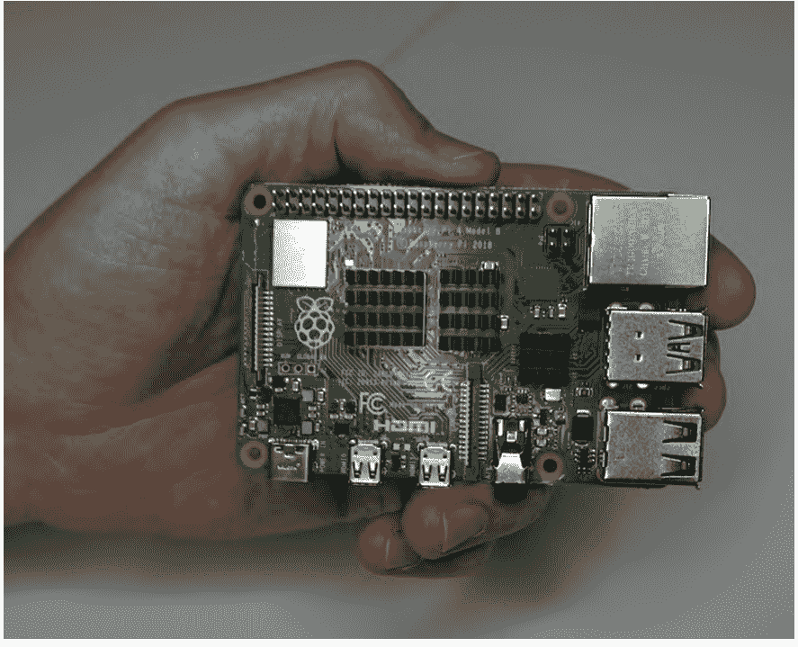
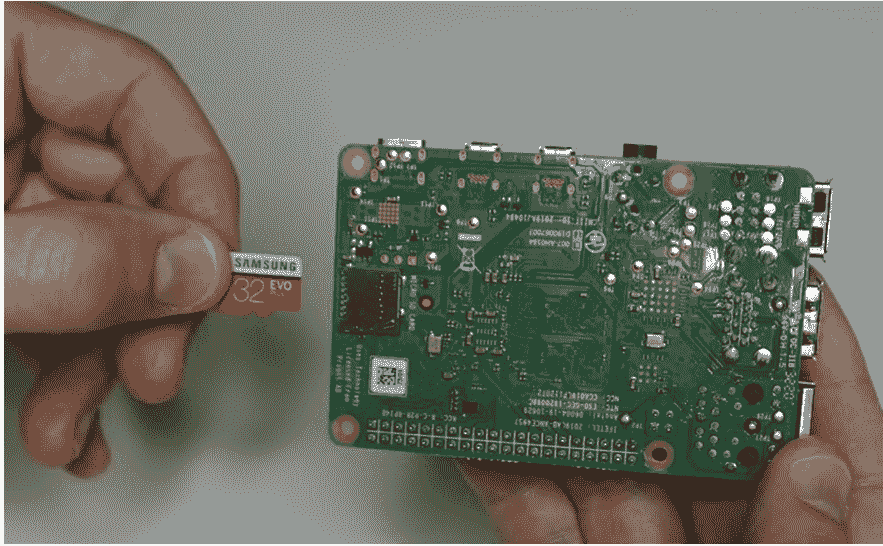
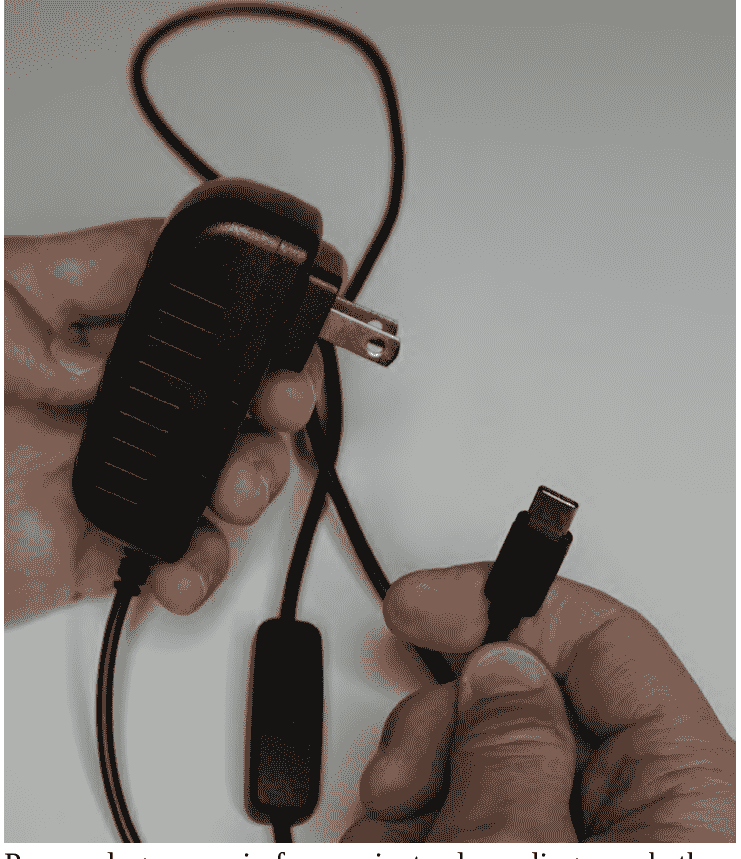
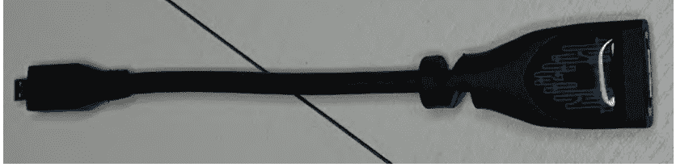
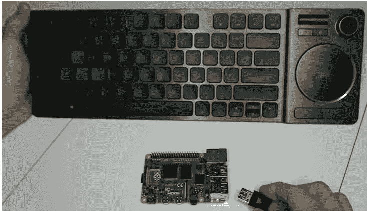
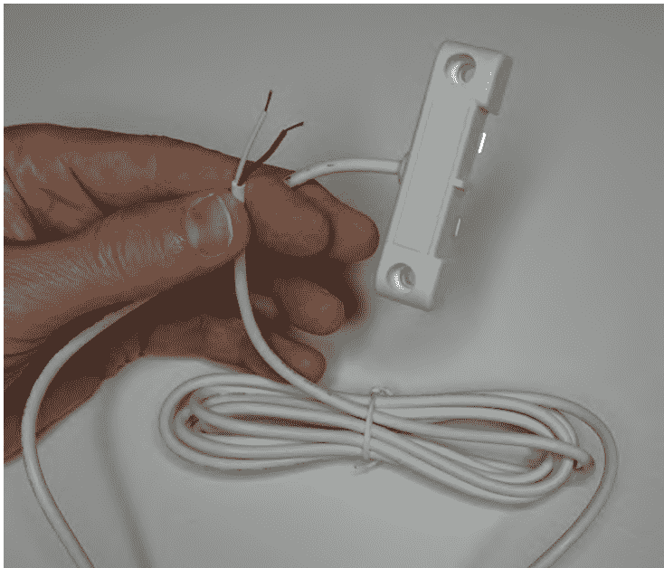
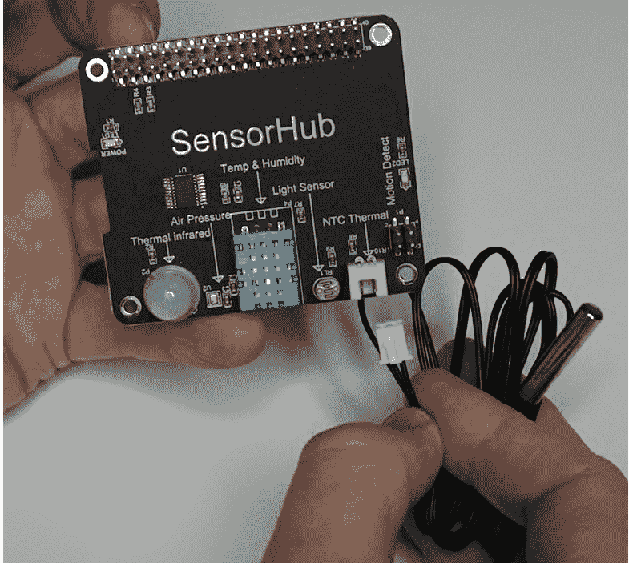
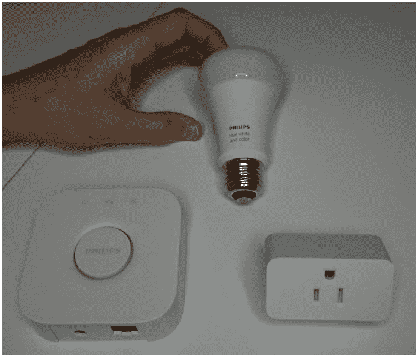
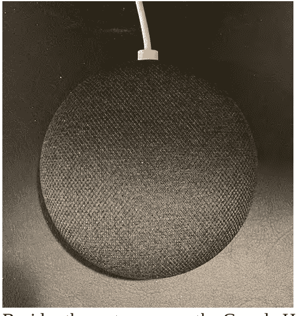
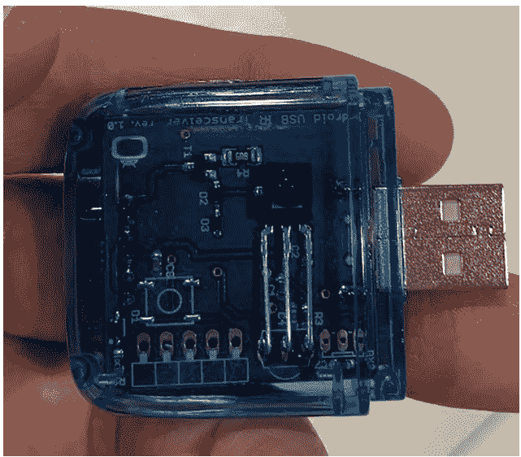

### Chapter 1
#### Assembling the Hardware

制作自己的 Pi 项目不仅是一项令人满意的教育性追求，而且也非常有趣。看到你通过连接廉价硬件和编写几行 Python 代码后，自己的创作栩栩如生，这令人启发且赋予力量。在本书中，你将创建酷炫且实用的项目，涵盖从漏水警报到安全摄像头捕获，以及家庭自动化到制作聊天机器人。每个项目都建立在下一个项目之上，因此最好按顺序进行。完成本书中的项目后，你将有能力将自己的出色自动化想法付诸实践。

但在我们开始这些 Pi 项目冒险之前，你需要获取构建它们的必要硬件。本章将快速回顾将 Pi 和本书项目变为现实所需的组件。每个项目都将附带平均价格、购买的网络链接，以及硬件是什么以及你为什么需要它的简要总结。

自行构建硬件和软件提供了相当大的灵活性，尽管它需要更多的前期规划和时间投入。除了更陡峭的学习曲线之外，定制硬件也是一个迭代过程，通常需要在获得令人满意的工作解决方案之前制作多个原型。

本书中的项目采用混合方法，兼具两者之长。我们将使用的硬件传感器是预先构建的，不需要电子学学位即可连接到 Pi 并使用——无需面包板或烙铁。 我们将编写的软件来运行项目可以高度定制以满足你自己的特定需求。

例如，你可以购买一个内置 WiFi 收发器的预制漏水探测器，使用第三方服务在漏水发生时提醒你。但此类设备的成本可能超过最昂贵的 Pi 硬件配置和附带漏水传感器的总成本。举例来说——Eve Water Guard[2] 配上 Eve Extend 的零售价为 $129.95。你将以更低的价格构建几乎相同的系统。而且由于 Pi 是一台多用途计算机，它可以同时充当文件服务器、源代码版本库、多媒体播放器或台式计算机，同时检查是否有任何漏水。

另一个好处是，与可能将各种潜在敏感网络数据发送到可能不可信的第三方服务器的第三方产品不同，你确切知道数据被发送到哪里，因为你编写了代码来指示 Pi 对收集的数据做什么。似乎每周都有新闻报道称，所谓的第三方物联网设备因故意后门、被利用的软件、被遗弃的服务和其他安全故障而受到损害。组装你自己的 Pi，运行你编写的 Python 代码，意味着你的解决方案不再是一个神秘的黑箱。你不再完全依赖产品的供应商来更新和修补意外的甚至是故意的漏洞。有了 Pi，你掌握着控制权。

根据你的技术熟练程度，你可能已经拥有这些产品中的几个。此外，请记住，你不需要购买本章列出的每个配件。你可以根据想要进行的项目挑选和选择所需的硬件和配件。以下是构建本书中各种项目所需的硬件项目。

#### Raspberry Pi

本书中的许多项目可以使用早至 Raspberry Pi 2 甚至迷你 Pi Zero 的型号。但在本书出版时，最好的 Pi 是 Raspberry Pi 4，而这款型号适用于所有项目。它也是本书照片中展示的型号，例如照片中所示。

Pi 4 型号有四种不同的内存配置：1、2、4 和 8 GB。如果计划只运行一个项目，或同时运行两个项目，1 GB ($30) 或 2 GB 型号 ($35) 就足够了。4 GB 版本 ($55) 是价格敏感的消费者寻求最佳投资的最佳折中。但如果你想在 Pi 上同时运行多个项目，并为你自己的未来项目留出余地，则推荐 8 GB 型号 ($75)，也是我为所有 Pi-

related projects. You can purchase any of the Pi models from various Raspberry Pi Foundation–approved retailers. Visit the official Raspberry Pi Store[^3^] to select your Pi 4 model of choice from the list of retailers in your country.

#### microSD Card

The Pi can boot from microSD exFAT-formatted cards with storage up to 2 TB, but unless you plan on using your Pi for network-attached storage (NAS), I’ve found little need to expand beyond a 32 GB microSD card. That said, microSD cards are so inexpensive, with 128 GB cards costing below thirty dollars, that having extra space for media files, code repositories, and images can be useful. For example, the photo shows a 32 GB microSD card ready to be inserted into the bottom of a Raspberry Pi 4 Model B.

Several retailers sell the Pi as a kit that includes a microSD card (usually 32 GB), power supply, micro-HDMI to HDMI converter cable, case enclosure, heat sinks and/or mini fans to dissipate heat generated by the Pi’s Broadcom graphics chip, and ARM-based CPU. These kits are useful if you don’t want to purchase these necessary components separately. I purchased my Pi 4 8GB in a kit that included a power supply, micro-HDMI adapter, and micro-USB to USB-C adapter. The package only cost ten dollars above the price of the base 8 GB Pi model. Had I opted to buy these accessories separately, I would have spent more on just the Pi’s power supply alone.

#### USB-C Power Supply

The Pi 4 Model B requires a 5.1-volt, 3-amp, 15.3-watt USB-C power supply to adequately power the Pi. The Pi 4 does not include a power supply unless it was purchased as part of a bundled kit. The first photo is of a Raspberry Pi 4–compatible USB-C power supply obtained from a third-party Pi vendor.

Power plugs come in four variants, depending on whether you’re in the United States, United Kingdom, Europe, or Asia. Visit the Raspberry Pi Store[^4] to choose the type and the retailer to purchase it from.

#### Micro-HDMI Adapter

Unlike previous versions, the Pi 4 does not have a full-sized HDMI port. Instead, it offers two much smaller micro-HDMI ports to connect the Pi’s audiovisual output to your computer monitor or TV. It’s a testament to the power of the Pi 4 hardware that the device is capable of outputting video simultaneously on two 4K displays. If you’re fortunate enough to have two 4K displays to connect to the Pi, you’ll also need two micro-HDMI to HDMI adapters along with standard HDMI cables. Check out a photo of a micro-HDMI to HDMI port adapter.

Just like the other Pi hardware, you can visit the micro-HDMI product page[^5] at the Raspberry Pi Store to select the color and length of the cable and locate a retailer in your country to purchase it from.

Since I already had several spare HDMI cables lying around in my home, I opted instead to connect my Pi 4 using a micro-HDMI to HDMI adapter. As I previously mentioned, this adapter was included with the Pi 4 bundle that I purchased. If you prefer to get this kind of stand-alone adapter, you can buy it for about six dollars from retailers like Amazon or Newegg.

#### Keyboard, Mouse, and Monitor

Any standard USB computer keyboard and mouse can be used with the Pi. If you don’t have an extra wired keyboard and mouse available, I recommend buying a wireless keyboard and mouse that use a dedicated 2.4 GHz USB dongle.

While you can pair a Bluetooth keyboard to the Pi, you won’t be able to do so until after you create a user account and select the Bluetooth option from the desktop Settings app. And if you encounter any problems booting your Pi, you won’t be able to interact with it from the command line since the Bluetooth connection might not be established. Using a dedicated wireless keyboard/mouse dongle communicates with the Pi just like any other wired USB keyboard and mouse. This assumes that the wireless keyboard you’re using is fully charged, powered on, and successfully paired to the USB dongle that you would plug into one of the Pi’s available USB ports.

If you plan to use your Pi as your primary desktop, or prefer to write all your code directly on the Pi, stick with a wired keyboard and mouse. If you intend to use the Pi as a media player or a portable data-collection device like I do, I recommend using the Corsair K83 wireless entertainment keyboard, shown in the next photo.

In addition to its ability to interact with the Pi regardless of the state of the desktop, the K83 keyboard also minimizes clutter by not having a tangled mess of wires to unravel whenever you want to type or mouse click the Pi’s desktop. Corsair’s K83 keyboard is also backlit and has a large touch pad and mouse buttons, a built-in joystick, and a volume roller. It can connect to the Pi either via the preferred wireless USB dongle or via Bluetooth.

#### Water Sensor

With the standard peripherals like mice, keyboards, and displays accounted for, we can now turn our attention toward the sensors and network devices that will allow the Pi to do some pretty cool tasks for us. The least expensive of the sensors we’ll employ is for Chapter 4, *Water Leak Notifier*. You can purchase this sensor from Amazon[^7] for around $13 US. Here’s a photo of the sensor.

#### DockerPi SensorHub

Other projects in the book require specific sensors including motion detection, light reading, and temperature reading. We could purchase a dedicated sensor for each project, but that would quickly start filling up available GPIO (general-purpose input/output) pin connections on the Pi.

Fortunately for us, a certain Pi HAT (hardware attached on top) combines these and other sensors onto a single expansion board. Take a look at the following photo of the SensorHub and the external temperature probe attachment that comes with it.

The DockerPi SensorHub, available for around $22 US from Seeed,[8] mounts on top of the Pi and will allow our Python scripts to interrogate measured values from the SensorHub’s five onboard sensors without needing to clutter up the Pi with wires attached to various GPIO pins. The SensorHub includes pass-through GPIO pins, allowing you to continue accessing and using the GPIO pins on the Pi that this add-on board is mounted on. The onboard sensors are good enough for the projects we will use them for, but if you need more precise readings, consider using a dedicated sensor for whatever specific variable you want to accurately measure.

#### Hue Starter Kit

If you don’t already have a Philips Hue bridge in your home or office to automatically control lighting and power, consider purchasing the Hue Starter Kit.[9] You can purchase a hub and two white smart lightbulbs for around $70 US. The next photo shows, from left to right, a Hue bridge, smart bulb, and smart plug.

We’ll be calling upon the Hue bridge in several projects, so if you just want a single smart light to start with, you can purchase the Hue bridge[10] and smart white light LED bulb[11] separately to save about $10 US.

In addition to turning on and off smart lights, we would also like to turn dumb appliances into smart ones. This can be achieved with the Hue smart plug[12] for around $30 US.

Simply plug in the smart plug into an available electrical socket, and plug the item to be powered on or off into the socket on the smart plug. We’ll use the smart plug in Chapter 5 to turn on a desk fan when a room temperature exceeds a set threshold and turn the fan back off when the temperature drops below that desired threshold.

#### Smart Voice Assistant

The proliferation of voice-enabled assistants has brought the web to a conversational level. Smart assistants like Amazon Alexa and Assistant dominate the consumer voice-activated query market. Due to its low cost and remarkable voice recognition capabilities, the Google Home Mini device is one of the most popular voice assistants available today. You can use the Home Mini to play back everything from songs and news. It can also report weather forecasts and provide answers to how old a certain celebrity might be. Given its versatility, the Home Mini is also surprisingly inexpensive for a smart device. Here’s a picture of the Google Home Mini.

Besides the water sensor, the Google Home Mini is the least expensive accessory we’ll need for our projects. You can buy a new Home Mini from sellers on eBay[^13] for under $20 US. Note that the various incarnations of Amazon Alexa hardware can also be used instead of the Google Home for these projects, but I’ll be using the Home as my primary smart assistant in the book.

#### USB 红外收发器

虽然红外控制正变得像传真机一样成为古老的科技遗物，但仍有许多设备依赖廉价的视线式红外传输来远程控制电器。我有一台老式 HDTV 显示器，至今工作良好，但它并不具备网络感知功能。鉴于现代智能电视中未经授权的数据收集炒作不断，或许这是一件好事。虽然我可以使用电视附带的旧遥控器，但我已将我的 Pi 编程为替我打开它。我将在第 9 章《语音红外控制》中向你展示如何使用这种方法远程控制你的红外启用型音视频设备。

由于我们已为其他传感器项目使用了几组 GPIO 引脚，并且未来设计中可能会使用更多引脚，因此我们可以使用 Pi 上的可用 USB 端口之一来连接 USB 连接的红外收发器。以下是一款此类产品的图片。

由 Irdroid 设计并销售的这款 USB 红外收发器[^14]可用于发送和接收红外信号。这不仅可用于向你的红外电器传输指令代码，还可用于记录你自己的红外遥控器发出的代码。你甚至可以使用遥控器无线与你的 Pi 通信。Irdroid USB 收发器价格约为 32 美元。

#### Pi 摄像头模块 V2

我们项目外设购物清单上的最后一项是 Raspberry Pi 的摄像头模块。摄像头将允许我们捕捉高分辨率照片并流式传输视频。虽然我们完全可以使用标准 USB 网络摄像头来满足此需求，但这会占用 Pi 上另一个宝贵的 USB 插槽，而且此类 USB 网络摄像头可能比 Pi 本身更大。只需看看 Pi Camera V2 在 [照片](photo) 中的尺寸有多小即可。

800 万像素的 V2 是官方 Raspberry Pi 摄像头的第二代产品，可通过摄像头的排线直接连接到 Pi 的 CSI（摄像头串行接口）。我们将在第 11 章 *PhotoHook* 中介绍如何安装和测试 Pi 摄像头模块 V2。

##### 下一步

假设你已至少购置了 Pi（建议使用 4 型号 B 且内存至少 4 GB）、至少 32 GB 存储的 SD 卡、带必要线缆和适配器的 HD 显示器、鼠标、键盘和 USB-C 电源，那么你就可以开始安装 Raspberry Pi 操作系统了。卷起袖子，整理并连接你的硬件布局，并为下一章的软件安装、配置和测试冒险做好准备。

##### 脚注

+   [2] https://www.evehome.com/en/eve-water-guard
+   [3] https://www.raspberrypi.org/products/raspberry-pi-4-model-b/
+   [4] https://www.raspberrypi.org/products/type-c-power-supply/
+   [5] https://www.raspberrypi.org/products/micro-hdmi-to-standard-hdmi-a-cable/
+   [6] https://www.corsair.com/us/en/Categories/Products/Gaming-Keyboards/K83-Wireless-Entertainment-Keyboard/p/CH-9268046-NA
+   [7] https://www.amazon.com/Floor-Water-Sensor-Flood-Detection/dp/B079YB1T8J?th=1
+   [8] https://www.seeedstudio.com/DockerPi-Sensor-Hub-Development-Board-p-4101.html
+   [9] https://www.philips-hue.com/en-us/products/smart-lighting-starter-kits
+   [10] https://www.philips-hue.com/en-us/p/hue-bridge/046677458478
+   [11] https://www.philips-hue.com/en-us/p/hue-white-1-pack-e26/046677555689
+   [12] https://www.philips-hue.com/en-us/p/hue-smart-plug/046677552343
+   [13] https://www.ebay.com/itm/Google-Home-Mini-Smart-Assistant-Charcoal-GA00216-US/114220854200
+   [14] https://www.irdroid.com/irdroid-usb-ir-transceiver/
