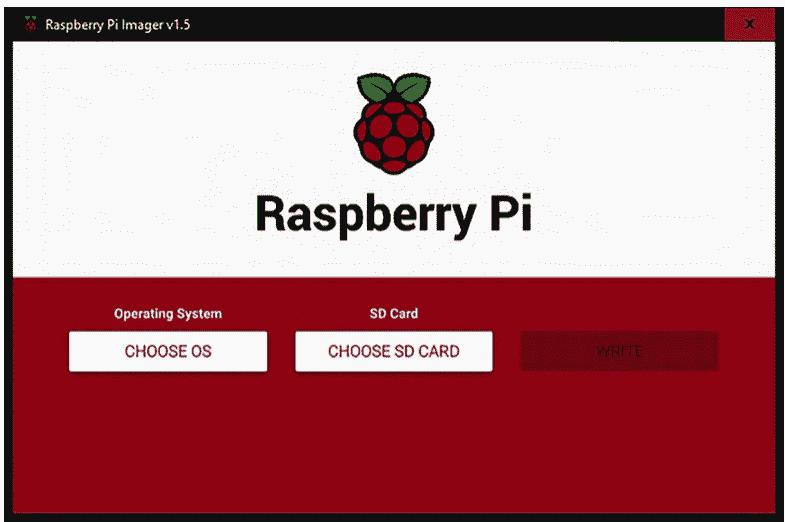
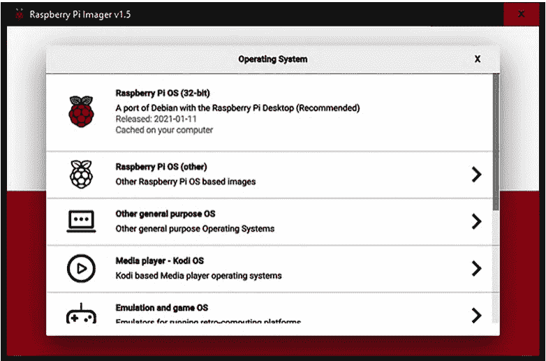
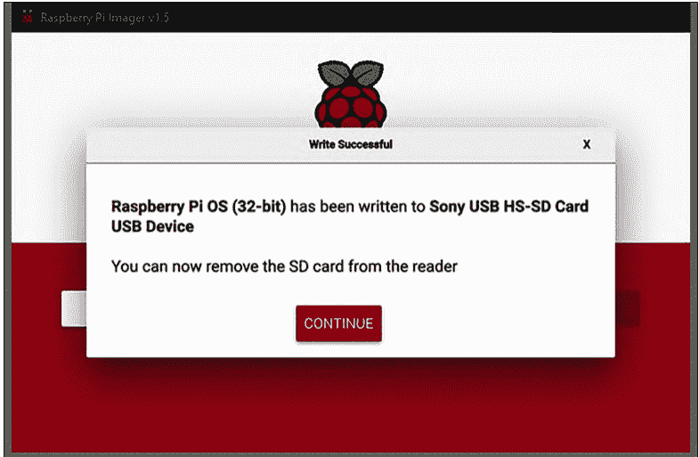
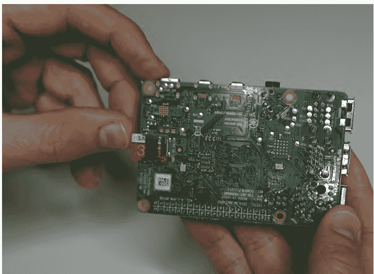
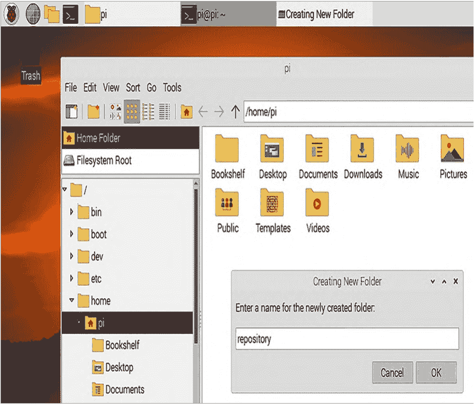
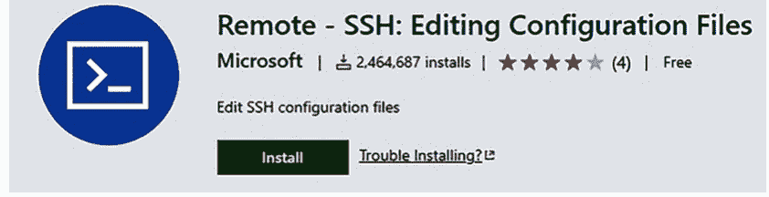

### 第 2 章

#### 设置软件

手握 Pi 以及必要的外设，包括电源、SD 卡、显示器、鼠标和键盘后，你就可以安装和配置将在硬件上运行的操作系统了。自第一代 Pi 硬件早期以来，设置 Pi 已取得了长足进步。即使是在 SD 卡上准备操作系统，也已从多阶段、多应用流程简化为简单的三键鼠标点击程序。

到本章结束时，你的 Pi 将运行最新的 Raspberry Pi 操作系统，并配备构建本书项目所需的所有软件。你还将拥有一个足够的使用体验，可将 Pi 作为一个尚可接受、 albeit 反应迟缓的桌面替代品。

##### Raspberry Pi OS

Raspberry Pi 基金会为 Pi 平台提供了一个 Linux 发行版安装工具，称为 Raspberry Pi Imager.[15] 该工具适用于 Apple macOS、Microsoft Windows 和 Ubuntu Linux，可通过仅需几次鼠标点击将 SD 卡映像为你选择的 OS 发行版。

下载并运行 Raspberry Pi Imager，然后插入你想要映像的 SD 卡。请记住，插入的 SD 卡将被完全重新格式化，因此如果卡上保存有你想保留的数据，请在继续之前备份。屏幕截图显示了 Raspberry Pi Imager 主屏幕的外观。



选择 Choose OS 按钮将显示可供 Pi 使用的推荐 Linux 发行版列表。虽然你可以选择安装更现代的 64 位操作系统，如 Ubuntu Desktop，但本书中我们将调用的许多 Pi 硬件和软件库尚未移植到 64 位。对于拥有充足时间和耐心的硬核黑客类型的人来说，有办法将这些库强行在这些 64 位平台上运行。在本书出版时，Raspberry Pi OS 的 64 位 alpha 版本正在开发中，但它过于不稳定和不完整，无法推荐，更不用说在之上构建可靠的项目了。下图显示了 Imager 可以写入目标 microSD 卡的不同操作系统。



当你在 Imager 应用主屏幕上点击 Choose OS 按钮时，Raspberry Pi OS（32 位）将显示在列表顶部。选择该操作系统以继续。

在你的 SD 卡插入并挂载在主机 Windows、Mac 或 Linux 桌面计算机上后，点击 Choose SD Card 按钮。当你准备将插入的 SD 卡提交以被擦除、重新格式化并安装 Raspberry Pi 操作系统时，选择 Imager 的 Write 按钮。映像写入和验证过程大约需要十五分钟或更长时间才能完成。完成后，Imager 将宣布你可以从计算机上移除 SD 卡并将其插入 Pi，如下一张屏幕截图所示。



将 microSD 卡插入 Pi 下方的插槽，确保正确对齐卡片的金属触点朝向 Pi 的板。以下是 microSD 卡插入 Pi 4 底部时的外观。



正确就位后，将键盘和鼠标连接到 Pi 的可用 USB 端口，并通过 micro-HDMI 转 HDMI 适配器将 HDMI 显示器连接到 Pi 的 micro-HDMI 端口。

将 Pi 连接到其 USB-C 电源，如果映像成功，你应该在连接的显示器上看到 Pi 启动到 Raspberry Pi OS 桌面。

一旦 Pi 启动并运行，就需要回答几个屏幕配置问题，以便操作系统了解你的身份、你的位置以及它应如何连接到互联网。

##### 配置设置

多个对话框将要求你为 Pi 账户创建密码，以及输入网络访问、键盘布局和地理位置。假设你在家庭或办公室中有无线网络，请使用无线网络密码连接到网络。我们将进一步探讨完成初始安装配置所需的网络设置。

##### 网络

现代 Pi 硬件提供有线以太网和无线网络连接。如果你幸运地在家庭或办公室完全布线了 CAT-6 以太网电缆，你可以将该电缆连接到 Pi 的千兆以太网端口。如果没有，你可以选择无线连接。无论你使用哪种网络类型，Raspberry Pi OS 都会提示你完成无线网络连接过程。只需选择你的 SSID 标识符（即无线网络的名称）并使用无线网络的密码连接。一旦连接，操作系统最终会提示你下载并安装自操作系统映像创建以来可能发布的安全更新和补丁。

安装最新更新后，你很可能需要重新启动 Pi。

##### 在网络上查找 Pi

在你的网络上，计算机和设备上最常见的两种网络配置是动态主机配置协议（DHCP）和静态 IP 地址分配。DHCP 是最常见的默认设置，因为它允许你轻松重新连接到其他网络，例如将你的 Pi 带到朋友家并连接到他们的网络。这是因为 DHCP 中的 D。也就是说，该协议根据网络路由器管理的 IP 地址池动态分配 Pi 的 IP 地址。虽然 DHCP 在你不关心知道


IP 地址的使用方式不同，确定分配给该设备的实际 IP 地址在 iPhone、Android、PC、Mac 或 Pi 上各不相同。例如，在 Pi 终端窗口中发出 `ifconfig -a` 命令会显示设备上活动网络接口的详细信息，而 iPhone 的图形界面则通过 设置 -> WiFi 屏幕并选择信息图标来显示 WiFi IP 详细信息。此外，DHCP 分配的 IP 地址可能会根据设备上次通电并连接到网络的时间而发生变化。

我们可以通过配置 Pi 的网络接口使其每次开机时始终使用相同的 IP 来减少这种麻烦。然而，将此类静态 IP 分配存储在设备上会降低其便携性，因为每次将 Pi 连接到另一个网络时都必须重新分配 IP 配置。如果您不打算更改家庭或办公室网络配置，并且也不打算将 Pi 连接到除其最初设置使用的网络之外的任何其他网络，那么将网络设置更改为静态 IP 分配是可以接受的。但我发现更易于管理的方法是使用家庭网络路由器根据设备的媒体访问控制（MAC）地址自动为连接的设备分配相同的 IP 地址。

##### MAC 分配与 Mac

除非用户明确允许，否则 MAC 分配在较新的 Apple 产品上默认不起作用。这是因为某些网络使用 MAC 地址作为访问认证手段。MAC 地址很容易被坏人欺骗和追踪。因此，使用 MAC 分配作为安全机制并不是一个好主意。Apple 使用一种称为 MAC 地址随机化的技术，即时创建新的唯一 MAC。这使得基于 MAC 的 IP 分配对于 Apple 产品而言变得毫无意义，除非用户有意在 Apple 设备上禁用 MAC 地址随机化。然而，由于我们仅将 Pi 的 MAC 用作分配网络配置的手段，而不是用于身份验证，因此这应该最大程度地减少了家庭网络上的任何安全风险。

检查您的网络路由器是否能够根据设备 MAC 地址分配 IP 地址。每个路由器制造商都有自己的实现方式。例如，在我的 Google Home WiFi 设置中，我必须进入高级网络设置并选择 DHCP IP 保留，以查找并添加我的 Pi。如果 Pi 长期离线或连接到另一个基于 DHCP 的网络，我不必担心 Pi 从我的路由器获取不同的 IP 地址，因为它将始终被分配我在路由器 IP 保留中设置的相同地址。这样做还将使安全远程连接到 Pi 变得更加容易，以及存储和执行新脚本，因为它将始终具有相同的 IP 地址分配给它。

##### SSH 密钥

在操作系统完全修补并更新后，您现在应该能够安全地启动预装的 Chromium 网络浏览器并浏览网页。如果您只想将 Pi 用作功能强大但反应迟缓的 PC 替代品，那么您已经完成了目标。但鉴于 Pi 比 Chromebook 更灵活，我们现在可以让 Pi 充当客户端和服务器。最快且最安全的方法是激活 Pi 上的 OpenSSH 服务器。SSH 代表安全外壳，OpenSSH 是该远程访问协议的开源实现。使用 SSH 将允许您从网络上的另一台计算机远程连接并传输文件到 Pi。

要安装 OpenSSH 服务器，请打开终端窗口并输入以下安装命令（不要输入 $ 符号，因为它只是说明 Pi 终端窗口中显示的提示符）：

```
$ sudo raspi-config
```

raspi-config 是 Raspberry Pi OS 内置的硬件和软件配置器。无需手动编辑启动配置文件，raspi-config 允许您轻松激活硬件端口和 OpenSSH 等软件。我们将重新审视 raspi-config 的其他设置，如摄像头和 I2C 接口访问，但现在我们将通过从主屏幕中选择接口选项来在 Pi 上启用 SSH。

在下一个屏幕上，选择 P2 SSH 选项以启用/禁用使用 SSH 的远程命令行访问。除了通过终端启用 SSH 访问外，此服务还允许您安全地向 Pi 传输文件和从 Pi 传输文件。

激活后，您应该能够从网络上安装了 SSH 客户端的另一台计算机 SSH 进入您的 Pi。如果您使用的是 Mac 或 Windows 10 计算机，则这些操作系统中已包含 SSH 客户端。要测试您对 Pi 的 SSH 访问，请在 Windows 上打开命令或 PowerShell 窗口，或在 macOS 上启动终端应用程序，并在相应窗口的命令提示符下输入以下命令（将 IP_ADDRESS 标签替换为您网络上 Pi 的 IP 地址）：

```
$ ssh pi@IP_ADDRESS
```

例如，我的 Pi 的 IP 地址分配为 192.168.1.22。因此，要从我的 Windows 10 计算机登录到我的 Pi，我打开一个 PowerShell 窗口并输入：

```
$ ssh pi@192.168.1.22
```

然后系统会提示您输入在初始操作系统设置过程中为 Pi 创建的密码。当您从另一台计算机 SSH 时，您每次都需要输入此密码，直到您为 SSH 访问设置数字密钥。我们很快就会做到这一点。

第一次尝试通过 SSH 连接到 Pi 时，您会收到一条警告，指出您尝试 SSH 的主机计算机的真实性无法建立。这是因为您从网络上用于 SSH 的另一台计算机从未连接到过 Pi。由于您知道这是您的 Pi，您可以对“您确定要继续连接吗”问题输入 yes。

现在您已通过 SSH 连接到 Pi，您可以访问文件系统、执行命令并执行程序，就像您在本地连接到 Pi 的键盘上输入一样。例如，在 Pi 的命令提示符下输入命令 `ls` 将显示 Pi 上您用户主目录中可见的文件和文件夹列表。如果您不熟悉以 Linux 为中心的命令行语句和实用程序，请查看 Linux.org[16] 网站，其中包含许多写得很好的初学者教程。

###### 生成 SSH 密钥对

现在您可以通过 SSH 连接到 Pi，如果每次都不必继续输入密码就方便多了。为此，您可以生成一组唯一的数字密钥，允许您的计算机立即连接到 Pi，无需密码。这在我们开始使用可能需要这些数字密钥已就位的源代码控制工具和代码编辑器时也很有用。

生成这些密钥需要几个步骤，但一旦您做过几次就相当直接。您可以在 Windows 10 或 macOS 计算机的命令/终端窗口中输入密钥生成命令：

```
$ ssh-keygen
```

发出此命令将调用 SSH 密钥对生成程序，询问您将数字密钥保存在何处。接受它建议的默认位置。然后程序会询问您是否要使用可选密码保护生成的密钥。这在您想要为新生成的密钥增加额外的安全层时很有用，但这样做会在您调用其使用时提示您输入该密码短语。由于我们希望在每次远程登录 Pi 时无需输入密码即可访问 Pi，只需将此密码短语留空即可。

###### 配置 SSH 密钥对

ssh-keygen 程序将在您的 Windows 10 或 macOS 用户主目录中创建 .ssh 目录，并在 .ssh 目录中存储两个文件，id_rsa 和 id_rsa.pub。id_rsa 是您的私钥，是您计算机唯一的 SSH 标识符。id_rsa.pub 文件是您的公钥，您将复制到 Pi 的 .ssh 目录。为此，首先在 PowerShell/终端窗口中切换到您的 Windows 10 或 macOS .ssh 目录，然后发出以下命令（将 USERNAME 和 IP_ADDRESS 值替换为您 Pi 的用户名和 IP 地址）：


```
$ cat ~/.ssh/id_rsa.pub | ssh USERNAME@IP_ADDRESS 'mkdir -p ~/.ssh && cat >> ~/.ssh/authorized_keys'
```

这一串命令会读取你的 id_rsa.pub 公钥内容，SSH 登录到你的 Pi，在 Pi 用户主目录中如果不存在则创建 .ssh 目录，然后将你的 id_rsa.pub 密钥详情保存到 Pi 的 .ssh 目录下名为 authorized_keys 的文件中。authorized_keys 文件是 SSH 服务器在每次 SSH 会话中进行密钥对验证请求时检查的内容。可以把 authorized_keys 文件看作门锁，而你的 id_rsa 私钥文件就是打开门的钥匙。保护并妥善保存 id_rsa 文件，就像对待现实生活中的钥匙一样，因为任何拥有该文件副本的人都可能利用它远程访问你的 Pi。

如果 SSH 密钥对配置成功，你现在应该能够从 Windows 或 macOS 电脑无需密码即可 SSH 登录到你的 Pi。在我们开始开发项目时，这种节省时间的<|message|> 安全改进会非常有用。

##### Python

预装在 Raspberry Pi OS 上的 Python 版本是 Python 3 的最新稳定版。要确定 Pi 发行版上安装了哪个版本的 Python，请打开终端窗口并输入 python3 --version。我们的项目适用于高于 Python 3.5 的任何版本，不过更推荐 Python 3.7 或更高版本。

例如，在我 Pi 4 上运行的 Raspberry Pi OS 版本上，其 Python 版本为 3.7.3：

```
$ python3 --version
Python 3.7.3
```

请务必运行 python3，而不是 python。单独的 python 指的是发行版中包含的旧版 Python 2.7，用于支持尚未更新其库以使用 Python 3 解释器的旧应用程序依赖项。

Python 3 发行版还包含 Python 最受欢迎的包管理实用程序 Pip。 使用 Pip 可以轻松下载和设置额外的有帮助库，供你的 Python 脚本调用以扩展功能。

###### Pip Pip Hooray

当我们开始开发项目时，我们将调用许多未包含在核心 Python 发行版中的额外 Python 包。这也是 Python 如此强大的原因之一。许多聪明的慷慨的 Python 开发者已经完成了编写代码以访问众多网络服务、执行强大的数据操作、与数据库交互等工作的艰苦工作。

今天使用最广泛的 Python 包管理和分发系统称为 Pip。 Pip 是“Pip installs packages”的递归缩写，让 Python 包安装变得轻而易举。 Pip3 已预装在 Raspberry Pi OS 桌面版上。 如果你选择了非桌面版（Raspberry Pi OS Lite），你可以使用 apt install 命令安装 Python 3 的 Pip：

```
$ sudo apt install python3-pip
```

一些 Python 开发库和构建工具将被安装，以便 Pip 可以编译可能请求的任何包。 安装这些依赖项所需的时间取决于你的 Internet 连接速度。 此外，就像我们执行 python3 来启动 Python 3 版本的 Python 解释器一样，我们也必须特别确保在安装 Python 3 包时运行匹配的 pip3 版本的 Pip。 否则，如果我们只运行 pip，我们将为 Python 2.7 安装包：

```
$ pip3 --version
pip 18.1 from /usr/lib/python3/dist-packages/pip (python 3.7)
```

```
$ pip --version
pip 18.1 from /usr/lib/python2.7/dist-packages/pip (python 2.7)
```

使用 pip3，你将能够检索和使用不断扩大的 Python 包世界。 但请注意，每次安装新包时，你可能还会同时安装一堆额外的第三方库依赖项。 随着你的 Python 3 包安装量的增长，潜在的库版本冲突、臃肿笨拙的系统管理以及性能问题也会随之增加。这就是虚拟环境概念派上用场的地方。

###### Installing Pipenv

存在几种 Python 虚拟环境实用程序和配置，但我发现其中 consistently 能以最少麻烦完成工作的是 Pipenv。[17] Pipenv 将最有用的 Python 虚拟环境工具结合在一个易于使用的命令行实用程序中。 如果你计划在 Pi 上创建许多独立的 Python 项目，Pipenv 将在很大程度上帮助保持 Python 依赖项隔离和井然有序。 虽然本书中的项目不需要你使用 Pipenv，但它仍然是一个极好的工具，可以用来[content]

```
$ cat ~/.ssh/id_rsa.pub | ssh USERNAME@IP_ADDRESS 'mkdir -p ~/.ssh && cat >> ~/.ssh/authorized_keys'
```

这一串命令会读取你的 id_rsa.pub 公钥内容，SSH 登录到你的 Pi，在 Pi 用户主目录中如果不存在则创建 .ssh 目录，然后将你的 id_rsa.pub 密钥详情保存到 Pi 的 .ssh 目录下名为 authorized_keys 的文件中。authorized_keys 文件是 SSH 服务器在每次 SSH 会话中进行密钥对验证请求时检查的内容。可以把 authorized_keys 文件看作门锁，而你的 id_rsa 私钥文件就是打开门的钥匙。保护并妥善保存 id_rsa 文件，就像对待现实生活中的钥匙一样，因为任何拥有该文件副本的人都可能利用它远程访问你的 Pi。

如果 SSH 密钥对配置成功，你现在应该能够从 Windows 或 macOS 电脑无需密码即可 SSH 登录到你的 Pi。在我们开始开发项目时，这种节省时间的 安全改进会非常有用。

##### Python

预装在 Raspberry Pi OS 上的 Python 版本是 Python 3 的最新稳定版。要确定 Pi 发行版上安装了哪个版本的 Python，请打开终端窗口并输入 python3 --version。我们的项目适用于高于 Python 3.5 的任何版本，不过更推荐 Python 3.7 或更高版本。

例如，在我 Pi 4 上运行的 Raspberry Pi OS 版本上，其 Python 版本为 3.7.3：

```
$ python3 --version
Python 3.7.3
```

请务必运行 python3，而不是 python。单独的 python 指的是发行版中包含的旧版 Python 2.7，用于支持尚未更新其库以使用 Python 3 解释器的旧应用程序依赖项。

Python 3 发行版还包含 Python 最受欢迎的包管理实用程序 Pip。 使用 Pip 可以轻松下载和设置额外的有帮助库，供你的 Python 脚本调用以扩展功能。

###### Pip Pip Hooray

当我们开始开发项目时，我们将调用许多未包含在核心 Python 发行版中的额外 Python 包。这也是 Python 如此强大的原因之一。许多聪明的慷慨的 Python 开发者已经完成了编写代码以访问众多网络服务、执行强大的数据操作、与数据库交互等工作的艰苦工作。

今天使用最广泛的 Python 包管理和分发系统称为 Pip。 Pip 是“Pip installs packages”的递归缩写，让 Python 包安装变得轻而易举。 Pip3 已预装在 Raspberry Pi OS 桌面版上。 如果你选择了非桌面版（Raspberry Pi OS Lite），你可以使用 apt install 命令安装 Python 3 的 Pip：

```
$ sudo apt install python3-pip
```

一些 Python 开发库和构建工具将被安装，以便 Pip 可以编译可能请求的任何包。 安装这些依赖项所需的时间取决于你的 Internet 连接速度。 此外，就像我们执行 python3 来启动 Python 3 版本的 Python 解释器一样，我们也必须特别确保在安装 Python 3 包时运行匹配的 pip3 版本的 Pip。 否则，如果我们只运行 pip，我们将为 Python 2.7 安装包：

```
$ pip3 --version
pip 18.1 from /usr/lib/python3/dist-packages/pip (python 3.7)
```

```
$ pip --version
pip 18.1 from /usr/lib/python2.7/dist-packages/pip (python 2.7)
```

使用 pip3，你将能够检索和使用不断扩大的 Python 包世界。 但请注意，每次安装新包时，你可能还会同时安装一堆额外的第三方库依赖项。 随着你的 Python 3 包安装量的增长，潜在的库版本冲突、臃肿笨拙的系统管理以及性能问题也会随之增加。这就是虚拟环境概念派上用场的地方。

###### Installing Pipenv

存在几种 Python 虚拟环境实用程序和配置，但我发现其中 consistently 能以最少麻烦完成工作的是 Pipenv。[17] Pipenv 将最有用的 Python 虚拟环境工具结合在一个易于使用的命令行实用程序中。 如果你计划在 Pi 上创建许多独立的 Python 项目，Pipenv 将在很大程度上帮助保持 Python 依赖项隔离和井然有序。 虽然本书中的项目不需要你使用 Pipenv，但它仍然是一个极好的工具，可以用来


## Git

Git 是技术行业事实上的源代码控制解决方案，也是我们用来维护项目源代码的系统。学习 Git 的方方面面需要时间和练习，但我们将专注于 Git 所提供的最基本方面，主要是创建新的仓库并安全地管理保存到这些仓库中的文件的更改。

听我的话，花额外精力使用这种事实上的源代码控制工具创建仓库并管理项目的代码是值得的。没有什么比意识到你在摆弄源代码时意外覆盖了数小时、数天甚至数月的成果更糟糕的了。正确且一致地使用时，Git 不仅能够从这些事故中恢复，还能让你安全地与其他正在处理相同项目源代码的开发者协作。

与 Python 和 Pip 一样，Git 已预装在 Raspberry Pi OS 上。如果你选择运行 Raspberry Pi OS Lite 版本，可以使用 apt install 命令安装 Git：

```
$ sudo apt install git
```

安装完成后，你需要个性化 Git，以便该工具在你将文件更新保存到 Git 仓库时知道你是谁。通过在终端窗口中输入以下两条指令完成此操作，并在引号中替换你的姓名和电子邮件地址：

```
$ git config --global user.name "Your First and Last Name"
```

```
$ git config --global user.email "your@emailaddress.com"
```

验证你的姓名和电子邮件地址是否已正确保存。以下终端窗口命令应返回你的名字和姓氏。

```
$ git config user.name
```

输入以下命令应返回你在之前的全局 user.email 语句中输入的电子邮件地址。

```
$ git config user.email
```

如果需要修改其中任何一个标识符，只需重新运行适用于相应字段的 git config --global 命令即可。

> Joe 问：
> 我不能直接使用像 GitHub 这样的云服务来托管我的 Git 仓库，而不用在本地运行自己的 Git 服务器吗？
> 
> GitHub 是托管 Git 仓库的优秀资源。但新手开发者犯的最大错误之一就是在 GitHub 上发布包含敏感密码和其他机密细节的代码。以这种方式无意中泄露的电子邮件账户、VPN 和公司密码不计其数。
> 
> 在熟练使用 Git 命令和功能的同时，最好托管自己的 Git 仓库。还请查看更高级的 Python 实践，了解如何将敏感数据（如密码和 API 密钥）作为环境变量导入，并存储在单独的安全文件中。当你准备好与他人分享代码并且已从中删除任何机密细节后，你可以轻松地将项目发布到 GitHub 或其他仓库托管服务。

现在 Git 已为你的使用量身定制，我们将在开始工作时为本书的每个项目创建单独的仓库。现在，创建一个空仓库来练习 Git 的基本命令，即在 Git 仓库中存储、检索和复制文件。我们将从终端窗口中使用的命令开始，但对于我们的项目，我们将使用一个易于使用的图形工具来存储和更新项目代码更改。

为我们的第一个项目做准备，让我们创建一个仓库来存储项目的代码以及我们对其所做的任何更改。首先，使用文件管理器应用程序

通过选择 Pi OS 桌面左上角看起来像两个黄色文件文件夹的图标，并在你的主目录中创建一个名为 repository 的文件夹，如下一张屏幕截图所示。



接下来，打开一个终端窗口并输入以下 Git 命令：

```
$ git init --bare repository/twitchtimer.git
```

如果成功，Git 将报告它已在请求的目录路径中初始化了一个空的 Git 仓库。我们将使用这个新仓库来存储和管理 Twitch Timer 项目代码。

### Joe 问：

#### 我可以在哪里了解更多关于如何使用 Git 的信息？

Git 是一个功能非常强大的源代码控制系统，除了我们在项目中使用的简单 clone、add、commit 和 push 命令之外，还有许多其他功能和命令。随着你的代码变得更加复杂，并且你想要尝试不同的想法，你可以为你的文件创建额外的分支来进行测试，而不会影响主源文件。分支在有其他人为你的项目做出贡献时非常有用。你可以通过访问 Git 网站了解更多关于 Git 的信息。[19]

## Rclone

虽然能够通过局域网访问你的 Pi 上的文件非常有帮助，但在尝试通过互联网访问这些文件时可能会出现问题。你可以设置 VPN 服务器或将连接请求从路由器端口转发到你的 Pi，但这样做既麻烦又可能不安全。

云存储提供商日益增长的普及使得在 Android、iOS、macOS 和 Windows 等平台上使用它们变得简单且广泛可访问。但很少有这些提供商为 Linux 提供简单的应用程序来参与其中。Rclone，[20] 由 Nic Craig-Wood 和一长串贡献者创建，是一个免费的开源云平台实用程序，用 Go[21] 编程语言编写，允许用户连接到三十多个不同的云存储提供商和文件传输协议。Amazon S3、Box、Dropbox、Google Drive 和 Microsoft OneDrive 只是 Rclone 支持的服务中的一些。

由于 Rclone 是一个命令行实用程序，设置它并不像运行漂亮的厂商提供的 GUI 安装程序那样容易。但它在漂亮的对话框方面所欠缺的，在巨大的功能和灵活性方面得到了弥补。以下步骤将连接到 Google Drive 并将其挂载到 Pi 用户的主目录。如果你更喜欢使用 Dropbox 或 OneDrive，只需选择这些服务即可。

使用典型的 apt install 命令安装 Rclone：

```
$ sudo apt install rclone
```

### 配置 Rclone

配置 Rclone 以使用你选择的云存储提供商：

```
$ rclone config
```

在随后的初始配置屏幕中，输入 n 以创建一个新的远程并为该新远程分配一个相关的名称。由于我使用的是 Google Drive，我将其命名为 GDrive。

Rclone 配置过程将显示云存储提供商的编号列表，并要求你输入想要使用的存储提供商的编号。

从列表中选择 Google Drive。Rclone 会询问此连接是否关联了应用程序客户端 ID。通常这是空白的，因此请相应操作。Rclone 然后询问是否有应用程序客户端密钥。这默认为空白，按键盘上的 Enter 键将提交该可接受的默认值。最后，Rclone 询问你希望对账户中云存储文件的访问范围。如果希望 Pi 上可以访问所有 Google Drive 文件，请选择第一个选项（1），完全访问所有文件，排除应用程序数据文件夹。

如果需要，你可以输入根文件夹的 ID。这通常默认为空白，你只需按 Enter 键即可继续配置。同样，你可以选择进行非交互式登录，但再次强调，输入空白值是默认值，并且适用于我们的目的。

Rclone 然后询问你是否想要编辑高级配置。对于我们的基本需求来说这不是必要的，所以只需选择 n 表示否。然后它会询问你是否要使用自动配置，建议你回答 y 表示是，除非你有非标准设置场景。我们没有，所以选择 y。

现在，Rclone 已准备好连接到你的 Google Drive，并将在你的 Pi 桌面上启动 Chromium 浏览器以完成 OAUTH 密钥交换。输入你的 Google 登录凭据，然后单击允许按钮以允许 Rclone 访问你的 Google 账户。

如果成功，浏览器将报告 Success! All done. Please go back to rclone. 你现在可以关闭浏览器并返回终端窗口以完成操作。


Rclone 接下来会询问你是否要将此连接配置为团队云盘。对于此单次用途，你可以回复 n 表示否。

最后，Rclone 会在提交 Pi 上的 Google Drive 访问配置之前询问配置是否正确。此时，你可以为 Pi 添加更多云服务提供商，但目前使用已配置的 Google Drive 就足够了。选择 q 退出 Rclone 配置程序。

### Rclone 文件夹分配

现在 Rclone 已能够连接到我们的 Google Drive，我们需要使其在桌面文件管理器中轻松查看文件。

启动文件管理器，并在主目录中创建一个名为 GoogleDrive 的新文件夹，如下一张屏幕截图所示。

返回到你的终端窗口，使用以下命令将已配置的 Rclone Google Drive 映射并挂载到新创建的 ‘GoogleDrive‘ 文件夹：

```
$ rclone --vfs-cache-mode writes mount GDrive: ~/GoogleDrive
```

此命令告诉 Rclone 允许缓存写入并将 Google Drive 挂载到创建的 GoogleDrive 文件夹。假设一切输入正确，你现在应该会在桌面上看到 Google Drive 图标出现。

打开该驱动器应会显示存储在云端

你的 Google Drive 中的文件和文件夹。

这很不错！但请注意当你关闭运行 rclone 命令的该终端窗口时会发生什么。桌面上的 Google Drive 图标连同对 Google Drive 文件和文件夹的连接一起消失了。为了使挂载的 GoogleDrive 在我们重新启动 Pi 后即使在重启后仍保持在桌面上持久存在，我们需要将该冗长的 rclone 命令添加为可执行 shell 脚本，然后告诉操作系统在你的 Pi 账户登录到桌面时自动运行该脚本。

### 启动 Rclone

首先在终端窗口中打开类似 Nano 的文本编辑器并添加我们之前使用的用于挂载 GDrive 的 rclone 命令：

```
$ rclone --vfs-cache-mode writes mount GDrive: ~/GoogleDrive
```

在 Nano 中输入或粘贴 rclone 挂载说明后，按 Ctrl+O 键保存文件。将此新文件命名为 mountgdrive.sh。通过 Ctrl+X 退出 Nano 返回到打开的终端窗口中的命令行。然后通过 chmod 命令将 mountgdrive.sh 文件设为可执行：

```
$ chmod +x mountgdrive.sh
```

现在测试这个可执行脚本，打开桌面文件管理器并双击 mountgdrive.sh 文件以运行它。请注意，此脚本的可执行图标由一个齿轮表示。当你双击运行脚本时，文件管理器会询问你是否要执行、终端中执行、打开或取消操作，如下一张屏幕截图所示。

选择执行将启动脚本而不打开单独的终端窗口。终端中执行将执行相同操作，但首先会打开一个终端窗口，脚本将从该窗口执行。打开仅在默认桌面文本编辑器中打开脚本文件（在标准 Raspberry Pi OS 发行版中通常称为 Mousepad），以防你需要进一步编辑。由于我们只想在不显示另一个终端窗口的情况下执行脚本，请选择执行按钮选项。假设一切顺利，你的 Google Drive 应该再次在 Pi 桌面上挂载并显示。

请注意，即使你注销并重新登录到 Pi 桌面，Google Drive 仍保持挂载状态。这很不错，因为你只需手动执行一次脚本即可使挂载的驱动器持久化。但如果重新启动，你必须手动重新运行脚本以重新挂载驱动器。

让我们通过在桌面启动时自动运行 mountgdrive.sh shell 脚本来完成此设置。为此，我们需要创建一个 crontab。crontab 是一种使用特殊格式的文本文件在特定间隔运行脚本或应用程序的程序。在我们的例子中，我们将在 crontab 中创建一个条目，以便在桌面启动时运行 mountgdrive.sh 脚本。打开一个终端窗口并启动 crontab 程序并传递 -e 参数以表示你想要编辑你的 crontab 文件：

```
$ crontab -e
```

如果这是你第一次运行 crontab，它会询问你希望使用哪个文本编辑器来编辑 crontab 文件。由于我们已经对 Nano 很熟悉，请选择该选项。crontab 文件打开后，通过键盘上的向下箭头将光标移动到屏幕底部并输入以下命令：

```
@reboot /home/pi/mountgdrive.sh &
```

此命令指示 crontab 在桌面启动后立即运行脚本。末尾的 & 字符告诉脚本在后台运行。

按 Ctrl+O 写入修改后的 crontab 文件，然后按 Ctrl+X 关闭 Nano。你可以随时通过在终端窗口中输入 crontab --help 来了解更多关于 crontab 的信息。

### 试用

好了，是时候测试我们的工作了。重新启动你的 Pi。当你看到桌面显示时，可能需要额外几秒钟才能显示启动栏和桌面上的图标。这是因为我们的 rclone 脚本正在运行，建立连接和挂载你的

Google Drive 需要几秒钟时间。另请注意，与之前不同，Google Drive 图标不会显示在桌面上。这没关系，因为我们仍然可以通过文件资源管理器应用程序访问 Google Drive 的内容。只需导航到 GoogleDrive 文件夹即可，瞧，你的 Google Drive 文件就在那里。你现在可以轻松地将文件保存到 Google Drive 并从中检索文件。此外，我们将在第 7 章 PiSpeak 中使用此已建立的功能。

很不幸，像 Google 和 Microsoft 这样的主要云存储厂商并没有为 Pi 和 Linux 总体提供更简单的安装程序。我怀疑这并不是因为他们不希望 Pi 参与他们的生态系统，而是由于 Linux 用户可以选择的桌面覆盖层种类繁多。从 macOS 或 Windows 的角度来看，图形桌面外壳始终相同。Linux 提供了选择，但选择带来复杂性。如果你能够在重新启动后成功自动挂载 Google Drive，那么你就成功地驾驭并克服了这种复杂性，应该相应地表扬自己。

如果需要的话，在此休息一下，享受一份漂亮的工作成果。否则，继续前进设置一个主管并安装一个精致、功能强大且免费的商业桌面文本编辑器。

### Supervisor

随着我们在全书中创建多个不同的项目，我们编写的脚本需要在我们不在 Pi 前等待事件发生时保持运行。通常当你从终端运行 Python 脚本时，关闭该终端窗口或会话后 Python 脚本将停止工作。

你可以指示脚本在启动它的终端关闭后继续在后台运行。然而，没有保证这样的脚本将始终继续运行，尤其是在存在内存或其他资源限制的情况下。此外，如果 Pi 重启时某些项目脚本能够自动开始运行会很有用。我们需要一个主管来启动这些脚本、保持它们运行，并在它们意外停止工作时重新启动它们。
Supervisor[^22] 是将完成我们所需确切工作的解决方案。我们可以使用 apt install 命令安装 Supervisor：

```
$ sudo apt install supervisor
```

这将安装作为系统级应用程序安装的旧版 Supervisor。Supervisor 的更新版本可以通过 Pip3 命令安装，但需要额外的工具才能使其可靠地作为系统服务工作。无论你选择哪个版本，两者都能够管理 Python 2.7 或 Python 3 脚本。通过检查 Pi 上正在运行的 supervisord 守护进程的版本来确认 Supervisor 包已成功部署

```
$ supervisord --version
3.3.5
```

我们稍后将探索 Supervisor 的功能，并在全书中部署 Python 脚本时为我们的需求配置它，从第 4 章 水开始


[泄漏通知器](Leak Notifier)。

## 代码编辑器

我更喜欢使用图形化文本编辑器，而不是基于字符的终端编辑器，例如 GNU nano^[23]^ 或 Vim。^[24]^ 一个专为编写和执行 Python 代码而优化的称职文本编辑器，名为 Thonny Python IDE，已预装在 Raspberry Pi OS 上。此编辑器完全可以用来输入和运行本书中的 Python 脚本，但如果你想使用一个拥有众多选项和庞大扩展的世界级编辑器，请考虑微软免费的 Visual Studio Code 编辑器。

TextMate^[25]^ 在 macOS 上曾是黄金标准，直到 Sublime Text^[26]^ 成为我多年来的首选。然而，我几个月前切换到微软免费的 Visual Studio Code 编辑器后就再也没有回头。Visual Studio Code 提供了我所需几乎所有基础功能，并且由于其不断扩大的免费扩展库而变得比其他编辑器更受欢迎。而且与 TextMate 或 Sublime Text 不同，VS Code 也能在 Pi 桌面上原生运行！

### 在 Pi 上安装 Visual Studio Code

你可以通过多种方式在 Pi 上安装 Visual Studio Code。最简单的方法就是使用 `apt install` 命令直接安装。

```
$ sudo apt install code
```

你可以在编程菜单中找到 Visual Studio Code 启动图标，位于 Thonny Python IDE 正下方。

如果你从未使用过可视化文本编辑器，初次使用 Visual Studio Code 可能会让人感到畏惧。即便如此，我仍然觉得它比使用基于终端的文本编辑器容易得多，主要是因为 VS Code 提供了大量节省时间的快捷键和可扩展性。随意尝试编辑器中的菜单选项、窗口窗格和图标，以更熟悉该程序。

它在本书后面我们编写一些较长的 Python 脚本时将会派上用场。

### 安装 Visual Studio Code 扩展

微软的 Python 扩展是 Visual Studio Code 可用扩展中最有帮助和最受欢迎的扩展之一。它提供了一系列有用的 Python 编程增强功能，包括语法高亮、自动代码格式化、虚拟环境支持等。使用 Python 扩展将大大有助于编写和测试本书项目中使用的 Python 代码。

通过从主视图菜单中选择扩展选项来安装 Python 扩展。这将显示最受欢迎的扩展列表。Python 扩展位居榜首也就不足为奇了。要安装并激活此扩展，请在随附的 Python 描述页面上选择安装按钮。

我还有一个关于在 macOS 或 Windows 平台上使用 VS Code 的重要建议。回想一下，我们设置了 SSH 密钥以允许从终端窗口轻松远程登录到 Pi。VS Code 有一个有用的、节省时间的免费扩展，名为 Visual Studio Code Remote - SSH: Editing Configuration Files Extension,[27] 如下一图所示。



此扩展将使你能够从 Mac、Windows 或 Linux 笔记本或台式电脑远程创建和修改 Pi 上的文件。当你的 Pi 已部署在家中或办公室的某个不方便访问的地方时，此功能非常有用，或者当你不再需要或不需要将鼠标、键盘和显示器连接到 Pi 时，而它在后台运行时。当你决定进一步探索 Pi 设备系列，例如 Pi Zero 时，你会发现通过 VS Code 的 Remote SSH 扩展方便地访问远程文件系统是 sanity saver。

由于你已经成功配置并测试了 PC 或 Mac 上的 SSH 访问和相关密钥，将 SSH 扩展添加到 Mac 或 PC 版本的 VS Code 与在该平台上启动 VS Code 一样简单（当然，前提是你已经在 PC 或 Mac 计算机上安装了 Visual Studio Code），从 VS Code 的视图菜单中选择扩展，然后在扩展搜索字段中输入“SSH editing”。Visual Studio Code Remote - SSH: Editing Configuration Files Extension[^28] 应该会出现在列表顶部。单击该扩展描述页上的安装按钮将把扩展安装到你的台式机或笔记本电脑上运行的 VS Code 中。

要连接和编辑 Pi 上的文件，请从 VS Code 左侧边栏工具栏中选择远程资源管理器图标，然后从远程资源管理器下拉选择器中选择 SSH 目标。通过选择 SSH 目标下拉指示器旁边的 + 图标将你的 Pi 添加到列表中。然后在弹出文本框中输入你的账户用户名和 Pi 的 IP 地址（例如 pi@192.168.1.22）。

连接后，你将能够轻松地在桌面或笔记本电脑上运行的 VS Code 中直接远程遍历和打开 Pi 的文本文件。

##### 后续步骤

如果你能够成功配置本章中推荐的所有软件和设置，那么你的 Pi 已准备好运行本书中的所有项目。如果你按照这些说明设置 Pi 时遇到任何问题，请务必严格按照指示的步骤进行。即使跳过一个小细节也可能导致整个设置失败。如果你多次尝试并进行网络搜索后仍对任何步骤有问题，请在 Pragmatic Bookshelf 论坛上发布你的经历，以便我和其他本书的敏锐读者尽力协助你。

假设一切顺利，你的 Pi 已连接并按预期工作，请在深入研究本书项目之前休息一下。花时间探索 Raspberry Pi OS 桌面，冲浪网络，并启动一些默认应用程序以了解环境的响应速度。当你准备好重新进入状态时，请继续进行 Twitch Timer 项目。该项目将向你展示如何在 Pi 上观看你最喜欢的 Twitch 直播有多么容易，而无需网络浏览器、自定义 Twitch 应用程序，甚至无需 Twitch 登录账户。

##### 脚注

- [15] https://www.raspberrypi.org/software/
- [16] https://www.linux.org/forums/linux-beginner-tutorials.123/
- [17] https://pipenv.pypa.io/en/latest/
- [18] https://www.docker.com/
- [19] https://git-scm.com/doc
- [20] https://rclone.org/
- [21] https://golang.org/
- [22] http://supervisord.org/
- [23] https://www.nano-editor.org/
- [24] https://www.vim.org/
- [25] https://macromates.com/
- [26] https://www.sublimetext.com/
- [27] https://marketplace.visualstudio.com/items?itemName=ms-vscode-remote.remote-ssh-edit
- [28] https://marketplace.visualstudio.com/items?itemName=ms-vscode-remote.remote-ssh-edit
