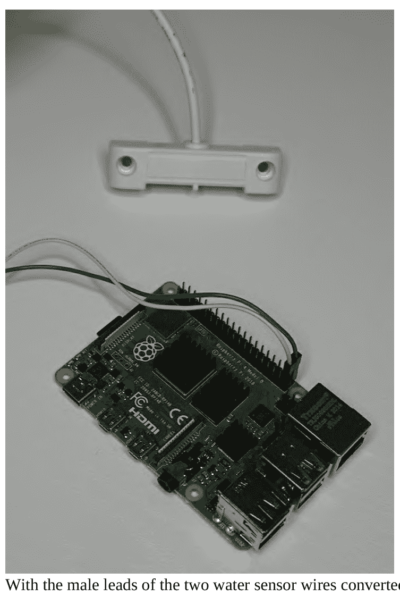
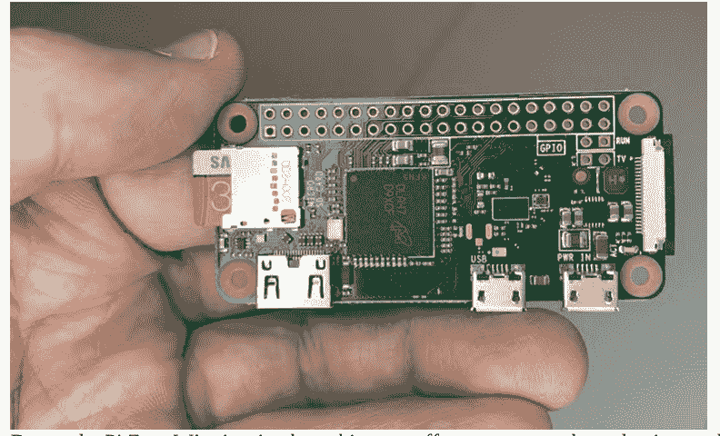

### Chapter 4
#### 水泄漏通知器

正如我们在之前的项目中演示的那样，Pi 可用作价格低廉的笔记本电脑或桌面电脑替代品，能够运行可在其他操作系统上运行的 Python 脚本。Pi 在家庭自动化领域如此有趣的原因在于其小巧的尺寸以及丰富的端口和 GPIO 引脚。传感器和执行器可通过这些接口连接到 Pi，使 Pi 拥有广泛的输入处理范围。其中最简单的输入之一就是开关。

对于本项目，我们将使用一个非常基础的水传感器，当水在其两个探针之间被检测到时，该传感器会打开（完成或闭合电气电路），当两个探针之间不再存在水时则关闭（断开或打开电气电路）。为了让这个开关更有用，我们将编写一个 Python 脚本，不仅可以检测开关是打开还是关闭，还能在检测到水时发送电子邮件。

##### 设置

以下是构建此项目所需的物品。

###### 硬件
- 地面水传感器 [35]

###### 软件
- Gmail（或其他 IMAP 兼容的电子邮件）账户

> **GPIOs 和 Pi 型号**
> GPIO 引脚图因使用的树莓派型号而异。本书假设您使用的是 Pi 4 Model B+，并将据此引用这些 GPIO 引脚位置。来自本书技术审阅者和 Pragmatic Bookshelf 同事作者 Maik Schmidt 的一个有用提示：如果您运行的是 Raspberry Pi OS，您可以在终端窗口中输入 pinout，然后图形地图和您所拥有的 Pi 型号的所有引脚列表将显示在屏幕上。非常酷！

将水传感器其中一根白色导线连接到引脚 39，该引脚在 Pi 4 上与地相关联，并将传感器的红色导线连接到引脚 40，该引脚与 GPIO 21 相关联。GPIO 21（引脚 40）提供电源，而地引脚是泄放端。当查看正确方向的 Pi 4 时，引脚 39 和 40 分别是最右侧的底部和顶部引脚。

由于水传感器没有用于树莓派 GPIO 引脚的母端适配器，并且直接将导线直接焊接到 Pi 的 GPIO 引脚并不是一个好主意，我建议使用母对母跳线。您可以将水传感器导线固定在跳线的一端，然后使用电工胶带或我个人最喜欢的热缩管将其固定到位。

如果您选择用热缩管密封带暴露水传感器接线的母端跳线，请使用发热源，例如将吹风机调至高温档，以使管子收缩包裹连接处。

每当在水传感器的两个探针之间检测到水时，电气电路将闭合，这意味着开关被打开。当这种情况发生时，GPIO 21 应该报告它感应到电流流过它。参考照片，查看水传感器导线应连接到 Pi GPIO 引脚的位置。



将两个水传感器导线的公端转换为母端后，您可以轻松地连接和移除连接。这在添加其他传感器或其他附件进行测试时非常方便，无论是与水传感器连接一起使用还是与其隔离。

##### 测试脚本

在我们完善完整的 Python 脚本来处理我们的电子邮件通知工作流程之前，让我们先测试水传感器，以确保其按预期工作。

我们将调用一个名为 RPi.GPIO 的自定义树莓派库来查询 GPIO 引脚的状态。与许多其他以 Pi 为中心/为 Pi 优化的软件一样，RPi.GPIO Python 库已预先安装在 Raspberry Pi OS 中。因此无需使用 Pip 安装它。

创建一个名为 watersensortest.py 的空 Python 文件。使用您喜欢的文本编辑器打开文件并输入以下 Python 代码：

```
watersensor/watersensortest.py

① import RPi.GPIO as GPIO
   import time

② GPIO.setmode(GPIO.BCM)
   GPIO.setup(21, GPIO.IN, pull_up_down = GPIO.PUD_UP)

   alert_trigger = False

③ while True:
    if GPIO.input(21):
    ④ if alert_trigger != True:
        print("No water detected.")
    ⑤ alert_trigger = True
    else:
        if alert_trigger != False:
            print("Water detected.")
            alert_trigger = False
    time.sleep(1)
```

① 导入 RPi.GPIO 库，我们将使用它来轮询 GPIO 引脚 21 的状态。

②

初始化 GPIO 库并通过 GPIO.setup 参数 pull_up_down = GPIO.PUD_UP 将引脚 21 的状态设置为 UP。

③ 运行无限循环，每秒轮询一次 GPIO 21 的状态。

④ 如果 GPIO 21 被拉低（即检测到水且电路闭合），则打印已检测到水。否则打印未检测到水。

⑤ 为防止不断的水/无水消息流打印到终端窗口，根据状态变化消息是否已输出到终端窗口，将变量 alert_trigger 设置为 True 或 False。

保存并使用 python3 执行脚本：

```
$ python3 watersensortest.py
```

如果一切代码无误且您的水传感器工作正常并正确连接到 Pi，您应该会看到单行输出，No water detected。将水传感器的两个金属探针浸入一小杯水中并检查您的终端窗口。新的 Water detected. 消息应该出现。将传感器从水中取出，另一个 No water detected. 消息应该显示。

您可以根据自己的喜好重复此测试任意多次。当您对结果的准确性和一致性感到满意时，按键盘上的 CTRL+C 键以中断并退出脚本中无限循环的 While 循环。

##### 水传感器电子邮件警报

虽然让传感器将水传感器的状态打印到终端窗口是有用的，但让我们整天坐在终端前等待检测到水是不切实际的。收到来自洗碗机、洗衣机甚至地下室泄漏的水泄漏电子邮件通知会更有帮助。利用我们测试脚本中已有的 print 语句存根，我们可以轻松添加一个电子邮件功能，在打印代替时调用它。

如果您已经设置了自己的电子邮件服务器，您可以使用该服务器代替公共服务器。但几乎每个人都有 Gmail 账户，因此本示例将使用 Gmail 作为邮件服务器，将水警报中继给您。请注意，您可以在其他公共电子邮件服务（如 Microsoft 的 Outlook.com 或 Yahoo Mail）上设置类似的配置。

由于我们将在未加密的纯文本 Python 脚本中存储电子邮件账户密码，我强烈建议您创建一个全新的、免费的 Gmail 账户，专门用于您的 Pi 和家庭自动化电子邮件通知项目。如果您的 Python 脚本因任何原因被入侵，您将把邮件存储暴露限制在简单的通知消息上。

现在我们已经创建了一个专用的 Gmail 账户并将其配置为允许从其他邮件客户端（如 Python 脚本）发送和接收消息，让我们创建一个简短的 emailtest.py 脚本来验证我们的新电子邮件地址是否正常工作：

```
watersensor/emailtest.py
```

```
① import smtplib
import email.mime.multipart
from email.mime.text import MIMEText
```

```
② def send_email(message):
③   gmail_user = 'YOUR-GMAIL-ACCOUNT-NAME@gmail.com'
    gmail_password = 'YOUR-GMAIL-ACCOUNT-PASSWORD'

    try:
④     msg = email.mime.multipart.MIMEMultipart()
    msg['to'] = 'Your Name<YOUR-EMAIL-ADDRESS@DOMAIN.COM>'
    msg['from'] = 'Your Gmail<YOUR-GMAIL-ACCOUNT-NAME@gmail.com>'
    msg['subject'] = 'Email Test'
    msg.add_header('reply-to', 'YOUR-GMAIL-ACCOUNT-NAME@gmail.com')
    msg.attach(MIMEText(message, 'plain'))
    session = smtplib.SMTP('smtp.gmail.com', 587)
    session.starttls()
    session.login(gmail_user, gmail_password)
    message = msg.as_string()
    session.sendmail('YOUR-GMAIL-ACCOUNT-NAME@gmail.com',
    'YOUR-EMAIL-ADDRESS@DOMAIN.COM', message)
    session.quit()
    print('Email sent.')
    except:
    print('Email failed to send.')

⑤ send_email('This is the body of the Email Test message.')
```

让我们在尝试运行它之前快速回顾一下此脚本中使用的代码。

- ① 使用并导入内置的 smtp 和 email Python 库。
- ② 创建一个 send_mail() 函数，接受要在电子邮件正文中显示的消息字符串。
- ③ 用您自己的 Gmail 账户的 Gmail 用户名和密码凭据替换示例 gmail_user 和 gmail_password 赋值。并且不，您不能使用我在示例中的那个，因为它无论如何都是假的。
- ④ 设置必要的 MIMEMultipart() 代码。您本可以使用更基础的纯文本邮件程序发送消息，但最好提前设置多部分 MIME 选项，以便轻松添加 HTML-


formatted message bodies in emails, should you decide to do so in the future.

⑤ 如果脚本能够成功验证 Gmail 并发送你的邮件，运行脚本后，你将在 Terminal 窗口中看到 Email sent. 显示。如果脚本执行时出现身份验证或配置错误，你将在 Terminal 中看到 Email failed to send.。

保存并运行脚本：

```
$ python3 emailtest.py
```

第一次运行脚本时，Gmail 会阻止你，你将在 Terminal 窗口中看到 Email failed to send.。这是因为 Gmail 由于欺诈性 Gmail 登录和滥用行为增加而提高了其 Gmail 账户的安全性。然而，由于我们特意创建了一个新的 Gmail 账户仅用于从 Python 脚本发送通知邮件，请登录你的新 Gmail 账户，应该会收到来自 Google 的邮件警报，提示有登录尝试并且 Google 已阻止它。通过注意 Google 在警报中指出的时间和日期以及位置，验证登录尝试确实来自你的脚本。按照邮件中提供的链接，然后在你的新 Gmail 账户中允许不太安全的应用程序访问。

##### Email Test

P4 Book <p4book@gmail.com>
3:11 PM

To: Mike Riley

This is the body of the Email Test message.

再次运行你的脚本，只要你的用户名和密码正确且被 Google 接受，你应该会在 Terminal 窗口中看到 Email sent. 消息。检查你发送测试邮件的邮箱的收件箱，应该会显示你已收到测试邮件。以下是我在测试期间收到的其中一封邮件的照片。

你现在可以从 Python 脚本发送具有自定义主题和正文消息的邮件。这很酷。现在你可以将这种新获得的消息功能与你的水传感器测试脚本结合起来，创建一个新的 watersensor.py 脚本：

```
watersensor/watersensor.py
import RPi.GPIO as GPIO
import time
import smtplib
import email.mime.multipart
from email.mime.text import MIMEText

GPIO.setmode(GPIO.BCM)
```

```
GPIO.setup(21, GPIO.IN, pull_up_down = GPIO.PUD_UP)

def send_email(message):
    gmail_user = 'YOUR-GMAIL-ACCOUNT-NAME@gmail.com'
    gmail_password = 'YOUR-GMAIL-ACCOUNT-PASSWORD'

    try:
        msg = email.mime.multipart.MIMEMultipart()
        msg['to'] = 'Your Name<YOUR-EMAIL-ADDRESS@DOMAIN.COM>'
        msg['from'] = 'Your Gmail<YOUR-GMAIL-ACCOUNT-NAME@gmail.com>'
        msg['subject'] = 'Water Sensor Alert'
        msg.add_header('reply-to', 'YOUR-GMAIL-ACCOUNT-NAME@gmail.com')
        msg.attach(MIMEText(message, 'plain'))
        session = smtplib.SMTP('smtp.gmail.com', 587)
        session.starttls()
        session.login(gmail_user, gmail_password)
        message = msg.as_string()
        session.sendmail('YOUR-GMAIL-ACCOUNT-NAME@gmail.com',
                         'YOUR-EMAIL-ADDRESS@DOMAIN.COM', message)
        session.quit()
        print('Email sent.')
    except:
        print('Email failed to send.')

alert_trigger = False

while True:
    if GPIO.input(21):
        if alert_trigger != True:
            send_email("No water detected.")
            alert_trigger = True
    else:
        if alert_trigger != False:
            send_email("Water detected.")
            alert_trigger = False
    time.sleep(1)
```

此脚本只是 watersensortest.py 和 emailtest.py Python 脚本的组合，用 send_email() 函数替换了 watersensortest.py 中的打印函数。如前所述，在附近放一杯水的情况下运行新合并的脚本，以验证水检测邮件的接收情况：

```
$ python3 watersensor.py
```

一旦执行脚本，你应该会收到一封发送到你提供的地址的邮件。测试每次将水传感器浸入水杯中并再次取出时邮件是否发送和接收。你应该会在每封邮件的正文中看到水检测状态消息。如果你想让这些邮件更简洁，可以修改主题行以包含水状态。例如，将以下行替换：

```
msg['subject'] = 'Water Sensor Alert'
```

为

```
msg['subject'] = 'Water Sensor Alert - ' + message
```

当你收到具有此修改后主题行的邮件时，它们会显示水传感器状态，而无需打开邮件查看正文。稍后当我们将 Pi Camera 连接到 Raspberry Pi 时，你可以通过让相机拍摄被监控区域的照片并将其作为邮件附件包含在内来改进此邮件通知。

##### Sensor Supervision

回想一下在 Supervisor 中，我们安装了 Supervisor 实用程序。现在是时候充分利用该守护进程应用程序了。虽然你当然可以从 Terminal 窗口启动 watersensor.py 脚本，但一旦关闭该窗口，脚本就会停止。如果你还记得 Rclone 中的 rclone 脚本，一种防止这种情况发生的方法是在命令末尾添加一个与号字符，&：

```
python watersensor.py &
```

此与号指示 BASH shell 在后台运行脚本，并在启动脚本执行的 Terminal 窗口关闭后仍保持其运行。虽然脚本可以以这种方式在后台继续运行，但不能保证它会继续运行。资源限制、冲突或甚至重启都会杀死脚本，而且除非测试是否仍收到邮件警报，否则你无法得知。

Supervisor 实用程序通过不仅在你希望时在启动时启动脚本；它还会不断监控脚本以验证其正在运行。如果脚本因任何原因死亡，Supervisor 将再次执行脚本。以这种方式设置像 watersensor.py 这样的无限循环脚本可以让我们安心，即使 Pi 意外或故意重启，脚本也会在后台运行。只要 Pi 正在运行，正确配置且无错误的受监视脚本也会运行。

配置 Supervisor 以启动和监控我们的脚本有点冗长，但相当容易，尤其是在你多次配置该实用程序之后。在我们的 watersensor.py 脚本的情况下，我们需要在 /etc/supervisor/conf.d/ 目录中创建一个新的配置文件。此配置文件指示 Supervisor 使用哪个 Python 解释器、要运行的 Python 脚本、以哪个用户运行它、是否应在启动时自动运行脚本、是否应在脚本意外死亡时自动重启脚本等等。让我们使用 Nano 实用程序为我们的 watersensor.py 脚本创建一个新的配置文件：

```
sudo nano /etc/supervisor/conf.d/watersensor.conf
```

在新创建的 watersensor.conf 文件中输入以下配置设置，将 YOURUSERNAME 占位符替换为你希望执行 watersensor.py 脚本的 Pi 上的账户用户名。如果你使用的是默认的 Pi 用户账户，则将 YOURUSERNAME 替换为 pi：

```
watersensor/watersensor.conf
```

```
① [program:watersensor]
② directory = /home/YOURUSERNAME/projects/watersensor
③ command = /usr/bin/nohup /usr/bin/python3 watersensor.py &
④ user = YOURUSERNAME
   environment HOME="/home/YOURUSERNAME",USER="YOURUSERNAME"
⑤ autostart = true
⑥ autorestart = true
⑦ stdout_logfile = /var/log/supervisor/watersensor.log
⑧ stderr_logfile = /var/log/supervisor/watersensor_err.log
```

输入后，通过按 CTRL+O 键盘键保存 /etc/supervisor/conf.d 目录中的配置文件。现在让我们更仔细地检查配置文件。

- ① 此标签用于标识 Supervisor 将运行的程序的名称。
- ② 这是你的 watersensor.py 脚本当前所在的目录。
- ③ nohup 程序是内置的 Linux 应用程序，允许命令或脚本在你注销 Pi 后继续运行。Python 3 是我们希望用于运行 watersensor.py 脚本的预期 Python 解释器。最后，我们显式运行 /usr/bin/python3 Python 3 解释器并


将脚本名称连同 & 符号一起传递，以指示脚本在后台运行。请注意，在 Supervisor 配置文件中为目标程序提供绝对路径是良好的做法。这可以保证 Supervisor 能够定位并运行负责正确执行您配置的 Python 脚本的应用程序。

④ 将用户和主目录环境变量设置为您的用户账户和绝对主目录路径。

⑤ 我们希望 watersensor.py 脚本在启动时自动开始运行。如果 Pi 需要自行重启，或者我们由于系统软件更新而需要重启它，我们就不必记住手动单独启动脚本。

⑥ 我们还希望 watersensor.py 脚本在意外退出时自动重启。请注意，如果您有一个导致脚本崩溃的 bug，Supervisor 将继续重新运行脚本，即使它继续反复崩溃。这就是为什么在设置 Supervisor 配置文件之前完全调试脚本很重要。 这样做将确保 Supervisor 尽可能无错误地保持脚本运行。

⑦ 如果您有任何通常会输出到终端窗口的打印语句，这些语句将被发送到日志文件。良好的 Supervisor 日志文件实践规定，日志文件应存储在 /var/log/supervisor 目录中以便轻松访问和查看。在这种情况下，我们将把这些输出保存到 /var/log/supervisor/watersensor.log 日志文件中。

⑧ 最后，如果您的脚本确实遇到错误和/或崩溃，由此类事件发出的错误可以在 stderr 日志文件中查看。此错误日志将存储在 /var/log/supervisor/watersensor_err.log 日志文件中。

要使 Supervisor 使用您新创建的 watersensor.conf 配置，您可以通过在终端窗口中输入重启命令来重启 Supervisor 服务。

```
$ sudo service supervisor restart
```

相反，您也可以选择重启您的 Pi。

```
$ sudo reboot
```

最好执行重启命令，以便您可以检查脚本是否在 Pi 完成重启后自动执行。通过对水传感器执行水杯测试来验证脚本是否已自动启动并在后台运行。如果您收到了预期的电子邮件警报，就万事大吉了！如果没有，请检查 /var/log/supervisor/watersensor_err.log 文件，看看是什么错误阻止了脚本运行或导致脚本崩溃。解决错误并重新启动/重启，然后重试。

一旦配置正确，Supervisor 程序就是一个强大的实用程序，它赋予 Pi 非凡的自主性和灵活性。我们将在本书中在创建更多项目时再次多次调用 Supervisor，这些项目会持续轮询连接到 Pi 的各种传感器的状态。

##### Joe asks:
###### What about the Pi Zero?

虽然我们功能强大的 Pi 4 会勤勉地执行轮询连接的水传感器状态的工作，但将此硬件用于这种简单、非 CPU 密集型任务似乎是对 Pi 4 硬件能力的极大浪费。当然，可能存在一些独特的场景，可以让 Pi 在检查水位的同时多任务流媒体，但这假设传感器有足够长的线可以到达测试源（更不用说防止此类电线成为安全隐患了）。

幸运的是，对于这些需要 Linux 操作系统的低 CPU 驱动项目，树莓派基金会有一个特殊的 Pi，称为 Pi Zero W。[36] 这台十美元的口香糖大小的电脑有足够的计算能力来执行此类项目，同时仍提供其较大兄弟中常见的 WiFi 和蓝牙连接等大多数功能。看看下一张照片中 Pi Zero 在我手中的有多小。



由于 Pi Zero W 的尺寸，设置和将电线连接到 GPIO 引脚需要付出更多努力（特别是因为板上没有引脚突出），但对于小型、单一用途的专用网络功能，Pi Zero W 是一款令人惊叹的技术，缩小成一台微小却功能强大的网络计算机。事实上，我将我的 Pi Zero 用作备份 Git 服务器和自动价格跟踪器，同时检查水漏。

做得好！您已经构建了一台水感应电脑，每当检测到水漏时就会向您发送电子邮件！您可以在涉及水收集的任何场景中使用这种新能力。在我的例子中，我想知道我的洗衣机何时开始向地板喷水。这通常发生在绒毛过滤器堵塞时，有时会造成需要数小时才能清理干净的混乱。有了我的水传感器，我不再担心我的洗衣机会意外地把我的地下室变成游泳池。

##### Next Steps

本项目向您展示了构建一个相当复杂、自主的监控系统是多么容易。通过这样做，您现在有了良好的基础，可以自定义构建和使用其他家庭自动化想法。您无需依赖第三方订阅服务或在未经您知情的情况下存储您家庭数据的外国服务器。您完全控制和管理自己的项目数据流程。

我们的下一个项目将应用我们在本项目中使用的相同概念。我们将使用类似的技术来检查不同类型传感器的状态并控制流行的消费级照明和电力管理系统。

##### Footnotes

[35] https://www.amazon.com/Floor-Water-Sensor-Flood-Detection/dp/B079YB1T8J?th=1

[36] https://www.raspberrypi.org/products/raspberry-pi-zero-w/
