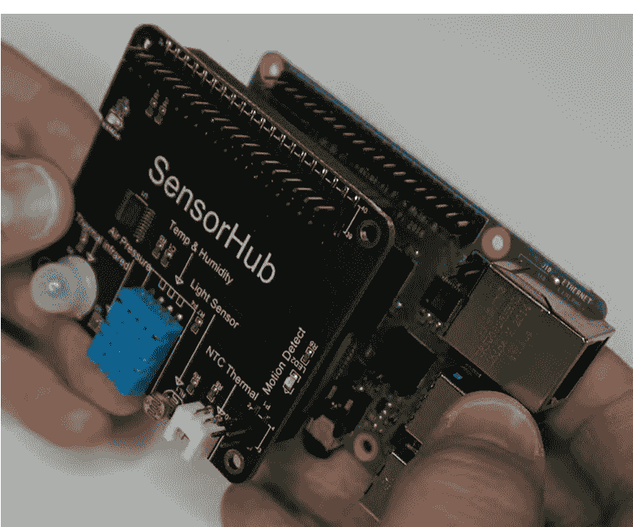
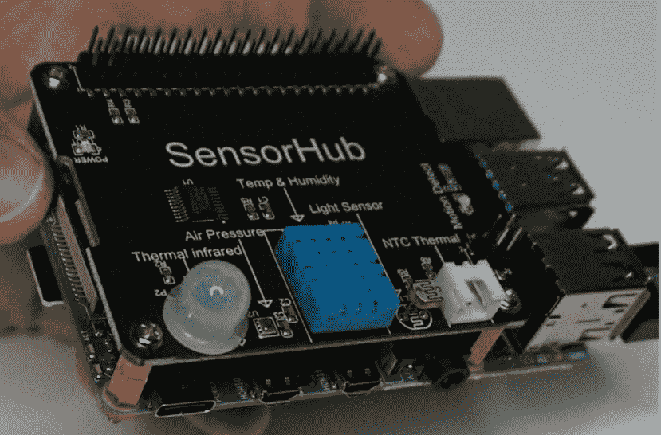
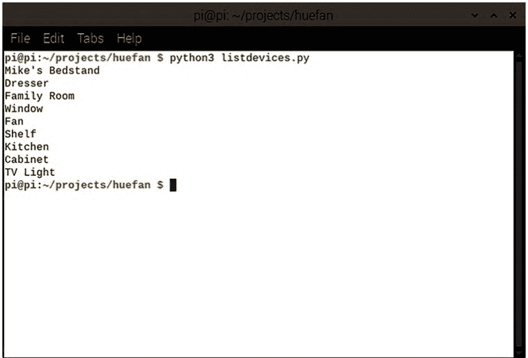

### Chapter 5

#### Hue Fan

作为一个狂热的技术爱好者，我用各种形状和大小的运行中的电脑包围我的 tinkering 工作空间。虽然这些机器在冬天用它们的所有热量排放让我保持温暖，但它们在炎热的夏季会把我的办公室变成桑拿房。

为了让我和我的机器保持凉爽，我有一个落地扇来帮助散发热量。但我经常忘记打开风扇，直到我汗湿的衬衫粘在椅背上。同样，我也会忘记在傍晚或电脑关机时关闭风扇。为了在保持凉爽的同时节省能源，我的 Pi 充当恒温器，根据室温打开或关闭落地扇。

由于我们已经在上一章编写了代码，构建这个解决方案很容易。我们所需要做的就是更改传感器类型并调用家庭自动化平台。让我们做点酷的事情！

##### Setup

以下是构建此项目所需的内容。

###### Hardware

- DockerPi SensorHub[^37]
- Philips Hue bridge[^38]
- Philips Hue smart plug[^39]
- 桌上风扇或其他可以通过电源旋钮或开关打开/关闭的电器。

###### Software

- Hue Smartphone[^40] app
- phue[^41] Python library

首先，通过按照 Hue bridge 包装中的说明安装和配置您的 Philips Hue bridge 和 Hue 配件，例如智能灯和智能插头。使用 Philips Hue 智能手机应用程序连接到、标记和组织您的配件。您需要这些标签来从本书中的 Python 脚本中识别要控制的智能插头和灯。Hue 应用程序提供了一种轻松的方式来组织和为您的 Hue 灯和电器分配名称。

请确保在将 SensorHub 连接到 Pi 之前先关闭并拔掉 Pi 的电源，如下一张照片所示。



在您能够查询 SensorHub 收集的数据之前，您必须启用 Pi 的 ARM I2C 内核模块。通过 raspi-config 程序执行此操作：

```
$ sudo raspi-config
```

从主菜单中选择选项 3，Interface Options，然后选择 P5 I2C 菜单选项以启用 I2C 内核模块的自动加载。

##### Seating the Sensor

SensorHub 包装包括四个金属柱，可以帮助将 SensorHub 更永久地固定到 Pi。我建议您先测试 SensorHub 连接到 Pi 的 GPIO 引脚，然后再用柱子固定。当您对 SensorHub 的长期使用感到满意时，您可以通过拧紧柱子使安装更安全。看看 SensorHub 在我 Pi 4 上坐得多么稳固，下一张照片。



当您在正确连接 SensorHub 的情况下为 Pi 上电时，SensorHub 上方左上角的红色 LED 电源指示灯将保持常亮。您还可能会看到 SensorHub 中右边缘附近的蓝色 LED 偶尔亮起和熄灭。此 LED 在最近五秒内检测到运动时点亮。您可以通过挥动手掌在板上方来验证此检测的发生。

由于我们将使用 Philips Hue 平台来打开和关闭连接到风扇的 Hue 智能插头（或其他可能更适合您的


needs)，我们将调用 phue 第三方 Python 库。将其安装到你的虚拟环境中：

```
$ sudo pip3 install phue
```

在我们能够开始向 Hue 网桥发送命令之前，必须先对其进行注册。

##### Bridge Registration

当你安装 Hue 系统时，需要按下 Hue 网桥顶部的同步按钮，以便你的 Hue 智能手机应用能够与该设备通信。Philips 采用了一种基本的安全方式，以防止附近的任何人未经授权访问你的 Hue 网络。通过按下 Hue 网桥上的按钮，你就是在授权请求控制访问的应用。

要在 Pi 上运行的 Python 脚本中执行此操作，你首先需要在按下 Hue 网桥按钮后的三十秒内通过连接进行注册。你还需要知道 Hue 网桥在网络上的 IP 地址，你应该能够从网络路由器的仪表板中识别出来，类似于 Finding the Pi on Your Network 中识别 Pi 的 IP 和 MAC 地址的方式。

在你的 huefan 目录中创建以下脚本，命名为 register.py，并将 Hue 网桥注册代码的行添加到此文件中：

```
huefan/register.py

① from phue import Bridge

② huebridge = Bridge('YOUR_HUE_BRIDGE_IP_GOES_HERE')

③ huebridge.connect()
```

让我们快速了解一下这段三行 Python 脚本的作用。

+   ① 使用 from Python 关键字，我们可以从模块中导入特定的类或函数并将其分配给实例变量。在本例中，我们从 phue 模块导入 Bridge 以供脚本使用。
+   ② 我们将 Hue 网桥的 IP 地址传递给 Bridge 并将其结果分配给 huebridge 变量。

③ 只要在运行此脚本前几秒内按下 Hue 网桥顶部的按钮，Hue 网桥就会注册我们的 Pi 并授予其控制网络上其他 Hue 注册设备的权限。一旦你成功将 Pi 与 Hue 网桥注册，除非你使用不同的 Hue 网桥或另一台 Pi 来运行 Hue 脚本，否则无需再次调用 connect()。

将 YOUR_HUE_BRIDGE_IP_GOES_HERE 替换为你的 Hue 网桥的 IP 地址。准备就绪后，按下 Hue 网桥顶部的同步按钮，以允许其自动注册请求注册的新设备。在我们的例子中，这个新设备就是运行此脚本的 Pi。

在按下 Hue 网桥按钮后的三十秒内执行 register.py 脚本。如果你未能及时运行脚本，你将不得不再次按下 Hue 网桥按钮并重新运行注册脚本。

```
$ python3 register.py
```

如果执行脚本后没有输出，则表示你已成功将 Pi 与 Hue 网桥注册。现在你可以使用 Pi 和其上运行的 phue 脚本来远程控制网络上的其他 Hue 设备。

如果脚本未能 connect()，它将在输出错误中提供详细信息。无法注册的最常见错误是使用错误的 Hue 网桥 IP 地址。此错误通常在错误跟踪的底部报告为 socket.gaierror: [Errno -2] Name or service not known。修复 IP 地址和连接问题，以便在继续之前成功将 Pi 与 Hue 网桥注册。

##### Registered Devices

为确认你的操作成功并识别已连接 Hue 智能插头的名称和 ID，创建并运行以下 listdevices.py 脚本，该脚本将连接到你的 Hue 网桥并枚举与网桥配置的 Hue 配件列表：

```
huefan/listdevices.py

from phue import Bridge

① huebridge = Bridge('YOUR_HUE_BRIDGE_IP_GOES_HERE')

② lights = huebridge.lights

③ for light in lights:
    print(light.name)
```

让我们快速了解一下此脚本如何连接到你的 Hue 网桥并识别其能够管理的其他 Hue 设备。

+   ① 在这里，我们将 Hue 网桥的 IP 地址传递给 huebridge 对象实例。
+   ② 接下来，我们查询网桥 lights 集合并将有关 Hue 智能灯泡、智能插头和其他 Hue 可控配件的详细信息分配给 lights 变量。
+   ③ 最后，我们使用 for 循环遍历 lights 集合并将每个项目分配给 light 变量。然后我们打印通过 Hue 智能手机应用为这些设备分配的名称。

脚本的输出将列出你已使用 Hue 网桥注册并命名的 Hue 灯光、智能插头和配件的名称。从列表中识别你的 Hue 智能插头的名称。在我的例子中，我将我的智能插头命名为“Fan”，我将在示例代码中使用该名称。如果你使用智能手机上的 Philips Hue 应用为智能插头或灯光标记了不同的名称，请务必将代码列表中的 ‘Fan’ 替换为你的 Hue 标记设备的名称。例如，这里是在我的终端窗口中从 within 运行 python3 listdevices.py 命令后显示的输出。



现在我们看到了已连接设备的列表，我们可以使用一行 Python 代码将其打开或关闭。

##### Turn It On Again

创建一个 smartplugtest.py 文件，并将 YOUR_HUE_BRIDGE_IP_GOES_HERE 和 Fan 标识符替换为环境中设备的 IP 地址和 Hue 名称：

```
huefan/smartplugtest.py

from phue import Bridge
import time

huebridge = Bridge('YOUR_HUE_BRIDGE_IP_GOES_HERE')

① huebridge.set_light('Fan','on', True)
time.sleep(10)
② huebridge.set_light('Fan','on', False)
```

① 通过调用 set_light() 函数并将设备名称（在本例中为 Fan）设置为 True 来打开设备。

② 等待十秒后，再次调用 set_light() 函数，这次将 Fan 设备设置为 False 以将其关闭。

在运行脚本之前，请靠近风扇或你连接智能插头的其他电器，并验证智能插头是否正常工作。使用智能手机上的 Philips Hue 应用通过切换智能插头的开/关来执行此操作。一旦确认一切按预期工作，请通过 Hue 智能手机应用将智能插头设置为关闭状态并执行 smartplugtest.py 脚本：

```
$ python3 smartplugtest.py
```

你的智能插头应打开电源。十秒后，它应断电。如果你将风扇或其他电源切换电器连接到智能插头，它也应如此。

##### Sensing the Heat

现在你可以使用一行 Python 代码打开 Hue 灯光和插头，让我们将这一新能力与温度传感器结合起来。当温度达到或超过 27 摄氏度（大约 80 华氏度）时，打开连接到智能插头的风扇。当温度降至 27 摄氏度以下时，关闭风扇。

创建一个名为 temperaturtest.py 的文件并编写代码，每秒显示一次 SensorHub 温度探头的温度读数。SensorHub 初始化代码取自 DockerPi 的 wiki:[42]

```
huefan/temperaturesensor.py
```

```
① import smbus
   import time

② DEVICE_BUS = 1
   DEVICE_ADDR = 0x17

   TEMP_REG = 0x01
   LIGHT_REG_L = 0x02
   LIGHT_REG_H = 0x03
   STATUS_REG = 0x04
   ON_BOARD_TEMP_REG = 0x05
   ON_BOARD_HUMIDITY_REG = 0x06
   ON_BOARD_SENSOR_ERROR = 0x07
   BMP280_TEMP_REG = 0x08
   BMP280_PRESSURE_REG_L = 0x09
   BMP280_PRESSURE_REG_M = 0x0A
   BMP280_PRESSURE_REG_H = 0x0B
   BMP280_STATUS = 0x0C
   MOTION_DETECT = 0x0D

   bus = smbus.SMBus(DEVICE_BUS)

③ while True:
      aReceiveBuf = []
```

```
aReceiveBuf.append(0x00)

for i in range(TEMP_REG,MOTION_DETECT + 1):
    aReceiveBuf.append(bus.read_byte_data(DEVICE_ADDR, i))

④ if aReceiveBuf[STATUS_REG] & 0x01 :
    print('The external temperature sensor range was exceeded. \ No value reported.')
elif aReceiveBuf[STATUS_REG] & 0x02 :
    print('The external temperature sensor is disconnected.')
else :
    external_celsius = aReceiveBuf[TEMP_REG]
    external_fahrenheit = (external_celsius * 9/5) + \
    32
    print('The current external sensor temperature = '
    + str(external_celsius) + ' C / ' + \
    str(external_fahrenheit) + ' F\n')

⑥ onboard_celsius = aReceiveBuf[ON_BOARD_TEMP_REG]
onboard_fahrenheit = (onboard_celsius * 9/5) + 32

print('The current onboard sensor temperature = '
⑦ + str(onboard_celsius) + ' C / ' + str(onboard_fahrenheit) + ' F')

if aReceiveBuf[ON_BOARD_SENSOR_ERROR] != 0 :
    print('The current onboard temperature and \ humidity sensor data is unavailable.')

time.sleep(1)
```

在执行它之前，让我们回顾一下此脚本正在做什么。

① 为了与连接 SensorHub 和 Pi 的 I2C 接口通信，我们需要导入 smbus Python 库。此外部库已预先加载到 Raspberry Pi OS Desktop 中。如果你运行此脚本时遇到错误，请确保已安装 smbus 库（通过 sudo pip3 install smbus）并验证 SensorHub 是否已正确安装并在 Pi 上运行。


这是与 SensorHub 上各种传感器通信所需初始化和地址分配代码。对于本项目，我们将只关注外部和板载温度传感器。我们将在第 6 章 *Hue Auto Light* 中调用 SensorHub 的运动和光传感器。SensorHub 上还配有一个气压传感器，但它不会在本书的任何项目中使用。

③ 此 While 语句将始终为 True，因此脚本将一直运行，直到你通过 Ctrl+C 从脚本执行中退出。

④ 如前所述，SensorHub 有两个温度传感器：一个板载传感器直接焊接在板上，以及一个外部温度探头，能更准确地检测室温。在运行脚本之前，请确保外部传感器探头已连接到 SensorHub。条件语句 elif aReceiveBuf[STATUS_REG] & 0x02 将检查探头是否已连接，并在未连接时报告。

⑤ 板载报告的温度采用摄氏度。对于更喜欢华氏度的人，我们进行快速转换，以便我们可以同时以摄氏度和华氏度打印温度。

⑥ 尽管我们将使用外部温度探头读数进行本项目，但板载传感器读数仍会被报告，只是为了说明两个传感器之间的温度差异。板载温度传感器 literally 位于 Pi 发热最严重的芯片顶部。随着这些芯片升温，该传感器周围的温度也会升高。据我的经验，板载和外部温度传感器读数之间的差异可能超过 10 摄氏度（20 华氏度）。

准备好后，运行脚本：

```
$ python3 temperaturesensor.py
```

注意在你的终端窗口中，每秒打印的板载和外部传感器的温度读数。

多次运行脚本以验证温度是否被准确报告。握住外部探头将其加热，并观察该热量在脚本输出中显示的读数中反映出来。

##### 过于温暖

现在我们能够检测环境室温，让我们使用我们在第 4 章 Water Leak Notifier 中采用的相同方法，设置上下温度边界以报告温度超过设定阈值条件时。 我们也只会轮询外部温度探头，因此请确保它已连接并正常工作。在此示例中，将温度阈值设置为 80 华氏度：

```
huefan/temperaturetest.py

import smbus
import time

DEVICE_BUS = 1
DEVICE_ADDR = 0x17

TEMP_REG = 0x01
LIGHT_REG_L = 0x02
LIGHT_REG_H = 0x03
STATUS_REG = 0x04
ON_BOARD_TEMP_REG = 0x05
ON_BOARD_HUMIDITY_REG = 0x06
ON_BOARD_SENSOR_ERROR = 0x07
BMP280_TEMP_REG = 0x08
BMP280_PRESSURE_REG_L = 0x09
BMP280_PRESSURE_REG_M = 0x0A
BMP280_PRESSURE_REG_H = 0x0B
BMP280_STATUS = 0x0C
MOTION_DETECT = 0x0D

bus = smbus.SMBus(DEVICE_BUS)

alert_trigger = False

while True:
    aReceiveBuf = []

    aReceiveBuf.append(0x00)
```

```
for i in range(TEMP_REG,MOTION_DETECT + 1):
    aReceiveBuf.append(bus.read_byte_data(DEVICE_ADDR, i))

if aReceiveBuf[STATUS_REG] & 0x01 :
    print('The external temperature sensor range was exceeded.')
elif aReceiveBuf[STATUS_REG] & 0x02 :
    print('The external temperature sensor is disconnected.')
else :
    external_celsius = aReceiveBuf[TEMP_REG]
    external_fahrenheit = (external_celsius * 9/5) + 32
    if external_fahrenheit > 79:
        if alert_trigger != True:
            print("Temperature is above 79 degrees.")
            alert_trigger = True
    else:
        if alert_trigger != False:
            print("Temperature is below 80 degrees.")
            alert_trigger = False

time.sleep(1)
```

运行脚本并注意在你的终端窗口中打印的温度读数：

```
$ python3 temperaturetest.py
```

对着外部温度探头吹气或使用低热设置的吹风机向其吹暖空气。一旦温度读数达到或超过 80 度，该状态将在终端中打印。移走热源并等待温度下降。当探头周围的空气低于 80 度时，消息 Temperature under 80 degrees. 将在运行脚本的终端中显示。

在你提高和降低外部探头周围的温度时观察输出屏幕，然后退出正在运行的 temperaturetest.py 脚本。

我们现在有能力控制电源开关并感测温度。是时候将所有这些独立功能组合成一个可执行脚本了。

##### 全部整合

将我们用于切换 Hue 智能插头的代码与外部温度测试脚本结合起来。这样做将使我们能够在温度超过 79 度时打开风扇，并在温度低于 80 度时关闭它。

我们还需要将采样率降低到每两分钟（120 秒）一次，而不是每秒一次。这将为智能插头打开和关闭风扇提供充足的时间。否则，随着温度在单个阈值度数之间波动，我们将不断地打开和关闭风扇：

```
huefan/huefan.py

from phue import Bridge
import smbus
import time

huebridge = Bridge('YOUR_HUE_BRIDGE_IP_GOES_HERE')

DEVICE_BUS = 1
DEVICE_ADDR = 0x17

TEMP_REG = 0x01
LIGHT_REG_L = 0x02
LIGHT_REG_H = 0x03
STATUS_REG = 0x04
ON_BOARD_TEMP_REG = 0x05
ON_BOARD_HUMIDITY_REG = 0x06
ON_BOARD_SENSOR_ERROR = 0x07
BMP280_TEMP_REG = 0x08
BMP280_PRESSURE_REG_L = 0x09
BMP280_PRESSURE_REG_M = 0x0A
BMP280_PRESSURE_REG_H = 0x0B
BMP280_STATUS = 0x0C
HUMAN_DETECT = 0x0D

bus = smbus.SMBus(DEVICE_BUS)
```

```
alert_trigger = False

while True:
    aReceiveBuf = []
    aReceiveBuf.append(0x00)
    for i in range(TEMP_REG,HUMAN_DETECT + 1):
        aReceiveBuf.append(bus.read_byte_data(DEVICE_ADDR, i))
    if aReceiveBuf[STATUS_REG] & 0x01 :
        print('The external temperature sensor range was exceeded.')
    elif aReceiveBuf[STATUS_REG] & 0x02 :
        print('The external temperature sensor is disconnected.')
    else :
        external_celsius = aReceiveBuf[TEMP_REG]
        external_fahrenheit = (external_celsius * 9/5) + 32
        if external_fahrenheit > 79:
            if alert_trigger != True:
                huebridge.set_light('Fan','on', True)
                alert_trigger = True
        else:
            if alert_trigger != False:
                huebridge.set_light('Fan','on', False)
                alert_trigger = False
    time.sleep(120)
```

保存并执行脚本。

```
$ python3 huefan.py
```

根据你理想的房间制冷条件调整温度和睡眠时间（即采样率）值。如果发现温度在 79 和 80 度之间反复波动，请进一步更改采样率。这样你就不会每两分钟不断地打开和关闭智能插头。你还可以创建一个嵌套条件语句，根据上次温度读数延长智能插头打开或关闭的持续时间。你可以根据喜好继续调整，以获得对房间温度变化响应的触发器的精细控制。

如果你打算让脚本始终运行，请为项目创建并启用一个 Supervisor 配置文件，并将其保存在 /etc/supervisor/conf.d 目录中：

```
huefan/huefan.conf
```

```
[program:huefan]
directory = /home/YOURUSERNAME/projects/huefan
command = /usr/bin/nohup /usr/bin/python3 huefan.py &
user = YOURUSERNAME
environment=HOME="/home/YOURUSERNAME",USER="YOURUSERNAME"
autostart = true
autorestart = true
stdout_logfile = /var/log/supervisor/huefan.log
stderr_logfile = /var/log/supervisor/huefan.log
```

重启 Supervisor 守护进程以激活受监督的 huefan.py Python 脚本。

```
$ sudo service supervisor restart
```

干得漂亮！你已能够将你在第 4 章 Water Leak Notifier 中学到的知识转化为基本上创建自己的恒温器。你现在拥有足够的经验和编码技能来连接并从 Pi 的输入中读取。你甚至可以通过包含我们在水传感器项目中编写的电子邮件警报代码来进一步扩展此项目。这样，即使你不在同一房间，也会被通知风扇已打开或关闭。


##### 下一步

现在你已经具备了根据外部输入（如环境光和室温）来控制风扇等电器设备的基础，可以在此基础上扩展该项目。创建计划来触发此类传感器测试，或在特定时间或家庭/工作场所的环境条件下启用其他 Hue 兼容配件，如灯带和墙壁开关。

在离开令人兴奋的传感器管理世界之前，我们将在下一个项目中探索一个额外的传感器相关情况。利用 SensorHub 上的光传感器，结合我们之前完成的项目中组装的代码片段，我们将构建在检测到运动时打开灯，并在设定持续时间后关闭灯的手段。

##### 脚注

- [37] https://www.seeedstudio.com/DockerPi-Sensor-Hub-Development-Board-p-4101.html
- [38] https://www.philips-hue.com/en-us/p/hue-bridge/046677458478
- [39] https://www.philips-hue.com/en-us/p/hue-smart-plug/046677552343
- [40] https://apps.apple.com/us/app/philips-hue/id1055281310
- [41] https://github.com/studioimagin aire/phue
- [42] https://wiki.52pi.com/index.php/DockerPi_Sensor_Hub_Development_Board_SKU:_EP-0106
