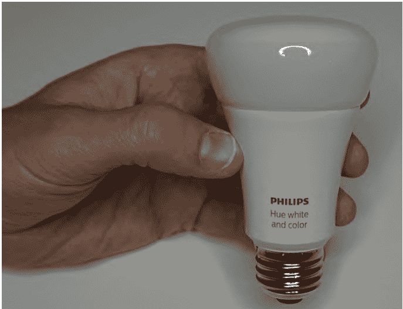

### 第 6 章

#### Hue 自动灯光

当检测到运动时打开灯的概念已经运行了数十年。最初设计用于工业和商业建筑空间，制造的解决方案昂贵且通常是专有安装。但正如我们在本书中其他项目中所见，Pi 重新定义了计算的成本，以及实现自动化解决方案的成本。

专业照明系统允许操作员设置计时器，以在不再检测到运动之前关闭灯。这些系统还允许根据一天中的时间设置照明计划以打开和关闭灯。只有最昂贵和最复杂的商业安装才会考虑到是否需要额外的照明，具体取决于现有光源照亮房间的情况。得益于 Pi-SensorHub 组合，我们的实现成本仅为传统专有照明系统的十分之一，但功能相同。

对于本项目，我们将借鉴之前传感器检测项目的设计。我们还将利用 SensorHub 的运动检测器来触发照明事件，有一个变化；我们希望考虑运动和时间变化，这样我们就不会每秒都打开和关闭灯。让我们开始吧。

##### 设置

以下是构建此项目所需的物品。

###### 硬件

- DockerPi SensorHub
- Philips Hue bridge
- Philips Hue 智能灯泡[^43]

你可以使用标准白光或彩色灯光 Hue 智能灯泡。虽然彩色灯光型号比白光灯泡贵一点，但我更喜欢彩色灯光型号，这样我就可以为环境或心情调节出完美的颜色。以下是我在手中 Hue 彩色灯泡型号的照片。



###### 软件

- phue Python 库
- Philips Hue 智能手机应用

如果你已完成第 5 章 *Hue Fan*，那么你已经安装了 phue Python 库。如果没有，你可以通过 pip3 install 命令安装 phue 库。

```
$ sudo pip3 install phue
```

假设你成功完成了上一个涉及 SensorHub 的 Hue 项目，并且该硬件附加组件仍然连接到你的 Pi，那么你就可以继续了。如果没有，请按照该项目中的设置将 SensorHub 连接并激活 I2C 接口。然后通过 Hue Fan Bridge Registration 部分中的说明将你的 Pi 与 Hue bridge 注册。

##### 于是有了光

确保你已经通过 Hue 智能手机应用使用 Hue bridge 配置并标记了你想在本项目中使用的 Hue 智能灯泡。确认你可以在 Hue 智能手机应用中打开和关闭该特定智能灯泡，然后再继续。

接下来，通过我们在第 5 章 *Hue Fan* 中使用的 listdevices.py 脚本识别你想要自动化的特定智能灯泡：

```
hueautolight/listdevices.py

from phue import Bridge

huebridge = Bridge('YOUR_HUE_BRIDGE_IP_GOES_HERE')

lights = huebridge.lights

for light in lights:
    print(light.name)
```

在生成的列表中识别首选智能灯泡名称的标签，然后通过 smartbulbtest.py Python 脚本确认你可以通过编程方式打开和关闭该灯泡。在我的示例中，我将打开和关闭我安装在我厨房灯具中的智能灯泡。请确保将 Kitchen 占位符更改为你在网络上测试的 Hue 智能灯泡的名称：

```
hueautolight/smartbulbtest.py

from phue import Bridge
import time

huebridge = Bridge('YOUR_HUE_BRIDGE_IP_GOES_HERE')

huebridge.set_light('Kitchen','on', True)
time.sleep(10)
huebridge.set_light('Kitchen','on', False)
```

就像 Hue Fan 项目一样，你应该看到指定的智能灯泡打开，然后十秒后关闭。确保此脚本在你的 Hue 设置中正常工作，然后再继续本项目。

看到多快就完成了吗？我们几乎完成了项目目标的一半。对于另一半，我们需要调用 SensorHub 的运动检测器来识别何时发生运动：

```
hueautolight/motionsensortest.py

import smbus
import time

DEVICE_BUS = 1
DEVICE_ADDR = 0x17

TEMP_REG = 0x01
LIGHT_REG_L = 0x02
LIGHT_REG_H = 0x03
STATUS_REG = 0x04
ON_BOARD_TEMP_REG = 0x05
ON_BOARD_HUMIDITY_REG = 0x06
ON_BOARD_SENSOR_ERROR = 0x07
BMP280_TEMP_REG = 0x08
BMP280_PRESSURE_REG_L = 0x09
```

```
BMP280_PRESSURE_REG_M = 0x0A
BMP280_PRESSURE_REG_H = 0x0B
BMP280_STATUS = 0x0C
MOTION_DETECT = 0x0D

bus = smbus.SMBus(DEVICE_BUS)

alert_trigger = False

while True:
    aReceiveBuf = []

    aReceiveBuf.append(0x00)

    for i in range(TEMP_REG,MOTION_DETECT + 1):
        aReceiveBuf.append(bus.read_byte_data(DEVICE_ADDR, i))

    if aReceiveBuf[MOTION_DETECT] == 1 :
        if alert_trigger != True:
            print("Movement was detected.")
            alert_trigger = True
    else:
        if alert_trigger != False:
            print("No movement was detected.")
            alert_trigger = False

    time.sleep(1)
```

回想一下在 Hue Fan 项目中 SensorHub 概述中，当检测到运动时，SensorHub 中间右侧的蓝色 LED 会亮起。运动检测事件在运行 motionsensortest.py 脚本时也会报告其状态。现在尝试运行脚本：

```
$ python3 motionsensortest.py
```

在 SensorHub 上方挥动手臂，当蓝色 LED 运动指示灯亮起时，你应该在运行脚本的终端窗口中看到打印出 Movement was detected. 消息。如果在传感器在一秒延迟后没有检测到额外运动，它将跟随 No movement was detected. 消息。

##### 灯光明亮

如果房间里已经有足够的自然日光，我们就不需要打开灯并不必要地浪费电。为测试该条件，我们将轮询 SensorHub 上的机载光传感器。光传感器将有助于确定是否需要额外的房间照明。机载 SensorHub 光传感器以勒克斯为单位检测存在的光能量。[44]

对于本项目，我们将在检测到运动时打开 Hue 智能灯泡，只要房间中检测到的可用光量小于 25 勒克斯，这大致相当于稍微昏暗房间中散射的环境光。让我们编写一个快速的光传感器测试脚本来检测光照度值并相应地做出反应：

```
hueautolight/lightsensortest.py

import smbus
import time

DEVICE_BUS = 1
DEVICE_ADDR = 0x17

TEMP_REG = 0x01
LIGHT_REG_L = 0x02
LIGHT_REG_H = 0x03
STATUS_REG = 0x04
ON_BOARD_TEMP_REG = 0x05
ON_BOARD_HUMIDITY_REG = 0x06
ON_BOARD_SENSOR_ERROR = 0x07
BMP280_TEMP_REG = 0x08
BMP280_PRESSURE_REG_L = 0x09
BMP280_PRESSURE_REG_M = 0x0A
BMP280_PRESSURE_REG_H = 0x0B
BMP280_STATUS = 0x0C
MOTION_DETECT = 0x0D

bus = smbus.SMBus(DEVICE_BUS)
```


```
while True:
    aReceiveBuf = []

    aReceiveBuf.append(0x00)

    for i in range(TEMP_REG,MOTION_DETECT + 1):
        aReceiveBuf.append(bus.read_byte_data(DEVICE_ADDR, i))

    lux = (aReceiveBuf[LIGHT_REG_H] << 8 | aReceiveBuf[LIGHT_REG_L])

    if aReceiveBuf[STATUS_REG] & 0x04 :
        print('The onboard light sensor is overloaded.')
    elif aReceiveBuf[STATUS_REG] & 0x08 :
        print('The onboard light sensor is not responding.')
    else :
        print('The current onboard light sensor brightness = %d lux.' % lux)

    time.sleep(1)
```

在运行脚本的同时，用光源，例如智能手机摄像头灯，对准 SensorHub。你应该会看到 lux 值显著增加，并且我们的脚本会相应做出反应。然后退出脚本。

##### 我们有了运动检测

在通过编程确认智能灯泡和光线及运动传感器正常工作后，我们可以将它们结合起来，在光线不足的情况下，只要检测到运动就打开灯。

我们将修改上一个 Hue 项目中的 Hue 智能插头代码，并用我们的运动测试代码替换温度代码。但与 Hue 风扇项目不同，我们不应在不再检测到运动时立即关闭灯；否则灯只会短暂亮起几秒钟后就熄灭。

我们将在脚本中通过让灯保持亮起五分钟来实现这一点。而且我们只会在房间照明不足时才打开智能灯泡：

```
hueautolight/hueautolight.py

from phue import Bridge
import smbus
import time

huebridge = Bridge('YOUR_HUE_BRIDGE_IP_GOES_HERE')

DEVICE_BUS = 1
DEVICE_ADDR = 0x17

TEMP_REG = 0x01
LIGHT_REG_L = 0x02
LIGHT_REG_H = 0x03
STATUS_REG = 0x04
ON_BOARD_TEMP_REG = 0x05
ON_BOARD_HUMIDITY_REG = 0x06
ON_BOARD_SENSOR_ERROR = 0x07
BMP280_TEMP_REG = 0x08
BMP280_PRESSURE_REG_L = 0x09
BMP280_PRESSURE_REG_M = 0x0A
BMP280_PRESSURE_REG_H = 0x0B
```

```
BMP280_STATUS = 0x0C
MOTION_DETECT = 0x0D

bus = smbus.SMBus(DEVICE_BUS)

alert_trigger = False

while True:
    aReceiveBuf = []
    aReceiveBuf.append(0x00)
    for i in range(TEMP_REG,MOTION_DETECT + 1):
        aReceiveBuf.append(bus.read_byte_data(DEVICE_ADDR, i))

    lux = (aReceiveBuf[LIGHT_REG_H] << 8 | aReceiveBuf[LIGHT_REG_L])

    if aReceiveBuf[MOTION_DETECT] == 1 :
        if alert_trigger != True:
            if lux < 25 :
                huebridge.set_light('Kitchen','on', True)
                alert_trigger = True
                time.sleep(300) # Leave the light on for 5 minutes
    else:
        if alert_trigger != False:
            huebridge.set_light('Kitchen','on', False)
            alert_trigger = False

    time.sleep(1)
```

保存你的工作，运行代码，并在各种场景下进行测试：

```
$ python hueautolight.py
```

改变 SensorHub 周围的照明条件，以验证光线传感器是否正常工作，只在房间内光线不足时才允许智能灯泡打开。你可以通过在 Pi-SensorHub 上放置一个盒子来使其环境变暗，从而人工模拟这种情况。相反，如果你已经在黑暗的房间里，可以用灯照射传感器，人为提高检测到的亮度。

一旦对结果满意，请根据自己的环境自定义条件 lux 值和超时值，并通过为 Supervisor 创建专用的 hueautolight.conf 配置文件来自动执行脚本。

如果尚未完成，请按照第 4 章《水泄漏通知器》中的 Supervisor 设置说明进行操作，然后在 /etc/supervisor/conf.d 目录中创建 hueautolight.conf 文件：

```
$ sudo nano /etc/supervisor/conf.d/hueautolight.conf
```

此文件的内容与我们在之前项目中使用的文件非常相似，只是更改了正在运行的脚本的路径和名称：

```
hueautolight/hueautolight.conf

[program:hueautolight]
directory = /home/YOURUSERNAME/projects/hueautolight
command = /usr/bin/nohup /usr/bin/python3 hueautolight.py &
user = YOURUSERNAME
environment=HOME="/home/YOURUSERNAME",USER="YOURUSERNAME"
autostart = true
autorestart = true
stdout_logfile = /var/log/supervisor/hueautolight.log
stderr_logfile = /var/log/supervisor/hueautolight_err.log
```

以两种方式之一激活脚本的监督。你可以重启 Supervisor 服务：

```
$ sudo service supervisor restart
```

或者你可以直接重启 Pi：

```
$ sudo reboot
```

再次运行照明测试，以确保脚本在后台执行。干得好！你刚刚创建了一个定制的照明解决方案，如果在商业建筑环境中实施，将花费数万美元。而你只用了几分钟就完成了，这得益于你在之前完成的 Pi 项目中获得的知识，以及所创建的源代码。

##### 下一步

这个项目很直接，特别是如果你完成了前面控制风扇的 Hue 项目。轮询 SensorHub 的运动传感器并通过 Python 脚本打开 Hue 管理的灯光可能看起来很简单，但使其正常工作所需的硬件和网络基础设施正是让一切看起来如此容易的原因。

如果你成功完成了 Hue 风扇和这个 Hue 照明项目，恭喜你！你已经成功掌握了以自主方式编程 Hue 系统执行任何操作的能力。你通常需要 Hue 应用手动控制照明和电器，但现在你有能力让你的 Hue 供电系统基于传感器数据和事件变化执行多项任务。

考虑你家或办公室中其他想要自动化的区域。在特定时间打开咖啡机并监控温度。如果咖啡在相同温度下闲置太久，发送电子邮件提醒。基于土壤湿度自动浇水。根据房间温度或时间自动卷起或放下窗帘。所有这些想法以及更多现在都是可能的，因为你知道实现它们是多么容易。

我们的下一个项目将从传感器和开关转向，专注于让我们的 Pi 在半夜做点事情。由于项目的复杂性，我们还需要编写比本书迄今为止使用的更多的 Python 代码。现在，你可以用 Hue 风扇保持凉爽，用 Hue 自动灯光看得更清楚。

脚注

[43] https://www.philips-hue.com/en-us/products/smart-lightbulbs

[44] https://en.wikipedia.org/wiki/Lux
