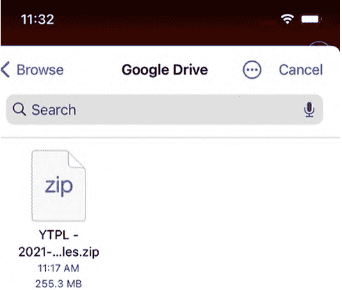

### 第 7 章

#### PiSpeak

考虑到其小巧的尺寸和相对较低的成本，Pi 4 是一款出色的硬件。然而，如果你只用这台计算能力来监控传感器偶尔的变化，就会浪费大量的计算周期。本项目的目的是让你的 Pi 在非工作时间做点事情，希望能让你在不睡觉时更高效、更聪明。

PiSpeak 项目的目标是使用 RSS 源检索最新新闻，并使用文本转语音 TTS 引擎将这些源转换为单个 MP3 文件，该文件可以轻松与云存储服务同步。然后可以将该 MP3 文件下载到智能手机，并配置为在智能手机 MP3 播放器应用程序中播放。脚本还将发送电子邮件通知，提醒有新内容可用，并附上音频文件中包含的文章标题和链接列表以供日后参考。

本项目包含本书中最长的脚本之一。你可以使用任何你喜欢的文本编辑器，但我建议使用 Microsoft Visual Code 来帮助突出显示源代码语法、导航和调试你的 Python 代码。你也可以使用 Mac 或 Windows PC 编写和测试脚本，然后最终部署到 Pi。得益于 Python 的可移植性，很容易在一个平台上编码并在完全不同的操作系统和 CPU 架构上运行脚本。当然，如果你更喜欢完全在 Pi 上工作，


那也很好，因为 Visual Studio Code 在树莓派上运行方式完全相同，只是相比更强大的 Mac 或 PC 硬件平台会慢一些。所以戴上你的 Python 编程帽子，让我们开始吧。

##### Setup

下面是构建此项目所需的资源。

###### Hardware

- Smartphone
- Speaker or headset to test audio playback
- (Optional) Mac or Windows PC for remote script development

###### Software

- beautifulsoup4[^45^] Python library
- feedparser[^46^] Python library
- ffmpeg[^47^]
- mutagen[^48^] Python library
- Path (part of the standard Python library)
- Rclone (already installed in Chapter 2, *Setting Up the Software*)
- shutil (part of the standard Python library)
- (Optional) DB Browser for SQLite[^49^]
- (Optional) SQLite Extension for VS Code[^50^]
- MP3 Audiobook Player Pro for iOS,[^51^] or
- Smart Book Player for Android[^52^]

在开始安装软件依赖列表之前，让我们先具体分解一下我们想要实现的目标。

- 1. Retrieve a list of recent articles posted to a selection of favorite news sources.
- 2. Aggregate these articles into a single body of text that can be processed for TTS.
- 3. TTS process the text and save the output as an MP3 file.

- 4. Accelerate the audio playback without altering the pitch, and convert the output to a new MP3 file.
- 5. Tag this new, sped-up MP3 file with title, artist, and cover art metadata for more meaningful rendering in audio playback applications.
- 6. Move this final MP3 file into a folder that synchronizes with a cloud storage service of choice, making it simple to retrieve the file from a smartphone or media playback system that may or may not be on our home or office network.
- 7. Send an email to notify you what new content is available for retrieval and the name of the timestamped MP3 file that contains it.
- 8. Download the MP3 file from your cloud storage provider via smartphone or computer.
- 9. Queue up, playback, and listen.

实现这一系列任务是直接的，尤其是因为帮助我们完成这些任务的应用程序和库已经由编程社区的专职成员构建好了。让我们从使用 Really Simple Syndication (RSS) 获取新闻文章列表开始。

##### Feeding RSS

RSS 订阅源刚出现时，媒体公司曾大力推广它们作为订阅和获取内容更新的手段。随着时间的推移，不同的通知和内容消费方式使 RSS 退居幕后。还有非技术用户点击 RSS 链接后只看到浏览器窗口中渲染出一堆 XML 代码的潜在混淆。因此，主要媒体提供商从其页面中移除了 RSS 参考，但大多数新闻机构如果知道在哪里查找，仍然提供许多这些 RSS 订阅源。

例如，大多数基于 WordPress 构建的博客网站只需在网站域名后加上 /feed/ 即可获取其 RSS 订阅源，例如 hackaday.com 的订阅源。[53] 根据你使用的网络浏览器，访问该 URL 将渲染包含各种 XML 标签的 XML 文档。手动解析和阅读此类文档将是费眼的浪费时间。幸运的是，Python 可以让这些本为机器而非人类阅读的 RSS 文档订阅源变得更容易消费和转换以满足我们的需求。

##### Feeding the Details

虽然你可以使用 Python 的内置库来检索和解析 RSS 订阅源，但一个流行的第三方库 feedparser 已经为我们完成了这项工作。通过通常的 pip3 install 命令安装它：

```
$ sudo pip3 install feedparser
```

你还需要另外两个 Python 库。它们将用于删除任何 HTML 标签，例如段落 (<p>) 或图像 (<image>) 引用。如果不这样做，这些标签将被包含在文本转语音转换中，使其难以收听（除非你当然喜欢听到一系列尖括号和标签名称在文章文本中穿插着被读出来）。

一个非常流行的标签解析工具 Beautiful Soup 4，配合一个易于使用的 Python HTML 解析器 lxml，将使删除这些不需要的 HTML 标签变得像一行代码一样简单。使用 pip3 安装这些库：

```
$ sudo pip3 install beautifulsoup4
```

```
$ sudo pip3 install lxml
```

你可以从中选择的 RSS 订阅源有大量，但为了聚焦于几个示范性的例子，在本项目中我们将从 Pragmatic Bookshelf 赞助的开发者对话网站 Devtalk.com,[54] 国家公共广播新闻,[55] 和树莓派爱好者网站 Raspberry Projects.[56] 获取它们。

以下 Python 脚本将遍历这些订阅源中的每一个，检索并显示最近发布的文章标题、参考网页链接和描述性内容。使用你选择的文本编辑器，创建一个名为 feedtest.py 的文件并输入以下代码：

```
pispeak/feedtest.py

① from bs4 import BeautifulSoup
import feedparser

② URLS = ['https://forum.devtalk.com/latest.rss',
'https://feeds.npr.org/1001/rss.xml',
'https://projects-raspberry.com/news-updates/raspberry-pi-news/feed/',
]

③ for url in URLS:
    feed = feedparser.parse(url)

④ for entry in feed["entries"]:
    title = entry.get("title")
    link = entry.get("link")
⑤ description = BeautifulSoup(entry.get("description"), "lxml").text
⑥ print(title + '\n' + link + '\n' + description + '\n\n')
```

让我们在尝试运行它之前快速回顾一下此脚本中使用的代码。

- ① Import the BeautifulSoup and feedparser Python libraries.
- ② Store the three RSS feed URLs that will be parsed in a static URLS array.
- ③ Assign a single url from each URL stored in the URLS array, and process that RSS feed url by having feedparser parse the feed elements that can be later queried upon.
- ④ For each entry in the feed being parsed, extract the title, link and description elements.
- ⑤ Rather than just store the raw HTML description, remove the embedded HTML tags so they’re not rendered when passing this string to the text-to-speech parser later in this project. Doing so will also make the output more human-readable as well.
- ⑥ Combine the results of the title, link, and HTML-cleaned description into a string with appropriate line breaks, and print() out the results.

保存并运行 feedtest.py 文件并使用 Python 解释器执行它：

```
$ python3 feedtest.py
```

假设你的代码语法正确并且你的 Pi 已连接到互联网，你应该会看到一列文章标题和相关网页链接。

你现在有一个脚本，可以快速打印出为本次演示选定的网站上发布的最新新闻订阅源文章。那很不错。你也完成了项目的第一个目标。

接下来，你需要识别自上次执行 feedresults.py 脚本以来添加了哪些列出的文章。否则，你将不得不收听之前听过的新闻项目中混杂着自上次运行脚本以来添加到订阅源的任何新增内容。为此，将检索到的关键标识符，即标题和链接实体，将存储在数据库中。该数据库可用于快速检查正在检索的文章是否已在之前的 feedresults.py 结果中出现过。

##### Database CRUD

虽然我们可以使用一种基本方法将文章标题列表及其唯一的网页链接标识符存储到纯文本文件中，但我们随后需要负责解析和更新该文件的代码。随着文件因更多条目而变得更大，解析会因需要迭代更多数据而变慢。而且如果我们需要从列表中删除任何数据，我们还必须通过大量错误检查代码来维护其余列表的完整性。

幸运的是，对于我们的项目，Python 包含对一个相当基础但功能强大且极其流行的数据库引擎 SQLite 的内置支持。[57] 虽然与 PostgreSQL[58] 等其他开源数据库引擎相比功能远不及它们，但 SQLite 对于像我们这样只需要本地数据存储来执行创建、读取、更新和删除（更广为人知的 CRUD）操作的项目来说是理想的。SQLite 轻量且快速，并且只需几行简单的代码即可在 Python 中调用。

SQLite 引擎已内置于 Python 中，但查看我们从 Python 脚本创建的数据库中存储的数据对我们来说会很有用。有多种方法可以实现这一点，最简单的方法是从终端为 Raspberry Pi OS 安装 sqlite3 引擎：

```
$ sudo apt install sqlite3
```

安装后，你可以通过在终端提示符下输入 sqlite3 来调用此引擎。这将启动 SQLite 并为你提供其自己的提示符。学习 SQLite 提供的各种命令超出了本书的范围，但我强烈建议从 SQL Tutorial[59] 等网站了解更多关于 SQLite 的信息。

如果你正在运行 Raspberry Pi OS Desktop 版本，一个有用的基于 GUI 的 SQLite 数据库客户端是 DB Browser for SQLite。你可以使用以下命令安装它：


使用 Terminal 中的 apt 命令。

```
$ sudo apt install sqlitebrowser
```

我将主要使用此应用程序来显示本项目查询的屏幕截图，因为它易于使用，并且以整洁的表格形式呈现数据。

最后，如果你使用 Microsoft Visual Code 作为首选编辑器，你可以安装一个流行的 SQLite 扩展，叫做 SQLite。[60] 虽然它没有 DB Browser 应用那么功能齐全，但足以用于查看查询结果并执行基本的 SQLite 数据库操作。

在安装了你选择的 SQLite 查看器后，我们可以继续为之前编写的代码添加数据库创建和存储功能。创建一个名为 feeddbtest.py 的新 Python 脚本文件，复制并粘贴 feedtest.py 代码，然后向其中添加额外的 SQLite 代码：

```
pispeak/feeddbtest.py

from bs4 import BeautifulSoup
import feedparser
import os
import sqlite3

URLS = ['https://forum.devtalk.com/latest.rss',
    'https://feeds.npr.org/1001/rss.xml',
    'https://projects-raspberry.com/news-updates/raspberry-pi-news/feed/',
]

if os.path.exists('feeddata.db'):
    read_articles = True
else:
    read_articles = False
    print("feeddata.db database doesn't exist, creating new database file.")
    conn = sqlite3.connect('feeddata.db')
    c = conn.cursor()

    c.execute("""CREATE TABLE NewsFeeds (
        id INTEGER PRIMARY KEY AUTOINCREMENT,
```

```
title TEXT,
link TEXT
);""")

conn.commit()
conn.close()

conn = sqlite3.connect('feeddata.db')
c = conn.cursor()

for url in URLS:
    feed = feedparser.parse(url)

    for entry in feed["entries"]:
        title = entry.get("title")
        link = entry.get("link")
        description = BeautifulSoup(entry.get("description"), "lxml").text

c.execute("SELECT link FROM NewsFeeds WHERE link=?", [link])
link_exists = c.fetchone()
if link_exists:
    # Record already exists in the database
    pass
else:
    newdata = (title, link)
    c.execute("INSERT INTO NewsFeeds (title, link) VALUES (?,?)", newdata)

print("Added to DB: " + title)

conn.commit()
conn.close()
```

下面是对我们添加到脚本中的新代码的快速回顾。

- ① 导入 sqlite Python 库。
- ② 检查 feeddata.db 数据库文件是否已存在。如果这是我们第一次运行脚本，我们需要创建它。
- ③ 连接到 feeddata.db 数据库文件。如果文件尚不存在，Python 会自动为我们创建一个空的 feeddata.db 文件。

④ 在我们的 feeddata.db 数据库中创建一个名为 NewsFeeds 的新表，其中包含 id、title 和 link 字段。

⑤ 将数据库表更改提交到 feeddata.db 数据库文件并关闭连接，以使这些更改永久生效。

⑥ 执行 SELECT 语句，查看我们是否已将记录存储在数据库中。如果已存储，就没有必要再次存储。

⑦ 如果这确实是我们之前从未见过的新记录，我们将使用 INSERT 语句将其添加到数据库中。然后提交所做的更改并关闭到 feeddata.db 数据库的连接。

保存 feeddbtest.py 文件并运行它：

```
$ python3 feeddbtest.py
```

由于这是你第一次运行脚本，它将创建一个新的 feeddata.db 数据库文件，然后使用从 RSS 源检索到的最新标题和链接实体填充 NewsFeeds 表。如果你尝试在脚本首次成功运行后再次运行脚本，脚本会发现 feeddata.db 文件已存在，因此不会重新创建或覆盖 NewsFeeds 表及其中的数据。而且，除非在两次脚本执行之间有新闻源更新了其内容，否则可能也不会有新数据添加到数据库中。

要查看存储在 NewsFeeds 表中的数据，请启动 DB Browser for SQLite 应用（位于 Raspberry Pi OS 桌面上的 Programming 子菜单中），然后导航并打开 feeddata.db 数据库文件。选择 Browse Data 选项卡并滚动浏览你存储在其中的数据。

干得漂亮！你刚刚完成了项目的最具挑战性的部分。现在你知道了有哪些新文章可用，你只需要将它们转换为 MP3 音频格式，然后将该编译的音频文件存储到

之前指定的 Rclone 文件夹中，以便轻松进行基于云的文件检索。

##### 转换音频

有多种方法可以将文本转换为语音，但我遇到的最简单的方法是一个非常有用且功能强大的基于 Python 的库，称为 gtts。你可以使用 pip3 命令安装它：

```
$ sudo pip3 install gtts
```

安装后，你可以在 Terminal 中像其他程序一样调用其命令行解释器前端。

例如，如果你想使用此 gtts-cli 实用程序生成一个示例 TTS 文件，你可以从 Terminal 窗口执行此操作：

```
$ gtts-cli "This is a quick test." -o output.mp3
```

在运行命令的同一目录中定位 output.mp3 文件，并使用文件管理器桌面应用双击该文件，在 VLC 媒体播放器中加载并播放它。

现在让我们通过从 Python 脚本调用 gtts 库以编程方式执行相同的操作。使用你喜欢的文本编辑器，创建一个名为 ttstest.py 的新文件并输入以下代码：

pispeak/ttstest.py

```
① from gtts import gTTS

test_text = 'This is a test of TTS conversion for the PiSpeak project!'

② output = gTTS(text=test_text, lang='en', tld='com', slow=False)

③ output.save("output.mp3")
```

下面是对此脚本作用的简要说明。

- ① 导入用于执行 TTS 转换的 gTTS 库。
- ② 将 test_text 文本字符串以及语言和播放速度参数传递给 gTTS 对象，执行转换，并将结果保存到 output 对象。
- ③ 将 output 对象中存储的音频内容保存到 output.mp3 音频文件。

保存并执行 ttstest.py 脚本。使用文件浏览器打开从运行脚本的同一目录中生成的 output.mp3 文件并收听播放。

当前 gtts 实现的一个令人恼火的限制是它无法有选择地更改 TTS 播放速度。即使在将 gtts 的 slow 参数设置为 False 之后，我发现播放结果仍然太慢，不符合我快速的收听偏好。幸运的是，这个问题有一个简单的解决方法。

##### 处理音频

ffmpeg 是用于渲染和操作音视频文件最重要的流行开源实用程序之一。它为 VLC 播放器和许多其他开源和商业媒体应用程序提供支持。除了是媒体文件世界的瑞士军刀外，它还是将媒体文件从一种格式转换为另一种格式的非常有用的工具。它还可以用于处理媒体数据的附加效果，例如淡入淡出、过渡和播放速度。

我总是忙于学习新事物，而时间是我无法改变的生活中的关键参数。但我可以改变如何使用这段时间，以及如何使用 ffmpeg 等实用程序来改变我消费的内容的时间。如果你曾经使用过现代播客应用程序，你会知道大多数都有加快播放速度而不影响音调的能力。换句话说，你可以在更短的时间内收听相同的内容，而主持人听起来不会像松鼠。

我在本项目软件部分列出的音频播放应用程序具有内置的加快播放速度的能力，但这样做会带来额外的计算开销，智能手机需要在播放时实时进行。如果你在设备上计划始终以相同的更改速率设置播放速度，那么你下载的数据量是渲染文件所需数据的两倍。为了减少这种开销并利用我们空闲的 Pi 上可用的处理时间，我们可以让 ffmpeg 提前执行此文件处理。我们将对之前生成的 MP3 文件执行此操作。

ffmpeg 已安装在 Raspberry Pi OS for Desktop 中，但如果你使用的是不同版本的 OS，你可以通过 apt install 命令安装 ffmpeg：

```
$ sudo apt install ffmpeg
```


要进一步修改渲染输出的 output.mp3 音频文件的播放速度，它将被传入 ffmpeg 程序，并附带一个指令过滤器：一个 "atempo" 标志。atempo 过滤器会改变文件的节奏或播放速度。当 atempo 设置为 1.0 时，它不会改变播放速度。要将播放速度改为两倍快，将此值设置为 2.0。

调用 ffmpeg 加速播放并将修改后的文件保存为 faster.mp3。我们将指示 ffmpeg 使用 -vn 参数应用此效果。我们还将在命令行语句中添加 -y 参数。这样做会赋予 ffmpeg 覆盖具有相同名称的现有文件的权限。这样，你在运行此转换以收听播放被更改的方式时，就不必每次都手动输入 Yes。-y 命令行开关在我们本项目的最终脚本中也很有用，因为如果已存在同名音频文件，脚本将继续运行。如果存在，我们允许 ffmpeg 直接覆盖该文件。以下是传递给 ffmpeg 程序的完整命令行语法：

```
$ ffmpeg -i output.mp3 -filter:a "atempo=1.5" -vn -y faster.mp3
```

打开转换后的 faster.mp3 文件，收听与原始 output.mp3 文件相比音频播放快了多少。此外，还查看原始 output.mp3 与转换后的 faster.mp3 的文件大小。它应该大约是原始大小的 25%。在将较大文件与我们的设备同步时，这将特别方便。不仅我们会使用更少的带宽，而且传输时间也会更快。

继续尝试不同的 atempo 值，以找到最适合你收听偏好的速度。请注意，atempo 过滤器的范围在 0.5 到 2.0 之间。如果你想让播放速度更快，你需要两次添加 atempo 过滤器。例如，如果你想将播放速度提高四倍，请尝试以下操作：

```
$ ffmpeg -i output.mp3 -filter:a "atempo=2.0,atempo=2.0" -vn -y faster.mp3
```

如果你是超级听众，你可能能够理解以该速度播放的内容。对我的耳朵来说它是难以理解的，所以我将坚持使用我个人在最终脚本中使用的最佳值 atempo=1.5。

##### Tagging the Audio

现在我们已经有一个转换后、加速的 faster.mp3 文件，我们可以简单地将新文件保持原样并完成项目。但虽然 faster.mp3 文件在我们将收听它的音频应用上播放得很好，但演示效果不会很有帮助。faster.mp3 文件缺少重要的元数据，如内容的标题和作者。它也没有任何封面艺术，因此我们的音频播放器程序将为我们未能嵌入文件中的缺失封面艺术替换任何占位符艺术。

我们可以通过调用 Python mutagen 第三方库轻松解决这些缺陷。Mutagen 是一个可以调用来操作 MP3 文件中存储的各种元数据的库。根据 MP3 文件创建者想要的全面程度，MP3 元数据可以包括标题、艺术家、专辑、年份、流派、评论和封面艺术等。对于我们的项目需求，我们将主要关注标题、艺术家和封面图像。

为了保持简单和一致，我们将使用单个 JPEG 文件作为转换后 MP3 文件的相同封面图像。对于下载本书代码的读者，我已保存了本书封面的较小 JPEG，保存为 home.jpg，作为我将用于这些示例的图像。

通过通常的 pip3 install 命令安装 Mutagen 库。

```
sudo pip3 install mutagen
```

以下是针对 faster.mp3 文件的简单测试脚本，用于将标题、艺术家/作者和 home.jpg 图像嵌入到 MP3 文件中：

```
pispeak/mp3tagging.py
```

```
①  from mutagen.mp3 import MP3
    from mutagen.easyid3 import EasyID3
```

```
from mutagen.id3 import ID3, APIC, error
```

```
② mp3_file = EasyID3('faster.mp3')
```

```
③ mp3_file["title"] = "Sample Title"
mp3_file["artist"] = "Content Creator"
mp3_file["album"] = "PiSpeak Project"
mp3_file.save()
```

```
④ mp3_file = MP3('faster.mp3', ID3=ID3)
mp3_file.tags.add(APIC(mime='image/jpeg',type=3,desc=u'PiSpeak Project',
    data=open('home.jpg','rb').read()))
mp3_file.save()
```

让我们看看这个脚本做了什么。

① 从 mutagen Python 库导入特定的 MP3 标记功能。

② 使用 EasyID3() 函数将 mp3_file 变量分配给 faster.mp3 文件。此函数允许我们轻松操作 MP3 标签而无需太多麻烦。

③ 将 MP3 标题、艺术家和专辑元数据嵌入到 test.mp3 文件中。我们在此示例中为这些字段分配了占位符文本。在最终脚本中，它们将更改为与从下载中检索到的相应实体相匹配。

④ 将 home.jpg 图像嵌入为 test.mp3 文件的封面艺术。此艺术将在解析和渲染 MP3 文件中嵌入封面艺术的应用程序中显示，例如文件管理器和某些媒体收藏和播放应用程序。

将脚本保存为 mp3tagging.py 并运行它，确保 home.jpg 和 faster.mp3 源文件与脚本位于同一项目目录中：

```
$ python3 mp3tagging.py
```

在文件管理器中查看更新后的 `faster.mp3` 文件。你现在应该看到它以书的封面呈现。尝试多次运行脚本，更改标题和艺术家，并使用不同的 JPEG 文件作为要嵌入到 MP3 文件中的 `home.jpg` 封面。

我们接近完成项目的所有目标。在我们能够将这些编程片段组装成单个完整的 Python 脚本之前，还有一个步骤要完成。

##### Move It

最后一个目标是将 faster.mp3 文件以编程方式移动到 Rclone 配置时创建的 GoogleDrive 文件夹中。为此，请调用 Python 内置的 shutil 库来移动和重命名文件。在与 faster.mp3 文件相同的目录中创建 movefile.py Python 脚本，并使用以下代码将文件移动到 GoogleDrive 文件夹中：

```
pispeak/movemp3file.py
① from pathlib import Path
import platform
import shutil
② homedirectory = str(Path.home())
③ if platform.system() == 'Windows':
    syncfolder = '\\GoogleDrive\\'
else:
    syncfolder = '/GoogleDrive/'
④ mp3name = "faster.mp3"
⑤ mp3destination = homedirectory + syncfolder + mp3name
⑥ shutil.move(mp3name, mp3destination)
```

在运行脚本之前，让我们快速回顾一下列表。

- ① 导入用于识别当前工作和主目录路径以及脚本运行的操作系统的必要的 pathlib、platform 和 shutil Python 库。
- ② 将 Path.home() 对象转换为字符串以获取当前用户主目录的文件路径。
- ③ 调用 platform.system() 函数查看运行脚本的操作系统是什么。如果是 Windows，则将目录分隔符更改为反斜杠。否则，在 Mac 和 Linux 的情况下，使它们成为正斜杠以匹配 Unix 文件路径规范。
- ④ 将 mp3name 变量分配给正在移动的文件的名称；在本例中，它是 faster.mp3 文件。
- ⑤ 将 homedirectory + syncfolder 和 mp3name 字符串分配连接成完整的文件路径并将其分配给 mp3destination 变量。
- ⑥ 调用 shutil.move() 函数，传入 mp3name 和 mp3destination，将 MP3 文件移动到用户主目录中的 GoogleDrive 目录。

保存文件并运行 movemp3file.py 脚本：

```
$ python3 movemp3file.py
```

你刚刚完成了项目的最后一部分。现在是时候将这些单独的代码片段组装成一个单一的、连贯的脚本，按顺序执行这些步骤。

在最终项目脚本中，你将添加邮件通知。此电子邮件正文将列出自上次运行脚本以来新文章的标题和链接摘要。它还将指示已编译并传输到 Google Drive 以供下载的新 MP3 文件的名称。最后，脚本将包括删除原始 output.mp3 源文件的说明。这将有助于继续保持脚本的工作目录整洁。当你准备好时，请继续阅读下一部分，其中列出了项目的最终完整脚本。


##### 列出它

以下是项目的完整脚本列表。如果你一直跟着做并运行到此为止的测试脚本，这些列表中的元素应该对你很熟悉。我们还从之前的项目中借用了 `send_email()` 函数，以便在脚本成功完成所有任务后通过电子邮件通知。

为了保持脚本简洁，让你能集中精力理解每一行代码在做什么，这里不会有编号的项目符号标注。我们已经在之前运行的测试脚本中讨论过脚本的大部分内容，因此在列表之后的总结中我只会提及其中几项。这些主要是我在代码列表本身中使用 `#` 符号注释的部分。

如果你从 Pragmatic Bookshelf 网站下载了本书的代码，应该可以直接在 `code\pispeak` 目录内执行 `pispeak.py` Python 脚本（假设你已经安装了所需的第三方库，并在你的计算机或 Pi 的主目录中创建了一个名为 GoogleDrive 的文件夹）。

```
pispeak/pispeak.py
import feedparser
from bs4 import BeautifulSoup
from gtts import gTTS
from mutagen.mp3 import MP3
from mutagen.easyid3 import EasyID3
from mutagen.id3 import ID3, APIC, error
import os
from pathlib import Path
import platform
import sqlite3
import shutil
import time
```

```
import smtplib
import email.mime.multipart
from email.mime.text import MIMEText

URLS = ['https://forum.devtalk.com/latest.rss',
    'https://feeds.npr.org/1001/rss.xml',
    'https://projects-raspberry.com/news-updates/raspberry-pi-news/feed/',
    ]

def send_email(message):
    gmail_user = 'YOUR-GMAIL-ACCOUNT-NAME@gmail.com'
    gmail_password = 'YOUR-GMAIL-ACCOUNT-PASSWORD'

    try:
        msg = email.mime.multipart.MIMEMultipart()
        msg['to'] = 'Your Name<YOUR-EMAIL-ADDRESS@DOMAIN.COM>'
        msg['from'] = 'Your Gmail<YOUR-GMAIL-ACCOUNT-NAME@gmail.com>'
        msg['subject'] = 'New PiSpeak Content Available'
        msg.add_header('reply-to', 'YOUR-GMAIL-ACCOUNT-NAME@gmail.com')
        msg.attach(MIMEText(message, 'plain'))
        session = smtplib.SMTP('smtp.gmail.com', 587)
        session.starttls()
        session.login(gmail_user, gmail_password)
        message = msg.as_string()
        session.sendmail('YOUR-GMAIL-ACCOUNT-NAME@gmail.com',
            'YOUR-EMAIL-ADDRESS@DOMAIN.COM', message)
        session.quit()
        print('Email sent.')
    except:
        print('Email failed to send.')

if os.path.exists('feeddata.db'):
    read_articles = True
else:
    read_articles = False
    print("feeddata.db database doesn't exist, creating new database file.")
    conn = sqlite3.connect('feeddata.db')
    c = conn.cursor()

c.execute("""CREATE TABLE NewsFeeds (
    id INTEGER PRIMARY KEY AUTOINCREMENT,
    title TEXT,
    link TEXT
);""")

conn.commit()
conn.close()

conn = sqlite3.connect('feeddata.db')
c = conn.cursor()

storycount = 0
storycollection = 'The following new articles have been compiled for you:\n\n'
tobeconverted = ""

for url in URLS:
    feed = feedparser.parse(url)

    for entry in feed["entries"]:
        title = entry.get("title")
        link = entry.get("link")
        description = BeautifulSoup(entry.get("description"), "lxml").text

        c.execute("SELECT link FROM NewsFeeds WHERE link=?", [link])
        link_exists = c.fetchone()
        if link_exists:
            # Record already exists in the database
            pass
        else:
            newdata = (title, link)
            c.execute("INSERT INTO NewsFeeds (title, link) VALUES (?,?)" , newdata)
            storycount = storycount + 1
            storycollection = storycollection + title + '\n' + link + '\n\n'
            tobeconverted = tobeconverted + '\n' + title + '\n' + description

if tobeconverted != '':
    tobeconverted = tobeconverted + ' End of playback.'
    output = gTTS(text=tobeconverted, lang='en', tld='com', slow=False)
    output.save('output.mp3')

os.system('ffmpeg -i output.mp3 -filter:a "atempo=2.0" -vn -y faster.mp3')
os.remove('output.mp3')

mp3_file = EasyID3('faster.mp3')
```

```
mp3_file["title"] = "Sample Title"
mp3_file["artist"] = "Content Creator"
mp3_file["album"] = "PiSpeak Project"
mp3_file.save()

mp3_file = MP3('faster.mp3', ID3=ID3)
mp3_file.tags.add(APIC(mime='image/jpeg',type=3,desc=u'PiSpeak Project',
    data=open('home.jpg','rb').read()))
mp3_file.save()

##### Add the time stamp and article count in final MP3 filename
current_seconds = time.time()
current_time = time.localtime(current_seconds)
current_directory = os.getcwd()

newsMP3name = 'NEWS - %d-%d-%d at %d-%d - %s articles.mp3' % (
current_time.tm_year, current_time.tm_mon, current_time.tm_mday,
current_time.tm_hour, current_time.tm_min, storycount)

##### Rename faster.mp3 to the one with more details in the final filename
os.rename('faster.mp3', newsMP3name)

##### Move the final MP3 file to the GoogleDrive directory
homedirectory = str(Path.home())
if platform.system() == 'Windows':
    syncfolder = '\\GoogleDrive\\'
else:
    syncfolder = '/GoogleDrive/'
mp3destination = homedirectory + syncfolder + newsMP3name
shutil.move(newsMP3name, mp3destination)

message_body = storycollection + '\n\nready to be retrieved in ' + newsMP3name
send_email(message_body)

conn.commit()
conn.close()
```

我们已经在通往此代码列表的章节中逐一审视了此脚本中最有趣的部分。还有几个新增内容值得一提。例如，将标题和描述都添加到 `tobeconverted` 字符串中，有助于在播放期间提供音频提示，标记新文章的开始和结束。此外，在 `tobeconverted` 字符串末尾加上 `End of playback.` 字符串，向听众发出音频播放已结束的信号。最后，注意内置的 Python `time` 库被用来为最终的 MP3 文件名添加时间戳，使得很容易识别文件编译的时间以及其中包含的文章数量。

像运行其他所有 Python 脚本一样运行此脚本：

```
$ python3 pispeak.py
```

第一次运行脚本时，不会生成任何音频内容，因为数据库尚不存在。一旦数据库创建并在上次运行脚本以来填充了新内容，音频处理就会开始。你可以通过随机删除 `feeddata.db` 数据库中存储的几条记录来测试这一点。使用 Pi 上的 DB Browser 打开 `feeddata.db` 数据库，选择 Browse Data 选项卡并随机点击任意一行数据，然后在 Browse Data 窗格右上角选择 Delete Record 按钮。然后重新运行脚本。当脚本第二次成功完成时，检查你的电子邮件收件箱，查看有哪些新内容已被捕获并为你转换为时间戳 MP3 文件，该文件已生成并保存到你的 Google Drive。

当你编写像这样更复杂的 Python 脚本时，最好像我们在整章中所做的那样将其分解为更小的部分。这样不仅能让你更清晰、更有把握地理解和处理每个数据处理阶段，而且在过程中你还会学到更多 Python 实践。

即使在我编程 Python 多年之后，我仍然会从 Stack Overflow 等网站上的 Python 帖子和各种 Python 播客中学习到一些新技巧。当你编写自己的 Python 脚本时，请利用这些资源为你提供想法或快速解决编码难题。

##### 随身播放

随着 [NEWS - ... .mp3]( ) 文件被移动到之前配置的 Rclone [GoogleDrive]( ) 文件夹中，该文件现在可以通过你的 Gmail/Google Drive 账户访问。你可以使用网络浏览器或你选择的平台的原生 Google Drive 应用从 Google 云端下载此文件。一旦 Google Drive 应用安装在 iOS 上，你就可以使用 Apple 内置的 Files 应用来访问你的 Google Drive 文件，如下图所示，来自我的 iPhone。



iOS Files 应用是 iOS 应用的首选文件浏览器。它与 Oleg Brailean 的 MP3 Audiobook Player Pro 完美配合。此高级应用是我在 iOS 上首选的有声读物播放器，主要是由于其从多个来源消费内容的全面功能灵活性。例如，访问 [NEWS - ... .mp3]( ) 文件就像访问应用的 ADD 屏幕并选择 Import via Cloud services 选项一样简单。这会显示 Apple Files 覆盖层，你可以在其中导航到 Google Drive 共享并选择其中上传的 [NEWS - ... .mp3]( ) 文件。

MP3 Audiobook Player 然后会解压并将内容注册为新的


“News Playlist” 书籍，完整包含嵌入在它排队的 MP3 文件中的封面艺术。

如果你使用 Android 作为首选移动设备，Alex Kravchenko 的 Smart AudioBook Player 是一款免费的有声读物播放器，其值得购买的内购选项可解锁更全面的功能。与 MP3 Audiobook Player Pro 不同，Smart AudioBook Player 不包含直接从云存储下载内容的 ability。相反，你需要依赖 Google Drive Android 应用程序来下载文件并将其存储在 Android 设备上指定的 Smart AudioBook 目录中。但在 Android 上多出的这一步相对微不足道，尤其是我发现 Smart AudioBook Player 的呈现比 MP3 Audiobook Player Pro 更具吸引力。

选择你云端存储的 NEWS MP3 文件，将其排队，并在你首选的媒体播放器上按下播放。坐下来，放松，享受你劳动成果的聆听乐趣。一旦你听够了音频，准备进行最后一次配置以在 Pi 上安排任务。这样做将允许脚本在固定间隔自动运行，以便我们在工作或玩耍时拥有可聆听的编译内容集合。

##### Schedule It

在类 Unix 操作系统（如 Raspberry Pi OS）上按固定间隔安排 Python 脚本运行，最常见的做法是作为 (UNIX scheduler) 或简称为 CRON 作业的命令运行。回想一下，我们之前设置了一个 cron 作业以在启动时挂载 Rclone 配置的 GoogleDrive 文件夹挂载点。

默认情况下，cron 作业由系统运行，而不是添加作业到调度器的用户。由于我们已在 pi 用户账户下为此项目添加了所有 Python 库依赖项，我们需要确保系统以 pi 用户身份运行脚本，并使用 pip 安装的库的适当文件路径。创建一个新的文件在项目目录中，名为 runpispeak.sh，它将是 shell 脚本，将建立这些路径和用户配置，并运行 pispeak.py 脚本。

```
pispeak/runpispeak.sh

#!/bin/sh
HOME=/home/pi
LOGNAME=pi
PATH=/usr/bin:/bin:/usr/local/bin/
SHELL=/bin/sh
PWD=/home/pi
cd /home/pi/projects/pispeak && python3 pispeak.py
```

HOME 和 LOGNAME 环境变量被设置为用户的主目录和登录名。请注意，PATH 变量将 /usr/local/bin/ 文件路径添加到标准系统路径中。当 pip3 在 sudo 级别安装 Python 库时，它会将这些库存储在 /usr/local/bin/ 目录中。剩余的 SHELL 和 PWD 变量被设置为用户标准 shell 和主工作目录。我们以 shell 脚本结束，该脚本将实际更改到 /home/pi/projects/pispeak 项目目录并执行 python3 pispeak.py 脚本。

保存 runpispeak.sh 文件并退出编辑器。

在我们能够使用 runpispeak.sh shell 脚本之前，我们需要告诉操作系统这是一个可执行文件。我们在 Terminal 中使用 chmod +x 命令来做到这一点。

```
$ chmod +x runpispeak.sh
```

文件被标记为可执行后，通过在 Terminal 中运行它来测试它。

```
$ ./runpispeak.sh
```

这应该启动 pispeak.py 脚本并按预期运行。在继续之前，请确保它能正确工作。

有了可工作的 shell 脚本，我们可以创建一个 cron 作业，每天早上 3:30 AM 本地时间运行脚本。这应该给 Pi 足够的时间下载、处理、压缩、移动并将音频集合同步到云端。为此，在 Terminal 中运行 crontab -e 程序：

```
$ crontab -e
```

滚动到 crontab 文件的底部，位于之前添加的用于挂载 GoogleDrive 的 @reboot 行下方，并添加以下 cron 命令。

```
30 3 * * * /home/pi/projects/pispeak/pispeak.sh 2>&1
```

crontab 命令中的第一个数字是分钟标记，其后是小时、月份中的日期、月份和星期几。由于我们希望此 cronjob 每天、每月、每年都在 3:30 AM 运行，我们将第一个数字设置为 30 后跟 3。* 字符包含所有值，指示 cron 作业在每个日期、月份和星期几运行分配的命令。

主字符串是我们希望系统在该时间运行的命令。在本例中，它是 `/home/pi/projects/pispeak/pispeak.sh 2>&1`。脚本命令末尾的 `2>&1` 指令指示 cron 将 2，即标准错误 stderr 的文件描述，将重定向到 1，即标准输出 stdout 的文件描述符。这使得调试 cronjob 问题变得容易，因为它将输出和错误合并到单个文件中。如果我们需要进行额外调试，我们可以将该行重写为包含存储此输出的文件路径和名称。

```
/home/pi/projects/pispeak/pispeak.sh > /home/pi/projects/pispeak/output.txt 2>&1
```

我建议仅在调试时创建此 `output.txt` 文件。否则，你将拥有一个每次运行 `pispeak.sh` shell 脚本时都会膨胀的文件。

保存并退出编辑器。crontab 应该报告 crontab 正在安装新的 crontab。你可以等到 3:30 AM 看看脚本是否自行执行，也可以重新编辑 cron 作业并将时间更改为在你当前时间之后的几分钟，以便更快地看到它自动执行脚本。请记住 cron 作业使用二十四小时制，因此将小时设置为例如 7:00 PM 实际上应设置为 19。如果你在小时位置使用 7，则脚本将在 7:00 AM 运行。

有了 Pi 每天早上运行脚本，你现在拥有持续不断的有趣且刺激的内容供应，可以在打扫房子、洗车、割草或只是闭眼在沙发上休息时聆听。而且由于 Pi 在加速播放方面进行计算，你可以在相同时间内听两倍的内容，同时轻松处理其他事情。这就像拥有自己的播客网络，而你是其唯一的客户。

##### Next Steps

哇！这是一个漫长的项目，但物有所值。你现在拥有一个完全功能、音频生成的 RSS 阅读应用程序，可以根据你想要解析的任何格式良好的 RSS 源进行定制。而且由于你将过去的源结果存储在数据库中，只有自上次运行 pispeak.py 脚本以来发布的新文章才会被编译成新的 MP3 文件供在家、工作或外出时收听。

任何软件项目都保证会有改进，而这个项目也不例外。

gtts 库调用的 TTS 技术比开源 TTS 引擎如 Festival[61] 使用的尖细机器人声音好得多，但它们仍然听起来不自然。大型科技公司如 Google、Microsoft 和 Mozilla 正在使用先进的机器学习来生成听起来更像真人说话的高质量 TTS 翻译。使用复杂的开源 Mozilla TTS 项目[62] 可以在自然听感的文本转换质量上产生巨大差异。不幸的是，虽然在 Pi 4 上安装和配置 Mozilla 的 TTS 引擎是可能的，但绝不是像运行 pip3 install 命令那样简单。阅读 Mozilla TTS 项目页面上的 Wiki 了解更多详情。

另一个必要的改进是将工作流程的每个阶段用 try/except/finally 块包裹以处理异常。如果发生异常，尝试以编程方式处理它，或者至少发送一封电子邮件指示发生了什么类型的故障。

对于那些喜欢更刺激挑战的人，构建一个自定义播客客户端脚本，该脚本不仅监控下载和处理的内容，还监控通过 Pi 的 HDMI 或模拟耳机插孔输出播放的内容。标记已收听的内容，并归档或删除不再需要的 MP3 文件。

下一个项目将回到更少的 Python 代码，并更多依赖第三方服务。这些将有助于仅通过你的声音就能在世界任何地方打开计算机的能力。

##### Footnotes

- [45] https://pypi.org/project/beautifulsoup4/
- [46] https://pypi.org/project/feedparser/
- [47] https://ffmpeg.org/
- [48] https://pypi.org/project/mutagen/
- [49] https://sqlitebrowser.org/
- [50] https://marketplace.visualstudio.com/items?itemName=alexcvzz.vscode-sqlite
- [51] https://apps.apple.com/us/app/mp3-audiobook-player-pro/id889580711
- [52] https://play.google.com/store/apps/details?id=ak.alizandro.smartaudiobookplayer
- [53] https://hackaday.com/feed/
- [54] https://forum.devtalk.com/latest.rss
- [55] https://feeds.npr.org/1001/rss.xml
- [56] https://projects-raspberry.com/news-updates/raspberry-pi-news/feed/
- [57] https://sqlite.org/
- [58] https://www.postgresql.org/
- [59] https://www.sqlitetutorial.net/
- [60] https://marketplace.visualstudio.com/items?itemName=alexcvzz.vscode-sqlite
- [61] https://www.cstr.ed.ac.uk/projects/festival/
- [62] https://github.com/mozilla/TTS/


