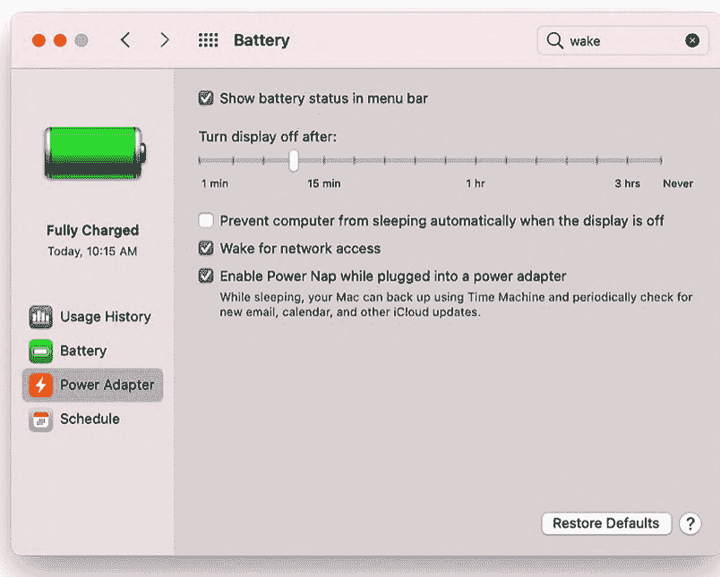
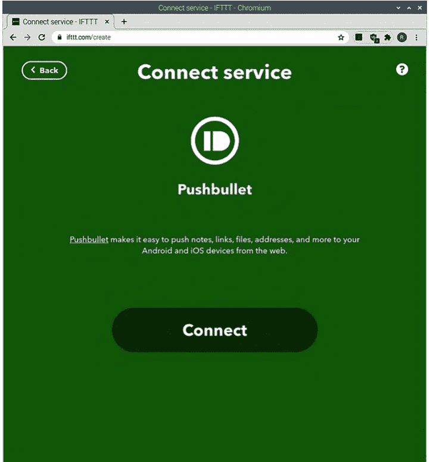
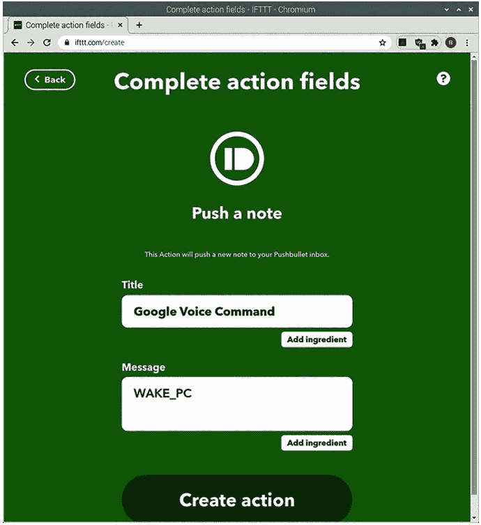
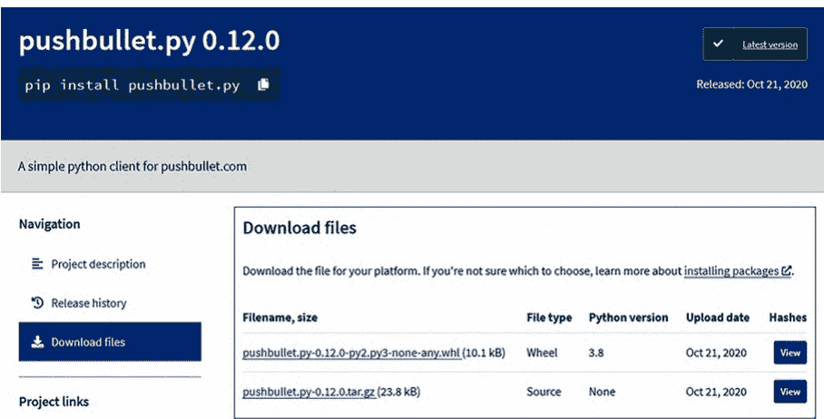

### 第8章

#### Voice Wake on LAN

像 Amazon Alexa 或 Google Assistant 这样的智能语音助手已成为家庭和办公环境的一部分，提供基于语音提示轻松启动操作和响应查询的方式。这些服务为 Philips Hue 等知名家庭自动化配件以及某些高端家电提供了引人注目的通用访问方式。

然而，响应高度自定义的操作需要大量的应用程序开发专业知识，以及与这些助手所需的各种 API、编码和配置管理依赖项的工作经验。即使在这种自定义服务被实现之后，其实现也受到了阻碍，因为仅仅为了启动自定义操作就需要调用繁琐的口语结构。例如，要查询 Google Home 上 UPS 包裹的交付状态，用户必须首先登录 Google Assistant，链接他们的 UPS 账户（假设他们甚至拥有一个），然后要求“Talk to UPS”。体验甚至语音都会随着 UPS 自己交互式语音应答（IVR）菜单选项而改变。

幸运的是，有一种更简单的方法可以要求你的数字助手执行简单的自定义任务。这样做需要使用另外两个服务提供商：IFTTT 和 Pushbullet。两者都提供免费套餐。如果你喜欢他们的服务并希望在本书所述之外为自己的项目使用更多功能，欢迎考虑订阅他们。

我们在第 7 章 *PiSpeak* 中演示了如何使用 Pi 自动处理工作流程，无论白天还是黑夜，最优地在 Pi 空闲时运行。这样做需要通过设置 cron 作业以预定义间隔启动工作流程。但我们也可以利用 Pi 动态响应消息并立即对这些消息采取行动，而不是采用计划的拉取方式。

在这个项目中，我们将使用我们的声音要求我们的 Google Home 和/或 Home Mini（或喜欢 Amazon 智能助手的用户的 Amazon Alexa 产品）唤醒并打开一台连接到与 Pi 位于同一局域网段的有线以太网连接的计算机。这种唤醒服务被称为 Wake on LAN（WOL），是一种流行的远程唤醒处于睡眠模式的 Mac 或 PC 的方式。虽然一些高级无线适配器支持无线 WOL，但我使用它们的经验是它们不如有线连接可靠。为了使本项目稳定工作，你应该通过有线以太网将目标 Mac 或 PC 连接到与将向其发送 WOL 数据包的 Raspberry Pi 相同的网络上。

让我们开始吧！

##### Setup

以下是构建此项目所需的内容。

###### Hardware

+   - Google Home、Home Mini 或 Amazon Alexa 智能助手
+   - 使用有线以太网连接的 Mac 或 PC 台式机

###### Software

+   - wakeonlan[^63]
+   - pushbullet[^64] Python 库

###### Services

+   - IFTTT[^65]
+   - Pushbullet[^66]

如果尚未这样做，请将你的 Google Home 或 Amazon Alexa 智能音箱设备与你选择的 Google 或 Amazon 账户关联。发出几个语音查询以确保 Google 或 Amazon 做出响应，然后再继续。

##### Listen to Wake Up

确定你想要从睡眠中远程唤醒的台式 Mac 或 PC（连接到你的有线局域网），因为你将从 Pi 向其发送 WOL 网络指令。你需要知道该 Mac 或 PC 以太网适配器端口的 MAC 地址。就像在现实世界中一样，在向收件人发送消息之前，你需要知道收件人的正确地址。

要确定 Windows PC 上以太网适配器的 MAC 地址，请打开一个 Windows 命令提示符窗口（你可以在开始菜单的 Windows 系统文件夹中找到命令提示符应用的快捷方式），运行 ipconfig 程序，并向其传递 /all 选项：

```
> ipconfig /all
```

这样将列出该 PC 上所有网络适配器的详细信息。查找具有 Connection-specific DNS Suffix 为 lan 的以太网适配器 Ethernet 条目。假设它处于活动状态，并且分配的 IP 地址与你的 Pi 使用的默认网关匹配，请记下与该适配器关联的物理地址。还请记下其描述，因为你需要在 Windows 设备管理器中识别物理以太网适配器。

如果你以 macOS 为目标，请打开终端应用程序（位于 Mac 的应用程序 -> 实用工具文件夹中）并运行 ifconfig 命令。查找 eth0 条目。

MAC 地址的模式将为 XX-XX-XX-XX-XX-XX，其中 X 占位符将被字母 A 到 F 和数字 0 到 9 替换。适配器地址是该物理适配器独有的，我们将把该地址传递给我们将在 Pi 上安装的 wakeonlan 程序。在继续之前请记下此 MAC 地址。

配置你的 PC 或 Mac 以侦听 Wake on LAN 数据包。要在 PC 上执行此操作，请右键单击 Windows 开始菜单图标并从出现的弹出菜单中选择设备管理器。展开网络适配器类别并查找你在 ipconfig /all 结果中适配器描述中看到的有线适配器的名称。右键单击设备管理器中的该特定网络适配器并从弹出菜单中选择属性。选择电源管理选项卡并确保所有复选框都被选中。

在该属性对话框中选择高级选项卡。然后向下滚动属性列表以查找并选择唤醒魔术包属性并将其值设置为已启用。

根据你的 PC 制造商，你可能还需要重新启动计算机并在启动时访问其 BIOS 设置。大多数 PC 允许你在启动时通过按 Delete 或 F1 键访问此设置。用于在启动时访问计算机 BIOS 设置的键应在启动计算机时短暂显示在屏幕上。在 BIOS 设置中查找电源开启或电源管理，并确保列出唤醒局域网的任何选项都已启用。

在 macOS 中启用 Wake on LAN 要容易得多。在系统偏好设置对话框的搜索框中输入单词 wake。根据你运行的 macOS 版本，这将突出显示节能图标或电池图标。选择适合你 macOS 版本的图标，然后搜索并选中唤醒网络访问选项。例如，macOS 11 Big Sur 用户可以在系统偏好设置 -> 电池 -> 电源适配器选项中找到此选项，如下一张屏幕截图所示。



在你的目标 PC 或 Mac 台式计算机正确配置并通过以太网电缆连接到你的局域网，以及你的 Pi 在同一网络上后，我们可以在你的 Pi 上配置最后一个要求。在你的 Pi 上打开一个终端窗口并使用 apt 命令安装 wakeonlan 程序：

```
$ sudo apt install wakeonlan
```

将你的 Mac 或 PC 台式机置于睡眠状态。Windows 用户可以从 Windows 开始菜单 -> 电源图标中选择睡眠，macOS 用户可以通过从 Apple 菜单中选择睡眠来执行此操作。

在目标 Mac 或 PC 计算机处于睡眠状态后，返回 Pi 上的终端窗口并执行 wakeonlan 程序，传入你之前捕获的以太网适配器的 MAC 地址。将 MAC 地址的字母更改为小写，并将每对字符之间的破折号转换为冒号。记住用分配给你的以太网适配器的实际 MAC 地址值替换下面的示例中的占位符 xx 对：

```
$ wakeonlan xx:xx:xx:xx:xx:xx
```

例如，如果你的以太网适配器 MAC 值为 d6:21:b4:3b:a1:c2，则 wakeonlan 命令将为：

```
$ wakeonlan d6:21:b4:3b:a1:c2
```

一旦你输入了计算机上正确格式化的 MAC 地址并以首选格式运行 wakeonlan 程序，你应该会看到你的 Mac 或 PC 开机。如果它在二十秒左右后未能开机，请检查你是否使用的是正确的以太网适配器 MAC 地址。如果你的目标台式计算机是 Windows，还要验证该适配器的所有电源设置，包括 BIOS 中的设置是否已正确设置。在你能够成功运行 wakeonlan 命令唤醒计算机之前，不要继续。

在局域网和计算资源正确配置后，我们可以通过在 IFTTT 和 Pushbullet 服务上建立免费用户账户来继续进行项目。

###### IFTTT

IFTTT，即 If This Then That，使创建自定义语音提示工作流程变得极其简单。这与如果你选择设置自己的独立服务所需的代码和资源相比。整本书都写过关于如何做到这一点，包括 Build Talking Apps for Alexa [Wal22]。我强烈鼓励对以这种方式创建自己的服务感兴趣的热情开发者追求这条道路。但对于那些希望快速创建非常基本的可用服务的人来说，IFTTT 提供了


只需几次鼠标点击即可实现更简单的替代方案。

在 IFTTT 上设置免费账户很简单。 在网页上访问 ifttt.com 并选择其网页主页右上角的 Sign Up 按钮。

IFTTT 允许用户快速将物联网（IoT）设备（如智能灯泡）连接到网络服务和智能助手，如 Alexa 或 Google Assistant。 这样做可以让你使用自己选择的预定语音命令来触发一系列事件。 例如，你可以告诉你的智能助手“喂狗”，这会触发一个 IFTTT applet 打开电动罐头开启器，并触发一个预编程的互联网中继将打开的罐头倒置，把内容倒入狗碗。 这听起来像电影里的场景，不是吗？

创建新账户并登录后，立即开始创建新的 applet，选择页面右上角的 Create 标签。 选择大大的 If this 按钮并搜索 Google Assistant（或如果你更喜欢的话 Amazon Alexa）。

当你选择 Connect 按钮时，你需要对与你的 Google Home（或 Amazon Alexa 驱动的）智能音箱关联的 Google（或 Amazon）账户进行身份验证。 请注意，通过允许 IFTTT 访问此账户，你就是授予 IFTTT 监听和响应你的语音命令的能力。 如果你担心这种隐私级别，你可能需要重新考虑是否使用智能助手。

在允许 IFTTT 链接到你的 Google Home 账户后，通过输入你想要与打开计算机关联的短语来完成 IFTTT applet 的 IF 部分。 IFTTT 不能覆盖现有的 Google 保留短语，因此你可能需要尝试一组最适合你未来语音启动场景的短语。 幸运的是，在本书出版时，“Turn on the computer” 并不是保留短语，所以它应该可以正常工作。 你还可以添加更多表达此短语的替代方式，以及你希望 Google Assistant 在解释此命令后说的内容。

选择 Create Trigger 按钮保存 applet 的 IF 部分。 现在 IFTTT 知道要监听什么，你需要告诉该服务接下来做什么。 选择 Then That 框中的 Add 按钮并搜索 Pushbullet 服务。 然后从四个不同的操作选项中选择 Push a Note，接着选择 Connect 按钮，如第一张屏幕截图所示。



使用你希望用于访问 Pushbullet 的 Google 账户登录。 这不必与你的 Google Assistant 关联的 Google 账户相同，但我发现如果使用相同的专用账户，故障排除会更容易。 就像 Google Assistant 一样，IFTTT 需要被授予访问你的 Pushbullet 账户的权限，以便向其发送消息，如

第二张屏幕截图所示。


###### IFTTT

授予 https://ifttt.com/ 访问你的 Pushbullet 配置文件和数据的权限。


输入你希望 Pushbullet 发送给我们尚未创建的 Pushbullet 监听脚本的消息。 标题是可选的，而且我们也不会解析它。 作为占位符，你可以添加 Google Voice Command 或你更喜欢的更具描述性的内容。 我们将在脚本中解析的是消息正文，因此不必让这条消息很长。 像 WAKE_PC 这样简短且独特的消息就足够满足我们的需求了，如下一张屏幕截图所示。



选择 Continue 以查看和完成 applet。 当你对定义的 workflow 满意时，选择 Finish 按钮保存 IFTTT applet。

对你的 Google Home 或智能手机上的 Google Assistant 说“Turn on the computer”，看看 IFTTT 是否监听并响应你的请求。 如果没有，请在继续之前检查你的设置。

###### Pushing a Bullet

使用你在 IFTTT applet 创建阶段连接时使用的相同账户登录 pushbullet.com。 如果你使用的是设置 IFTTT workflow 的同一浏览器，那么 Pushbullet 将自动使用该账户登录。

对于一个用于以编程方式监听 Pushbullet 消息的 Python 脚本，它

需要一个与生成该令牌的账户关联的访问令牌。 通过导航到 Settings -> Account 页面并滚动到 Access Tokens 部分来创建此令牌。

复制这个 34 个字符的令牌并暂时保存在一个安全文件中。 我们需要这个字符字符串来验证我们的 Python 脚本，以便监听发送给我们的任何新的 Pushbullet 消息。

###### Scripted WOL

现在所有后端消息基础设施都已配置好，我们准备编写 Python 脚本，该脚本将接收并处理来自 Pushbullet 消息正文的 WAKE_PC 消息。 与所有项目一样，创建一个空的 Git 仓库来存储和版本控制你的项目代码：

```
$ git init --bare ~/repository/voicewol.git
```

```
$ cd ~/projects/
```

```
$ git clone ~/repository/voicewol.git
```

```
$ cd voicewol
```

使用你喜欢的代码编辑器，创建一个名为 wakeup.py 的新 Python 脚本。 使用 os.system() 函数以编程方式执行你之前成功测试过的 wakeonlan xx:xx:xx:xx:xx:xx 命令：

```
voicewol/wakeup.py

import os

MAC = 'YOUR_COMPUTER_MAC_ADDRESS_GOES_HERE'

os.system('wakeonlan ' + MAC)
```

将你的目标桌面置于睡眠状态并运行脚本，以验证它是否按预期唤醒你的计算机：

```
$ python3 wakeup.py
```

你的目标计算机应该像你从终端窗口运行 wakeonlan 程序时一样唤醒。 接下来是编写一个 Python 脚本来监听并有选择地处理传入的 Pushbullet 消息。

###### Catching a Bullet

我们这个项目的最后一个主要目标是连接到、监听并对包含消息正文中 WAKE_PC 的 Pushbullet 消息做出反应。 为此，我们需要安装一个第三方 pushbullet Python 库。 不幸的是，这个简单的 pushbullet 库的作者未能正确配置它以便使用 Pip 方便地下载和安装。 相反，它需要直接从 PiPy 网站下载。 访问 pypi.org 网站，[67] 搜索 pushbullet.py，选择其链接，然后在该网页上选择 Download files 链接。 下载以 .whl 扩展名结尾的文件，如此屏幕截图所示。



将下载的 pushbullet.py-VERSION_NUMBER-py2.py3-none-any.whl 文件复制到你的 voicewol 项目目录中，并使用 pip3 install 命令安装此下载文件。 请注意，示例命令中的 VERSION_NUMBER 将被库作者部署的最新版本替换：

```
$ sudo pip3 install pushbullet.py-VERSION_NUMBER-py2.py3-none-any.whl
```

###### Use Pushbullet.py with Python Version 3.6 or Earlier

本项目使用的 Pushbullet.py 库版本目前仅适用于 Python 3.6 或更早版本。 你可以安装 Pi 上的该版本的 Python，或尝试诸如 Webhooks[68] 之类的替代方法来将你的智能助手命令连接到你的 Pi。 访问 DevTalk 论坛分享你的经验！

安装了 pushbullet 库后，我们可以构建一个简短的 Python 脚本，该脚本将使用我们之前注册的访问令牌连接到 Pushbullet 服务。 只要收到 Pushbullet 消息，我们就会打印出该消息的正文。

创建一个名为 pbreceiver.py 的新 Python 脚本文件并添加以下代码：

```
voicewol/pbreceiver.py

① from pushbullet import Listener
   from pushbullet import Pushbullet

② ACCESS_CODE = 'PUSHBULLET_ACCESS_CODE_GOES_HERE'
   HTTP_PROXY_HOST = None
   HTTP_PROXY_PORT = None

   def on_push(data):
       pbullet = Pushbullet(ACCESS_CODE)
③   pushes = pbullet.get_pushes()

④   try:
       latest = pushes[0]
       print('Latest message body received:\n')
       print(latest['body'])
```


```
except:
    print("No messages.")

⑤ pb = Pushbullet(ACCESS_CODE)

pbapp = Listener(account=pb,
    on_push=on_push,
    http_proxy_host=HTTP_PROXY_HOST,
    http_proxy_port=HTTP_PROXY_PORT)
try:
⑥    pbapp.run_forever()
except KeyboardInterrupt:
    print("Keypress received, exiting script.")
    pbapp.close()
```

让我们简要回顾一下此脚本中部分代码的作用。

+   ① 从 pushbullet Python 库导入 Listener 和 Pushbullet 函数。
+   ② 将 PUSHBULLET_ACCESS_CODE_GOES_HERE 替换为你之前为登录生成的 Pushbullet 访问代码。将其值设为 ACCESS_CODE 静态变量。
+   ③ 使用此 on_push() 函数来捕获来自 Pushbullet 事件的推送。
+   ④ 由于你只关心查看收到的第一个 PushBullet 消息，仅使用 print 语句显示 Pushbullet 消息的主体。在最终脚本中，我们将删除队列中的所有消息，以免重新处理之前收到的 Pushbullet 消息。
+   ⑤ 在这里，我们启动 Pushbullet 服务并将其分配给 pb 对象。然后将该对象连同 ACCESS_CODE 以及如有必要的代理设置一起传递给 Listener() 函数。我们将其实例化结果分配给 pbapp 对象。
+   ⑥

最后，我们指示 pbapp 实例运行_forever()，或至少直到我们通过 Ctrl+Z 键盘组合退出程序为止。

保存并运行 pbreceiver.py Python 脚本：

```
$ python3 pbreceiver.py
```

脚本运行时，让你的智能助手说“Turn on the computer”，几秒钟后，你应该会在终端上看到消息主体打印出来：

```
Latest message body received:
```

```
WAKE_PC
```

如果没有看到任何消息出现，请登录 IFTTT 网站并仔细检查配置。查看 applet 的活动以确保它已运行并在 Pushbullet 便笺的正文中发送了 WAKE_PC 文本。继续之前请验证 pbreceiver.py 脚本是否正常工作。你可以通过退出正在运行的脚本或直接关闭其运行的终端窗口来退出程序。

###### Wake Up

我们已准备好迎接关键时刻。将 wakeup.py 脚本与 pbreceiver.py 脚本结合，并在执行 wakeonlan 命令后添加一行代码来清除所有收到的 Pushbullet 消息。创建一个名为 voicewol.py 的新 Python 脚本，并在其中包含以下代码：

```
voicewol/voicewol.py

import os
from pushbullet import Listener
from pushbullet import Pushbullet

ACCESS_CODE = 'PUSHBULLET_ACCESS_CODE_GOES_HERE'
HTTP_PROXY_HOST = None
HTTP_PROXY_PORT = None
MAC = 'YOUR_COMPUTER_MAC_ADDRESS_GOES_HERE'

def on_push(data):
    pbullet = Pushbullet(API_KEY)
    pushes = pbullet.get_pushes()
    try:
        latest = pushes[0]
        if latest['body'] == "WAKE_PC":
            print("Turning on your computer...")
            os.system('wakeonlan ' + MAC)
            pushes = pbullet.delete_pushes()
        else:
            print("Unrecognized code in message body.")
    except:
        print("No messages.")

pb = Pushbullet(ACCESS_CODE)

pbapp = Listener(account=pb,
    on_push=on_push,
    http_proxy_host=HTTP_PROXY_HOST,
    http_proxy_port=HTTP_PROXY_PORT)
try:
```

```
pbapp.run_forever()
except KeyboardInterrupt:
    print("Keypress received, exiting script.")
    pbapp.close()
```

通过将脚本名称传递给 Python 3 解释器来保存并运行脚本。

```
$ python3 voicewol.py
```

将目标计算机置于睡眠状态，然后说出唤醒它的魔咒短语。

最后，为 Supervisor 创建一个 .conf 文件以供其消费并在 Pi 重启时启动脚本，并在因错误、低内存条件或其他意外异常而失败时重启它：

```
voicewol/voicewol.conf

[program:voicewol]
command = /usr/bin/nohup /usr/bin/python3 \
/home/pi/projects/voicewol/voicewol.py &
directory = /home/pi/projects/voicewol
user = pi
environment=HOME="/home/pi",USER="pi"
autostart = true
autorestart = true
stdout_logfile = /var/log/supervisor/voicewol.log
stderr_logfile = /var/log/supervisor/voicewol_err.log
```

将 voicewol.conf 文件保存在 /etc/supervisor/conf.d 目录中，然后重新启动 Supervisor 服务，或更好的是，重新启动你的 Pi。在等待 Pi 重启的同时，将目标桌面计算机置于睡眠状态：

```
$ sudo reboot
```

等待几分钟让 Pi 重新启动，然后对你的智能助手说“Turn on the computer”。你的睡眠中的桌面计算机应该会唤醒并准备好接收你的命令。

太棒了！你已经获得了仅通过要求智能语音助手即可唤醒计算机的便利。在多次尝试以验证其一致工作后，用你日益增长的技术知识和创造力让朋友和家人惊叹，展示你如何利用未来的人机交互。

##### Next Steps

通过将 IFTTT 和 PushBullet 服务与来自 Amazon 或 Google 的智能助手以及一个简短的 Python 脚本结合，你现在可以让 Raspberry Pi 用你的声音打开计算机。在这个基础 IFTTT applet 工作后，你可以用你的声音激活家庭中的其他服务。控制执行器以解锁并打开门，升降电动升降办公桌，并打开洒水系统——所有这些都可以用你的声音实现。反向消息流以将 Pushbullet 消息传输到其他互联网连接设备。在你的智能手机上安装 Pushbullet 客户端，并用它代替我们在之前项目中使用的电子邮件警报。

你还可以增强 voicewol.py 脚本以响应“Turn off the computer”，让你的 Pi 传输适当的命令以使目标桌面进入睡眠状态。macOS 已默认安装 OpenSSH 服务器。Windows 10 的 OpenSSH 服务器可以通过在 Windows 10 应用和功能设置页面中选择可选功能轻松安装。

下一个项目将在构建的 IFTTT + Pushbullet 组合的基础上增加红外功能。这样就可以激活和控制依赖于传统视线、发射即忘通信协议的电器。

##### Footnotes

[63] https://packages.debian.org/buster/wakeonlan
[64] https://github.com/rbrcsk/pushbullet.py
[65] https://ifttt.com/
[66] https://www.pushbullet.com/
[67]
https://pypi.org/project/pushbullet.py/#files
[68] https://ifttt.com/maker_webhooks/details
