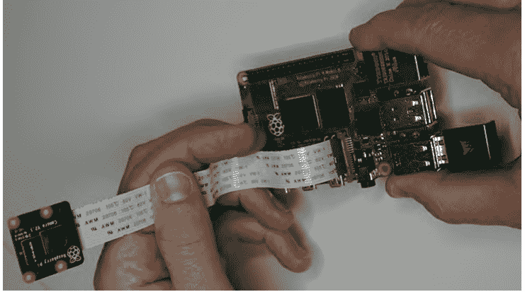
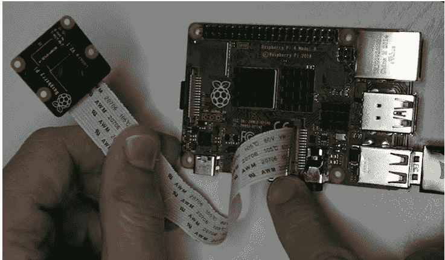
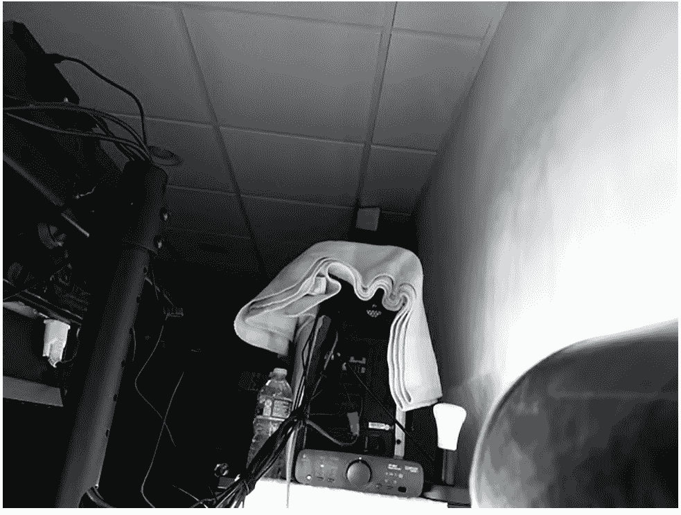

### Chapter 11

#### PhotoHook

In this project, we’ll create a Python script that will transmit a notification with an accompanying photo whenever motion is detected near the location of the Pi.

Prior projects in this book have relied on email messages as the predominant way to receive event notifications. But email is so twentieth century. It offers a tried-and-true, pull-to-retrieve message mechanism that works best for long-form messages benefiting from permanent record storage. But for the types of messages that just need a quick alert, email is slow and heavy. Something like a desktop or smartphone notification push message would be more beneficial. Fortunately, we already used a service that has a robust client capable of displaying notifications on computers, phones, and tablets. In addition to Discord offering developers an easy way to build interactive bots, the service also allows for the receipt of notifications via webhooks.[90]

While we could expand upon RedditBot to bundle Photo alert functionality into it, doing so would require more sophisticated use of Python’s thread model. Recall that Discord bots operate their own asynchronous event loop. Without setting up a separate managed thread to monitor sensor activity, we could come into conflict with the While loops we used in those monitoring scripts.

Fortunately, Discord offers a very easy solution to this problem: webhooks. Webhooks allow us to post any message to a channel with minimal overhead

and without requiring a dedicated bot. In fact, webhooks are so lightweight that they don’t even require any third-party Python libraries. Just a call to Python’s built-in *requests* library will do fine. Also, we can swap out the email code we used in the sensor projects and replace it with a few lines of Discord webhook code. Since we already built the Hue AutoLight project that used the SensorHub’s motion detector, we already have a majority of the script written. Let’s do this!

##### Setup

Here’s what you need to build this project.

###### Hardware

-   Docker SensorHub
-   Pi Camera v2 or USB webcam

###### Software

-   Raspistill[^91] Pi Cam software included in Raspberry Pi OS

###### Services

-   Discord[^92] user account (free)

Begin the project like most others, with the installation of any necessary third-party Python libraries. If you didn’t build the RedditBot project, be sure to install the Discord Python library:

```
$ sudo pip3 install discord
```

Also, if you currently have the SensorHub still attached to your Pi from the Hue Fan or Hue AutoLight projects, shut down your Pi and temporarily remove the SensorHub to install the Pi Camera. You’ll reattach the SensorHub once the Pi Camera is connected to the Raspberry Pi’s camera port.

##### Camera Attachment

Look for the camera port on the top of the Pi. On the Pi 4 Model B, this port is located to the left of the USB ports. Gently pull up on the plastic clip that will be snapped back into place once the Pi Camera ribbon is seated inside the clip.

With the blue edge strip of the Pi Camera ribbon facing the USB ports, slide the ribbon into the Pi camera port until it is flush against the base of the Pi. Be sure to seat the ribbon in straight and don’t crimp it or squash it into the clip slot. Refer to the first photo showing the correct orientation and seating of the ribbon.



When the camera ribbon is properly seated, lock it in place by pressing down on the Pi’s ribbon clip. You may want to use both thumb and forefinger to apply equal pressure across the clip when pressing down. Again, pay special care to seat the ribbon in the clip flat so it’s not angled, and thus confirm all ribbon metal contacts align with the contacts on the Pi’s camera port. Refer to the next photo for proper alignment of the camera ribbon cable.




在相机排线卡扣重新扣回原位并确认排线与相机端口连接器完全接触且稳定后，将 SensorHub 重新安装到 GPIO 引脚上。如果你之前 chưa 使用过 SensorHub，请参考 [Seating the Sensor](Seating the Sensor)。在安装 SensorHub 时要小心，不要在下方压折或夹住 Pi Camera 的排线。

所有部件正确就位并安装完成后，为你的 Pi 通电。

##### Camera Activation

在 Pi 上打开一个终端窗口，使用 raspi-config 程序启用你刚刚连接相机的 Pi 相机端口：

```
$ sudo raspi-config
```

从 raspi-config 屏幕中，选择 Interface Options，然后选择 Camera 并通过选择 Camera 菜单选项启用相机端口，并在询问是否要启用相机接口时选择 <Yes>。

在 Interface Options 屏幕中，同时再次确认 ARM I2C 接口是否也已启用。如果你已经完成了之前的 Hue AutoFan 或 AutoLight 项目，该接口应该已经启用。但再次 double-check 也无妨，以防万一。

相机已连接且相机端口已启用后，你就可以使用 Pi Camera 拍摄第一张照片了。

##### Take a Picture

在终端窗口仍打开的情况下，切换到你的 PhotoHook 项目目录：

```
$ cd /home/pi/projects/photohook
```

使用已安装在 Raspberry Pi OS 中的 raspistill 程序拍摄照片，并指定要保存图片的文件路径和名称：

```
$ raspistill -o test0.jpg
```

几秒钟后，test0.jpg 文件应该会出现在该目录中。如果 raspistill 报告错误，请验证相机排线是否已正确连接，并且 Pi 相机端口已启用。

如果你已登录到 Raspberry Pi 桌面，请使用桌面文件管理器导航到项目目录，并双击 test0.jpg 文件在照片查看器应用中打开它。

请注意，以这种方式拍摄的照片默认图像分辨率为完整的 800 万像素质量，3280 x 2464 像素。以此分辨率拍摄的照片文件大小约为 4 兆字节。

虽然这种图像质量对于需要高细节的静态照片来说非常好，但它们对于传输来说相当大，尤其是作为机器人图像附件。幸运的是，raspistill 可以配置为降低捕获的分辨率和质量。例如，让我们再拍一张照片，这次将分辨率降低到 640 x 480 像素，图像压缩质量降低到 75%。将这张新照片命名为 test1.jpg，以便与之前拍摄的高质量 test0.jpg 进行比较：

```
$ raspistill --width 640 --height 480 --quality 75 -o test1.jpg
```

打开并检查 test1.jpg 图像。如果它未打开，请重新打开原始的 test0.jpg 照片并并排比较两张图像。除非你放大照片，否则在照片查看器窗口中你很可能看不出两者的区别。然而，文件大小的差异非常巨大，test1.jpg 很可能只有约 203 千字节，相差超过 1,800%！

下面是一张照片，用于远程监控第 9 章《Voice IR Control》的结果测试，分辨率为 640x480，质量为 75%。即使以本书中呈现的格式，图像看起来也相当不错。



200 千字节的文件传输速度远快于 4,000 千字节的文件，并且消耗的资源和开销也远少于高分辨率图像。因此，我建议你在此项目中使用这种文件质量。当然，如果你拥有快速的互联网连接和智能手机上的无限数据套餐，你也可以随意使用更高的分辨率进行静态照片捕获。随意调整 raspistill 的值，直到获得最适合你需求的图像质量和文件大小的平衡。

##### Motion Detector

对于本项目，我们将再次使用 SensorHub 上的红外热传感器来检测运动，就像我们在第 6 章 *Hue Auto Light* 中所做的那样。由于我们已经为该运动检测例程编写了代码，我们可以将其复制到本项目中。我们唯一需要添加的新例程是捕获并通过 Discord webhook 传输图像。

Joe 问：

##### Why not use the Motion program?

Motion[93] 是一款流行的免费软件实用程序，其工作原理与大多数安防摄像头检测运动的方式相同。它不断监控传入的图像流中像素值的显著变化，指示状态变化。当检测到此变化时，Motion 可以响应事件执行额外的程序或脚本。它还可以配置为仅在图像的特定定义区域中识别运动，就像商用运动检测安防摄像头套件一样。

然而，为了执行此分析，Motion 要求摄像头始终处于运行并流式传输数据状态，无论是否有移动。这意味着必须让另一个守护进程一直运行以捕获和分析任何变化并相应地采取行动。哦，而且可以通过 apt install 在 Raspberry Pi 上安装的 Motion 版本与原生 Pi 相机配置不兼容。需要额外的配置开销才能使其工作，或者更好的是，你可以使用廉价的网络摄像头并将其连接到 Pi 的其中一个 USB 端口。

由于我们已经为其他项目使用 SensorHub，它将比使用 Motion 更快且计算成本更低。因此，请记住，由于 SensorHub 上的红外传感器需要热信号来检测运动，因此在窗户或其他阻挡红外辐射测量的障碍物后面运行时将无法工作。

如果你决定通过 sudo apt install motion 尝试 Motion，请务必查看项目文档，将你想要在检测到移动时执行的任何 Python 脚本添加到 motion.conf 中。例如，如果你希望在 Motion 检测到移动时运行 test.py 脚本，你将在 motion.conf 文件中添加以下行：

```
On_motion_detected python3 test.py
```

现在，回到我们常规的项目。

##### Hook a Photo

如果尚未创建，请创建一个 Discord 账户并登录到你的 Discord 服务器。使用 Text Channels 列表右侧的 + 图标创建一个名为 #photos 的新文本频道。编辑 #photos 频道的设置，方法是选择 #photos 频道名称右侧的齿轮图标。从那里，选择 Integrations 并点击 Create Webhook 按钮。

为新 webhook 起一个像 PhotoBot 这样的名字并保存更改。

选择 Copy Webhook URL 按钮并将生成的 URL 存储到安全文件中。Webhooks 快速且轻量，因为它们不需要身份验证即可向指定频道发布消息。这也意味着任何拥有此敏感 webhook URL 的人都可以做同样的事情并向你的频道发送不需要的垃圾信息。

现在 Discord 的基本配置已完成并且 webhook URL 已激活，我们可以将 raspistill 捕获的图像（或任何其他文件）发布到 #photos 文本频道。

##### Post a Picture

使用你喜欢的代码编辑器在 projects/photohook 目录中创建一个新的 Python 脚本文件，并将其命名为 phototest.py。添加以下 Python 代码行，将生成的 webhook URL 粘贴到 WEBHOOK_URL_GOES_HERE 的位置，然后保存文件：

```
photohook/phototest.py

import requests

WEBHOOK_URL = 'WEBHOOK_URL_GOES_HERE'
CAPTURE_FILE = r'/home/pi/projects/photohook/capture.jpg'

photo = {'media': open(CAPTURE_FILE, 'rb')}
requests.post(WEBHOOK_URL, files=photo)
```

打开一个终端窗口，切换到 PhotoHook 项目目录，并使用 raspistill 应用拍摄一张 Pi Camera 照片：

```
$ cd ~/projects/photohook
$ raspistill --width 640 --height 480 --quality 75 -o capture.jpg
```

确认 capture.jpg 文件已存在于目录中并运行 phototest.py 脚本：

```
$ python3 phototest.py
```

你应该会在 Discord #photos 频道中看到 capture.jpg 被发布。运行此脚本几次，拍摄不同的照片，使用 raspistill 捕获。在你的 Android 或 iOS 智能手机上安装 Discord 应用，登录并确保 #photos 频道的通知已启用（默认情况下应已启用，但请检查以确保）。

运行 phototest.py 并验证图像通知是否出现在


your phone screen.

在继续进行项目的下一个也是最后一步之前，请验证一切是否按预期工作。

##### Movement Notification

我们几乎完成了。现在只需要将第 6 章 *Hue Auto Light* 中的 motionsensortest.py 代码与 phototest.py 脚本合并到一个名为 photohook.py 的新 Python 文件中。以下是该文件最终内容的示例：

```
photohook/photohook.py

import os
import requests
import smbus
import time

WEBHOOK_URL = 'WEBHOOK_URL_GOES_HERE'
CAPTURE_FILE = r'/home/pi/projects/photohook/capture.jpg'

DEVICE_BUS = 1
DEVICE_ADDR = 0x17

TEMP_REG = 0x01
LIGHT_REG_L = 0x02
LIGHT_REG_H = 0x03
STATUS_REG = 0x04
ON_BOARD_TEMP_REG = 0x05
ON_BOARD_HUMIDITY_REG = 0x06
ON_BOARD_SENSOR_ERROR = 0x07
BMP280_TEMP_REG = 0x08
BMP280_PRESSURE_REG_L = 0x09
BMP280_PRESSURE_REG_M = 0x0A
BMP280_PRESSURE_REG_H = 0x0B
BMP280_STATUS = 0x0C
MOTION_DETECT = 0x0D

bus = smbus.SMBus(DEVICE_BUS)

alert_trigger = False

while True:
```

```
aReceiveBuf = []
aReceiveBuf.append(0x00)
for i in range(TEMP_REG,MOTION_DETECT + 1):
    aReceiveBuf.append(bus.read_byte_data(DEVICE_ADDR, i))

if aReceiveBuf[MOTION_DETECT] == 1 :
    if alert_trigger != True:
        os.system('raspistill --width 640 --height 480 \
        --quality 75 -o ' + CAPTURE_FILE)
        photo = {'media': open(CAPTURE_FILE, 'rb')}
        requests.post(WEBHOOK_URL, files=photo)
        time.sleep(5) # Wait 5 seconds before capturing another photo
        alert_trigger = True
    else:
        if alert_trigger != False:
            alert_trigger = False

time.sleep(1)
```

使用常规语法保存并运行脚本：

```
$ python3 photohook.py
```

脚本运行后，走到 Pi 前面，触发红外传感器。你应该会看到红外 LED 指示灯在检测到移动时亮起。几秒钟后，检查你的 Discord 客户端，确认 Pi 相机确实捕捉到了事件，并且图像已通过 PhotoBot 分配的 webhook URL 发布到你的 #photos 频道。

测试相机的位置和角度，并将 Sensorhub 的方向定位，使其能够在你想要的目标角度和位置最佳地捕捉移动。

如果希望 PhotoHook 在 Pi 上后台自动运行，请设置一个 Supervisor 脚本。参考以下 .conf 文件：

```
photohook/photohook.conf
```

```
[program:photohook]
```

```
directory = /home/YOURUSERNAME/projects/photohook
command = /usr/bin/nohup /usr/bin/python3 photohook.py &
user = YOURUSERNAME
environment=HOME="/home/YOURUSERNAME",USER="YOURUSERNAME"
autostart = true
autorestart = true
stdout_logfile = /var/log/supervisor/photohook.log
stderr_logfile = /var/log/supervisor/photohook_err.log
```

重启 Supervisor 服务或重启你的 Pi，并验证你的 PhotoBot 是否正在向你的 Discord #photos 频道传输捕捉到的运动照片。

##### Next Steps

恭喜！你刚刚以与同类商用安防摄像头功能相当但成本仅为其一小部分的价格，打造了一台带通知更新的运动检测安防摄像头。与那些第三方黑盒替代品不同，你也完全清楚所捕捉的图像存储、传输和显示的位置和方式。最棒的是，你不必为使用这个自己打造的定制解决方案支付任何月费或订阅费。

如果你更喜欢事件通知传递的简便性和弹出通知方式，可以考虑重温过去的项目。将电子邮件通知机制替换为 Discord webhook。或者将两者结合使用，以实现重要信号的冗余故障转移消息传递。结合 IR 控制脉冲与快照，以提供 IR 控制设备按指令打开或关闭的照片证明。

监控 Pi 上的磁盘空间，并在存储容量降至 10% 以下时发送短信。将 PhotoHook 代码与 Hue AutoLight 项目合并，以在昏暗的房间中打开灯光，暂停几秒钟，拍摄照片并发布到你的 Discord 频道。这些项目展示了你的 Pi 仅用少量代码能做到多少。

##### Footnotes

[90] https://discord.com/developers/docs/resources/webhook

[91] https://www.raspberrypi.org/documentation/raspbian/applications/camera.md

[92] https://discord.com/

[93] https://motion-project.github.io/index.html
