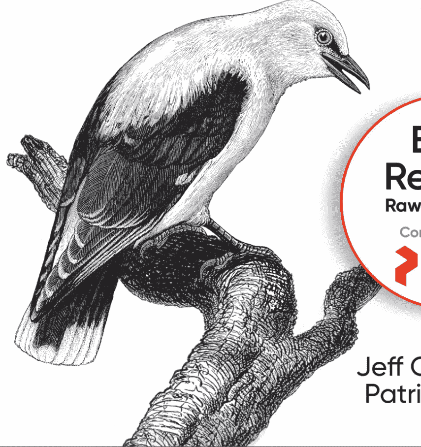
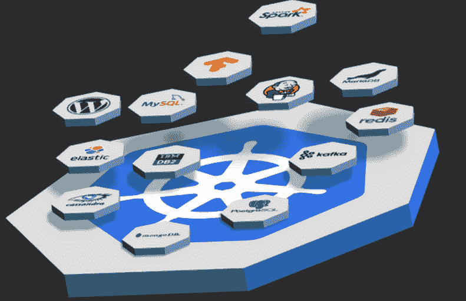
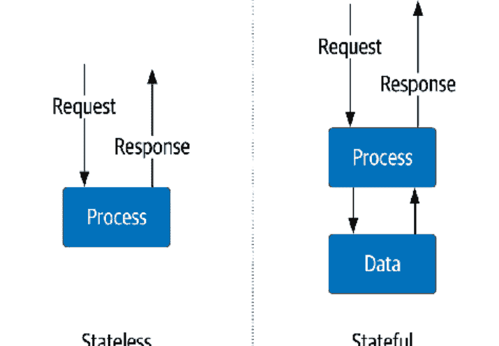
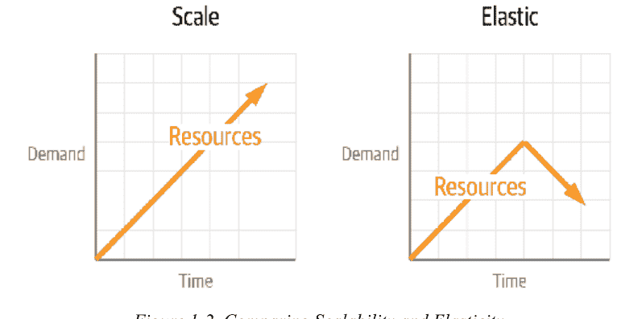
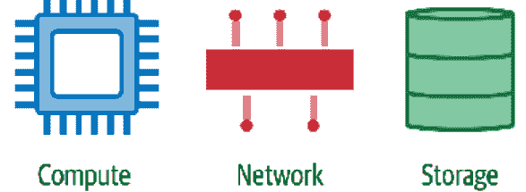
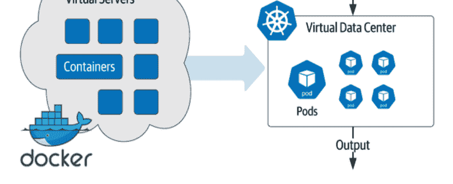

# Kubernetes 云原生数据管理 第四版
Kubernetes 云原生数据管理 (第六版早期发布)

## Chapter 1. Introduction to Cloud Native Data Infrastructure: Persistence, Streaming, and Batch Analytics

第 1 章. 云原生数据基础设施简介：持久化、流处理和批处理分析

### A NOTE FOR EARLY RELEASE READERS

早期发布读者须知

With Early Release ebooks, you get books in their earliest form—the author’s raw and unedited content as they write—so you can take advantage of these technologies long before the official release of these titles.

通过 Early Release 电子书，您可以在这些图书正式发布前就能获得书籍的最早版本——作者在撰写时的原始未编辑内容，以便您尽早利用这些技术。

This will be the 1st chapter of the final book. Please note that this book’s code examples are available at https://github.com/data-on-k8s-book.

这将是最终图书的第 1 章。请注意，本书的代码示例可在 https://github.com/data-on-k8s-book 获取。

If you have comments about how we might improve the content and/or examples in this book, or if you notice missing material within this chapter, please reach out to the editor at jleonard@oreilly.com.

如果您对如何改进本书的内容和/或示例有任何建议，或在本章中发现缺失材料，请联系编辑 jleonard@oreilly.com。

Do you work at solving data problems and find yourself faced with the need for modernization? Is your cloud native application limited to the use of microservices and service mesh? If you deploy applications on Kubernetes without including data, you haven’t fully embraced cloud native. Every element of your application should embody the cloud native principles of scale, elasticity, self-healing, and observability, including how you handle data. Engineers that work with data are primarily concerned with stateful services, and this will be our focus: increasing your skills to manage data in Kubernetes. By reading this book, our goal is to enrich your journey to cloud native data. If you are just starting with cloud native applications,

您是否在解决数据问题时面临现代化需求？您的云原生应用是否仅限于使用微服务和服务网格？如果您在 Kubernetes 上部署应用却不包含数据，您尚未完全拥抱云原生。应用的每个元素都应体现云原生的规模、弹性、自愈和可观测性原则，包括您如何处理数据。与数据打交道的工程师主要关注有状态服务，这将是我们的重点：提升您在 Kubernetes 中管理数据的技能。通过阅读本书，我们的目标是丰富您迈向云原生数据的旅程。如果您刚开始使用云原生应用，

then there is no better time to include every aspect of the stack. This convergence is the future of how we will consume cloud resources.

那么现在正是将技术栈的各个方面都纳入其中的最佳时机。这种融合是我们未来消费云资源的方式。

So what is this future we are creating together?

那么我们共同创造的未来是什么？

For too long, data has been something that has lived outside of Kubernetes, creating a lot of extra effort and complexity. We will get into valid reasons for this, but now is the time to combine the entire stack to build applications faster at the needed scale. Based on current technology, this is very much possible. We’ve moved away from the past of deploying individual servers and towards the future where we will be able to deploy entire virtual data centers. Development cycles that once took months and years can now be managed in days and weeks. Open source components can now be combined into a single deployment on Kubernetes that is portable from your laptop to the largest cloud provider.

长期以来，数据一直存在于 Kubernetes 之外，造成了大量额外的工作和复杂性。我们将探讨其合理原因，但现在是时候将整个技术栈结合起来，以所需的规模更快地构建应用了。基于当前技术，这完全可行。我们已从部署单个服务器的过去转向未来，在未来我们可以部署整个虚拟数据中心。曾经需要数月甚至数年的开发周期，现在可以在数天数周内完成。开源组件现在可以组合成在 Kubernetes 上的单一部署，从您的笔记本电脑到最大的云服务提供商均可移植。

The open source contribution isn’t a tiny part of this either. Kubernetes and the projects we talk about in this book are under the Apache License 2.0. unless otherwise noted. And for a good reason. If we build infrastructure that can run anywhere, we need a license model that gives us the freedom of choice. Open source is both free-as-in-beer and free-as-in-freedom, and both count when building cloud native applications on Kubernetes. Open source has been the fuel of many revolutions in infrastructure, and this is no exception.

开源贡献也不是其中的小部分。本书中讨论的 Kubernetes 和项目均采用 Apache License 2.0，除非另有说明。这是有充分理由的。如果我们构建可在任何地方运行的基础设施，我们需要一种许可模式来给予我们选择的自由。开源既是免费的啤酒，也是自由的自由，在 Kubernetes 上构建云原生应用时两者都很重要。开源一直是基础设施许多革命的动力，这次也不例外。

That’s what we are building. This is the near future reality of fully realized Kubernetes applications. The final component is the most important, and that is you. As a reader of this book, you are one of the people that will create this future. Creating is what we do as engineers. We continuously reinvent the way we deploy complicated infrastructure to respond to the increased demand. When the first electronic database system was put online in 1960 for American Airlines, you know there was a small army of engineers who made sure it stayed online and worked around the clock. Progress took us from mainframes to minicomputers, to microcomputers, and eventually to the fleet management we find ourselves doing today. Now, that same progression is continuing into cloud native and Kubernetes.

这就是我们在构建的内容。这是完全实现的 Kubernetes 应用的近期现实。最后一个也是最重要的组件就是您。作为本书的读者，您是创造这一未来的人之一。创造是我们作为工程师所做的事情。我们不断重新发明部署复杂基础设施的方式以应对不断增长的需求。当第一台电子数据库系统于 1960 年为美国航空上线时，您知道有一支小规模的工程师团队确保其全天候在线运行。进步让我们从大型机到小型机，再到微型计算机，最终到我们今天所做的舰队管理。现在，同样的进步正在延续到云原生和 Kubernetes。

This chapter will examine the components of cloud native applications, the challenges of running stateful workloads, and the essential areas covered in this book. To get started, let’s turn to the building blocks that make up data infrastructure.

本章将探讨云原生应用的组件、运行有状态工作负载的挑战以及本书涵盖的核心领域。为了开始，让我们转向构成数据基础设施的构建模块。

### Infrastructure Types

基础设施类型

In the past twenty years, the approach to infrastructure has slowly forked into two areas that reflect how we deploy distributed applications, as shown in Figure 1-1.

在过去二十年里，基础设施的方法已缓慢分化为两个领域，反映了我们部署分布式应用的方式，如图 1-1 所示。

Figure 1-1. Stateless vs. Stateful Services

图 1-1. 无状态与有状态服务

#### Stateless services

无状态服务

These are services that maintain information only for the immediate life cycle of the active request—for example, a service for sending formatted shopping cart information to a mobile client. A typical example is an application server that performs the business logic for the shopping cart. However, the information about the shopping cart contents resides external to these services. They only need to be online

这些服务仅在活动请求的即时生命周期内维护信息——例如，向移动客户端发送格式化购物车信息的服务。一个典型例子是执行购物车业务逻辑的应用服务器。然而，购物车内容的<|message|>信息存在于这些服务之外。它们只需在请求到响应的短暂时间内保持在线

for a short duration from request to response. The infrastructure used to provide the service can easily grow and shrink with little impact on the overall application. Scaling compute and network resources on-demand when needed. Since we are not storing critical data in the individual service, they can be created and destroyed quickly with little coordination. Stateless services are a crucial architecture element in distributed systems.

从请求到响应只需短暂在线。提供服务的基础设施可以轻松地随需求增长和收缩，对整体应用影响很小。按需扩展计算和网络资源。由于我们不在单个服务中存储关键数据，因此它们可以快速创建和销毁，几乎无需协调。无状态服务是分布式系统中的关键架构要素。

#### *Stateful services*

*有状态服务*

These services need to maintain information from one request to the next. Disks and memory store data for use across multiple requests. An example is a database or file system. Scaling stateful services is much more complex since the information typically requires replication for high availability, which creates the need for consistency and mechanisms to keep data in sync. These services usually have different scaling methods, both vertical and horizontal. As a result, they require different sets of operational tasks than stateless services.

这些服务需要在一次请求到下一次请求之间维护信息。磁盘和内存存储数据以供多次请求使用。示例是数据库或文件系统。扩展有状态服务要复杂得多，因为信息通常需要复制以实现高可用性，这就产生了对一致性和保持数据同步机制的需求。这些服务通常具有不同的扩展方法，既有垂直扩展也有水平扩展。因此，它们需要的运维任务与无状态服务不同。

In addition to how information is stored, we’ve also seen a shift towards developing systems that embrace automated infrastructure deployment. These recent advances include:

除了信息存储方式外，我们还看到了向拥抱自动化基础设施部署的系统发展的转变。这些最新进展包括：

- Physical servers gave way to virtual machines that could be deployed and maintained easily.
- Virtual machines eventually became greatly simplified and focused on specific applications to what we now call containers.
- Containers have allowed infrastructure engineers to package an application’s operating system requirements into a single executable.

物理服务器让位于可以轻松部署和维护的虚拟机。
虚拟机最终变得高度简化并专注于特定应用，这就是我们现在所说的容器。
容器使基础设施工程师能够将应用的操作系统需求打包成单个可执行文件。

The use of containers has undoubtedly increased the consistency of deployments, which has made it easier to deploy and run infrastructure in bulk. Few systems emerged to orchestrate the explosion of containers like

容器用法的无疑提高了部署的一致性，使得批量部署和运行基础设施变得更容易。很少有系统能够像

Kubernetes 的这种现象在令人难以置信的增长中显而易见。这说明了它解决问题的出色程度。根据 [Kubernetes 文档](to the Kubernetes documentation)：

> *Kubernetes 是一个可移植、可扩展的开源平台，用于管理容器化工作负载和服务，促进声明式配置和自动化。它拥有庞大且快速增长的生态系统。Kubernetes 服务、支持和工具广泛可用。*

Kubernetes 最初是为无状态工作负载设计的，而且这也是它传统上做得最好的地方。Kubernetes 已发展成为一种“构建平台的平台”的声誉，采用云原生方式。然而，有一个合理的论点认为，完整的云原生解决方案必须考虑数据。这就是本书的目标：探索如何在 Kubernetes 上构建云原生数据解决方案的方法。但首先，让我们来解析一下这个术语的含义。

### 什么是云原生数据？

让我们开始定义云原生数据的各个方面，以便帮助我们得出最终定义。首先，让我们从 Cloud Native Computing Foundation（CNCF）的 [定义](definition) 开始：

> *云原生技术使组织能够在现代动态环境中构建和运行可扩展的应用程序，例如公共、私有和混合云。容器、服务网格、微服务、不可变基础设施和声明式 API 体现了这种方法。*

> *这些技术使松耦合系统能够具备弹性、可管理性和可观察性。结合强大的自动化，它们使工程师能够频繁且可预测地进行影响深远的更改，同时将操作负担降至最低。*

请注意，此定义描述了一个目标状态、可取的特征以及体现二者的技术示例。基于此正式定义，我们可以综合出使云原生应用程序区别于其他类型部署的品质，具体体现在其处理数据的方式上。让我们更仔细地审视这些品质。

### 可扩展性

如果一项服务能为单位资源产生单位工作量，那么增加更多资源就应提高服务可执行的工作量。可扩展性描述的是服务将额外资源应用于产生额外工作量的能力。理想情况下，在无限的计算、网络和存储资源下，服务应无限扩展。对于数据而言，这意味着无需停机即可扩展。传统系统在添加新资源时需要维护期，所有服务都必须关闭。随着云原生应用的需求，停机已不再可接受。

### 弹性

如果扩展是为满足需求而添加资源，那么弹性基础设施则是当不再需要时释放这些资源的能力。可扩展性与弹性之间的差异在图 1-2 中有所体现。弹性也可以称为按需基础设施。在私有数据中心等受限环境中，这对于共享有限资源至关重要。对于按使用量计费的云基础设施而言，这是一种避免为不需要运行的服务付费的方式。谈到管理数据，这意味着我们需要回收存储空间并优化使用方式的能力，例如将旧数据迁移到成本更低的存储层。

### 自愈

坏事会发生，当它们发生时，你的基础设施会如何响应？自愈基础设施会重新路由流量、重新分配资源并维持服务水平。随着部署越来越大、更复杂的分布式应用程序，这已成为云原生应用程序日益重要的属性。这就是让你免于凌晨 3 点被叫醒的原因。对于数据而言，这意味着我们需要检测数据问题（如数据缺失和数据质量）的能力。

### 可观察性

如果某物失败而你没有监控它，它发生了吗？
不幸的是，答案不仅是肯定的，而且这可能是一个更糟糕的场景。分布式应用程序高度动态，对每个服务的可见性对于维持服务水平至关重要。
相互依赖可能导致复杂的故障场景，这就是为什么可观察性是构建云原生应用程序的关键部分。在数据系统中，常见的海量数据需要高效监控基础设施的流向和状态的方式。在大多数情况下，问题的早期预警可以帮助操作员避免昂贵的停机。

图 1-2. 比较可扩展性和弹性

在所有先前的定义就位后，让我们尝试一个表达这些属性的定义。

### 云原生数据

云原生数据方法使已采用云原生应用方法论的组织能够整体地纳入数据，而非沿用人员、流程、技术等传统做法，以便数据能够弹性地向上和向下扩展，并促进可观察性和自愈。

这体现为容器化数据、声明式数据、数据 API、数据网格以及云原生数据基础设施（即本身作为云原生应用程序架构的数据库、流处理和分析技术）。

为了使数据基础设施与应用程序的其他部分保持一致，我们需要纳入每一部分。这包括扩展、弹性与自愈的自动化，API 用于解耦服务并提高开发人员效率，以及观察整个应用栈以做出关键决策的能力。整体来看，你的应用和数据基础设施应表现为一个整体单元。

### 更多基础设施，更多问题

无论你的基础设施位于云端、本地还是两者兼有（通常称为混合），你都可能花费大量时间进行手动配置。键入编辑器中的内容并进行极其详细的配置工作需要对每项技术都有深入了解。在过去二十年里，DevOps 社区在代码和我们部署基础设施的方式方面取得了重大进展。这是现代基础设施演进中的关键一步。DevOps 使我们勉强领先于所需规模，但仅此而已。坦率地说，完全脚本化单个数据库服务器部署所需的知识量与过去相同。只是现在如果需要，我们可以借助模板和脚本将其重复一百万次。所缺乏的是组件之间的连接性和对整个应用栈的整体视图。预示：这是一个需要解决的问题。

像任何好的工程问题一样，让我们将其分解为可管理的部分。第一部分是资源管理。无论我们开发了多少种大规模工作方式，从根本上说，我们正试图尽可能高效地管理三件事：计算、网络和存储，如图 1-3 所示。这些是每个应用程序都需要且在增长过程中消耗的燃料。毫不奇怪，这些也是运行应用程序所带来的货币成本所在。我们在明智使用资源时获得回报，如果不这样做则会付出高昂的代价。无论你在哪里运行应用程序，这些都是最原始的单元。在本地时，一切都是购买并拥有的。使用云时，我们是在租用。

图 1-3. 云应用的基本资源：计算、网络和存储

问题的第二部分是整个栈作为单一实体的运行问题。DevOps 已为我们提供了管理单个组件的许多工具，但它们之间的连接组织提供了巨大的效率潜力。类似于桌面应用程序的打包方式，但工作在数据中心规模。那种潜力催生了围绕云原生应用程序的整个社区。这些应用程序与我们一直部署的非常相似。不同之处在于，现代云应用程序不是具有业务逻辑的单一进程。它们是众多容器化进程的复杂协调，这些进程需要安全可靠地通信。存储必须与应用程序当前需求相匹配，同时仍意识到其对应用程序稳定性的贡献。当我们想到部署无状态应用程序而不将数据管理在同一控制平面时，这听起来不完整，因为它确实不完整。将应用程序组件拆分到不同的控制平面会产生更多复杂性，这与云原生的理想背道而驰。

### Kubernetes 引领潮流

如前所述，DevOps 自动化使我们保持在满足扩展需求的最前沿。容器创造了对更

编排，而答案就是 Kubernetes。对于运维人员来说，在部署文件中描述完整的应用程序栈，可以实现可重复且可移植的基础设施。这是因为 Kubernetes 已经远远超出了 DevOps 工具箱中流行的部署管理范畴。Kubernetes 控制平面将部署需求应用于底层计算、网络和存储，以管理整个应用程序基础设施生命周期。即使底层硬件发生变化，你的应用程序的期望状态也会得到维护。我们不再部署虚拟机，而是将虚拟数据中心作为完整定义进行部署，如图 1-4 所示。

图 1-4. 从虚拟服务器转向虚拟数据中心

Kubernetes 流行度的上升已经超越了 DevOps 中使用的所有其他容器编排工具。它已经超越了我们部署基础设施的每一种其他方式，并且在未来会更加如此。它没有任何放缓的迹象。然而，早期的主要采用主要集中在无状态服务上。

在大规模管理数据基础设施的问题在转向容器和 Kubernetes 之前就已经存在。像数据库这样的有状态服务沿着与 Kubernetes 采用曲线平行的不同轨道发展。许多人建议 Kubernetes 是运行有状态服务的错误方式，因为其架构偏爱临时工作负载。这在它不起作用之前是可行的，现在正推动 Kubernetes 所需的变革以实现应用程序栈的融合。

那么有状态服务的挑战是什么？为什么用 Kubernetes 部署数据基础设施一直很困难？让我们考虑我们基础设施的每个组件。

### 在 Kubernetes 上管理计算

在数据基础设施中，依赖摩尔定律使得升级成为常规事件。如果你不熟悉，摩尔定律预测计算能力每 18 个月翻一番。如果你的需求每 18 个月翻一番，你可以通过更换硬件来跟上。最终，原生计算能力开始趋于平稳。厂商开始在服务器上添加更多处理器和核心以跟上摩尔定律，导致单台服务器资源共享使用虚拟机和容器。这使我们能够利用物理服务器孤岛中搁置的庞大计算资源池。Kubernetes 通过将整个数据中心视为跨多个物理设备的单一大型资源池，扩展了计算资源管理的范围。

在数据世界中，与其他服务共享计算资源一直有些禁忌。数据工作负载通常资源密集，一个服务影响另一个服务（即所谓的 noisy neighbor 问题）的可能性导致了将它们与其它工作负载隔离的策略。这种一刀切的方法消除了更显著收益的可能性。首先是假设所有数据服务资源需求都相同。Apache Pulsar™ 代理可能的需求远少于 Apache Spark™ 工作节点，而两者都与用于 OLAP 报告的大型 MySQL 实例不同。其次，将底层硬件与运行应用程序解耦，为运维人员提供了大量被低估的灵活性。需要规模、弹性以及自愈的云原生应用程序需要 Kubernetes 能够提供的能力。数据也不例外。

### 在 Kubernetes 上管理网络

构建分布式应用程序本质上需要可靠且安全的网络。云原生应用程序增加了添加和删除服务的复杂性，使得动态网络配置成为新的需求。Kubernetes 在你的虚拟数据中心内部自动管理所有这些。当新服务上线时，就像虚拟网络团队立即行动。IP地址被分配，路由被创建，DNS 条目被添加，然后虚拟安全团队确保防火墙规则到位，并在需要时 TLS 证书提供端到端加密。

数据基础设施的动态性通常远低于微服务之类的东西。数据库使用固定 IP 和主机名一直是常态。分析系统如 Apache Flink™ 在处理上是动态的，但具有固定的硬件地址分配。服务质量通常位于需求列表的顶部，因此对专用硬件和专用网络的渴望使管理员对 Kubernetes 望而却步。

数据基础设施在 Kubernetes 中运行的优势在于过去的需求较少，而在于未来所需的内容。动态扩展资源可以产生依赖关系的瀑布效应。自动化是维护干净高效网络的唯一方式，而网络是分布式无状态系统的生命线。云原生应用程序的未来只会包含更多组件和新的挑战，例如应用程序运行的位置。我们可以将监管合规性和数据主权添加到对延迟和吞吐量的先前关注中。Kubernetes 网络的声明式特性使其非常适合数据基础设施。

### 在 Kubernetes 上管理存储

任何提供持久性或对大量数据进行分析的服务都需要合适的存储设备。Kubernetes 的早期版本将存储视为栈中的基本商品，并假设大多数工作负载是临时的。对于数据来说，这是一个巨大的不匹配。如果你的 Postgres 数据文件每次容器移动时都被删除，那就行不通了。此外，底层块存储的实现可能是一个宽广的光谱。从高性能 NVMe 磁盘到旧的 5400 RPM 机械磁盘。你可能不知道你会得到什么。值得庆幸的是，这在过去几年中一直是 Kubernetes 的关键关注点，并且已得到显著改善。

随着 Storage Classes 等功能的加入，可以针对性能或容量或两者提出特定要求进行解决。通过自动化，我们可以避免资源不足的临界点。避免意外是容量管理的领域——既包括初始化所需容量，也包括在需要时增长。当你的存储容量用完时，一切都会停滞不前。

将 Kubernetes 的分布式特性与数据存储相结合，为自愈打开了更多可能性。自动备份和快照使你为潜在的数据丢失场景做好准备。将计算和存储放在一起以最大限度地降低硬件故障风险，并在不可避免的故障发生时自动恢复到期望状态。所有这些都使 Kubernetes 的数据存储方面变得更有吸引力。

### 云原生数据组件

现在我们已经定义了云原生应用程序消耗的资源，让我们明确其所依赖的数据基础设施类型。与其列出每种可能的产品的全面清单，我们将它们分解为具有相似特征的更大类别。

### 持久性

当我们谈论数据基础设施时，这可能是理所当然的。系统存储数据并通过某种查询方法提供访问。关系型数据库如 MySQL 和 Postgres。NoSQL 系统如 Cassandra 和 MongoDB。在 Kubernetes 世界中，这些一直是最强、最顽固的最后堡垒，因为它们有最严格的资源要求。这也是有充分理由的。数据库通常对运行的应用程序至关重要，并且是系统中每个其他部分的中心。

### 流式

流式最基本的功能是促进数据从一个点到另一个点的高速度移动。流式系统根据用例提供各种交付语义。在某些情况下，数据可以交付给许多客户端，或者在需要严格控制时，仅交付一次。流式的进一步增强是添加处理。在传输途中更改或增强数据。对数据的更快洞察的需求推动流式分析成为任务关键型，其重要性赶上了持久性系统。移动数据的流式系统示例有 Apache Flink™ 和 Apache Kafka™，其中处理系统示例为 Apache Flink™ 和 Apache Storm™。

### 批处理分析

第一个大数据问题之一。对大量数据进行分析以获得洞察或重新用于新数据。Apache Hadoop™ 是第一个大规模批处理分析系统，它设定了使用大量计算和存储的期望，并以协调的方式产生最终结果。通常，这些作为作业发布到整个集群中，这在 Apache Spark™ 中可以找到。成本问题在这些系统中可能更为普遍，因为所需的资源量巨大。编排系统通过智能分配来帮助缓解成本。

### 展望未来

云原生数据有着非常有说服力的未来，既有我们今天拥有的，也包括我们未来可以拥有的。我们在这两点之间走的道路取决于我们：负责数据基础设施的人群社区。正如我们一直所做的那样，我们看到新的挑战并迎接它。这里每个人都有很多事情要做，但结果可能非常惊人，再次提高标准。

## 数据库现代化呼吁：拥抱 Kubernetes

与 Western Digital 战略项目高级总监 Rick Vasquez 共同撰写

Kubernetes 是当前这一宏观变革趋势的催化剂。数据基础设施的运行方式必须与应用基础设施保持一致。在一次会议演讲中，长期从事数据基础设施领域的领军人物 Rick Vasquez 向数据库社区写了一封公开信，呼吁变革。以下是该演讲的摘要：

这对在 2020 年代从事数据库工作的人来说至关重要。Kubernetes 正引领着云原生和分布式系统的建设。数据系统如果能更好地与 Kubernetes 集成，就无法充分利用其全部容量和功能集。我已从“你永远不应该在容器中运行数据库”的观点转变为
- 容量管理

为了更好地适应整个应用日益重要的责任，需要在此列表中增加新技能。这些技能你可能已经具备，其中包括：

#### *CI/CD 管道*

拥抱从代码库到生产环境的全局视角。没有什么比这更能加速组织内的应用开发了。持续集成（CI）将新代码构建到应用栈中并自动化所有测试以确保质量。持续部署（CD）将经过充分测试和认证的构建自动部署到生产环境。两者结合使用（Pipeline），组织可以大幅提升开发者的速度和生产力。

#### *可观测性*

监控是任何有基础设施经验的人都熟悉的事情。在 DevOps 的“是什么”层面，你知道服务是否健康，并拥有诊断问题所需的信息。可观测性将监控扩展到应用的“如何”层面，将一切视为整体。例如，通过洞察数据在每个节点上的流转，追踪高度分布式应用中延迟的来源。

### 了解代码

当大型分布式应用出现问题时，并不总是流程失败。在许多情况下，可能是代码中的 bug 或微妙的实现细节。由于你需要对整个应用的健康负责，你必须理解在所提供环境中执行的代码。正确实施的可观测性将帮助你发现问题，其中包括软件的 instrumentation。SRE 和开发团队需要保持清晰且定期的沟通，而代码是共同基础。

### 拥抱分布式计算

在 Kubernetes 中部署应用意味着拥抱分布式计算所提供的一切。当你习惯于单一系统思维时，这一转变可能很困难。主要在于思维方式的转变，围绕期望以及问题出现位置的理解。例如，当每个进程都包含在单一系统中时，延迟将接近于零。这不是你需要管理的内容。CPU 和内存资源才是主要关注点。在 1990 年代，Sun Microsystems 在蓬勃发展的分布式计算领域处于领先地位，并发布了这一常见谬误清单：

1. 网络是可靠的
2. 延迟为零
3. 带宽是无限的
4. 网络是安全的
5. 拓扑不会改变
6. 只有一个管理员
7. 传输成本为零
8. 网络是同构的

这些条目背后很可能都有一个有趣的故事，某人假设了其中一种谬误，结果大失所望。结果并非他们所预期，浪费了无数小时去试图弄清楚错误的问题。

从长远来看，采用分布式方法论是值得付出的努力。这就是我们构建大规模应用程序的方式，也将如此很长一段时间。挑战值得回报，对于我们这些每天都在做这件事的人来说，这也可能很有趣！Kubernetes 应用程序会考验这些谬误中的每一个，因为其默认的分布式特性。当你规划部署时，考虑诸如从一个地方到另一个地方的传输成本或延迟影响等事项。这将为你节省大量浪费的时间和重新设计。

### 云原生数据基础设施原则

作为工程专业人士，我们寻求标准和最佳实践来构建。 为了使数据尽可能“云原生”，我们需要拥抱 Kubernetes 所提供的一切。 真正的云原生方法意味着采用 Kubernetes 设计范式中的关键元素并在此基础上构建。 一个包含数据的完整云原生应用程序必须是能够在 Kubernetes 上有效运行的应用程序。 让我们探索一些 Kubernetes 设计原则，它们指明了方向。

### 原则 1：利用计算、网络和存储作为商品化 API

云计算成功的关键之一是将计算、网络和存储商品化为我们可以通过简单 API 提供的资源。 考虑以下 AWS 服务的采样。

*Compute*

我们通过 EC2 和自动扩展组 (ASGs) 分配虚拟机。

*Network*

我们使用 Elastic Load Balancers (ELB)、Route 53 和 VPC 对等互连来管理流量。

### Storage

我们使用诸如简单存储服务 (S3) 用于长期对象存储，或 Elastic Block Storage (EBS) 卷用于我们的计算实例等选项来持久化数据。

Kubernetes 为容器化应用程序的世界提供了自己的 API 来提供类似的服务：

### Compute

Pods、Deployments 和 ReplicaSets 管理容器在计算硬件上的调度和生命周期。

### Network

Services 和 Ingress 暴露容器的网络接口。

### Storage

PersistentVolumes 和 StatefulSets 能够灵活地将容器与存储关联起来。

Kubernetes 资源促进了应用程序在 Kubernetes 发行版和服务提供商之间的可移植性。 这对数据库意味着什么？ 它们只是利用计算、网络和存储资源来提供数据持久化和检索服务的应用程序：

### Compute

数据库需要足够的处理能力来处理传入的数据和查询。 每个数据库节点都作为 pod 部署并分组在 StatefulSets 中，使 Kubernetes 能够管理扩展和缩减。

### Network

数据库需要暴露用于数据和控制的接口。 我们可以使用 Kubernetes Services 和 Ingress Controllers 来暴露这些接口。

### Storage

数据库使用指定存储类的持久卷来存储和检索数据。

将数据库视为其计算、网络和存储需求，可以消除在 Kubernetes 上部署所涉及的大部分复杂性。

### 原则 2：分离控制面和数据面

Kubernetes 促进了控制面和数据面的分离。 Kubernetes API 服务器是用于请求计算资源的关键数据面接口，而控制面管理将这些请求映射到底层 IaaS 平台的细节。

我们可以将相同的模式应用于数据库。 例如，数据库数据面包括为客户端公开的端口，以及对于分布式数据库，用于数据库节点之间通信的端口。 控制面包括数据库提供的用于管理和指标收集的接口，以及执行运营维护任务的工具。 其中大部分功能可以通过 Kubernetes operator 模式实现并应实现。 Operator 定义自定义资源 (CRDs) 并提供控制循环，观察这些资源的状态并采取行动使其趋向期望状态，帮助将 Kubernetes 扩展为领域特定逻辑。

### 原则 3：使可观测性变得简单

可观测系统的三大支柱是日志、指标和追踪。 Kubernetes 通过将每个容器的日志暴露给第三方日志聚合解决方案提供了一个很好的起点。 有多种指标、追踪和可视化解决方案可用，我们将在本书中探索其中几种。

### 原则 4：使默认配置安全

Kubernetes 网络默认是安全的：端口必须显式暴露才能在 pod 外部访问。 这为数据库部署树立了宝贵的先例，迫使我们仔细思考每个控制面和数据面接口将如何暴露，以及哪些接口应通过 Kubernetes Service 暴露。 Kubernetes 还提供了用于密钥管理的设施，可用于共享加密密钥和配置管理账户。

### 原则 5：优先使用声明式配置

在 Kubernetes 声明式方法中，你指定资源的期望状态，控制器操纵底层基础设施以实现该状态。 数据基础设施的 Operator 可以管理如何智能地扩展的细节，例如，在扩展更多节点时如何重新分配分片或分区，或在弹性缩减时选择移除哪些节点。

下一代 Operator 应该使我们能够指定存储数据大小、每秒事务数或两者的规则。 也许我们将能够指定最大和最小集群大小，以及何时将不经常使用的数据移动到对象存储。 这将使我们的数据基础设施实现更多自动化和效率。

### 总结

到目前为止，我们希望你已准备好迎接前方页面的激动人心之旅。 云原生应用程序的迁移必须包含数据，为此，我们将利用 Kubernetes 来包含无状态和有状态服务。 本章介绍了可以弹性扩展并抵御系统故障导致的任何停机的云原生数据基础设施，以及如何构建这些系统。 我们作为工程师必须拥抱云原生基础设施的原则，并在某些情况下学习新技能。 恭喜你，你已开始进入构建云原生应用程序未来的精彩旅程。 翻页，让我们开始吧！
