## 第 2 章. 在 Kubernetes 上管理数据存储

> *没有无状态架构。 所有应用程序都在某处存储状态*
> 
> —Alex Chircop，StorageOS 首席执行官

### 早期发布读者须知

使用 Early Release 电子书，你可以在这些技术正式发布之前很久就获得书籍的早期形式——作者在写作时的原始和未编辑内容——从而利用这些技术。

这将是最终书籍的第 2 章。 请注意，本书的代码示例可在 https://github.com/data-on-k8s-book 获取。

如果你对如何改进本书的内容和/或示例有任何评论，或者如果你注意到本章中缺少材料，请联系编辑 jleonard@oreilly.com。

在上一章中，我们描绘了一幅可能的近期未来图景，即强大的、有状态的、数据密集型应用程序在 Kubernetes 上运行。 为了实现这一目标，我们需要用于持久化、流式传输和分析的数据基础设施，并且为了构建此基础设施，我们需要利用 Kubernetes 提供的原语来帮助管理云计算的三大商品：计算、网络和存储。 在接下来的几章中，我们开始研究这些原语，从存储开始，以便了解它们如何组合起来创建我们需要的数据基础设施。

为了呼应 Alex Chircop 在上面引文中提出的观点，所有应用程序都必须在某处存储其状态，这就是为什么我们将重点放在


本章介绍 Kubernetes 提供的用于与存储交互的基本抽象。我们还将探讨存储供应商和开源项目提供的正在兴起的创新技术，它们为 Kubernetes 构建了本身体现云原生原则的存储基础设施。

让我们从对容器化应用程序中持久性管理的探索开始，并以此作为我们研究 Kubernetes 上数据存储的跳板。

### Docker、容器和状态

在分布式、云原生应用程序中管理状态的问题并非 Kubernetes 独有。快速搜索就会显示，状态化工作负载一直是其他容器编排平台（如 Mesos 和 Docker Swarm）的关注领域。这部分与容器编排的特性有关，部分则由容器本身的特性驱动。

首先，让我们考虑容器。容器的一项关键价值主张是其短暂的特性。容器设计为可丢弃和可替换，因此需要快速启动并尽可能少地使用资源用于开销处理。出于这个原因，大多数容器镜像都是基于包含精简的、基于 Linux 的开源操作系统的基础镜像构建的，例如 Ubuntu，它们启动速度快，并且只包含容器化应用程序或微服务所需的必要库。顾名思义，容器设计为自包含，包含所有依赖项在不可变的镜像中，而其配置和数据则外部化。这些特性使容器具有可移植性，以便我们可以在任何可用的兼容容器运行时上运行它们。

如图 2-1 所示，容器所需的开销比传统的虚拟机少，后者每个虚拟机运行一个客户操作系统，并通过超visor 层在底层主机操作系统上实现系统调用。

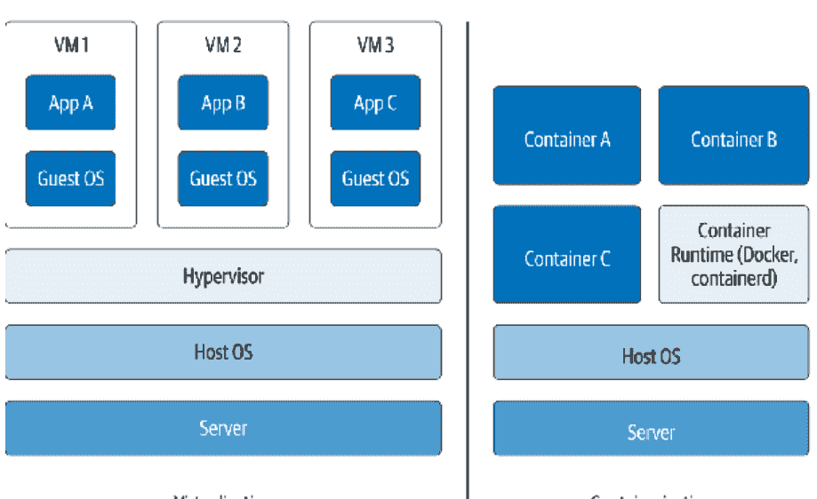

图 2-1. 比较容器化与虚拟化

尽管容器使应用程序更具可移植性，但使其数据可移植却被证明是一个更大的挑战。我们将在第 12 章中探讨可移植数据集的想法。由于容器本身是短暂的，任何需要超出容器生命周期而存在的数据必须按定义位于外部。容器技术的关键特性是提供链接到持久存储的机制，而容器编排技术的关键特性是能够以容器能够高效访问持久存储的方式调度容器。

### 在 Docker 中管理状态

让我们看看最流行的容器技术 Docker，看看容器如何存储数据。Docker 中的关键存储概念是卷。从 Docker 容器的角度来看，卷是一个可以支持只读或读写访问的目录。Docker 支持将多种不同的数据存储挂载为卷。我们将介绍几个选项，以便稍后指出它们在 Kubernetes 中的等价物。

#### Bind mounts

创建卷最简单的方法是将容器中的目录绑定到主机系统上的目录。这称为绑定挂载，如图 2-2 所示。

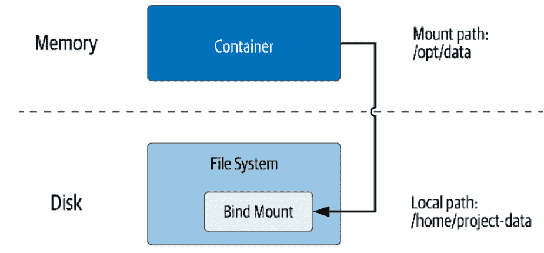

图 2-2. 使用 Docker 绑定挂载访问主机文件系统

在 Docker 中启动容器时，您使用 --volume 或 -v 选项指定绑定挂载，并使用本地文件系统路径和容器路径。例如，您可以启动 Nginx Web 服务器的实例，并将开发机器上的本地项目文件夹映射到容器中。这是在您安装了 Docker 的环境中可以测试的命令：

```
docker run -it --rm -d --name web -v ~/site-content:/usr/share/nginx/html nginx
```

如果本地路径目录尚不存在，Docker 运行时会创建它。Docker 允许您创建具有只读或读写权限的绑定挂载。由于卷表示为目录，因此在容器中运行的应用程序可以将任何可以表示为文件的内容放入卷中——甚至是数据库。

绑定挂载对于开发工作非常有用。然而，使用绑定挂载不适合生产环境，因为这会导致容器依赖于特定主机上存在的文件。这对于单机部署可能没问题，但生产部署往往分布在多个主机上。另一个问题是容器访问主机文件系统所带来的潜在安全漏洞。出于这些原因，我们需要另一种生产部署的方法。

#### Volumes

Docker 内的首选选项是使用卷。Docker 卷由 Docker 在主机文件系统上的特定目录下创建和管理。Docker volume create 命令用于创建卷。例如，您可能会创建一个名为 site-content 的卷来存储网站文件：

```
docker volume create site-content
```

如果未指定名称，Docker 会分配一个随机名称。创建后，结果卷可用于使用形式 -v VOLUME-NAME:CONTAINER-PATH 挂载到容器中。例如，您可能会使用刚刚创建的类似卷来允许 Nginx 容器读取内容，同时允许另一个容器编辑内容，使用 ro 选项：

```
docker run -it --rm -d --name web -v site-content:/usr/share/nginx/html:ro nginx
```

##### DOCKER VOLUME MOUNT SYNTAX

> Docker 还支持 --mount 语法，允许您更明确地指定源文件夹和目标文件夹。这种记法被认为更现代，但也更冗长。上面显示的语法仍然有效，并且是更常用的语法。

如上所述，Docker 卷可以同时挂载到多个容器中，如图 2-3 所示。

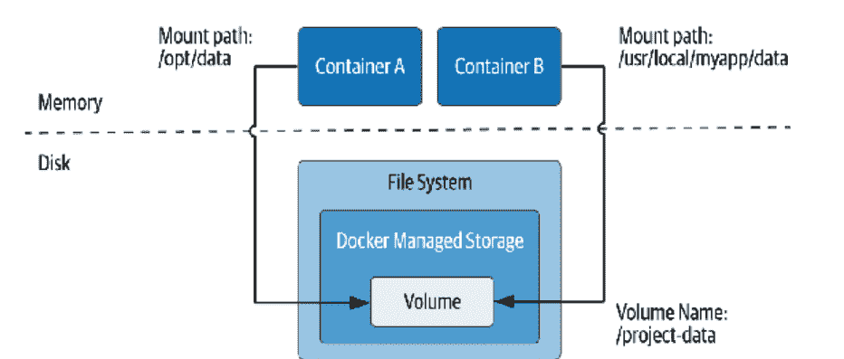

图 2-3. 创建 Docker 卷在主机上的容器之间共享数据

使用 Docker 卷的优点是 Docker 管理容器的文件系统访问，这使得对容器执行容量和安全限制变得更加简单。

#### Tmpfs Mounts

Docker 支持两种特定于主机系统所用操作系统的挂载类型：tmpfs（或“临时文件系统”）和命名管道。命名管道在 Docker for Windows 上可用，但由于它们通常不用于 K8s，因此我们在这里不会过多考虑它们。

Tmpfs 挂载在 Linux 上运行 Docker 时可用。Tmpfs 挂载仅在容器生命周期内存在于内存中，因此内容永远不会存在于磁盘上，如图 2-4 所示。Tmpfs 挂载对于编写为持久化相对少量数据，尤其是您不希望写入主机文件系统的敏感数据的应用程序非常有用。由于数据存储在内存中，因此访问速度更快的好处。


图 2-4. 使用 Docker tmpfs 创建临时卷

要创建 tmpfs 挂载，您使用 docker run --tmpfs 选项。例如，您可以使用如下命令为处理敏感数据的 Web 服务器指定一个 tmpfs 卷来存储 Nginx 日志：

```
docker run -it --rm -d --name web --tmpfs /var/log/nginx nginx
```

--mount 选项也可以用于对可配置选项进行更多控制。

#### Volume Drivers

Docker Engine 具有可扩展的架构，允许您通过插件添加自定义行为，用于包括网络、存储和授权在内的功能。第三方存储插件可用于多个开源和商业提供商，包括公共云和各种网络文件系统。利用这些功能涉及使用 Docker 引擎安装插件，然后在启动使用该存储的 Docker 容器时指定关联的卷驱动程序，如图 2-5 所示。


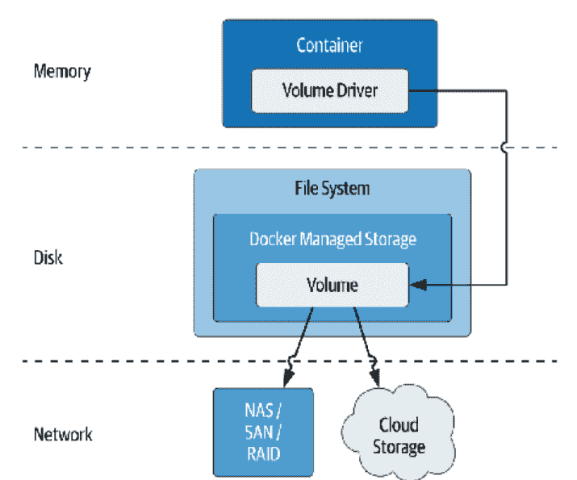

Figure 2-5. 使用 Docker 卷驱动程序访问网络存储

有关在 Docker 中使用各种类型卷的更多信息，请参阅 Docker 存储文档以及 docker run 命令的文档。

### 文件、块和对象存储

在我们现代的云架构时代，传统上向应用程序提供存储的三种主要格式是文件、块和对象。每种格式以不同的方式存储数据并提供数据访问。

- 文件存储将数据表示为文件夹层次结构，每个文件夹都可以包含文件。文件是存储和检索的基本访问单元。要由容器访问的根目录被挂载到容器文件系统中，看起来就像其他任何目录一样。每个公有云都提供自己的文件存储，例如 Google Cloud Filestore 或 Amazon Elastic Filestore。Gluster 是一个开源分布式文件系统。许多这些系统都与网络文件系统 Network File System (NFS) 兼容，NFS 是一种分布式文件系统协议，由 Sun Microsystems 发明，可追溯到 1984 年，至今仍被广泛使用。
- 块存储将数据组织成块，并将这些块分配到一组受管理的卷中。当你向块存储系统提供数据时，它会将其分割成不同大小的块并进行分发，以便最有效地使用底层卷。当你查询块存储系统时，它会从各个位置检索块并将数据返回给你。这种灵活性使块存储成为在有异构存储设备可用时非常好的解决方案。块存储不提供太多元数据处理，这会给应用程序带来更多负担。
- 对象存储将数据组织成称为对象的单元。每个对象都由唯一的标识符或“键”引用，并且可以支持丰富的元数据标记以实现搜索。对象组织在存储桶中。这种扁平的非层次结构使对象存储易于扩展。Amazon 的简单存储服务 Simple Storage Service (S3) 是对象存储的典型示例，大多数对象存储产品都会声称与 S3 API 兼容。

如果你负责构建或选择数据基础设施，你将希望了解这些模式各自的优缺点。

### Kubernetes 数据存储资源

现在你已经了解了容器和云存储的基本概念，让我们看看 Kubernetes 提供了什么。在本节中，我们将介绍 Kubernetes API 中用于将存储附加到容器化应用程序的一些关键概念或“资源”。即使你已经对这些资源有所了解，你也应该继续关注，因为我们将特别关注每个资源与有状态数据的关系。

#### Pods 和 Volumes

Kubernetes 新用户遇到的第一个资源之一是 pod。pod 是 Kubernetes 工作负载部署的基本单元。pod 为运行容器提供环境，而 Kubernetes 控制平面负责将 pod 部署到 Kubernetes 工作节点。Kubelet 是运行在每个工作节点上的 Kubernetes 控制平面组件。它负责在节点上运行 pod，以及监控这些 pod 及其内部容器的健康状况。这些元素在图 2-6 中进行了总结。

虽然 pod 可以包含多个容器，但最佳实践是 pod 包含单个应用程序容器，以及可选的额外辅助容器，如图所示。这些辅助容器可能包括在主应用程序容器之前运行以执行配置任务的 init 容器，或与主应用程序容器并行运行以提供可观测性或管理等辅助服务的 sidecar 容器。在未来的章节中，我们将演示数据基础设施部署如何利用这些架构模式。

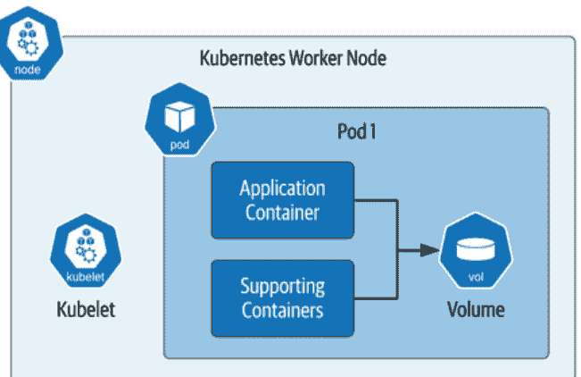

Figure 2-6. 在 Kubernetes Pods 中使用 Volumes

现在让我们考虑在这个 pod 架构中如何支持持久性。与 Docker 一样，容器中的“磁盘上”数据在容器崩溃时会丢失。kubelet 负责重启容器，但这个新容器实际上是原始容器的替代品——它将具有不同的身份，并从完全新的状态开始。

在 Kubernetes 中，术语 volume 用于表示 pod 内的存储访问。通过使用 volume，容器能够持久化数据，这些数据将超出容器的生命周期（并且可能也超出 pod 的生命周期，如我们稍后将看到的）。一个 volume 可以被 pod 中的多个容器访问。每个容器在 pod 中都有自己的 volumeMount，指定应挂载到的目录，从而允许挂载点在容器之间不同。

可能存在多个希望在 pod 中的多个容器之间共享数据的场景：

- 一个 init 容器为特定环境创建自定义配置文件，应用程序容器挂载该文件以获取配置值。
- 应用程序 pod 写入日志，而 sidecar pod 读取这些日志以识别报告给外部监控工具的告警条件。

然而，你可能希望避免多个容器同时写入同一个 volume 的情况，因为你必须确保多个写入者不会冲突——Kubernetes 不会为你处理这个问题。

### 准备运行示例代码

本章（以及本书其余部分）的示例假设你有权访问正在运行的 Kubernetes 集群。对于本章中的示例，本地机器上的开发集群，例如 Kind、K3s 或 Docker Desktop 应该足够。 本节使用的源代码位于 Kubernetes Storage Examples。

```
apiVersion: v1
kind: Pod
metadata:
  name: my-pod
spec:
  containers:
  - name: my-app
    image: nginx
    volumeMounts:
    - name: web-data
      mountPath: /app/config
  volumes:
  - name: web-data
```

请注意配置的两个部分：volume 在 spec.volumes 下定义，而 volumes 的使用在 spec.containers.volumeMounts 下定义。首先，volume 的名称在 volumeMounts 下被引用，并且要挂载到的目录由 mountPath 指定。当声明 pod 规范时，volumes 和 volume mounts 是成对出现的。对于你的配置有效，volume 必须在被引用之前声明，并且 volume 必须被 pod 中的至少一个容器使用。

你可能还注意到 volume 只有一个名称。你没有指定任何额外信息。你认为这会做什么？你可以自己尝试一下，使用示例源代码文件 nginx-pod.yaml 或将上面的配置复制并粘贴到同名文件中，并在配置好的 Kubernetes 集群上执行 kubectl 命令：

```
kubectl apply -f nginx-pod.yaml
```

你可以使用 kubectl get pod 命令获取有关已创建 pod 的更多信息，例如：

```
kubectl get pod my-pod -o yaml | grep -A 5 " volumes:"
```

结果可能看起来像这样：

```
volumes:
  - emptyDir: {}
    name: web-data
  - name: default-token-2fp89
    secret:
      defaultMode: 420
```

正如你所见，Kubernetes 在创建请求的 volume 时提供了一些额外信息，默认将其设为 emptyDir 类型。其他默认属性可能因你使用的 Kubernetes 引擎而异，我们在此不再进一步讨论。

有几种不同类型的 volumes 可以挂载到容器中，让我们来看看。

#### Ephemeral volumes

你还记得我们上面讨论 Docker volumes 时的 tmpfs volumes，它们为单个容器的生命周期提供临时存储。Kubernetes 提供了 ephemeral volumes 的概念，类似，但作用范围是 pod。上面示例中引入的 emptyDir 就是一种 ephemeral volume。


Ephemeral volumes can be useful for data infrastructure or other applications that want to create a cache for fast access. Although they do not persist beyond the lifespan of a pod, they can still exhibit some of the typical properties of other volumes for longer-term persistence, such as the ability to snapshot. Ephemeral volumes are slightly easier to set up than PersistentVolumes because they are declared entirely inline in the pod definition without reference to other Kubernetes resources. As you will see below, creating and using PersistentVolumes is a bit more involved.

### OTHER EPHEMERAL STORAGE PROVIDERS

Some of the in-tree and CSI storage drivers we’ll discuss below that provide PersistentVolumes also provide an ephemeral volume option. You’ll want to check the documentation of the specific provider in order to see what options are available.

### Configuration volumes

Kubernetes provides several constructs for injecting configuration data into a pod as a volume. These volume types are also considered ephemeral in the sense that they do not provide a mechanism for allowing applications to persist their own data.

These volume types are relevant to our exploration in this book since they provide a useful means of configuring applications and data infrastructure running on Kubernetes. We’ll describe each of them briefly:

### ConfigMap Volumes

A ConfigMap is a Kubernetes resource that is used to store configuration values external to an application as a set of name-value pairs. For example, an application might require connection details for an underlying database such as an IP address and port number. Defining these in a ConfigMap is a good way to externalize this information from the application. The resulting configuration data can be mounted into the application as a volume, where it will appear as a directory. Each configuration value is represented as a file, where the filename is the key, and the contents of the file contain the value. See the Kubernetes documentation for more information on [mounting ConfigMaps as volumes](mounting ConfigMaps as volumes).

### Secret Volumes

A Secret is similar to a ConfigMap, only it is intended for securing access to sensitive data that requires protection. For example, you might want to create a secret containing database access credentials such as a username and password. Configuring and accessing Secrets is similar to using ConfigMap, with the additional benefit that Kubernetes helps decrypt the secret upon access within the pod. See the Kubernetes documentation for more information on [mounting Secrets as volumes](mounting Secrets as volumes).

### Downward API Volumes

The Kubernetes Downward API exposes metadata about pods and containers, either as environment variables or as volumes. This is the same metadata that is used by kubectl and other clients.

The available pod metadata includes the pod’s name, ID, namespace, labels, and annotations. The containerized application might wish to use the pod information for logging and metrics reporting, or to determine database or table names.

The available container metadata includes the requested and maximum amounts of resources such as CPU, memory, and ephemeral storage. The containerized application might wish to use this information in order to throttle its own resource usage. See the Kubernetes documentation for an example of [injecting pod information as a volume](injecting pod information as a volume).

### Hostpath volumes

A [hostPath](hostPath) volume mounts a file or directory into a pod from the Kubernetes worker node where it is running. This is analogous to the bind mount concept in Docker discussed above. Using a hostPath volume has one advantage over an emptyDir volume: the data will survive the restart of a pod.

However, there are some disadvantages to using hostPath volumes. First, in order for a replacement pod to access the data of the original pod, it will need to be restarted on the same worker node. While Kubernetes does give you the ability to control which node a pod is placed on using affinity, this tends to constrain the Kubernetes scheduler from optimal placement of pods, and if the node goes down for some reason, the data in the hostPath volume is lost. Second, similar to Docker bind mounts, there is a security concern with hostPath volumes in terms of allowing access to the local filesystem. For these reasons, hostPath volumes are only recommended for development deployments.

### Cloud Volumes

It is possible to create Kubernetes volumes that reference storage locations beyond just the worker node where a pod is running, as shown in Figure 2-7. These can be grouped into volume types that are provided by named cloud providers, and those that attempt to provide a more generic interface.

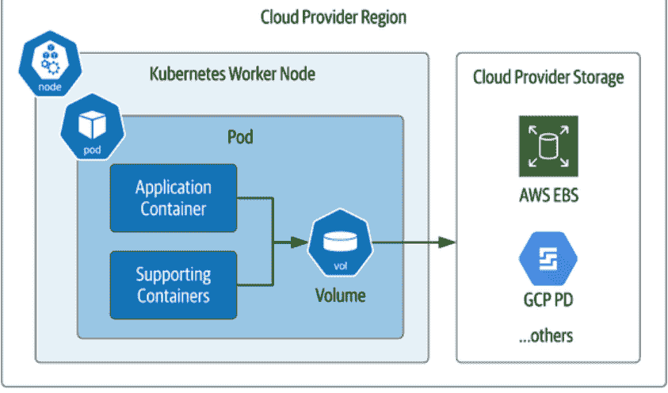

Figure 2-7. Kubernetes pods directly mounting cloud provider storage

These include the following:
- The `awsElasticBlockStore` volume type is used to mount volumes on Amazon Web Services (AWS) Elastic Block Store (EBS). Many databases use block storage as their underlying storage layer.
- The `gcePersistentDisk` volume type is used to mount Google Compute Engine (GCE) persistent disks (PD), another example of block storage.
- Two types of volumes are supported for Microsoft Azure:
  `azureDisk` for Azure Disk Volumes, and `azureFile` for Azure File Volumes
- For OpenStack deployments, the `cinder` volume type can be used to access OpenStack Cinder volumes

Usage of these types typically requires configuration on the cloud provider, and access from Kubernetes clusters is typically confined to storage in the same cloud region and account. Check your cloud provider’s documentation for additional details.

### Additional Volume Providers

There are a number of additional volume providers that vary in the types of storage provided. Here are a few examples:
- The `fibreChannel` volume type can be used for SAN solutions implementing the FibreChannel protocol.
- The `gluster` volume type is used to access file storage using the Gluster distributed file system referenced above
- An `iscsi` volume mounts an existing iSCSI (SCSI over IP) volume into your Pod.
- An `nfs` volume allows an existing NFS (Network File System) share to be mounted into a Pod

We’ll examine more volume providers below that implement the Container Attached Storage pattern.

Table 2-1 provides a comparison of Docker and Kubernetes storage concepts we’ve covered so far.

Table 2-1: Comparing Docker and Kubernetes storage options

| Type of Storage | Docker | Kubernetes |
|---|---|---|
| Access to persistent storage from various providers | Volume (accessed via Volume drivers) | Volume (accessed via in-tree or CSI drivers) |
| Access to host filesystem (not recommended for production) | Bind mount | Hostpath volume |
| Temporary storage available while container (or pod) is running | tmpfs | emptyDir and other ephemeral volumes |
| Configuration and environment data (read-only) | (no direct equivalent) | ConfigMap, Secret, Downward API |

### HOW DO YOU CHOOSE A KUBERNETES STORAGE SOLUTION?

Given the number of storage options available, it can certainly be an intimidating task to try to determine what kind of storage you should use for your application. Along with determining whether you need file, block, or object storage, you’ll want to consider your latency and throughput requirements, as well as your expected storage volume. For example, If your read latency requirements are aggressive, you’ll most likely need a storage solution that keeps data in the same data center where it is accessed.

Next, you’ll want to consider any existing commitments or resources you have. Perhaps your organization has a mandate or bias toward using services from a preferred cloud provider. The cloud providers will frequently provide cost incentives for using their services, but you’ll want to trade this against the risk of lock-in to a specific service. Alternatively, you might have an investment in a storage solution in an on-premises data center that you need to leverage.

Overall, cost tends to be the overriding factor in choosing storage solutions, especially over the long term. Make sure your modeling includes not only the cost of the physical storage and any managed services, but also the operational cost involved in managing your chosen solution.

In this section, we’ve discussed how to use volumes to provide storage that can be shared by multiple containers within the same pod. While this is sufficient for some use cases, there are some needs this doesn’t address. A volume does not provide the ability to share storage resources between pods. The definition of a particular storage location is tied to the definition of the pod. Managing storage for individual pods doesn’t scale well as the number of pods deployed in your Kubernetes cluster increases.


感谢 Kubernetes 提供了额外的原语，有助于简化为单个 Pod 和一组相关 Pod  provision 存储卷并挂载存储卷的过程。我们将在接下来的几个章节中研究这些概念。

### PersistentVolumes

Kubernetes 开发者为管理存储引入的关键创新是持久卷子系统。该子系统由三个协同工作的额外 Kubernetes 资源组成：PersistentVolumes、PersistentVolumeClaims 和 StorageClasses。这使你能够将存储的定义和生命周期与其在 Pod 中的使用方式分离，如图 2-8 所示：

- 集群管理员定义 PersistentVolumes，要么显式定义，要么通过创建可动态 provision 新 PersistentVolumes 的 StorageClass。
- 应用程序开发者创建 PersistentVolumeClaims，用以描述其应用程序的存储资源需求，并且这些 PersistentVolumeClaims 可以作为 Pod 中卷定义的一部分被引用。
- Kubernetes 控制平面管理 PersistentVolumeClaims 与 PersistentVolumes 的绑定。

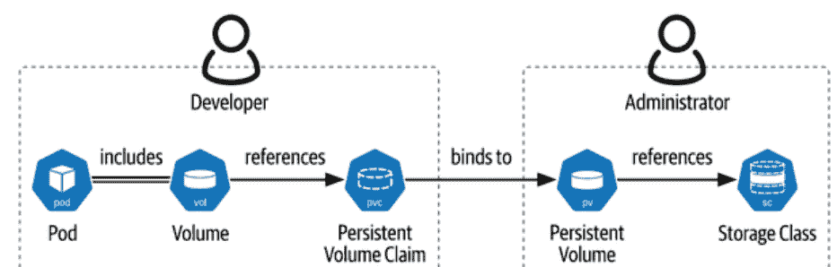

图 2-8. PersistentVolumes、PersistentVolumeClaims 和 StorageClasses

让我们首先来看 PersistentVolume 资源（通常缩写为 PV），它定义了对特定位置存储的访问。PersistentVolumes 通常由集群管理员为应用程序开发者使用而定义。每个 PV 都可以代表上一节中讨论的相同类型的存储，例如云提供商提供的存储、网络存储或直接在工作节点上的存储，如图 2-9 所示。由于它们与特定存储位置绑定，PersistentVolumes 在 Kubernetes 集群之间不可移植。

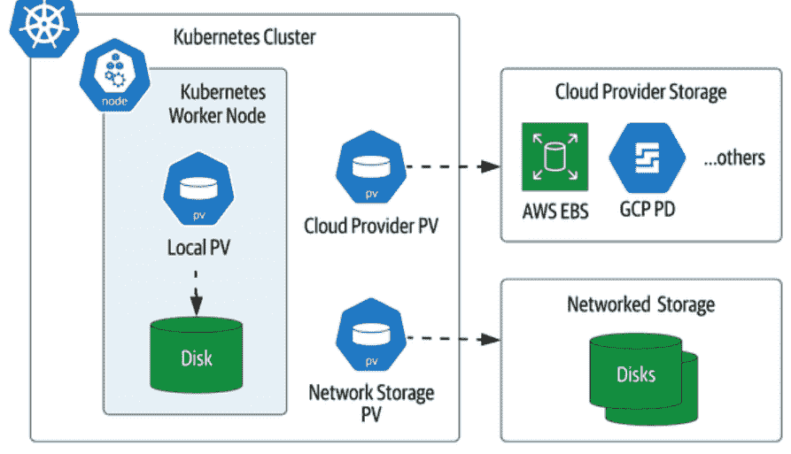

图 2-9. Kubernetes PersistentVolumes 的类型

#### Local PersistentVolumes

该图还引入了一种名为 local 的 PersistentVolume 类型，它代表直接挂载在 Kubernetes 工作节点上的存储，例如磁盘或分区。与 hostPath 卷类似，local 卷也可能代表一个目录。local 卷与 hostPath 卷之间的关键区别在于，当使用 local 卷的 Pod 重启时，Kubernetes 调度器会确保 Pod 被重新调度到同一节点，以便它可以附加到相同的持久状态。因此，local 卷经常用作管理自身复制的数据基础设施的后端存储，如我们在第 4 章中将看到的那样。

定义 PersistentVolume 的语法看起来很熟悉，因为它与在 Pod 中定义卷类似。例如，这里是一个定义 local PersistentVolume 的 YAML 配置文件（[source code](source code)）：

```
apiVersion: v1
kind: PersistentVolume
metadata:
  name: my-volume
spec:
  capacity:
    storage: 3Gi
  accessModes:
    - ReadWriteOnce
  local:
    path: /app/data
  nodeAffinity:
    required:
      nodeSelectorTerms:
        - matchExpressions:
            - key: kubernetes.io/hostname
              operator: In
              values:
                - node1
```

正如你所见，这段代码在工作节点 `node1` 上定义了一个名为 `my-volume` 的 `local` 卷，大小为 3 GB，访问模式为 `ReadWriteOnce`。以下 [access modes](access modes) 可用于 PersistentVolumes：

- `ReadWriteOnce` 访问允许卷在同一时间由单个 Pod 以读写方式挂载，且不能被其他 Pod 挂载
- `ReadOnlyMany` 访问意味着卷可以同时被多个 Pod 以只读方式挂载
- `ReadWriteMany` 访问允许卷在同一时间由多个节点以读写方式挂载

#### CHOOSING A VOLUME ACCESS MODE

给定卷的正确访问模式将由工作负载类型驱动。例如，许多分布式数据库将为每个 Pod 配置专用存储，使 ReadWriteOnce 成为一个不错的选择。

除了容量和访问模式之外，PersistentVolumes 的其他属性还包括：

- `volumeMode`，默认为 `Filesystem`，但可以覆盖为 Block。
- `reclaimPolicy` 定义了当 Pod 释放其对该 PersistentVolume 的声明时发生的情况。合法值有 `Retain`、`Recycle` 和 `Delete`。
- PersistentVolume 可以具有 `nodeAffinity`，指定哪些工作节点可以访问该卷。对于大多数类型这是可选的，但对于 `local` 卷类型是必需的。
- `class` 属性将此 PV 绑定到特定的 StorageClass，这是一个我们将在下面介绍的概念。
- 一些 PersistentVolume 类型会公开特定于该类型的 mountOptions。

#### DIFFERENCES IN VOLUME OPTIONS

不同卷类型之间的选项有所不同。例如，并非每个访问模式或回收策略都适用于每种 PersistentVolume 类型，因此请查阅所选类型的文档以获取更多详细信息。

你可以使用 `kubectl describe persistentvolume` 命令（或简写 `kubectl describe pv`）来查看 PersistentVolume 的状态：

```
$ kubectl describe pv my-volume
Name:               my-volume
```

```
Labels:              <none>
Annotations:         <none>
Finalizers:          [kubernetes.io/pv-protection]
StorageClass:
Status:              Available
Claim:
Reclaim Policy:      Retain
Access Modes:        RWO
VolumeMode:          Filesystem
Capacity:            3Gi
Node Affinity:
    Required Terms:
        Term 0:         kubernetes.io/hostname in [node1]
Message:
Source:
    Type:   LocalVolume (a persistent volume backed by local storage
on a node)
    Path:   /app/data
Events:      <none>
```

PersistentVolume 在首次创建时状态为 Available。PersistentVolume 可以有多个不同的状态值：

- `Available` 表示 PersistentVolume 是空闲的，尚未绑定到声明。
- `Bound` 表示 PersistentVolume 已绑定到 PersistentVolumeClaim，该声明在 describe 输出的其他位置列出
- `Released` 表示 PersistentVolume 上的现有声明已被删除，但资源尚未被回收，因此资源尚未变为 Available
- `Failed` 表示卷的自动回收失败

现在你已经了解了 Kubernetes 中存储资源是如何定义的，下一步是学习如何在应用程序中使用该存储。

### PersistentVolumeClaims

如上所述，Kubernetes 将存储的定义与其使用分离。通常这些任务由不同角色执行：集群管理员定义存储，而应用程序开发者使用存储。PersistentVolumes 通常由管理员定义并引用特定于该集群的存储位置。开发者随后可以使用 PersistentVolumeClaims（PVCs）指定其应用程序的存储需求，Kubernetes 使用它们将 Pod 与满足指定条件的 PersistentVolume 关联起来。如图 2-10 所示，PersistentVolumeClaim 用于引用我们之前介绍的各种卷类型，包括 local PersistentVolumes，或云或网络存储供应商提供的外部存储。

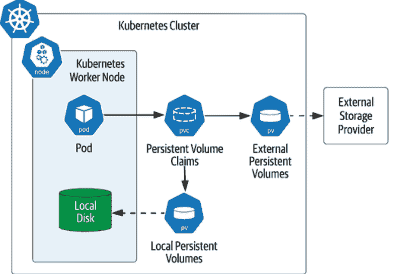

图 2-10. 使用 PersistentVolumeClaims 访问 PersistentVolumes

从应用程序开发者角度来看，流程如下。首先，你将创建一个代表所需存储条件的 PVC。例如，这里是一个请求 1GB 存储且具有独占读写访问的声明（source code）：

```
apiVersion: v1
kind: PersistentVolumeClaim
metadata:
  name: my-claim
spec:
  storageClassName: ""
  accessModes:
  - ReadWriteOnce
  resources:
    requests:
      storage: 1Gi
```

你可能注意到这个声明中的一个有趣之处是 storageClassName 被设置为空字符串。我们将在下面讨论 StorageClasses 时解释其意义。你可以在 Pod 的定义中引用该声明，如下所示（source code）：

```
apiVersion: v1
kind: Pod
metadata:
  name: my-pod
spec:
  containers:
  - name: nginx
    image: nginx
    volumeMounts:
    - mountPath: "/app/data"
      name: my-volume
  volumes:
  - name: my-volume
    persistentVolumeClaim:
      claimName: my-claim
```

正如你所见，PersistentVolume 在 Pod 中作为卷表示。卷被赋予一个名称并引用声明。这被视为 persistentVolumeClaim 类型的卷。与其他卷一样，卷被挂载到容器中的特定挂载点，在本例中挂载到主应用程序 Nginx 容器中的路径 /app/data。

PVC 也有一个状态，你可以通过检索状态查看：

```
Name:          my-claim
Namespace:     default
StorageClass:
```


```
Status:      Bound
Volume:      my-volume
Labels:      <none>
Annotations: pv.kubernetes.io/bind-completed: yes
             pv.kubernetes.io/bound-by-controller: yes
Finalizers:  [kubernetes.io/pvc-protection]
Capacity:    3Gi
Access Modes: RWO
VolumeMode:  Filesystem
Mounted By:  <none>
Events:      <none>
```

PVC 有两种状态值之一：Bound，表示它已绑定到卷（正如上面所示），或 Pending，表示它尚未绑定到卷。通常 Pending 状态意味着没有与该声明匹配的 PV。

下面是幕后发生的情况。Kubernetes 使用在 Pod 中作为卷引用的 PVC，并在调度 Pod 时将它们考虑在内。Kubernetes 识别与声明关联的属性相匹配的 PersistentVolumes，并将最小的可用卷绑定到该声明。这些属性可能包括标签或节点亲和性，正如我们在上面针对本地卷所看到的那样。

在启动 Pod 时，Kubernetes 控制平面确保 PersistentVolumes 已挂载到工作节点。然后，每个请求的存储卷都会在指定的挂载点挂载到 Pod 中。

### StorageClasses

上面显示的示例演示了 Kubernetes 如何将 PVC 绑定到已存在的 PersistentVolumes。这种在 Kubernetes 集群中显式创建 PersistentVolumes 的模型称为静态配置。Kubernetes 持久卷子系统还支持使用 StorageClasses 进行卷的动态配置（通常缩写为 SC）。StorageClass 负责根据集群中运行的应用程序的需求配置（和取消配置）PersistentVolumes，如图 2-11 所示。

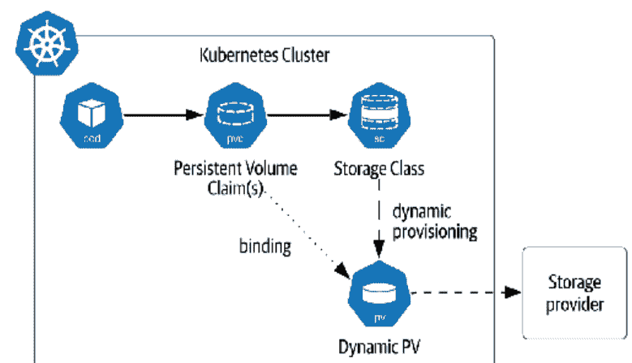

图 2-11. StorageClasses 支持卷的动态配置

根据您使用的 Kubernetes 集群，很可能已经至少有一个 StorageClass 可用。您可以使用命令 kubectl get sc 来验证这一点。如果您在本地机器上运行简单的 Kubernetes 发行版且看不到任何 StorageClasses，您可以使用以下命令从 Rancher 安装一个开源本地存储提供程序：

```
kubectl apply -f https://raw.githubusercontent.com/rancher/local-path-provisioner/master/deploy/local-path-storage.yaml
```

该存储提供程序已预装在 K3s 中，K3s 是 Rancher 提供的桌面发行版。如果您查看该语句中引用的 YAML 配置，您将看到以下 StorageClass 定义（源代码）：

```
apiVersion: storage.k8s.io/v1
kind: StorageClass
metadata:
  name: local-path
provisioner: rancher.io/local-path
volumeBindingMode: WaitForFirstConsumer
reclaimPolicy: Delete
```

正如定义所示，StorageClass 由几个关键属性定义：

- `provisioner` 与底层存储提供程序（如公共云或存储系统）接口以分配实际存储。provisioner 可以是 Kubernetes 内置 provisioner 之一（称为“in-tree”，因为它们是 Kubernetes 源代码的一部分），也可以是符合 Container Storage Interface（CSI）的 provisioner，我们将在下面进行检查。
- `parameters` 是传递给 provisioner 的存储提供程序特定配置选项。常见选项包括文件系统类型、加密设置以及以 IOPS 为单位的吞吐量。有关更多详细信息，请查看存储提供程序的文档。
- `reclaimPolicy` 描述了在删除 PersistentVolume 时是否回收存储。默认值为 Delete，但可以覆盖为 Retain，在这种情况下，存储管理员将负责使用存储提供程序管理该存储的未来状态。
- 尽管上面的示例中未显示，但还有一个可选的 `allowVolumeExpansion` 标志。这表示 StorageClass 是否支持卷扩展的能力。如果为 true，则可以通过增加 PersistentVolumeClaim 的 storage.request 字段的大小来扩展卷。此值默认为 false。
- `volumeBindingMode` 控制存储何时配置和绑定。如果值为 `Immediate`，则只要创建引用 StorageClass 的 PersistentVolumeClaim，就会立即配置 PersistentVolume，并且声明会绑定到 PersistentVolume，而不管声明是否在 Pod 中被引用。许多存储插件还支持第二种模式，称为 `WaitForFirstConsumer`，在这种情况下，直到创建引用该声明的 Pod 之前，不会配置任何 PersistentVolume。这种行为被认为更可取，因为它为 Kubernetes 调度程序提供了更大的灵活性。

### LIMITS ON DYNAMIC PROVISIONING

Local 不能由 StorageClass 动态配置，因此您必须手动创建它们。

应用程序开发人员可以通过在定义中添加 storageClass 属性来在创建 PVC 时引用特定的 StorageClass。例如，这里是引用 local-path StorageClass 的 PVC 的 YAML 配置（源代码）：

```
apiVersion: v1
kind: PersistentVolumeClaim
metadata:
  name: my-local-path-claim
spec:
  storageClassName: local-path
  accessModes:
  - ReadWriteOnce
  resources:
    requests:
      storage: 1Gi
```

如果在声明中未指定 storageClass，则使用默认 StorageClass。默认 StorageClass 可以由集群管理员设置。正如我们在上面的 Persistent Volumes 部分所示，您可以通过使用空字符串来选择不使用 StorageClasses，这表示您使用的是静态配置的存储。

StorageClasses 提供了一个有用的抽象，集群管理员和应用程序开发人员可以用作契约：管理员定义 StorageClasses，开发人员通过名称引用 StorageClasses。底层 StorageClass 实现的细节可能因 Kubernetes 平台提供商而异，促进应用程序的可移植性。

这种灵活性允许管理员创建代表各种不同存储选项的 StorageClasses，例如，以区分吞吐量或延迟方面的不同服务质量保证。这个概念在其他存储系统中被称为“profiles”。请参阅 *Developers are Driving the Future of Kubernetes Storage*（侧边栏），了解有关如何以创新方式利用 StorageClasses 的更多想法。

### Kubernetes Storage Architecture

在前面的章节中，我们讨论了 Kubernetes 通过其 API 支持的各种存储资源。在本章的剩余部分，我们将看看这些解决方案是如何构建的，这可以为我们提供有关如何构建云原生数据解决方案的一些宝贵见解。

### DEFINING CLOUD-NATIVE STORAGE

我们在本章中讨论的大多数存储技术都被捕获为 Cloud Native Computing Foundation（CNCF）景观中列出的“云原生存储”解决方案的一部分。CNCF 存储白皮书是一份有用的资源，定义了云原生存储的关键术语和概念。这两个资源都会定期更新。

### Flexvolume

最初，Kubernetes 代码库包含多个“in-tree”存储插件，即包含在与 Kubernetes 其余代码相同的 GitHub 仓库中。其优点是它有助于标准化连接不同存储平台的代码，但也有一些缺点。首先，许多 Kubernetes 开发人员对包含的广泛存储提供程序的专业知识有限。更重要的是，升级存储插件的能力与 Kubernetes 发布周期绑定，这意味着如果您需要存储插件的修复或增强，您必须等待它被接受到 Kubernetes 发布中。这减慢了 K8s 存储技术的成熟速度，因此采用速度也放缓了。

Kubernetes 社区创建了 Flexvolume 规范，以允许开发独立于 Kubernetes 源代码树开发的插件，即在不绑定到 Kubernetes 发布周期的情况下独立开发。与此同时，存储插件标准正在


对于其他容器编排系统而言，开发者们开始质疑为解决同一个基本问题而开发多个标准的做法是否明智。

### FUTURE FLEXVOLUME SUPPORT

虽然 Flexvolume 的新功能开发已暂停，但许多部署仍然依赖这些插件，并且截至 Kubernetes 1.21 版本，没有弃用该功能的活跃计划。

### Container Storage Interface (CSI)

Container Storage Interface (CSI) 计划被确立为容器化应用存储的行业标准。CSI 是一个开放标准，用于定义可在包括 Kubernetes、Mesos 和 Cloud Foundry 在内的容器编排系统之间通用的插件。正如 Google 工程师、Kubernetes 存储特别兴趣小组 (SIG) 主席 Saad Ali 在 The New Stack 文章《The State of State in Kubernetes》中所指出的：“Container Storage Interface 允许 Kubernetes 直接与任意存储系统交互。”

CSI 规范可在 GitHub 上获取。Kubernetes 对 CSI 的支持始于 1.x 版本，并在 1.13 版本中达到 GA。Kubernetes 仍在跟踪 CSI 规范的更新。

一旦 CSI 实现部署在 Kubernetes 集群上，其功能即可通过标准的 Kubernetes 存储资源（如 PVCs、PVs 和 SCs）访问。在后端，每个 CSI 实现必须提供两个插件：节点插件和控制器插件。CSI 规范使用 gRPC 定义了这些插件的必需接口，但并未具体说明插件的部署方式。

让我们简要了解一下这些服务的角色，也如图 2-12 所示：

- 控制器插件支持对卷的操作，如创建、删除、列出、发布/取消发布、跟踪和扩展卷容量。它还跟踪卷状态，包括每个卷附加到的节点。控制器插件还负责创建和管理快照，并使用快照克隆卷。控制器插件可在任何节点上运行——它是一个标准的 Kubernetes 控制器。

- 节点插件运行在将挂载已配置卷的每个 Kubernetes 工作节点上。节点插件负责本地存储，以及将卷挂载和卸载到节点上。Kubernetes 控制平面在任何需要该卷的 Pod 被调度到该节点之前，会指示插件挂载卷。

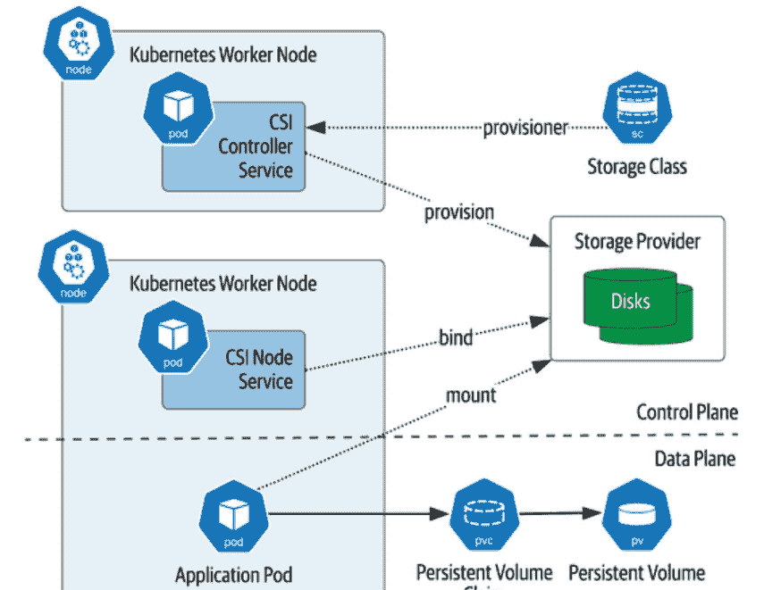

Figure 2-12. Container Storage Interface mapped to Kubernetes

### ADDITIONAL CSI RESOURCES:

CSI 文档站点为有兴趣开发 CSI 兼容驱动的开发人员和存储提供商提供指导。该站点还提供了一个非常有用的 CSI 兼容驱动列表。该列表通常比 Kubernetes 文档站点提供的列表更新。

### CSI MIGRATION

Kubernetes 社区一直非常注重在版本之间保持向前和向后兼容性，从树内存储插件向 CSI 的过渡也不例外。Kubernetes 中的功能通常以 Alpha 功能引入，并逐步发展到 Beta，然后作为通用可用性 (GA) 发布。引入 CSI 这样新 API 的挑战更为复杂，因为它涉及引入新 API 以及弃用旧 API。

CSI 迁移方法被引入以促进存储插件用户的一致体验。当等效的 CSI 兼容驱动可用时，每个对应的树内插件的实现将被更改为外观。当对树内插件进行调用时，会委托给底层的 CSI 兼容驱动。迁移功能本身是一个可以在 Kubernetes 集群上启用的功能。

这允许分阶段的采用过程，可在现有集群更新到更新的 Kubernetes 版本时使用。每个应用程序都可以独立更新以使用 CSI 兼容驱动而不是树内驱动。这种成熟和替换 API 的方法有助于促进整体平台的稳定性，并为管理员提供对其迁移到新 API 的控制。

### Container Attached Storage

虽然 CSI 是标准化容器编排器之间存储管理的重大进步，但它并未提供存储软件如何或在何处运行的实现指导。一些 CSI 实现基本上是围绕在 Kubernetes 集群外部运行的传统存储管理软件的薄包装。虽然重用现有存储资源确实有好处，但许多开发人员表达了希望存储管理解决方案完全在 Kubernetes 中与应用程序一起运行的愿望。

Container Attached Storage 是一种设计模式，提供了一种更云原生的存储管理方法。用于管理将卷附加到应用程序等存储操作的业务逻辑本身由在容器中运行的微服务组成。这使得存储层具有与部署在 Kubernetes 上的其他应用程序相同的属性，并减少了管理员必须跟踪的不同管理界面的数量。存储层成为另一个 Kubernetes 应用程序。

正如 Evan Powell 在 CNCF 博客文章《Container Attached Storage: A primer》中指出的那样，“Container Attached Storage 反映了更广泛的趋势，即解决方案通过构建在 Kubernetes 和微服务之上并为基于 Kubernetes 的微服务环境提供功能，从而重新发明特定类别或创建新类别。例如，针对安全、DNS、网络、网络策略管理、消息传递、跟踪、日志记录等的新项目已在云原生生态系统中出现。”

有几个项目和产品体现了 CAS 的存储方法。让我们来检查一下其中的一些开源选项。

### OpenEBS

OpenEBS 是由 MayaData 创建并捐赠给 CNCF 的项目，于 2019 年成为沙箱项目。其名称是对 Amazon 的 Elastic Block Store 的戏仿，OpenEBS 试图提供此流行托管服务的开源等价物。OpenEBS 提供用于管理本地和 NVMe PersistentVolumes 的存储引擎。

OpenEBS 提供了一个 CSI 兼容实现的绝佳示例，该实现部署在 Kubernetes 上，如图 2-13 所示。控制平面包括 OpenEBS provisioner，它实现了 CSI 控制器接口，以及 OpenEBS API server，它为客户端提供配置接口并与 Kubernetes 控制平面的其余部分交互。

Open EBS 数据平面由 Node Disk Manager (NDM) 以及每个 PersistentVolume 的专用 Pod 组成。NDM 在将访问存储的每个 Kubernetes 工作节点上运行。它实现了 CSI 节点接口，并提供了自动检测附加到工作节点的块存储设备的有用功能。

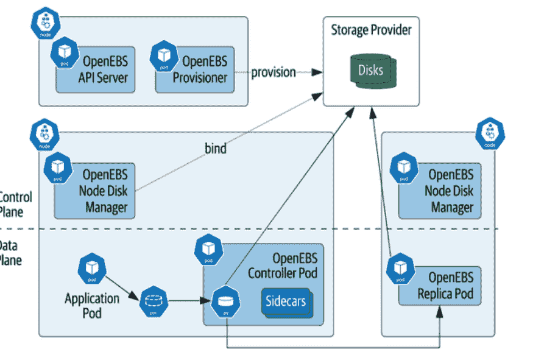

Figure 2-13. OpenEBS Architecture

OpenEBS 为每个卷创建多个 Pod。主副本会创建控制器 Pod，并在其他 Kubernetes 工作节点上创建额外的副本 Pod 以实现高可用性。每个 Pod 都包括用于指标收集和管理的边车，这使得控制平面能够监控和管理数据平面。

### Longhorn

Longhorn 是一个用于 Kubernetes 的开源分布式块存储系统。它最初由 Rancher 开发，并于 2019 年成为 CNCF 沙箱项目。Longhorn 专注于提供云厂商存储和昂贵外部存储阵列的替代方案。Longhorn 支持向 NFS 或 AWS S3 兼容存储提供增量备份，并向单独的 Kubernetes 集群进行实时复制以实现灾难恢复。

Longhorn 使用与 OpenEBS 所示类似的架构；根据文档，“Longhorn 为每个块设备卷创建一个专用存储控制器，并将卷同步复制到存储在多个节点上的多个副本中。存储控制器和副本本身使用 Kubernetes 进行编排。” Longhorn 还提供集成用户界面以简化操作。

### Rook and Ceph

根据其网站，“Rook 是一个开源云原生存储编排器，为多样化的存储解决方案提供平台、框架和支持，以便与云原生环境原生集成。” Rook 最初创建为可在 Kubernetes 中部署的 Ceph 容器化版本。Ceph 是一个开源分布式存储框架，提供块、文件和对象存储。Rook 是 CNCF 接受的首个存储项目，现在被视为 CNCF 成熟项目。

Rook 在真正意义上是 Kubernetes 原生的，因为它使用了 Kubernetes 自定义资源 (CRDs) 和称为操作符的自定义控制器。Rook 为 Ceph、Apache Cassandra 和 Network File System (NFS) 提供操作符。我们将在第 4 章中了解更多关于自定义资源和操作符的内容。


也有一些商业解决方案体现了 Kubernetes 上的 CAS 模式。其中包括 MayaData（OpenEBS 的创建者）、PureStorage 的 Portworx、Robin.io 和 StorageOS。这些公司提供块和文件格式的原始存储，以及用于简化数据库和流式解决方案等额外数据基础设施部署的集成。

### 容器对象存储接口（COSI）

CSI 提供了对文件和块存储的支持，但对象存储 API 需要不同的语义，并不太适合 CSI 将卷挂载的范式。2020 年秋季，由 MinIO 领导的一组公司开始为容器编排平台上的对象存储设计新的 API：容器对象存储接口（COSI）。COSI 提供了更适合配置和访问对象存储的 Kubernetes API，定义了 bucket 自定义资源并包含创建 bucket 和管理 bucket 访问的操作。COSI 控制平面和数据平面的设计以 CSI 为模型。COSI 是一个新兴标准，起步良好，有望在 Kubernetes 社区乃至更广泛范围内得到广泛采用。

### 开发者如何推动 Kubernetes 存储的未来

与 MayaData 的联合创始人兼 CTO、Kubernetes 存储特别兴趣小组（SIG）成员 Kiran Mova 共同撰写

许多组织刚刚开始容器化之旅。Kubernetes 是闪亮的新事物，每个人都想在 Kubernetes 上运行一切。但并非所有团队都准备好使用 Kubernetes，更不用说在 Kubernetes 上管理有状态工作负载了。

应用程序开发者是推动 Kubernetes 上有状态工作负载的动力。这些开发者从可用的云资源开始，甚至是单节点 Kubernetes 集群，并假设他们已准备好在生产环境中运行。开发者正在将内部应用程序“Kubernetes 化”，而对存储的需求与支持他们的平台团队所习惯的截然不同。

微服务和 Kubernetes 改变了存储卷的配置方式。平台团队习惯于以所需吞吐量或容量来考虑数据的配置。在旧的方式中，平台团队会与应用程序团队会面，估算数据大小，进行一个月的规划，配置一个 2-3 TB 的卷，并将其挂载到虚拟机或裸金属服务器中，这将为下一年的存储容量提供足够的空间。

随着 Kubernetes 的出现，配置变得更加容易和临时。你可以通过采用 Kubernetes 以非常经济高效和敏捷的方式运行事物。但许多平台团队仍在努力赶上。一些团队只是专注于正确配置存储，而其他团队则开始关注“第 2 天”操作，例如自动配置、扩展卷，或断开和销毁卷。

平台团队目前还没有万无一失的方法在 Kubernetes 上运行有状态工作负载，因此他们经常将持久性卸载到公共云

提供商。公共云为其托管服务提出了有力的论点，声称他们拥有运行存储系统所需的一切，但一旦你开始为状态使用托管服务，你就可能依赖于这些云提供商并陷入困境。

与此同时，存储技术也在并行创新中：

格局在超融合和分离式之间来回转变。这种重新架构发生在堆栈的所有层级中，这不仅仅是软件，还包括流程和消费数据的人员。

硬件趋势正朝着包括 NVMe 和 DPDK/SPDK 在内的低延迟解决方案发展，以及对 Linux 内核的更改，例如 io_uring，以利用更快的硬件。

容器附加存储将帮助我们更有效地管理存储。例如，在工作负载缩小时能够收回存储空间。当数据分布在多个节点上时，这可能是一个难题。我们需要更好的逻辑来将数据重新定位到现有节点上。

带来合规和运营自动化技术的技术也正在进入视野。

随着所有这些创新，要理解大局并确定如何最大化利用这项技术可能会有点不知所措。平台 SRE 需要学习 Kubernetes、声明式部署、GitOps 原则、新卷类型，甚至数据库概念如最终一致性。

我们设想的未来是，应用程序开发者将根据所需服务质量来指定 Kubernetes 存储需求，例如每秒 I/O 操作数（IOPS）和吞吐量。开发者应该能够以更易于理解的人类相关术语来指定工作负载的不同存储需求。例如，平台团队可以为“快速存储”与“慢速存储”定义 StorageClasses，或许

“元数据存储”与“数据存储”。这些 StorageClasses 将做出不同的成本/性能权衡并提供特定的服务等级协议（SLA）。我们甚至可能会看到这些新 StorageClasses 开始出现一些标准定义。

理想情况下，应用程序团队不应参与选择存储解决方案的决策。应用程序开发者唯一需要关心的是为其应用程序指定 PersistentVolumeClaims，并使用所需的 StorageClasses。管理存储的其他细节应被隐藏，尽管当然存储子系统将通过标准的 Kubernetes 机制报告错误，包括状态和日志。此功能将使应用程序开发者无论是部署数据库还是其他有状态工作负载变得更加简单。

这些创新将引导我们走向 Kubernetes 上存储的更优化状态。今天我们正处于部署基础设施很容易的阶段。让我们共同努力，达到部署正确的基础设施也很简单的阶段。

正如你所见，Kubernetes 上的存储是一个创新非常多的领域，包括多个开源项目和商业供应商竞争提供最易用、最具成本效益和性能最强的解决方案。CNCF 景观中的 Cloud-Native Storage 部分提供了存储提供商和相关工具的有用列表，包括本章中引用的技术以及更多。

### 总结

在本章中，我们探讨了如何在 Docker 等容器系统以及 Kubernetes 等容器编排系统中管理持久性。你了解了可用于管理有状态工作负载的各种 Kubernetes 资源，包括 Volumes、PersistentVolumes、PersistentVolumeClaims、StorageClasses。我们看到了容器存储接口和容器附加存储模式如何指引更云原生的存储管理方法。现在你已准备好学习如何使用这些构建块和设计原则来管理包括数据库、流式数据等在内的有状态工作负载。
