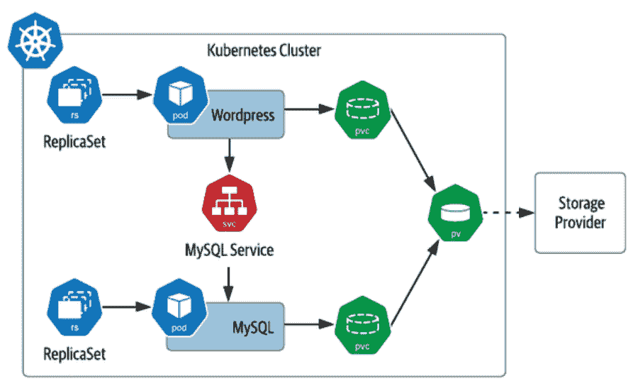
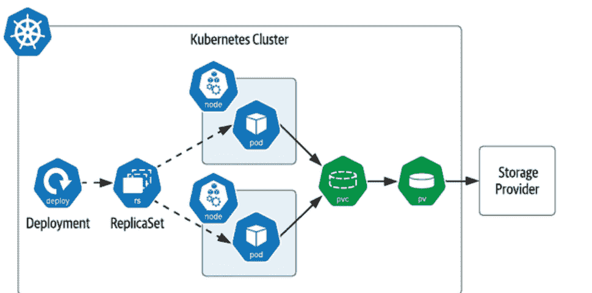
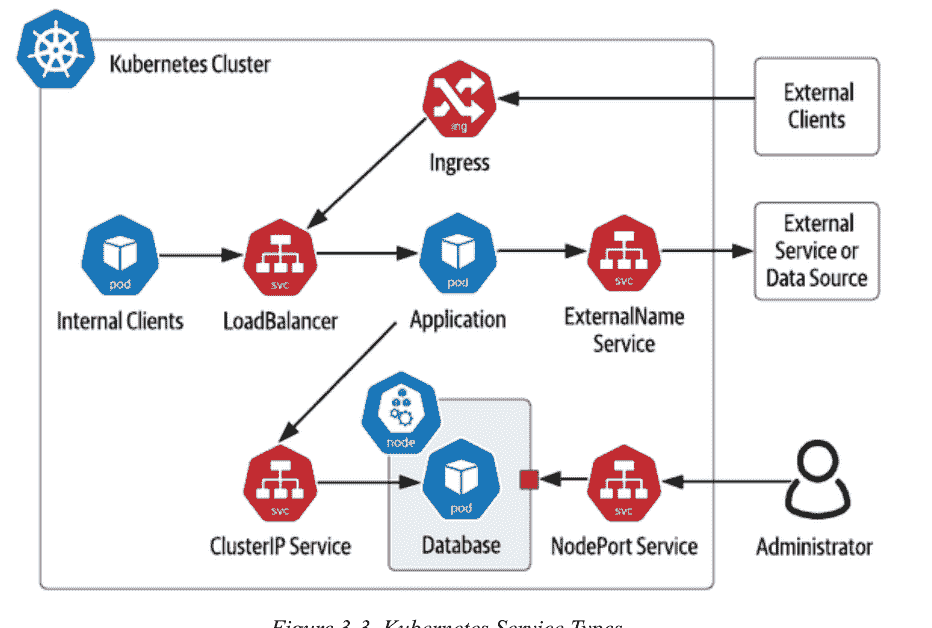
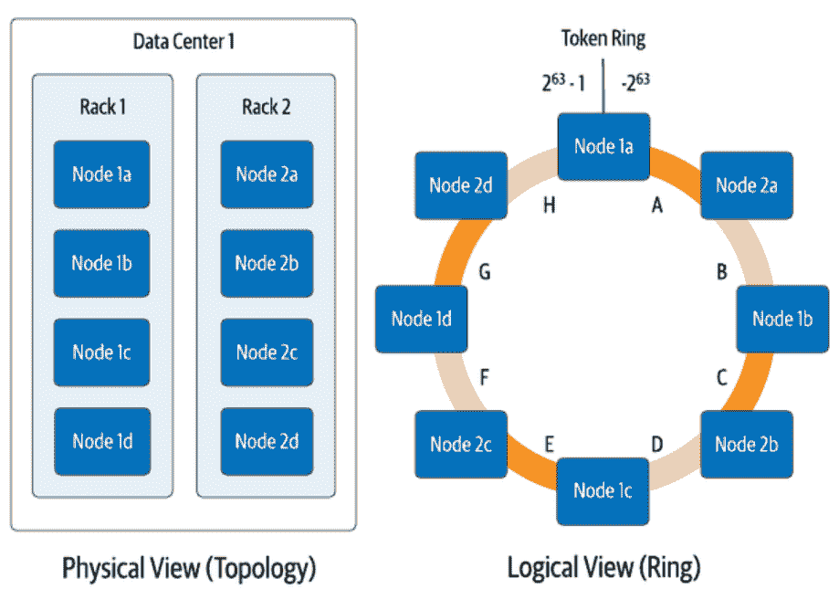
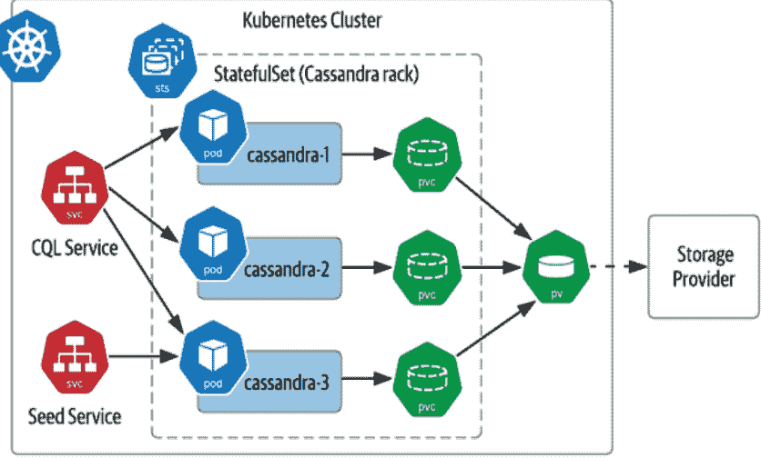
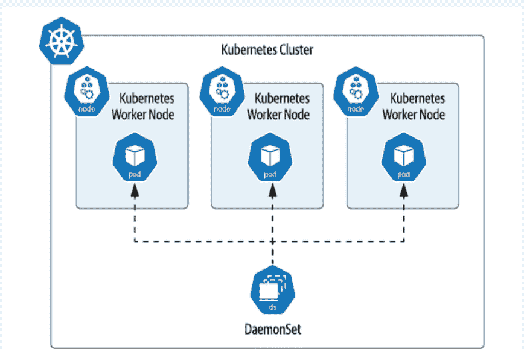

## 第 3 章. 以硬核方式在 Kubernetes 上运行数据库

### 早期发布读者的说明

使用 Early Release 电子书，你可以在这些标题正式发布之前很久就利用这些技术——作者在写作时的原始未编辑内容，以便你能尽早利用这些技术。

这将是最终书籍的第 3 章。请注意，本书的代码示例可在 https://github.com/data-on-k8s-book 获取。

如果你对如何改进本书的内容和/或示例有任何意见，或者如果你注意到本章中缺少材料，请联系编辑 jleonard@oreilly.com。

正如我们在第 1 章中讨论的，Kubernetes 是为无状态工作负载而设计的。由此推断，无状态工作负载是 Kubernetes 最擅长的。因此，有人认为你不应该尝试在 Kubernetes 上运行有状态工作负载，你可能会听到各种建议，关于你应该做什么替代方案：“使用托管服务”，或“将数据保留在本地数据中心的传统数据库中”，或甚至“在云中运行数据库，但使用传统虚拟机而不是容器。”

虽然这些建议仍然是可行的选择，但我们本书的主要目标之一是证明在 Kubernetes 中运行数据基础设施不仅是一个可行的选择，而且是一个首选选项。在他的文章《来自前怀疑者的 Kubernetes 数据库案例》中，Chris Bradford 描述了他从怀疑运行任何有状态工作负载到……的旅程


在 Kubernetes 上，从勉强接受将数据基础设施用于开发和测试工作负载，到热情地倡导在生产环境中将数据库部署到 K8s 上。这段旅程是数据在 Kubernetes 社区中许多人的典型经历。到 2020 年中，Boris Kurktchiev 在他的文章《3 Reasons to Bring Stateful Applications to Kubernetes》中能够引用一个日益增长的共识，即在 Kubernetes 上管理有状态工作负载已达到可行性，甚至成熟的程度。

这种变化是如何发生的？在过去几年里，Kubernetes 社区已将重点转向添加支持以云原生方式在 Kubernetes 上管理状态的功能。我们在上一章中介绍的存储元素代表了这一转变的重要部分，包括 Kubernetes PersistentVolume 子系统以及对容器存储接口的采用。在本章中，我们将通过查看用于在此存储基础之上构建有状态应用程序的 Kubernetes 资源来完成这个故事的一部分。我们将特别关注一种特定的有状态应用程序：数据基础设施。

### The Hard Way

短语“doing it the hard way”已与避免简单选项而选择投入详细工作以实现具有持久意义的结果相关联。纵观历史，各种派别的先驱者以自豪地做出牺牲——流血、流汗、流泪——使后代的生活变得稍微更易忍受而闻名。这些前辈经常抱怨他们的门徒未能理解他们所经历的深度。

在技术世界中也一样。虽然 API 和“无代码”环境等新创新具有在全球范围内培养新一代开发者的巨大潜力，但要管理在全球范围内高度可用和安全的系统，仍然需要对底层技术有更深入的理解。当事情出错时，这种详细的知识就证明了其价值。这就是为什么我们许多人作为软件开发人员，在日常工作中从不接触物理服务器，却能从亲手焊接芯片和电路板组装自己的 PC 中获得如此多的收获。这也是我们充当朋友和家人非正式 IT 顾问时隐藏的好处之一。

对于 Kubernetes 社区来说，“the hard way”当然有更具体的含义。Google 工程师 Kelsey Hightower 的 [Kubernetes the Hard Way](https://) 已成为那些想要更深入了解构成 Kubernetes 集群元素的要素的人的一种入门仪式。这个流行的教程引导你下载、安装和配置构成 Kubernetes 控制平面的每个组件。结果是一个可工作的 Kubernetes 集群，虽然不适合部署生产工作负载，但对于开发和学习来说是完全可用的。这种方法的吸引力在于所有的指令都是手工输入的，而不是下载一堆为你完成一切的脚本，这样你就能理解每一步发生了什么。

在本章中，我们将效仿这种方法，自己一步步部署一些示例数据基础设施的硬方式。在此过程中，我们将更深入地实践你在第 2 章中学到的存储资源，并介绍用于管理计算和网络的额外 Kubernetes 资源类型，以完成我们在第 1 章中介绍的“计算、网络、存储”三元组。你准备好动手了吗？让我们开始吧！

### EXAMPLES ARE NOT PRODUCTION-GRADE

本章中我们提供的示例主要用于介绍 Kubernetes API 的新元素，并不打算代表我们在生产环境中推荐运行的部署。我们会确保突出显示其中的差距，以便在后续章节中演示如何填补它们。

### Prerequisites for running data infrastructure on Kubernetes

要跟随本章中的示例进行操作，你需要有一个可用的 Kubernetes 集群。如果你从未尝试过，也许你想使用 Kubernetes the Hard Way 指令构建一个集群，然后在同一个集群上以硬方式添加数据基础设施。你也可以使用简单的桌面 K8s，因为我们不会使用大量资源。如果你使用的是共享集群，你可能希望在自己的命名空间中安装这些示例，以将其与他人的工作隔离开来。

```
kubectl config set-context --current --namespace=<insert-namespace-name-here>
```

你还需要确保你的集群中有一个 StorageClass。如果你是从硬方式构建的集群开始的，你将没有一个。你可能希望按照 StorageClasses 部分中的说明安装一个简单的 StorageClass 和 provisioner 来公开本地存储（源代码）。

你希望使用支持 volumeBindingMode 为 WaitForFirstConsumer 的 StorageClass。这给了 Kubernetes 在我们需要时再延迟配置存储的灵活性。这种行为通常更受生产部署的青睐，所以你最好现在就养成习惯。

### Running MySQL on Kubernetes

首先，让我们从一个超级简单的示例开始。MySQL 由于其可靠性和易用性，是最广泛使用的关系型数据库之一。对于此示例，我们将在官方 Kubernetes 文档中的 MySQL 教程的基础上进行构建，并加入一些变化。你可以在 Deploying MySQL Example - Data on Kubernetes the Hard Way 找到本节使用的源代码。该教程包括两个 Kubernetes 部署：一个用于运行

MySQL pod，另一个用于运行示例客户端，在本例中为 Wordpress。此配置如图 3-1 所示。



Figure 3-1. Sample Kubernetes Deployment of MySQL

在此示例中，我们看到每个 pod 都有一个 PersistentVolumeClaim。为了本示例的目的，我们假设这些声明由默认 StorageClass 提供的单个卷满足。你还会注意到每个 pod 都显示为 ReplicaSet 的一部分，并且为 MySQL 数据库公开了一个服务。让我们暂停一下并介绍这些概念。

### ReplicaSets

在 Kubernetes 上，生产应用程序部署通常不会部署单个 pod，因为当节点消失时，单个 pod 很容易丢失。相反，pod 通常在管理其生命周期的 Kubernetes 资源上下文中部署。ReplicaSet 是这些资源之一，另一个是 StatefulSet，我们将在本章后面讨论。

ReplicaSet（RS）的目的是确保在任何给定时间保持指定数量的给定 pod 副本运行。随着 pod 被销毁，其他 pod 会被创建以替换它们，以便满足所需的副本数。ReplicaSet 由 pod 模板、副本数和选择器定义。pod 模板定义了将由 ReplicaSet 管理的 pod 的规范，类似于我们在第 2 章示例中为单个 pod 创建时看到的。副本数可以为 0 或更多。选择器标识 ReplicaSet 的一部分的 pod。

让我们看一下图 3-1 中所示的 Wordpress 应用程序的 ReplicaSet 定义的一部分：

```
apiVersion: apps/v1
kind: ReplicaSet
metadata:
  name: wordpress-mysql
  labels:
    app: wordpress
spec:
  replicas: 1
  selector:
    matchLabels:
      app: wordpress
      tier: mysql
  template:
    metadata:
      labels:
        app: wordpress
        tier: mysql
    spec:
      containers:
      - image: mysql:5.6
        name: mysql
        ...
```

ReplicaSet 负责创建或删除 pod 以满足指定的副本数。你可以通过更改此值来放大或缩小 RS 的大小。pod 模板在创建新 pod 时使用。由 ReplicaSet 管理的 pod 在其 metadata.ownerReferences 字段中包含对 RS 的引用。ReplicaSet 实际上可以采用


如果选择器匹配并且 Pod 未引用其他所有者，则负责管理它未创建的 Pod。这种 ReplicaSet 的行为被称为 *获取* 一个 Pod。

你可能会想知道为什么我们上面没有提供 ReplicaSet 的完整定义。事实证明，大多数应用程序开发人员最终不会直接使用 ReplicaSets，因为 Kubernetes 提供了另一种资源类型，可以声明式地管理 ReplicaSets：Deployments。

### 仔细定义 ReplicaSet 选择器

如果你确实直接创建 ReplicaSets，请确保你使用的选择器是唯一的，并且不会匹配任何你不打算被获取的裸 Pod。如果选择器匹配，则可能获取到与 Pod 模板不匹配的 Pod。

有关管理 ReplicaSets 及其管理的 Pod 的生命周期，请参阅 Kubernetes 文档。

### Deployments

Kubernetes *Deployment* 是一种资源，它在 ReplicaSet 的基础上构建，并提供额外的生命周期管理功能，包括能够推出新版本并回滚到以前的版本。如图 3-2 所示，创建 Deployment 会导致创建 ReplicaSet。



图 3-2. Deployments 和 ReplicaSets

该图强调 ReplicaSets（因此管理它们的 Deployments）操作的是 Pod 的克隆副本，这意味着 Pod 的定义是相同的，甚至在 PersistentVolumeClaims 的级别上也是如此。ReplicaSet 的定义引用了提供给它的单个 PVC，并且没有提供克隆 PVC 定义以供额外 Pod 使用的机制。因此，如果你的意图是每个 Pod 都有自己的专用存储，则 Deployments 和 ReplicaSets 不是一个好的选择。

如果你的应用程序 Pod 不需要访问存储，或者你的意图是它们访问同一块存储，则 Deployments 是一个不错的选择。然而，这种情况是可取的情况相当罕见，因为你可能不希望出现多个同时写入同一存储的情况。

让我们创建一个示例 Deployment。首先，创建一个将代表数据库密码的 secret（将 `<your password>` 替换为你想要的密码字符串）：

```
kubectl create secret generic mysql-root-password --from-literal=password=<your password>
```

接下来，创建一个代表数据库可使用的存储的 PVC（源代码）。在这种情况下，单个 PVC 就足够了，因为你正在创建一个单节点。只要你有前面提到的适当的存储类，这应该就可以工作。

```
apiVersion: v1
kind: PersistentVolumeClaim
metadata:
  name: mysql-pv-claim
  labels:
    app: wordpress
spec:
  accessModes:
    - ReadWriteOnce
  resources:
    requests:
      storage: 1Gi
```

接下来，创建一个具有运行 MySQL 的 Pod 规范的 Deployment（源代码）。请注意，它包含对你刚刚创建的 PVC 的引用以及包含数据库 root 密码的 Secret。

```
apiVersion: apps/v1
kind: Deployment
metadata:
  name: wordpress-mysql
  labels:
    app: wordpress
spec:
  selector:
    matchLabels:
      app: wordpress
      tier: mysql
  strategy:
    type: Recreate
  template:
    metadata:
      labels:
        app: wordpress
        tier: mysql
    spec:
      containers:
      - image: mysql:5.7
        name: mysql
```

```
env:
  - name: MYSQL_ROOT_PASSWORD
    valueFrom:
      secretKeyRef:
        name: mysql-root-password
        key: password
ports:
  - containerPort: 3306
    name: mysql
volumeMounts:
  - name: mysql-persistent-storage
    mountPath: /var/lib/mysql
volumes:
  - name: mysql-persistent-storage
    persistentVolumeClaim:
      claimName: mysql-pv-claim
```

关于此 Deployment 的规范，有几件有趣的事情需要注意。

- 首先，注意 Deployment 具有 Recreate 策略。这指的是 Deployment 在 Pod 模板更新时如何处理 Pod 的替换，我们将在后面讨论。
- 接下来，注意在 Pod 模板下，密码作为环境变量传递给 Pod，通过从上面创建的 secret 中提取。覆盖默认密码是保护任何数据库部署的重要方面。
- 还要注意 MySQL 镜像上仅公开了一个端口用于数据库访问，因为这是一个相对简单的示例。在本书的其他示例中，我们将看到 Pod 为管理操作、指标收集等公开额外端口的情况。默认情况下禁用访问是 Kubernetes 的一个很棒的功能。
- MySQL 镜像使用上面定义的 PVC 为其持久存储挂载卷。
- 最后，注意规范中未提供副本数量。这意味着将使用默认值 1。

应用上述配置后，尝试使用类似 `kubectl get deployments, rs, pods` 的命令来检查 Kubernetes 为你创建的项目。你会注意到一个以部署命名的单个 ReplicaSet，其中包含一个随机字符串，例如：`wordpress-mysql-655c8d9c54`。Pod 的名称引用了 ReplicaSet 的名称，并添加了一些额外的随机字符，例如：`wordpress-mysql-655c8d9c54-tgswd`。这些名称提供了一种快速识别这些资源之间关系的方法。

以下是 Deployment 管理 ReplicaSet 生命周期所采取的一些操作。遵循 Kubernetes 对声明式操作的强调，其中大多数操作都是通过更新 Deployment 的规范触发的：

#### 初始推出

当你创建 Deployment 时，Kubernetes 使用你提供的规范创建一个 ReplicaSet。创建此 ReplicaSet 及其 Pod 的过程称为 *rollout*。在滚动更新过程中也会执行 rollout，如下所述。

#### 扩容或缩容

当你更新 Deployment 以更改副本数量时，底层 ReplicaSet 会相应地扩容或缩容。

#### 滚动更新

当你更新 Deployment 的 Pod 模板时，例如通过为 Pod 指定不同的容器镜像，Kubernetes 会基于新的 Pod 模板创建一个新的 ReplicaSet。Kubernetes 管理旧 ReplicaSet 和新 ReplicaSet 之间转换的方式由 Deployment 的 `spec.strategy` 属性描述，其默认值称为 `RollingUpdate`。在滚动更新中，新的 ReplicaSet 会通过创建符合新模板的 Pod 而缓慢扩容，同时现有 ReplicaSet 中的 Pod 数量会缩减。在此过渡期间，Deployment 会强制执行最大和最小 Pod 数量，以百分比表示，由 spec.strategy.rollingupdate.maxSurge 和 maxUnavailable 属性设置。这两个值的默认值均为 25%。

#### 重新创建更新

当你更新 Pod 模板时，另一个策略选项是 Recreate。这是在上面 Deployment 中设置的一个选项。使用此选项，现有 ReplicaSet 会在创建新 ReplicaSet 之前立即终止。此策略对于开发环境很有用，因为它可以更快地完成更新，而 RollingUpdate 更适合生产环境，因为它强调高可用性。

#### 回滚更新

在创建或更新 Deployment 时，你可能会引入错误，例如通过在 Pod 中更新包含错误的容器镜像版本。在这种情况下，Deployment 管理的 Pod 可能甚至无法完全初始化。你可以使用诸如 kubectl rollout status 之类的命令检测这些类型的错误。Kubernetes 提供了用于管理 Deployment 的 rollout 历史记录的一系列操作。你可以通过诸如 kubectl rollout history 之类的 kubectl 命令访问这些操作，它提供部署的 rollout 的编号历史记录，以及 kubectl rollout undo，它将 Deployment 恢复到之前的 rollout。你也可以使用 --to-version 选项回滚到特定的 rollout 版本。因为 kubectl 支持其他资源类型的 rollout，我们将在下面介绍（StatefulSets 和 DaemonSets），所以在使用这些命令时，你需要包含资源类型和名称，例如：

```
kubectl rollout history deployment/wordpress-mysql
```

这会产生如下输出：


```
deployment.apps/wordpress-mysql
REVISION  CHANGE-CAUSE
1         <none>
```

正如你所见，Kubernetes Deployment 为管理一组克隆 Pod 的生命周期提供了一些复杂的特性。你可以通过修改 Deployment 的 YAML 规范并重新应用它来测试这些生命周期操作（回滚除外）。尝试将副本数缩放至 2 再缩回，或使用不同的 MySQL 镜像。更新 Deployment 后，你可以使用类似 `kubectl describe deployment wordpress-mysql` 的命令来观察 Kubernetes 为使 Deployment 达到期望状态而发起的事件。

Deployment 还有其他可用的选项，这里没有空间展开，例如如何指定当尝试的更新失败时 Kubernetes 的行为。有关 Deployment 行为的更深入解释，请参阅 Kubernetes 文档。

### Services

在上述步骤中，你已创建了一个 PVC 来指定数据库的存储需求，一个 Secret 来提供管理员凭据，以及一个 Deployment 来管理单个 MySQL Pod 的生命周期。现在你有了运行中的数据库，你希望使其可供应用程序访问。在我们于第 1 章介绍的计算、网络和存储方案中，这属于网络部分。

Kubernetes Service 是我们需要使用的原语，以便将对数据库的访问作为网络服务暴露出来。Service 为其背后运行的一组 Pod 提供了抽象。在本例中只有一个 MySQL 节点，你可能会想知道为什么要创建这种抽象。一个 Service 支持的关键特性是提供一个一致命名的端点，且不会改变。你不希望在数据库 Pod 重启并获得新的

IP地址时，不得不更新你的客户端。你可以使用如下的 YAML 配置为访问 MySQL 创建一个 Service（源代码）：

```
apiVersion: v1
kind: Service
metadata:
  name: wordpress-mysql
  labels:
    app: wordpress
spec:
  ports:
    - port: 3306
  selector:
    app: wordpress
    tier: mysql
clusterIP: None
```

以下是关于此配置需要注意的几点：

- 首先，此配置指定了在 Service 上暴露的端口：3306。在定义 Service 时实际上涉及两个端口：暴露给 Service 客户端的端口，以及 Service 所代理的底层 Pod 暴露的 `targetPort`。由于你未指定 `targetPort`，它默认为 port 的值。
- 其次，选择器定义了 Service 将流量导向哪些 Pod。在此配置中，只会有一个由 Deployment 管理的 MySQL Pod，这完全没问题。
- 最后，如果你之前使用过 Kubernetes Service，你可能会注意到此 Service 未定义 `serviceType`，这意味着它是默认类型，即 `ClusterIP`。此外，由于 `clusterIP` 属性被设为 None，这就是所谓的 *无头服务*，即 Service 的 DNS 名称直接映射到所选 Pod 的 IP 地址。

Kubernetes 支持多种类型的服务以满足不同的用例，如图 3-3 所示。我们将在此简要介绍它们，以突出它们对数据基础设施的适用性：

#### ClusterIP Service

此类 Service 暴露在只能从 Kubernetes 集群内部访问的 IP 地址上。这是在 Kubernetes 中用于数据基础设施（如数据库）的最常见的服务类型，尤其是无头服务，因为此类基础设施通常与使用它的应用程序一起部署在 Kubernetes 中。

#### NodePort Service

NodePort Service 在每个工作节点的 IP 地址上对集群外部暴露。还会内部创建一个 ClusterIP 服务，NodePort 将流量路由到该服务。你可以让 Kubernetes 选择使用的外部端口，或使用 NodePort 属性指定所需端口。NodePort 服务最适合开发环境，当你需要调试数据基础设施应用程序特定实例上发生的情况时。

#### LoadBalancer

LoadBalancer 服务代表 Kubernetes 运行时请求设置由底层云提供商提供的负载均衡器。例如，在 Amazon 的 Elastic Kubernetes Service（EKS）上，请求一个 LoadBalancer 服务会导致创建一个 Elastic Load Balancer（ELB）实例。在多节点数据基础设施部署前面使用 LoadBalancer 通常不是必需的，因为这些数据技术通常有自己的负载分发方法。例如，Apache Cassandra 驱动程序了解 Cassandra 集群的拓扑结构，并为客户端应用程序提供负载均衡功能，从而消除了对负载均衡器的需求。

#### ExternalName Service

ExternalName Service 通常用于表示对集群外部服务的访问，例如在 Kubernetes 外部运行的数据库。ExternalName 服务不

具有选择器，因为它不映射到任何 Pod。相反，它将 Service 名称映射到 CNAME 记录。例如，如果你创建一个 `my-external-database` 服务，其 `externalName` 为 `database.mydomain.com`，则应用程序 Pod 中对 `my-external-database` 的引用将被映射到 `database.mydomain.com`。



图 3-3. Kubernetes 服务类型

还请注意图中包含 Ingress。虽然 Kubernetes Ingress 不是一种 Service 类型，但它相关。Ingress 用于从集群外部提供对 Kubernetes 服务的访问，通常通过 HTTP。存在多种 Ingress 实现，包括 Nginx、Traefik、Ambassador（基于 Envoy）等。Ingress 实现通常提供包括 SSL 终止和跨多个不同 Kubernetes 服务的负载均衡在内的功能。与 LoadBalancer 服务一样，Ingress 更常用于应用层。

### Accessing MySQL

现在你已部署了数据库，可以部署使用它的应用程序了——Wordpress 服务器。

首先，服务器需要自己的 PVC。这有助于说明存在直接利用存储的应用程序的情况，也许用于存储文件，以及使用数据基础设施的应用程序，以及两者兼具的应用程序。你可以提出一个较小的请求，因为这只是演示目的（[source code]()）：

```
apiVersion: v1
kind: PersistentVolumeClaim
metadata:
  name: wp-pv-claim
  labels:
    app: wordpress
spec:
  accessModes:
    - ReadWriteOnce
  resources:
    requests:
      storage: 1Gi
```

接下来，创建一个单个 Wordpress 节点的 Deployment（[source code]()）：

```
apiVersion: apps/v1
kind: Deployment
metadata:
  name: wordpress
  labels:
    app: wordpress
spec:
  selector:
    matchLabels:
      app: wordpress
      tier: frontend
  strategy:
    type: Recreate
  template:
    metadata:
      labels:
        app: wordpress
        tier: frontend
```

```
spec:
  containers:
  - image: wordpress:4.8-apache
    name: wordpress
    env:
    - name: WORDPRESS_DB_HOST
      value: wordpress-mysql
    - name: WORDPRESS_DB_PASSWORD
      valueFrom:
        secretKeyRef:
          name: mysql-root-password
          key: password
    ports:
    - containerPort: 80
      name: wordpress
    volumeMounts:
    - name: wordpress-persistent-storage
      mountPath: /var/www/html
  volumes:
  - name: wordpress-persistent-storage
    persistentVolumeClaim:
      claimName: wp-pv-claim
```

请注意，访问 MySQL 的数据库主机和密码作为环境变量传递给 Wordpress。主机值是你上面为 MySQL 创建的服务名称。这就是数据库连接被路由到你的 MySQL 实例所需的一切。密码值从 Secret 中提取，与上面 MySQL 部署的配置类似。

你还会注意到 Wordpress 在 80 端口暴露 HTTP 接口，因此让我们创建一个服务来暴露 Wordpress 服务器（source code）：

```
apiVersion: v1
kind: Service
metadata:
  name: wordpress
  labels:
    app: wordpress
spec:
  ports:
  - port: 80
  selector:
    app: wordpress
```


```
tier: frontend
type: LoadBalancer
```

请注意该服务的类型为 LoadBalancer，这应该使你能够从本地机器相对轻松地访问它。执行命令 `kubectl get services` 以获取负载均衡器的 IP 地址，然后你就可以通过 URL *http://<ip>* 在浏览器中打开 WordPress 实例。尝试登录并创建一些页面。

### 从 Kubernetes 发行版访问服务

访问服务的具体细节将取决于你使用的 Kubernetes 发行版，以及你是在生产环境中部署应用，还是只是像我们这里这样快速测试一下。如果你使用的是桌面版 Kubernetes 发行版，为了简化操作，你可能希望改用 NodePort 服务而不是 LoadBalancer。你也可以查阅特定说明以了解如何访问服务，例如 Minikube 或 K3d 提供的文档。

当你完成对 WordPress 实例的实验后，可以使用以下命令清理你在本地目录中使用的配置文件中指定的资源，包括存储在 PersistentVolumeClaim 中的数据：

```
kubectl delete -k ./
```

此时，你可能会觉得这相对容易，尽管我们声称是在做“困难的方式”。从某种意义上说，你是对的。到目前为止，我们部署了一个简单的数据库的单个节点，使用了合理的默认值，我们不需要花费太多时间进行配置。创建单个节点当然是可以的，如果你的应用程序只会存储少量数据。那就是在 Kubernetes 上部署数据库的全部内容吗？当然不是！现在我们已经通过这个简单的数据库部署介绍了几个基本的 Kubernetes 资源，是时候稍微提高一下复杂度了。让我们开始吧！

### 在 Kubernetes 上运行 Apache Cassandra

在本节中，我们将研究如何在 Kubernetes 上运行多节点数据库，使用 Apache Cassandra。Cassandra 是一种 NoSQL 数据库，最初由 Facebook 开发，于 2010 年成为 Apache 软件基金会的顶级项目。Cassandra 是一种运营数据库，提供表格数据模型，其 Cassandra 查询语言 CQL 与 SQL 相似。

Cassandra 是一种为云设计的数据库，它通过添加节点实现水平扩展，每个节点都是对等节点。这种去中心化设计已被证明具有接近线性的可扩展性。Cassandra 通过存储数据的多个副本或副本来实现高可用性，包括将这些副本分布在多个数据中心和云区域的逻辑。Cassandra 建立在与 Kubernetes 相似的原则之上，即它旨在检测故障并在系统在后台恢复到预期状态时继续运行。所有这些特性使 Cassandra 非常适合在 Kubernetes 上部署。

为了讨论此部署的工作方式，了解 Cassandra 分布数据的两种不同视角是有帮助的：物理和逻辑。借用《Cassandra：权威指南》中的部分视觉效果，你可以在图 3-4 中看到这些视角。从物理角度来看，Cassandra 节点（不要与 Kubernetes 工作节点混淆）使用称为机架和数据中心的概念进行组织。虽然这些术语暴露了 Cassandra 的起源——在 2000 年代中期，本地数据中心是软件部署的主要方式——但它们可以灵活应用。在云部署中，机架通常代表可用区，而数据中心代表云区域。然而无论如何表示，重要的是它们代表了物理上分离的故障域。Cassandra 利用对该拓扑的认知，确保它在多个物理位置存储副本，以最大化在发生故障时数据的可用性，无论这些故障是单台机器、一组服务器、一个可用区还是整个区域。



图 3-4. Cassandra 分布式架构的物理和逻辑视图

逻辑视图帮助我们理解 Cassandra 如何确定将数据放置在每个节点上。Cassandra 中每行数据都由主键标识，主键由一个或多个用于在节点间分配数据的分区键列组成，以及可选的聚簇列，可用于在分区内组织多行数据以实现高效访问。Cassandra 中的每次写入（以及大多数读取）都通过提供分区键值来引用特定分区，Cassandra 将其哈希在一起生成一个称为 token 的值，该值介于 −2^63 和 2^63−1 之间。Cassandra 为其每个节点分配一个或多个 token 范围的责任（图 3-4 中为简化起见显示每个节点一个范围）。在分配 token 范围时，会考虑物理拓扑，以确保你的数据副本分布在机架和数据中心之间。

现在我们准备考虑 Cassandra 如何映射到 Kubernetes。考虑 Cassandra 架构的两个影响很重要：

#### 有状态性

每个 Cassandra 节点都有其负责维护的状态。Cassandra 具有通过从其他副本流式传输数据到新节点来替换节点的功能，这意味着使用本地临时存储的配置是可能的，但代价是更长的启动时间。然而，更常见的做法是为每个 Cassandra 节点配置持久存储。在任何一种情况下，每个 Cassandra 节点都需要拥有自己的唯一 PersistentVolumeClaim。

#### 标识

尽管在完全对等架构中，每个 Cassandra 节点在代码、配置和功能方面是相同的，但节点在实际角色方面是不同的。每个节点在数据中心和机架的拓扑中以及其分配的 token 范围方面都有其身份。

这些对标识的要求以及与特定 PersistentVolumeClaim 的关联为 Deployment 和 ReplicaSet 带来了挑战，而它们并不是为处理这些情况而设计的。Kubernetes 早期就意识到需要另一种机制来管理像 Cassandra 这样的有状态工作负载。

#### StatefulSets

Kubernetes 开始通过 1.3 版本中 PetSets 的 alpha 版本提供管理有状态工作负载的资源。该功能随着时间的推移而成熟，现在被称为 StatefulSets（参见：边栏：你的有状态工作负载是宠物还是牲畜？）。StatefulSet 与 ReplicaSet 有一些相似之处，因为它负责管理一组 Pod 的生命周期，但其管理方式存在显著差异。为了满足 Cassandra 等有状态应用程序的需求，StatefulSets 表现出以下关键属性：

#### Pod 的稳定标识

首先，StatefulSets 为 Pod 提供稳定的名称和网络标识。每个 Pod 都根据 StatefulSet 的名称加上序数编号进行命名。例如，一个名为 `cassandra` 的 StatefulSet 将拥有名为 `cassandra-1`、`cassandra-2`、`cassandra-3` 等的 Pod，如图 3-5 所示。这些是稳定的名称，因此如果 Pod 因某种原因丢失并需要替换，替换 Pod 将具有相同的名称，即使它在不同的工作节点上启动。每个 Pod 的名称被设置为其主机名，因此如果你创建了一个无头服务，你实际上可以根据需要寻址单个 Pod，例如：`cassandra-1.cqlservice.default.svc.cluster.local`。我们将在本章后面 *访问 Cassandra* 部分讨论更多关于为 Cassandra 运行 Kubernetes 服务的内容。



图 3-5. 使用 StatefulSets 在 Kubernetes 上部署 Cassandra 的示例

#### 有序的生命周期管理

StatefulSets 为管理 Pod 的生命周期提供了可预测的行为。在扩展 StatefulSet 中的 Pod 数量时，新 Pod 会根据下一个可用编号添加。例如，扩展图 3-5 中的 StatefulSet 将导致创建诸如 `cassandra-4` 和 `cassandra-5` 的 Pod。缩减规模则具有相反的行为，因为具有最高序数编号的 Pod 会首先被删除。这种可预测性简化了管理，例如在减少集群规模之前，很明显应备份哪些节点。

#### 持久磁盘

与创建所有 Pod 共享的单个 PersistentVolumeClaim 的 ReplicaSet 不同，StatefulSets 为每个 Pod 创建一个 PVC。如果 StatefulSet 中的 Pod 被替换，替换 Pod 将绑定到具有其正在替换的状态的 PVC。替换可能发生在 Pod 失败或调度程序选择在另一个节点上运行 Pod 以平衡负载时。对于像 Cassandra 这样的数据库，这使得在 Cassandra 节点丢失时能够快速恢复，因为替换节点可以立即从关联的 PersistentVolume 恢复其状态，而无需从其他副本流式传输数据。

### 管理数据复制

在规划应用程序部署时，请确保考虑数据是在数据层还是存储层进行复制。像 Cassandra 这样的分布式数据库自行管理复制，根据你请求的复制因子在多个节点上存储数据的副本，通常每个 Cassandra 数据中心为 3 个。你选择的存储提供商也可能提供复制。如果每个 Cassandra Pod 的 Kubernetes 卷有 3 个副本，你最终可能会存储 9 份数据。虽然这 certainly 促进了高数据存活率，但这可能比你预期的成本更高。


### 你的有状态工作负载是宠物还是牲畜？

PetSet 这个名字对于 Kubernetes 资源来说似乎很奇怪，并且此后已被取代，但它为 Kubernetes 社区在支持有状态工作负载时的思考过程提供了一些有趣的见解。PetSets 这个名字参考了自 2012 年以来在 DevOps 世界中一直活跃的讨论。最初的概念被归因于 Bill Baker，前微软员工。

基本思想是处理服务器有两种方式：将其视为需要照顾、喂养和呵护的宠物，或将其视为牲畜，你不会对它们产生依恋或提供大量个性化关注。如果你定期登录服务器执行维护活动，你就是将其视为宠物。

其含义是，运维工程师的生活可以通过将更多元素视为牲畜而非宠物而得到极大改善。随着向现代云原生架构的转变，这一概念已从服务器扩展到虚拟机和容器，甚至扩展到单个微服务。它也有助于推广高可用性和在单个组件丢失时存活的架构方法，这些方法使 Kubernetes 和 Cassandra 等技术取得成功。

正如你所见，将 Kubernetes 资源命名为“PetSets”承载了很多含义，也许甚至对在 Kubernetes 上运行有状态工作负载持有一点怀疑态度。最终，PetSets 帮助将 Kubernetes 上管理状态的照顾和喂养工作去除，而名称更改为 StatefulSets 非常恰当。综合起来，像 StatefulSets、第二章中介绍的 PersistentVolume 子系统以及第四章中即将出现的运算符等功能，正在带来一种自动化水平，承诺在不久的将来我们将像管理牲畜一样管理 Kubernetes 上的数据。

### 定义 StatefulSets

现在你已经了解了一些关于 StatefulSets 的知识，让我们研究一下如何使用它们来运行 Cassandra。你将使用 Kubernetes StatefulSet 以“硬方式”配置一个简单的 3 节点集群，表示单个 Cassandra 数据中心包含单个机架。虽然此示例受到了 Kubernetes 文档中 Cassandra 教程的启发，但它在某些方面与教程有所不同。本节使用的源代码位于 Deploying Cassandra Example - Data on Kubernetes the Hard Way。这近似于图 3-5 所示的配置。

要在 Kubernetes 中设置 Cassandra 集群，你首先需要一个 headless service。此服务代表图 3-5 中显示的“CQL Service”，为客户端提供一个端点，用于获取 StatefulSet 中所有 Cassandra 节点的地址（源代码）：

```
apiVersion: v1
kind: Service
metadata:
  labels:
    app: cassandra
  name: cassandra
spec:
  clusterIP: None
  ports:
  - port: 9042
  selector:
    app: cassandra
```

你将在 StatefulSet 的定义中引用此服务，该 StatefulSet 将管理你的 Cassandra 节点（源代码）。与其立即应用此配置，不如在我们下面进行快速解释后再等待。配置如下所示：

```
apiVersion: apps/v1
kind: StatefulSet
metadata:
  name: cassandra
  labels:
    app: cassandra
spec:
```

```
serviceName: cassandra
replicas: 3
podManagementPolicy: OrderedReady
updateStrategy: RollingUpdate
selector:
  matchLabels:
    app: cassandra
template:
  metadata:
    labels:
      app: cassandra
  spec:
    containers:
    - name: cassandra
      image: cassandra
      ports:
      - containerPort: 7000
        name: intra-node
      - containerPort: 7001
        name: tls-intra-node
      - containerPort: 7199
        name: jmx
      - containerPort: 9042
        name: cql
      lifecycle:
        preStop:
          exec:
            command:
            - /bin/sh
            - -c
            - nodetool drain
    env:
    - name: CASSANDRA_CLUSTER_NAME
      value: "cluster1"
    - name: CASSANDRA_DC
      value: "dc1"
    - name: CASSANDRA_RACK
      value: "rack1"
    - name: CASSANDRA_SEEDS
      value: "cassandra-0.cassandra.default.svc.cluster.local"
    volumeMounts:
    - name: cassandra-data
      mountPath: /var/lib/cassandra
volumeClaimTemplates:
- metadata:
    name: cassandra-data
  spec:
```

```
accessModes: [ "ReadWriteOnce" ]
storageClassName: standard-rwo
resources:
  requests:
    storage: 1Gi
```

这是我们迄今为止一起查看过的最复杂的配置，因此让我们通过一次查看一部分来简化它。

#### StatefulSet 元数据

我们已将此 StatefulSet 命名并标记为 cassandra，并且该字符串也将用作属于 StatefulSet 的 Pod 的选择器。

#### 通过 Service 公开 StatefulSet Pod

StatefulSet 的 spec 从对上面创建的 headless service 的引用开始。虽然根据 Kubernetes 规范 serviceName 不是必需字段，但某些 Kubernetes 发行版和工具（如 Helm）期望它被填充，如果你未能提供值，将会生成警告或错误。

#### 副本数

replicas 字段标识此 StatefulSet 中应可用的 Pod 数量。提供的 3 的值反映了实际生产部署中可能看到的最小 Cassandra 集群，而大多数部署要大得多，这时 Cassandra 在规模化时提供高性能和高可用性的能力才真正开始闪耀。

#### 生命周期管理选项

podManagementPolicy 和 updateStrategy 描述了 Kubernetes 在集群扩展或缩小时如何管理 Pod 的滚动，以及如何管理 StatefulSet 中 Pod 的更新，分别。我们将在 Managing the lifecycle of a StatefulSet 中研究这些值的意义。

#### Pod 规范

StatefulSet 规范的下一部分是用于创建由 StatefulSet 管理的每个 Pod 的模板。模板有几个子部分。首先，在 metadata 下，每个 Pod 包含一个标签 cassandra，标识其属于该集合。

此模板在 containers 字段中包含一个项目，即 Cassandra 容器的规范。image 字段选择官方 Cassandra [Docker 镜像](Docker image) 的最新版本，截至撰写时为 Cassandra 4.0。这就是我们与上面引用的 Kubernetes StatefulSet 教程不同的地方，后者使用专门为该教程创建的自定义 Cassandra 3.11 镜像。因为我们在这里选择的镜像是官方 Docker 镜像，所以你不需要包含注册表或账户信息来引用它，名称 cassandra 本身就足以标识将使用的镜像。

每个 Pod 将公开用于各种接口的端口：用于客户端使用的 cql 端口、用于 Cassandra 集群中节点之间通信的 intra-node 和 tls-intra-node 端口，以及用于通过 Java Management Extensions（JMX）进行管理的 jmx 端口。

Pod 规范还包括帮助 Kubernetes 管理 Pod 生命周期的指令，包括 readinessProbe、livenessProbe 和 preStop 命令。我们将在下面学习每个指令的用途。

根据其 [文档](documentation)，我们使用的镜像已构建为提供两种不同的方式来自定义存储在镜像中 cassandra.yaml 文件内的 Cassandra 配置。一种方法是使用你提供的文件覆盖 cassandra.yaml 的全部内容。第二种是利用镜像公开的环境变量来覆盖最频繁使用的 Cassandra 配置选项的子集。在 env 字段中设置这些值会导致 cassandra.yaml 文件中的相应设置被更新：

- CASSANDRA_CLUSTER_NAME 用于区分哪些节点属于一个集群。如果 Cassandra 节点进入


contact with nodes that don’t match its cluster name, it will ignore them.

- CASSANDRA_DC 和 CASSANDRA_RACK 标识每个节点所属的数据中心和机架。这凸显了 StatefulSets 暴露 Pod 规范方式中的一个有趣细节。由于模板应用于每个 Pod 和容器，因此无法在不同的 Cassandra Pod 之间改变配置的数据中心和机架名称。因此，通常使用每个机架一个 StatefulSet 的方式在 Kubernetes 中部署 Cassandra。
- CASSANDRA_SEEDS 定义了 Cassandra 集群中节点众所周知的<|message|>位置，新节点可用于将其自身引导到集群中。最佳实践是指定多个种子，以防其中一个在新节点加入时恰好宕机或离线。然而，对于此初始示例，指定初始 Cassandra 副本作为种子就足够了，其 DNS 名称为 cassandra-0.cassandra.default.svc.cluster.local。我们将在第 4 章中使用服务来查看更稳健的指定种子方法，如图 3-5 所示的“Seed Service”所暗示的那样。

容器规范中的最后一项是 volumeMount，它请求将 PersistentVolume 挂载到 /var/lib/cassandra 目录，该目录是 Cassandra 镜像配置为存储其数据文件的位置。由于每个 Pod 都需要自己的 PersistentVolumeClaim，因此名称 cassandra-data 是对下面定义的 PersistentVolumeClaim 模板的引用。

### Volume claim templates

StatefulSet 规范的最后一部分是 volumeClaimTemplates。规范必须为上面容器规范中引用的每个名称包含一个模板定义。在本例中，cassandra-data 模板引用了我们在这些示例中一直使用的标准存储类。Kubernetes 将使用此模板在该 StatefulSet 中启动新 Pod 时创建所请求大小为 1GB 的 PersistentVolumeClaim。

### StatefulSet lifecycle management

现在我们已经讨论了 StatefulSet 规范的组件，你可以继续应用源文件：

```
kubectl apply -f cassandra-statefulset.yaml
```

在应用过程中，你可以执行以下命令来观察 StatefulSet 启动 Cassandra Pod 的情况：

```
kubectl get pods -w
```

让我们描述一下可以从此命令的输出中观察到的一些行为。首先，你会看到单个 Pod cassandra-0。一旦该 Pod 进入 Ready 状态，然后你会看到 cassandra-1 Pod，cassandra-1 准备就绪后会跟随 cassandra-2。这种行为由 StatefulSet 的 podManagementPolicy 选择指定。让我们探索可用的选项以及帮助定义 StatefulSet 中 Pod 管理方式的其他设置。

podManagementPolicy 决定 StatefulSet 中 Pod 的添加或删除时机。我们在 Cassandra 示例中应用的 OrderedReady 策略是默认值。当此策略生效且 Pod 被添加时，无论是在初始创建还是扩容时，Kubernetes 都会一次扩展一个 Pod。随着每个 Pod 的添加，Kubernetes 会等待 Pod 报告 Ready 状态后才添加后续 Pod。如果 Pod 规范包含 readinessProbe，如本示例中所做的那样，Kubernetes 会迭代执行提供的命令以确定 Pod 是否准备好接收流量。当探针成功完成时，即返回代码为零时，它会继续创建下一个 Pod。对于 Cassandra，准备就绪通常通过 CQL 端口 9042 的可用性来衡量，这意味着节点能够响应 CQL 查询。

同样，当 StatefulSet 被删除或缩容时，Pod 会一次删除一个。随着 Pod 被删除，其容器的任何提供的 `preStop` 命令都会被执行，以便它们有机会优雅地关闭。在我们当前的示例中，`nodetool drain` 命令被执行以帮助 Cassandra 节点干净地退出集群，将其 token 范围的职责分配给其他节点。当 Kubernetes 等待一个 Pod 完全终止后，才会删除下一个 Pod。`livenessProbe` 中指定的命令用于确定 Pod 是否存活，当它不再无错误完成时，Kubernetes 就可以继续删除下一个 Pod。有关配置就绪探针和存活探针的更多信息，请参阅 [Kubernetes 文档](https://kubernetes.io/docs)。

另一个 Pod 管理策略是 `Parallel`。当此策略生效时，Kubernetes 会同时启动或终止多个 Pod 以进行扩容或缩容。这会更快地将 StatefulSet 扩展到期望的副本数，但也可能导致某些有状态工作负载更长时间才能稳定。例如，像 Cassandra 这样的数据库在集群大小变化时会将数据在节点之间重新分发以平衡负载，并且在节点一次添加或删除时往往会更快稳定。

无论采用哪种策略，Kubernetes 都会根据序数号管理 Pod，扩容时始终使用下一个未使用的序数号添加 Pod，缩容时删除序数号最高的 Pod。

### Pod Management Policies

### Update Strategies

`updateStrategy` 描述了如果 Pod 模板规范发生变化，例如更改容器镜像，StatefulSet 中的 Pod 将如何更新。默认策略是 `RollingUpdate`，本示例中已选择该策略。另一种选项 `OnDelete` 要求你手动删除 Pod 才能应用新的 Pod 模板。

在滚动更新中，Kubernetes 将删除并重新创建 StatefulSet 中的每个 Pod，从序数号最大的 Pod 开始，逐步向最小的 Pod 进行。Pod 一次更新一个，你可以指定一个称为 partition 的 Pod 数量以执行分阶段发布或金丝雀发布。请注意，如果你在发布过程中发现了错误的 Pod 配置，你需要将 Pod 模板规范更新为已知良好的状态，然后手动删除使用错误规范创建的任何 Pod。由于这些 Pod 永远无法达到 Ready 状态，Kubernetes 不会决定用良好配置替换它们。

请注意，Kubernetes 为 Deployments、ReplicaSets 和 DaemonSets 提供了类似的生命周期管理选项，包括修订历史记录。

### MORE SOPHISTICATED LIFECYCLE MANAGEMENT FOR STATEFULSETS

关于 StatefulSets 的额外生命周期选项的一个有趣观点集合来自 OpenKruise，这是一个 CNCF 沙箱项目，它提供了 Advanced StatefulSet。Advanced StatefulSet 增加了包括以下功能在内的能力：

- 并行更新，最大不可用 Pod 数
- 具有基于提供的优先级策略的替代替换顺序的滚动更新
- 通过根据更新的 Pod 模板规范重新启动其容器来“就地”更新 Pod

此 Kubernetes 资源也命名为 StatefulSet，以方便在对现有配置影响最小的情况下使用。你只需将 apiVersion 从 apps/v1 改为 apps.kruise.io/v1beta1 即可。

我们建议获得更多管理 StatefulSets 的实践经验以巩固你的知识。例如，你可以监控 StatefulSet 扩容时 PersistentVolumeClaims 的创建。另一个可以尝试的操作：删除一个 StatefulSet 并重新创建它，验证新 Pod 是否能从原始 StatefulSet 恢复先前存储的数据。更多想法，你可能会发现以下指导教程有帮助：来自 Kubernetes 文档的 [StatefulSet Basics](StatefulSet Basics)，以及来自 Kubernetes 博客的 [StatefulSet: Run and Scale Stateful Applications Easily in Kubernetes](StatefulSet: Run and Scale Stateful Applications Easily in Kubernetes)。

StatefulSets 对于在 Kubernetes 上管理有状态工作负载非常有用，而且这甚至不包括我们未涉及的一些功能，例如 Pod 亲和性、反节点亲和性、管理内存和 CPU 的资源请求，以及 PodDisruptionBudgets 等可用性约束。另一方面，你可能希望拥有的一些功能 StatefulSets 并未提供，例如持久卷的备份/恢复，或访问凭据的安全配置。我们将在第 4 章及以后讨论如何在 Kubernetes 之上利用或构建这些功能。


### STATEFULSETS：过去、现在与未来

与 RedHat 工程师兼 Kubernetes SIG Apps 成员 Maciej Szulik 共同撰写

Kubernetes 应用特别兴趣小组（SIG Apps）负责开发用于管理 Kubernetes 上应用程序工作负载的控制器。这包括诸如 Jobs 和 CronJobs 之类的批处理工作负载、诸如 Deployments 和 Replica Sets 之类的其他无状态工作负载，当然还有用于有状态工作负载的 StatefulSets。

StatefulSet 控制器的工作方式与这些其他控制器略有不同。当你考虑 Deployments 或 Jobs 时，控制器只需要管理 Pods。你不必担心底层数据，因为这些数据要么由持久卷处理，要么在销毁并重新创建 pod 时丢弃每个 pod 的数据是可以接受的。然而，当你尝试运行数据库或任何需要状态在运行之间得以保留的工作负载时，这种行为是不可接受的。这导致 StatefulSet 控制器中存在显著的额外复杂性。编写和成熟 Kubernetes 控制器的主要挑战一直是处理边缘情况。StatefulSets 在这方面类似，但对于 StatefulSets 来说，正确处理故障情况更为紧迫，这样我们就不会丢失数据。

我们遇到了一些有趣的 StatefulSet 用例，以及用户希望更改核心实现中设定的边界的情况。例如，我们收到了更改 StatefulSet 在更新期间处理 pod 的方式的拉取请求。在原始实现中，StatefulSet 控制器一次只更新一个 pod，如果在滚动更新期间出现问题，整个滚动更新将被暂停，并且 StatefulSet 需要人工干预以确保数据不会损坏或丢失。一些用户希望 StatefulSet 控制器忽略 pod 卡在挂起状态或无法运行的问题，并 simply 重启这些 pod。然而，需要记住的是，对于 StatefulSets 来说，保护底层数据是最重要的优先事项。我们可能会做出建议的更改，以便在数据保护不太重要的开发环境中允许更快地并行更新，但需要通过功能标志选择加入。

另一个经常被请求的功能是能够在删除 StatefulSet 时自动删除 StatefulSet 的 PersistentVolumeClaims。原始行为是保留 PVC，再次作为数据保护机制，但有一个 Kubernetes 增强提案（KEP）用于自动删除，目前正在考虑用于 Kubernetes 1.23 版本。

尽管 StatefulSets 管理 pod 的方式与其他控制器存在一些显著差异，但我们正在努力尽可能使不同控制器之间的行为更加相似。一个例子是 pod 模板中添加了 minReadySeconds 设置，这允许你说，我希望此应用程序在向其发送流量之前再不可用一段时间。这对于需要更多时间初始化自己的某些有状态工作负载很有帮助，例如预热缓存，并使 StatefulSets 与其他控制器保持一致。

另一个例子是正在进行的工作，以统一所有应用程序控制器中的状态报告。目前，如果你正在构建任何更高级别的编排或管理工具，你需要有不同的行为来处理 StatefulSets、Deployments、DaemonSets 等的状态，因为它们各自由不同的作者编写。每位作者对状态中应包含的内容、资源应如何表达其是否可用、是否正在进行滚动更新、是否不可用或正在发生什么等信息都有不同的要求。DaemonSets 在报告状态方面的差异尤其明显。

还有一项正在进行的功能，允许你为 StatefulSet 设置 maxUnavailable pod 数量。此数字将在 StatefulSet 的初始滚动更新期间应用，并允许更快地扩展副本数。这是另一项使 StatefulSets 与其他控制器的工作方式更加一致的功能。如果你想了解 SIG Apps 团队正在进行的工作，最好的方法是查看标记为 `sig/apps` 的 [Kubernetes 开放问题](Kubernetes open issues)。

构建能够满足所有有状态工作负载需求的 StatefulSets 是一项困难的任务；我们尝试以一种能够以一致的方式处理最常见需求的方式构建它们。我们显然可以为更多边缘情况添加支持，但这往往会使用户难以掌握功能变得显著复杂。总会有用户不满意，因为他们的用例未被覆盖，并且在不影响功能和性能的情况下我们能放入多少内容之间始终存在平衡。

在大多数用户需要更具体行为的情况下，例如处理边缘情况，通常是因为他们试图管理像 Postgres 或 Cassandra 这样复杂的应用程序。这就是创建自己的控制器甚至 operator 来处理这些特定情况的很好理由。即使听起来非常可怕，编写自己的控制器其实并不困难。你可以使用一些简单示例，包括 Kubernetes 代码库的一部分并由项目维护的 [示例控制器](sample controller)，在合理的时间内快速开始并在几天内运行一个基本控制器。O’Reilly 书籍 [Programming Kubernetes](Programming Kubernetes) 也有一章关于编写控制器的内容。不要仅仅假设你只能使用开箱即用的行为。Kubernetes 旨在开放且可扩展，无论是网络、控制器、CSI、插件等。如果你需要自定义 Kubernetes，就去做吧！

### 访问 Cassandra

一旦你应用了上面列出的配置，你就可以使用 Cassandra 的 CQL shell cqlsh 来执行 CQL 命令。如果你碰巧是 Cassandra 用户并且在本地机器上安装了 cqlsh 的副本，你就可以像客户端应用程序一样访问 Cassandra，使用与 StatefulSet 关联的 CQL 服务。然而，由于每个 Cassandra 节点都包含 cqlsh，这给了我们一个机会来演示在 Kubernetes 中以不同方式与基础设施交互的方法，通过直接连接到 StatefulSet 中的单个 pod：

```
kubectl exec -it cassandra-0 -- cqlsh
```

这应该会启动 cqlsh 提示符，然后你就可以使用 DESCRIBE KEYSPACES 探索 Cassandra 内置表的内容，然后使用 USE 选择特定的 keyspace 并运行 DESCRIBE TABLES。网上有许多 Cassandra 教程可以指导你完成更多创建自己的表、插入和查询数据的示例等。当你完成对 cqlsh 的实验后，可以输入 exit 来退出 shell。

删除 StatefulSet 与删除任何其他 Kubernetes 资源相同 - 你可以通过名称删除它，例如：

```
kubectl delete sts cassandra
```

你也可以通过用于创建它的文件引用删除 StatefulSet：

```
kubectl delete sts cassandra
```

当你删除一个策略为 Retain 的 StatefulSet 时，如本示例中所示，它创建的 PersistentVolumeClaims 不会被删除。如果你重新创建 StatefulSet，它将绑定到相同的 PVC 并重用现有数据。当你不再需要这些声明时，你需要手动删除它们。从本次练习中你想要执行的最后清理是删除 CQL 服务：kubectl delete service cassandra。

### 那 DAEMONSETS 呢？

如果你熟悉 Kubernetes 用于管理工作负载的资源，你可能已经注意到我们尚未提到 [DaemonSets](DaemonSets)。DaemonSets 允许你请求在 Kubernetes 集群中的每个 worker 节点上运行一个 pod，如图 3-6 所示。与指定副本数量不同，DaemonSet 会随着 worker 节点被添加到集群或从集群中移除而扩展或缩小。默认情况下，DaemonSet 将在每个 worker 节点上运行你的 pod，但你可以使用 [污点和容忍](taints and tolerations) 来覆盖此行为，例如限制某些 worker 节点，或选择也在 Kubernetes 主节点上运行 pod。DaemonSets 以与 StatefulSets 类似的方式支持滚动更新。



图 3-6. Daemon Sets 在选定的 worker 节点上运行单个 pod

表面上，DaemonSets 听起来可能对运行数据库或其他数据基础设施很有用，但这似乎并不是一种广泛的做法。相反，DaemonSets 最常用于与 worker 节点及其与


底层 Kubernetes 提供程序。例如，我们在第 2 章中看到的许多容器存储接口（CSI）实现都使用 DaemonSets 在每个工作节点上运行存储驱动程序。另一个常见用途是在工作节点上运行执行监控任务的 Pod，例如日志和指标收集器。

### 摘要

在本章中，我们通过实践示例学习了如何在 Kubernetes 上部署单节点和多节点分布式数据库。在此过程中，你熟悉了 Kubernetes 资源，例如 Deployments、ReplicaSets、StatefulSets 和 DaemonSets，并了解了每种资源的最佳用例：

- 使用 Deployments/ReplicaSets 管理无状态工作负载或简单的有状态工作负载，如可依赖临时存储的单节点数据库或缓存
- 使用 StatefulSets 管理涉及多个节点并需要与特定存储位置关联的有状态工作负载
- 使用 DaemonSets 管理利用特定工作节点功能的工作负载

你还了解了每种资源所能提供的局限性。现在你已经在 Kubernetes 上部署有状态工作负载方面积累了经验，下一步是学习如何自动化所说的“第 2 天”操作，以保持此数据基础设施的运行。
